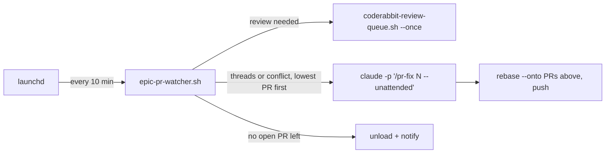

# Watch Epic

The watching is **not** done by this session. A launchd job runs
`scripts/epic-pr-watcher.sh <n>` every 10 minutes; it reads everything from
GitHub, so closing this session, rebooting or missing a tick loses nothing.

## Start: `/watch-epic <n>`

1. Confirm the epic has open PRs: `gh pr list --state open --json headRefName | jq -r '.[].headRefName' | grep "^epic/<n>/"`. None → tell the user and stop.
2. Write `~/Library/LaunchAgents/com.biddaloy.epic-watch.<n>.plist`: `ProgramArguments` = `/bin/bash -lc 'cd <repo root> && scripts/epic-pr-watcher.sh <n>'`, `StartInterval` 600, `RunAtLoad` true, `StandardOutPath`/`StandardErrorPath` = `~/.claude/epic-watch/<n>.log`, and `EnvironmentVariables.PATH` containing the dirs of `gh`, `jq`, `claude`, `node` (`which` each).
   Use the **main checkout** path as repo root, not a worktree.
3. `launchctl bootstrap gui/$(id -u) <plist>`, then `launchctl kickstart gui/$(id -u)/com.biddaloy.epic-watch.<n>` for an immediate tick.
4. Tell the user: the PRs it sees, that the Mac must stay powered/awake (lid open or on power), and where the log is. Do not wait or poll — you are done.

## `/watch-epic <n> stop`
`launchctl bootout gui/$(id -u)/com.biddaloy.epic-watch.<n>` and delete the plist.

## `/watch-epic status`
`launchctl list | grep epic-watch`, `tail -20 ~/.claude/epic-watch/*.log`, and
`gh pr list --label needs-human` (PRs the watcher gave up on).

## Rules
- A PR labelled `needs-human` blocks itself and every PR above it. Fix by hand, remove the label, the watcher resumes.
- It only fixes review threads and conflicts, never CI-only failures.
- `--dry-run` (`scripts/epic-pr-watcher.sh <n> --dry-run`) prints what it would do without commenting, spawning or pushing.
