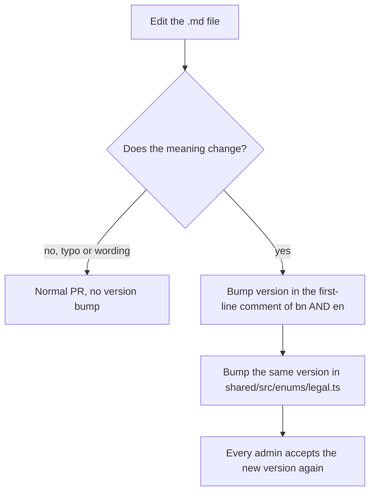

# Legal texts

Terms, Privacy, Data agreement (dpa) and Service agreement (sla), in Bangla (`bn/`) and English (`en/`). The text is Markdown; the sign-up dialog renders it.

## Change a text

Example: the first line `<!-- version: 1.0 -->` becomes `<!-- version: 1.1 -->`, and the matching `LEGAL_DOCS` entry becomes `1.1`. A test checks they match.

## Rules

- Markdown subset only: `#` / `##` headings, paragraphs, numbered and bullet lists, `**bold**`. No HTML, links or tables.
- Promise only what is true today. No timed deletion. No price figure (the Terms point to the price list).
- Plain words, short sentences. Bangla first; English says the same.
- Which language wins in a dispute is a question for the lawyer (#1781), not decided here.

## Placeholders the owner must fill before launch (D42)

No release to a paying school while any `[bracket]` is left.

| Placeholder (bn / en) | Where | Meaning |
| --- | --- | --- |
| `[তারিখ]` / `[date]` | all 8 files | Effective date |
| `[কোম্পানির নাম]` / `[company name]` | terms, dpa | Legal name of the operator |
| `[ঠিকানা]` / `[address]` | terms | Operator address |
| `[ইমেইল]` / `[email]` | terms, privacy, dpa, sla | Contact email |
| `[ফোন]` / `[phone]` | terms, dpa, sla | Contact phone |
| `[ঢাকার]` / `[Dhaka]` | terms | Court city for disputes |
| `[দেশ / প্রতিষ্ঠান]` / `[country / provider]` | privacy | Where data is hosted (#1782) |
| `[৭২ ঘণ্টার]` / `[72 hours]` | privacy, dpa | Breach notice time |
| `[৯৯.৫ %]` / `[99.5 %]` | sla | Monthly uptime target |
| `[সময়]` / `[hours]`, `[time]` | sla | Support hours, first response time |
| `[ক্রেডিট]` / `[credit]` | sla | Credit if the target is missed |
