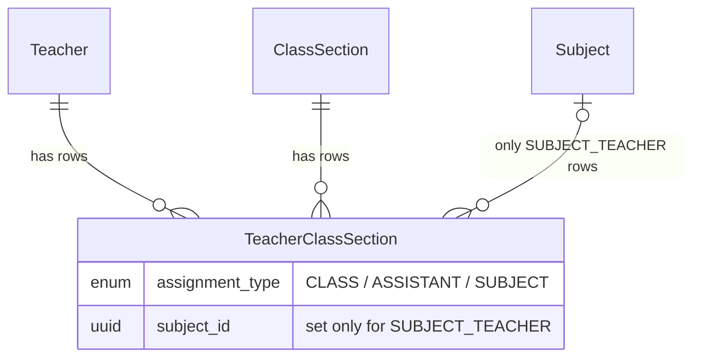
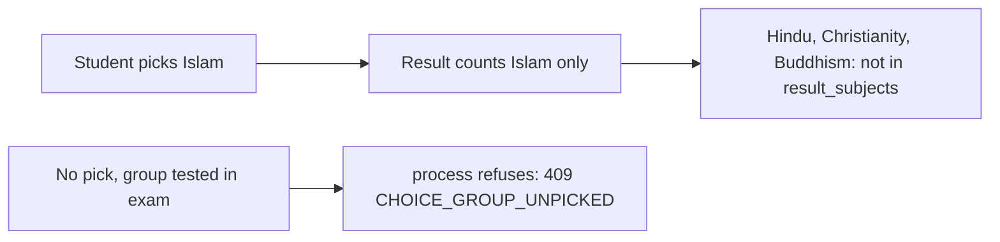
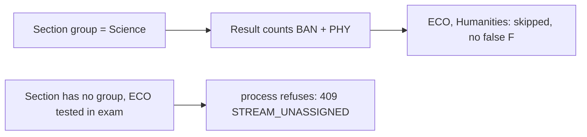
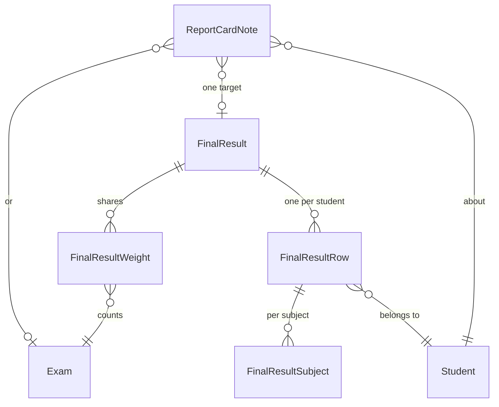
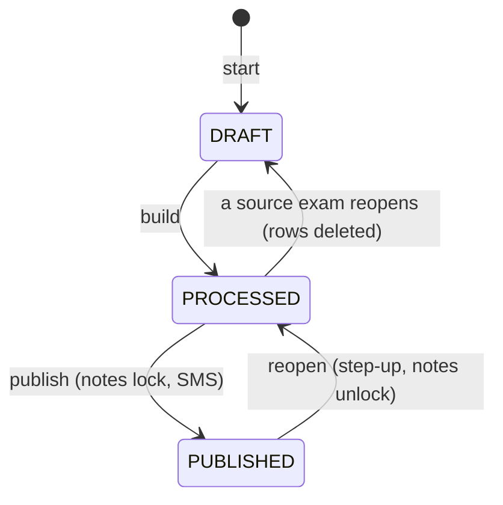
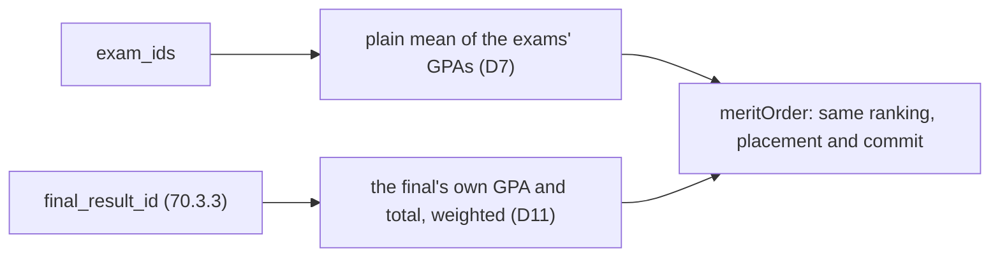
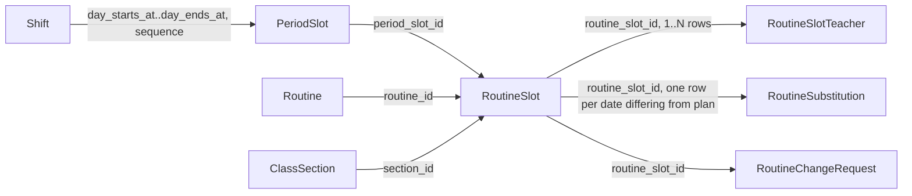

# Domain Model

All entities live under `server/src/modules/*/entities/`. Every entity file
has a detailed docstring explaining its relations and any non-obvious
rationale — treat that docstring as the primary source of truth; this doc is
a map to help you find the right one.

## Entity-relationship diagram

```mermaid
erDiagram
    School ||--o{ UserTenant : "has members"
    User ||--o{ UserTenant : "has memberships"
    School ||--o{ AcademicYear : scopes
    School ||--o{ Class : scopes
    School ||--o{ Teacher : scopes
    School ||--o{ Student : scopes
    School ||--o{ Guardian : scopes
    School ||--o{ FeeStructure : scopes
    School ||--o{ Payment : scopes
    School ||--o{ CommunicationLog : scopes
    School ||--o{ ReminderBatch : scopes
    School ||--o{ AttendanceSession : scopes
    School ||--o{ AttendanceDevice : scopes
    School ||--o{ CalendarEvent : scopes
    School ||--o{ AcademicTerm : scopes
    School ||--o{ CalendarFeedToken : scopes

    AcademicYear ||--o{ Class : contains
    AcademicYear ||--o{ FeeStructure : "fees for"
    AcademicYear ||--o{ StudentFee : "generated within"
    Class ||--o{ ClassSection : "divided into"
    ClassSection }o--o{ Teacher : "assigned (teacher_class_sections)"

    Student }o--|| ClassSection : "enrolled in"
    Student ||--o{ Enrollment : "history"
    Student }o--o{ Guardian : "linked (student_guardians)"
    User ||--o{ Teacher : "profile, one per branch"
    User ||--o{ Guardian : "profile, one per branch"
    User ||--o{ Student : "profile, one per branch"

    FeeStructure ||--o{ FeeStructureStudent : "selected students"
    FeeStructure ||--o{ StudentFee : generates
    FeeStructure ||--o{ FineRule : "fine category for"
    AcademicYear ||--o{ FineRule : "rules for"
    Class ||--o{ FineRule : "class-scoped (optional; null = school default)"
    FineRule ||--o{ StudentFee : "fines (via fine_rule_id, nullable)"
    Student ||--o{ StudentFee : owes
    StudentFee ||--o{ PaymentAllocation : "paid via"
    Payment ||--o{ PaymentAllocation : "splits into"
    Student ||--o{ Payment : pays
    User ||--o{ Payment : "recorded by"
    Payment ||--o| Invoice : generates
    StudentFee ||--o| Invoice : "referenced by"
    User ||--o{ Invoice : "issued by"

    Student ||--o{ CommunicationLog : about
    Guardian ||--o{ CommunicationLog : recipient
    ReminderBatch ||--o{ CommunicationLog : produces

    User ||--o{ AuditLog : "performed by"
    User ||--o{ RefreshToken : owns
    ClassSection ||--o{ AttendanceSession : "registers for"
    AttendanceSession ||--o{ AttendanceRecord : "marks students in"
    Student ||--o{ AttendanceRecord : "marked in"
    AttendanceDevice ||--o{ AttendanceRecord : "produced"
    AttendanceDevice ||--o{ AttendanceDeviceEvent : "sent"
    AcademicYear ||--o{ CalendarEvent : "calendar for"
    AcademicYear ||--o{ AcademicTerm : "split into"
    CalendarEvent ||--o{ CalendarEventClass : "scoped to (empty = all classes)"
    Class ||--o{ CalendarEventClass : "scoped by"
    User ||--o{ CalendarFeedToken : "subscribes via"

    AcademicYear ||--o{ GradingScale : "graded under"
    Class ||--o{ GradingScale : "overridden by"
    GradingScale ||--o{ GradingBand : "made of"
    Class ||--o| Shift : "shift_id (promoted from classes.shift)"
    Shift ||--o{ PeriodSlot : "lays out"
    AcademicYear ||--o| Routine : "one timetable per year"
    Routine ||--o{ RoutineSlot : "scheduled classes"
    ClassSection ||--o{ RoutineSlot : "taught in"
    PeriodSlot ||--o{ RoutineSlot : "fills grid cell"
    RoutineSlot ||--o{ RoutineSlotTeacher : "covered by"
    Teacher ||--o{ RoutineSlotTeacher : covers
    RoutineSlot ||--o{ RoutineSubstitution : "dated override"
    Teacher ||--o{ RoutineSubstitution : substitutes
    RoutineSlot ||--o{ RoutineChangeRequest : "requested change"
    Room ||--o{ RoutineSlot : "fixed room (optional)"

    AcademicYear ||--o{ Exam : "held in"
    Class ||--o{ Exam : "sits"
    Exam ||--o{ ExamComponent : "made of"
    Subject ||--o{ ExamComponent : measures
    Exam ||--o{ MarkGrid : "entry grid per"
    ClassSection ||--o{ MarkGrid : "graded by"
    Subject ||--o{ MarkGrid : "graded in"
    Exam ||--o{ Mark : "marks for"
    Student ||--o{ Mark : "marked in"
    ExamComponent ||--o{ Mark : "values for"
    Exam ||--o{ Result : "computed result per"
    Student ||--o{ Result : "has a"
    GradingScale ||--o{ Result : "pinned against"
    Result ||--o{ ResultSubject : "breaks down into"
    ClassSection ||--o{ Result : "sat in (section_id/section_position, D17)"
    Subject ||--o{ ResultSubject : "line for"
    Student ||--o{ StudentSubjectChoice : "picks a"
    ClassSubject ||--o{ StudentSubjectChoice : "chosen offering"
    Class ||--o{ ClassSubject : offers
    Subject ||--o{ ClassSubject : "offered as"
    ClassSubject {
        string group_name "stream (Science, ...); NULL = every student"
        string choice_group "pick-one set (Religion, ...); NULL = none"
    }
    StudentSubjectChoice {
        string choice_group "copied from the class subject by a trigger"
    }

    School ||--o{ ExamTemplate : scopes
    ExamTemplate ||--o{ ExamTemplateComponent : "made of"

    Class ||--o{ PromotionRun : "source class of"
    School ||--o{ PromotionRun : scopes
    PromotionRun ||--o{ PromotionEntry : "one row per student"
    Student ||--o{ PromotionEntry : "decided for"
    Enrollment ||--o{ PromotionEntry : "carried forward from (source_enrollment_id)"
    Enrollment ||--o| PromotionEntry : "creates on commit (target_enrollment_id)"

    School ||--o{ Program : scopes
    Program ||--o{ ProgramMilestone : "ordered list"
    Program ||--o{ ProgramEnrollment : "students in"
    Student ||--o{ ProgramEnrollment : "enrolled in"
    ProgramEnrollment ||--o{ MilestoneAchievement : "ticks off"
    ProgramMilestone ||--o{ MilestoneAchievement : "achieved via"

    AcrFormVersion ||--o{ AcrCriterion : "criteria of"
    AcrFormVersion ||--o{ AcrAssessment : "form used by"
    User ||--o{ AcrAssessment : "subject of"
    AcademicYear ||--o{ AcrAssessment : "one per user per year"
    AcrAssessment ||--o{ AcrScore : "scored by"
    AcrCriterion ||--o{ AcrScore : scores
    User ||--o{ StaffIncident : "reported about"
    Survey ||--o{ SurveyQuestion : asks
    Survey ||--o{ SurveyTarget : "rates teacher+subject"
    Survey ||--o{ SurveyResponse : "answered by"
    SurveyResponse ||--o{ SurveyAnswer : holds
    SurveyQuestion ||--o{ SurveyAnswer : "answer to"
```

_(This shows the shape of the graph, not every column — see each entity file
for full field lists.)_

## Entities by domain area

### Tenancy & identity (`modules/schools`, `modules/users`, `modules/auth`)

- **`School`** — a tenant. Every school-scoped table has a `tenant_id` (or
  goes through a relation that resolves to one). See
  [02-auth-and-multitenancy.md](02-auth-and-multitenancy.md).
  `settings.preset` (`{ id, version, appliedAt, appliedByUserId }`) records
  which curriculum pack the school applied; only apply and reset write it. See
  [20-presets.md](20-presets.md).
- **`User`** — one account per person, **not** scoped to a single school.
  Holds login credentials (`password_hash`, nullable for guardians/students
  who never log in) and profile basics.
- **`UserTenant`** — junction table: `(user, school, role)`. This is where
  RBAC roles actually live, _not_ on `User` — a person can be `TEACHER` at
  School A and `PARENT` at School B simultaneously.

### Academics (`modules/academics`)

- **`AcademicYear`** — a school's calendar period (e.g. "2026-2027"),
  school-scoped. Only one can be `is_current` per school. Everything
  fee-related is ultimately scoped to one of these.
- **`Class`** — a grade/standard (e.g. "Class 10"), unique per
  academic-year + school + `shift` + `version`. `shift` (e.g. "Morning" vs
  "Day") and `version` (e.g. "Bangla" vs "English") are free-text values a
  school configures for itself in Settings → Organisation
  (`TenantSettings.organisation.{shifts,versions}`) — a school that doesn't
  use either dimension just leaves every class's `shift`/`version` `NULL`.
  `NULL` is treated as one specific, real value here, not a wildcard: two
  `Class 6` rows with `shift: NULL` **collide**, exactly like two `Class 6`
  rows both with `shift: 'Morning'` would — so a school that never sets a
  shift still only ever gets one `Class 6` per year, not an unlimited
  number of them. `Class 6` with `shift: NULL` and a separate `Class 6`
  with `shift: 'Morning'` _do_ stay distinct. Postgres's own default
  (`NULLS DISTINCT`) would let any number of `NULL`-shift `Class 6` rows
  through silently — the unique index is declared `NULLS NOT DISTINCT`
  specifically to close that gap (`1789800010700-AddOrganisationDimensions.ts`).
  **Branches are a separate concern**: a school with multiple physical
  branches models each branch as its own tenant (`School` row) with its own
  EIIN, not as a shift/version value (Epic 33 decision D1).
- **`ClassSection`** — a division within a class (e.g. "Section A"), with an
  optional `group` (e.g. "Science" vs "Commerce") drawn from the same
  tenant vocabulary (`organisation.groups`). Unlike shift/version, `group`
  is **not** part of what makes a section unique — two sections named "A"
  in the same class always collide regardless of group.
- **`ClassSubject`** — "this subject is taught in this class in this year".
  `is_optional` marks the 4th subject. `group_name` (e.g. "Science") limits it
  to students in a section of the same group; `NULL` means everyone.
  `choice_group` (e.g. "Religion") puts it in a _pick one_ set. A choice-group
  row is never optional and never has a `group_name` (database CHECK). See
  [20-presets.md](20-presets.md#6-choice-groups-exactly-one-of).
- **`Teacher`** — a staff profile layered on top of a `User`. Can hold
  multiple designations and be assigned to multiple sections via
  **`TeacherClassSection`** (see [Teacher assignments](#teacher-assignments-teacher_class_sections)).
  `teacher.designations` (e.g. `CLASS_TEACHER`) is an **HR label only**. It
  never decides who the class teacher is. The assignment row does.

#### Teacher assignments (`teacher_class_sections`)

A teacher is linked to a section by a row in `teacher_class_sections`
(short name: tcs). Each row has an `assignment_type` (Epic 47.0). It is the
only source of "who is the class teacher". The old rule "`subject_id IS NULL`
means class teacher" is gone.

| `assignment_type`         | Per section             | `subject_id` | Meaning                                       |
| ------------------------- | ----------------------- | ------------ | --------------------------------------------- |
| `CLASS_TEACHER`           | 0 or 1                  | none         | The one accountable teacher (form master).    |
| `ASSISTANT_CLASS_TEACHER` | many                    | none         | Helps. Same read access as the class teacher. |
| `SUBJECT_TEACHER`         | one per teacher+subject | required     | Owns one subject in the section.              |

Example: Rahim is `CLASS_TEACHER` of 7-A **and** `SUBJECT_TEACHER` (Maths)
of 7-A. That is two rows. Karim is `ASSISTANT_CLASS_TEACHER` of 7-A.



The database enforces these rules, not just the service code:

| Rule                                                          | Enforced by                                             |
| ------------------------------------------------------------- | ------------------------------------------------------- |
| `subject_id` is set **if and only if** `SUBJECT_TEACHER`      | check constraint `CK_tcs_subject_matches_type`          |
| One `CLASS_TEACHER` per section                               | partial unique index `UQ_tcs_section_class_teacher`     |
| One CLASS or ASSISTANT row per teacher per section (homeroom) | partial unique index `UQ_tcs_teacher_section_homeroom`  |
| One subject row per teacher, section and subject              | existing unique index `IDX_tcs_teacher_section_subject` |

Because of the check constraint, `subject_id IS NULL` now means exactly
"CLASS or ASSISTANT". Older code that tests `subject_id IS NULL` (homework,
routines) therefore covers assistants too, with no change.

How the type gets set:

- **API / UI:** `assignment_type` is optional. If omitted it is inferred:
  `SUBJECT_TEACHER` when `subject_id` is given, else `CLASS_TEACHER`.
  `ASSISTANT_CLASS_TEACHER` must always be sent explicitly.
- **Raw SQL inserts** (seed, old e2e specs): a `BEFORE INSERT` trigger
  (`TRG_tcs_default_assignment_type`) applies the same inference.
- **Assigning a new `CLASS_TEACHER`** replaces the old one in one
  transaction (both changes are audited). The UI warns first
  ("<name> will be replaced"). If the same teacher was the section's
  assistant, that assistant row goes too (promotion).
- **Assigning an `ASSISTANT_CLASS_TEACHER`** to a teacher who already holds a
  CLASS or ASSISTANT row in that section returns `409`
  (`details.code = TEACHER_ALREADY_HOMEROOM`). A race on any of the unique
  indexes also returns `409` (`TEACHER_ASSIGNMENT_CONFLICT`), never `500`.
- **Hard-deleting a subject** that has a SUBJECT_TEACHER row is blocked by
  the check constraint (the foreign key would otherwise turn the subject
  teacher into a class teacher). Subjects are soft-deleted, so this does not
  come up in normal use.
- **Migration:** `1791300000000-TeacherAssignmentType.ts` backfills old rows
  (`subject_id IS NULL` → `CLASS_TEACHER`, else `SUBJECT_TEACHER`). Its
  `down()` refuses to run while any `ASSISTANT_CLASS_TEACHER` row exists,
  because the old schema cannot represent it.

Who reads what, including the marks read/write rules, is covered in
[03-backend-modules.md](03-backend-modules.md) (`TeacherScopeService`) and [11-attendance.md](11-attendance.md) (streaks).

#### Coordinators (`coordinator_assignments`, Epic 83)

A **coordinator** is a teacher who oversees other teachers' work in some classes.
It is an assignment on a teacher, not a role (D1). One row says "this teacher
coordinates this class", optionally "for this subject only".

| Row                      | Name in the app     | Reads (never writes)                                                                                     |
| ------------------------ | ------------------- | -------------------------------------------------------------------------------------------------------- |
| `subject_id` NULL        | Class coordinator   | Students, attendance, every subject's marks, homework rollups, study plans of every section of the class |
| `subject_id` = a subject | Subject coordinator | The same students and attendance, but marks and study plans of that subject only                         |

Example: Rahim is class coordinator of Class 6, 7 and 8 (three rows, subject
NULL). Karim is Mathematics subject coordinator of Class 9 and 10 (two rows).

```mermaid
erDiagram
    Teacher ||--o{ CoordinatorAssignment : "coordinates"
    Class ||--o{ CoordinatorAssignment : "is coordinated"
    Subject |o--o{ CoordinatorAssignment : "only subject coordinators"
    User |o--o{ CoordinatorAssignment : "assigned_by"
    CoordinatorAssignment {
        uuid class_id "class level, no section"
        uuid subject_id "NULL = whole class"
        uuid assigned_by_user_id "SET NULL when the user goes"
        timestamptz created_at
    }
```

Why it is its own table and not a fourth `assignment_type` (D2): the teacher
scope treats every non-subject tcs row as homeroom, and homeroom reads **and
writes** every subject. A coordinator must only read. So coordinator rows live
apart and count only where a read path asks for them (`includeCoordinated`, see
[02-auth-and-multitenancy.md](02-auth-and-multitenancy.md)).

| Rule                                                        | Enforced by                                                      |
| ----------------------------------------------------------- | ---------------------------------------------------------------- |
| One row per (tenant, teacher, class, subject), NULLs equal  | `UQ_coordinator_assignment ... NULLS NOT DISTINCT` (D11)         |
| Class level only; the class's year is the row's year (D3)   | no `section_id`; scope SQL joins the current academic year (D14) |
| Deleting a teacher, class or subject deletes its rows (D15) | FKs `ON DELETE CASCADE`; not in the delete-guard registry        |
| A school's rows only                                        | every query filters `tenant_id`; cross-tenant ids are 404        |

`TeacherDesignation.COORDINATOR` stays an HR label (D16); it grants nothing.

**Learning (2026-10-31, 83.1).**

- Surprise: TypeORM's `@Index` cannot express `NULLS NOT DISTINCT`, so the unique index lives in the migration only.
  Cost: one schema-drift baseline line. Fix: the entity comment names the migration. Rule candidate: none (known pattern).
- Surprise: FK and PK names written by hand drift from TypeORM's hashed names. Fix: the migration uses the hashed
  names (`sha1('<table>_<column>')`), so only the NULLS NOT DISTINCT index is baselined.

### Grading (`modules/grading`)

- **`GradingScale`** — a set of percent-to-grade bands for one
  `AcademicYear`. `class_id` null means "this year's default scale"; a
  non-null `class_id` overrides the default for that one class (e.g. a
  vocational track grading itself pass/fail while the rest of the year
  uses the default GPA scale). Only one default scale may exist per
  (tenant, academic year).

  `revision` bumps whenever a scale's bands change after results have
  already been computed against it, so a past result stays readable
  against the band set that actually produced it (a later epic wires
  results to read it back). A workbook restore always writes
  the backed-up `revision` value, never the entity's own `default: 1`, so
  restoring a scale that had already been revised does not quietly roll
  it back to looking untouched.

- **`GradingBand`** — one percent range within a scale, e.g. "80-100% →
  A+, GPA 5.0". `gpa` is nullable: a scale that only ever grades with
  letters (no numeric GPA) leaves it `null` on every band, not `0.00`.

```
GradingScale (2026-2027, class: null)         "the year's default"
├── GradingBand  80-100  A+  gpa 5.00
├── GradingBand  70-79   A   gpa 4.00
└── GradingBand   0-69   F   gpa null   (D4: fail band, not a zero GPA)

GradingScale (2026-2027, class: "Class 9-Vocational")   "an override"
├── GradingBand  50-100  PASS  gpa null
└── GradingBand   0-49   FAIL  gpa null   is_fail: true
```

- **`ClassSubject.is_graded_only`** — marks a subject (e.g. "Physical
  Education") that only ever gets a pass/fail-style grade and is excluded
  from GPA computation, even though it still sits under the same
  `GradingScale` as every other subject in the class.

Result composition — turning a set of subject marks into one grade per
subject and one GPA for the term — is **out of scope for this epic
(20.x)**. This doc covers only the scale/band data model and its
backup/restore path; the composition rules land in a later epic.

### Exams, marks & results (`modules/exams`) — Epic 19.0

```
Exam (First Term Exam, Class 6, 2026-2027)   status: DRAFT -> PROCESSED -> PUBLISHED
├── ExamComponent  Math / Written    full_marks 100   source: MANUAL
├── ExamComponent  Math / Attendance full_marks 10    source: DERIVED  (D11, read-only)
├── ExamComponent  English / Written full_marks 100   source: MANUAL
│
├── MarkGrid  Section A × Math      state: SUBMITTED
├── MarkGrid  Section B × Math      state: DRAFT        ← progress screen shows this
│
├── Mark  student=Karim  component=Math/Written    value 78.50  status PRESENT
├── Mark  student=Rahim  component=Math/Written    value null   status ABSENT   (D10)
│
└── Result  student=Karim   total 167.00  grade A  ── pinned: grading_scale_id, grading_scale_revision, rule_version
    └── ResultSubject  Math      obtained 89.00  grade A
    └── ResultSubject  English   obtained 78.00  grade A
```

- **`Exam`** — one sitting (e.g. "First Term Exam") for one `Class` in one
  `AcademicYear`. `kind` (TERM/MONTHLY/MODEL/OTHER) is a label only, no
  behaviour keys off it. `status` is the D12 lifecycle: `DRAFT` (marks being
  entered) → `PROCESSED` (results computed) → `PUBLISHED` (visible to
  guardians in the portal).
- **`ExamComponent`** — one markable part of one exam-subject, e.g. "Written"
  and "MCQ" for Math. `full_marks`/`pass_marks` are per component; a
  subject's total is the sum of its components. `source` distinguishes
  `MANUAL` (typed on the marks grid) from `DERIVED` (computed server-side —
  currently only `ATTENDANCE`, D11 — never accepts direct grid entry).
- **`ExamTemplate`** / **`ExamTemplateComponent`** — a reusable set of
  components (name, kind, full and pass marks) per class grade and subject
  code. Keyed by `class_grade` and `subject_code`, not ids, so one template
  works every year. Creating an exam from a template copies the rows onto the
  exam as `ExamComponent`s; later template edits never change that exam.
  Curriculum packs ship them. Template names are unique per school.
- **`MarkGrid`** — one section-subject's entry state for one exam (D12):
  `DRAFT` is editable, `SUBMITTED` locks it. One row per (exam, section,
  subject).
- **`Mark`** — one student's value for one component. **D10**: `value` is
  `NULL` whenever `status` isn't `PRESENT`, enforced by a database CHECK
  constraint — an `ABSENT` mark can never be misread as a zero, on the grid
  or after a workbook restore.
- **`Result`** — one student's computed outcome for an exam: total marks,
  GPA, grade, class position, pass/fail. **D19**: pins
  `grading_scale_id` + `grading_scale_revision` + `rule_version` at the
  moment it's computed — the same "snapshot, don't re-derive" pattern
  `Invoice.snapshot` uses for money. A later edit to the grading scale
  (Epic 20.0 D6 makes scales editable) bumps the scale's own `revision` and
  triggers a recompute of dependent results; comparing an old result's
  `grading_scale_revision` against the scale's current `revision` is how a
  caller notices a printed card has gone stale.
- **`ResultSubject`** — one subject's line within a `Result` — what a report
  card actually prints. `is_fourth_subject` records whether this line
  counted as the student's chosen fourth/optional subject for this result.
- **`StudentSubjectChoice`** — a student's fourth/optional subject pick
  (D14), per student rather than per class, since two students in the same
  class can pick different fourth subjects. `academic_year_id` is
  denormalised from the chosen `ClassSubject` so "one `is_fourth` choice per
  student per year" can be enforced by a database index. It also has a
  `choice_group` column, owned by a database trigger (copied from the chosen
  `ClassSubject`, never written by code), so a pick cannot disagree with its
  subject.

**Subject choice groups (D44).** Some classes offer a _pick one_ slot: in NCTB
Class 5 every student takes Religion, but Islam, Hindu, Christianity and
Buddhism are separate subjects and each student takes exactly one. Those
subjects share a `class_subjects.choice_group` (e.g. `Religion`), and the
student's pick is a `StudentSubjectChoice` row.



- Only the picked member counts toward total, GPA, grade and pass/fail. The
  non-takers' `ABSENT` cells are never read, so they cannot cause a false `F`.
- A student with no pick in a group that has components in this exam blocks
  `process()` with a 409 whose `details` carry `code: CHOICE_GROUP_UNPICKED`,
  `total`, and the first 50 students by name and roll number. `force` does
  **not** bypass it.
- Recompute after a mark edit never throws; it leaves the unpicked group out
  until a pick is made and the exam is processed again.

**Composing exams:** one exam never reads another. Averaging or weighting
several exams into a term or annual outcome lives in its own entities, see
[Final results and report-card notes](#final-results-and-report-card-notes-modulesfinal-results--epic-70)
(Epic 70; this epic stayed single-exam, decision D3).

**D17 — the exam cohort comes from `Enrollment`, not `Student.class_section`.**
`ResultsService.computeAll`, `MarkGridService`'s roster, and the marks IDOR
guard all resolve "who sits this exam" by querying the student's **ACTIVE
`Enrollment`** row for the exam's `(academic_year, class)`, not the
student's live `class_section` pointer. This matters once a student has
moved sections mid-year, or a promotion run has advanced them into next
year's class: an exam processed for last year's class still finds exactly
the roster that actually sat it, because `Enrollment` is the historical
record and `Student.class_section` only ever reflects _today_.

`Result.section_id` / `Result.section_position` (added alongside D17) pin
which section a student actually sat the exam in and their merit rank
within that `(exam, section)` pair — computed once, at process time, so it
stays correct even if the student is later moved or promoted out of that
section.

**Stream (group) subjects (D49).** In NCTB classes 9-10 a student takes the
subjects of one stream (Science, Humanities, Business). A subject with
`class_subjects.group_name` set counts only for students whose **section**
has the same `class_sections.group_name`. Subjects with no `group_name` count
for everyone.



Example, class 10: BAN (no group), PHY (`Science`), ECO (`Humanities`). A
Science-section student with marks only for BAN and PHY is processed normally;
ECO never appears in their `result_subjects`. A student in a section with no
group blocks `process()` with a 409 whose `details` carry
`code: STREAM_UNASSIGNED`, `total` and the first 50 students (`force` does
**not** bypass it). The block only applies while a group-only subject has
components in the exam. A student whose stream matches no examined subject
gets no stream subjects; if nothing at all is countable the grade is `-`, not `F`.

**Learnings, Epic 70 wave 1** (surprise, cost, fix, rule candidate):

- 2026-11-02. `effectiveShares` fell back to equal shares when the subject sat in
  no weighted exam. Cost: a misconfigured final graded silently. Fix: it throws
  `SharesNotHundred` like any other bad total. Rule: a missing config is an error,
  never a default.
- 2026-11-02. `working_days` / `present_days` shipped without CHECKs, so
  `present > working` was storable. Cost: caught only in review. Fix: CHECK
  `CHK_final_result_rows_days` (edited in the unshipped migration). Rule: every
  paired numeric column gets its relation as a CHECK in the same migration.
- 2026-11-02. The shared type `FinalResultWeight` had the same name as the entity.
  Cost: ambiguous imports. Fix: shared types end in `Dto`. Rule: a shared type
  never reuses an entity's name.

### Final results and report-card notes (`modules/final-results`) — Epic 70

A final result combines several PUBLISHED exams of one class and year into one
outcome per student. Teacher remarks and conduct grades live in a note row.



| Table                   | Holds                                                                                                  |
| ----------------------- | ------------------------------------------------------------------------------------------------------ |
| `final_results`         | One live row per (class, year): status DRAFT, PROCESSED, PUBLISHED; mode WEIGHTED or BEST_OF; rounding |
| `final_result_weights`  | Share per exam, optionally per subject (`subject_id` null = whole exam); 0-100                         |
| `final_result_rows`     | A student's total, GPA, grade, positions, pinned grading scale, attendance days                        |
| `final_result_subjects` | The combined mark per subject for that row                                                             |
| `report_card_notes`     | Remark and conduct grades; exactly one of `exam_id` / `final_result_id`                                |

Example: Class 8, 2026. Half-Yearly counts 30 and Annual counts 70. Rahim gets
60% and 90%, so his combined percent is 0.3 x 60 + 0.7 x 90 = 81. Math is a
100-mark subject in both, so the card prints 81. Shares for a subject must add
to exactly 100 (hundredths, no tolerance); an exam without the subject drops out
and the rest renormalise. If every share left is 0 the final refuses to compute.

Life cycle, and what each step does to notes and source exams (D24, D28):



A PUBLISHED final also refuses to let a source exam reopen (409 `EXAM_IN_PUBLISHED_FINAL`).
Epic 69 (year rollover, #2202) must treat all five tables as year data: the year-close guard covers them.

Learnings, Epic 70 waves 2-6 (surprise, cost, fix, rule candidate):

- 2026-11-02. Notes were checked for the publish lock before the transaction, so a
  publish racing a save could slip a write in. Cost: a locked card could change.
  Fix: check under the row lock. Rule: a lock check lives inside the transaction it guards.
- 2026-11-02. `GET /exams` joined `class` but not `academic_year`, which its type lists;
  mocks hid it. Cost: the My class notes link broke on real data. Fix: join it.
  Rule: a list route returns every relation its type declares.
- 2026-11-02. The demo seed published a past final before saving its notes. Cost: 409
  `REPORT_CARD_NOTES_LOCKED` in seeding. Fix: save notes between `build` and `publish`.
  Rule: seed in the order the lock allows.
- 2026-11-03. Workbook restore of `final_result_rows` could change published numbers.
  Cost: a restore could rewrite a card. Fix: restore adds rows, never changes them
  (#3422). Rule: derived result rows are add-only on restore.

DB guards: two `NULLS NOT DISTINCT` uniques (weights, notes), CHECK share range,
CHECK `CHK_final_result_rows_days` (days not negative, present at most working,
null-safe), CHECK one note target. Weights pin their exam (FK NO ACTION).

### Promotions (`modules/promotions`) — Epic 26.6–26.8

```
PromotionRun (Class 6 -> Class 7, 2026-2027)   status: DRAFT -> COMMITTED
├── algorithm: BLOCK | SNAKE                    (how next-year sections are filled)
├── exam_ids: [First Term, Second Term]         (which published exams feed the mean GPA)
│
├── PromotionEntry  student=Karim
│   ├── suggested_outcome: PROMOTE   final_outcome: PROMOTE   is_override: false
│   └── target_section_id, new_roll_number   (set once placement runs)
└── PromotionEntry  student=Rahim
    ├── suggested_outcome: PROMOTE   final_outcome: RETAIN   is_override: true
    └── override_note: "Repeating — attendance"   (required by a DB CHECK when is_override)
```

- **`PromotionRun`** — one end-of-year promotion attempt for a source
  `Class`: which published exams feed the decision (a plain mean across
  them — see the composition caveat below), which placement algorithm
  (`BLOCK` fills sections in merit-rank blocks, `SNAKE` interleaves them for
  even ability spread) assigns next-year sections, and whether it's been
  committed. `DRAFT` runs are freely re-runnable and re-computable;
  `COMMITTED` is final. `target_class_id: null` means this run **graduates**
  the whole class out of the school rather than promoting it. Hard-deleted
  (no `deleted_at`) when discarded — a draft carries no history worth
  keeping.
- **`PromotionEntry`** — one student's decision within a run: merit stats
  (`mean_gpa`, `total_marks_sum`), the algorithm's `suggested_outcome`, and
  the possibly human-`override`n `final_outcome` actually applied on
  commit. `is_override: true` requires a non-blank `override_note`,
  enforced by a DB CHECK, not just app validation. `source_enrollment_id`
  points at the `Enrollment` row (D17) this entry was computed from;
  `target_enrollment_id` is filled in on commit once placement has created
  the student's next-year `Enrollment`.

**Composition caveat, stated plainly:** a promotion run's merit source is one of two
things, never both:



- With `exam_ids`, `mean_gpa` is still a **plain mean** — no per-exam weights.
- With `final_result_id`, the run reads the weighted `gpa`, `total_marks` and `is_fail`
  straight from `final_result_rows`. The final must be `PUBLISHED`, belong to the source
  class and its year; otherwise create answers 422. `exam_ids` is `[]` then
  (`CHK_promotion_runs_one_merit_source`). Commit refuses (409 `STALE_RESULTS`) if the
  final was recomputed after the last refresh (a cohort row written or soft-deleted since).
  A student with no row (joined after the build) ranks last with outcome RETAIN; that alone is
  not stale.

### Calendar (`modules/calendar`) — see [16-academic-calendar.md](16-academic-calendar.md) for the full model

- **`CalendarEvent`** — see under Attendance below; the one calendar table
  every other module reads.
- **`AcademicTerm`** — a term/semester/trimester within an `AcademicYear`;
  ordered by `seq`, never overlaps another term in the same year.
- **`CalendarEventClass`** — join table scoping a `CalendarEvent` to
  specific `Class`es; no rows means "every class."
- **`CalendarFeedToken`** — a revocable per-user token that turns into a
  subscribable ICS feed URL.
- **`PublicHolidaySet`** (platform-level, no `tenant_id`) — one country's
  fetched public holidays for one year, shared across every tenant in that
  country.

### Students & guardians (`modules/students`)

- **`Student`** — belongs to one `ClassSection` at a time; optionally has a
  `User` for self-service login. Has a unique `registration_number` and a
  `roll_number` unique within its section.
- **`Guardian`** — a parent, optionally with a `User` login. Many-to-many
  with `Student` (siblings share guardians; a student can have two
  guardians) via the `student_guardians` pivot.
- **`Enrollment`** — historical record of which class/section a student was
  in during a given academic year. The _current_ enrollment is the most
  recent `ACTIVE` row — `Student.class_section` is the fast-path pointer,
  `Enrollment` is the audit trail.

### Programs & milestones (`modules/programs`) — see [32-programs.md](32-programs.md) for the full model

- **`Program`** — a tenant-wide track (hifz, a vocational trade, a club) with
  no `academic_year_id` — it can span years. `show_on_report_card` opts it
  into a Programs block on the report card.
- **`ProgramMilestone`** — an ordered step within one `Program` (e.g. "Juz
  1" for a hifz program). Deleting a milestone cascades its achievements.
- **`ProgramEnrollment`** — a student's enrollment in a `Program`, separate
  from their class `Enrollment`. At most one `ACTIVE` row per
  (program, student).
- **`MilestoneAchievement`** — records that one enrollment reached one
  milestone, with an optional date/score/grade/remark.

### Fees, payments, invoices (`modules/fees`, `modules/invoices`) — see [04-fees-payments-invoices.md](04-fees-payments-invoices.md) for the full lifecycle

- **`FeeStructure`** — the _template_: "this fee applies to Class 10 / all
  students (or a selected subset) / this academic year / this month, and
  recurs monthly or not."
- **`FeeStructureStudent`** — pivot recording exactly which students a
  `SELECTED`-applicability fee structure applies to.
- **`StudentFee`** — the _obligation_: one student's fee for one month,
  generated from a `FeeStructure` by the fee-generation engine. Carries
  `total_amount`, `paid_amount`, `discount_amount`, and a status that moves
  `PENDING → PARTIALLY_PAID → PAID` as payments are allocated against it.
- **`Payment`** — a transaction (cash/cheque today). Can cover several
  `StudentFee` periods at once.
- **`PaymentAllocation`** — how one `Payment` is split across one or more
  `StudentFee` rows (`DUE`, `CURRENT`, or `ADVANCE`).
- **`Invoice`** — a printable/shareable document generated from a payment,
  sequentially numbered (`INV-YYYY-XXXXX`), snapshotting line items so it
  stays accurate even if the fee structure changes later.

### Communications (`modules/communications`) — see [05-communications.md](05-communications.md)

- **`CommunicationLog`** — one row per message actually sent (SMS,
  WhatsApp, email, phone call, Messenger), to a student and/or guardian.
- **`ReminderBatch`** — tracks a bulk reminder campaign (progress, success
  rate, filters used); each message it produces gets its own
  `CommunicationLog` row.

### Evaluations (`modules/acr`, `modules/incidents`, `modules/surveys`) — see [17-evaluations-and-performance.md](17-evaluations-and-performance.md) for the lifecycles and privacy rules

- **`AcrFormVersion`** / **`AcrCriterion`** — the yearly staff assessment form. Copy-on-write: every save of the criteria is a new version.
- **`AcrAssessment`** — one staff member's ACR for one academic year (unique per user and year), `INCOMPLETE` or `COMPLETED`. The subject can never read it (404).
- **`AcrScore`** — one 1 to 4 score for one criterion in one ACR.
- **`StaffIncident`** — a reported incident about a staff member (type, severity, date, text). No attachments.
- **`Survey`** / **`SurveyQuestion`** / **`SurveyTarget`** — a teacher survey (`DRAFT`, `OPEN`, `CLOSED`), its questions, and the teacher and subject pairs it rates.
- **`SurveyResponse`** / **`SurveyAnswer`** — one respondent's answers for one target. `respondent_user_id` exists only to stop double answers and is never returned.
- Also adds `student_notes.rating` (1 to 5), read by student Performance. Performance itself has no tables; it is computed on read.

### Attendance (`modules/attendance`)

- **`AttendanceSession`** — one register: a section, on one school day, for one period (or the whole day if `period_no` is null). Holds no marks itself.
- **`AttendanceRecord`** — one student's mark within one `AttendanceSession`. `date` is denormalised from the session for fast per-student range queries.
- **`AttendanceDevice`** — a biometric/face/RFID reader that can post attendance events for a tenant.
- **`AttendanceDeviceEvent`** — one raw scan a device sent, the forensic trail behind an `AttendanceRecord`.
- **`CalendarEvent`** (`modules/calendar`, [16-academic-calendar.md](16-academic-calendar.md)) — a holiday, exam, event, meeting, or deadline attendance reads to compute working-day math. Renamed from `SchoolHoliday` in [17.1.2] to reflect the wider set of `type`s the calendar module now owns; a `calendar` concern, not an `academics` one.

### Class routines / timetables (`modules/routines`) — see [03-backend-modules.md](03-backend-modules.md#routines-module) for the module's services

Eight entities, all school-scoped. Concrete example: "Class 6 A has Math,
period 1, every Monday, taught by Ms Rahman" is one `RoutineSlot` row
pointing at a `Routine`, a `ClassSection`, a `PeriodSlot`, and (via
`RoutineSlotTeacher`) a `Teacher`.

- **`Shift`** — a tenant's named daily window ("Morning", "Day"). [21.2.1]
  promotes `classes.shift` (a free-text column) into this table —
  `Class.shift_id` is the new pointer, `Class.shift` (the string) stays for
  one release as a rollback path.
- **`PeriodSlot`** — one grid cell within a shift's day: a numbered class
  period, or a `BREAK` (e.g. "Lunch"). `sequence` orders slots independent
  of `starts_at`, so periods can be reordered without renumbering every row.
- **`Room`** — a physical room a class can be scheduled into. `building` is
  nullable (a small school may not name its one building).
- **`Routine`** — one timetable document per `(tenant, academic_year)`.
  Lifecycle: `DRAFT` → `REVIEW` → `PUBLISHED`.
- **`RoutineSlot`** — one scheduled class: section + period slot + weekday +
  subject, effective for `[valid_from, valid_to)`. Two rows can share the
  same section/period/weekday with disjoint date ranges — that's how a
  mid-year subject swap is represented, not a schema bug.
- **`RoutineSlotTeacher`** — join table: which teacher(s) cover a slot.
  Usually one row; a co-taught period adds a second.
- **`RoutineSubstitution`** — a dated override of one `RoutineSlot`: a
  substitute teacher covering it, or the period cancelled outright, without
  touching the slot's own effective-dated row.
- **`RoutineChangeRequest`** — a teacher's request to change a _published_
  slot, tracked separately so a coordinator can accept/reject it rather than
  the request silently mutating the live timetable.



### Audit & auth internals (`modules/audit`, `modules/auth`)

- **`AuditLog`** — write-only, immutable log of every significant action
  (who, what, when, old/new values). See the root README's "Audit trail"
  section for the full write path.
- **`RefreshToken`** — one token in a rotation "family"; only a hash is
  stored. See [02-auth-and-multitenancy.md](02-auth-and-multitenancy.md).

### Platform health (`modules/health`)

- **`PlatformAlert`** (platform-level, no `tenant_id`) — one open row per
  outage kind (today only `REDIS_DOWN`), opened and cleared by the API's own
  probe loop; read by platform SUPER_ADMINs via `GET /platform/alerts`. See
  [12-operations.md §3.6](12-operations.md#36-platform-alert-redis-down).

## Conventions worth knowing before you add a table

- **Soft deletes** (`@DeleteDateColumn`) are used on tenant-owned entities
  (`School`, `Student`, `Guardian`, …) — never hard-delete these.
- **UUID primary keys** everywhere (`@PrimaryGeneratedColumn('uuid')`).
- **`created_at`/`updated_at`** (`timestamptz`) on every entity.
- Every school-scoped entity carries its `tenant_id`/`School` relation
  **directly**, even when it could technically be derived through another
  relation (e.g. `CommunicationLog.school` isn't derived from
  `student`/`guardian`) — deriving tenant scoping through an optional
  relation would leave rows with no populated relation readable by any
  tenant. Always add a direct tenant reference on a new entity rather than
  relying on a join to prove ownership.

## Year rollover (Epic 69)

Dated learning from wave 1. Each bullet: what surprised us, what it cost, the
fix, and a rule worth keeping.

- **2026-11-11 — new shared enums break `client-admin` typecheck.** Adding
  `AuditAction.YEAR_*` and `Permission.PROMOTION_GROUP_SET` made `tsc -b` fail in
  places no server lane runs: the audit-log label map, the staff permission
  labels and groups, and the generated `schema.d.ts`. Cost: two red integration
  runs. Fix: en + bn labels, a permission-group entry, `api:types` regenerated.
  Rule: a ticket that adds a shared enum value also adds its labels and
  regenerates API types before it leaves the lane.
- **2026-11-11 — required response fields break test factories.** The regenerated
  `AcademicYear` type made `closed_at`, `closed_by_user_id` and `closed_by`
  required, so `academicYearFactory` stopped compiling. Rule: a new column on a
  returned entity updates its `ui/src/test/factories` file in the same change.
- **2026-11-11 — a relation is not an entity column.** `closed_by` was listed in
  the workbook tab's `excluded`, but TypeORM metadata lists only scalar columns,
  so `registry.completeness` failed. Rule: `excluded` names columns only.
- **2026-11-11 — a spec that needs a database belongs in `*.integration.spec.ts`.**
  `year-open.guard.spec.ts` hit the real table but sat in the DB-less unit
  suite. Rule: if it connects to Postgres, name it `.integration.spec.ts`.
- **2026-11-11 — restore must not trust a user id from the file.** The workbook
  import checked `closed_by_user_id` against all users, so one tenant's backup
  could attach another tenant's user. Fix: resolve through `user_tenants` for
  this tenant, else NULL. Rule: any id read from an import is resolved inside the
  importing tenant.
- **2026-11-11 — `YEAR_SCOPED_WRITES` started all `wired: false` (the flag is gone since 69.3.99).** The registry
  lists 22 entries (21 entities with `academic_year_id`, plus attendance keyed by
  date), not the 25 in the epic body; the other four have no year column of their
  own. Wave 3 flips entries to `wired: true` as each service calls
  `assertYearOpen`.

**Learning (2026-11-11, Epic 69 wave 2).** The current academic year is no longer always built by hand: `YearRolloverService` (`modules/academics/year-rollover.service.ts`) copies classes, sections, class subjects, teacher assignments, fee structures, grading scales and terms from a source year into a target year by natural key (D14), all-or-nothing, and re-running it counts rows `existing` instead of duplicating them. A closed year (`academic_years.closed_at`) is read-only for writes that call `assertYearOpen`.

**Learning (2026-11-11, Epic 69 close).** Every year-scoped write is now guarded: `YEAR_SCOPED_WRITES` has 21 entries, none can be unwired, and the registry test also checks the listed service really calls `assertYearOpen`. `Program` was listed by mistake (no `academic_year_id`, D2) and was removed. Report card notes have no year column, so their guard reads the year from the target exam or final result. A student whose latest ACTIVE enrollment is in a just-closed year, with no next-year enrollment, cannot be recorded as leaving until the year is reopened: promote before you close.
