# Auth & Multi-Tenancy

> This doc explains the _shape_ of the system with diagrams. For the deep
> security rationale (CSRF posture, brute-force protection, exact TTLs,
> revocation details) see [08-security.md](08-security.md) — that document
> is kept exhaustive on purpose and this one won't repeat it.

## The core idea: tenants, not a single school

SchoolManager hosts **many independent schools** on one deployment. A `School`
row _is_ a tenant. Everything school-specific — students, classes, fees,
staff — is scoped to exactly one tenant. A single `User` account, however,
is **not** tenant-scoped: the same person can belong to multiple schools,
with a different role at each.

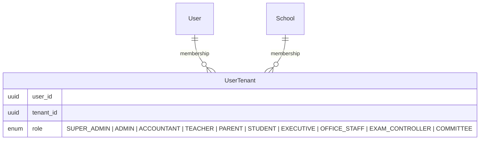

Example: Fatima is a `TEACHER` at Greenview School and a `PARENT` at
Riverside School (her own child studies there) — one `User` row, two
`UserTenant` rows.

## Same person in several schools

One person has **one login**: one email, one phone, one password, and any
Google or Facebook sign-ins. That login is shared by every school the person
belongs to. Each school then has its own membership row and its own profile
row for that person.

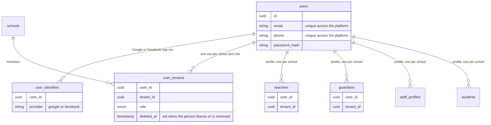

The entities are `server/src/modules/users/entities/user.entity.ts`
(`users`), `server/src/modules/auth/entities/user-tenant.entity.ts`
(`user_tenants`) and `server/src/modules/auth/entities/user-identity.entity.ts`
(`user_identities`). The profile tables (`teachers`, `guardians`,
`staff_profiles`, `students`) each carry a `tenant_id`.

**One profile per school (Epic 58.0 W0).** Each profile table links to `users`
with `@ManyToOne`, and is unique on `(tenant_id, user_id)` for live rows
(`teachers.employee_id` is unique per school too). `users.email` stays global.

Example: Rahim teaches ICT in High School and in the College branch. He has one
login, two `user_tenants` rows and two `teachers` rows, each with its own
employee id, attendance, leave and ACR (D14).

Three more rules from Epic 58.0:

- **D12, clash scope.** The routine double-booking check also scans other
  schools where the acting user is a member. It never reads a school the actor
  cannot see.
- **D13, guardian switcher.** A guardian with children in two schools uses the
  existing school switcher. There is no merged cross-school view yet.
- **D41, joining is never silent.** School B files a join request, the person
  accepts, and only then does B appear in their switcher. See
  `e2e/journeys/multi-branch-teacher.spec.ts`.

Because the login is shared, no single school owns it. These rules come from
decisions D12 and D16 of Epic 68 (#2150):

| Action on the shared login                              | Who may do it                                                                                                                                                                                                                                                                                                                                                                                                                                                                                                                                                                                      | Enforced by                                                                                                                                                    |
| ------------------------------------------------------- | -------------------------------------------------------------------------------------------------------------------------------------------------------------------------------------------------------------------------------------------------------------------------------------------------------------------------------------------------------------------------------------------------------------------------------------------------------------------------------------------------------------------------------------------------------------------------------------------------- | -------------------------------------------------------------------------------------------------------------------------------------------------------------- |
| Change email or phone                                   | The person, from their own profile: `POST /users/me/contact-change` (needs their current password), then the code (`POST /users/me/contact-change/confirm-phone`) or the emailed link (`POST /auth/verify-email`). A school admin may use `PATCH /users/:id` only while the person belongs to no other school; otherwise `409` with `details.code: "SHARED_IDENTITY"`. "Belongs" means a membership there, or a guardian record there linked to this login. The link stays after a parent is removed, so the lock stays too. D12 also allows platform support, but there is no route for that yet. | `account-access/contact-change.service.ts`; `UserService.update` with `countOtherMemberships` (`users/users.service.ts`)                                       |
| Admin password reset (`POST /users/:id/reset-password`) | A school admin, only for a person who belongs to that school alone (no membership and no linked guardian record in any other school). Otherwise `409` `SHARED_IDENTITY`, and the person uses "Forgot password" on the sign-in page. Checked before any session is revoked.                                                                                                                                                                                                                                                                                                                         | `RecoveryService.adminReset` (`account-access/recovery.service.ts`)                                                                                            |
| Join another school                                     | Only the person, by accepting a pending join request. Nothing is attached silently. Platform provisioning (adding a school admin), the guardian invite batch and workbook restore all file a join request. "Add staff" (`POST /users`) with an email or phone that already has an account answers `409` `ACCOUNT_EXISTS`; the dialog then offers "Send join request" (`POST /users/join-requests`), which the person must accept (#2224).                                                                                                                                                          | `insertJoinRequest` and `SchoolInviteService.accept` (`account-access/school-invite.service.ts`)                                                               |
| Leave, or be removed from, one school                   | `POST /users/me/leave` or `DELETE /users/:id` soft-deletes that school's `user_tenants` row only; the login and other schools stay. Access ends on the very next request (D16 "staff removal immediate", #2297): a per-user cut-off in Redis refuses every access token issued before the removal. If Redis is down this fails open, and access then ends at the next token refresh, at most 15 minutes later.                                                                                                                                                                                     | `UserService` (`users/users.service.ts`); `AccessTokenDenylistService.revokeUserTokensIssuedBefore` + `JwtStrategy`; `POST /auth/refresh` re-reads memberships |
| Login lockout                                           | Counted per identifier (email or phone), so a lockout applies in every school (D16 "login lockout stays global").                                                                                                                                                                                                                                                                                                                                                                                                                                                                                  | `login-attempt.service.ts` (Redis key `login-lockout:<identifier>`)                                                                                            |
| Password reset                                          | Setting a new password through a reset removes every connected Google or Facebook sign-in, each with an audit row.                                                                                                                                                                                                                                                                                                                                                                                                                                                                                 | `RecoveryService.applyNewPassword`                                                                                                                             |

A join request is an `auth_tokens` row with purpose `JOIN_SCHOOL` in the
inviting school. No `user_tenants` row exists until the person says yes, so
no guard, list or message can see them early.

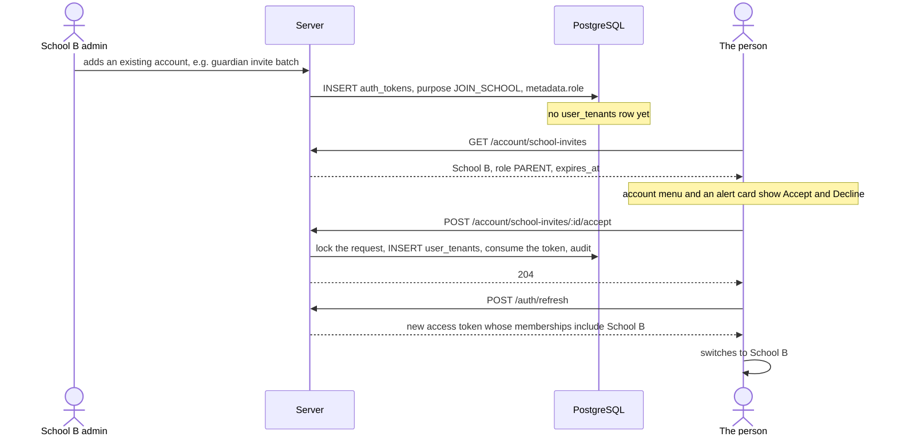

Decline is `POST /account/school-invites/:id/decline`; it revokes the request
and creates nothing. These three routes need a signed-in user but no
`X-Tenant-ID`: the person is not a member of School B yet, and every id is
matched to the caller's own user id. The UI is
`client-admin/src/components/staff-user-menu.tsx` and
`ui/src/components/school-invites-card.tsx`.

**Worked example.** Fatima is a `TEACHER` at Greenview and a `PARENT` at
Riverside. Riverside's admin tries to fix her phone number:

```http
PATCH /api/v1/users/<fatima's user id>
X-Tenant-ID: <riverside id>

{ "phone": "+8801811111111" }
```

```json
{
  "statusCode": 409,
  "message": "This person also belongs to another school. Only they can change their email or phone, from their own profile.",
  "details": { "code": "SHARED_IDENTITY" }
}
```

Nothing changes. If Riverside could change it, Riverside could then reset
the password and sign in as Fatima at Greenview. Instead Fatima opens her
own profile and sends `POST /api/v1/users/me/contact-change` with
`{ "phone": "+8801811111111", "current_password": "…" }`. A code goes to the
new number. She enters it (`POST /api/v1/users/me/contact-change/confirm-phone`),
and only then does the phone change, for both schools at once.

The full list of rules like these, per domain, is
[36-domain-invariants.md](36-domain-invariants.md).

## Login → request flow

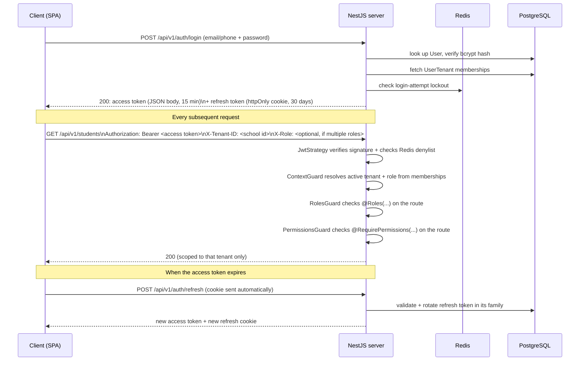

Key pieces, each in its own file under `server/src/modules/auth/`:

| Concern                                                      | File                                                                        |
| ------------------------------------------------------------ | --------------------------------------------------------------------------- |
| Verifying the JWT on every request                           | `strategies/jwt.strategy.ts`                                                |
| Resolving active tenant + role, enforcing `@Roles()`         | `guards/context.guard.ts`                                                   |
| Enforcing `@RequirePermissions()` against `ROLE_PERMISSIONS` | `guards/permissions.guard.ts`                                               |
| Issuing/rotating/revoking refresh tokens                     | `refresh-token.service.ts`                                                  |
| Detecting stolen/replayed refresh tokens                     | `refresh-token.service.ts` (reuse detection revokes the whole token family) |
| Instant access-token revocation (logout-all)                 | `access-token-denylist.service.ts` (Redis, keyed by `jti`)                  |
| Brute-force protection on login                              | `login-attempt.service.ts`                                                  |
| CSRF defense on the two cookie-authenticated routes          | `guards/same-origin.guard.ts`                                               |

## Client session lifecycle

`client-admin` keeps the access token in memory only (never
`localStorage`/`sessionStorage` — see [06-frontend-architecture.md](06-frontend-architecture.md)),
so a hard page reload always starts with nothing to send, even when the
httpOnly refresh cookie above is still valid. [8.9.3] is what makes that
transparent: every route is gated behind a check that silently tries the
refresh cookie once per page load before deciding whether the visitor is
actually logged out.

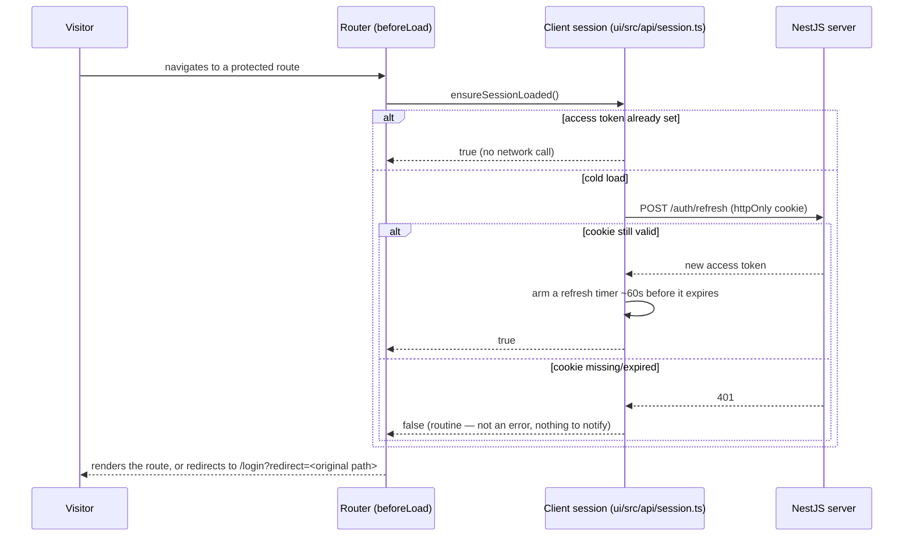

A refresh failing _after_ a session was already established (the
proactive timer above firing too late, or a request hitting a genuinely
dead token) is a different, louder event — that path already existed
before [8.9.3] (`client.ts`'s reactive 401 handling) and calls
`notifySessionExpired()`, which `client-admin/src/main.tsx` turns into the
same `/login` redirect. See [`ui/README.md`'s "Auth" section](../../ui/README.md)
for the full function-level write-up (`ensureSessionLoaded`,
`scheduleTokenRefresh`, `logout`/`logoutAll`).

## The tenant header contract

Every tenant-scoped controller is decorated with `@ApiTenantAuth()`
(`server/src/common/decorators/api-tenant-auth.decorator.ts`), which
documents and enforces:

- **`Authorization: Bearer <token>`** — required, always.
- **`X-Tenant-ID: <school id>`** — required. `ContextGuard` validates this
  against the caller's own `UserTenant` memberships; a tenant ID the caller
  doesn't belong to is rejected, not silently ignored.
- **`X-Role: <role>`** — optional. Only needed when a caller has more than
  one role _within that same tenant_; otherwise the first matching
  membership is used.

This means authorization is always **"is this user a member of this
specific tenant, and if so with what role"** — never a global role check.

## Role-Based Access Control (RBAC)

Roles are fixed and defined once in `shared/src/enums/index.ts`
(`UserRole`), shared by server and every client so they can never drift:

```
SUPER_ADMIN → ADMIN → ACCOUNTANT → EXECUTIVE → TEACHER → EXAM_CONTROLLER → OFFICE_STAFF → COMMITTEE → PARENT / STUDENT
```

(highest to lowest priority — see `ROLE_PRIORITY` in `context.guard.ts`,
used as a tiebreak when a caller has multiple roles in one tenant and omits
`X-Role`). Routes declare required roles with the `@Roles(...)` decorator;
`RolesGuard` enforces it after `ContextGuard` has resolved which role the
caller is acting as.

| Role              | Who it is for                           | Data scope (`ROLE_SCOPE`) |
| ----------------- | --------------------------------------- | ------------------------- |
| `SUPER_ADMIN`     | Platform operator                       | `TENANT`                  |
| `ADMIN`           | School head / IT admin                  | `TENANT`                  |
| `ACCOUNTANT`      | Fees and payments                       | `TENANT`                  |
| `EXECUTIVE`       | Principal / management, read-mostly     | `TENANT`                  |
| `OFFICE_STAFF`    | Front-office clerk: admissions, records | `TENANT`                  |
| `EXAM_CONTROLLER` | Runs exams, marks and results           | `TENANT`                  |
| `COMMITTEE`       | Governing / admission committee member  | `TENANT`                  |
| `TEACHER`         | Classroom teacher                       | `ASSIGNED_SECTIONS`       |
| `PARENT`          | Guardian                                | `FAMILY`                  |
| `STUDENT`         | Learner                                 | `SELF`                    |

`SUPER_ADMIN`'s `TENANT` scope does not open a school's own data (marks,
attendance, homework, performance): `hasTenantDataScope` in
`shared/src/enums/audiences.ts` holds it out until product decides (#1362
D-N). Tenant scope is always paired with the route's permission.

These are code roles, not runtime-editable ones: each role is wired into
guards, menus and data scope at build time, so a school cannot invent one
(decision D1 of [Epic #786](https://github.com/tareq89/biddaloy/issues/786)).
Demo accounts for every role live in `ROLE_TEST_USERS`
(`server/src/scripts/seed.util.ts`), e.g. `office@biddaloy.test`.

This was a deliberate choice over attribute-based access control (ABAC):
school roles map cleanly onto real staff titles, and finer-grained rules
(e.g. "a class teacher can only see their own section") can be layered on
top of roles later if needed, without redesigning the model now.

### Roles and permissions, both

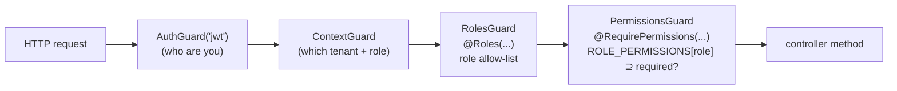

**Security rules** for this path live in [08-security.md](08-security.md#security-rules):
[Rule 1](08-security.md#rule-1-routes-are-closed-by-default) (routes closed by default),
[Rule 2](08-security.md#rule-2-teacher-reads-are-scoped-to-assigned-sections) (teacher scope; a coordinator row widens reads only, through `includeCoordinated` — see [03-backend-modules.md](03-backend-modules.md#coordinators-widen-reads-never-writes-epic-83)),
[Rule 8](08-security.md#rule-8-suspend-remove-or-reset-bumps-tokens_valid_after) (session cut-off) and
[Rule 15](08-security.md#rule-15-redis-down-has-a-written-answer-per-route) (Redis down).

`@Roles` says which roles may reach a route; `@RequirePermissions` says
which capability from `ROLE_PERMISSIONS` (`shared/src/enums/permissions.ts`)
the route exercises. Both run today.

On a tenant route with `@RequirePermissions`, the permission is the real
gate. `@Roles` now exists only on routes listed in `ROLE_NARROWINGS` or
`IDENTITY_SCOPED` (`permission-matrix.e2e-spec.ts`). Everywhere else it was
redundant and was deleted (Epic 24.0).

`PermissionsGuard` **fails closed**: every route behind it carries either
`@RequirePermissions` or `@AuthenticatedOnly()`. A route with neither is a 403
(`This route declares no permission`).

`IDENTITY_SCOPED` routes are the exception: some carry no
`@RequirePermissions` at all and are marked `@AuthenticatedOnly()` instead
(`permission-matrix.e2e-spec.ts` proves the marker and the list match
one-for-one). The gate is the route's own identity check, plus its `@Roles`
list where it has one. Seven identity routes have no `@Roles` at all (the five
`/attention/*` routes, `GET /schools/:id/logo`, `GET /schools/me/profile`): there
the service's identity check is the only gate. Example: `GET /leave/balance` acts
only on the caller's own staff profile.

`ContextGuard` trusts the memberships inside the JWT. What makes a removed membership disappear within one request is the session cut-off (`users.tokens_valid_after`, checked in `JwtStrategy`; see [08-security](08-security.md) "Session cut-off").

Which status a refused request gets depends on which guard refuses it:

| Request                                                                                         | Refused by         | Status                                                  |
| ----------------------------------------------------------------------------------------------- | ------------------ | ------------------------------------------------------- |
| Valid token, wrong role, route has **no** `@Roles` (most routes)                                | `PermissionsGuard` | **403** `Requires permission(s): …`                     |
| Valid token, wrong role, route **still has** `@Roles` (a narrowing or identity-scoped route)    | `RolesGuard`       | **403** `Requires one of roles: …` (since #1360 / #729) |
| Route behind `PermissionsGuard` declares no `@RequirePermissions` and no `@AuthenticatedOnly()` | `PermissionsGuard` | **403** `This route declares no permission`             |
| `X-Role` names a role the user does not hold in this tenant                                     | `ContextGuard`     | **401**                                                 |
| Missing or bad token                                                                            | `AuthGuard('jwt')` | **401**                                                 |

`ContextGuard` also checks the school's own state, after the role is resolved (the platform tenant is exempt from both):

| School state                                       | Request                                               | Answer                                                                   |
| -------------------------------------------------- | ----------------------------------------------------- | ------------------------------------------------------------------------ |
| `SUSPENDED`                                        | anything, unless `@AllowWhenSuspendedForBilling`      | **403** `TENANT_SUSPENDED` (plus `reason` for a billing suspension)      |
| `ACTIVE`, over its seats (7-day grace, Epic 49 D9) | `POST/PUT/PATCH/DELETE`, unless the handler is marked | **403** `TENANT_READ_ONLY` with `details.until`; `GET/HEAD/OPTIONS` pass |
| `ACTIVE`, a backup restore running                 | `POST/PUT/PATCH/DELETE`                               | **423** `TENANT_RESTORING`                                               |

How the grace window and the suspension work: [34-onboarding](34-onboarding.md) "Over the seats".

Example, with a PARENT token for the same school:

- `GET /guardians` (no `@Roles`; PARENT lacks `GUARDIAN_READ`) → `403`.
- `GET /homework` (keeps `@Roles(ADMIN, TEACHER)`, see below) → `403`.

Example of a narrowing: `GET /homework`. PARENT and STUDENT hold
`HOMEWORK_READ` (for their own child's view). This route is the teacher/admin
list across all students, so it keeps `@Roles(ADMIN, TEACHER)` to keep
families out.

A narrowing can retire later: give the route its own permission, grant it to
the roles in `@Roles`, delete the `@Roles` line and the `ROLE_NARROWINGS`
entry. When the list is empty, delete `RolesGuard`.

### Step-up approval (16.2) — re-entering an approver's code for a risky action

Some actions (reversing a payment, discounting a bill past a threshold,
creating a duplicate fee, voiding an invoice) need a fresh, in-the-moment
re-authentication of an admin — not just the acting user's own login. The
approver can be the person acting. `@RequireApproval` marks a route as
gated; walking the modal through to a token is the same flow everywhere,
regardless of which route triggered it.

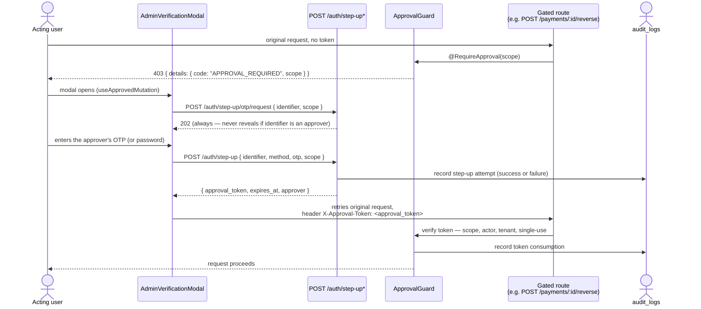

What the server checks when the acting user types an approver identifier:

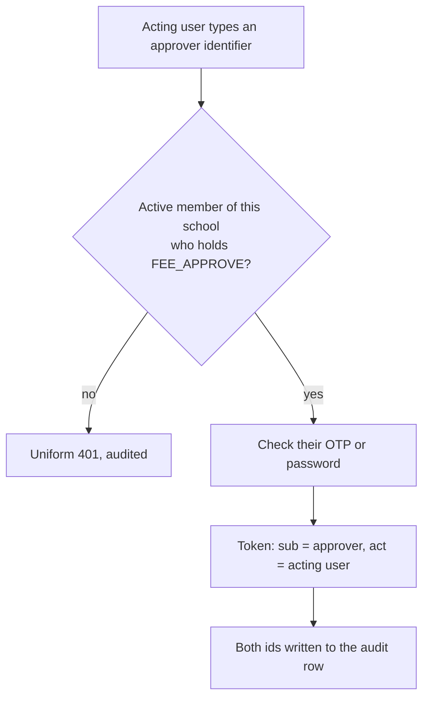

Example: in a school with one admin, Rahim is the admin. Rahim reverses a
payment and types his own code as the approver. That is allowed. The audit row
shows `approver_id = actor_id = Rahim`.

A few things worth being explicit about, because they're easy to get wrong
building a new gated route:

- **The approver can be the acting user, but a reversal checks who else
  could have approved.** Step-up itself lets the actor verify as their own
  approver (pinned by `step-up.controller.e2e-spec.ts`, "the actor may verify
  themselves as the approver"). `POST /payments/:id/reverse` then applies the
  Epic 78 D1 rule in `PaymentReversalService` before any lock or money row:

  ```mermaid
  flowchart TD
    A[approver == actor?] -- no --> OK[reversal runs<br/>audit self_approved: false]
    A -- yes --> B{fees.requireSecondApprover on?}
    B -- yes --> NO[403 SECOND_APPROVER_REQUIRED<br/>nothing changes]
    B -- no --> C{another ACTIVE FEE_APPROVE holder<br/>in this school? SUPER_ADMIN does not count}
    C -- yes --> NO
    C -- no --> OK2[reversal runs<br/>audit self_approved: true]
  ```

  Example: Rahim is the only admin of his school and reverses a payment with
  his own code. That runs, and the audit row says `self_approved: true`. Once
  a second admin, Karim, joins, Rahim's own code is refused with
  `403 { details: { code: "SECOND_APPROVER_REQUIRED" } }`; the approval token
  is already spent, so he runs step-up again with Karim's code. A school can
  also turn on **Always need a second admin to reverse a payment**
  (`fees.requireSecondApprover`) to refuse self-approval even with one admin.

- **Attempts are counted three ways** (Redis, 15-minute window, limit
  `STEP_UP_RATE_LIMIT_MAX_ATTEMPTS`, default 5). Every attempt counts, right
  or wrong, before the credential is checked. Any one over its limit is a 429.
  The approver key is counted only after the caller's own two keys allow the
  attempt, so one caller adds at most 5 to it.

  | Key                                                  | Limit   | Why                                                                |
  | ---------------------------------------------------- | ------- | ------------------------------------------------------------------ |
  | `step-up-attempts:pair:<tenant>:<caller>:<approver>` | 5       | One caller's attempts never lock the approver out for others.      |
  | `step-up-attempts:actor:<caller>`                    | 5       | One caller cannot spread guesses over many approvers.              |
  | `step-up-attempts:approver:<tenant>:<approver>`      | 20 (4x) | Many callers together cannot multiply the guesses at one approver. |

  Code requests have the same 20 ceiling per approver
  (`step-up-otp-requests:approver:…`): past it, the 202 still comes back but no
  new code is sent, so ten staff cannot text one approver ten times. Only codes
  actually sent count: a request inside the caller's own 60 s cooldown sends
  nothing and gives its slot back.

- **A step-up code is bound to the school, the caller and the scope it was
  requested for.** `POST /auth/step-up/otp/request` takes `{ identifier, scope }`
  and the code is stored under `tenant:caller:scope:approver`. Using it for a
  different scope or from a different account fails like a wrong code.
  Example: a code requested for `fees.discount` and sent to `POST /auth/step-up`
  with `scope: payments.reverse` gives `401 Invalid credentials`, the same body
  and the same audit row as a wrong code. The three attempt counters above
  carry no scope, so rotating the scope buys no extra guesses.
- **The 403 body is nested.** `ApprovalRequiredException`
  (`server/src/common/errors/approval-required.exception.ts`) must put
  `code`/`scope` under a `details` key — the global exception filter only
  ever forwards a top-level `details` field onto the wire, and every
  consumer (`ui/src/hooks/approval.tsx`'s `isApprovalRequiredError`,
  `ui/src/api/errors.ts`'s `ApiError.details`) reads `error.details.code`. A
  flat `{code, scope}` body silently breaks every step-up flow in the app —
  this happened once already (fixed in [16.2.5]'s wave-close pass) and every
  mocked component test kept passing throughout, because the mocks assumed
  the correct nested shape from the start. Only a live-server test (an
  `e2e/journeys/*.spec.ts` hitting the real guard, not a `msw`-mocked one)
  catches this class of drift.
- **A token is single-use and scope-bound.** `approval_token` is consumed by
  `ApprovalGuard` on first successful use; a retry with the same token — even
  against the same route — gets another `APPROVAL_REQUIRED` 403.
  `e2e/journeys/step-up.spec.ts` (16.2.5) proves the whole loop end to end:
  no token → 403, full OTP round trip → token → route succeeds once →
  same token replayed → 403 again.
- **A refused reversal still spends the code.** `ApprovalGuard` burns the
  token before the handler runs, so if the handler then answers 409 the admin
  needs a new OTP. Accepted on purpose (F-153): a token is a one-shot "yes",
  not a reservation. Example: reversing payment #1 while payment #2 exists
  answers `REVERSE_LATER_PAYMENTS_FIRST` (`payment-reversal.service.ts`; the
  route is `@RequireApproval(PAYMENTS_REVERSE)` in `checkout.controller.ts`);
  the OTP is gone, so the retry after reversing #2 asks for a fresh one. The
  same holds for `REVERSE_RETRY`. Checkout is the exception: it checks the
  wallet balance before it spends the token.

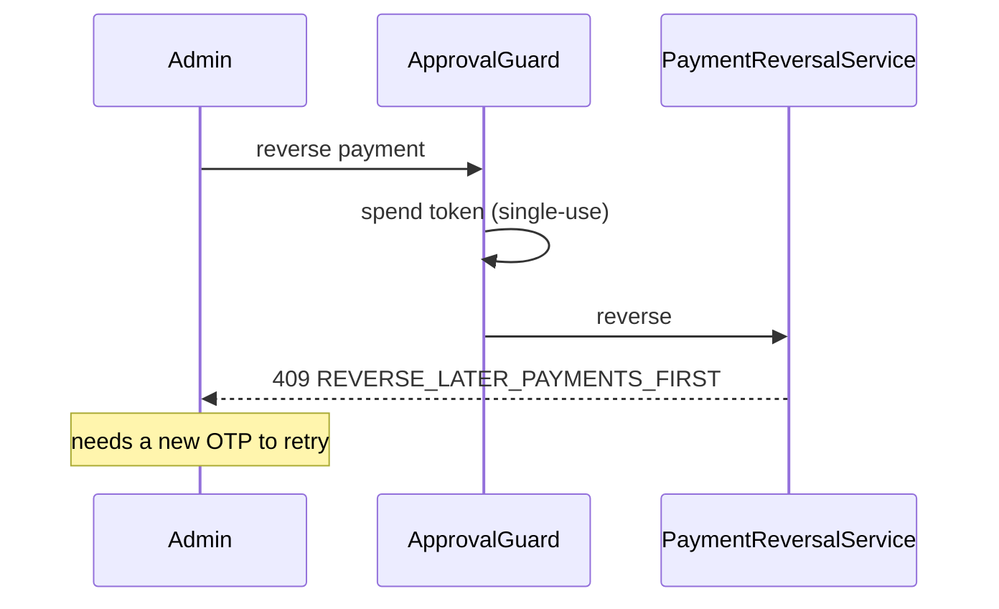

- **`ApprovalGuard` runs after `RolesGuard`/`PermissionsGuard`.** A caller
  who isn't allowed on the route at all still gets a plain 401/403 from the
  earlier guards, not `APPROVAL_REQUIRED` — the step-up prompt only appears
  once the caller has cleared "can you call this route," to avoid using
  "approval required" as a way to fingerprint routes a caller can't see.

## Invitations & account access

When an admin creates a user without a password (`POST /users`, no
`password` field), the account is created with `password_hash = null` and
cannot log in on its own — it needs an activation link. "Invited" is not a
stored status: it's derived from `password_hash` plus the newest
`auth_tokens` row for that user, so no `UserStatus` enum churn was needed.

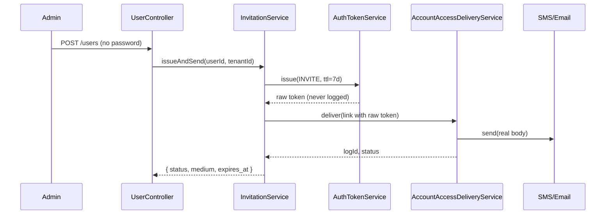

Key points:

- **One shared `auth_tokens` table** (`AuthToken` entity) backs invitations
  today and password resets / email verification in later sub-issues
  (12.3, 12.7) — same hashed-token pattern as `refresh_tokens`: only a
  SHA-256 hash of the random secret is ever stored.

  | id      | user_id | purpose  | token_hash (64 hex) | expires_at | consumed_at                                  |
  | ------- | ------- | -------- | ------------------- | ---------- | -------------------------------------------- |
  | `a1b2…` | `u-42`  | `INVITE` | `9f86d0…`           | in 7 days  | `null`                                       |
  | `c3d4…` | `u-42`  | `INVITE` | `e3b0c4…`           | (expired)  | `2026-08-01` (consumed, from a prior resend) |

- **Delivery never leaks the secret into the communication log.**
  `AccountAccessDeliveryService` writes a `CommunicationLog` row (so the
  send is visible in the same audit trail as any other message) but with
  `message_body` redacted (`••••••` in place of the link/code) — the real
  body is a local variable, sent straight to the provider, and never
  persisted or logged. `trigger = ACCOUNT_ACCESS` marks these rows apart
  from ordinary reminders.
- **One shared `OtpService`** (Redis, 6-digit codes, 5-minute TTL, 5
  attempts then a 15-minute lock) is shared by forgot-password, admin
  reset, OTP sign-in, contact change, registration and step-up. It lives
  in the `account-access` module.
- **Resend revokes prior links.** `POST /users/:id/invitation/resend`
  calls the same `issueAndSend` path, which revokes every still-live
  invite for that user before issuing a new one — a stale link in an old
  email can never be used once a resend happens.
- A delivery failure (bad phone number, provider outage) never rolls back
  the user that was just created — user creation and invitation dispatch
  are independent outcomes.

#### How many codes one phone or email can get (GAP-05)

Each purpose has a 60-second cooldown. On top of that, one phone or email
gets at most 5 codes **per purpose per hour** (sign-in, reset, registration
and phone check each have their own count). Step-up codes are not counted,
because they are not sent anywhere.

Why per purpose and per hour: the first version shared 10 codes a day across
all purposes. Anyone could then spend a parent's codes in ten minutes and
lock them out of both sign-in and password reset for a whole day. Now a
stranger can block one purpose for at most an hour.

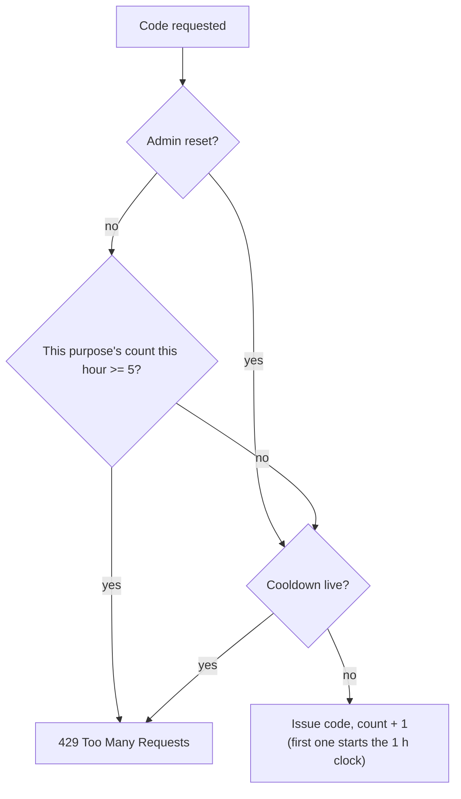

Example: `01712345678`, `+880 1712-345678` and `8801712345678` are one
handset, so sign-in codes for any of them count against the Redis key
`otp-cap:LOGIN:8801712345678`. `Foo@X.com` resetting a password counts
against `otp-cap:PASSWORD_RESET:foo@x.com`.

An admin reset (`POST /users/:id/reset-password`) skips the cap, so a
stranger cannot block it, and it asks for the code before signing the user
out, so a refused code (cooldown) signs nobody out.

Forgot-password and OTP sign-in still answer 202 when refused (so nobody
can tell which numbers have accounts). Their "enter the code" screen says
so: "No code after a few tries? Wait an hour, then try again."
Registration and contact change show the 429. Per-school and global caps
are #1759.

### Batch invites (12.6) — inviting a whole imported cohort's guardians

Bulk-imported students get Guardian rows but no login — so "invite this
cohort's guardians" is a **preview-first batch action**, not an import side
effect. It reuses 12.1's `issueAndSend` per guardian, fanned out over a
queue, with a `batch_id` (not a new `ReminderBatch`-shaped entity) tying
the fan-out back together for progress polling:

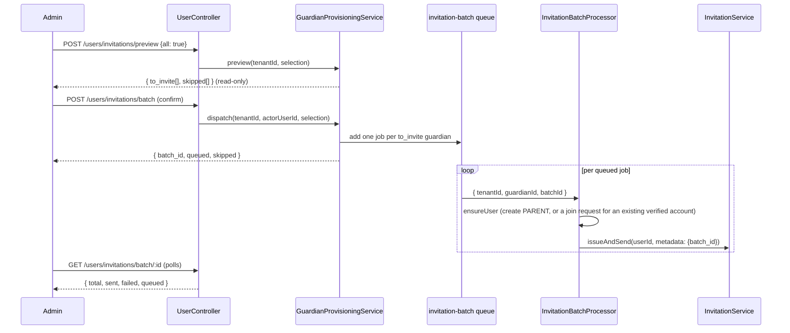

Key points:

- **Sibling dedup is free.** Two students sharing one guardian's phone
  already collapse to one `Guardian` row (`bulk-upload.service.ts`'s
  phone-dedup) — one guardian, one `ensureUser` call, one account.
- **`batch_id` lives in `metadata`, not a new table.** It's written into
  `auth_tokens.metadata.batch_id` (via `issueAndSend`'s `metadata`
  parameter) and `communication_logs.metadata.batch_id` (via `deliver`'s
  `metadata` parameter). `batchStatus` counts `communication_logs` rows by
  that key and reads `total` back from the batch-dispatch audit row
  (`AuditAction.INVITATION_SENT`, `entity_type: 'InvitationBatch'`) —
  the same "derive it, don't store a redundant counter" instinct
  `deriveInvitationStatus` already uses.
- **Skip reasons mirror the reminder-batch preview grammar** —
  `no_contact` / `already_active` / `already_pending` /
  `notifications_disabled` — so staff read the same shape of "who got
  skipped and why" they already know from bulk reminders.
- **`ensureUser` is idempotent under retry.** A guardian already linked to
  a `User` is loaded, not recreated; a guardian matching an existing
  `User` by a _verified_ phone or email, and not yet a member of this
  school (or holding a password but no `PARENT` role here), is not linked
  silently: that person gets a `JOIN_SCHOOL` request to accept (see
  [Same person in several schools](#same-person-in-several-schools)); a
  `23505` race between two concurrent batches is retried as "found".

## Sign-in methods, first password, leaving (Epic 13.0)

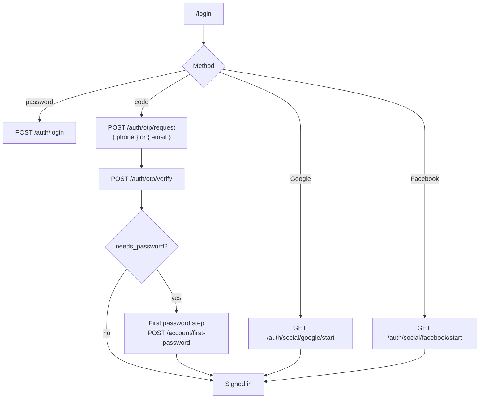

- **Code sign-in works by phone or email.** The identifier is either one.
  `/otp/verify` also returns `needs_password` and `password_required`
  (no password + staff role + no linked social account). The gate is
  client-side, stored per account and cleared on logout or when a password is
  set. Server enforcement is open: #1697. See
  [34-onboarding.md](34-onboarding.md).
- **Password rules depend on the role**, checked only when a password is set
  or changed (never at sign-in). Strictest role across all memberships wins.

  | Roles                    | Rules                                       |
  | ------------------------ | ------------------------------------------- |
  | Any staff role, or mixed | 8+ characters, upper, lower, digit, special |
  | Only PARENT / STUDENT    | 8+ characters, a digit                      |

- **Google and Facebook.** The server lists the
  configured providers (`GET /auth/social/providers`) and the UI draws one
  button each. The flow is server-side authorization code with PKCE and
  `state`. Identities live in `user_identities`. **Connecting is always
  explicit** (`POST /auth/social/:provider/link-start` from a signed-in
  session, with the account's `current_password`). An identity is never attached by matching email. Example: a Google
  account with `rahim@example.com` does not sign in to a user who has that
  email unless it was connected first.
- **Leaving and former members.** Staff leave with `POST /users/me/leave`.
  An admin removes with `DELETE /users/:id`. Both soft-delete the
  `user_tenants` row (`deleted_at`); the user account and their other schools
  stay. The last admin cannot leave or be removed. Guardians and students
  have no "leave". `POST /users/:id/restore` (needs `MEMBER_REMOVE`, ADMIN and SUPER_ADMIN only today) brings back the rows
  ended by the latest event. A person with no active staff role is a
  "Former" member.

## Why this deviated from the original plan

The original plan assumed one school and a single `role` column directly on
`User`. Multi-tenancy was added during build because the same account needs
to represent different people-in-context at different schools — a column on
`User` can't express "TEACHER here, PARENT there" for one person. The
`UserTenant` join table is what makes that possible, and it's the reason
almost every entity in [01-domain-model.md](01-domain-model.md) carries an
explicit tenant reference.

- **D12 (Epic 68): a shared login is owned by the person, not by a school.**
  School admins used to edit any member's email or phone (`PATCH /users/:id`)
  and reset their password. For a person in two schools, that let one school
  take over the login used at the other. Epic 68 replaced it: the person
  changes their own contact through the verify flow, an admin edit or reset
  of a shared login answers `409 SHARED_IDENTITY`, and joining a school is a
  request the person accepts. The alternative, admin edit plus a
  verification step, was considered and rejected.
