# Auth & Multi-Tenancy

> This doc explains the _shape_ of the system with diagrams. For the deep
> security rationale (CSRF posture, brute-force protection, exact TTLs,
> revocation details) see [08-security.md](08-security.md) — that document
> is kept exhaustive on purpose and this one won't repeat it.

## The core idea: tenants, not a single school

SchoolManager hosts **many independent schools** on one deployment. A `School`
row _is_ a tenant. Everything school-specific — students, classes, fees,
staff — is scoped to exactly one tenant. A single `User` account, however,
is **not** tenant-scoped: the same person can belong to multiple schools,
with a different role at each.

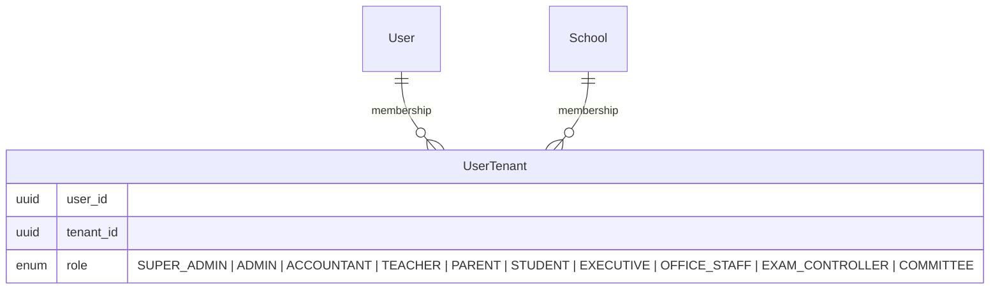

Example: Fatima is a `TEACHER` at Greenview School and a `PARENT` at
Riverside School (her own child studies there) — one `User` row, two
`UserTenant` rows.

## Same person in several schools

One person has **one login**: one email, one phone, one password, and any
Google or Facebook sign-ins. That login is shared by every school the person
belongs to. Each school then has its own membership row and its own profile
row for that person.

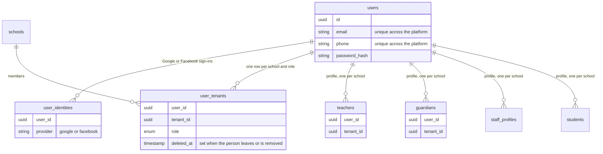

The entities are `server/src/modules/users/entities/user.entity.ts`
(`users`), `server/src/modules/auth/entities/user-tenant.entity.ts`
(`user_tenants`) and `server/src/modules/auth/entities/user-identity.entity.ts`
(`user_identities`). The profile tables (`teachers`, `guardians`,
`staff_profiles`, `students`) each carry a `tenant_id`.

**One profile per school (Epic 58.0 W0).** Each profile table links to `users`
with `@ManyToOne`, and is unique on `(tenant_id, user_id)` for live rows
(`teachers.employee_id` is unique per school too). `users.email` stays global.

Example: Rahim teaches ICT in High School and in the College branch. He has one
login, two `user_tenants` rows and two `teachers` rows, each with its own
employee id, attendance, leave and ACR (D14).

Three more rules from Epic 58.0:

- **D12, clash scope.** The routine double-booking check also scans other
  schools where the acting user is a member. It never reads a school the actor
  cannot see.
- **D13, guardian switcher.** A guardian with children in two schools uses the
  existing school switcher. There is no merged cross-school view yet.
- **D41, joining is never silent.** School B files a join request, the person
  accepts, and only then does B appear in their switcher. See
  `e2e/journeys/multi-branch-teacher.spec.ts`.

Because the login is shared, no single school owns it. These rules come from
decisions D12 and D16 of Epic 68 (#2150):

| Action on the shared login                              | Who may do it                                                                                                                                                                                                                                                                                                                                                                                                                                                                                                                                                                                      | Enforced by                                                                                                                                                    |
| ------------------------------------------------------- | -------------------------------------------------------------------------------------------------------------------------------------------------------------------------------------------------------------------------------------------------------------------------------------------------------------------------------------------------------------------------------------------------------------------------------------------------------------------------------------------------------------------------------------------------------------------------------------------------- | -------------------------------------------------------------------------------------------------------------------------------------------------------------- |
| Change email or phone                                   | The person, from their own profile: `POST /users/me/contact-change` (needs their current password), then the code (`POST /users/me/contact-change/confirm-phone`) or the emailed link (`POST /auth/verify-email`). A school admin may use `PATCH /users/:id` only while the person belongs to no other school; otherwise `409` with `details.code: "SHARED_IDENTITY"`. "Belongs" means a membership there, or a guardian record there linked to this login. The link stays after a parent is removed, so the lock stays too. D12 also allows platform support, but there is no route for that yet. | `account-access/contact-change.service.ts`; `UserService.update` with `countOtherMemberships` (`users/users.service.ts`)                                       |
| Admin password reset (`POST /users/:id/reset-password`) | A school admin, only for a person who belongs to that school alone (no membership and no linked guardian record in any other school). Otherwise `409` `SHARED_IDENTITY`, and the person uses "Forgot password" on the sign-in page. Checked before any session is revoked.                                                                                                                                                                                                                                                                                                                         | `RecoveryService.adminReset` (`account-access/recovery.service.ts`)                                                                                            |
| Join another school                                     | Only the person, by accepting a pending join request. Nothing is attached silently. Platform provisioning (adding a school admin), the guardian invite batch and workbook restore all file a join request. "Add staff" (`POST /users`) with an email or phone that already has an account answers `409` `ACCOUNT_EXISTS`; the dialog then offers "Send join request" (`POST /users/join-requests`), which the person must accept (#2224).                                                                                                                                                          | `insertJoinRequest` and `SchoolInviteService.accept` (`account-access/school-invite.service.ts`)                                                               |
| Leave, or be removed from, one school                   | `POST /users/me/leave` or `DELETE /users/:id` soft-deletes that school's `user_tenants` row only; the login and other schools stay. Access ends on the very next request (D16 "staff removal immediate", #2297): a per-user cut-off in Redis refuses every access token issued before the removal. If Redis is down this fails open, and access then ends at the next token refresh, at most 15 minutes later.                                                                                                                                                                                     | `UserService` (`users/users.service.ts`); `AccessTokenDenylistService.revokeUserTokensIssuedBefore` + `JwtStrategy`; `POST /auth/refresh` re-reads memberships |
| Login lockout                                           | Counted per identifier (email or phone), so a lockout applies in every school (D16 "login lockout stays global").                                                                                                                                                                                                                                                                                                                                                                                                                                                                                  | `login-attempt.service.ts` (Redis key `login-lockout:<identifier>`)                                                                                            |
| Password reset                                          | Setting a new password through a reset removes every connected Google or Facebook sign-in, each with an audit row.                                                                                                                                                                                                                                                                                                                                                                                                                                                                                 | `RecoveryService.applyNewPassword`                                                                                                                             |

A join request is an `auth_tokens` row with purpose `JOIN_SCHOOL` in the
inviting school. No `user_tenants` row exists until the person says yes, so
no guard, list or message can see them early.

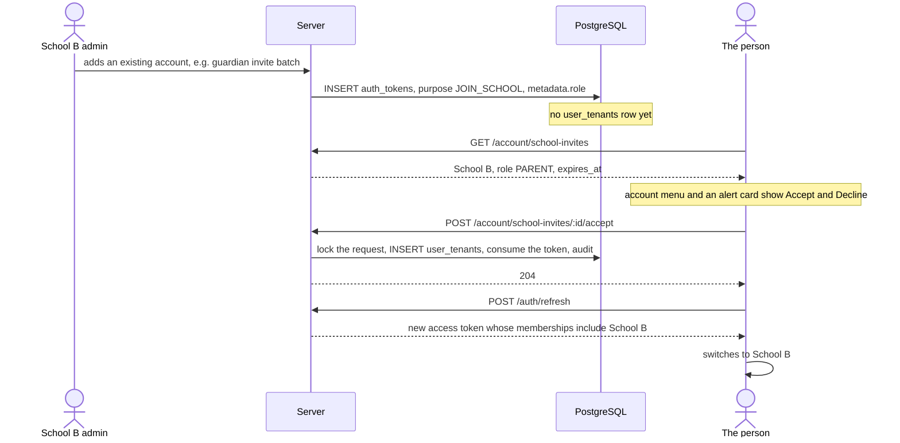

Decline is `POST /account/school-invites/:id/decline`; it revokes the request
and creates nothing. These three routes need a signed-in user but no
`X-Tenant-ID`: the person is not a member of School B yet, and every id is
matched to the caller's own user id. The UI is
`client-admin/src/components/staff-user-menu.tsx` and
`ui/src/components/school-invites-card.tsx`.

**Worked example.** Fatima is a `TEACHER` at Greenview and a `PARENT` at
Riverside. Riverside's admin tries to fix her phone number:

```http
PATCH /api/v1/users/<fatima's user id>
X-Tenant-ID: <riverside id>

{ "phone": "+8801811111111" }
```

```json
{
  "statusCode": 409,
  "message": "This person also belongs to another school. Only they can change their email or phone, from their own profile.",
  "details": { "code": "SHARED_IDENTITY" }
}
```

Nothing changes. If Riverside could change it, Riverside could then reset
the password and sign in as Fatima at Greenview. Instead Fatima opens her
own profile and sends `POST /api/v1/users/me/contact-change` with
`{ "phone": "+8801811111111", "current_password": "…" }`. A code goes to the
new number. She enters it (`POST /api/v1/users/me/contact-change/confirm-phone`),
and only then does the phone change, for both schools at once.

The full list of rules like these, per domain, is
[36-domain-invariants.md](36-domain-invariants.md).

## Login → request flow

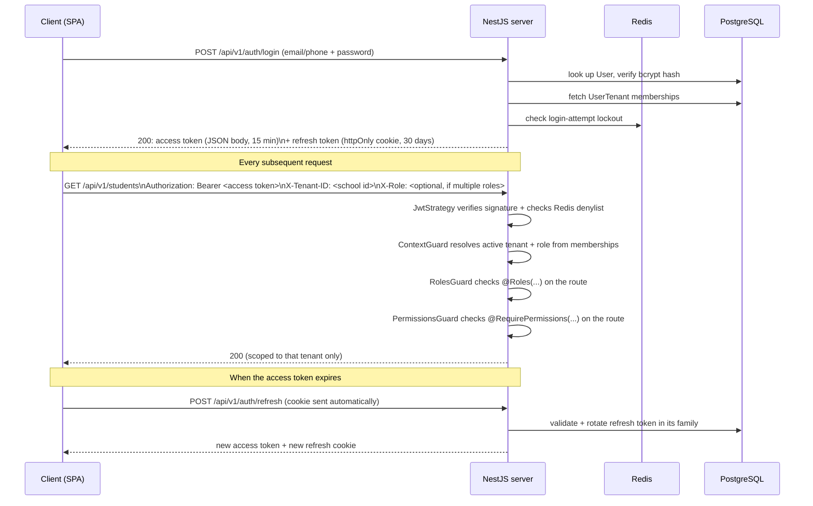

Key pieces, each in its own file under `server/src/modules/auth/`:

| Concern                                                      | File                                                                        |
| ------------------------------------------------------------ | --------------------------------------------------------------------------- |
| Verifying the JWT on every request                           | `strategies/jwt.strategy.ts`                                                |
| Resolving active tenant + role, enforcing `@Roles()`         | `guards/context.guard.ts`                                                   |
| Enforcing `@RequirePermissions()` against `ROLE_PERMISSIONS` | `guards/permissions.guard.ts`                                               |
| Issuing/rotating/revoking refresh tokens                     | `refresh-token.service.ts`                                                  |
| Detecting stolen/replayed refresh tokens                     | `refresh-token.service.ts` (reuse detection revokes the whole token family) |
| Instant access-token revocation (logout-all)                 | `access-token-denylist.service.ts` (Redis, keyed by `jti`)                  |
| Brute-force protection on login                              | `login-attempt.service.ts`                                                  |
| CSRF defense on the two cookie-authenticated routes          | `guards/same-origin.guard.ts`                                               |

## Client session lifecycle

`client-admin` keeps the access token in memory only (never
`localStorage`/`sessionStorage` — see [06-frontend-architecture.md](06-frontend-architecture.md)),
so a hard page reload always starts with nothing to send, even when the
httpOnly refresh cookie above is still valid. [8.9.3] is what makes that
transparent: every route is gated behind a check that silently tries the
refresh cookie once per page load before deciding whether the visitor is
actually logged out.

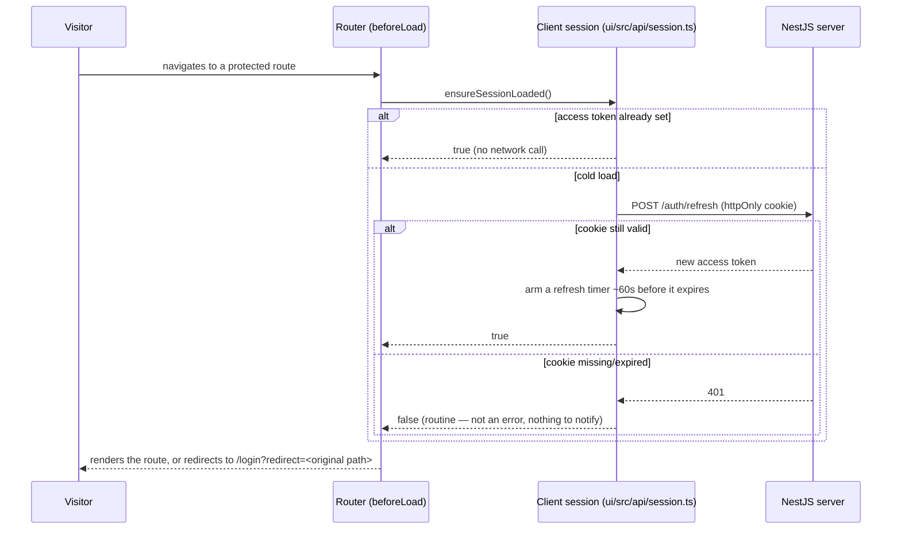

A refresh failing _after_ a session was already established (the
proactive timer above firing too late, or a request hitting a genuinely
dead token) is a different, louder event — that path already existed
before [8.9.3] (`client.ts`'s reactive 401 handling) and calls
`notifySessionExpired()`, which `client-admin/src/main.tsx` turns into the
same `/login` redirect. See [`ui/README.md`'s "Auth" section](../../ui/README.md)
for the full function-level write-up (`ensureSessionLoaded`,
`scheduleTokenRefresh`, `logout`/`logoutAll`).

## The tenant header contract

Every tenant-scoped controller is decorated with `@ApiTenantAuth()`
(`server/src/common/decorators/api-tenant-auth.decorator.ts`), which
documents and enforces:

- **`Authorization: Bearer <token>`** — required, always.
- **`X-Tenant-ID: <school id>`** — required. `ContextGuard` validates this
  against the caller's own `UserTenant` memberships; a tenant ID the caller
  doesn't belong to is rejected, not silently ignored.
- **`X-Role: <role>`** — optional. Only needed when a caller has more than
  one role _within that same tenant_; otherwise the first matching
  membership is used.

This means authorization is always **"is this user a member of this
specific tenant, and if so with what role"** — never a global role check.

## Role-Based Access Control (RBAC)

Roles are fixed and defined once in `shared/src/enums/index.ts`
(`UserRole`), shared by server and every client so they can never drift:

```
SUPER_ADMIN → ADMIN → ACCOUNTANT → EXECUTIVE → TEACHER → EXAM_CONTROLLER → OFFICE_STAFF → COMMITTEE → PARENT / STUDENT
```

(highest to lowest priority — see `ROLE_PRIORITY` in `context.guard.ts`,
used as a tiebreak when a caller has multiple roles in one tenant and omits
`X-Role`). Routes declare required roles with the `@Roles(...)` decorator;
`RolesGuard` enforces it after `ContextGuard` has resolved which role the
caller is acting as.

| Role              | Who it is for                                                                                                                                        | Data scope (`ROLE_SCOPE`) |
| ----------------- | ---------------------------------------------------------------------------------------------------------------------------------------------------- | ------------------------- |
| `SUPER_ADMIN`     | Legacy school-level role, no platform power. The platform operator is a cockpit owner (below); the explicit cutover step turns old rows into `ADMIN` | `TENANT`                  |
| `ADMIN`           | School head / IT admin                                                                                                                               | `TENANT`                  |
| `ACCOUNTANT`      | Fees and payments                                                                                                                                    | `TENANT`                  |
| `EXECUTIVE`       | Principal / management, read-mostly                                                                                                                  | `TENANT`                  |
| `OFFICE_STAFF`    | Front-office clerk: admissions, records                                                                                                              | `TENANT`                  |
| `EXAM_CONTROLLER` | Runs exams, marks and results; enters marks as backup for an absent teacher (81 D5b)                                                                 | `TENANT`                  |
| `COMMITTEE`       | Governing / admission committee member                                                                                                               | `TENANT`                  |
| `TEACHER`         | Classroom teacher                                                                                                                                    | `ASSIGNED_SECTIONS`       |
| `PARENT`          | Guardian                                                                                                                                             | `FAMILY`                  |
| `STUDENT`         | Learner                                                                                                                                              | `SELF`                    |

`SUPER_ADMIN`'s `TENANT` scope does not open a school's own data (marks,
attendance, homework, performance): `hasTenantDataScope` in
`shared/src/enums/audiences.ts` holds it out until product decides (#1362
D-N). Tenant scope is always paired with the route's permission.

These are code roles, not runtime-editable ones: each role is wired into
guards, menus and data scope at build time, so a school cannot invent one
(decision D1 of [Epic #786](https://github.com/tareq89/biddaloy/issues/786)).
Demo accounts for every role live in `ROLE_TEST_USERS`
(`server/src/scripts/seed.util.ts`), e.g. `office@biddaloy.test`.

This was a deliberate choice over attribute-based access control (ABAC):
school roles map cleanly onto real staff titles, and finer-grained rules
(e.g. "a class teacher can only see their own section") can be layered on
top of roles later if needed, without redesigning the model now.

### Roles and permissions, both

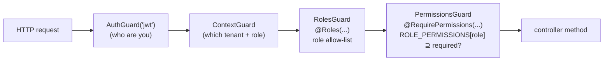

**Security rules** for this path live in [08-security.md](08-security.md#security-rules):
[Rule 1](08-security.md#rule-1-routes-are-closed-by-default) (routes closed by default),
[Rule 2](08-security.md#rule-2-teacher-reads-are-scoped-to-assigned-sections) (teacher scope; a coordinator row widens reads only, through `includeCoordinated` — see [03-backend-modules.md](03-backend-modules.md#coordinators-widen-reads-never-writes-epic-83)),
[Rule 8](08-security.md#rule-8-suspend-remove-or-reset-bumps-tokens_valid_after) (session cut-off) and
[Rule 15](08-security.md#rule-15-redis-down-has-a-written-answer-per-route) (Redis down).

`@Roles` says which roles may reach a route; `@RequirePermissions` says
which capability from `ROLE_PERMISSIONS` (`shared/src/enums/permissions.ts`)
the route exercises. Both run today.

On a tenant route with `@RequirePermissions`, the permission is the real
gate. `@Roles` now exists only on routes listed in `ROLE_NARROWINGS` or
`IDENTITY_SCOPED` (`permission-matrix.e2e-spec.ts`). Everywhere else it was
redundant and was deleted (Epic 24.0).

`PermissionsGuard` **fails closed**: every route behind it carries either
`@RequirePermissions` or `@AuthenticatedOnly()`. A route with neither is a 403
(`This route declares no permission`).

`IDENTITY_SCOPED` routes are the exception: some carry no
`@RequirePermissions` at all and are marked `@AuthenticatedOnly()` instead
(`permission-matrix.e2e-spec.ts` proves the marker and the list match
one-for-one). The gate is the route's own identity check, plus its `@Roles`
list where it has one. Seven identity routes have no `@Roles` at all (the five
`/attention/*` routes, `GET /schools/:id/logo`, `GET /schools/me/profile`): there
the service's identity check is the only gate. Example: `GET /leave/balance` acts
only on the caller's own staff profile.

`ContextGuard` trusts the memberships inside the JWT. What makes a removed membership disappear within one request is the session cut-off (`users.tokens_valid_after`, checked in `JwtStrategy`; see [08-security](08-security.md) "Session cut-off").

Which status a refused request gets depends on which guard refuses it:

| Request                                                                                         | Refused by         | Status                                                  |
| ----------------------------------------------------------------------------------------------- | ------------------ | ------------------------------------------------------- |
| Valid token, wrong role, route has **no** `@Roles` (most routes)                                | `PermissionsGuard` | **403** `Requires permission(s): …`                     |
| Valid token, wrong role, route **still has** `@Roles` (a narrowing or identity-scoped route)    | `RolesGuard`       | **403** `Requires one of roles: …` (since #1360 / #729) |
| Route behind `PermissionsGuard` declares no `@RequirePermissions` and no `@AuthenticatedOnly()` | `PermissionsGuard` | **403** `This route declares no permission`             |
| `X-Role` names a role the user does not hold in this tenant                                     | `ContextGuard`     | **401**                                                 |
| Missing or bad token                                                                            | `AuthGuard('jwt')` | **401**                                                 |

`ContextGuard` also checks the school's own state, after the role is resolved (the platform tenant is exempt from both):

| School state                                       | Request                                               | Answer                                                                   |
| -------------------------------------------------- | ----------------------------------------------------- | ------------------------------------------------------------------------ |
| `SUSPENDED`                                        | anything, unless `@AllowWhenSuspendedForBilling`      | **403** `TENANT_SUSPENDED` (plus `reason` for a billing suspension)      |
| `ACTIVE`, over its seats (7-day grace, Epic 49 D9) | `POST/PUT/PATCH/DELETE`, unless the handler is marked | **403** `TENANT_READ_ONLY` with `details.until`; `GET/HEAD/OPTIONS` pass |
| `ACTIVE`, a backup restore running                 | `POST/PUT/PATCH/DELETE`                               | **423** `TENANT_RESTORING`                                               |

How the grace window and the suspension work: [34-onboarding](34-onboarding.md) "Over the seats".

Example, with a PARENT token for the same school:

- `GET /guardians` (no `@Roles`; PARENT lacks `GUARDIAN_READ`) → `403`.
- `GET /homework` (keeps `@Roles(ADMIN, TEACHER)`, see below) → `403`.

Example of a narrowing: `GET /homework`. PARENT and STUDENT hold
`HOMEWORK_READ` (for their own child's view). This route is the teacher/admin
list across all students, so it keeps `@Roles(ADMIN, TEACHER)` to keep
families out.

A narrowing can retire later: give the route its own permission, grant it to
the roles in `@Roles`, delete the `@Roles` line and the `ROLE_NARROWINGS`
entry. When the list is empty, delete `RolesGuard`.

### Step-up approval (16.2) — re-entering an approver's code for a risky action

Some actions (reversing a payment, discounting a bill past a threshold,
creating a duplicate fee, voiding an invoice) need a fresh, in-the-moment
re-authentication of an admin — not just the acting user's own login. The
approver can be the person acting. `@RequireApproval` marks a route as
gated; walking the modal through to a token is the same flow everywhere,
regardless of which route triggered it.

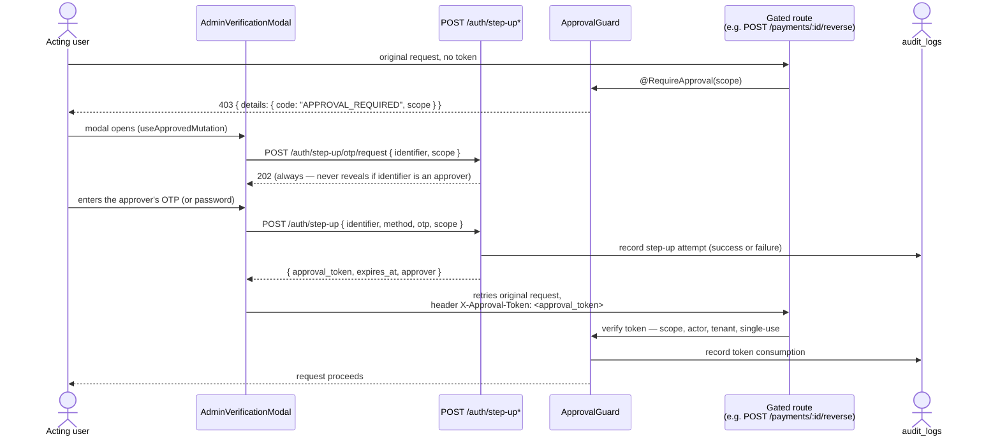

What the server checks when the acting user types an approver identifier:

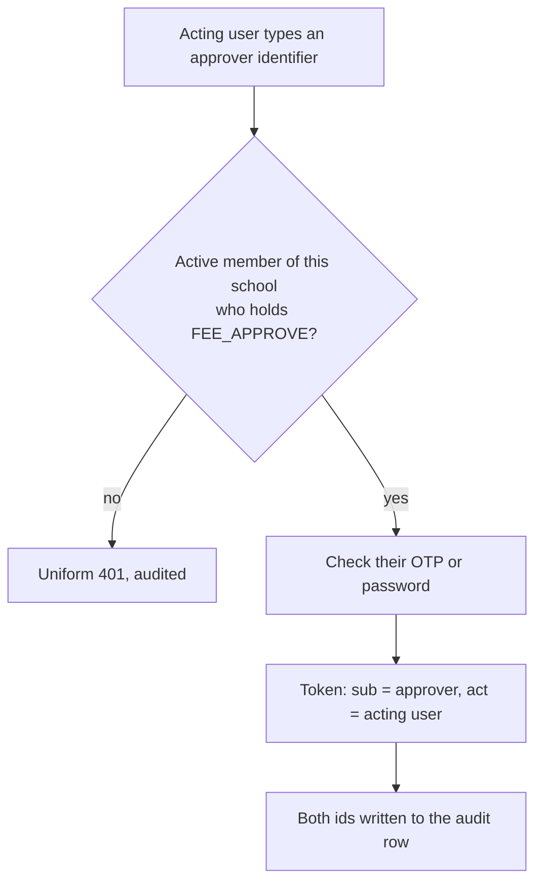

Example: in a school with one admin, Rahim is the admin. Rahim reverses a
payment and types his own code as the approver. That is allowed. The audit row
shows `approver_id = actor_id = Rahim`.

A few things worth being explicit about, because they're easy to get wrong
building a new gated route:

- **The approver can be the acting user, but a reversal checks who else
  could have approved.** Step-up itself lets the actor verify as their own
  approver (pinned by `step-up.controller.e2e-spec.ts`, "the actor may verify
  themselves as the approver"). `POST /payments/:id/reverse` then applies the
  Epic 78 D1 rule in `PaymentReversalService` before any lock or money row:

  ```mermaid
  flowchart TD
    A[approver == actor?] -- no --> OK[reversal runs<br/>audit self_approved: false]
    A -- yes --> B{fees.requireSecondApprover on?}
    B -- yes --> NO[403 SECOND_APPROVER_REQUIRED<br/>nothing changes]
    B -- no --> C{another ACTIVE FEE_APPROVE holder<br/>in this school? SUPER_ADMIN does not count}
    C -- yes --> NO
    C -- no --> OK2[reversal runs<br/>audit self_approved: true]
  ```

  Example: Rahim is the only admin of his school and reverses a payment with
  his own code. That runs, and the audit row says `self_approved: true`. Once
  a second admin, Karim, joins, Rahim's own code is refused with
  `403 { details: { code: "SECOND_APPROVER_REQUIRED" } }`; the approval token
  is already spent, so he runs step-up again with Karim's code. A school can
  also turn on **Always need a second admin to reverse a payment**
  (`fees.requireSecondApprover`) to refuse self-approval even with one admin.

- **Attempts are counted three ways** (Redis, 15-minute window, limit
  `STEP_UP_RATE_LIMIT_MAX_ATTEMPTS`, default 5). Every attempt counts, right
  or wrong, before the credential is checked. Any one over its limit is a 429.
  The approver key is counted only after the caller's own two keys allow the
  attempt, so one caller adds at most 5 to it.

  | Key                                                  | Limit   | Why                                                                |
  | ---------------------------------------------------- | ------- | ------------------------------------------------------------------ |
  | `step-up-attempts:pair:<tenant>:<caller>:<approver>` | 5       | One caller's attempts never lock the approver out for others.      |
  | `step-up-attempts:actor:<caller>`                    | 5       | One caller cannot spread guesses over many approvers.              |
  | `step-up-attempts:approver:<tenant>:<approver>`      | 20 (4x) | Many callers together cannot multiply the guesses at one approver. |

  Code requests have the same 20 ceiling per approver
  (`step-up-otp-requests:approver:…`): past it, the 202 still comes back but no
  new code is sent, so ten staff cannot text one approver ten times. Only codes
  actually sent count: a request inside the caller's own 60 s cooldown sends
  nothing and gives its slot back.

- **A step-up code is bound to the school, the caller and the scope it was
  requested for.** `POST /auth/step-up/otp/request` takes `{ identifier, scope }`
  and the code is stored under `tenant:caller:scope:approver`. Using it for a
  different scope or from a different account fails like a wrong code.
  Example: a code requested for `fees.discount` and sent to `POST /auth/step-up`
  with `scope: payments.reverse` gives `401 Invalid credentials`, the same body
  and the same audit row as a wrong code. The three attempt counters above
  carry no scope, so rotating the scope buys no extra guesses.
- **The 403 body is nested.** `ApprovalRequiredException`
  (`server/src/common/errors/approval-required.exception.ts`) must put
  `code`/`scope` under a `details` key — the global exception filter only
  ever forwards a top-level `details` field onto the wire, and every
  consumer (`ui/src/hooks/approval.tsx`'s `isApprovalRequiredError`,
  `ui/src/api/errors.ts`'s `ApiError.details`) reads `error.details.code`. A
  flat `{code, scope}` body silently breaks every step-up flow in the app —
  this happened once already (fixed in [16.2.5]'s wave-close pass) and every
  mocked component test kept passing throughout, because the mocks assumed
  the correct nested shape from the start. Only a live-server test (an
  `e2e/journeys/*.spec.ts` hitting the real guard, not a `msw`-mocked one)
  catches this class of drift.
- **A token is single-use and scope-bound.** `approval_token` is consumed by
  `ApprovalGuard` on first successful use; a retry with the same token — even
  against the same route — gets another `APPROVAL_REQUIRED` 403.
  `e2e/journeys/step-up.spec.ts` (16.2.5) proves the whole loop end to end:
  no token → 403, full OTP round trip → token → route succeeds once →
  same token replayed → 403 again.
- **A refused reversal still spends the code.** `ApprovalGuard` burns the
  token before the handler runs, so if the handler then answers 409 the admin
  needs a new OTP. Accepted on purpose (F-153): a token is a one-shot "yes",
  not a reservation. Example: reversing payment #1 while payment #2 exists
  answers `REVERSE_LATER_PAYMENTS_FIRST` (`payment-reversal.service.ts`; the
  route is `@RequireApproval(PAYMENTS_REVERSE)` in `checkout.controller.ts`);
  the OTP is gone, so the retry after reversing #2 asks for a fresh one. The
  same holds for `REVERSE_RETRY`. Checkout is the exception: it checks the
  wallet balance before it spends the token.

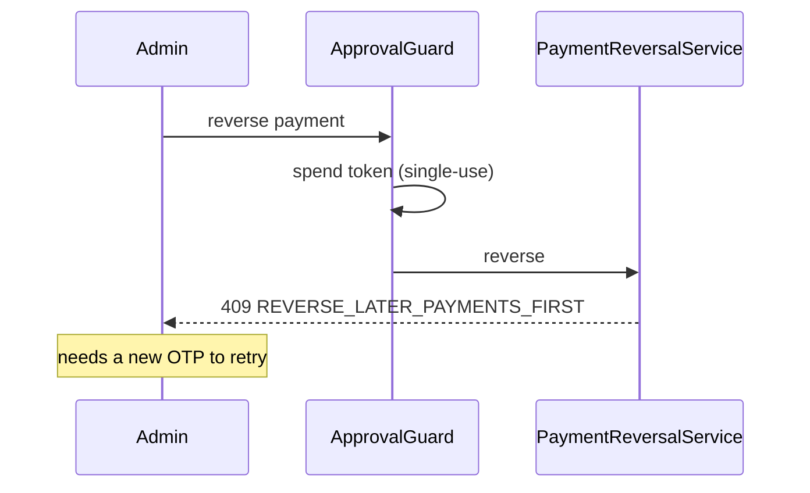

- **`ApprovalGuard` runs after `RolesGuard`/`PermissionsGuard`.** A caller
  who isn't allowed on the route at all still gets a plain 401/403 from the
  earlier guards, not `APPROVAL_REQUIRED` — the step-up prompt only appears
  once the caller has cleared "can you call this route," to avoid using
  "approval required" as a way to fingerprint routes a caller can't see.

## Invitations & account access

When an admin creates a user without a password (`POST /users`, no
`password` field), the account is created with `password_hash = null` and
cannot log in on its own — it needs an activation link. "Invited" is not a
stored status: it's derived from `password_hash` plus the newest
`auth_tokens` row for that user, so no `UserStatus` enum churn was needed.

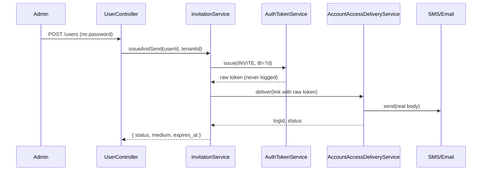

Key points:

- **One shared `auth_tokens` table** (`AuthToken` entity) backs invitations
  today and password resets / email verification in later sub-issues
  (12.3, 12.7) — same hashed-token pattern as `refresh_tokens`: only a
  SHA-256 hash of the random secret is ever stored.

  | id      | user_id | purpose  | token_hash (64 hex) | expires_at | consumed_at                                  |
  | ------- | ------- | -------- | ------------------- | ---------- | -------------------------------------------- |
  | `a1b2…` | `u-42`  | `INVITE` | `9f86d0…`           | in 7 days  | `null`                                       |
  | `c3d4…` | `u-42`  | `INVITE` | `e3b0c4…`           | (expired)  | `2026-08-01` (consumed, from a prior resend) |

- **Delivery never leaks the secret into the communication log.**
  `AccountAccessDeliveryService` writes a `CommunicationLog` row (so the
  send is visible in the same audit trail as any other message) but with
  `message_body` redacted (`••••••` in place of the link/code) — the real
  body is a local variable, sent straight to the provider, and never
  persisted or logged. `trigger = ACCOUNT_ACCESS` marks these rows apart
  from ordinary reminders.
- **One shared `OtpService`** (Redis, 6-digit codes, 5-minute TTL, 5
  attempts then a 15-minute lock) is shared by forgot-password, admin
  reset, OTP sign-in, contact change, registration and step-up. It lives
  in the `account-access` module.
- **Resend revokes prior links.** `POST /users/:id/invitation/resend`
  calls the same `issueAndSend` path, which revokes every still-live
  invite for that user before issuing a new one — a stale link in an old
  email can never be used once a resend happens.
- A delivery failure (bad phone number, provider outage) never rolls back
  the user that was just created — user creation and invitation dispatch
  are independent outcomes.

#### How many codes one phone or email can get (GAP-05)

Each purpose has a 60-second cooldown. On top of that, one phone or email
gets at most 5 codes **per purpose per hour** (sign-in, reset, registration
and phone check each have their own count). Step-up codes are not counted,
because they are not sent anywhere.

Why per purpose and per hour: the first version shared 10 codes a day across
all purposes. Anyone could then spend a parent's codes in ten minutes and
lock them out of both sign-in and password reset for a whole day. Now a
stranger can block one purpose for at most an hour.

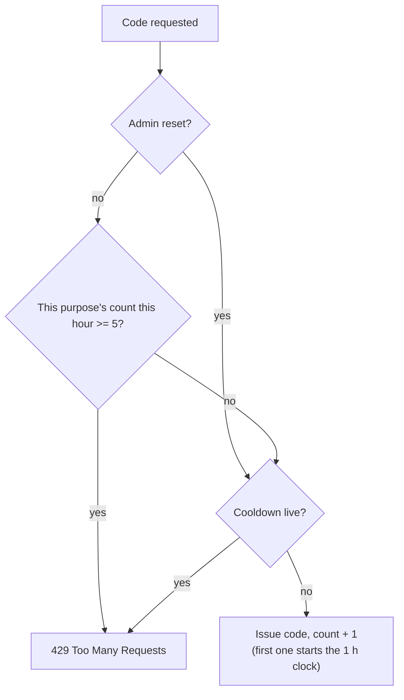

Example: `01712345678`, `+880 1712-345678` and `8801712345678` are one
handset, so sign-in codes for any of them count against the Redis key
`otp-cap:LOGIN:8801712345678`. `Foo@X.com` resetting a password counts
against `otp-cap:PASSWORD_RESET:foo@x.com`.

An admin reset (`POST /users/:id/reset-password`) skips the cap, so a
stranger cannot block it, and it asks for the code before signing the user
out, so a refused code (cooldown) signs nobody out.

Forgot-password and OTP sign-in still answer 202 when refused (so nobody
can tell which numbers have accounts). Their "enter the code" screen says
so: "No code after a few tries? Wait an hour, then try again."
Registration and contact change show the 429. Per-school and global caps
are #1759.

### Batch invites (12.6) — inviting a whole imported cohort's guardians

Bulk-imported students get Guardian rows but no login — so "invite this
cohort's guardians" is a **preview-first batch action**, not an import side
effect. It reuses 12.1's `issueAndSend` per guardian, fanned out over a
queue, with a `batch_id` (not a new `ReminderBatch`-shaped entity) tying
the fan-out back together for progress polling:

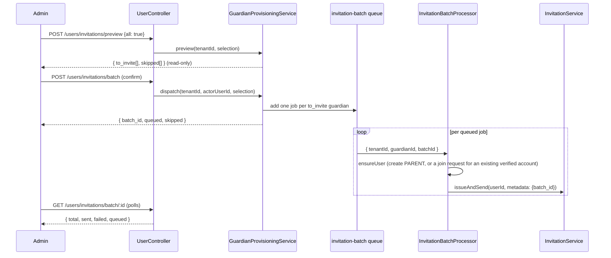

Key points:

- **Sibling dedup is free.** Two students sharing one guardian's phone
  already collapse to one `Guardian` row (`bulk-upload.service.ts`'s
  phone-dedup) — one guardian, one `ensureUser` call, one account.
- **`batch_id` lives in `metadata`, not a new table.** It's written into
  `auth_tokens.metadata.batch_id` (via `issueAndSend`'s `metadata`
  parameter) and `communication_logs.metadata.batch_id` (via `deliver`'s
  `metadata` parameter). `batchStatus` counts `communication_logs` rows by
  that key and reads `total` back from the batch-dispatch audit row
  (`AuditAction.INVITATION_SENT`, `entity_type: 'InvitationBatch'`) —
  the same "derive it, don't store a redundant counter" instinct
  `deriveInvitationStatus` already uses.
- **Skip reasons mirror the reminder-batch preview grammar** —
  `no_contact` / `already_active` / `already_pending` /
  `notifications_disabled` — so staff read the same shape of "who got
  skipped and why" they already know from bulk reminders.
- **`ensureUser` is idempotent under retry.** A guardian already linked to
  a `User` is loaded, not recreated; a guardian matching an existing
  `User` by a _verified_ phone or email, and not yet a member of this
  school (or holding a password but no `PARENT` role here), is not linked
  silently: that person gets a `JOIN_SCHOOL` request to accept (see
  [Same person in several schools](#same-person-in-several-schools)); a
  `23505` race between two concurrent batches is retried as "found".

## Sign-in methods, first password, leaving (Epic 13.0)

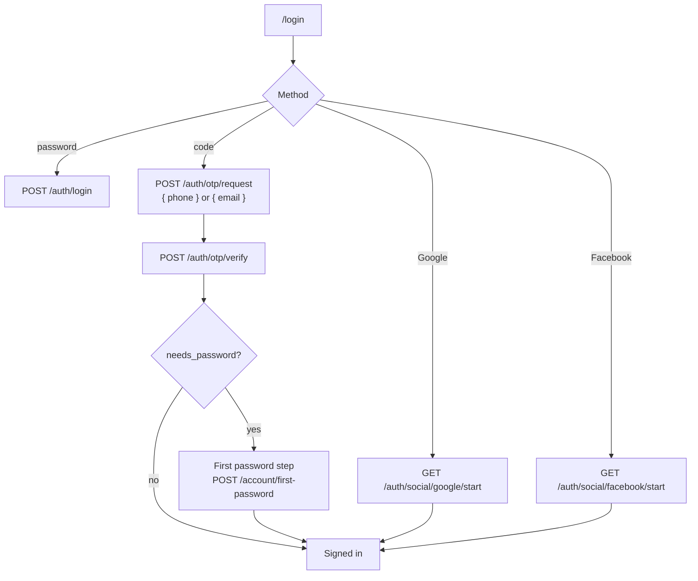

- **Code sign-in works by phone or email.** The identifier is either one.
  `/otp/verify` also returns `needs_password` and `password_required`
  (no password + staff role + no linked social account). The gate is
  client-side, stored per account and cleared on logout or when a password is
  set. Server enforcement is open: #1697. See
  [34-onboarding.md](34-onboarding.md).
- **Password rules depend on the role**, checked only when a password is set
  or changed (never at sign-in). Strictest role across all memberships wins.

  | Roles                    | Rules                                       |
  | ------------------------ | ------------------------------------------- |
  | Any staff role, or mixed | 8+ characters, upper, lower, digit, special |
  | Only PARENT / STUDENT    | 8+ characters, a digit                      |

- **Google and Facebook.** The server lists the
  configured providers (`GET /auth/social/providers`) and the UI draws one
  button each. The flow is server-side authorization code with PKCE and
  `state`. Identities live in `user_identities`. **Connecting is always
  explicit** (`POST /auth/social/:provider/link-start` from a signed-in
  session, with the account's `current_password`). An identity is never attached by matching email. Example: a Google
  account with `rahim@example.com` does not sign in to a user who has that
  email unless it was connected first.
- **Leaving and former members.** Staff leave with `POST /users/me/leave`.
  An admin removes with `DELETE /users/:id`. Both soft-delete the
  `user_tenants` row (`deleted_at`); the user account and their other schools
  stay. The last admin cannot leave or be removed. Guardians and students
  have no "leave". `POST /users/:id/restore` (needs `MEMBER_REMOVE`, ADMIN and SUPER_ADMIN only today) brings back the rows
  ended by the latest event. A person with no active staff role is a
  "Former" member.

## Learning: coordinator scope (Epic 83, 2026-10-31)

- **Surprise:** `HomeworkService.findOne` gates both the homework detail read and its edits, so a read-only widening there would have opened writes. **Fix:** homework list and detail stay teaching-only; coordinators get the read-only analytics rollups. **Rule candidate:** before passing `includeCoordinated` to a gate, grep its callers for a write path.
- **Surprise:** `GET /students/:id` goes through `FamilyAccessService.assertLinked`, the same gate fees and invoices use. **Fix:** an `opts.includeCoordinated` on `assertLinked` that only the student detail passes; the student list and `GET /students/ids` pass the flag to `sectionScope` (D5 keeps money routes teaching-only).
- **Rule:** a coordinator gets the listed reads only; they never change attendance, marks or student records. Their one write is the reminder they send through `POST /coordination/alerts`. The enforcing test is `server/src/coordinator-scope.e2e-spec.ts`; it lists the widened reads and the unchanged edit routes in `server/test/helpers/coordinator-scope-routes.ts`.

## Learning: D16 reversal, controller gets MARK_ENTER (Epic 81, 2026-11-05)

- **Surprise:** reversing D16 touched far more than the permission map. The Opus review of #3466 found stale references in `new-roles-narrowings.e2e-spec.ts`, `permission-matrix.e2e-spec.ts`, a comment in `marks-authorization.util.ts`, the exam-controller journey (it sent `cells: []`, which `@ArrayNotEmpty` rejects once the role can reach the route), and three bn/en user-guide page pairs. **Cost:** a second review pass after the first one declared done. **Fix:** every stale reference updated in #3466. **Rule candidate:** when a permission changes hands, grep the permission name AND the reason text; guide prose, comments and test titles assert the old rule in words, not in identifiers.
- **Surprise:** the first hunt only grepped the permission name, so it missed everything that stated the rule in prose. **Rule candidate:** treat "who may do X" as a sentence to search for (both languages for guide pages), not only a constant.
- **Note:** #3467 (usability test) is SKIPPED by decision D1, because it needs real users. W1 is server-only and may start; W3 stays gated on a real usability run.

## Why this deviated from the original plan

The original plan assumed one school and a single `role` column directly on
`User`. Multi-tenancy was added during build because the same account needs
to represent different people-in-context at different schools — a column on
`User` can't express "TEACHER here, PARENT there" for one person. The
`UserTenant` join table is what makes that possible, and it's the reason
almost every entity in [01-domain-model.md](01-domain-model.md) carries an
explicit tenant reference.

- **D12 (Epic 68): a shared login is owned by the person, not by a school.**
  School admins used to edit any member's email or phone (`PATCH /users/:id`)
  and reset their password. For a person in two schools, that let one school
  take over the login used at the other. Epic 68 replaced it: the person
  changes their own contact through the verify flow, an admin edit or reset
  of a shared login answers `409 SHARED_IDENTITY`, and joining a school is a
  request the person accepts. The alternative, admin edit plus a
  verification step, was considered and rejected.

## Learning: cockpit identity, Wave 0

2026-11-10, Epic 98 wave 0 (#3732).

- **Shared git config flipped (2026-11-10).**
  - Surprise: `core.bare` in the shared `.git/config` turned `true` mid-run, and git broke in every worktree at once.
  - Cost: all lanes stalled until someone noticed.
  - Fix: `git config core.bare false`.
  - Rule candidate: agents never touch git config; a worktree preflight checks `git config core.bare` is `false`.
- **Fence smoke counted fetch errors as "refused" (2026-11-10, #3731 review).**
  - Surprise: a DNS or TLS failure threw, the script read the throw as "the fence refused me", and a broken check looked like a pass.
  - Cost: a fence that could never fail.
  - Fix: `fetch` follows redirects, so use `redirect: 'manual'` and count only closed-socket codes (for example `ECONNREFUSED`, `ECONNRESET`) as refused. Anything else is a failure.
  - Rule candidate: a negative-path smoke check must name the exact outcomes that count as success, never "any error".
- **`COCKPIT_DOMAIN` never reached the smoke script (2026-11-10).**
  - Surprise: `smoke.yml` forwards only `SMOKE_*` keys, and `biddaloy-nightly` passes an explicit `-e` list, so a new env var is dropped silently and its checks skip.
  - Cost: the gated cockpit checks ran as no-ops.
  - Fix: forward the variable in `smoke.yml` and add it to the nightly `-e` list.
  - Rule candidate: a new smoke env var is not done until it appears in `smoke.yml` and the nightly `-e` list, and a gated check logs loudly when it skips.

## Learning: cockpit identity, Wave 1

2026-11-10, Epic 98 wave 1 (#3733-#3740).

- **The DB role password drifted from the container env (2026-11-10).**
  - Surprise: the Postgres role password no longer matched the container environment, so DB auth failed although the config looked right.
  - Cost: integration runs failed on auth, not on code.
  - Fix: re-sync the role password with the container env before blaming the code.
  - Rule candidate: on a DB auth failure, compare the role password with the container env first.
- **`core.bare` flipped a second time (2026-11-10).**
  - Surprise: the shared `.git/config` flag went `true` again, as in Wave 0.
  - Cost: git broke in every worktree until it was reset.
  - Fix: `git config core.bare false`.
  - Rule candidate: the worktree preflight checks `git config core.bare` every wave, not once.
- **New entities fan out to about 117 spec failures (2026-11-10).**
  - Surprise: an entity missing from the app `entities` array or `test/all-entities.ts` fails `all-entities.completeness.integration.spec.ts`, and the demo-seed and workbook coverage guards fail too.
  - Fix: register the entity in the app `entities` array, `all-entities.ts`, `slices.ts` `EXEMPT` and `entity-coverage.ts` together.
  - Rule candidate: a new table is not done until all four lists name it.
- **Compressed issue bodies lose their Steps section (2026-11-10).**
  - Surprise: agents got issue bodies with no Steps section, so they guessed.
  - Cost: wrong guesses, rework.
  - Fix: put the brief in a file and point the agent at it.
  - Rule candidate: dispatch from a brief file, never a compressed issue body.
- **`yarn install` churned about 117 lock entries (2026-11-10).**
  - Surprise: one install rewrote far more of `yarn.lock` than the change needed.
  - Cost: noisy diff, hard review.
  - Fix: edit the lock minimally, check with `git diff --stat`.
  - Rule candidate: any lockfile change gets a `git diff --stat` look before commit.
- **The all-entities completeness spec never ran in CI (2026-11-10).**
  - Surprise: the vitest `include` pattern skipped `all-entities.completeness`.
  - Cost: the guard looked green while checking nothing.
  - Fix: fix the include so it runs.
  - Rule candidate: a new guard ships with proof it runs (fail it once on purpose).
- **`COCKPIT_*` owner env is required in production (2026-11-10).**
  - Surprise: boot refuses without the owner keys, but they are optional in dev and test.
  - Cost: a deploy would fail on missing secrets.
  - Fix: create the secrets before deploy.
  - Rule candidate: a new required prod env key means its secret exists BEFORE the deploy.
- **Agents cannot dispatch reviewers (2026-11-10).**
  - Surprise: a subagent has no way to start a reviewer subagent.
  - Cost: in-lane review silently did not happen.
  - Fix: run reviews as separate passes from the orchestrator.
  - Rule candidate: plan review as its own pass, not inside the implementing agent.

## Learning: cockpit identity, Wave 2

2026-11-11, Epic 98 wave 2 (#3741-#3747). The cockpit sign-in is live under `/auth/cockpit/*`.

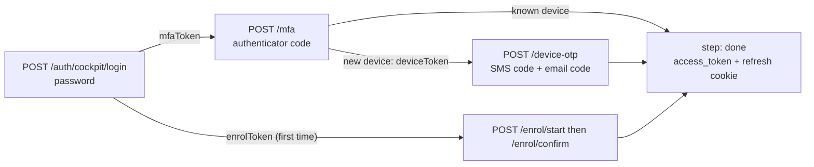

Example: the dev owner sends `{ "identifier": "owner@...", "password": "..." }` and gets `{ "step": "mfa", "mfaToken": "<jwt>" }`. The next call sends `{ "mfaToken": "<jwt>", "code": "123456" }`. Every refusal says the same sentence, so a caller cannot tell a wrong password from an unknown owner.

- **Briefs get garbled (2026-11-11).**
  - Surprise: compressed briefs and issue bodies lost whole sections (Steps, file lists).
  - Fix: write the brief to a file, tell the agent to read it, and have the agent say which part looks garbled.
- **Agents cannot nest (2026-11-11).**
  - Surprise: a lane agent cannot dispatch its own reviewer.
  - Fix: the orchestrator dispatches reviews, then a fix agent. Plan for that round trip.
- **nginx `conf.d` loads alphabetically (2026-11-11).**
  - Surprise: a `log_format` used before the file that defines `redacted` loads is a config error.
  - Fix: name files so the one that defines `redacted` sorts first. Rule 13 still applies to the cockpit host.
- **Express routes are case-insensitive, nginx `location ~` is not (2026-11-11).**
  - Surprise: `/Auth/Cockpit/login` reached the app but missed an nginx rule written for the lower-case path.
  - Fix: write protective regexes as `~*`.
- **The edge-mode failover check is flaky (2026-11-11, #4041).**
  - Cost: a red CI section that passes on rerun.
  - Fix: rerun it alone with `--only edge-mode` before judging it. Tracked in #4041.
- **`reset-order.ts` must list new tables (2026-11-11).**
  - Surprise: a table missing there leaves rows behind between specs.
  - Rule candidate: a new table is not done until `reset-order.ts` names it, next to the four lists in Wave 1.
- **A cockpit session refresh must check the owner before it rotates (2026-11-11).**
  - Surprise: checking after `rotate()` had already minted a new cookie for a locked owner.
  - Fix: read the cookie owner first (`userIdForCookie`), then rotate.
- **A custom passport strategy has a random guard name (2026-11-11).**
  - Surprise: `AuthGuard('cockpit-jwt')` printed as a random hash in `route-permissions.txt`, so the snapshot would change on every run.
  - Fix: `describeGuards` names it (`COCKPIT_JWT_AUTH_GUARD`). A new strategy needs the same line.

## Learning: cockpit identity, Wave 3

2026-11-11, Epic 98 wave 3 (#3748-#3756). Owners can step up, lock each other and approve each other's risky actions. No table or column changed in the close task, so no demo-seed change.

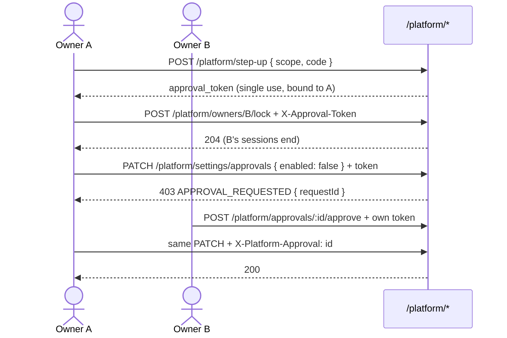

- **Step-up request and response.**
  - Request: `POST /platform/step-up` with `{ "scope": "platform.owner_lock", "code": "123456" }` and a cockpit bearer.
  - Response: `{ "approval_token": "...", "expires_at": "..." }`. Only a platform scope is accepted. A school scope, a wrong code or a replayed code is the same 401.
  - A recovery code is not accepted here.
- **Two owners locking each other at once: exactly one lock lands.** `lock()` takes `SELECT ... FOR UPDATE` on `platform_admins`, then re-reads statuses. Reading statuses before the lock is stale under READ COMMITTED and lets both through. Pinned by `platform-identity.e2e-spec.ts`.
- **The approval gate has two layers.** `X-Approval-Token` (step-up, every approval route) and `X-Platform-Approval` (the other owner's grant, only while the switch is ON and two owners are active). Switching the gate OFF needs the grant; switching it ON does not. With the gate OFF, repeating the same request needs no grant, by design.
- **A cockpit route is not in the school route snapshot's roles.** Every role column reads 401 for `/platform/step-up`, `/platform/owners*`, `/platform/approvals*`, `/platform/settings/approvals` because those routes take the cockpit bearer only. Each is on the `ALLOWLIST` in `server/test/helpers/route-path.helper.ts` with a reason.
- **supertest closes an unbound server.** A request built before an awaited call (`.set('X-Approval-Token', await stepUp(...))`) fails with `reading 'address'` on `app.getHttpServer()`. Fix: `app.listen(0)` and send to `app.getUrl()`.
- **Wave 2 notes re-checked against the files.**
  - nginx: `log_format redacted` is in `nginx/templates/default.conf.template`; every other template that uses it (`demo`, `host-cockpit`, `inbox`, `landing`, `ops`, `site`, `staging`) sorts after `default`. The two generated files sorting before it (`00-edge.conf`, `01-site-host.conf`) do not log with `redacted`. The note is correct.
  - `server/test/reset-order.ts` names `platform_approvals`, `platform_settings`, `user_recovery_codes`, `user_mfa`, `platform_admin_devices`, `platform_admins`; `reset-order.integration.spec.ts` fails if a table is missing. The note is correct.

## Learning: tenant control and Login as, Wave 0

2026-11-12, Epic 99 wave 0 (#3777 to #3781).

- **No `node_modules` in a fresh worktree broke the commit hook (2026-11-12, #3778).**
  - Surprise: husky lint-staged failed because the worktree had no install.
  - Cost: the commit went in with `--no-verify`.
  - Fix: `yarn install` before the first commit; `ci:local` at wave close re-runs the checks.
  - Rule candidate: a lane's first step is install, so hooks never need `--no-verify`.
- **The word "session" is banned on screen (D14, #3778).**
  - Surprise: the natural label "End session" breaks the copy rule.
  - Fix: the banner button reads "End".
  - Rule candidate: check kit copy against the D14 word list before writing stories.
- **Kit tests run only through the root vitest config, and the type check is `tsc -b` (#3778).**
  - Surprise: running vitest inside `ui/` skips the kit tests, and `tsc --noEmit` misses project references.
  - Fix: run vitest from the repo root and use `tsc -b`.
- **The deny-list snapshot is not an empty file (#3779).**
  - Surprise: `impersonation-deny-list.snapshot.txt` carries `#` header comment lines, so "empty" means "no route lines".
  - Cost: a later ticket (#3793) that expects a zero-byte file would fail.
  - Rule candidate: compare snapshots with comments stripped.
- **The pre-push hook hung for more than 120s (#3779).**
  - Cost: the push stalled until the hook was bypassed.
  - Fix: push with `--no-verify` and disclose it; `ci:local` covers the checks.
- **The post-deploy smoke reuses existing domain names, but adds one gate (#3780).**
  - It reads `SMOKE_COCKPIT_DOMAIN` and `SMOKE_APP_DOMAIN`, not a new `COCKPIT_DOMAIN`.
  - The Login as fence runs only when `SMOKE_IMPERSONATION=1`. Once opted in, a missing domain is a FAIL, never a silent skip.
  - Open item: `SMOKE_IMPERSONATION` appears in no workflow, `smoke.yml` or the nightly `-e` list, so the fence never runs in CI. Forward it in the wave that enables the fence (the Wave 0 cockpit bullet above is the rule).
- **Banner story label (#3778) — fixed in the accumulating branch.** `impersonation-banner.stories.tsx` passed "End session", which broke D14; it now passes "End".
- **Open owner steps (#3777).** The usability test and the screenshots of the tenant control mockups are human steps and are not done. They stay open for the owner.

## Learning: tenant control and Login as, Wave 1

2026-11-12, Epic 99 wave 1 (#3782 to #3788).

- **Money-tier reviewers could not run DB specs in their contexts.** DB specs were verified at wave close, not in the review pass.
- **Fresh worktrees: husky pre-push hangs and lint-staged is missing.** Push and commit with `--no-verify`, disclose it; `ci:local` at close re-runs the checks.
- **`core.bare` got flipped to `true` once.** If git says "bare repository", stop and check `git config core.bare`.
- **Ticket #3784 said 17 audit values; 16 is right.** Trust the code and the shared enum, not the ticket count.
- **Notes for #3797.**
  - Middleware order: the AsyncLocalStorage context must survive body-parser.
  - `JwtStrategy` (#3791) must call `setImpersonation` exactly once per request.
- **Open follow-ups.** #4081 (`SMOKE_IMPERSONATION` not forwarded in CI), #4087 (workbook restore race).
- **`ci:local` caught a stale `schema.d.ts` (#3788).** No route changed, but the 16 new `AuditAction` values reached the OpenAPI schema; `client-admin` audit-logs failed `tsc -b`. Fix: `yarn api:types` and commit `schema.d.ts`. Rule candidate: a shared enum used in a DTO means regenerate the API types.

## Learning: tenant control and Login as, Wave 2

2026-11-12, Epic 99 wave 2 core (#3797). The server pieces from #3789 to #3796 are now wired.

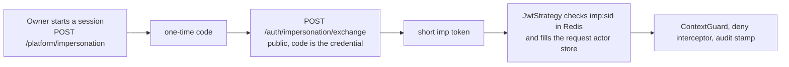

- **One Redis client.** `AuthModule` provides and exports `IMPERSONATION_REDIS` (fail-fast, 1 s command timeout). `SupportAccessModule` imports `AuthModule` instead of opening a second connection. `JwtStrategy` was already waiting for the token as `@Optional()`.
- **The per-request store comes from a middleware.** `SupportAccessModule.configure` applies `requestActorContextMiddleware` to every route. `JwtStrategy` fills the store once per request; with no store it answers 401, so a missing middleware fails closed. Nothing else in the repo implements `configure`.
- **Route lists.** `POST /auth/impersonation/exchange` is public by design (ALLOWLIST) and fail-closed without Redis. `GET /auth/impersonation/me` and `POST /auth/impersonation/end` are bearer-only like `/auth/logout-all` and fail-open. The four `/platform/*` routes are cockpit-jwt + `PlatformAdminGuard` rows, like `/platform/approvals`.
- **No-store on exchange.** `main.ts` sets `no-store` for `/api/*`, but e2e apps do not run `main.ts`, so the exchange route sets the header itself (`@Header`).
- **Test reset order.** `impersonation_sessions` (RESTRICT FK to `platform_admins` and `users`) was missing from `test/reset-order.ts`. One leftover row made the next spec file's setup fail with a foreign key error. `platform_school_notes` and `platform_announcements` were missing too, and the reset-order coverage guard caught them. Any new RESTRICT-FK table joins that list in the same ticket.
- **Stale header.** The deny-list snapshot header said "empty until #3793"; it now lists marked routes, and the generating string in the e2e spec was changed to match.
- **Open.** `SMOKE_IMPERSONATION=1` still reaches no workflow in this branch (#4081).

## Learning: tenant control and Login as, Wave 3

2026-11-12, Epic 99 wave 3 close (#3804). The consent, request, notice and rule files from #3798 to #3803 were built as loose files; #3804 wired them.

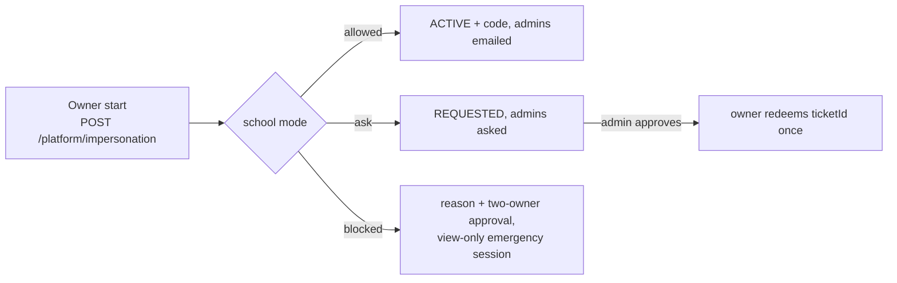

- **Wire-only ticket, one real gap.** Seven providers and three controllers joined `SupportAccessModule`, two attention rules joined their rules modules. The module also needed `School` in `TypeOrmModule.forFeature`, plus `TrialModule` (for `AdminNoticeService`) and `AccountAccessModule` (for the delivery service).
- **Two approval layers on one start.** `ApprovalGuard` always wants a `platform.login_as` step-up token (even with one owner). Only in `blocked` mode does `TwoPersonGuard` then add the second owner (`APPROVAL_REQUESTED`). The e2e spec mints a fresh step-up token per start and suspends other seeded owners so the owner count is its own.
- **New route classification.** `POST /platform/impersonation/:id/request-write` needed an `ALLOWLIST` entry in `test/helpers/route-path.helper.ts`; `permission-matrix.e2e-spec.ts` fails on any unclassified cockpit route.
- **Admin notices are logged, not delivered through the delivery spy.** `AdminNoticeService` writes `communication_logs` rows (`metadata.kind`); assert on those, not on `AccountAccessDeliveryService.deliver`.
- **Shared DTOs followed the server.** `SupportAccessSettingsDto` now has `confirmedByName` and `needsConfirmation`; `StartImpersonationRequest` gained `ticketId?`; `RequestWriteRequest` is new. `schema.d.ts` regenerated.
- **Deviation.** No i18n keys were added for `supportAccess.platformAction.*`: no UI renders them yet, so they ship with the admin screen ticket.

## Learning: tenant control and Login as, Wave 4

2026-11-12, Epic 99 wave 4 close (#3816). Eleven controller families (#3805 to #3815) were built as loose files; `PlatformControlModule` wires them and is the only place that does.

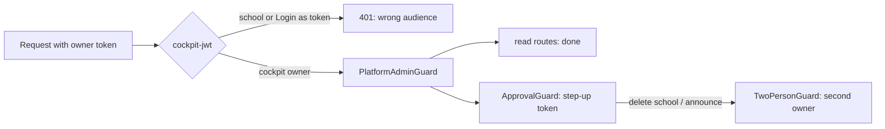

- **A Login as token hits the same wall as a school token.** Both carry the school audience, and `cockpit-jwt` only accepts the cockpit audience, so every `/platform/**` route answers 401 for them. The e2e spec proves the wall with a real school login on every route; a real Login as token is not minted in it (same audience, same strategy check).
- **Real gap found at wiring: step-up could not be minted.** `PLATFORM_APPROVAL_SCOPES` (`step-up.service.ts`) only listed Epic 98 scopes, so `platform.delete_school`, `platform.announce_all`, `platform.ops_action` and `platform.school_control` were refused with 401. Every approval-gated Wave 4 route was unreachable until the four scopes were added. A new platform scope joins that list in the same ticket as its route.
- **Wiring needed three tiny exports:** `SupportAccessModule` exports `ImpersonationSessionService`, `HealthModule` exports `HealthService`, `SchoolsModule` exports `SchoolAdminsService`. Session cut-off, refresh tokens, `ApprovalGuard` and the Redis clients arrive through @Global modules.
- **Route lists.** All 24 new routes are `ALLOWLIST` rows (cockpit bearer, no tenant); each is 401 for ANON and every school role in the route-status snapshot. Retry-failed, restore-lock release and the announcement send are `@FailClosedWithoutRedis()` and listed in the Redis outage table; the read and preview routes are fail-open.
- **No extend route.** #3808 added no extend route, so none exists to wire.
- **Archive status never returns the raw job error** (Rule 24): a fixed sentence replaces it.

## Cockpit identity

Platform power (suspend a school, lock an owner, change approvals) does **not** come from a school membership. It comes from a row in `platform_admins`, and it is used only on the cockpit host with a cockpit token.

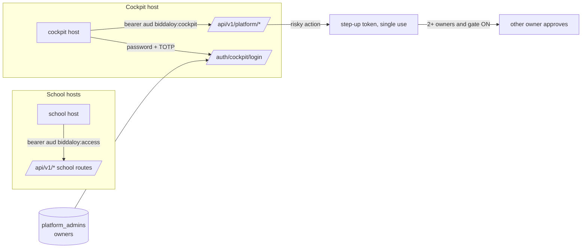

- **Two token audiences.** A school token is refused on `/platform/*`, and a cockpit token is refused on school routes, both ways (`cockpit-auth.e2e-spec.ts`).
- **Owners.** Seeded at boot from `COCKPIT_OWNER_*` by `OwnerSeedingService`. Each owner has a password, an authenticator (TOTP) and recovery codes.
- **Step-up and approval.** A risky route needs `X-Approval-Token` from `POST /platform/step-up`; with two active owners and the gate ON it also needs the other owner's grant (`X-Platform-Approval`).
- **Example.**

```
POST /api/v1/platform/step-up      Authorization: Bearer <cockpit token>
{ "scope": "platform.owner_lock", "code": "123456" }
200 { "approval_token": "...", "expires_at": "2026-11-12T10:05:00Z" }
```

- **Why not a school membership?** A membership is per school and a school ADMIN can create them. Platform authority must not be something a school can grant, copy or lose by removing a user. So legacy `SUPER_ADMIN` rows are converted once, **by an operator**, with `node server/dist/scripts/platform-cutover.js` (`--dry-run` first; steps in `28-platform-runbook.md`). `PlatformCutoverService` (flag `cutover.done` in `platform_settings`): owners and platform-school `SUPER_ADMIN`s lose the membership, other schools' `SUPER_ADMIN`s become `ADMIN`, those users' sessions end. It does not run on boot: converting real legacy `SUPER_ADMIN`s must wait for the owner sign-off on #3773. It refuses unless a verified owner exists.

## Learning: cockpit identity, Wave 5

2026-11-12, Epic 98 wave 5 leftovers.

- **A service that "exists" was not wired, then ran when nobody asked (2026-11-12).**
  - Surprise: `PlatformCutoverService` had specs but sat in no module. Wiring it as a boot hook fixed that, and then it downgraded the e2e database's dev `SUPER_ADMIN`s on the first boot. That created a second approver, and reversal and step-up e2e specs failed with `SECOND_APPROVER_REQUIRED` (403).
  - Cost: two e2e shards red; a real production database would have had its legacy `SUPER_ADMIN`s downgraded silently on deploy.
  - Fix: the cutover is an explicit script (`platform-cutover.js`, with `--dry-run`); `platform-identity.e2e-spec.ts` boots the app with an owner and a legacy `SUPER_ADMIN` present and asserts nothing converts, and still resolves the service from the container.
  - Rule candidate: a one-time data conversion is an operator step with a dry run, never a boot hook.
- **Background polling kept an idle session alive.** Every cockpit request touched the idle key, so a polling page never idled out. Polling requests (alert bar, bell, `/platform/alerts`) now send `X-Cockpit-Poll`; `CockpitJwtStrategy` then only checks the session (`touch(fam, false)`) and never renews. The shell sends one real renewal per 5 minutes of user activity, so an active owner who triggers no other request is not idled out by the server first.
- **Shared DTOs drifted from the server** (`emailMasked`, `summary`): the client type-checked against a stale shape. The shared DTO now matches the server DTO.
- **What surprised us across the epic.**
  - Authority and "home school" are different things: `is_platform` marks where alerts live, `platform_admins` decides who may act.
  - Every negative-path check must name the outcomes that count as success.
  - Cached "found once" ids need an invalidation story, not only a miss story.

## Learnings — Epic 77

Module switches and renamed words, wave 1 (#3905 to #3909). Each bullet is: surprise, cost, fix, rule candidate.

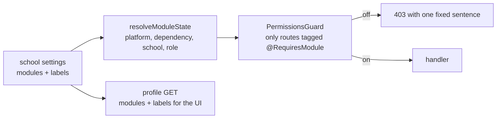

- 2026-11-13. **A guard that gained a dependency broke its other callers.** `PermissionsGuard` now takes a second constructor argument (`ModuleStateReader`). Six specs still build `new PermissionsGuard(reflector)` with one argument. Cost: a follow-up ticket (#3910) just to fix them. Fix: the specs pass a reader stub. Rule candidate: when a shared guard's constructor changes, grep for `new <Guard>(` in the same ticket and list the callers in the ticket's `## Files`.
- 2026-11-13. **A unit test of the guard did not prove the wiring.** The spec called `canActivate` on a mock context; nothing showed that a tagged route in a real Nest app refuses with the fixed sentence. Fix: `permissions.guard.e2e-spec.ts` now has a tagged probe controller that returns 403 `MODULE_OFF_MESSAGE` when the module is off, 200 when on, and refuses only the role listed in `offForRoles`. Rule candidate: any new guard behaviour gets one HTTP-level probe, like the permission one.
- 2026-11-13. **A test title said TEACHER but tested ACCOUNTANT.** The "role off" test passed for the wrong reason and would not have caught a bug for TEACHER. Fix: rewritten with TEACHER (refused) and ADMIN (passes). Rule candidate: assert on the role named in the title.
- 2026-11-13. **The validator let the same role in twice.** `offForRoles: ['TEACHER','TEACHER']` was accepted and stored. Fix: 400 with the fixed `roles` sentence (no echo of the input, Rule 23). Rule candidate: list-valued settings reject duplicates at the validator, not in the reader.
- 2026-11-13. **The ticket text said a missing tenant is a 400; it is a 401.** `PermissionsGuard` throws `UnauthorizedException('No active tenant context')`. Fix: corrected on the issue. Rule candidate: write status codes in tickets from the guard's code, not from memory.
- 2026-11-13. **The workbook needed no code.** `settings` is one JSON cell and only secret paths and `supportAccess` are stripped, so `modules` and `labels` already round-trip. Cost: none, but nothing proved it. Fix: a round-trip integration test and a line in `14-school-workbook.md`. Rule candidate: for a new key inside an existing JSON column, add the round-trip test, not a new column spec.
- 2026-11-13. **The demo seed has no table obligation here.** Settings is jsonb, so no column or table changed. The primary branch still shows Fines off, Homework off for teachers, and "Batch" for section, so the feature has data in the demo school (written next to the vocabulary save, after the preset apply, so it is not reset).

### Wave 2 (server tagging, #3910 to #3919)

Where one switch is read, and who reacts when it flips:

```mermaid
flowchart LR
  A[admin saves modules] --> W[SchoolsService.updateSettings]
  W --> C[tenant settings cache cleared]
  W --> B[attention bar cache of that school dropped]
  R[ModuleStateReader<br/>reads the school row, no cache] --> G[guard: route tagged]
  R --> J[jobs: skip an off school]
  R --> Q[attention queries: hide off-module rules]
  R --> D[push delivery: skip off-module rules]
```

Example: the school switches Fees off. `GET /api/v1/fee-structures` answers 403 `MODULE_OFF_MESSAGE` on the next request. The nightly fees job skips the school. A "fees overdue" alert already waiting for push is not sent, and is not counted on the bar. Switch Fees on again and all of it comes back; no row was deleted (D9).

- 2026-11-13. **The 30 s cache claim in D27 was wrong for modules.** `ModuleStateReader` goes through `SchoolsService.getSchoolModules`, which reads the school row (`findById`), not `TenantSettingsCache`. So a switch applies to the very next request, at the price of one small query per tagged request. Fix: none needed; this note replaces the "up to 30 s" wording for modules. Rule candidate: when a decision names a cache, check which reader the new code really calls.
- 2026-11-13. **One module-off check was missing from the push path.** The bar and the lists hid off-module alerts, but `AlertDeliveryService.deliver` did not, so an alert queued before the switch could still push once. Fix: it asks `AttentionQueryService.hiddenRuleKeys` (the same list the bar uses). Rule candidate: a new "hide when off" rule lists every reader of the data (screen, count, push, export), not only the screen.
- 2026-11-13. **The bar count lagged a switch by up to 60 s.** The bar summary is cached in Redis for `ATTENTION_SUMMARY_TTL_SECONDS`. Fix: a `modules` write now deletes that school's cached summaries (best effort; Redis down means the old 60 s lag). Words (`labels`) do not touch it.
- 2026-11-13. **"Unreadable state" quietly became "success".** Fees-daily logged and returned when it could not read the module state, so a run-now or restore catch-up job finished green and that day was never retried. Fix: it throws; the nightly loop already reports per school to Sentry, the other two jobs fail visibly. Rule candidate: a job that skips on purpose says so; a job that cannot decide fails.
- 2026-11-13. **One file can hold two modules.** `POST /fees/bills/:id/waive` lives in the fines controller but is tagged fees; the reminder routes live in the communications controller but are tagged fees (D39), while message history is messaging. The tag is per handler, so the table-driven spec (`modules-off.e2e-spec.ts`) pins these by name. `SYLLABUS_VS_PLAN` stays on `syllabus`: it is a syllabus card that only adds the plan line when a plan exists.
- 2026-11-13. **The table is driven by the key list.** `ROUTES` is a `Record<ModuleKey, string>`, so a new key without a row does not compile, and a row whose route is not tagged with that key in `route-status.snapshot.txt` fails the drift test. The snapshot MODULE column was already filled by earlier tickets, so the wave close changed no snapshot line (D48).

### Wave 3 (client hiding, #3920 to #3922)

How a switch reaches a page that is already open:

```mermaid
sequenceDiagram
  participant A as Admin (settings PATCH)
  participant S as Server
  participant P as Open page (profile cached)
  A->>S: modules: fines off
  Note over S: next request reads the school row, refuses at once
  P->>P: still shows Fines (cached profile, staleTime 30 s)
  P->>S: window focus after 30 s: GET /schools/me/profile
  S-->>P: modules.school.fines.on = false
  P->>P: sidebar, tab, palette drop Fines
```

Example: ADMIN switches Fines off while a teacher has the student page open. The
teacher's `PUT /fines` is refused with 403 right away. The Fines tab disappears the
next time the tab regains focus after 30 s, or on any reload.

- 2026-11-13. **The page does not hear about a switch; it asks again.** The profile query has `staleTime` 30 s and refetches on window focus. So "hidden within 30 s" is true only when something wakes the page; the server is the only instant gate. Fix: `modules-hiding.spec.ts` moves the page clock 31 s, fires a bubbling `visibilitychange` and polls. Rule candidate: say which event makes a cached value refresh, not only how long it lives.
- 2026-11-13. **A test fixture sent a body the server rejects.** `setModules` omitted `version: 1`, so every settings PATCH was a 400 and no e2e had ever run it. Fix: the fixture sends the version. Rule candidate: run a new fixture once against the real endpoint in the ticket that adds it.
- 2026-11-13. **A hidden portal URL shows a load error, not the refusal page.** Only the staff shell renders `ModuleOffState`. In the portal, `/portal/routine` with Routines off shows the generic "could not load" card (the server still answers 403). Cost: the e2e asserts only that the link is gone. Fix: follow-up to be filed from the lane report. Rule candidate: when a decision names "the URL shows the refusal page", list every shell it must hold in.
- 2026-11-13. **Modules are school-wide, so a browser test that flips one disturbs its neighbours.** Each test restores in `finally` and keeps the off window short; the spec uses Fines, Homework and Routines only. Rule candidate: a spec that changes school settings says so in its header comment.
