# Fees, Payments & Invoices

This is the core business flow the whole system exists for: charge students
for fees, collect payments, and prove what was charged and paid. It was
rebuilt end-to-end in Epic 16 — the section at the bottom explains what
changed and why, if you're looking for something this doc used to describe.

## The entities

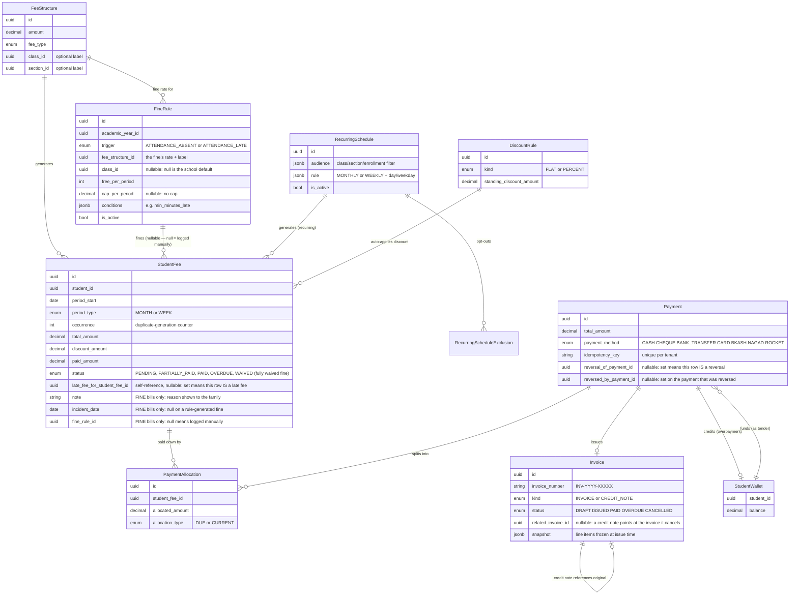

A `StudentFee` row is one student owing one fee for one period — the
"bill." Two bills for the same student in the same month are two separate
rows (e.g. tuition + exam fee), never merged. `FeeStructure` is a price tag
consumed at generation time; editing it later doesn't change bills already
generated, only future ones.

**"Is this a late fee / a reversal?" is a relationship, not a flag.** There
is no `is_late_fee` or `is_reversal` column. The API fields of those names
are derived in the DTO mappers from whether the self-reference is set:

```ts
// server/src/modules/fees/dto/family.dto.ts
is_late_fee: fee.late_fee_for_student_fee_id !== null,
is_reversal: payment.reversal_of_payment_id !== null,
```

That way the row always says _which_ bill it is a late fee for, or _which_
payment it reverses — a boolean alone could never be reconciled.

## Generate: turning a price tag into bills

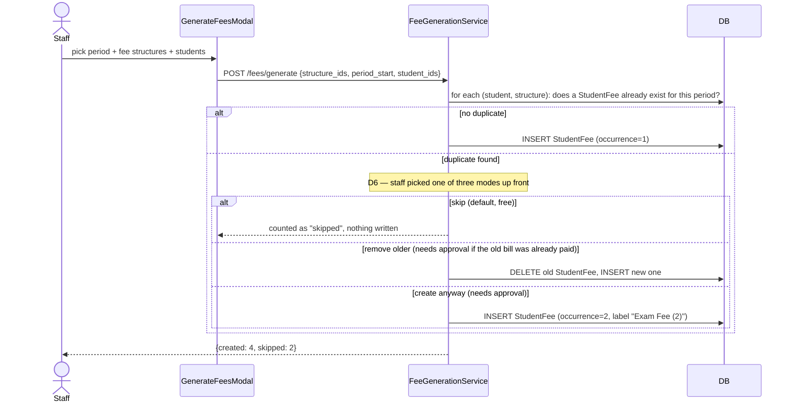

Example response for a run that generated 2 real bills and skipped 2
pre-existing duplicates:

```json
{
  "generation_id": "8e2f...",
  "created": 2,
  "skipped": 2,
  "student_fees": [
    { "id": "a1b2...", "student_id": "c3d4...", "fee_name": "Tuition", "total_amount": "1500.00" }
  ]
}
```

`RecurringSchedule` runs the same generation logic on a timer (see
"Daily job" below) instead of a staff click — audience is a filter
(class/section/program/enrollment status), evaluated fresh every run day, so a
student who joins mid-year starts getting billed automatically and one who
leaves stops, without editing the schedule (D4). `RecurringScheduleExclusion`
opts one specific student out of an otherwise-matching schedule. [34.2.2] A
`program_id` audience bills students with an ACTIVE `ProgramEnrollment` in
that program AND an ACTIVE class enrollment in the schedule's academic year —
combinable with class/section (both filters intersect), e.g.
`{ "program_id": "…", "enrollment_status": "ACTIVE" }`. One-off generation
(`POST /fees/generate`, `/fees/generate/preview`) accepts the same
`program_id`, resolved through the identical join and intersected with any
explicit `student_ids`.

`DiscountRule` (FLAT or PERCENT, scoped to all fee types or a chosen list,
optionally dated) auto-applies at generation time and writes to
`StudentFee.standing_discount_amount`. A one-off discount typed in during
checkout writes to `one_off_discount_amount` instead; `discount_amount` is
always their sum. Both discount paths go through the same approval-gated
flow described below (D8).

## Checkout: turning bills into a payment

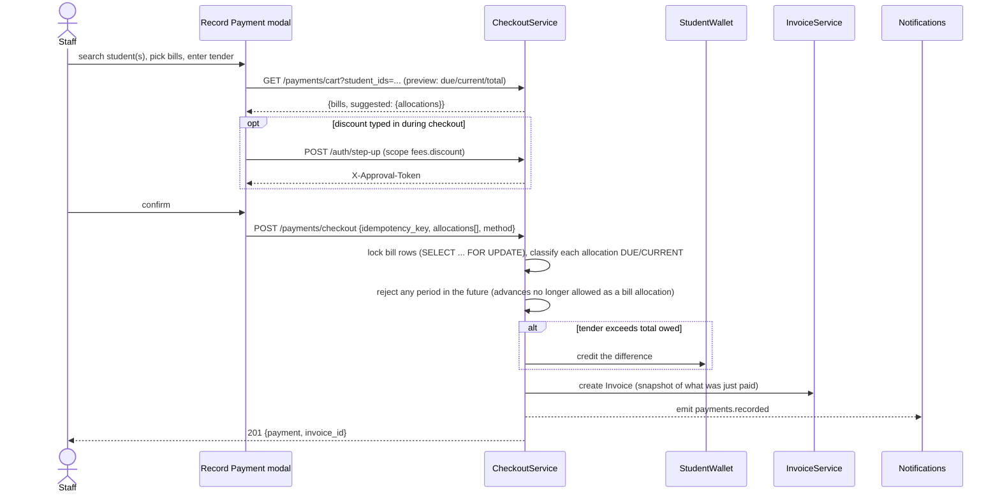

Multi-child checkout is one `Payment` + one `Invoice`, allocations grouped
per student; each child's dues update independently (D12). Overpayment goes
to `StudentWallet.balance` rather than a `PaymentAllocationType.ADVANCE`
row — the old advance-payment type was removed (D5, see below); wallet
balance can be spent as tender on a later checkout instead. `idempotency_key`
is unique per tenant, so a retried request (e.g. a double-click, or a client
retry after a timeout) returns the original payment rather than double
charging (D20).

## Reversal: undoing a payment

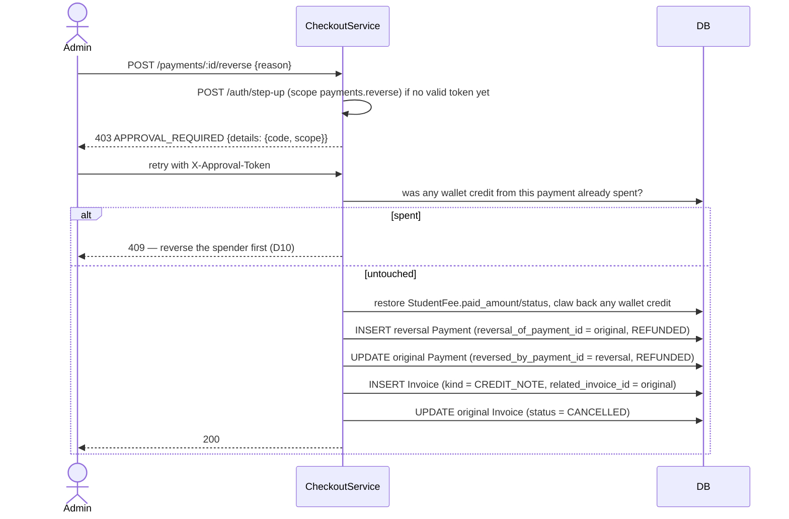

Note the shape: a reversal is a **second, positive `Payment` row** pointing
back at the first, not a negative amount and not a deleted row. The two
rows reference each other (`reversal_of_payment_id` one way,
`reversed_by_payment_id` the other), so the original stays on the books
with a visible audit trail. The credit note works the same way — a second
`Invoice` row, never an edit.

Reversal is only ever full, never partial, and only ADMIN can call it —
`PAYMENT_REVERSE` stays admin-gated by explicit decision, not just an
approval-scope check (confirmed again during wave 8: granting it to
ACCOUNTANT would need a deliberate widening, not a side effect of any
ticket). A payment whose wallet credit has already been spent by a later
checkout can't be reversed until that later payment is reversed first (D10)
— otherwise the wallet balance would go negative with no record of why.

The 403 body shape matters here: `ApprovalRequiredException` nests its
`code`/`scope` under a `details` key (`{"details": {"code": "APPROVAL_REQUIRED", "scope": "..."}}`).
Every real consumer (`ui/src/hooks/approval.tsx`, `ui/src/api/errors.ts`)
reads `error.details.code` — a mismatch here silently breaks every step-up
retry flow in the app while still passing unit tests that mock the body
directly. See [02-auth-and-multitenancy.md](02-auth-and-multitenancy.md)
for the full step-up sequence (request OTP → verify → token → retry).

## Invoices

Generated automatically when a payment is recorded, with a sequential
number (`INV-YYYY-XXXXX`). The `snapshot` field freezes the line items at
issue time, so an invoice stays historically accurate even if the
underlying fee structure is edited later. `kind` is `INVOICE` or
`CREDIT_NOTE`; `ISSUED` is a `status`, not a kind.

Invoices are immutable after issue (D21) — a reversal never edits the
original invoice, it creates a second `Invoice` row with
`kind = CREDIT_NOTE` and `related_invoice_id` pointing at it. "Immutable"
here means the _financial_ fields: once `status` leaves `DRAFT`, only
`status`, `updated_at` and `deleted_at` may change on that row
(`invoice.entity.ts`). That is what lets a reversal flip the original to
`CANCELLED` while its amounts and `snapshot` stay exactly as issued.

Two ways to view an invoice:

- **Print** (`GET /invoices/:id/print`) — server-rendered HTML sized for
  A4 or POS 80mm (`@page { size: 80mm auto }`), reachable by staff and by
  the paying family (PARENT/STUDENT roles).
- **Public share link** (`POST /invoices/:id/share`, admin/accountant
  only) — a 32-byte random token (hash stored, not the token itself),
  expires 30 days after it is made (D9), individually revocable, rate-limited, opens at `/i/<token>` with
  no login required (D15). The content shown there is receipt-only — no
  internal remarks, no staff user IDs. Regenerating (`POST
/invoices/:id/share/regenerate`) kills every older link for that invoice
  and mints a new one. Links that existed when expiry shipped got 30 days
  from the deploy (D22).

  A link stops working (same 404 as any dead link) when the school is not
  ACTIVE, and all of a student's links are revoked when any guardian is
  unlinked from that student (68.4.21, #2298).

  > As of wave 8, family callers (PARENT/STUDENT) cannot mint or list
  > their own share link — only print. A family-visible "get me a link to
  > share" affordance would need a new family-scoped share endpoint; not
  > built yet, tracked as follow-up.

## Daily job: schedules and late fees

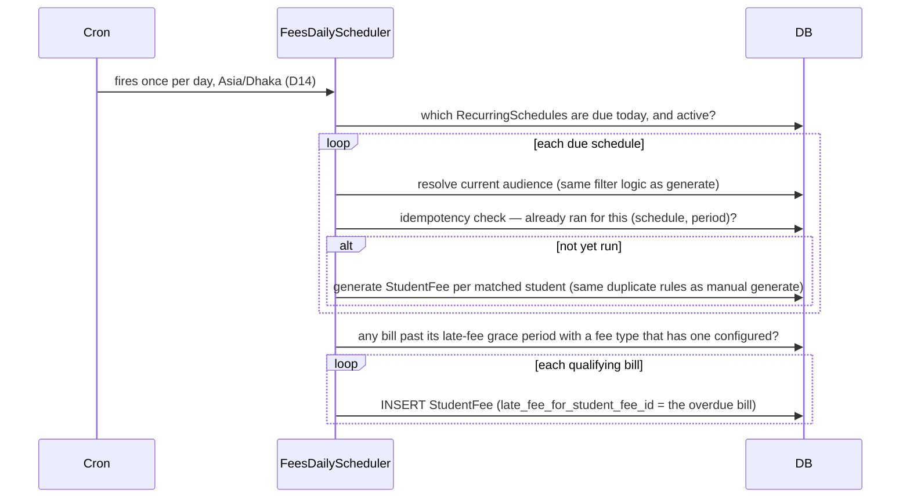

Late fees are off by default, configured per fee type (`grace_days`, FLAT
or PERCENT of the outstanding balance, applied once, never compounding —
D11). A late fee is its own `StudentFee` row linked back to the bill it's
late on via `late_fee_for_student_fee_id`, not a field mutated on the
original bill. Waiving a late fee works like waiving any bill; see
[Write-offs and wallet payouts](#write-offs-and-wallet-payouts).

### Write-offs and wallet payouts

Three ways a bill or the wallet is settled without a normal payment.
Each one is audited. Waiving needs a `fees.discount` approval token and a wallet payout needs `payments.reverse`. The wallet credit for a removed paid bill is automatic; the removal itself is what is gated (`fees.edit_paid`, or the duplicate-override approval).

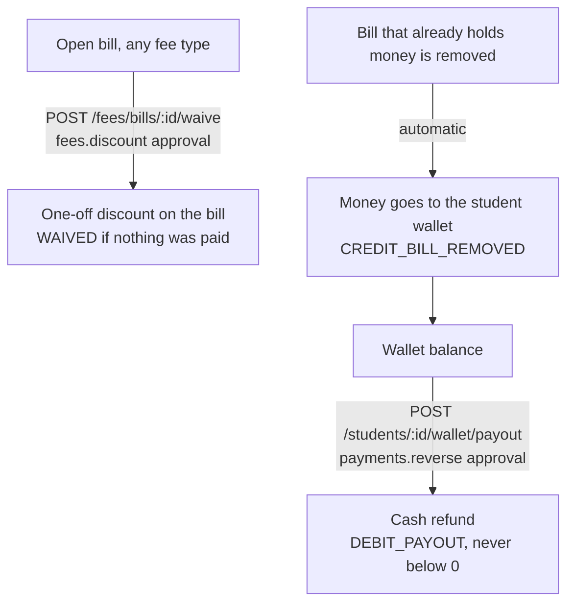

- **Waive any bill.** Late fee, tuition, fine: all can be written off, in
  full or in part. No fake 0.01 payment needed. Old route
  `POST /fees/fines/:id/waive` still works and does the same thing.
- **Removed paid bill.** If a bill that already holds checkout money is
  removed, that money is credited to the student wallet. It is not lost.
- **Wallet payout.** Staff pay wallet money back as cash. Example: pay out
  300 from 1,800, the balance becomes 1,500. More than the balance is
  refused with `409 WALLET_PAYOUT_EXCEEDS_BALANCE`. It works for a student
  who has left. Two payouts at the same time cannot overdraw the wallet:
  the second waits for the first.

Notification on a schedule-generated bill defaults **on**; a manually-run
batch defaults **off** — staff have to opt in explicitly for a one-time
run (D13). Channel order is push → WhatsApp → SMS, with SMS only sent if
the school has it enabled and has credit remaining. See
[05-communications.md](05-communications.md).

## Fines

A fine is just a bill: `FeeStructure.fee_type = 'FINE'` (e.g. "Absent",
"Late", "Damage", "Lost ID card") and the fine itself is an ordinary
`StudentFee` row. There's no separate "fine" table for the bill itself —
checkout, reversal, and invoicing have **no fine-specific branch** anywhere.
Two things get a fine onto a bill (Epic 38 #818):

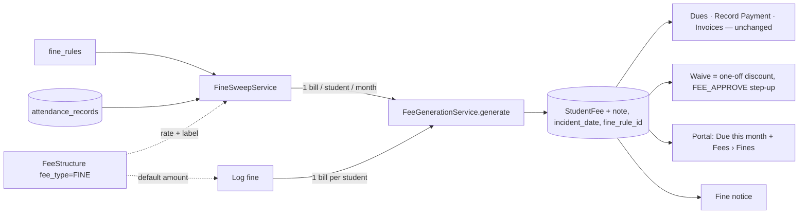

- **Rule-driven (automatic, monthly)** — a `FineRule` names a trigger
  (`ATTENDANCE_ABSENT` or `ATTENDANCE_LATE`), a `FeeStructure` (the rate),
  an optional class scope, `free_per_period` and an optional
  `cap_per_period`. `FineSweepService` reads `attendance_records`
  read-only (it never writes a mark), counts hits per student for the
  month, and bills `max(0, count - free_per_period) × rate`, capped. At or
  below the free threshold there is no bill at all (see the example below). It runs
  daily as part of `FeesDailyScheduler` (like the late-fee sweep below),
  self-healing the previous month once `correctionWindowDays` has passed —
  a late attendance correction never mutates a bill already generated.
  Example, `free_per_period: 2`, rate 50:

  | Absences in the month | Bill                             |
  | --------------------- | -------------------------------- |
  | 1 or 2                | none (within the free threshold) |
  | 3                     | (3 - 2) × 50 = 50                |
  | 5                     | (5 - 2) × 50 = 150               |

- **Staff-logged (manual)** — `POST /fees/fines` (`FinesService.logFine`)
  takes a reason and incident date, for anything a rule can't see (a
  broken window, a lost ID card, a discipline case). ADMIN/ACCOUNTANT
  only, `FEE_GENERATE` permission, no approval needed to _add_ a fine.

**`cap_per_period` is per rule, not per bill.** Each rule is capped on
its own. When two rules point at the same fee structure, their fines are
added into one bill, so that bill can be bigger than one cap
(`fine-sweep.service.ts`: the cap is applied per rule in `compute`; the
merge happens in `generate`, where rows for one student and structure are
added together).

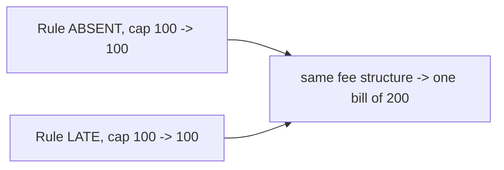

Both paths write through the same `FeeGenerationService.generate()` used
by every other bill, extended with `billOverrides` — a per-(student, fee
structure) map of `{ amount, note, fine_rule_id }` that lets one
`generate()` call bill different students different amounts, instead of
everyone paying the structure's fixed price.

### A worked example: a class rule fines "3+ absences a month, ৳20 each, capped at ৳200"

The rule (`FineRule`, `trigger: 'ATTENDANCE_ABSENT'`):

```json
{
  "id": "9f11...",
  "academic_year_id": "2b7a...",
  "trigger": "ATTENDANCE_ABSENT",
  "fee_structure_id": "c001...",
  "class_id": "cl-10...",
  "free_per_period": 2,
  "cap_per_period": "200.00",
  "conditions": {},
  "is_active": true
}
```

A student in that class was marked `ABSENT` 5 times in September. Staff
open **Finance › Fines**, pick "Generate", and preview September:

```json
// POST /fees/fines/generate/preview {"month": "2026-09", "class_id": "cl-10..."}
{
  "students": [
    {
      "student_id": "a1b2...",
      "rule_id": "9f11...",
      "fee_structure_id": "c001...",
      "count": 5,
      "amount": 60.0,
      "note": "5 absences (2 free)"
    }
  ],
  "total_amount": 60.0,
  "would_create": 1,
  "duplicates": []
}
```

`amount` is `(5 - 2 free) × ৳20 = ৳60` — under the ৳200 cap, so the cap
never kicks in here. Confirming the preview calls
`POST /fees/fines/generate`, which produces this `StudentFee` row:

```json
{
  "id": "e4d5...",
  "student_id": "a1b2...",
  "fee_structure_id": "c001...",
  "period_start": "2026-09-01",
  "total_amount": "60.00",
  "status": "PENDING",
  "note": "5 absences (2 free)",
  "incident_date": null,
  "fine_rule_id": "9f11..."
}
```

`incident_date` stays `null` on a rule-generated fine — there's no single
day, it's a monthly count. A manually-logged fine is the opposite:
`fine_rule_id` is `null` (that's what marks it "logged manually", not a
separate kind flag) and `incident_date` is the day it happened. From that
row on, the fine behaves exactly like any other bill: it shows up in
dues, Record Payment can collect it, and it prints on an invoice.

### Waiving a fine (D24)

Waiving reduces or clears a fine the same way a checkout discount does —
`POST /fees/bills/:id/waive` (legacy alias `POST /fees/fines/:id/waive`) behind
`FEE_APPROVE` step-up (`ApprovalScope.FEES_DISCOUNT`), reason required, any open
bill of any fee type:

| Situation                                 | Waive amount                 | Resulting `status`     |
| ----------------------------------------- | ---------------------------- | ---------------------- |
| Unpaid fine, waived in full               | the whole outstanding amount | `WAIVED`               |
| Partly paid fine, rest waived             | the remaining balance        | `PAID`                 |
| Partly paid fine, only part of the rest   | less than the balance        | stays `PARTIALLY_PAID` |
| Fully paid fine                           | — (nothing outstanding)      | rejected, `409`        |
| Bill not open (`PAID`/`WAIVED`/`ADVANCE`) | —                            | rejected, same `409`   |

There's no dedicated "waive" column — the endpoint writes the same
`one_off_discount_amount`/`discount_amount` fields checkout uses, and
`status` is derived from whatever's left outstanding after the discount.

### The manual-occurrence rule (D28)

Every other bill in this doc asks "does one already exist for this
(student, structure, period)?" and offers skip/remove-older/create-anyway
(D6, "Generate" above) when it does. A **manually-logged** fine skips that
question entirely: `FinesService.logFine()` calls `generate()` with
`alwaysNewOccurrence: true`, so a second damage report on the same
student in the same month always creates a new bill, no duplicate prompt,
no approval. A **rule-generated** fine still goes through the normal
duplicate check (SKIP by default) — the sweep is idempotent per month, so
re-running it never double-bills.

### Fines never get late fees

`LateFeeService` explicitly skips `fee_type = 'FINE'` bills
(`late-fee.service.ts`, D10) — a fine is already a penalty; charging a
late fee on top of it isn't a case anyone asked for.

### Learnings (Epic #2642, Wave 3, 2026-10-19)

- **Checkout lock order (#2647).** Two separate orders, both in `checkout.service.ts`:
  - **Rows: bills, then wallet.** Checkout locks every bill (`pessimistic_write`), then the wallet row. Wallet debit and reversal use the same order. A path that took the wallet first while another held a bill would deadlock.
  - **Wallet lock before the approval token.** The wallet balance is checked under its lock _before_ `approvalService.consume()` burns the one-time token, so a concurrent spend fails without wasting the approval.

  TO_WALLET siblings are refused, and reversal handles a stale bill. Cost: a race between two checkouts on one wallet. Rule candidate: in any money path, lock bills then wallet, and burn approval tokens last -> Rule 24-27 candidate.

## Guardian payments: whose money is it?

A guardian can pay a child's open bills from the portal (Epic #291). One rule sits above all the others.

**D1: the money goes only to the school's own merchant account. Biddaloy never holds school money.**

Each school brings its own bKash merchant account. Its credentials sit in the tenant settings under `payments.bkash.*` (encrypted, `@Secret()`). When a guardian pays online, bKash moves the money from the guardian to _that school's_ merchant wallet. Biddaloy only asks bKash "did this payment complete?" and then books it. The only bKash account Biddaloy owns is the platform's own, used for seat orders ([38-billing.md](38-billing.md)).

Two ways to pay, one ending:

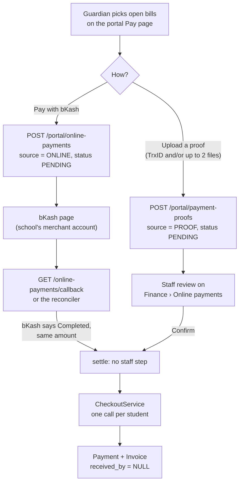

Both paths write one row in `payment_submissions` (`source` is `ONLINE` or `PROOF`; D35), with child tables `_bills`, `_files` and `_events`. `_events` is append-only: every move below adds one row. Only a guardian (`PARENT`, permission `PAYMENT_SUBMIT`, D34) can start either path. Staff confirm or reject with `PAYMENT_RECORD`.

### The status machine

Both sources share one `PaymentSubmissionStatus` enum (`shared/src/enums/index.ts`). Each source uses its own part of it.

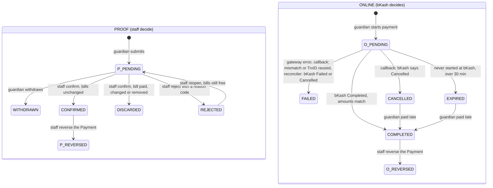

`P_PENDING` and `O_PENDING` are the same stored value `PENDING`, and `P_REVERSED` and `O_REVERSED` are the same `REVERSED`. The diagram splits them only so the two flows do not tangle.

What the diagram hides:

- **Reject is not "undo".** A CONFIRMED proof cannot be rejected (`409`, `details.code = PROOF_CONFIRMED_USE_REVERSAL`). The only way to undo money is the existing reversal (`PAYMENT_REVERSE` plus step-up). A listener then marks the submission REVERSED and writes one event per reversed payment (D9, D45).
- **REJECTED to CONFIRMED goes through reopen.** `confirm` answers `409` on a REJECTED row. Staff reopen it (back to PENDING), then confirm it (D9). Reopen answers `409` if another proof is now waiting on one of its bills.
- **DISCARDED means "no money moved".** At confirm, if a bill is already paid, was removed, or has a different balance (in whole paisa) than at submit time, the whole proof is DISCARDED and the guardian resubmits (D7, D11, D44). Once any payment exists for the proof it is never discarded: a crashed confirm is finished on retry.
- **ONLINE never discards.** bKash already took the money, so `settle` runs in a lenient mode (`ONLINE_LENIENT`). It pays the bills still open, puts the rest in the student's wallet, and flags the row as an unmatched receipt (D12).
- **CANCELLED and EXPIRED are not final for ONLINE.** A guardian can pay after the sweep. The callback asks bKash again about both (D28). The reconciler asks EXPIRED and CANCELLED rows that have a `paymentID` and are under 72 h old, with the same checks and `ONLINE_LENIENT` settle, so a lost callback on either is rescued. FAILED rows are not asked yet (#4234). COMPLETED, CONFIRMED and REVERSED are the settled states: a replay returns the same answer and writes nothing.
- **FAILED is final in today's code.** A FAILED online row is never asked again. The callback closes a row as FAILED on an amount or invoice mismatch or a reused TrxID, so bKash may hold money nobody books (open as #4234). The reconciler does not close those rows: on a mismatch it only logs "needs a human" and leaves the row PENDING, so it is visible only in logs.

### The rules that keep the money straight (D24 to D27)

| Rule | What it says                                                                                                                                                                                                           |
| ---- | ---------------------------------------------------------------------------------------------------------------------------------------------------------------------------------------------------------------------- |
| D24  | A bill in a waiting proof, or in a PENDING online attempt, cannot be picked on the _other_ guardian path. Counter checkout still works, and the cashier's cart shows a "waiting" tag.                                  |
| D25  | A TrxID is trimmed and upper-cased (`normaliseReference`). It is flagged, never refused, when it matches a confirmed payment or another waiting proof in the same school. A DISCARDED proof's TrxID can be used again. |
| D26  | The proof amount must equal the total of the picked bills in whole paisa, or the submit is refused. Confirm writes exactly the bill amounts. A proof never credits the wallet.                                         |
| D27  | Confirm runs once: a row lock on the submission, plus an idempotency key derived from the submission id and the student id. A double click returns the first answer.                                                   |

**Example: ৳500 for two children.** Rahim pays for Anika (৳300 tuition) and Arif (৳200 tuition) in one go.

- **By proof.** He sends a bKash proof for ৳500 with TrxID `8n7a5x` (stored as `8N7A5X`). The two bills total ৳500.00, so the submit passes. If he typed ৳450, it would be refused (D26). While the proof waits, he cannot start a bKash payment for the same two bills (D24). The accountant confirms: two Payments (৳300 on Anika, ৳200 on Arif, Epic 16 D12) and two invoices, both with `received_by = NULL` and "How it was paid: bKash, `8N7A5X`" (D8). A second click on Confirm returns the same two payments (D27).
- **By bKash.** The same ৳500 goes through bKash to the school's merchant wallet. One `ONLINE` submission, one callback, the same two Payments. If the counter took ৳100 of Arif's bill while Rahim was at bKash, the ৳200 line pays the ৳100 still open and the other ৳100 lands in Arif's wallet. The row shows up in unmatched receipts (D12).

Other epic rules: the school pays the gateway fee and the guardian pays exactly the bill total (D3). Refunds are manual: refund in the bKash merchant panel first, then reverse the Payment in Biddaloy (D18). Online start fails closed when Redis is down, and the callback does not (D19). The school never types a gateway URL; hosts come from a fixed list (D14, Rule 7 in [08-security.md](08-security.md)).

Where the code lives:

| Piece                               | Where                                                              |
| ----------------------------------- | ------------------------------------------------------------------ |
| Start, callback, reconciler, result | `server/src/modules/payment-submissions/online-payments*.ts`       |
| Proof submit, withdraw, review      | `server/src/modules/payment-submissions/proof-*.ts`                |
| Settle (both sources)               | `server/src/modules/fees/payment-submission-settlement.service.ts` |
| Shared bKash client                 | `server/src/modules/payment-gateways/bkash/`                       |

### Learnings (Epic #291, Wave 1, 2026-11-14)

Wave 1 of guardian-initiated online payments laid the base: `PAYMENT_SUBMIT` permission, enums, the `payment_submissions` tables (+ `_bills`, `_files`, `_events`), the tenant `payments` settings block, and the shared `ImageViewer`. No guardian screen yet.

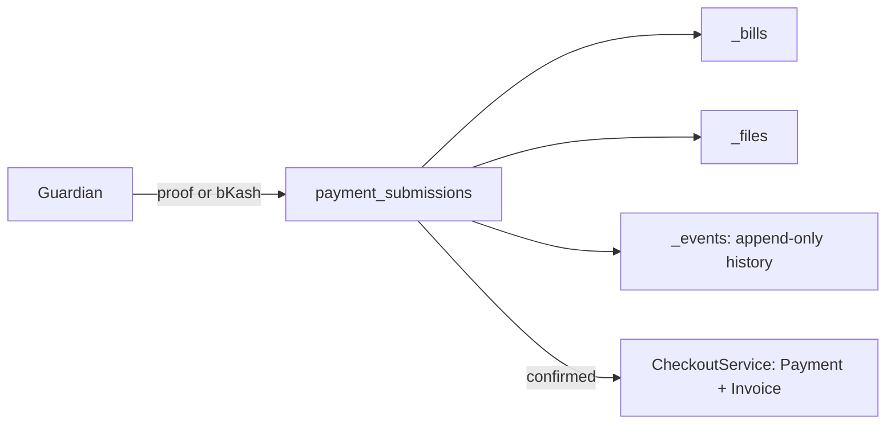

- **Surprise:** the demo-seed `owedBy` field takes one ticket id (`#\d+`), but the new slice is filled by two tickets (PROOF rows in #3973, ONLINE rows in #3988). Cost: the ticket asked for two names in `owedBy`. Fix: name the first ticket (`#3973`); it deletes `owedBy`, and #3988 later adds rows to an already-filled slice. Rule candidate: when two tickets fill one slice, `owedBy` names the first; the second just adds rows.
- **Surprise:** a new `PaymentsSettingsDto` and its nested DTOs change the OpenAPI file, so `ui/src/api/schema.d.ts` goes stale even though no route changed. Cost: `check-api-types` fails at the wave close. Fix: run `yarn api:types` at wave close (done in #3964). Rule candidate: any DTO change in a wave means the close ticket regenerates the types.
- **Example:** a settings read now returns `payments: { onlineEnabled: false, proofEnabled: true, proofMethods: [{ method: "BKASH", instructions: "Send to 017XXXXXXXX" }] }`, with bKash secrets masked.

### Learnings (Epic #291, Wave 2, 2026-11-14)

Wave 2 made proofs real: a guardian files a proof, staff confirm it, and a normal Payment plus Invoice appears. The invoice, POS slip and public receipt now show a "How it was paid" block. The workbook backs up and restores the submission tabs.

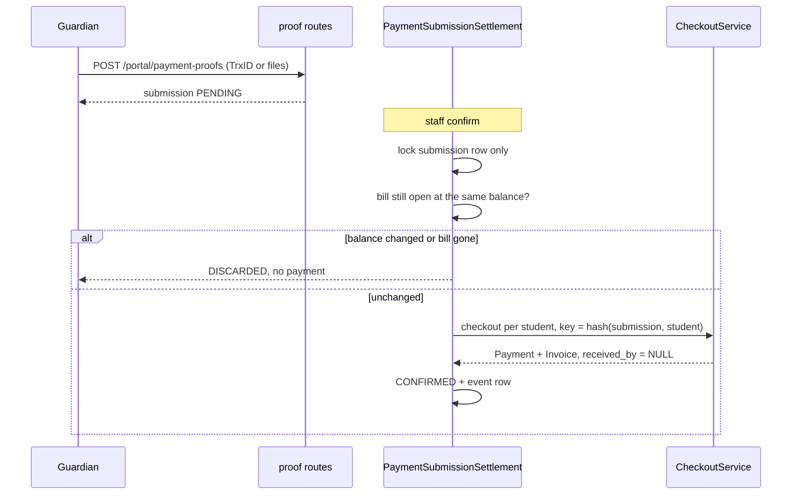

- **Surprise:** the natural idempotency key `<submissionId>:<studentId>` is 73 characters, but `payments.idempotency_key` is `varchar(64)`. Cost: a key that would fail on insert. Fix: `settlementIdempotencyKey()` hashes the pair into a UUID-shaped string; the same pair always gives the same key. Rule candidate: derive idempotency keys by hashing, never by joining ids.
- **Surprise:** "settle everything in one transaction" is impossible, because `CheckoutService` opens its own transaction and writes the invoice outside it. Cost: a crash can leave student 1 paid and student 2 not. Fix: settle locks only the submission row (never the bills, or it deadlocks with checkout), skips students who already have a payment under their key, and finishes the rest on retry. Once any payment exists, it never discards. Rule candidate: a multi-step money flow must be re-runnable, not atomic.
- **Surprise:** a removed bill must not strand a guardian's money. Cost: `StudentFee` is soft-deleted from four places. Fix: one helper, `assertNoWaitingSubmissionBills`, called after the bill locks in each path; it answers `409 PAYMENT_SUBMISSION_WAITING` with a count only (Rule 23). A bill removed after submit discards the proof as `BILL_REMOVED`.
- **Surprise:** there is no `AuditAction` for submissions and `shared/` was outside the lane. Cost: "who decided this" lives only in event rows. Fix: event rows are the record for now; follow-up #4212 adds the audit action. Rule candidate: add the audit action in the same wave that adds the state machine.
- **Surprise:** the ticket's "created by" has no column on `Payment`. Fix: the actor is the audit `performed_by_user_id` and the event row `actor_user_id`; `received_by_user_id` stays NULL for a proof, so a guardian-paid receipt never names a cashier.
- **Example:** a PROOF for two siblings (৳1000 + ৳700, bKash TrxID `8N7A5X`) settles into two Payments and two invoices. If a counter payment cleared the ৳700 bill first, the whole proof is `DISCARDED` with `discard_reason: BILL_ALREADY_PAID`, and nothing is paid.

### Learnings (Epic #291, Wave 3, 2026-11-15)

Wave 3 gave staff the review side: a queue and detail screen, confirm, reject and reopen, an attention alert, a push to the guardian, a "waiting" mark on the cashier's cart, and a demo school with proofs in every state.

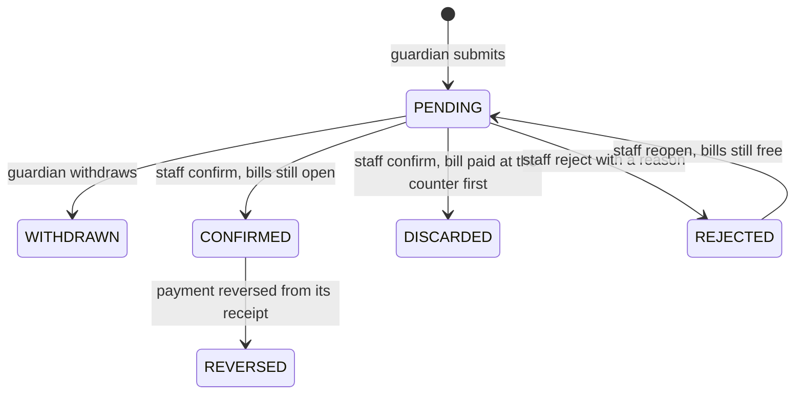

- **Surprise:** a confirmed proof cannot be rejected, because its money is already a Payment. Cost: a second, hidden way to undo a payment. Fix: reject answers `409` with `details.code = PROOF_CONFIRMED_USE_REVERSAL` and the reversal listener (#3970) moves the proof to REVERSED when staff reverse the payment from the receipt. Rule candidate: one way to undo money, one place it is recorded.
- **Surprise:** confirm can end as DISCARDED. Cost: the screen cannot assume "confirm means paid". Fix: `confirm` returns `{ outcome: 'SETTLED' | 'DISCARDED', paymentIds, detail }`; the UI reads `outcome`. Confirming a proof that is already CONFIRMED or DISCARDED replays the same answer (D27), so a double click is safe.
- **Surprise:** reopen can collide. While a proof is REJECTED its bills are free, so the guardian may send a new proof for them. Cost: two waiting proofs on one bill. Fix: `reopen` checks for another PENDING proof on any of the bills and answers `409` ("Another payment proof is already waiting"). Rule candidate: a state that frees a lock must re-check the lock when it comes back.
- **Surprise:** the duplicate-TrxID warning is computed, not stored on the proof. Cost: it looks stale if you read it from the row. Fix: the opening event keeps `reason_code` (`DUPLICATE_PAYMENT` or `DUPLICATE_PENDING`) for history, and `detail` recomputes `duplicateFlag` while the proof is PENDING. The flag never blocks a submit (D25).
- **Surprise:** the review routes have no response DTO, so `schema.d.ts` holds the paths but not the shapes. Cost: UI hooks need hand-written types. Fix: `ui/src/hooks/payment-submissions.ts` declares them next to the hooks; replace them when the server adds DTOs. Rule candidate: a route with no `@ApiOkResponse` type is a contract gap, list it at wave close.
- **Surprise:** the demo cannot reach DISCARDED by editing rows; it has to pay the bill first. Cost: the demo slice is order-sensitive. Fix: the `payment-submissions` slice files the proof, takes the counter payment through `CheckoutService`, then confirms through `ProofReviewService`. Login guardians are only about 5% of families, so a tiny CI run (`--scale 0.05`) may have too few open bills. The slice then files as many of its seven proofs as there are bills (at least one).
- **Example:** guardian `guardian@bmsc.example` sends a bKash proof for ৳1,200 with TrxID `DM4K9XQ2LA`. Another family reuses `DM4K9XQ2LA`, so the accountant sees `DUPLICATE_PENDING` on the second one. The accountant confirms the first (one Payment, one invoice), rejects the second as `IMAGE_UNCLEAR`, and the guardian gets a push for each decision (push is off in the demo).

### Learnings (Epic #291, Wave 4, 2026-11-15)

Wave 4 put the screens in front of people: the guardian Pay page and "My payment proofs" tab, the accountant's Online payments list and review screen, and the settings card. The close wired them into the nav, breadcrumbs, palette and route guards.

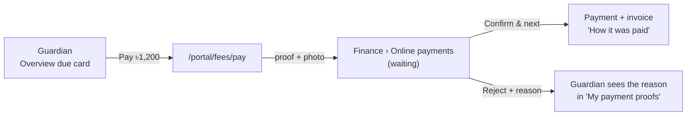

- **Surprise:** four lanes each added route files, and none could regenerate `routeTree.gen.ts` without colliding with the others. Cost: the route manifest, crumbs and permission guards were all red until the close. Fix: the close ticket regenerates the tree once (the Vite router plugin writes it on `vite build`) and never hand-edits it. Rule candidate: a lane ticket that adds a route must not commit `routeTree.gen.ts`; the wave close owns it.
- **Surprise:** the Overview due card took a `payOptions` prop (#3974) but nothing on the Overview fetched the options, so the Pay button never showed. Cost: the guardian's main entry point was dead while every unit test passed, because the card was tested with the prop given. Fix: `usePaymentOptions()` in the Overview and a test that the Pay link renders. Rule candidate: when a component gets a new optional prop, add one test at the page that must feed it.
- **Surprise:** the portal palette is pages-only, so the epic's "Pay fees" and "Submit payment proof" palette actions have nowhere to live. Cost: those two actions were not built. Fix: staff palette actions only (`payments.waiting`, `payments.onlineSettings`); the Pay page is reached from the due card and Fees & invoices. Rule candidate: check which palette a screen belongs to before listing palette actions in an epic.
- **Surprise:** the sweep helper sends any `/payments/<id>` route to a real payment id, so `/payments/online/$id` would have been fed a payment id. Cost: a not-found card scanned instead of the review screen, silently. Fix: a branch for `/payments/online/$id` before it, using a fake UUID (same as `$requestId`). Rule candidate: when a new route shares a prefix with an old one, check the first-match resolvers.
- **Surprise:** the portal cart returned a waiting proof's `id` for every linked guardian. Cost: a co-guardian received the id of a proof they did not send. Fix: `id` is returned only to the submitter; a co-guardian gets `source` and `id: null`. The Pay page only checks "is there a waiting proof", so nothing in the UI changed. Rule candidate: an id in a family-shared answer is a capability; return it only to its owner.
- **Example:** guardian `Rahim` sends a bKash proof for ৳500 (TrxID `E2E41592653`, one photo). The accountant opens `/payments/online/<id>`, "Confirm & next" is focused, one press confirms it, and the invoice print shows "How it was paid: bKash, TrxID `E2E41592653`, verified by the accountant on the date". The second child's proof is rejected as `IMAGE_UNCLEAR`, and the guardian sees that reason in the proofs tab. Covered by `e2e/payment-proofs.spec.ts`.

### Online payments: callback and reconciler (#3984, #3986)

bKash sends the guardian's browser back to us with `?paymentID=...&status=...`. That URL only names a payment; we never trust its `status`. If the browser never comes back (phone dies, tab closed), the reconciler catches the payment within 10 minutes.

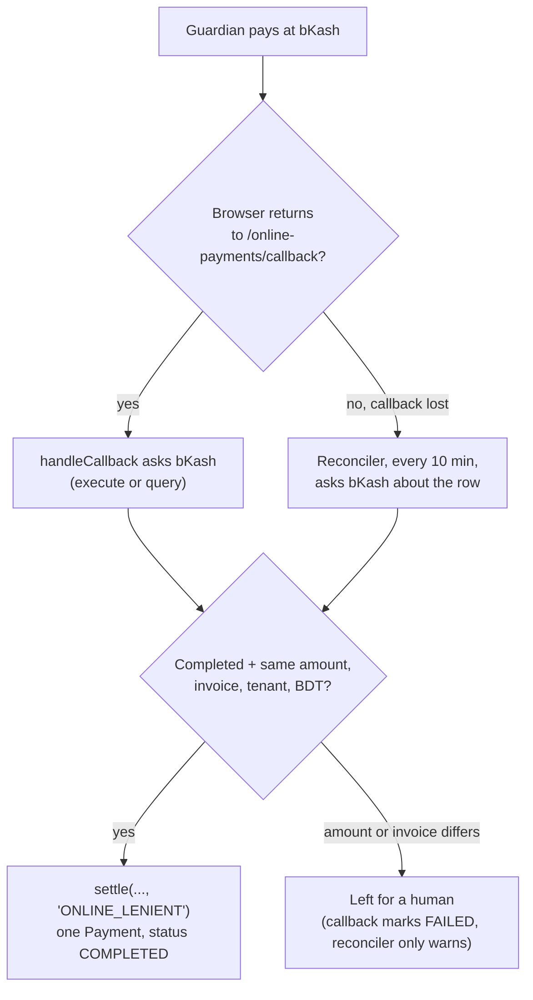

Which rows the reconciler asks about:

| Row                             | Age         | Asked?                                                      | If bKash says Completed |
| ------------------------------- | ----------- | ----------------------------------------------------------- | ----------------------- |
| PENDING with a paymentID        | under 72 h  | yes                                                         | settled                 |
| PENDING, never started at bKash | over 30 min | no call; becomes EXPIRED (`NOT_STARTED`)                    | n/a                     |
| EXPIRED with a paymentID        | under 72 h  | yes, a late payer is real money                             | settled (from EXPIRED)  |
| FAILED                          | any         | never; a bad amount or a used TrxID needs a human           | n/a                     |
| PENDING                         | over 72 h   | no; one warning with the count, only when the count changes | n/a                     |

Both paths call the same `settle`, and settle returns `alreadySettled` for a row that is COMPLETED, CONFIRMED or REVERSED. Each path emits `COMPLETED` only when `alreadySettled` is false, so one settlement gives one event and one history row. A reversal of the Payment marks the ONLINE submission REVERSED through the same listener as a proof.

**Example:** a guardian pays ৳500 and bKash takes it, but the phone loses signal before the redirect. No callback arrives. At the next 10-minute run the reconciler asks bKash for that `paymentID`, sees Completed for ৳500.00 with `merchantInvoiceNumber` equal to our submission id, stores the TrxID and calls `settle`. The bill is paid, the invoice exists, and the guardian's result page shows COMPLETED. If the guardian was slow and the row had already expired at 30 minutes, the same thing happens, because EXPIRED rows under 72 h are asked too.

Logs: nginx logs the path without the query string (`$uri`), so `paymentID` never reaches the access log; `redactPii` also masks `paymentID` and `trxID` in app logs (Rule 13).

### Learnings (Epic #291, Wave 6, 2026-11-15)

Wave 6 added the gateway client with per-school credentials, the start, callback and result routes, the reconciler, and the demo rows.

- **Surprise:** the callback settled a late payment on an EXPIRED row, but the reconciler only read PENDING. Cost: a lost callback on an expired row stayed unpaid forever while the guardian's money was at bKash. Fix: the reconciler also asks EXPIRED rows that have a paymentID and are under 72 h old. Rule candidate: when two paths settle the same state, give both the same set of source states and test each one.
- **Surprise:** the reconciler warned about every stale row every 10 minutes, and it decrypted the credentials of schools that only had stale rows. Cost: log noise and needless secret handling. Fix: one grouped query counts rows per school; only schools with a live row are decrypted, and a stale count is logged when it changes. Rule candidate: decide who needs secrets from a cheap count first.
- **Surprise:** building gateway credentials with `{ ...settings, tenantId }` passes along any extra stored field. Cost: a future settings field would flow into the gateway client and its cache key. Fix: pick the five bKash fields by name. Rule candidate: build a credentials object field by field, never by spread.
- **Surprise:** `schema.d.ts` is regenerated only at integration, so a lane that adds a route cannot type its hooks until then. Cost: hooks were typed from the DTO names before the schema had them. Fix: regenerate once at integration (`yarn api:types`) and commit it with the hooks.
- **Surprise:** the demo cannot reach an unmatched online payment without a counter payment first. Cost: ordering again. Fix: the `payment-submissions` slice makes the ONLINE row, takes half the bill at the counter, then settles it; the other half goes to the wallet. Five ONLINE rows (3 COMPLETED, one of them unmatched, 1 CANCELLED, 1 EXPIRED) need 12 open bills in all, so the slice spec runs at scale 0.5. `onlineEnabled` stays off and no gateway is ever called.

### The result page and the end-to-end test (#3990, #3997)

After bKash, the guardian lands on `/portal/fees/pay/result?id=<submission id>`. The The page asks `GET /portal/online-payments/:id` until the payment leaves PENDING.

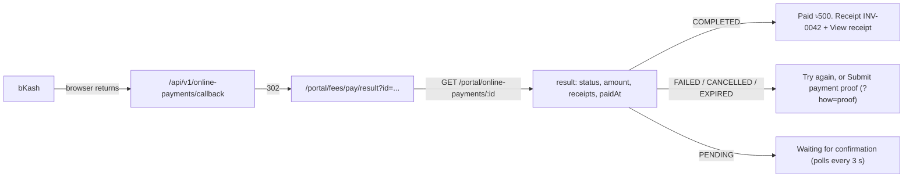

- **Receipt (D22):** `receipts` lists `{ invoiceId, receiptNo }` for the caller's own children only (the invoice number is the receipt number); `paidAt` is the latest payment date, or `null` until booked. "View receipt" opens the existing family-scoped invoice print. There is no guardian share link: minting one needs `INVOICE_SEND` (staff) and a public link shows the whole invoice, siblings included.
- **Example:** the guardian pays ৳700.50 for two children. The result says "Paid ৳700.50. Receipt INV-0041, INV-0042" with one "View receipt" button per child.
- **Fake bKash in e2e:** `e2e/fixtures/bkash-stub.ts` listens on `127.0.0.1:38417`. The The server reaches it only when `NODE_ENV=test`, `OUTBOUND_TEST_ALLOW_LOOPBACK=true` and `BKASH_TEST_BASE_URL` are all set (`playwright.config.ts` sets them). Locally, run `yarn playwright test e2e/online-payments.spec.ts` against the running stack. Production boot refuses the loopback flag, so the seam cannot exist there. The test never opens bKash's page: it calls our callback URL itself.

### Learnings (Epic #291, Wave 7, 2026-11-15)

Wave 7 added the result page, the staff tabs, the settings section and the end-to-end journey.

- 2026-11-15 **Surprise:** the result route existed but was missing from `routeTree.gen.ts`, the e2e route manifest, and the palette, breadcrumb and nav allow-lists. Cost: the palette-coverage test failed only at the close ticket. Fix: register the route in all four lists the moment the file is added. Rule candidate: a route-adding ticket lists every registry its route must join.
- 2026-11-15 **Surprise:** turning online payment on is school-wide, so an e2e that does it on the seeded school hides the proof form for every spec running beside it. Cost: a flake that looks like a proof bug. Fix: the journey provisions its own school. Rule candidate: an e2e that flips a school-wide switch gets its own school.
- 2026-11-15 **Surprise:** the switch refuses to turn on until the saved credentials passed "Test connection" (`Test the bKash connection before turning online payments on`). Cost: the first run of the journey got a 400. Fix: the journey saves the credentials, tests them against the fake, then turns it on. Rule candidate: set up a gated switch in the order a person would.
- 2026-11-15 **Surprise:** the the result DTO had no receipt number or paid date, although D22 promised the receipt on this page. Cost: the page could only say "Payment done". Fix: `receipts` and `paidAt`, family-scoped. Rule candidate: when a decision names what a screen shows, check the DTO has it.
- 2026-11-15 **Surprise:** the bKash URL went straight into `window.location.assign`. Cost: none yet, but a gateway answer is outside input. Fix: only `https://` is followed. Rule candidate: never navigate to a URL that came from an outside answer without checking its scheme.

### Learnings (Epic #291, whole epic, 2026-11-15)

Wave 8 close. These are the lessons that cut across waves. Each bullet is: surprise, cost, fix, rule candidate. Details marked "(lane report)" come from the wave lanes' reports and were not re-derived from code when this was written.

- 2026-11-15 **Surprise:** an idempotency key built as `<submissionId>:<studentId>` is 73 characters, and `payments.idempotency_key` is `varchar(64)`. Cost: a key that would fail on insert. Fix: `settlementIdempotencyKey()` hashes the pair into a UUID-shaped string. Rule candidate: derive idempotency keys by hashing, and check the column width before choosing a key shape.
- 2026-11-15 **Surprise:** `CheckoutService` opens its own transaction, so "settle all children atomically" cannot be done. Cost: a crash can leave child 1 paid and child 2 not. Fix: settle locks only the submission row, skips students that already have a payment under their key, and finishes the rest on retry. Rule candidate: a multi-step money flow must be re-runnable, not atomic.
- 2026-11-15 **Surprise:** the guardian-side seams were missing when the client waves started (for example the Overview due card took `payOptions` but nothing fed it, so the Pay button never showed). Cost: the main entry point was dead while every unit test passed. Fix: `usePaymentOptions()` on the Overview plus a page-level test. Rule candidate: when a server wave adds an option, the client wave's first ticket checks that the page feeds it.
- 2026-11-15 **Surprise:** several tickets' `## Files` lists were wrong (lane report: `queue-workers.ts`, the `fees/pay` path, and an `Outlet` in a layout file). Cost: lanes hit the territory rule or had to edit a file the plan did not name. Fix: the lane reported it and the plan was corrected before editing. Rule candidate: a planner checks that every path in `## Files` exists and is the right owner before the ticket is marked plan-grade.
- 2026-11-15 **Surprise:** a smoke spec written before the online routes existed went stale (lane report; `601094fc9` later made it cover the callback fences). Cost: a post-deploy check that asserted old route behaviour. Fix: update the spec in the same ticket that adds the public route. Rule candidate: a new public route ticket lists the smoke spec in `## Files`.
- 2026-11-15 **Surprise:** the e2e bKash stub (`e2e/fixtures/bkash-stub.ts`) talks to `127.0.0.1`, which the SSRF guard refuses. A first version read the loopback flag in a second place. Cost: two readers of one dangerous switch. Fix: the bKash client reuses the guard's own seam (`adf5fafe9`), so `OUTBOUND_TEST_ALLOW_LOOPBACK` is read in one place and production boot refuses it (Rule 7). Rule candidate: a test seam for a security guard lives inside the guard, never beside it.
- 2026-11-15 **Surprise:** the staff cart needed the "waiting for confirmation" tag too (D46), but its `CartBill` type is shared by Record payment and the cart table. Cost: a new field on a widely used type. Fix: the cart answer carries `waiting_submission` (with the proof id for staff), and `cart-table.tsx` shows a tag that links to the proof; the bill stays selectable, because counter checkout is always allowed (D24). Rule candidate: add a field to a shared cart type in the same ticket that renders it, and say that staff and guardian answers differ in what they reveal.
- 2026-11-15 **Surprise:** the callback settled a late payment on an EXPIRED row, but the reconciler read only PENDING. Cost: a lost callback on an expired row stayed unpaid while the money sat at bKash. Fix: the reconciler also asks EXPIRED rows that have a `paymentID` and are under 72 h old. Rule candidate: when two paths settle the same state, give both the same set of source states and test each one.
- 2026-11-15 **Surprise:** FAILED online rows are never asked again, including the `MISMATCH` kind where bKash took money for something that is not this submission. Cost: nobody books or refunds that money, and no staff screen lists it. Fix: not fixed in this epic; open as #4234 (suggested: a "needs a human" list with a book-or-refund action, and a re-ask for `PERSIST` and `GATEWAY_CREATE` rows that have a `paymentID`). Rule candidate: every terminal failure state that can follow money leaving the guardian needs a human-facing list.

## Student statement

A statement answers one question for one student: **what was charged, what was paid, and what is still owed after each line?** It is a coded report (Epic 8.15 D10), not a defined one, because it is a ledger. The code is `server/src/modules/fees/statement/student-statement.service.ts`; the numbers are the same ones the student's fees tab and the dues list show.

### Where the lines come from

The service reads four kinds of line and puts them in one list. Nothing is stored: every request reads the tables again.

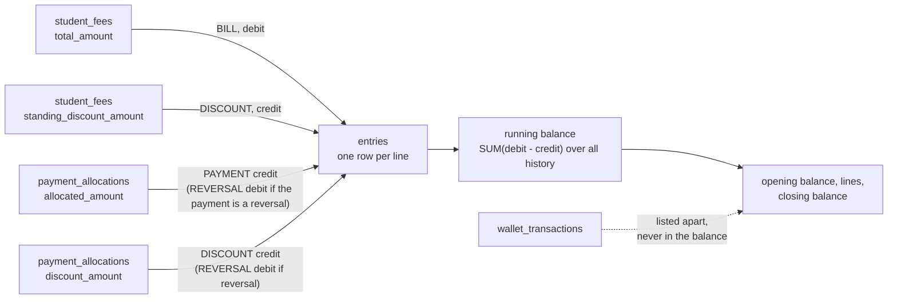

| Line kind  | Source row                                                             | Column | Date it carries                              |
| ---------- | ---------------------------------------------------------------------- | ------ | -------------------------------------------- |
| `BILL`     | a `student_fees` row (not deleted)                                     | debit  | its `due_date`, else its `period_start`      |
| `DISCOUNT` | the same row's standing discount (only when above 0)                   | credit | same date as its bill                        |
| `PAYMENT`  | one `payment_allocations` row of a normal payment (`allocated_amount`) | credit | `payment_date`, in Asia/Dhaka                |
| `DISCOUNT` | the same allocation's one-off `discount_amount` (only when above 0)    | credit | `payment_date`, in Asia/Dhaka                |
| `REVERSAL` | an allocation (or its discount) of a payment that undoes another       | debit  | the reversal's `payment_date`, in Asia/Dhaka |

Payments reach a bill only through allocations, so one payment spread over two bills shows as two `PAYMENT` lines, each named after its bill's fee. A reversal is its own payment whose allocations mirror the original, so its lines come out as `REVERSAL` debits that put the money back on what is owed. A payment counts only if it succeeded, or is one side of a reversal; a failed or pending payment is left out. Lines of another student, or of another school, can never enter: both the school and the student are in the query itself.

### Order and running balance

Lines sort by date, then by kind (bill, then its standing discount, then payments, then one-off discounts), then by the time the row was created, then by its id. So on the day a bill falls due, the bill comes first and its discount right after it. The balance after a line is the sum of `debit - credit` of **every line up to and including it**, counted from the student's first line ever. A debit makes the student owe more, a credit less.

### The opening balance rule

A statement can ask for a range: `from` and `to`, both optional, both `YYYY-MM-DD`.

- The balance is always counted over the whole history first, and the range only cuts the list afterwards. So an earlier `from` never changes a later balance.
- **Opening balance** = the balance after the last line dated before `from`. With no `from`, or nothing before it, it is 0.
- **Closing balance** = the balance after the last line shown. If the range holds no line, it is the opening balance.
- With no range at all, the closing balance equals what the dues list says the student still owes (the integration spec asserts this).

### Advance money is listed apart

A wallet holds money paid in advance. It is not owed and not paid against a bill yet, so it never enters the balance. The response carries `wallet_balance` and `wallet_moves` (date, kind, amount, note; positive adds to the wallet, negative takes from it) beside the lines, in the order they happened. The wallet moves are not cut by `from` and `to`.

### An example

Karim has two bills in March. Bill A is 1,000 with a 100 standing discount; he pays 400 on 5 March and that payment is reversed on 20 March. Bill B is 500, paid 450 with a 50 discount at the counter.

| Date       | Kind       | Debit | Credit | Still owed |
| ---------- | ---------- | ----- | ------ | ---------- |
| 2026-03-01 | `BILL`     | 1,000 | 0      | 1,000      |
| 2026-03-01 | `DISCOUNT` | 0     | 100    | 900        |
| 2026-03-05 | `PAYMENT`  | 0     | 400    | 500        |
| 2026-03-10 | `BILL`     | 500   | 0      | 1,000      |
| 2026-03-12 | `PAYMENT`  | 0     | 450    | 550        |
| 2026-03-12 | `DISCOUNT` | 0     | 50     | 500        |
| 2026-03-20 | `REVERSAL` | 400   | 0      | 900        |

Asking for `?from=2026-03-10` shows the last four lines. The opening balance is 500 (what was owed after the 5 March payment) and the balances on those lines are unchanged. The closing balance is 900 either way.

### The two routes

| Route                                       | Who                                          | Notes                                                                                                                   |
| ------------------------------------------- | -------------------------------------------- | ----------------------------------------------------------------------------------------------------------------------- |
| `GET /students/:studentId/statement`        | staff with `INVOICE_READ` and `PAYMENT_READ` | `:studentId` goes through `ParseUUIDPipe`; an unknown student is a 404                                                  |
| `GET /portal/students/:studentId/statement` | a parent or student with `FEE_READ`          | only for a student linked to the caller (`FamilyAccessService`); any other student is the same 404, a staff role is 403 |

Both take `from` and `to`, and both return the same body. Each request writes a `report_runs` row (source `student-statement`, the student and the range as params, the line count; no money values), so a look at a statement is audited like any report run.

## Family-facing access

Parents/students see a deliberately narrower view of all of the above —
`server/src/modules/fees/dto/family.dto.ts` is the single module that owns
every family-facing DTO and mapper, with an explicit allow-list per
resource (bill, wallet, payment, invoice, schedule, discount rule). Fields
like `approved_by_user_id`, `reversal_reason`, internal notes, and a
full (non-last-4) payment reference are withheld everywhere a family caller
can read — this was tightened during wave 8 after an audit found four real
routes leaking staff-internal fields to PARENT/STUDENT (discount-rule
`reason` and approver IDs, wallet transaction notes, invoice notes, and an
unmasked payment reference).

## Notable design decisions (D1–D21, from Epic 16 #637)

| #   | Decision                                                                                                                                             |
| --- | ---------------------------------------------------------------------------------------------------------------------------------------------------- |
| D1  | Student-only payee. Guardian/company/`payee_type` generalisation is a future epic.                                                                   |
| D2  | One bill per student × fee structure × period. Unique `(student_id, fee_structure_id, period_start, occurrence)`.                                    |
| D3  | Fee structure is just a price tag — dropped `month`, `is_recurring`, `applicability` (`FeeApplicability` enum), `fee_structure_students`.            |
| D4  | Recurring audience is a filter + exclusions, evaluated fresh on each run day.                                                                        |
| D5  | Advances became the student wallet. `PaymentAllocationType.ADVANCE`, `is_advance_payment`, `original_advance_month/year` removed.                    |
| D6  | Duplicate-generation offers skip / remove-older / create-anyway (see "Generate" above).                                                              |
| D7  | Structure amount edits are audit-logged, effective next generation; bills snapshot the amount at generation time. Soft-delete only.                  |
| D8  | Discount rules are FLAT or PERCENT, admin-verified once on create/edit; one-off checkout discounts are admin-verified every time.                    |
| D9  | Approval is the permission `FEE_APPROVE`, re-verified every time regardless of role. See [02-auth-and-multitenancy.md](02-auth-and-multitenancy.md). |
| D10 | Reversal is full-only; a payment whose wallet credit was already spent can't be reversed until the spender is.                                       |
| D11 | Late fees: off by default, FLAT/PERCENT, `grace_days`, once per bill, no compounding.                                                                |
| D12 | Multi-child checkout is one payment + one invoice, grouped by student.                                                                               |
| D13 | Notify defaults: schedules on, manual batches off.                                                                                                   |
| D14 | Scheduling runs in `Asia/Dhaka` (`SCHOOL_TZ`).                                                                                                       |
| D15 | Public invoice links: 32-byte token, hash stored, revocable, rate-limited.                                                                           |
| D16 | Payment methods: `CASH, CHEQUE, BANK_TRANSFER, CARD, BKASH, NAGAD, ROCKET` — `UPI`/`ONLINE` removed.                                                 |
| D17 | Barcode/QR is keyboard-wedge only; camera scanning is out of scope.                                                                                  |
| D18 | Both old wizards (`generate-fees-wizard.tsx`, `record-payment-wizard.tsx`) deleted, replaced by single modal forms.                                  |
| D19 | No production data existed yet — migrations were free to drop/recreate; seed/`e2e/seed-contract`/`api-types` regenerated at each wave close.         |
| D20 | Checkout is idempotent (`idempotency_key` unique per tenant), locks bill rows during allocation.                                                     |
| D21 | Invoices immutable after issue; changes produce a credit note, never an edit.                                                                        |

### Fines (D22–D28, from Epic 38 #818)

| #   | Decision                                                                                                                                                                                                   |
| --- | ---------------------------------------------------------------------------------------------------------------------------------------------------------------------------------------------------------- |
| D22 | A class `FineRule` replaces the school default for that trigger; one active rule per (tenant, academic year, trigger, class_id), `NULLS NOT DISTINCT`.                                                     |
| D23 | A `LATE` mark with `minutes_late` still `NULL` counts as a hit; `min_minutes_late` only filters marks where the minutes are actually known.                                                                |
| D24 | Waive covers the outstanding amount only — full waive on an unpaid fine gives `WAIVED`, waiving the rest of a partly-paid one gives `PAID` (see the waive table above). A fully paid fine can't be waived. |
| D25 | Permissions: log/generate a fine needs `FEE_GENERATE`; rule CRUD needs `FEE_STRUCTURE_CREATE/UPDATE/DELETE`; waive needs `FEE_APPROVE` step-up. EXECUTIVE stays read-only.                                 |
| D26 | The daily sweep runs from `correctionWindowDays + 1` to month end, always billing the _previous_ month (self-healing after a late attendance correction).                                                  |
| D27 | `FineRule` is scoped to one `academic_year_id`; the sweep resolves the year that contains the attended month.                                                                                              |
| D28 | A manually-logged fine always creates a new bill (`alwaysNewOccurrence: true`) — no duplicate prompt, no approval, unlike every other `generate()` caller.                                                 |

## What was removed, and why

- **`FeeApplicability` (`ALL`/`SELECTED`)** — the old fee-structure model
  could target a whole class/section or an explicit student list. D3
  replaced this with the price-tag model: a `FeeStructure` no longer
  targets anyone directly, and `RecurringSchedule`'s audience filter (D4)
  is the only targeting mechanism left. Removed from `shared/src/enums`
  in wave 8, having had zero remaining consumers since wave 1.
- **`PaymentAllocationType.ADVANCE`** — pre-paying a future bill used to
  create a `StudentFee` row with an `ADVANCE`-type allocation. D5 replaced
  this with `StudentWallet`: an overpayment now credits a balance the
  student can spend later, rather than pre-allocating against a specific
  future bill. A future-dated allocation attempt now throws
  `BadRequestException` instead of succeeding.
- **Generate/record-payment wizards** — multi-step wizards were replaced
  with single modal forms (D18); the wizard route names and nav entries
  are gone.
- **`UPI`/`ONLINE` payment methods** — dropped per D16; not a supported
  gateway in this market segment at this time.

## See also

- Multi-tenancy and the tenant-scoping convention every table here
  follows: [01-domain-model.md](01-domain-model.md#conventions-worth-knowing-before-you-add-a-table).
- Approval/step-up flow in full: [02-auth-and-multitenancy.md](02-auth-and-multitenancy.md).
- How a flagged-overdue bill turns into a reminder message:
  [05-communications.md](05-communications.md).
