# Communications (Reminders)

Guardians who haven't paid fees get reminded via SMS, WhatsApp, Messenger,
or email — one guardian at a time, or in bulk across every flagged student
from [04-fees-payments-invoices.md](04-fees-payments-invoices.md#5-flag-overdue-fees-and-remind-guardians).

## Provider adapter pattern

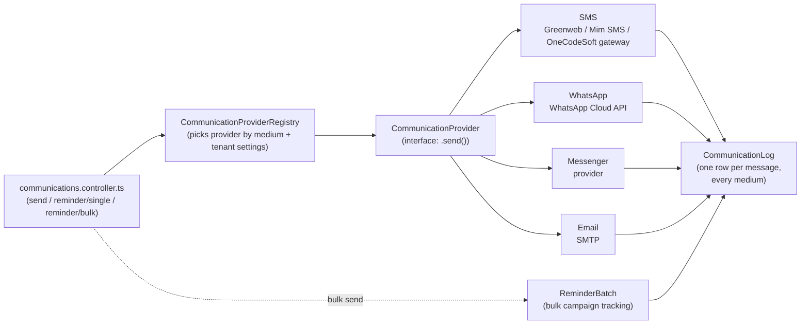

Every channel implements the same `CommunicationProvider` interface
(`modules/communications/providers/communication-provider.interface.ts`), so
the controller/service layer never branches on medium — it asks the
registry for "whatever handles WHATSAPP for this tenant" and calls
`.send()`. Per-tenant provider configuration (which SMS gateway, which SMTP
account, credentials) lives in `School.settings` / the tenant-settings
module, so different schools can use different providers without any code
change.

## Where this deviated from the original plan

The original plan specified **Twilio** for both SMS and WhatsApp. What
shipped instead:

- **SMS** — **Greenweb**, **Mim SMS** and **OneCodeSoft**, three Bangladeshi SMS gateways
  (`providers/sms/greenweb.provider.ts`, `.../mimsms.provider.ts`,
  `.../onecodesoft.provider.ts`). A school's settings name one, e.g. through the settings API:
  `communications.sms = { provider: 'onecodesoft', onecodesoft: { apiKey, apiUrl, senderId } }`.
  OneCodeSoft also reports delivery status and account balance. The gateway is
  selected per-tenant by `MessagingConfigResolver` (`config/messaging-config.resolver.ts`). Twilio's per-message
  pricing and lack of local carrier relationships make it a poor fit for a
  Bangladesh-market product; local gateways are both cheaper and more
  reliable for BD phone numbers.
- **WhatsApp** — the **WhatsApp Cloud API** directly (Meta's own API), not
  Twilio's WhatsApp product.
- **Messenger** was added as a full channel, beyond the original three.

## Single vs. bulk sends

- **Single**: `POST communications/reminder/single/:studentId` (with a
  `.../preview` variant to show staff the rendered message before sending).
- **Bulk**: `POST communications/reminder/bulk` creates a `ReminderBatch`
  row up front (tracking the filter used and progress), then fans out to
  one `CommunicationLog` row per recipient as each send completes —
  `GET communications/reminder/bulk/:id` polls that batch's status.

## Free-form send: guardians only

`POST communications/send` does not take a phone number or email. The
caller sends a `guardian_id`; the server loads that guardian (404 if it is
another school's) and reads the address from the guardian's own record.
Only ADMIN, ACCOUNTANT and OFFICE_STAFF hold `COMMUNICATION_SEND`; teachers
do not.

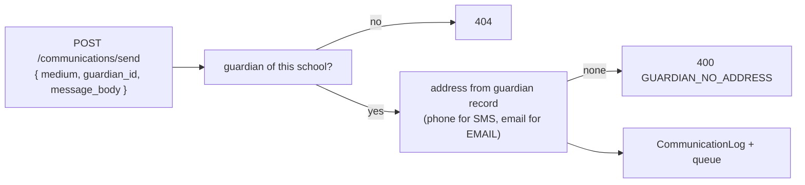

If `student_id` is also sent, the guardian must be linked to that student
(else 400 `GUARDIAN_NOT_LINKED`). Internal senders (invoices, study plans,
incidents, applications) still call `enqueue` with addresses they resolved.

## Delivery tracking & debugging

Every send — success or failure, automated or staff-triggered — gets a
`CommunicationLog` row: recipient, channel, message content, delivery
status, and who/what triggered it (`sent_by` is null for
automatically-triggered sends). This is the first place to look when a
guardian says "I never got the reminder."

`CommunicationLog.status` moves through:

- `QUEUED` — waiting for `CommunicationsProcessor` to pick it up.
- `SENT` — the provider accepted it.
- `FAILED` — permanently failed (bad provider, no retries left, or the
  tenant is suspended — see below); `metadata.reason` / `metadata.error`
  says why.

## Push-first dispatch for routine automated notifications [#555]

"Push" here means a browser/OS notification delivered through the [Web
Push API](https://developer.mozilla.org/en-US/docs/Web/API/Push_API) to a
device the guardian's linked user account has subscribed from (see
`modules/push/`) — not SMS, WhatsApp, Messenger, or email. Free to send
(no gateway cost), so it's tried first for **routine** notifications, with
the guardian's normal preferred channel as the fallback.

**Routine** = `CommunicationLog.trigger === CommunicationTrigger.AUTOMATED`
— today that's only attendance-absence notices
(`absence-notice.scheduler.ts`'s daily sweep, and the same code path when
a class teacher finalizes a register early). A **staff-initiated** send —
one guardian (`SINGLE_REMINDER`), a bulk campaign (`BULK_REMINDER`), or a
freeform message (`MANUAL`) — always goes straight to the guardian's
preferred channel, exactly as before. `ACCOUNT_ACCESS` sends (invites,
OTPs, password resets) are excluded too: a fallback delay is not
acceptable for those.

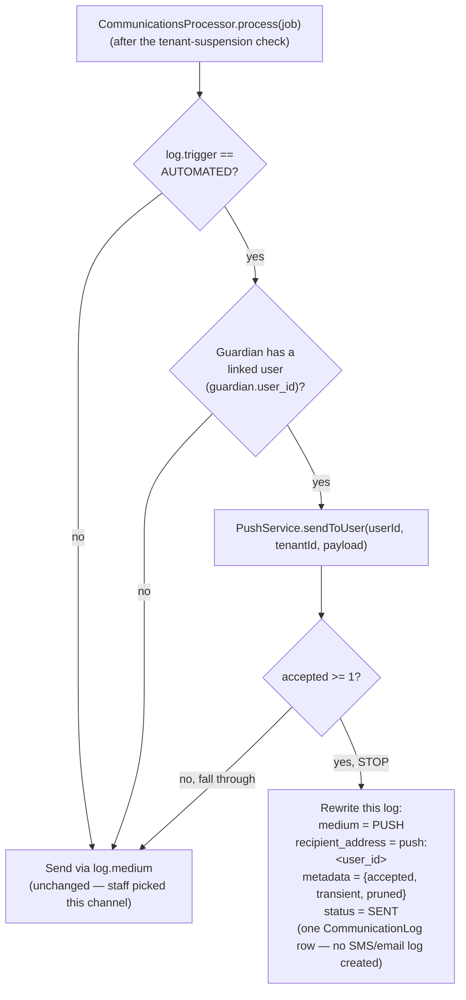

Decision table (opt-out is checked upstream — see
`reminder-recipients.util.ts#partitionByOptOut` — and stays authoritative:
an opted-out guardian never gets a `CommunicationLog` row queued at all,
so it never reaches this table):

| Trigger                                                           | Guardian has linked user + push subscription? | Push result      | What gets logged / sent                                                          |
| ----------------------------------------------------------------- | --------------------------------------------- | ---------------- | -------------------------------------------------------------------------------- |
| `AUTOMATED` (routine)                                             | No                                            | —                | Preferred channel, unchanged (SMS/WhatsApp/Email)                                |
| `AUTOMATED` (routine)                                             | Yes                                           | `accepted >= 1`  | **One** `CommunicationLog` (`medium = PUSH`) — preferred channel is **not** sent |
| `AUTOMATED` (routine)                                             | Yes                                           | `accepted === 0` | Falls back to preferred channel, unchanged                                       |
| `MANUAL` / `SINGLE_REMINDER` / `BULK_REMINDER` / `ACCOUNT_ACCESS` | irrelevant                                    | —                | Preferred channel, unchanged — never tried via push                              |

Example: a guardian with the app installed as a PWA on their phone gets an
absence notice as a push notification instead of an SMS. A `push` medium
log for them looks like:

```json
{
  "medium": "PUSH",
  "recipient_address": "push:3f2a1c9e-...-user-id",
  "metadata": { "accepted": 1, "transient": 0, "pruned": 1 },
  "status": "SENT"
}
```

No push endpoint or subscription key ever lands in `CommunicationLog` —
only which user it went to and the accept/transient/pruned counts
`PushService.sendToUser` returned (see `modules/push/push.service.ts`).

For VAPID key generation, storage, and rotation cost, see
[`12-operations.md` §5 Web push](12-operations.md#5-web-push-vapid-keys).

`medium = 'PUSH'` is a value only `communication_logs.medium`'s own DB
enum accepts (`communication_logs_medium_enum`,
migration `1789400000000-AddPushCommunicationMedium.ts`) — it is
deliberately **not** part of the shared `CommunicationMedium` enum used
elsewhere (e.g. `guardian.preferred_communication`), because a guardian
can never _choose_ push as a preferred channel the way they can choose
SMS or email.

When push is accepted instead of SMS, the SMS credit reserved for that
log (fee, payment-receipt and calendar notices reserve credit and carry
`batchId` + `segments` in the job) is **released** (`settlePart(..., 'RELEASE')`,
`metadata.credit = RELEASED`), because no SMS goes out. Logs with no
reservation (unmetered tenant, no `batchId`) touch nothing.

### The arrival-notice branch [84.1.3 / D44]

An `ARRIVAL_NOTICE` log is **not** push-first. The subscription row already
says how the guardian wants it, so the processor obeys the log's `medium`
and never falls back to the other channel.

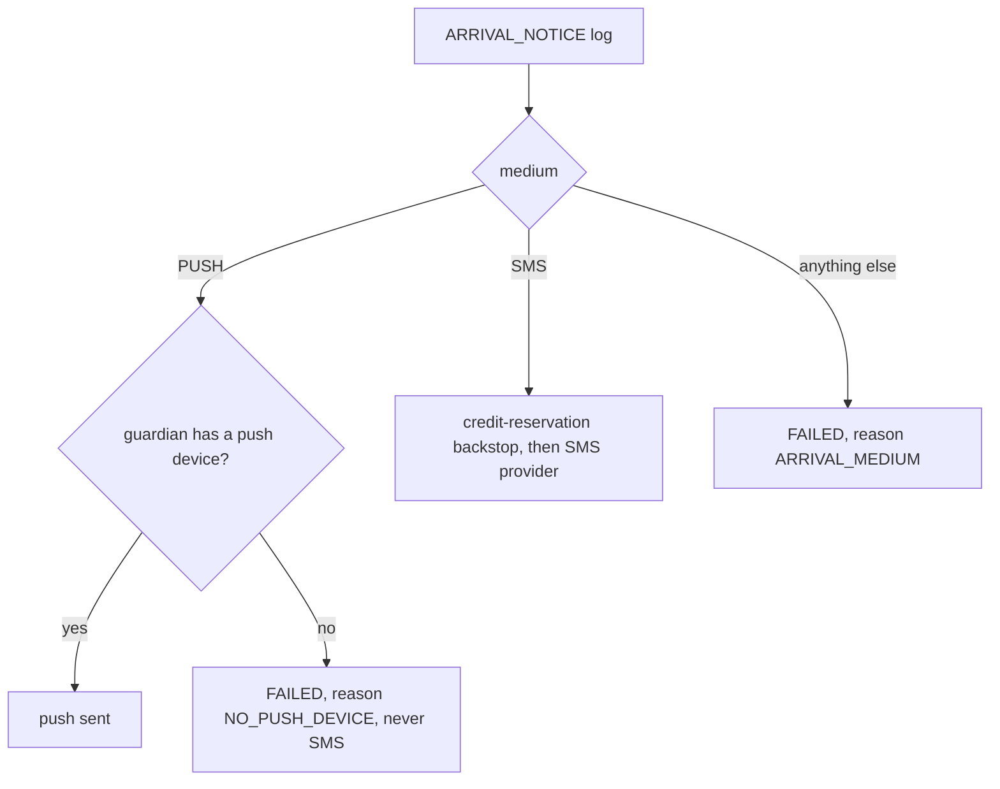

Example: Rahim's guardian chose "in the app" but has no device. The log ends
`FAILED` with `metadata.reason = 'NO_PUSH_DEVICE'`; no SMS credit is spent.
Dedupe is the log's `reference_key` (`arrival:<date>:<student>:<guardian>`,
D22): a second notice for the same day is a unique-key conflict, so a skip.

## Arrival-notice log claim [#3286]

`ArrivalNoticeService` bounds `queue.add` with a 3 s timeout, but the add is not cancelled. So the
enqueue-timeout path and the worker can both reach the same log. One conditional UPDATE decides
who owns it (`server/src/modules/communications/worker/log-claim.ts`). No new status value and no
migration: the claim is `metadata.claimed_by` = the BullMQ job id.

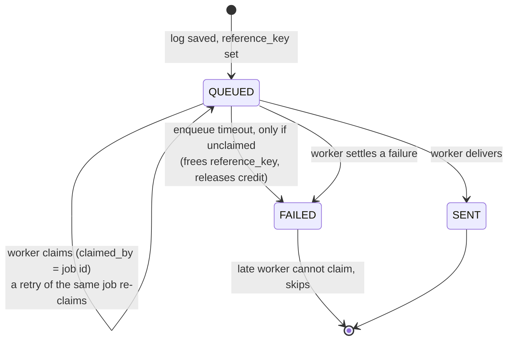

- Worker (ARRIVAL_NOTICE only): `UPDATE ... WHERE status='QUEUED' AND (claimed_by IS NULL OR claimed_by = jobId)`. 0 rows = already settled, skip.
- Timeout path: `UPDATE ... SET status='FAILED', reference_key=NULL WHERE status='QUEUED' AND claimed_by IS NULL`. 0 rows = a worker owns it, so credit and key are left for the worker.
- Absence notices, fees and OTP logs never claim; their behaviour is unchanged.

## Suspended tenants: queued work is cancelled, not paused

A school (tenant) can be suspended by a SUPER_ADMIN
(`TenantStatusService`, `server/src/modules/schools/tenant-status.service.ts`).
`CommunicationsProcessor.process()` checks `tenantStatus.isActive(tenantId)`
before doing anything else — no provider call, no SMS credit debit for a
suspended tenant:

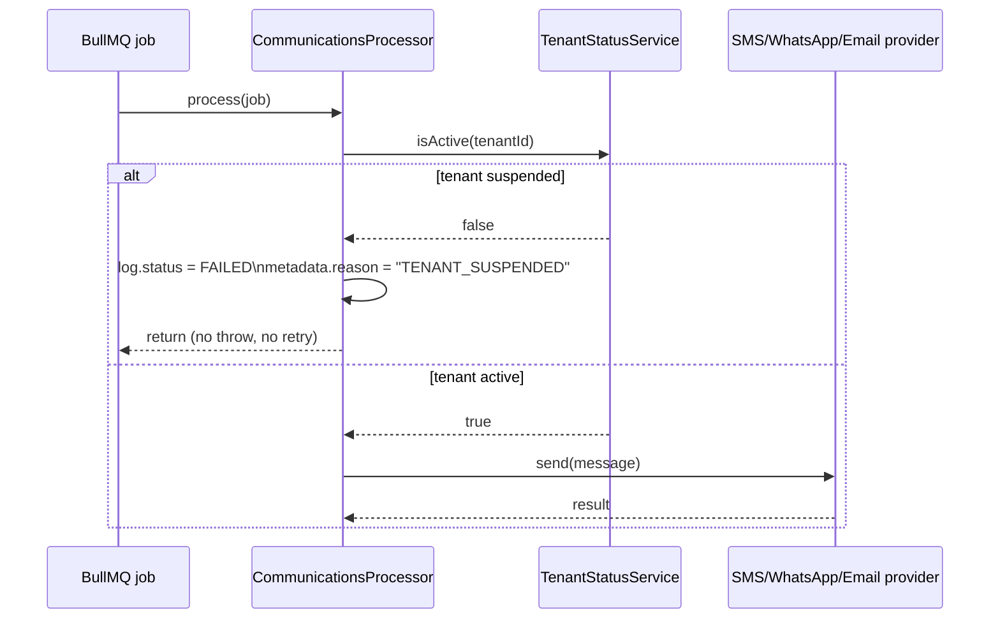

**Important:** this cancels the job, it does not pause it. A message
queued while a school is suspended ends up `FAILED` with
`metadata.reason = "TENANT_SUSPENDED"` and stays that way — reactivating
the school does **not** automatically resend it. Example: a bulk fee
reminder queues 200 `CommunicationLog` rows, the school gets suspended
mid-batch, and 80 rows haven't been picked up by a worker yet — those 80
end up `FAILED`. When the school is reactivated, staff have to trigger a
new send (single or bulk) for anyone who still needs the reminder.

## SMS credit settlement [15.6.6/#549]

A metered tenant's bulk SMS send **reserves** credits for the whole batch
up front (`batch:<batchId>`, epic #508's `RESERVE` ledger kind — see
[the credits doc/#546] for the batch-level reservation). Each individual
SMS job then **settles its own slice** of that reservation, once, right
after the provider call returns — this is the part this section documents.

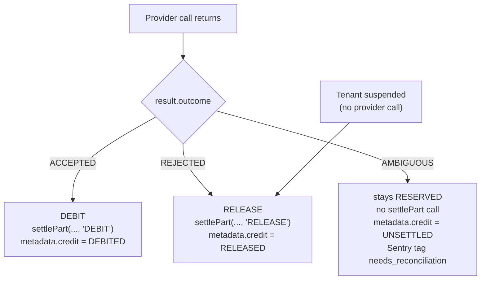

| Provider outcome             | Meaning                                                                             | Ledger kind | Balance effect                                  | `metadata.credit` |
| ---------------------------- | ----------------------------------------------------------------------------------- | ----------- | ----------------------------------------------- | ----------------- |
| `ACCEPTED`                   | Provider took the message                                                           | `DEBIT`     | `reserved -= segments`, credits spent           | `DEBITED`         |
| `REJECTED`                   | Provider (or a pre-flight check) definitely refused it — 4xx/validation, never sent | `RELEASE`   | `reserved -= segments`, `available += segments` | `RELEASED`        |
| `AMBIGUOUS`                  | Timeout/5xx/unknown error _after_ the request went out — unclear if it was sent     | none        | untouched — stays reserved                      | `UNSETTLED`       |
| Tenant suspended before send | No provider call was made                                                           | `RELEASE`   | `reserved -= segments`, `available += segments` | `RELEASED`        |

A **post-acceptance delivery failure** (the SMS was accepted by the
gateway but never reaches the handset — bad number on the carrier side,
etc.) is **not** one of these outcomes: it's invisible to this processor,
which only sees the gateway's immediate accept/reject response. It stays
billed — this mirrors how a real carrier charges: you pay to hand the
message to the network, not for confirmed handset delivery.

### Key convention (#1317)

Every metered-SMS producer follows one rule, so the worker can find the
reservation it settles:

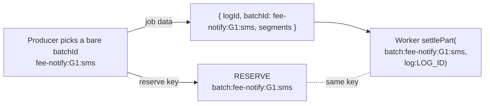

| Producer                              | Bare `batchId` (job) / reserve key = `batch:` + it         |
| ------------------------------------- | ---------------------------------------------------------- |
| Bulk reminders                        | `<batch.id>`                                               |
| Calendar notify                       | `<batch.id>`                                               |
| Incident SMS                          | `incident:<incidentId>`                                    |
| Fee notification                      | `fee-notify:<feeGenerationId>:sms`                         |
| Payment receipt                       | `payment-notify:<paymentId>:<guardianId>`                  |
| Invoice send (manual)                 | `invoice-send:<invoiceId>:<guardianId>:<sendId>`           |
| Exam result SMS                       | `exam-result-sms:<examId>:<sendId>`                        |
| Absence notice                        | `<logId>` (one reservation per SMS log)                    |
| Homework notice                       | `<logId>`                                                  |
| Admission status SMS                  | `<logId>`                                                  |
| Single reminder                       | `<uuid>` (one per send, shared by its SMS logs)            |
| Free-form `POST /communications/send` | `<uuid>` (reserved inside `CommunicationsService.enqueue`) |

Rules:

- **Backstop:** the worker fails any SMS job for a metered tenant that
  carries no reservation (`metadata.reason = 'UNRESERVED_SMS'`, no provider
  call, no retry). A future producer that forgets to reserve cannot spend
  platform money.
- Automated producers (absence, homework, admission) that find the balance
  short do not queue the SMS: the log is saved `FAILED` with
  `metadata.reason = 'INSUFFICIENT_SMS_CREDIT'`. Staff-initiated sends
  (single reminder, free-form) answer 409 `INSUFFICIENT_SMS_CREDIT` instead.
- If the reserve call itself throws (a DB error, say), the automated
  producer saves that log `FAILED` with
  `metadata.reason = 'CREDIT_RESERVE_FAILED'` and moves on to the next
  recipient. A log is never left `QUEUED` with no job behind it.
- Single reminder reserves for the whole send up front. If its loop throws
  half-way (e.g. a log save fails), it gives back the unused part under the
  `unused:<uuid>` part key. Example: 3 segments reserved, 1 queued, then a
  save fails → 2 segments are released.
- **Exempt: two paths skip the queue and credit on purpose.** They call the
  SMS provider directly, so neither reserves and the backstop never sees them:
  - `account-access-delivery.service.ts` — invitations, login OTPs,
    password-reset links and backup/restore notices. A school at 0 credit
    must still be able to sign in and recover an account.
  - `schools/trial/admin-notice.service.ts` — trial warning, trial-ended and
    welcome notices to a school's admins. The platform sends these, not the
    school.

  Any other new SMS sender must go through the queue and reserve.

- A manual re-send gets its own `sendId` (and its own `reference_id`), so
  each send reserves and is capped on its own.
- `CommunicationsService.enqueue` releases the reservation itself when no job
  will ever exist: the log save or lookup throws (`enqueue-failed:<uuid>` part
  key) or `queue.add` throws (`log:<id>`). The exam-result loop does the same
  per job: a failed log save releases under `enqueue-failed:<uuid>`, a failed
  `queue.add` under `log:<id>`, and the loop carries on with the next job.
- The fee and payment listeners do **not** release on a `queue.add` failure.
  The log is marked `ENQUEUE_FAILED` and a replayed event re-claims that same
  log id, so the units stay held for the replay's settle. Releasing would make
  the re-sent SMS free.

### Reconciling stranded reservations (#1317)

Before the fix, fee, payment-receipt, invoice-send and exam-result reservations
were made under a key the worker never looked up (no `batch:` prefix). Their
units stayed in `reserved` forever. An operator command finds them and settles
the ones whose outcome is certain. It is **not** a migration and never runs on
boot: you start it by hand.

Run it **after** the fix is deployed **and** the communications queue has
drained (in-flight rows are skipped, so an early run is safe but incomplete).

**Deploy note:** drain or stop the communications workers before (or while)
deploying the producers. A rolling deploy lets an OLD worker handle a NEW-key
job (for example by push-delivering it), which leaves units reserved under a
`batch:` key. Run the dry-run afterwards: such rows show up as
`BATCH_REMAINDER`.

```bash
cd server && yarn sms-credit:reconcile                          # dry run, all tenants (default)
cd server && yarn sms-credit:reconcile --tenant=<uuid>          # dry run, one tenant
cd server && yarn sms-credit:reconcile --tenant=<uuid> --apply --confirm-db=<database name>  # act, one tenant
```

It connects with `DATABASE_URL` from `.env`, like `settings:reencrypt`, but an
already-exported `DATABASE_URL` wins over `.env`. So `--apply` is refused
(exit 2) unless `--confirm-db=<name>` equals the database it actually
connected to (the `database=` value on the first output line; a dry run
shows it). Dry runs need no confirmation.

How each linked SMS log is decided (the log's own `log:<id>` part key is used,
the same one the worker uses, so a re-run or a late worker can never charge or
credit twice):

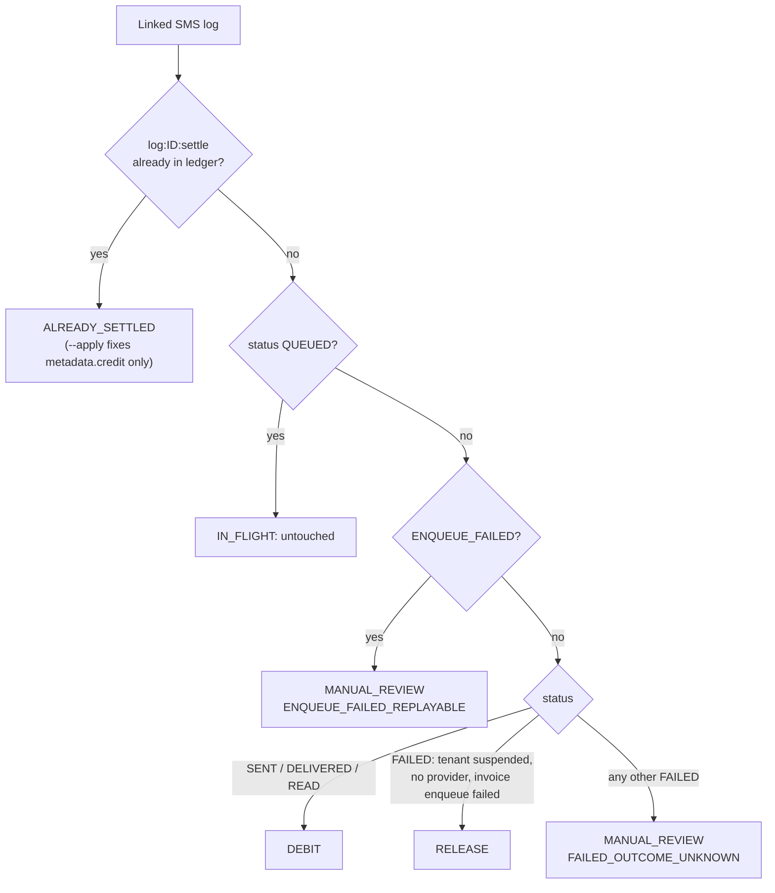

Example dry run (made-up ids; only ids, counts and codes are printed, never
keys, phones, names or message text):

```text
sms-credit:reconcile mode=DRY-RUN database=biddaloy
tenant=0a1b... reserve=7c2d... source=FEE_NOTIFY log=91ef... units=2 action=DEBIT reason=SENT
tenant=0a1b... reserve=7c2d... source=FEE_NOTIFY log=44aa... units=1 action=RELEASE reason=TENANT_SUSPENDED
tenant=0a1b... reserve=7c2d... source=FEE_NOTIFY log=5be0... units=1 action=MANUAL_REVIEW reason=FAILED_OUTCOME_UNKNOWN
tenant=0a1b... stranded_reserves=1 settled_reserves=0 debit=1/2u release=1/1u manual=1/1u already_settled=0 in_flight=0 errors=0
```

`MANUAL_REVIEW` rows are only listed, never touched. They keep their units
reserved until a person decides:

| Reason                         | Meaning                                                                                                                                                                                                                                |
| ------------------------------ | -------------------------------------------------------------------------------------------------------------------------------------------------------------------------------------------------------------------------------------- |
| `FAILED_OUTCOME_UNKNOWN`       | FAILED but we cannot tell rejected from ambiguous on old rows                                                                                                                                                                          |
| `ENQUEUE_FAILED_REPLAYABLE`    | A replayed event re-claims this log; releasing would make the re-send free                                                                                                                                                             |
| `ENQUEUE_FAILED_HOLDING_UNITS` | Same, on a post-fix `batch:` reservation. Listed only                                                                                                                                                                                  |
| `AMBIGUOUS_LINK`               | Invoice-send reserve has no single matching log (time-window match)                                                                                                                                                                    |
| `NO_LOG_LINK`                  | Exam-result reserve: logs carry no link to the reservation                                                                                                                                                                             |
| `SHARED_REFERENCE`             | Old invoice-send reserves for one invoice share a reference, so their caps mix; never settled. (Result SMS has one reserve per exam key, so it is never a group.) Reported once per group, as the units not yet settled (any key form) |
| `BATCH_REMAINDER`              | A `batch:` reserve older than 24h with units left and no QUEUED SMS log since: crashed worker, push-delivered by an old worker, or a rolling deploy. Listed only                                                                       |
| `SPLIT_ACROSS_DEPLOY`          | Both an old and a `batch:` reserve exist for the same send; their caps would mix                                                                                                                                                       |
| `EXCEEDS_RESERVATION`          | Settling this log would pass the reserved units                                                                                                                                                                                        |
| `ORPHAN_UNITS`                 | Reserved units no log accounts for                                                                                                                                                                                                     |
| `UNKNOWN_KEY`                  | Reserve key matches no known producer                                                                                                                                                                                                  |

Legacy fee and payment SMS that were delivered by **push** (not SMS) have no
SENT log to debit, so their reserved units show up as `ORPHAN_UNITS`. That is
manual review too.

Safe to re-run: settled rows show as `ALREADY_SETTLED` and nothing is written
twice. The exit code is 1 if any row ended in `ERROR`, 2 for bad arguments.

### Where settlement happens, and why it's outside the log-save transaction

`CommunicationsProcessor.settle()` (the log-save + batch-counter update)
already runs in one DB transaction — see its doc comment. Credit
settlement is a **separate, later** step, deliberately **not** part of
that transaction: a `SmsCreditService.settlePart` failure must never roll
back (or block recording) a send that already happened. If it fails, the
processor logs the error and writes `metadata.credit = 'UNSETTLED'`
instead of throwing — throwing here would risk BullMQ retrying a job
whose SMS was _already sent_, resending it to the guardian a second time.

### Idempotency and the retry/crash window

`settlePart(tenantId, batchKey, logKey, units, outcome)` is idempotent on
`` `${logKey}:settle` `` (`log:<logId>:settle`) — a second call with the
same key is a no-op. Since every settlement call in the processor uses
the same `log:<logId>` key regardless of how many times that job runs,
a BullMQ retry or stalled-job replay settles at most once.

This does **not** close the existing duplicate-send crash window
documented on `CommunicationsProcessor` itself: if the worker crashes
_after_ the provider accepts the message but _before_ the log save
commits, a replay resends the SMS (the log's status guard only catches a
replay _after_ that save landed). What settlement adds: if that same
crash happens after the provider call but before this class gets a chance
to run `settlePart`, the reservation for that log is left in its original
"neither debited nor released" state. The next time this job is
processed, it goes through the outcome mapping again and settles
normally — so the crash window is closed for credit-correctness the same
way it already is for the log/batch state. The `AMBIGUOUS` case is the
one that's expected to require a human: reconciliation tooling looks for
`metadata.credit = 'UNSETTLED'` and the `needs_reconciliation` Sentry tag
(reusing 15.1.4's queue-failure telemetry — see
`CommunicationsProcessor.flagAmbiguousSettlement`) to find these and
resolve them manually.

## Test inbox sink (`MESSAGE_SINK=mailpit`) [Epic 87]

With `MESSAGE_SINK=mailpit`, the registry skips every real provider. Each medium (SMS, WhatsApp, email, Messenger) is sent to Mailpit as an email with the real body, so you can read OTP codes in a browser. `DEMO_MODE` alone does **not** do this.

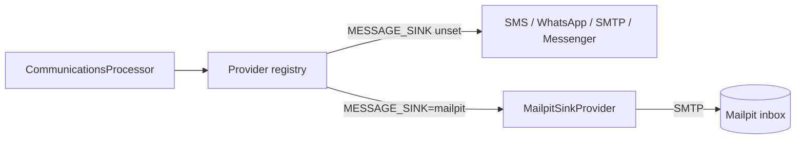

Example: an SMS to `01711111111` arrives as an email to `01711111111@sms.sink.invalid`, subject `[SMS]`, header `X-Tags: SMS`. The number stays out of the subject, because the demo inbox is public and lists subjects; search by `to:` instead.

| Variable                  | Default               | Meaning                                                                                                                                                                      |
| ------------------------- | --------------------- | ---------------------------------------------------------------------------------------------------------------------------------------------------------------------------- |
| `MESSAGE_SINK`            | unset                 | `mailpit` turns the sink on. Anything else is off.                                                                                                                           |
| `MESSAGE_SINK_SMTP_URL`   | `smtp://mailpit:1025` | Where the sink sends. Dev `.env` sets it; `deploy/stack.yml` sets `smtp://<stack>-mailpit:1025`, since the bare `mailpit` alias is shared across stacks on the edge network. |
| `MESSAGE_SINK_PUBLIC_URL` | unset                 | Browser URL of the Mailpit UI, for links in docs and UI.                                                                                                                     |

If Mailpit cannot be reached (connection refused, reset, timed out, or its name does not resolve, e.g. during the nightly restart), the send fails with `Test inbox unreachable` and the queue retries it. The log row ends FAILED only when the retries run out. Any other sink error is final at once.

### Test inbox: deploy and learning [87.1.06]

Hostnames are single level: `inbox-demo.<domain>` and `inbox-staging.<domain>`. Cloudflare Universal SSL covers one level only, so `inbox.demo.<domain>` would have no cert.

Deploy prerequisites on demo and staging:

- `MESSAGE_SINK=mailpit` and `COMPOSE_PROFILES=sink` (config:check refuses either one missing). The deploy names `mailpit` in its `up` on staging and demo, because a profile alone never starts a service.
- `INBOX_*` keys in `edge.enc.env`.
- The edge nginx has a separate block for Mailpit's send API (`/api/v1/send`); it is not exposed like the UI.

Dated learning (2026-10-28):

- **Surprise:** test-env starts db, redis and seaweedfs only, so there is no Mailpit locally. Cost: the "OTP in Mailpit" proof could not run in CI. Fix: `mailpit-sink.smtp.spec.ts` runs the real provider against an in-test SMTP socket. Rule candidate: prove a sink with a socket listener, keep the live-inbox check as a manual step.
- **Surprise:** the existing provider spec mocks `nodemailer`, so it never checked the wire format (`X-Tags`, `To`, `Subject`). Fix: a second spec file with no mock. Rule candidate: one mocked spec plus one real-transport spec per provider.
- **Surprise:** a down inbox must fail the log row (D10). Covered by the closed-port case in the same spec.
- **Surprise:** a two-level host like `inbox.demo.<domain>` is outside Cloudflare's free Universal certificate, which covers one level only. Cost: the planned names would have failed TLS. Fix: single-level `inbox-demo.` and `inbox-staging.`. Rule candidate: new public hostnames are one label under the apex.
- **Surprise:** a shared nginx `map` lived in `ops.conf.template`, which the edge deletes when ops is off; the new inbox block then stopped nginx booting. Fix: the inbox template owns its own map. Rule candidate: a template never uses a variable defined in an optional template.
- **Surprise:** vitest does not type-check, so a stray `, null` argument passed 23 tests and failed `yarn lint`. Rule candidate: run `tsc` on the touched package before committing.

## Epic 97 learning

Wave 1 (#3295, #3296) put one abstract class in front of the five providers. Nothing a user sees changed.

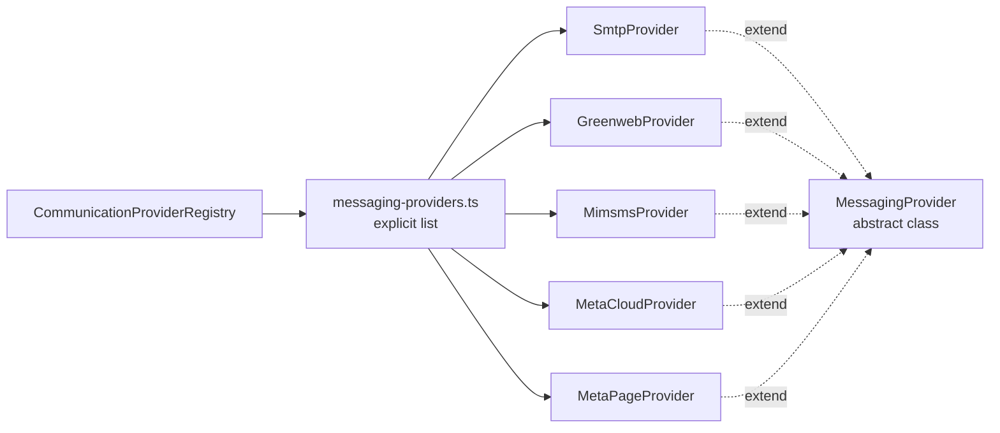

Example: adding a provider means one new class that `extends MessagingProvider` plus one line in `messaging-providers.ts`. No decorator, no scanning.

Dated learning (2026-10-31):

- **Surprise:** the old `sms-gateway.interface.ts` and the per-channel names (`SmtpEmailProvider`, `MimSmsGateway`) hid that all five providers do the same job. Cost: each channel had its own factory shape. Fix: one `MessagingProvider` base and a flat provider list. Rule candidate: a new channel reuses the base class, never a new interface.
- **Surprise:** Wave 1 changed no DTO or route, so `yarn api:types` produced no diff. Fix: none needed; `check-api-types` still passes. Rule candidate: a pure refactor wave closes by proving "no diff", not by committing a regenerated file.
- **Surprise:** a few Wave 1 bridges were left on purpose (`sendForTenant`, a `MediumSettings` index signature typed `any`, the deprecated `SmsGatewayName` alias). Rule candidate: list deliberate bridges in the wave-close notes so the next wave owns their removal.

Wave 2 (#3298 to #3301) made the choice of provider data, not code. A school's settings name the provider, one resolver turns that into a config, and a spec proves a brand-new vendor needs no other edit.

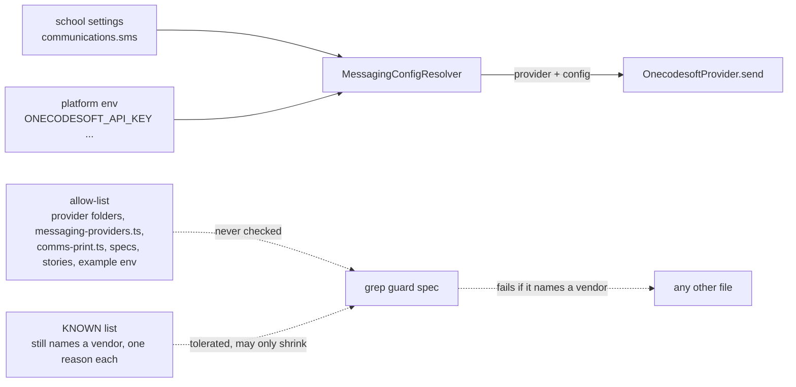

Example: a school stores `communications.sms = { provider: 'onecodesoft', onecodesoft: { apiKey, senderId, apiUrl } }`. The demo seed (`comms-print.ts`) writes that shape for every demo school, with fake values. The secrets are encrypted when `SETTINGS_ENCRYPTION_KEY` is set; without it (a bare local DB) the seed leaves `apiKey` out, so OneCodeSoft reads `configured: false` there. It adds no `metering: 'PLATFORM'`: a school on its own gateway pays the vendor itself.

A field's descriptor decides how it resolves. `required`, `owned: true` (OneCodeSoft `senderId`) and destination fields (`kind: 'url'`, or `destination: true` on SMTP `host`/`port`) belong to whoever owns the medium. Once the school owns it, they never come from the platform env. Example: a school with its own OneCodeSoft key and no `senderId` sends with no sender id, never under `ONECODESOFT_SENDER_ID`.

The same rule covers unsaved values (the `config` a connection test or test message sends). On a school with no config of its own, an override that sets any owned field must carry every required field itself. It is never mixed with the platform env. Example: `{ smtp: { from: "ceo@bank.example" } }` with `SMTP_*` set on the platform is refused; it does not send through the platform login under a caller-chosen sender. On a school that owns the medium, the override still mixes with the school's own saved values, so "test my saved config" works when the form leaves an unchanged secret out.

A destination in the override (`host`, `port`, `apiUrl`) counts as new only when it differs from the saved one. The form sends the saved destination back, so that is still the school's own target and the saved secret is used. A different destination must carry every required field itself, so a saved password or key never goes to a host the caller picked.

| Saved                         | Override                    | Result                         |
| ----------------------------- | --------------------------- | ------------------------------ |
| `smtp.example`, password `pw` | `{ host: 'smtp.example' }`  | uses `pw` (`source: 'tenant'`) |
| `smtp.example`, password `pw` | `{ host: 'other.example' }` | refused: missing `password`    |

The resolver returns `source: 'override' | 'tenant' | 'platform'` so a caller can tell whose account a send uses.

Dated learning (2026-10-31, Wave 2 close #3301):

- **Proof:** `stub-provider.proof.spec.ts` adds a `StubSmsProvider` with one `vi.mock` line. The resolver (tenant settings and `STUB_API_KEY`), the settings validator, `getSecretPaths` and the providers response all accept it with no source edit.
- **Guard:** `messaging-provider-names.guard.spec.ts` fails when a generic file names a vendor. Allowed: the provider folders, `messaging-providers.ts`, the demo seed `comms-print.ts`, specs, stories, example env files. Files that still name a vendor (the hand-built SMS form, platform alerts, locale labels, doc comments) sit in a `KNOWN` list with a reason each. The list may only shrink: a second test fails when an entry stops leaking.
- **Surprise:** a single-provider medium (WhatsApp, email, messenger) still honoured a stray stored `provider` key, so a bad value broke a school that had nothing to choose. Fix: the resolver ignores it when the medium has one provider.
- **Surprise:** `parsePort('')` failed the digit check even though blank means "use 587" (the settings form saves `''`). Fix: blank passes; `'abc'` stays a config error. Both are pinned in the SMTP spec.
- **Surprise:** the fee and invoice listeners read the flat `whatsapp.phoneNumberId`, so a school on the D6 nested shape looked like it had no WhatsApp. Fix: one `whatsappConfigured(settings)` helper reads both shapes.
- **Rule candidate:** a helper that asks "is this medium set up?" goes through `messaging-descriptors.ts`, never a hand-written settings path.

Wave 3 (#3305, #3302, #3303) gave admins a way to prove a provider works, moved platform alerts onto the registry, and made the settings form read the provider list from the server. #3304 (an e2e vendor stub) did not ship.

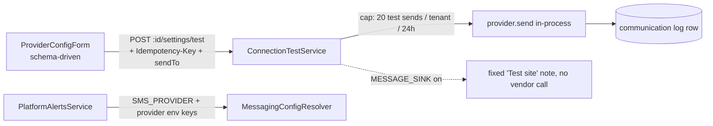

**Test send.** `POST /schools/:id/settings/test` with `sendTo` sends one real message in-process through the same provider code a school uses. No queue. Example: `sendTo: "+8801700000000"` with header `Idempotency-Key: 7f3c...` sends one SMS and writes one log row. Rules:

- The route allows 20 test sends per school per 24 hours (`TEST_SENDS_PER_DAY`). The 21st is refused.
- `sendTo` without an `Idempotency-Key` is a 400. A repeated key replays the stored answer and sends nothing. The UI mints a fresh key on every click.
- On a sink stack (`MESSAGE_SINK`, Epic 87) nothing real is configured. The route returns the fixed "Test site" note before any vendor call. So a sink stack can never show a balance, a Sent row or Delivered.

**Platform alerts.** `PlatformAlertsService` now asks the registry. `SMS_PROVIDER` names the provider (for example `onecodesoft`) and that provider's own env keys (`ONECODESOFT_API_KEY`, ...) carry the secrets. The old `PLATFORM_SMS_*` keys still work for one more release, only while `SMS_PROVIDER` is unset and `PLATFORM_SMS_API_KEY` is set. They log one boot warning with key names only. If `SMS_PROVIDER` is set they are ignored and a warning says so. `config-check` fails production when `SMS_PROVIDER` is not a registered name or a required key is missing.

**ProviderConfigForm.** One form renders every provider from the server's descriptors, so a new vendor adds no UI code. Descriptor flags drive it: `owned` (the school's own value, never the platform's), `destination` (a host or URL, treated like `owned`), `sendOnly` (shown only for sending, not for the credential check) and `format` (input type and validation). `SchoolSettingsPage` now asks `useMessagingProviders` whether SMS is configured instead of rebuilding that rule in the client.

Dated learning (2026-10-31, Wave 3 close #3306):

- **Surprise (#3304, issue #3324):** the e2e vendor stub could not work. `outbound-destination-guard.ts` rejects `http:` and loopback or private hosts for send, balance, status and test connection (security Rule 7), and it has no test override. `MESSAGE_SINK` is no substitute because it answers before any vendor call. Nothing was weakened. Rule candidate: an e2e plan that needs a local fake HTTP server checks the SSRF guard first. Vendor flows stay covered by `provider-connection-test.e2e-spec.ts`; the choice between a `NODE_ENV=test` loopback seam and UI-only Playwright is on #3324.
- **Surprise:** `yarn guide:impact` flagged `communications.sendMessage` and `admin.howItWorks` for pure internal edits (a resolver rename in `credits.controller.ts`, a hook swap in `SchoolSettingsPage.tsx`). Nothing a user sees changed there, so the PR body carries a `User guide: not affected` line. The settings page itself did change and its bn and en guide pages were updated.
- **Rule candidate:** a wave that adds routes closes with `yarn api:types` and `check-api-types`, unlike Wave 1 where "no diff" was the proof.
