# Deployment

> **What this page is.** The shape of the deployment: what runs, how the
> parts talk, how a version reaches a server. The commands you type live in
> [28-platform-runbook.md](28-platform-runbook.md). The reasons behind each
> choice, and what we left for later, live in
> [30-deployment-target.md](30-deployment-target.md).

One VM runs every environment. Prod, staging and demo are three copies of the
same stack, each with its own database, Redis and file store. A shared edge
(nginx) is the only thing that reaches all of them.

## Topology

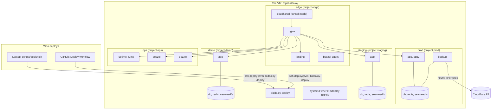

| Project   | Compose file(s) in `deploy/`                      | Services                                                                                                              |
| --------- | ------------------------------------------------- | --------------------------------------------------------------------------------------------------------------------- |
| `prod`    | `stack.yml`                                       | `app`, `app2` (profile `replica`), `db`, `redis`, `seaweedfs`, `backup` (profile `backup`), `jobs` (profile `jobs`)   |
| `staging` | `stack.yml`                                       | `app`, `db`, `redis`, `seaweedfs`, `jobs`                                                                             |
| `demo`    | `stack.yml`                                       | `app`, `db`, `redis`, `seaweedfs`, `demo-reset` (profile `demo-jobs`, run once per night)                             |
| `edge`    | `edge.yml`, plus `edge.direct.yml` in direct mode | `nginx`, `landing`, `beszel-agent`, `cloudflared` (profile `tunnel`); direct mode adds `cert-bootstrap` and `certbot` |
| `ops`     | `ops.yml`                                         | `uptime-kuma`, `beszel`, `dozzle`                                                                                     |

The same `stack.yml` runs three times, told apart by `-p <project>` and by
its own `.env` at `/opt/biddaloy/<project>/.env`. There is no `container_name`
and no published host port in `stack.yml`. Prod's `.env` sets
`COMPOSE_PROFILES=replica,backup`, which is why every deploy step names its
services instead of running a bare `up`.

## Networks: who joins what

Each box below is a Docker network. Only `app` and `app2` leave their own
stack. They join `biddaloy-edge` under an alias such as `prod-app` or
`staging-app`, and that is the only door nginx uses.

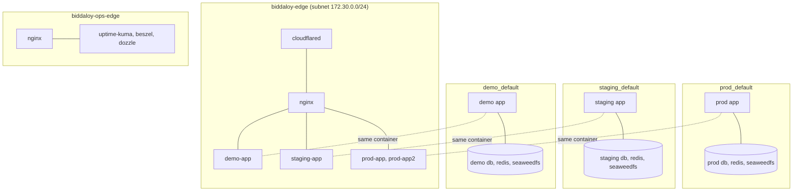

| Network             | Made by                                                              | Members                                      |
| ------------------- | -------------------------------------------------------------------- | -------------------------------------------- |
| `<project>_default` | compose, one per project                                             | that stack's own services                    |
| `biddaloy-edge`     | the deploy playbook (`docker network create --subnet 172.30.0.0/24`) | nginx, cloudflared, and every `app` / `app2` |
| `biddaloy-ops-edge` | the deploy playbook                                                  | nginx, and Kuma, Beszel, Dozzle              |

Why not put everything on one network: Docker answers a name such as `redis`
from every network a container sits on. If the staging app shared a network
with prod, its `redis` lookup could return prod's Redis. Here the staging app
sees its own `redis` on `staging_default`, and on `biddaloy-edge` it sees only
nginx.

The subnet is pinned because nginx trusts `CF-Connecting-IP` only from it
(tunnel mode, `EDGE_TRUSTED_CIDR`). Provision creates no Docker network.

## The two edge modes

One nginx image, two ways to reach it. `nginx/edge-mode.sh` reads `EDGE_MODE`
(from `infra/secrets/edge.enc.env`) when the container starts and writes the
parts that differ. A bad value stops the container.

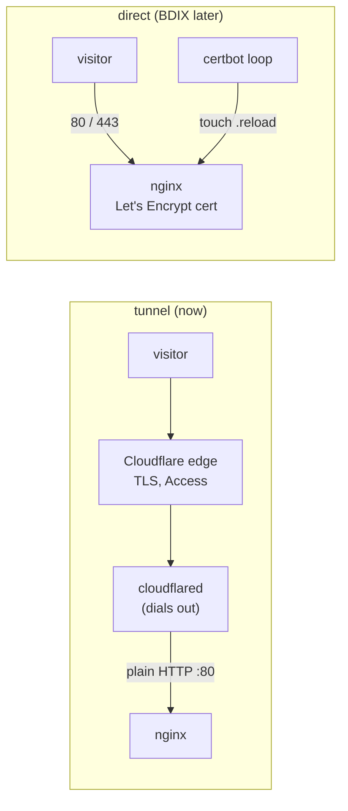

|                             | `EDGE_MODE=tunnel`                                                   | `EDGE_MODE=direct`                                                                                                                                          |
| --------------------------- | -------------------------------------------------------------------- | ----------------------------------------------------------------------------------------------------------------------------------------------------------- |
| Public ports                | SSH only                                                             | SSH, 80, 443                                                                                                                                                |
| Compose                     | `edge.yml`, profile `tunnel` starts `cloudflared`                    | `edge.yml` + `edge.direct.yml` (`cloudflared` moves to profile `disabled`)                                                                                  |
| TLS                         | Cloudflare                                                           | Let's Encrypt, HTTP-01; `cert-bootstrap` makes a 30-day self-signed cert on the first start so nginx can answer the challenge; `certbot` renews twice a day |
| Visitor IP                  | `CF-Connecting-IP`, trusted only from `EDGE_TRUSTED_CIDR`            | the TCP peer; no `real_ip` lines at all                                                                                                                     |
| `X-Forwarded-Proto`         | forced to `https` (cloudflared talks plain HTTP)                     | the real scheme                                                                                                                                             |
| Staging and ops outer login | Cloudflare Access, checked by `cloudflared` (`originRequest.access`) | nginx basic auth from `BASIC_AUTH_HTPASSWD`                                                                                                                 |
| Kuma push monitors          | `cloudflared` routes `/api/push/` on the Kuma host without Access    | nginx skips basic auth for exactly that path                                                                                                                |
| Config files                | `cloudflared/config.yml`, `credentials.json`                         | `letsencrypt/`, `acme-webroot/`, `htpasswd`                                                                                                                 |
| Hosts that answer           | the five domains in `edge.enc.env`; anything else gets `444`         | same                                                                                                                                                        |

**First real certificate (direct mode).** Issuing it is one manual step, once.
After the first `biddaloy-deploy edge <sha>` nginx serves the placeholder; delete
it and ask Let's Encrypt for the real one (the command is in the comment above
`cert-bootstrap` in `deploy/edge.direct.yml`):

```bash
rm -r /opt/biddaloy/edge/letsencrypt/live/<APP_DOMAIN>
docker compose -p edge exec certbot certbot certonly --webroot -w /var/www/acme \
  --cert-name <APP_DOMAIN> -d <APP_DOMAIN> -d <STAGING_DOMAIN> -d <DEMO_DOMAIN> \
  -d <LANDING_DOMAIN> -d <KUMA_DOMAIN> -d <BESZEL_DOMAIN> -d <LOGS_DOMAIN> \
  -d <INBOX_DEMO_DOMAIN> -d <INBOX_STAGING_DOMAIN> --force-renewal
```

(Not yet run on a real host. The command as written has no `--email` and nothing
reads `LETSENCRYPT_EMAIL` from `edge.enc.env`; see the hand-off notes.) From then on the
`certbot` loop renews it and touches `/var/www/acme/.reload`, which makes nginx reload.

Switch by setting `EDGE_MODE` (and, in `infra/ansible/inventory/prod.yml`,
`edge_mode`), running provision again, then `biddaloy-deploy edge <sha>`.
See [25-cloudflare.md](25-cloudflare.md#direct-mode-what-replaces-cloudflare)
for what Cloudflare does for you in tunnel mode and what replaces it.

## Images and tags

`.github/workflows/publish-image.yml` runs on every merge to `main`. Each
image is tagged with the **full 40-character commit SHA** and `main`. The VM
only pulls, never builds.

To test a branch before it merges, run the same workflow by hand
(`gh workflow run publish-image.yml --ref <branch>`; it is a `workflow_dispatch`).
On any branch other than `main` it publishes **only** the full-SHA tags and never
writes `:main`, so `:main` always means "what is merged". Deploy that SHA with
`biddaloy-deploy <stack> <sha>` (see
[30-deployment-target.md](30-deployment-target.md)). The pull login is the `GHCR_PULL_USER` /
`GHCR_PULL_TOKEN` pair in `edge.enc.env` (a token with only `read:packages`).

| Image                                 | Built from                                                                                  | Used by                                                              |
| ------------------------------------- | ------------------------------------------------------------------------------------------- | -------------------------------------------------------------------- |
| `ghcr.io/tareq89/biddaloy-app`        | `Dockerfile`                                                                                | `app`, `app2`, and one-off `config-check`, `migrate`, smoke          |
| `ghcr.io/tareq89/biddaloy-backup`     | `scripts/backup/Dockerfile`                                                                 | prod `backup`, and the `jobs` service (staging refresh, log archive) |
| `ghcr.io/tareq89/biddaloy-demo-reset` | `scripts/demo/Dockerfile` (`FROM` the app image, plus `db-swap.sh` from the backup context) | `demo-reset`                                                         |
| `ghcr.io/tareq89/biddaloy-landing`    | `landing/`                                                                                  | `landing`                                                            |

Example: `APP_VERSION=3f9c2ab4e1d07a5b6c8f9e0d1a2b3c4d5e6f7a8b` in
`/opt/biddaloy/prod/.env` runs `ghcr.io/tareq89/biddaloy-app:3f9c2ab4e1d07a5b6c8f9e0d1a2b3c4d5e6f7a8b`.
The deploy writes `APP_VERSION` (`LANDING_VERSION` for edge); you never edit it.
`ops` runs public images (Kuma, Beszel, Dozzle) pinned by digest, not by SHA.

The app image carries no per-environment values. One image serves prod,
staging and demo (next section). The build gets only `APP_VERSION`,
`SENTRY_ORG`, `SENTRY_PROJECT` and the `sentry_auth_token` BuildKit secret
(for source maps, which are deleted before the image is sealed).

## Runtime config and secrets

Everything that differs between environments is read at boot from the
environment, so the same image runs three times.

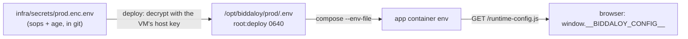

`GET /runtime-config.js` (`server/src/runtime-config.ts`) is served by the
app, outside `/api`, with `no-store`. It carries only public values, and a
spec pins the exact key list:

| Key in `window.__BIDDALOY_CONFIG__` | Read from env                         | Used for                                             |
| ----------------------------------- | ------------------------------------- | ---------------------------------------------------- |
| `turnstileSiteKey`                  | `TURNSTILE_SITE_KEY`                  | the captcha widget on public forms                   |
| `supportUrl`                        | `SUPPORT_CONTACT_URL`                 | the "Contact us" link on the trial-ended screen      |
| `messageSinkUrl`                    | `MESSAGE_SINK_PUBLIC_URL`             | test inbox link; empty unless `MESSAGE_SINK=mailpit` |
| `sentryDsn`                         | `SENTRY_DSN_WEB`                      | browser error reports; empty = nothing is sent       |
| `sentryEnvironment`                 | `SENTRY_ENVIRONMENT`, else `NODE_ENV` | tags events `prod` / `staging` / `demo`              |
| `sentryTracesSampleRate`            | `SENTRY_TRACES_SAMPLE_RATE`           | default `0.1`                                        |
| `release`                           | `APP_VERSION`                         | ties a Sentry issue to the deploy                    |

The secrets files, one per project:

| File in `infra/secrets/` | Holds                                                                                                                                                                         | Written to                                                     |
| ------------------------ | ----------------------------------------------------------------------------------------------------------------------------------------------------------------------------- | -------------------------------------------------------------- |
| `prod.enc.env`           | prod app, DB, R2 backup write token, SMS, OAuth, Turnstile, Sentry                                                                                                            | `/opt/biddaloy/prod/.env`                                      |
| `staging.enc.env`        | staging app, `STAGING_PASSWORD`, `STAGING_PASSWORD_HASH_B64`, the R2 **read-only** token, `BACKUP_AGE_PRIVATE_KEY`                                                            | `/opt/biddaloy/staging/.env`, key to `staging/restore/key.txt` |
| `demo.enc.env`           | demo app, `DEMO_PASSWORD`, `DEMO_RESET_PUSH_URL`                                                                                                                              | `/opt/biddaloy/demo/.env`                                      |
| `edge.enc.env`           | `EDGE_MODE`, hostnames, tunnel credentials, GHCR pull token, basic-auth users (direct mode), Telegram bot (`TELEGRAM_BOT_TOKEN`, `TELEGRAM_CHAT_ID`), log-archive R2 settings | `/opt/biddaloy/edge/.env`                                      |
| `ops.enc.env`            | `BESZEL_KEY`, `DOZZLE_USERS_YML`                                                                                                                                              | `/opt/biddaloy/ops/.env`                                       |

Each file is encrypted for three keys: the operator's, an offline recovery
key, and the VM's own host key (`/opt/biddaloy/keys/host.age`). Because the VM
decrypts for itself, no age key ever sits in GitHub. Setup and editing:
[`infra/secrets/README.md`](../../infra/secrets/README.md). Rotation:
[12-operations.md §8](12-operations.md#8-secrets-and-rotation).

`write-env.yml` single-quotes every value, because compose expands `$` in an
unquoted `.env` value. The staging password hash is a bcrypt string full of
`$`, so it is also carried as base64 in `STAGING_PASSWORD_HASH_B64`.

Public values the sign-up form needs, in one place:

| Variable                                                           | Read by                                                   | Missing means                                                                                                                                                                                                                                                                                                                                                                                            |
| ------------------------------------------------------------------ | --------------------------------------------------------- | -------------------------------------------------------------------------------------------------------------------------------------------------------------------------------------------------------------------------------------------------------------------------------------------------------------------------------------------------------------------------------------------------------- |
| `TURNSTILE_SECRET_KEY`                                             | server                                                    | dev and test skip the captcha; **production refuses every sign-up with 503**                                                                                                                                                                                                                                                                                                                             |
| `TURNSTILE_SITE_KEY`                                               | server, served to the browser through `runtime-config.js` | no captcha widget is drawn                                                                                                                                                                                                                                                                                                                                                                               |
| `SUPPORT_CONTACT_URL`                                              | server, same route                                        | no support link                                                                                                                                                                                                                                                                                                                                                                                          |
| `MESSAGE_SINK`, `MESSAGE_SINK_SMTP_URL`, `MESSAGE_SINK_PUBLIC_URL` | server (`PUBLIC_URL` also to the browser)                 | real providers; set `mailpit` on staging and demo, unset on prod (config:check refuses the wrong pairing). The stacks forward `MESSAGE_SINK` and `MESSAGE_SINK_PUBLIC_URL` and set `MESSAGE_SINK_SMTP_URL` to `smtp://<stack>-mailpit:1025` themselves (the bare `mailpit` alias is shared across stacks on the edge network and once sent demo's mail to staging's inbox); a dev `.env` sets it by hand |
| `OTP_SMS_ALLOWED_PREFIXES`                                         | server                                                    | `+880`                                                                                                                                                                                                                                                                                                                                                                                                   |
| `GOOGLE_OAUTH_CLIENT_ID`, `GOOGLE_OAUTH_CLIENT_SECRET`             | server                                                    | Google is not offered                                                                                                                                                                                                                                                                                                                                                                                    |

Set `TURNSTILE_SECRET_KEY` and `TURNSTILE_SITE_KEY` together or not at all: a
secret with no site key rejects every sign-up. The content-security-policy
(`server/src/security-headers.ts`) allows one outside origin,
`https://challenges.cloudflare.com`, in `script-src` and `frame-src`. See
[34-onboarding.md](34-onboarding.md).

## Before you deploy: `yarn config:check`

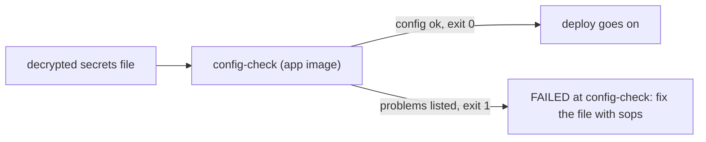

`yarn config:check` (in the image: `node server/dist/scripts/config-check.js --env <prod|staging|demo> --file <path>`)
runs the server's boot-time config checks without starting anything. The deploy runs it for you; run it by hand
on a laptop with `sops -d infra/secrets/staging.enc.env | yarn config:check --env staging --file /dev/stdin`.
It checks:
the env schema and placeholder rules (`env.validation.ts`), the
secret-echo guard, `DB_SSL`, the `SETTINGS_ENCRYPTION_KEY` shape (32 bytes
of base64), the https rules for `APP_BASE_URL` and `PUBLIC_APP_URL`, and,
when `ENABLE_API_DOCS=true`, that `API_DOCS_USER` and `API_DOCS_PASSWORD` are
both set. It lists every failure, not just the first. `--env staging` adds the no-real-provider rules ([Staging](#staging)); `--file <path>` reads that env file instead of `.env`. It does not connect to Postgres,
Redis or S3, so a wrong password or host still only shows up at boot. It
always judges the env as production whatever `NODE_ENV` the file says. It
names variables, never their values. Example, for an `.env` copied from `.env.example` where `JWT_SECRET`
was lengthened but the other placeholders were left in (a `JWT_SECRET` under
32 characters fails earlier, with the plain schema error):

```text
Refusing to start with unsafe production config:
- JWT_SECRET still holds a placeholder value
- POSTGRES_PASSWORD still holds a placeholder value
- S3_ACCESS_KEY_ID still holds a placeholder value
- S3_SECRET_ACCESS_KEY still holds a placeholder value
- SETTINGS_ENCRYPTION_KEY is required in production
- APP_BASE_URL is required in production
- PUBLIC_APP_URL is required in production
DB_SSL must be "true" in production — refusing to connect to Postgres over an unencrypted connection. Set DB_SSL=true (and use an sslmode=require-style DATABASE_URL) once the target Postgres serves TLS.
```

`deploy/stack.yml` also refuses to start when `POSTGRES_*`, `S3_*`, `JWT_SECRET` or
`APP_VERSION` are unset (`${VAR:?...}`), and a `client-admin` production build
fails if `VITE_USE_MOCKS=true`.

Every deploy of an app project runs the same check for you, from the app
image, before touching anything (`node server/dist/scripts/config-check.js --env <project> --file /dev/stdin`,
fed the decrypted file). On staging it also verifies that
`STAGING_PASSWORD_HASH_B64` is the bcrypt hash of `STAGING_PASSWORD`.

## Migrations

The image has no ts-node, so migrations run from compiled JS, in the new app
image, **before** any app container is restarted.

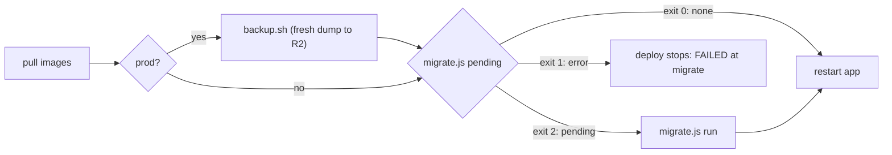

Migrations are **forward-only**. A failed deploy rolls the containers back
to the previous version but never reverts the schema (D11). So old code must
keep working on the new schema for one release: the rule is in
[`CONTRIBUTING.md`](../../CONTRIBUTING.md#database-migrations). By hand, if
you need to look (the project name is the stack name):

```bash
docker compose -p prod --project-directory /opt/biddaloy/prod -f /opt/biddaloy/repo/deploy/stack.yml \
  run --rm app node server/dist/scripts/migrate.js pending
```

## Rolling restart

Prod runs two app containers (D25). The deploy restarts them one at a time:

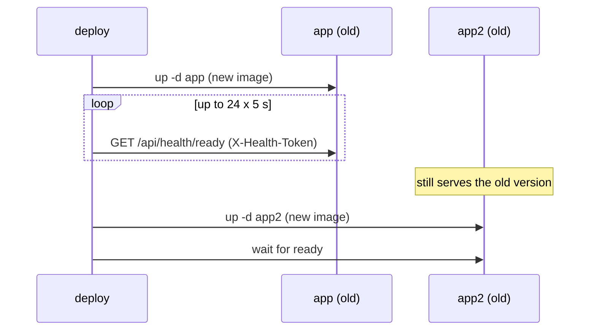

A bad version stops at the first container; the second keeps serving the
old one. Staging and demo have one `app`. nginx finds `prod-app` and
`prod-app2` by alias.
`/api/health/ready` needs `HEALTH_TOKEN` in the project's secrets file; without
it the route answers 404 and the deploy never turns ready.

## How a deploy runs

You pick a commit SHA. It goes to staging first, then the **same image** goes
to prod. A laptop and GitHub run the same command on the VM.

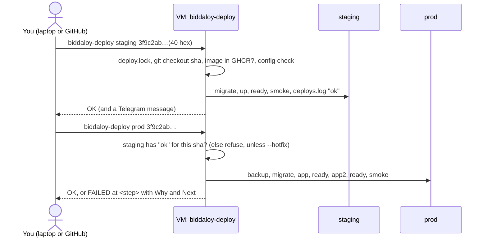

The command, on the VM (`deploy/bin/biddaloy-deploy`):

```bash
biddaloy-deploy <prod|staging|demo|edge|ops|all> <40-hex sha> [--hotfix "reason"] [--skip-backup]
biddaloy-deploy --last-ok <staging|prod>      # prints the last ok sha of that stack
```

From a laptop, `scripts/deploy.sh` checks the SHA is on origin, then runs the
same command over ssh as `deploy@$BIDDALOY_HOST`:

```bash
BIDDALOY_HOST=203.0.113.10 scripts/deploy.sh staging 3f9c2ab4e1d07a5b6c8f9e0d1a2b3c4d5e6f7a8b
BIDDALOY_HOST=203.0.113.10 scripts/deploy.sh prod    3f9c2ab4e1d07a5b6c8f9e0d1a2b3c4d5e6f7a8b
BIDDALOY_HOST=203.0.113.10 scripts/deploy.sh prod    <sha> --hotfix "login broken for all schools"
```

From GitHub: Actions, **Deploy**, `workflow_dispatch` with `stack`, `sha`
(empty = the last staging-ok sha for prod, the ref's head otherwise) and
`hotfix_reason`. Its SSH key is a **forced command**: it can run only
`biddaloy-deploy --from-github`, which accepts one of the shapes
`<stack> <sha> [--hotfix "reason"]` or `--last-ok <staging|prod>`, and only for
a commit that is an ancestor of `origin/main`. The secrets `DEPLOY_HOST`,
`DEPLOY_SSH_KEY` and `DEPLOY_SSH_KNOWN_HOSTS` belong to the `production`
Environment, restricted to `main`.

What `biddaloy-deploy` does, in order:

1. Check the input: `sha` matches `^[0-9a-f]{40}$`; the hotfix reason is 3 to
   200 characters of `A-Z a-z 0-9 space . , : _ / -`; nothing with `{ } % #`.
2. Take `/opt/biddaloy/deploy.lock` (exit 75 if another deploy holds it).
3. `git fetch`, then check out the SHA in `/opt/biddaloy/repo`.
4. Run `ansible-playbook -c local infra/ansible/deploy.yml` on the VM, detached
   (own session), writing `/opt/biddaloy/logs/<stack>-last-deploy.log`. A
   dropped SSH session cannot kill a deploy half way.
5. `all` deploys `edge`, `ops` (only if this host is in the `ops` group),
   `staging`, `prod`, `demo`, in that order.

The playbook, per app project: preflight (inputs, host key decrypts the
secrets, required keys set, **staging gate**, 10 GB free on `/var/lib/docker`,
GHCR login, images exist, `config-check`), networks, `.env` and Postgres TLS,
pull, backup (prod), migrate, data services, rolling restart, the rest of the
stack, smoke. Edge adds `nginx -t` in a throwaway container before the
recreate. Ops is preflight, networks, env, pull, `up`.

**The staging gate (D10).** Prod refuses a SHA with no `staging <sha> ok` line
in `/opt/biddaloy/staging/deploys.log`. `--hotfix "reason"` skips the gate,
and the reason is written to the prod `deploys.log`. The reason travels in the
environment variable `BIDDALOY_HOTFIX_REASON`, never as an Ansible `-e` value,
because Ansible templates `-e` values and a reason holding `{{ }}` would run
code as root.

**Prod backs up before migrating.** If the backup fails, migrations never
run. The rule keys off the data, not the log: the backup runs whenever the
volume `prod_pgdata` exists. `--skip-backup` is for the rare second deploy a
few minutes after a good one.

**Smoke runs on the VM.** After the rollout, `scripts/smoke-post-deploy.mjs`
runs from the app image on `biddaloy-edge` against `http://<stack>-app:3000`
(staging and prod only), so no Cloudflare layer is in the way. Demo gets a
health call only. Prod is also checked from outside: `https://<APP_DOMAIN>/api/health`
must answer 200. What the smoke checks: [12-operations.md §7](12-operations.md#7-post-deploy-smoke-check).

Every result is one line in `/opt/biddaloy/<project>/deploys.log`
(`<UTC time> <project> <sha> <ok|rolled-back|failed> [hotfix: reason]`) and one
Telegram message. A failure always prints the same three lines:

```text
FAILED at: migrate (prod, 3f9c2ab4e1d0)
Why:       migration 1797… failed: relation "fee_items" does not exist
Next:      docker compose -p prod run --rm app node server/dist/scripts/migrate.js pending; biddaloy-doctor prod
```

If anything fails after pre-flight, the playbook puts the previous `.env`
back, pins the previous version (the last `ok` line in `deploys.log`), and
restarts on it. Migrations stay applied.

The deploy never runs `compose up` without naming services: a bare `up`
would start the one-off job containers that `COMPOSE_PROFILES` switches on.

### When rollback also fails

The deploy ends red and the app may be down. On the VM, name the project: a
bare `docker compose` in `/opt/biddaloy/prod` would look at a project named
after the directory and show nothing.

```bash
biddaloy-doctor prod
docker compose -p prod --project-directory /opt/biddaloy/prod -f /opt/biddaloy/repo/deploy/stack.yml ps -a
docker compose -p prod --project-directory /opt/biddaloy/prod -f /opt/biddaloy/repo/deploy/stack.yml logs --tail 100 app
tail -n 5 /opt/biddaloy/prod/deploys.log
```

Then deploy the last good SHA by hand: `biddaloy-deploy prod $(biddaloy-deploy --last-ok prod)`.
If the cause is a migration the old code cannot read, the fix is a new
forward migration, not a rollback. The step-by-step version is in
[28-platform-runbook.md](28-platform-runbook.md).

## Staging

Staging is the same stack as prod, in its own project (`staging`), on the
same VM. It runs yesterday's prod data, scrubbed, so a change meets real
shapes of data before prod does. It can never message a real person: the
scrub removes contacts and provider keys, and `config-check --env staging`
refuses a staging file that points at prod's database or bucket.

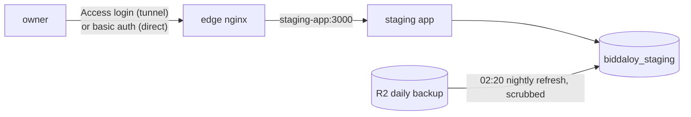

- Hostname: `staging.<domain>`, `X-Robots-Tag: noindex`, outer login as above.
- Data: replaced every night from the 02:00 prod daily backup; see
  [13-backup-restore.md](13-backup-restore.md#the-nightly-restore-drill-proves-restores).
- Logins: every user has the one `STAGING_PASSWORD`. Platform super admins and
  the "Smoke Test School" users keep their email (D20), so the smoke test can
  sign in.
- Files: uploaded files are not copied. Missing images on staging are expected.
- Providers: the test inbox (`MESSAGE_SINK=mailpit`); see
  [05-communications](05-communications.md). No OAuth or push keys; Turnstile uses
  Cloudflare's public always-pass test pair.
- Every prod SHA must pass here first (the staging gate above).

## Demo

The public demo is the `demo` project: its own database and bucket on the same
VM, `DEMO_MODE=true`, rebuilt every night at 03:00 (Asia/Dhaka) by the
`biddaloy-nightly@demo-rebuild` timer. How the rebuild works and how to run it
by hand: [22-demo-seed.md](22-demo-seed.md#running-the-demo-site).
Providers: the test inbox (`MESSAGE_SINK=mailpit`); see
[05-communications](05-communications.md). First-time deploy steps:
[28 part 10b](28-platform-runbook.md#10b-deploy-the-test-inbox-epic-87-staging-and-demo).

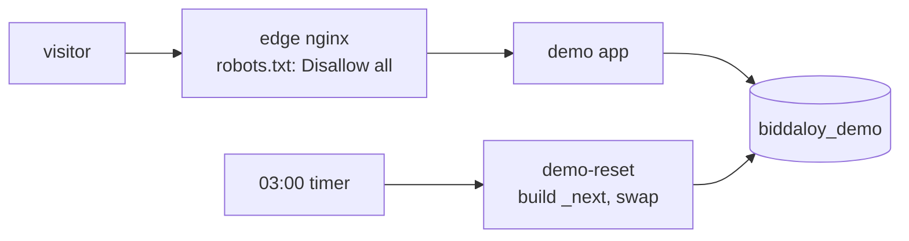

## Landing site

The marketing site is the `landing` container of the edge project, an image
(`biddaloy-landing`) built in CI and pulled like the others. It serves the
apex `schoolmanagerp.com` and redirects `www.` to it. Deploy it with
`biddaloy-deploy edge <sha>`; roll back by deploying an older SHA. Headers and
CSP hosts: `nginx/templates/landing.conf.template`, checked by
`nginx/test/landing.infra.test.sh`.

## Build pipeline

`yarn build:all` (`scripts/build-all.sh`) builds `shared`, `ui`, `client-admin`
and `server` locally into `build-output/`. That folder is for local builds only
and is **not** a deploy path any more: servers run only the GHCR images.

`landing/` (the Astro marketing site) is built by CI's `landing` job:
`yarn workspace @biddaloy/landing build`, then
`node landing/scripts/check-tokens.mjs` (token drift vs the app).

## Error tracking and Web Vitals (Sentry)

The SPA reports errors and real-user performance (LCP/CLS/INP) to Sentry.
The browser values are runtime config (table above), so each project reports
under its own `sentryEnvironment`. Missing values are a supported setup, they
just mean less telemetry:

| Variable                                              | Read by                                      | Missing means                                    |
| ----------------------------------------------------- | -------------------------------------------- | ------------------------------------------------ |
| `SENTRY_DSN_WEB`                                      | the server, handed to the browser at runtime | nothing is sent from the browser                 |
| `SENTRY_TRACES_SAMPLE_RATE`                           | same                                         | 10% of transactions sampled                      |
| `SENTRY_AUTH_TOKEN` + `SENTRY_ORG` + `SENTRY_PROJECT` | the image build only (`publish-image.yml`)   | no source-map upload; stack traces stay minified |

With the token set, the build uploads hidden source maps to Sentry and deletes
them from `dist/`, and a CI step fails the image if any `.map` is left in the
SPA. The plugin stamps the release with the commit SHA, which is what ties an
issue in Sentry to the deploy that introduced it.

**Sentry is scrubbed allow-list style, on every egress path.**
`ui/src/api/sentry.ts` filters errors (`beforeSend`), breadcrumbs
(`beforeBreadcrumb`), transactions (`beforeSendTransaction`) and
standalone spans (`beforeSendSpan` — the path INP takes, which bypasses
the others). Free-form key/value bags are rebuilt from an allow-list, so
a field the SDK adds in a future version is dropped by default rather
than shipped unreviewed. Query strings are removed from URLs entirely,
because this app puts free text in them (`/students?search=…`), and DOM
paths in span names have their attribute selectors stripped, because
Sentry builds those from `aria-label`/`alt`/`title`.

What that does and does not promise: the mechanism is structural, not a
pattern-matcher, so it does not depend on recognising a name — but it is
only as good as the allow-list. **Adding a key to it is a decision about
data protection**, and the tests in `ui/src/api/sentry.test.ts` assert
the allow-list rather than trying to detect PII, because "no addresses"
is not something a regex can check.

## How a request is served

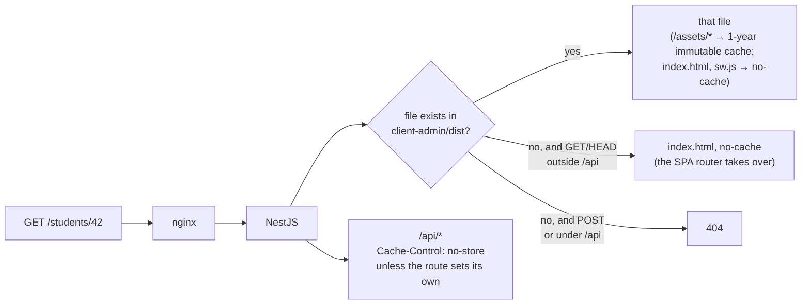

**Cache headers ([75.20]).** `server/src/cache-control.ts` makes every
`/api/*` response `no-store` before the handler runs, so a CDN "Cache
Everything" rule can never serve one person's data to another. A route that
sets its own `Cache-Control` replaces the default:

| Route                                                          | Header                                           |
| -------------------------------------------------------------- | ------------------------------------------------ |
| `GET /api/v1/calendar/feed/:token.ics`                         | `private, max-age=900` (+ `ETag`/304)            |
| print-assets, certificate assets, admit-card assets `…/file`   | `private, max-age=31536000, immutable`           |
| `GET /api/v1/students/:id/photo`                               | `private, no-store`                              |
| everything else under `/api` (JSON, CSV/PDF downloads, errors) | `no-store` (`Content-Disposition` is unaffected) |
| `index.html`, `sw.js`                                          | `no-cache` (revalidated every load)              |
| `/assets/*` (hashed)                                           | `public, max-age=31536000, immutable` (nginx)    |

The immutable `/assets/*` caching comes from nginx only; Nest's own static
serving does not set it, so it holds only behind nginx.

There is deliberately no `Vary: Authorization`: the PWA caches API responses
by its own key and the header changes every token refresh.

One SPA at `/` since [8.9.10] — no `/admin/` or `/student/` prefix, and no
root redirect. The rules above live in `server/src/spa-fallback.ts`
(unit-tested there); nginx's long-cache rule matches `^/assets/`
accordingly. Two behaviours this fixed: `GET /teacher/*` used to return
**500** (the directory never existed, so `sendFile` hit ENOENT with no
error callback) and `POST /admin/anything` used to return **200 + HTML**.

## CI

GitHub Actions (`.github/workflows/ci.yml`) runs on every PR, on push to
`main`, and on every merge-queue entry (`merge_group`). As of [18.5.2] the
three triggers don't all run the same jobs — a merge-queue entry is the
last check before `main`, so it pays for two nightly-only checks
(`sweeps`, `quality`/Lighthouse) that a PR skips to stay fast:

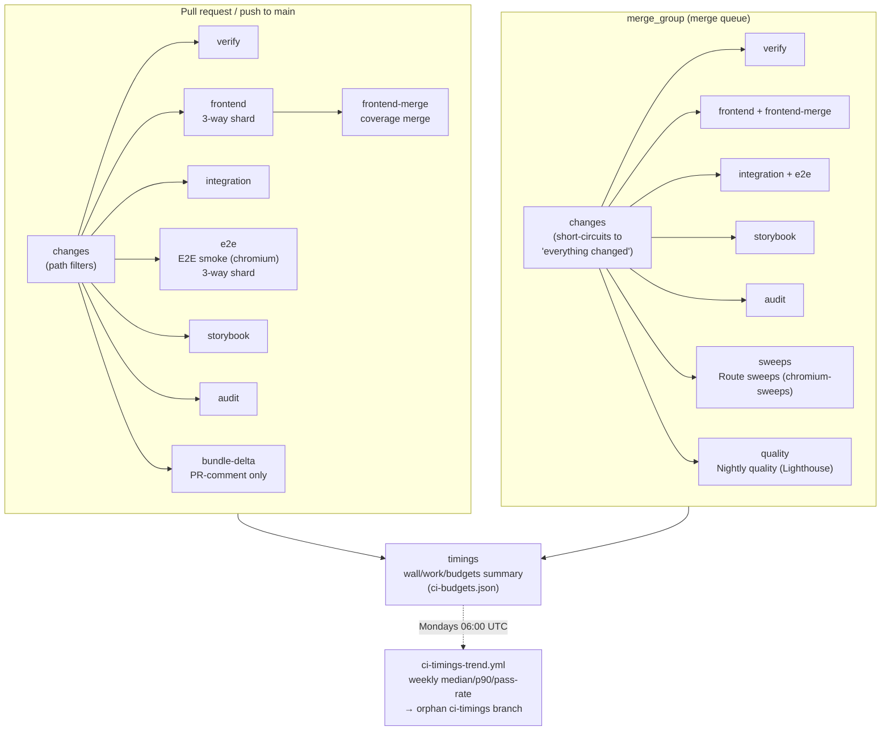

Two further scheduled workflows run checks that neither a PR nor a
merge-queue entry gates on: `nightly-e2e.yml` (the full Playwright suite —
journeys + sweeps — across chromium, firefox and webkit, each 3-way
sharded) and `nightly-frontend-flakes.yml`. All three of
`nightly-quality.yml`, `nightly-e2e.yml` and `nightly-frontend-flakes.yml`
file or update one sticky issue on failure, carrying a workflow-specific
label (`nightly-quality-red`, `nightly-e2e-red`, `flake-hunt`) and the
shared `nightly-red` label; see the root README's "Nightly failure
visibility" section for the full mechanism.

Concretely, each `e2e` (`E2E smoke (chromium N/3)`) shard job: starts Postgres/Redis
service containers → installs deps → builds `shared` → resolves and
caches the Playwright browser → runs migrations → seeds the database →
builds and starts the production client-admin + server → runs the
chromium journeys, smoke and PWA/offline specs against that build →
collects and uploads E2E timings.

Every job above reports its wall time into `timings`, which checks it
against a hand-tuned ceiling in `ci-budgets.json`
(`budgetSeconds = ceil(p90 × 1.15)` over its own trailing green-run
window) and fails the run — with a named job and both numbers in the
annotation — the first time a job actually regresses, instead of a human
noticing CI "feels slower" weeks later. `ci-timings-trend.yml` is the
other half: it doesn't gate anything, it just makes the trend a graph
Monday morning instead of a feeling.

See the root README's "CI" section for the full per-job description and
`ui/CONTRIBUTING.md` for the PR checklist tied to these gates.

### Local loop

Catching a regression in CI (7-15 minutes) is strictly worse than catching
it before the push. Three layers, cheapest first:

1. **While editing** — `yarn check` (`scripts/check.mjs`) runs typecheck +
   lint + affected unit tests. Example: after touching one file in
   `server/src/students/`, `yarn check --affected` runs only the tests
   that import it, not the whole suite. `yarn test:server` goes one step
   further — it takes its own database/Redis/S3 slice of the shared Docker
   stack (`scripts/test-env.sh`, no new containers) and runs the
   full unit + integration + e2e chain server-side, the same steps
   `ci.yml`'s `verify`/`integration`/`e2e` jobs run, without waiting on a
   push.
2. **Before commit/push** — `.husky/pre-push` runs `yarn check --affected`
   automatically, so a regression is caught on your machine, not in CI.
3. **Reproducing a specific CI job** — `yarn ci:local` (`scripts/ci-local.sh`)
   runs the same commands `ci.yml` runs, job-for-job, so "works on my
   machine" stays true. `--only` picks one job instead of the whole
   pipeline, and `--affected` further restricts it to what your branch
   actually touched. Example:

   ```bash
   scripts/ci-local.sh --only frontend --affected
   # → runs just the ui/client-admin vitest suites, scoped to changed files —
   #   the same shard-vs-single-run split ci.yml uses, without waiting on GitHub.
   ```

See the root README's "Local loop" and "CI" sections for the full command
reference (`yarn test:server`, `yarn ci:local --only <job>`, and the
`CI_PATHS_*` path-filter lists `ci-local.sh` and `ci.yml`'s `changes` job
must be kept in sync by hand).

## Learnings (Epic 61, wave 1)

- 2026-10-20: **Compose files got an `APP_VERSION` requirement and every script that starts the stack broke.** Cost: test-env, backup test, setup and the infra test all failed on `${APP_VERSION:?...}`. Fix: each exports `APP_VERSION="${APP_VERSION:-local}"` first. Rule candidate: when a compose file gains a required variable, grep every `docker compose` caller in `scripts/` and CI in the same PR.
- 2026-10-20: **The digest-pin check flagged our own GHCR images.** Cost: a false FAIL in the infra job. Fix: the check skips `ghcr.io/tareq89/biddaloy-`; those are pinned by commit-SHA tag instead (Rule 21). Rule candidate: an exemption list names the exact prefix, never a loose pattern.
- 2026-10-20: **Build overlays were outside the CI infra path filter.** Cost: an edit to `docker-compose.build.yml` ran no infra test. Fix: both overlays join the filter in `ci.yml` and `ci-local.sh`. Rule candidate: a new compose file joins the path filter in the same PR.
- 2026-10-20: **Certbot text outlived certbot.** Cost: the README and three architecture docs still told operators to renew Let's Encrypt certs, and one Cloudflare check ran a command for a service that no longer exists. Fix: all now describe the Origin CA pair. Rule candidate: removing a service greps `docs/` and `README.md` for its name.
