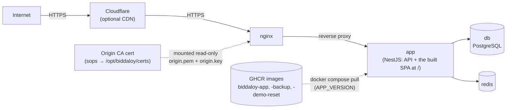
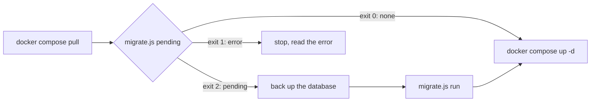
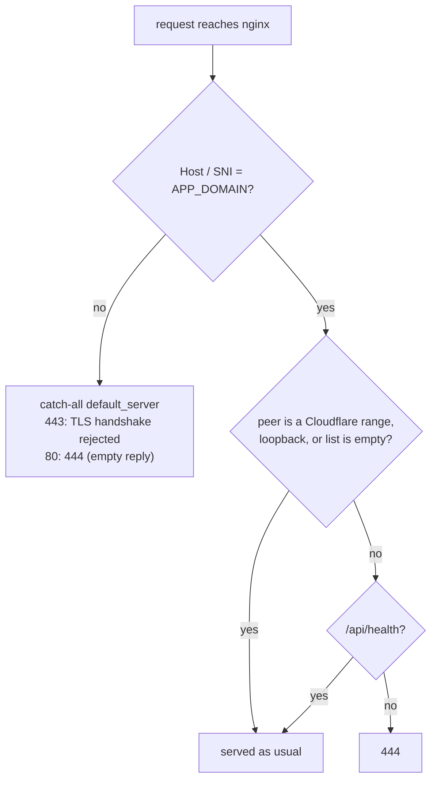
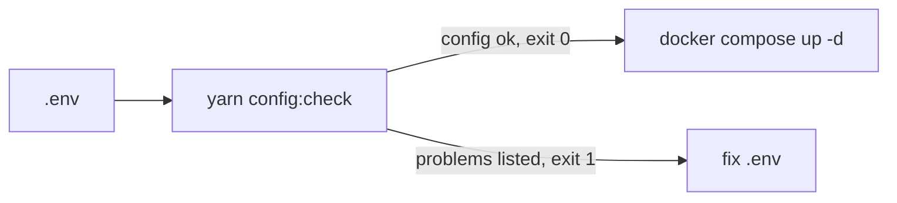
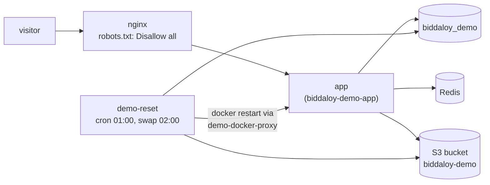
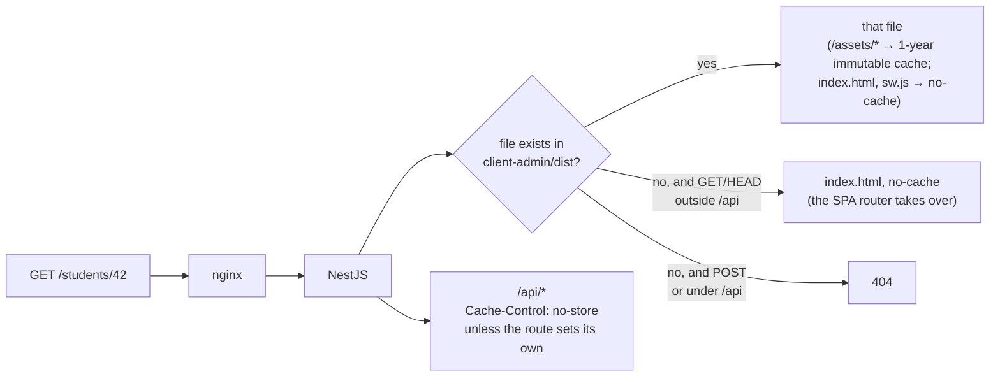
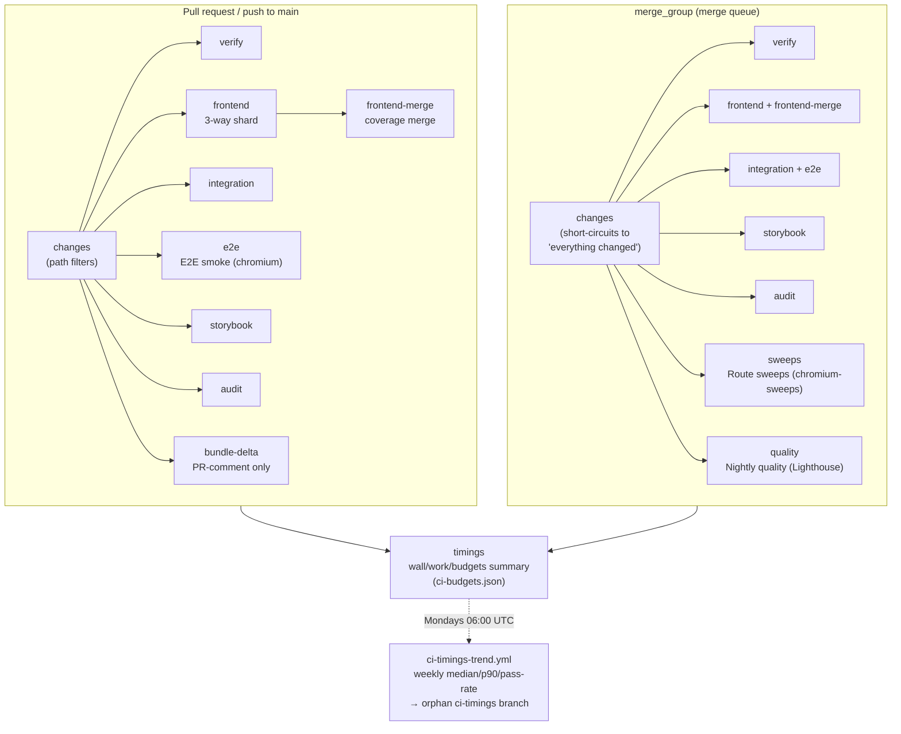

# Deployment

> Full step-by-step deploy/renewal instructions live in the root
> [`README.md`](../../README.md#docker-deployment) — this doc is just the
> shape of it, for orientation.

## Docker Compose topology



Example: `export APP_VERSION=<full commit SHA>; docker compose pull && docker compose up -d` runs
`ghcr.io/tareq89/biddaloy-app:<full commit SHA>` (the publish workflow tags the full 40-character SHA). `APP_VERSION` has no default, so a
forgotten tag fails loudly. Local dev builds instead:
`APP_VERSION=local docker compose -f docker-compose.yml -f docker-compose.build.yml up --build`
(the overlay adds `build:` blocks and a `cert-bootstrap` service that writes a
dummy self-signed pair).
Uptime monitors that hit the origin directly over HTTPS will not trust an
Origin CA cert; point them at Cloudflare.

Services (`docker-compose.yml`): `app`, `db` (Postgres), `redis`, `seaweedfs`,
`backup`, `nginx`. nginx serves the Cloudflare Origin CA pair mounted from
`TLS_CERT_DIR` and self-reloads every 6h to pick up a rotated pair (see
`nginx/reload-loop.sh`). Every service rotates its logs (3 files x 10 MB).

**Security rules for this stack** (full text in [08-security.md](08-security.md#security-rules)):

- [Rule 11](08-security.md#rule-11-client-ip-comes-only-from-reqip): the client IP is `req.ip`, set by nginx from `CF-Connecting-IP` for peers in `TRUSTED_PROXY_CIDRS`.
- [Rule 12](08-security.md#rule-12-the-origin-accepts-only-cloudflare): the origin accepts only Cloudflare (next section).
- Cloudflare dashboard settings: the checklist in [25-cloudflare.md](25-cloudflare.md) (75.31).
- After every deploy: `yarn smoke:post-deploy` ([12-operations.md §7](12-operations.md#7-post-deploy-smoke-check)).

### Running migrations

The image has no ts-node, so migrations run from compiled JS. Run them after
`docker compose pull`, before `up -d`, back up first if any are pending.



Example (from the `app` image, so it sees the same code you are deploying):

```bash
docker compose run --rm app node server/dist/scripts/migrate.js pending
docker compose run --rm app node server/dist/scripts/migrate.js run
```

The one-release backward-compatibility rule (old code must work on the new
schema) is in [`CONTRIBUTING.md`](../../CONTRIBUTING.md#database-migrations).

### Deploying behind an external load balancer instead

If TLS terminates upstream of this stack (a cloud LB, or Cloudflare straight
to the app) instead of the bundled nginx:

- Don't run the `nginx` service. An Origin CA certificate is not trusted by
  browsers, so use your load balancer's own certificate there. The
  Cloudflare-only origin lock ([Rule 12](08-security.md#rule-12-the-origin-accepts-only-cloudflare))
  lives in nginx, so the LB or a firewall must do that job instead.
- Point the LB at the `app` service's port directly (change `expose` to
  `ports` in `docker-compose.yml`, or route through your platform's service
  discovery).
- `app.set('trust proxy', 1)` in `main.ts` trusts exactly one hop. That is
  right when the LB is the only proxy in front of the app. With two (LB →
  nginx → app), change the `1` to the real hop count, or a client can spoof
  its IP ([Rule 11](08-security.md#rule-11-client-ip-comes-only-from-reqip)).
- Set `CORS_ORIGINS` to your real public origin(s) either way.

### Who can reach the origin

nginx answers only the real site name, and (when `TRUSTED_PROXY_CIDRS` lists
the Cloudflare ranges, see [12-operations.md](12-operations.md) 3.5) only for
traffic that comes through Cloudflare.



Always reachable, even by a non-Cloudflare public peer:

- `/api/health` (uptime monitors may hit the origin directly; `/api/health/ready` stays a 404 at the edge)
- `/healthz` on port 80, loopback callers only. It is for a future container
  healthcheck ([75.29]); nothing uses it yet.
- any loopback peer, which means callers inside the nginx container (a
  container healthcheck, `docker exec`). A request from the host itself to the
  published port arrives from the Docker bridge gateway (`172.x`), not
  loopback, so run the smoke script through the public URL. Private ranges are
  not exempt: if the app logs show a Docker bridge gateway (`172.x`) instead of
  real client IPs, the host uses Docker's userland proxy and the lock-down must
  not be enabled there (see 12-operations.md 3.5)

Example: `curl https://<origin-ip>/` gets a rejected TLS handshake;
`curl --resolve <domain>:443:<origin-ip> https://<domain>/` from a laptop
gets an empty reply; the same URL through Cloudflare loads the app.

Warning: if production ever serves a second hostname (for example `www.`),
add it to `server_name` before deploying this, or that hostname gets 444.

Rollback if real users or a monitor get 444: set `TRUSTED_PROXY_CIDRS=` and
`docker compose up -d nginx`; the Cloudflare-only rule is off at once. If the
catch-all itself is the problem (a hostname missing from `server_name`), revert
the `default.conf.template` change and restart nginx. No data or app change is
involved.

This whole stack — including automated TLS — was **not** in the original
plan, which treated Docker as a future migration. It shipped as the actual
deployment mechanism.

## Before you deploy: `yarn config:check`



It runs the server's boot-time config checks without starting anything:
the env schema and placeholder rules (`env.validation.ts`), the
secret-echo guard, `DB_SSL`, the `SETTINGS_ENCRYPTION_KEY` shape (32 bytes
of base64), the https rules for `APP_BASE_URL` and `PUBLIC_APP_URL`, and,
when `ENABLE_API_DOCS=true`, that `API_DOCS_USER` and `API_DOCS_PASSWORD` are
both set. It lists every failure, not just the first. It does not connect to Postgres,
Redis or S3, so a wrong password or host still only shows up at boot. It
always judges the env as production whatever `NODE_ENV` the file says. It
reads the **host's** `.env` (not the container's environment) and needs node
and `yarn install` on the deploy host. It names variables, never their
values. Example, for an `.env` copied from `.env.example` where `JWT_SECRET`
was lengthened but the other placeholders were left in (a `JWT_SECRET` under
32 characters fails earlier, with the plain schema error):

```text
Refusing to start with unsafe production config:
- JWT_SECRET still holds a placeholder value
- POSTGRES_PASSWORD still holds a placeholder value
- S3_ACCESS_KEY_ID still holds a placeholder value
- S3_SECRET_ACCESS_KEY still holds a placeholder value
- SETTINGS_ENCRYPTION_KEY is required in production
- APP_BASE_URL is required in production
- PUBLIC_APP_URL is required in production
DB_SSL must be "true" in production — refusing to connect to Postgres over an unencrypted connection. Set DB_SSL=true (and use an sslmode=require-style DATABASE_URL) once the target Postgres serves TLS.
```

`docker-compose.yml` also refuses to start when `POSTGRES_*` or `S3_*`
credentials are unset (`${VAR:?...}`), and a `client-admin` production build
fails if `VITE_USE_MOCKS=true`.

## Build pipeline

`yarn build:all` (`scripts/build-all.sh`) builds `shared` → `ui` →
`client-admin` → `server`, and assembles a single deployable
`build-output/` folder that can be zipped and shipped to a VPS without
Docker too — see the README's "Production Build" / "Deploy to VPS"
sections for that path.

**Images (GHCR).** `.github/workflows/publish-image.yml` runs on every merge
to `main` and pushes three images, each tagged `<commit-sha>` and `main`.
Production pulls, never builds.

| Image                                 | Built from                  | Notes                                                                      |
| ------------------------------------- | --------------------------- | -------------------------------------------------------------------------- |
| `ghcr.io/tareq89/biddaloy-app`        | `Dockerfile`                | build args `VITE_TURNSTILE_SITE_KEY`, `VITE_SUPPORT_URL` (repo variables)  |
| `ghcr.io/tareq89/biddaloy-backup`     | `scripts/backup/Dockerfile` |                                                                            |
| `ghcr.io/tareq89/biddaloy-demo-reset` | `scripts/demo/Dockerfile`   | `FROM app`: built after the app image, using that SHA as the `app` context |

Only `GITHUB_TOKEN` is used; the two `VITE_*` values are repo **variables**
(Settings > Secrets and variables > Actions > Variables), not secrets, because
they are public in the bundle. One-time step: after the first run, set each
GHCR package to **public** (package settings) so `docker pull` works
anonymously.

## Error tracking and Web Vitals (Sentry)

The SPA reports errors and real-user performance (LCP/CLS/INP) to Sentry.
Three build-time knobs, all optional — every one of them missing is a
supported configuration, it just means less telemetry:

| Variable                                              | Read by                                      | Missing means                                                       |
| ----------------------------------------------------- | -------------------------------------------- | ------------------------------------------------------------------- |
| `VITE_SENTRY_DSN`                                     | the browser, at runtime                      | `initSentry` no-ops; nothing is sent                                |
| `VITE_SENTRY_TRACES_SAMPLE_RATE`                      | the browser, at runtime                      | 10% of transactions sampled (the default)                           |
| `SENTRY_AUTH_TOKEN` + `SENTRY_ORG` + `SENTRY_PROJECT` | `client-admin/vite.config.ts`, at build time | no source-map upload and no release tag; stack traces stay minified |

There is no separate deploy pipeline to hang the source-map upload on
(the build _is_ `scripts/build-all.sh`), so the upload is a Vite plugin
that only switches on when `SENTRY_AUTH_TOKEN` is present. With the
token set, the build emits `sourcemap: 'hidden'` maps, uploads them, and
deletes them from `dist/` — so users never download them.
`scripts/build-all.sh` also deletes any stray `.map` left in `build-output/`.
The Docker build has no such step; it is safe only because
`SENTRY_AUTH_TOKEN` is not a build arg there, so no maps are emitted:

```bash
SENTRY_ORG=biddaloy SENTRY_PROJECT=client-admin SENTRY_AUTH_TOKEN=sntrys_... \
  yarn build:all
```

The plugin also stamps the release (the git SHA by default), which is
what ties an issue in Sentry to the deploy that introduced it.

**Sentry is scrubbed allow-list style, on every egress path.**
`ui/src/api/sentry.ts` filters errors (`beforeSend`), breadcrumbs
(`beforeBreadcrumb`), transactions (`beforeSendTransaction`) and
standalone spans (`beforeSendSpan` — the path INP takes, which bypasses
the others). Free-form key/value bags are rebuilt from an allow-list, so
a field the SDK adds in a future version is dropped by default rather
than shipped unreviewed. Query strings are removed from URLs entirely,
because this app puts free text in them (`/students?search=…`), and DOM
paths in span names have their attribute selectors stripped, because
Sentry builds those from `aria-label`/`alt`/`title`.

What that does and does not promise: the mechanism is structural, not a
pattern-matcher, so it does not depend on recognising a name — but it is
only as good as the allow-list. **Adding a key to it is a decision about
data protection**, and the tests in `ui/src/api/sentry.test.ts` assert
the allow-list rather than trying to detect PII, because "no addresses"
is not something a regex can check.

## Sign-up values and the Turnstile CSP (Epic 13.0)

The public `/register` form needs a few values. Two are baked into the client
bundle when it is built, so they are Docker build args, not runtime env.

| Variable                                               | Read by                                                         | Missing means                                                            |
| ------------------------------------------------------ | --------------------------------------------------------------- | ------------------------------------------------------------------------ |
| `TURNSTILE_SECRET_KEY`                                 | server, at runtime                                              | dev/test skip the captcha; **production refuses every sign-up with 503** |
| `VITE_TURNSTILE_SITE_KEY`                              | client, build arg in the `Dockerfile`                           | no captcha widget is drawn                                               |
| `SUPPORT_CONTACT_URL`                                  | server, at runtime                                              | no support link from the API                                             |
| `VITE_SUPPORT_URL`                                     | client, build arg (Compose fills it from `SUPPORT_CONTACT_URL`) | no "Contact us" on the trial-ended screen                                |
| `TRIAL_DAYS`, `TRIAL_SEAT_LIMIT`                       | server                                                          | 30 days, 10 students                                                     |
| `OTP_SMS_ALLOWED_PREFIXES`                             | server                                                          | `+880`                                                                   |
| `GOOGLE_OAUTH_CLIENT_ID`, `GOOGLE_OAUTH_CLIENT_SECRET` | server                                                          | Google is not offered                                                    |

Set `TURNSTILE_SECRET_KEY` and `VITE_TURNSTILE_SITE_KEY` together or not at
all: a secret with no site key rejects every sign-up. A plain `docker build`
needs `--build-arg VITE_TURNSTILE_SITE_KEY=...` and `--build-arg VITE_SUPPORT_URL=...`.
Examples are in [`.env.example`](../../.env.example).

The content-security-policy (`server/src/security-headers.ts`) allows one
outside origin, `https://challenges.cloudflare.com`, in `script-src` and
`frame-src`. Turnstile loads a script and draws its challenge in an iframe.
Everything else stays `'self'`. See [22-onboarding.md](22-onboarding.md).

## Demo site

The public demo is its own deployment: its own host, database and bucket. It runs the same images with `DEMO_MODE=true`
and rebuilds itself every night. Full detail is in [22-demo-seed.md](22-demo-seed.md); this is what you need to stand it up.



**Host needs.** The reset keeps three databases at once (live, `_next` while building, `_prev`), so plan for about
**3x the database size**. At full scale one demo database is about 2.7 GB (measured: 2,686 MB at scale 1, 10 years),
so keep at least 10 GB free for databases, plus the images. The full seed took 24 min on a busy laptop (the attendance
slice is 74% of that), so give it a real CPU: start with 2 vCPU and 4 GB RAM and check the first night. These sizes are a
starting point, not a measurement from a real host.

**Bucket.** One bucket whose name contains `demo` (for example `biddaloy-demo`), used by nothing else. The reset deletes
objects in it, and refuses any other name.

**Env** (host `.env`; the full table is in [22-demo-seed.md](22-demo-seed.md#host-env-variables)):

```bash
DEMO_PASSWORD=Demo-Public-2026
S3_BUCKET=biddaloy-demo
SENTRY_CRONS_URL=https://o1.ingest.sentry.io/api/2/cron/demo/KEY/
TURNSTILE_SECRET_KEY=0x4AAAAAAA...        # demo hostname's keys, from Cloudflare
VITE_TURNSTILE_SITE_KEY=0x4AAAAAAA...
DEMO_SKIP_SWEEP=true                      # until a Playwright runner service exists
```

Never set `SMS_*`, `SMTP_*` or `VAPID_*`. The reset refuses to run if any variable with one of those prefixes is set.

**Compose.** The first start has an order, because `app` refuses to boot until a reset has written the platform id:

```bash
C="docker compose -f docker-compose.yml -f docker-compose.demo.yml"
$C build
$C up -d db redis seaweedfs
$C run --rm demo-reset /app/reset.sh --now    # first run logs "app not restarted: first run"
$C up -d
```

Compose must be new enough to read `additional_contexts: app: service:app` (2.20.2 is not).

**Shared host.** The demo overlay assumes the host runs nothing else: the Docker proxy can stop any container on it.
If the host is also used for staging (#1768), put the demo on its own host or accept that risk knowingly.

## How a request is served



**Cache headers ([75.20]).** `server/src/cache-control.ts` makes every
`/api/*` response `no-store` before the handler runs, so a CDN "Cache
Everything" rule can never serve one person's data to another. A route that
sets its own `Cache-Control` replaces the default:

| Route                                                          | Header                                           |
| -------------------------------------------------------------- | ------------------------------------------------ |
| `GET /api/v1/calendar/feed/:token.ics`                         | `private, max-age=900` (+ `ETag`/304)            |
| print-assets, certificate assets, admit-card assets `…/file`   | `private, max-age=31536000, immutable`           |
| `GET /api/v1/students/:id/photo`                               | `private, no-store`                              |
| everything else under `/api` (JSON, CSV/PDF downloads, errors) | `no-store` (`Content-Disposition` is unaffected) |
| `index.html`, `sw.js`                                          | `no-cache` (revalidated every load)              |
| `/assets/*` (hashed)                                           | `public, max-age=31536000, immutable` (nginx)    |

The immutable `/assets/*` caching comes from nginx only; Nest's own static
serving does not set it, so it holds only behind nginx.

There is deliberately no `Vary: Authorization`: the PWA caches API responses
by its own key and the header changes every token refresh.

One SPA at `/` since [8.9.10] — no `/admin/` or `/student/` prefix, and no
root redirect. The rules above live in `server/src/spa-fallback.ts`
(unit-tested there); nginx's long-cache rule matches `^/assets/`
accordingly. Two behaviours this fixed: `GET /teacher/*` used to return
**500** (the directory never existed, so `sendFile` hit ENOENT with no
error callback) and `POST /admin/anything` used to return **200 + HTML**.

## CI

GitHub Actions (`.github/workflows/ci.yml`) runs on every PR, on push to
`main`, and on every merge-queue entry (`merge_group`). As of [18.5.2] the
three triggers don't all run the same jobs — a merge-queue entry is the
last check before `main`, so it pays for two nightly-only checks
(`sweeps`, `quality`/Lighthouse) that a PR skips to stay fast:



Two further scheduled workflows run checks that neither a PR nor a
merge-queue entry gates on: `nightly-e2e.yml` (the full Playwright suite —
journeys + sweeps — across chromium, firefox and webkit, each 3-way
sharded) and `nightly-frontend-flakes.yml`. All three of
`nightly-quality.yml`, `nightly-e2e.yml` and `nightly-frontend-flakes.yml`
file or update one sticky issue on failure, carrying a workflow-specific
label (`nightly-quality-red`, `nightly-e2e-red`, `flake-hunt`) and the
shared `nightly-red` label; see the root README's "Nightly failure
visibility" section for the full mechanism.

Concretely, the `e2e` (`E2E smoke (chromium)`) job: starts Postgres/Redis
service containers → installs deps → builds `shared` → resolves and
caches the Playwright browser → runs migrations → seeds the database →
builds and starts the production client-admin + server → runs the
chromium journeys, smoke and PWA/offline specs against that build →
collects and uploads E2E timings.

Every job above reports its wall time into `timings`, which checks it
against a hand-tuned ceiling in `ci-budgets.json`
(`budgetSeconds = ceil(p90 × 1.15)` over its own trailing green-run
window) and fails the run — with a named job and both numbers in the
annotation — the first time a job actually regresses, instead of a human
noticing CI "feels slower" weeks later. `ci-timings-trend.yml` is the
other half: it doesn't gate anything, it just makes the trend a graph
Monday morning instead of a feeling.

See the root README's "CI" section for the full per-job description and
`ui/CONTRIBUTING.md` for the PR checklist tied to these gates.

### Local loop

Catching a regression in CI (7-15 minutes) is strictly worse than catching
it before the push. Three layers, cheapest first:

1. **While editing** — `yarn check` (`scripts/check.mjs`) runs typecheck +
   lint + affected unit tests. Example: after touching one file in
   `server/src/students/`, `yarn check --affected` runs only the tests
   that import it, not the whole suite. `yarn test:server` goes one step
   further — it takes its own database/Redis/S3 slice of the shared Docker
   stack (`scripts/test-env.sh`, no new containers) and runs the
   full unit + integration + e2e chain server-side, the same steps
   `ci.yml`'s `verify`/`integration`/`e2e` jobs run, without waiting on a
   push.
2. **Before commit/push** — `.husky/pre-push` runs `yarn check --affected`
   automatically, so a regression is caught on your machine, not in CI.
3. **Reproducing a specific CI job** — `yarn ci:local` (`scripts/ci-local.sh`)
   runs the same commands `ci.yml` runs, job-for-job, so "works on my
   machine" stays true. `--only` picks one job instead of the whole
   pipeline, and `--affected` further restricts it to what your branch
   actually touched. Example:

   ```bash
   scripts/ci-local.sh --only frontend --affected
   # → runs just the ui/client-admin vitest suites, scoped to changed files —
   #   the same shard-vs-single-run split ci.yml uses, without waiting on GitHub.
   ```

See the root README's "Local loop" and "CI" sections for the full command
reference (`yarn test:server`, `yarn ci:local --only <job>`, and the
`CI_PATHS_*` path-filter lists `ci-local.sh` and `ci.yml`'s `changes` job
must be kept in sync by hand).

## Learnings (Epic 61, wave 1)

- 2026-10-20: **Compose files got an `APP_VERSION` requirement and every script that starts the stack broke.** Cost: test-env, backup test, setup and the infra test all failed on `${APP_VERSION:?...}`. Fix: each exports `APP_VERSION="${APP_VERSION:-local}"` first. Rule candidate: when a compose file gains a required variable, grep every `docker compose` caller in `scripts/` and CI in the same PR.
- 2026-10-20: **The digest-pin check flagged our own GHCR images.** Cost: a false FAIL in the infra job. Fix: the check skips `ghcr.io/tareq89/biddaloy-`; those are pinned by commit-SHA tag instead (Rule 21). Rule candidate: an exemption list names the exact prefix, never a loose pattern.
- 2026-10-20: **Build overlays were outside the CI infra path filter.** Cost: an edit to `docker-compose.build.yml` ran no infra test. Fix: both overlays join the filter in `ci.yml` and `ci-local.sh`. Rule candidate: a new compose file joins the path filter in the same PR.
- 2026-10-20: **Certbot text outlived certbot.** Cost: the README and three architecture docs still told operators to renew Let's Encrypt certs, and one Cloudflare check ran a command for a service that no longer exists. Fix: all now describe the Origin CA pair. Rule candidate: removing a service greps `docs/` and `README.md` for its name.
