# Security

This is the deep rationale behind the auth/data-protection posture — moved
here from the root README so that README stays a practical "get the app
running" doc. See also [02-auth-and-multitenancy.md](02-auth-and-multitenancy.md)
for the higher-level shape (diagrams) this detail sits underneath.

## The layers, at a glance

One request, from the internet to the service. `R1` = [Rule 1](#rule-1-routes-are-closed-by-default), and so on.

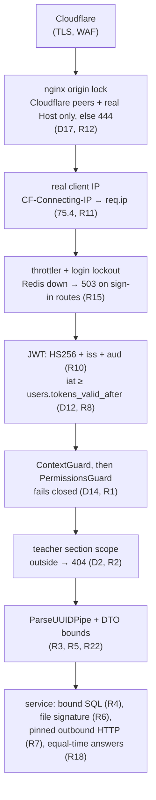

Sign-in, in detail:

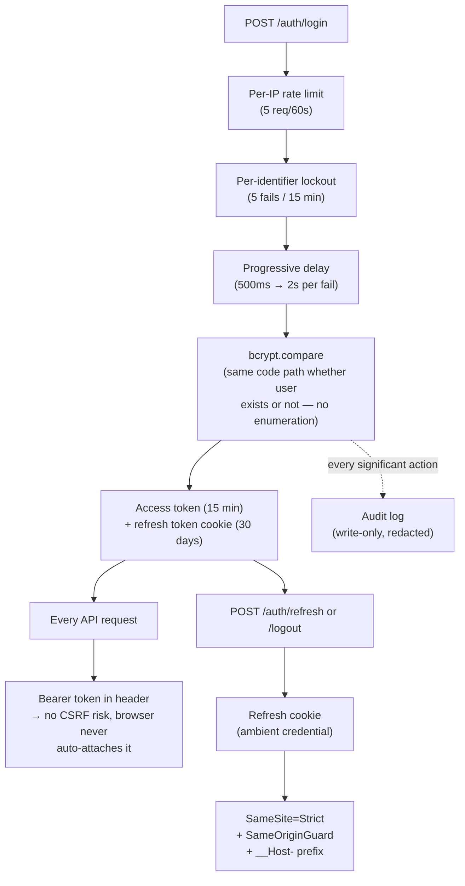

**PermissionsGuard fails closed.** A route behind it needs `@RequirePermissions(...)` or `@AuthenticatedOnly()` (identity-scoped, e.g. `GET /users/me`). A route with neither gets `403 This route declares no permission`, so a forgotten permission is a runtime refusal, not a silent allow.

Each box below is one paragraph in this doc — read the section with the
matching name for the full reasoning.

Before any of that runs, **boot-time config refusal** (`assertProductionConfig`
in `server/src/config/env.validation.ts`): with `NODE_ENV=production` the
server will not start on a placeholder or weak secret, a malformed
`CORS_ORIGINS`, or a missing `SETTINGS_ENCRYPTION_KEY` / `APP_BASE_URL` /
`PUBLIC_APP_URL`. `yarn config:check` runs those checks on demand, plus the
`DB_SSL`, encryption-key shape and https URL checks (07-deployment.md). Dev, test and CI are
unaffected.

## Security rules

Short rules for anyone (person or agent) about to touch auth, routes, uploads,
SQL or infra. Each rule is written once, here. Root `CLAUDE.md`, the reviewer
hunt list and the `plan-epic` slicing rules only name a rule and link to it.
The [Learnings log](#learnings-log-epic-75) at the end of this doc is where
each rule came from.

Every rule has the same four parts:

- **Rule.** One sentence.
- **Why.** The decision (D#) or ticket behind it.
- **Example.** A real path or line.
- **Test.** The spec that fails if the rule is broken.

The layers diagram above shows where most of these rules sit on a request's way in (`R1` = Rule 1).

### Rule 1: Routes are closed by default

- **Rule.** Every route behind `PermissionsGuard` declares `@RequirePermissions(...)`, or `@AuthenticatedOnly()` plus a reviewed `IDENTITY_SCOPED` entry with a reason. A route with neither is a 403.
- **Why.** A forgotten permission used to be a silent allow (D14, #2315, #2436).
- **Example.** `GET /users/me` carries `@AuthenticatedOnly()` and the entry `{ path: '/users/me', reason: '10.4 — self-service: the id comes from the JWT, never the path' }`.
- **Test.** `server/src/permission-matrix.e2e-spec.ts` (marker and list match one-for-one), `route-guard-coverage.e2e-spec.ts`.

### Rule 2: Teacher reads are scoped to assigned sections

- **Rule.** A teacher reads students, guardians, fees, notes, records, attendance and results only for sections assigned this academic year. A record outside scope is 404, never 403. A teacher with no assignment gets an empty list. Every "which sections" question goes through `TeacherScopeService`.
- **Why.** A 403 tells the caller the record exists; a raw `teacher_class_sections` query missed the year window (D2, D13, D31, #2314).
- **Example.** `GET /api/v1/students/<other section's student>` as TEACHER → `404`.
- **Test.** `server/src/teacher-section-scope.e2e-spec.ts`, `teacher-scope-finance.e2e-spec.ts`, `teacher-scope-exams-search.e2e-spec.ts`.

### Rule 3: Every id path param goes through ParseUUIDPipe

- **Rule.** Every `:id`-style `@Param` that holds a UUID uses `ParseUUIDPipe`. A non-UUID param is on the reviewed allowlist.
- **Why.** A malformed id reached Postgres and came back as a 500 (75.13, #2321, #2437).
- **Example.** `@Param('id', ParseUUIDPipe) id: string`; `GET /api/v1/students/not-a-uuid` → `400`.
- **Test.** `server/src/param-uuid-coverage.spec.ts`.

### Rule 4: No string-built SQL

- **Rule.** No `${}` or `+` reaches `query()`, `.where()`, `.andWhere()`, a join condition or `orHaving`. User input is a bound parameter. LIKE input goes through `normalizeSearchTerm` (or `escapeLikePattern`).
- **Why.** Injection, and a raw `%` matched every row (75.15, #2323).
- **Example.** `search=%` returns only names holding a literal `%`.
- **Test.** `server/src/sql-interpolation.contract.spec.ts` (its header lists its blind spots), `escape-like.util.spec.ts`.

### Rule 5: limit is capped and money fields are bounded

- **Rule.** List DTOs cap `limit` at 100 (`@Max(100)`). Money DTO fields take at most 2 decimals and `MONEY_MAX` (99,999,999.99, the `decimal(10,2)` limit). A client that needs more rows pages.
- **Why.** Huge pages and oversized amounts became a 500 or a rounded amount (75.14, #2322).
- **Example.** `GET /api/v1/students?limit=100000` → `400`; `useAllStudents` pages whole classes 100 at a time.
- **Test.** `server/src/dto-bounds.e2e-spec.ts` (each 400 names the field).

### Rule 6: Uploads are checked by file signature

- **Rule.** An upload is accepted on its leading bytes (`matchesDeclaredType` in `server/src/modules/storage/file-signature.ts`), never on the client's mimetype. An xlsx goes through `xlsx-guard.util.ts` before parsing.
- **Why.** The mimetype is client-sent; a zip bomb hid behind a valid header (75.8, #2330).
- **Example.** A `.png` whose bytes are a PDF → `400 File content does not match its declared type`.
- **Test.** `homework-submission.controller.e2e-spec.ts`, `xlsx-guard.util.spec.ts`.

### Rule 7: Outbound HTTP goes through the SSRF guard or a reviewed fixed host

- **Rule.** A URL that a user or tenant can influence (a webhook, an SMS gateway `apiUrl`, a push endpoint) is called only through `fetchPinnedJson` (`server/src/modules/communications/providers/shared/pinned-http.ts`), after `assertSafeHttpDestination` has checked the address. Any other outbound call (`fetch`, `ws`, `net`, `tls`, an SDK client) goes to a fixed host, a code constant or operator config, and its file is on the reviewed `REVIEWED_OUTBOUND` list in the contract spec, with the host and who controls it.
- **Why.** A configurable URL could be pointed at internal addresses (75.24, #2332).
- **Example.** `turnstile.service.ts` calls the constant host `challenges.cloudflare.com` with a plain `fetch`, and is listed in `REVIEWED_OUTBOUND`. The SMS gateways resolve a tenant's `apiUrl` once, refuse private, loopback and metadata addresses, and connect to exactly the checked address (no second DNS answer can sneak in). `mailpit-sink.provider.ts` is also listed: its SMTP host is the compose alias `<stack>-mailpit` set by `deploy/stack.yml` (dev `.env`: `MESSAGE_SINK_SMTP_URL`), never tenant input, and it is reached only when `MESSAGE_SINK=mailpit`. Staging alone can opt out of the inbox with `ALLOW_REAL_PROVIDERS_ON_STAGING=true` (real messages reach real contacts); demo and prod refuse the flag at boot and in config-check.
- **Test.** `server/src/outbound-http.contract.spec.ts`.

### Rule 8: Suspend, remove or reset bumps tokens_valid_after

- **Rule.** Suspending, removing or resetting a user sets `users.tokens_valid_after = now()`. `JwtStrategy` refuses any access token issued before it.
- **Why.** A 15-minute access token outlived the action that should have ended it (D12, 75.2).
- **Example.** Admin suspends a teacher; the teacher's next request with the old token → `401`.
- **Test.** `session-cutoff.service.integration.spec.ts`, `jwt.strategy.spec.ts`.

### Rule 9: One bcrypt cost, one password check

- **Rule.** Hash only with `hashPassword` (`BCRYPT_COST = 12`), check only with `verifyPassword`, both in `server/src/modules/auth/password-hash.ts`. No literal cost and no `bcrypt.compare` on a password elsewhere. A new password over `BCRYPT_MAX_BYTES` (72) is refused. An old cheaper hash is rehashed on the next good sign-in.
- **Why.** bcrypt ignores bytes past 72. A cost change without padding made old accounts faster than unknown ones (D5, 75.11, #2319).
- **Example.** `verifyPassword(plain, cost10Hash)` pads with throw-away hashes so it costs one cost-12 check.
- **Test.** `password-hash.spec.ts`.

### Rule 10: Boot refuses unsafe config, and JWTs are pinned

- **Rule.** With `NODE_ENV=production` the server refuses placeholder or weak secrets, bad `CORS_ORIGINS` and missing URLs (`assertProductionConfig`; `yarn config:check` runs it on demand). JWTs are HS256 with a pinned `iss` and `aud`. `JWT_SECRET_PREVIOUS` is verify-only during a rotation.
- **Why.** A deploy with `.env.example` values must fail loudly, and a token must not verify for another app (75.9, 75.10, D21).
- **Example.** Rotation: move the old value to `JWT_SECRET_PREVIOUS`, wait 15 minutes, remove it. See [Token signing and rotating JWT_SECRET](#token-signing-and-rotating-jwt_secret-759).
- **Test.** `env.validation.spec.ts`, `jwt-secrets.spec.ts`, `jwt-rotation.e2e-spec.ts`.

### Rule 11: Client IP comes only from req.ip

- **Rule.** Code reads the client IP only from `req.ip` (via `requestContext()`). Express trusts exactly one hop: nginx. nginx decides the address by edge mode (`EDGE_MODE`, written by `nginx/edge-mode.sh`):
  - **tunnel:** from `CF-Connecting-IP`, but only when the TCP peer is on the `biddaloy-edge` network (where `cloudflared` lives).
  - **direct:** the TCP peer. There are no `real_ip` lines, so the header is ignored.
    Never read `X-Forwarded-For` yourself.
- **Why.** A client can write any `X-Forwarded-For` or `CF-Connecting-IP`; rate limits and audit rows would trust it (75.4, D1, Epic 79.0 D8).
- **Example.** `requestContext(request).ip` in the Turnstile check.

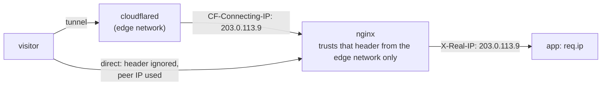

- **Test.** `nginx/test/real-ip.infra.test.sh` (both modes), `server/src/trust-proxy.e2e-spec.ts`.

### Rule 12: The origin is reachable only through the edge

- **Rule.** The origin accepts traffic only through the edge it is deployed with, and serves only known `Host` names (anything else gets `444`, or a rejected TLS handshake). By mode:
  - **tunnel:** no web port is published. `cloudflared` dials out and reaches nginx on the private `biddaloy-edge` network, plain HTTP on :80.
  - **direct:** nginx publishes 80 and 443. :80 only answers the Let's Encrypt challenge and redirects to HTTPS. This is deliberately public, so protected hosts carry their own login.
  - **Protected hosts** (`staging.`, `kuma.`, `beszel.`, `logs.`) carry two auth layers (D14). Outer: Cloudflare Access in tunnel mode, nginx basic auth in direct mode. Inner: the tool's own login. Kuma's `/api/push/` skips the outer layer only; its URL token is the login.
  - **Exception: `inbox-staging.` has the outer layer only** (Epic 87, PR #3212 review F3). Cloudflare Access (`Owner only`) in tunnel mode, nginx basic auth in direct mode. Mailpit runs without its own login on purpose: its login is HTTP basic auth too, so in direct mode it and nginx would both claim the one `Authorization` header. Accepted because the inbox holds only staging mail, and staging data must carry no real contacts except the owner's. The staging refresh replaces everyone's contacts but keeps the platform admins and the smoke school admin, so those must be the owner's own addresses.
  - Readiness (`/api/health/ready`) is a bare `404` at the edge, in both modes.
- **Why.** A direct hit on the origin IP skips Cloudflare's WAF and rate limits when Cloudflare is in front, and exposes internal tools when it is not (D14, D17, 75.5, Epic 79.0 D8).
- **Example.** `curl -H 'Host: evil.test' http://<origin-ip>/` → empty reply. `curl https://kuma.<domain>/` or `https://inbox-staging.<domain>/` in direct mode → `401` (`inbox-demo.<domain>` is public by design, noindex). See [30-deployment-target](30-deployment-target.md#edge-two-modes-same-nginx).
- **Test.** `nginx/test/edge-mode.infra.test.sh` (both modes, bad `EDGE_MODE`, unknown host, auth layers, two app upstreams), `nginx/test/landing.infra.test.sh`, `nginx/test/inbox.infra.test.sh` (staging inbox behind the outer layer).

### Rule 13: Logs never carry secrets

- **Rule.** Tokens, phone numbers, emails and secret query strings (`password`, `token`, `otp`, `code`, …) never reach a log. nginx logs with the `redacted` format and the API log goes through `redactPii`. A new secret-bearing URL shape is added to `redactPii` in the same ticket. Request ids are kept only if they are 1-64 of `[A-Za-z0-9_-]`.
- **Why.** Logs are read by more people, and kept longer, than the data (75.23, 75.19).
- **Example.** `GET /api/v1/public/invoices/<token>` logs as `[REDACTED]`.
- **Test.** `redact-log.util.spec.ts`, `nginx/test/access-log.infra.test.sh`, `request-context.util.spec.ts`.

### Rule 14: API responses are no-store

- **Rule.** Every `/api/*` response is `Cache-Control: no-store` by default and the SPA shell (`index.html`, `sw.js`) is `no-cache`. A route that needs another value overrides it. The service worker never caches `/api/v1/auth/*` or `/api/v1/public/*`.
- **Why.** A shared computer or proxy kept personal data (75.20). Workbox ignores `no-store`, so it kept expired receipt links (#2438).
- **Example.** `apiNoStoreByDefault` in `server/src/cache-control.ts`.
- **Test.** `cache-control.spec.ts`, `cache-control.e2e-spec.ts`, `client-admin/src/pwa/cache-policy.test.ts`.

### Rule 15: Redis down has a written answer per route

- **Rule.** When Redis is down, routes marked `@FailClosedWithoutRedis()` (sign-in, OTP, reset, step-up, contact change) answer 503. The throttler and lockout fail open everywhere else. Every route on an `/auth*` or `/account*` controller is listed as fail-closed or fail-open in `server/test/helpers/redis-outage-routes.ts`. A down Redis raises a platform alert: a SUPER_ADMIN banner plus SMS.
- **Why.** "Open everywhere" means unlimited password guessing; "closed everywhere" takes the app down (D4, D4b, D15, 75.18, 75.34).
- **Example.** `POST /auth/login` with Redis down → `503`; `POST /auth/refresh` → served.
- **Test.** `app-throttler.guard.spec.ts`, `app-throttler.guard.e2e-spec.ts`, `route-guard-coverage.e2e-spec.ts`, `platform-alerts.service.spec.ts`.

**The one route family that fails open on purpose: `Idempotency-Key`.** A double-click or a retry of a send or create must not send twice. `IdempotencyInterceptor` keeps the first answer in Redis for 24 hours and replays it. If Redis is down the request runs unprotected and an error is logged, because a closed route would stop a school from messaging anyone at all. Routes: `communications/send`, `reminder/bulk`, `reminder/single/:studentId`, `invoices/:id/send`, `promotions` (create), `students` (create). Test: `idempotency.interceptor.spec.ts`, `reminders.e2e-spec.ts`.

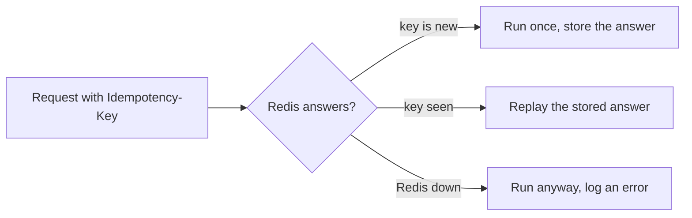

### Rule 16: Public share links expire

- **Rule.** A public invoice share link works for 30 days. Staff can regenerate it, which kills every older link of that invoice. An expired, revoked or unknown token is the same 404.
- **Why.** A forwarded link used to work forever (D9). Links that existed before the change got 30 days from the deploy (D22).
- **Example.** `POST /api/v1/invoices/:id/share/regenerate` → new link 200, old link 404.
- **Test.** `public-invoice.e2e-spec.ts`, `test/invoice-share-expiry-migration.integration.spec.ts`.

### Rule 17: A shared person's new contact waits for their approval

- **Rule.** When a school admin changes the email or phone of a person who also belongs to another school, nothing is written until the person approves through a link to their current contact and a code to the new one. The other schools' admins are told. Opening a link never changes anything; a button does.
- **Why.** One school could take over a person's sign-in at every school (D3, D23). A mail scanner "opened" the first version's link (D11).
- **Example.** `PATCH /users/:id {phone}` → `200 {phone: OLD, pending_contact_change: "phone"}`. See [Contact verification](#contact-verification-127).
- **Test.** `contact-change.service.integration.spec.ts`, `users.membership.e2e-spec.ts`.

### Rule 18: Does-this-account-exist answers take equal time

- **Rule.** Recovery, OTP request and activation resend do one identifier lookup on the request path. Everything after it (checks, codes, audit, delivery) runs inside one `detach()` job after the response.
- **Why.** A known account cost more queries than an unknown one, so timing gave it away (75.17, #2325).
- **Known exception.** `POST /users/join-requests` ("Add staff" for an existing account) answers `{status: "PENDING"}` for a hit and a miss, but a hit takes longer (it files the request). Left as is: only a school admin can call it, it is throttled (5 per minute) while Redis is up, and fails open without Redis, like the other admin routes, and `POST /users` already tells that admin the account exists (409 `ACCOUNT_EXISTS`). The only extra thing the timing shows is that the contact is verified (#2224).
- **Example.** `POST /auth/forgot-password` → `{}` in the same time for a real and a made-up address.
- **Test.** `recovery.service.integration.spec.ts`, `otp-login.service.integration.spec.ts` and `activation.service.integration.spec.ts` (exactly one query before the response), `account-access-delivery.service.spec.ts`.

### Rule 19: Inbound webhooks go through the verification kit

- **Rule.** An inbound webhook is accepted only after `verifyWebhookSignature` (`server/src/common/webhooks/webhook-signature.util.ts`) checks its HMAC over the raw body, timing-safe, with a timestamp window.
- **Why.** Anyone can POST to a public URL (75.30).
- **Example.** An empty or non-string secret makes verification return `false`, never pass.
- **Test.** `webhook-signature.util.spec.ts`, `webhook-signature.e2e-spec.ts`.

### Rule 20: A reachability change updates the route snapshot

- **Rule.** A change in who can reach a route updates `server/src/route-status.snapshot.txt` in the same PR, and the PR lists each changed line with its ticket.
- **Why.** Guard changes are easy to miss in a diff (D21). A `/platform/*` route also needs `PlatformSuperAdminGuard`, which only this snapshot shows.
- **Example.** `GET /api/v1/platform/alerts  401 PASS 403 …` (`TENANT_SA` 403).
- **Test.** `server/src/route-status-snapshot.e2e-spec.ts`. See `server/CLAUDE.md` "Route status snapshot".

### Rule 21: CI actions and images are pinned

- **Rule.** Every workflow `uses:` names a 40-character commit SHA (`# vX` comment), every `actions/checkout` sets `persist-credentials: false`, and every pulled image carries `@sha256:`. Every `yarn audit` allowlist entry has a `recheckBy` date. First-party GHCR images (`ghcr.io/tareq89/biddaloy-*`) are pinned by commit-SHA tag via `APP_VERSION`, not by digest.
- **Why.** A moved tag runs someone else's code with our secrets (75.25, 75.26, 75.29).
- **Example.** `uses: actions/checkout@<sha> # v4`; `ALLOWLIST` in `scripts/ci-audit.js`.
- **Test.** `docker/test/compose.infra.test.sh` (images), `scripts/ci-audit.spec.mjs` (expiry), `actionlint` in the CI audit job. Action SHAs have no automated check yet; the reviewer checks them.

### Rule 22: Public write forms carry Turnstile

- **Rule.** An unauthenticated route that writes data (registration, public admission submit) verifies a Cloudflare Turnstile token with `TurnstileService` before it writes anything. In production with no `TURNSTILE_SECRET_KEY` it fails closed (503).
- **Why.** A public form is the cheapest target for automated abuse (75.16, #2324).
- **Example.** `POST /api/v1/public/admission/:slug/applicants` without `captcha_token` → `400`.
- **Test.** `public-admission.controller.e2e-spec.ts`, `registration.controller.e2e-spec.ts`.

### Rule 23: Errors never echo what was sent

- **Rule.** An error on an identity field (email, phone, employee ID) names the kind of field, never the value. Within one operation, every failure path uses the same text, and no message echoes the submitted value.
- **Known exception.** `UserService.update()` and `contact-change.service.ts` say "That email address is already in use" or "That phone number is already in use" on the pre-check, and "That email address or phone number is already in use" on the unique-index race path. The caller chose which field to change, so the field name tells them nothing new; left as is.
- **Known exception (#3000).** Validation messages the caller authored themselves (a date range, a template placeholder, a vocabulary value they just typed) still quote that input so they can fix it; they are not record ids. Record ids never appear in a message a client sees. The `ContextGuard` 401 texts and the SMS-credit ledger invariants were the last known leftovers; both are fixed sentences since #3080.
- **Why.** An echoed address, or two different texts, tells a caller which accounts exist (75.19, #2327).
- **Example.** `POST /users` with a taken email or phone → `409 This person already has an account. Send them a join request instead.` (`details.code: ACCOUNT_EXISTS`), the same text on the pre-check and the unique-index race; `409 That employee ID is already in use`.
- **Test.** `users.e2e-spec.ts` (create), `users.service.integration.spec.ts` and `staff-profiles.service.spec.ts` (employee ID).

### Rule 24: Errors are mapped in one place and never echo input

- **Rule.** Known database and parser failures (`23505`, `22001`, `22003`, oversized body, multer codes, import file errors: `ImportFileError` → 400 with `details.code`) become fixed 4xx sentences in `server/src/common/filters/known-errors.ts`. A service does not catch them one by one, and no sentence holds the submitted value or a constraint name. Removing an echo in one service means grepping its sibling services for the same message shape.
- **Why.** A raw 500 paged Sentry and showed the constraint name (#2634, #2612, #2616). A sibling service kept echoing an id after checkout stopped (Wave 1 log).
- **Example.** `POST /classes` with a taken name returns `409` with a fixed sentence, not `duplicate key value violates unique constraint "UQ_..."`.

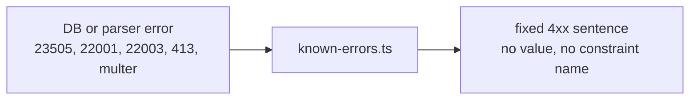

- **Test.** `server/src/common/filters/known-errors.spec.ts`, `known-errors.e2e-spec.ts` (the cases of #2634, #2612, #2616), `server/src/not-found-echo.contract.spec.ts` (no NotFound message interpolates, #3000).

### Rule 25: Writes never auto-retry, and sending and billing routes carry an Idempotency-Key

- **Rule.** UI mutations default to `retry: false`. A route that sends a message or creates a record a double click could duplicate sits behind `IdempotencyInterceptor` (`server/src/common/idempotency/idempotency.interceptor.ts`). The same key replays the first reply. Redis down fails open with a log (Rule 15). A new send or create route joins the interceptor, or its ticket names the unique DB constraint that makes a duplicate impossible (#2691).
- **Why.** A lost reply plus an automatic retry created two records and sent one SMS twice (#2596, #2631).
- **Example.** `POST /communications/send` with `Idempotency-Key: 7f3c…` twice returns the same body; one SMS leaves.


- **Test.** `ui/src/hooks/mutation-retry.guard.spec.ts`, `server/src/common/idempotency/idempotency.interceptor.spec.ts`, `e2e/journeys/double-submit.spec.ts` (registry: `double-submit.registry.ts`).

### Rule 26: Money is compared in whole paisa, with DB CHECKs behind it

- **Rule.** Money is compared after `toPaisa()` (`server/src/common/constants/money.ts`), never with a tolerance such as 0.01. `student_fees` also carries CHECKs, so a bug cannot store a bad row: `CHK_sf_paid_plus_discount` (paid + discount <= total) and `CHK_sf_waived_settled` (WAIVED means paid + discount = total). The demo seed must pass both.
- **Why.** Checkout took 0.01 over the balance and a bill 0.01 short closed as PAID (#2636, #2644). The load seed had WAIVED bills with no discount (#2617).
- **Example.** Balance 1400.00, pay 1400.01 returns 400. Balance 1400.00, pay 1399.99 leaves `PARTIALLY_PAID`.
- **Deploy step.** The CHECKs are `NOT VALID`; audit and `VALIDATE CONSTRAINT` once per environment ([12-operations §3.8](12-operations.md)).
- **Test.** The paisa table test in `server/src/modules/fees/payment-allocation.service.spec.ts` (PAID flips at exactly the paisa the bill is covered, 5000 random amounts), `server/test/student-fee-money-checks-migration.integration.spec.ts`, `server/src/scripts/demo-seed/validator.spec.ts`, `fee-generation-batch.service.integration.spec.ts`.

### Rule 27: A parent row cannot be deleted while a child row references it

- **Rule.** Each `remove()` refuses (409) while a child row exists. Every parent-child pair is in `server/test/delete-guard-registry.ts`: guarded, or listed in `KNOWN_GAPS` with an issue. A new FK to a parent joins the registry or the test fails.
- **Why.** Deleting an academic year orphaned its bills (#2613, #2655). Open gaps: #2675-#2680, and #2688 for bare uuid columns.
- **Example.** Delete a room still used by a routine: `409`, the room stays.
- **Test.** `server/test/delete-guard-registry.integration.spec.ts`.

## Login brute-force protection

`POST /auth/login` layers three controls, defined in
`server/src/modules/auth/`:

- **Per-IP rate limit** — the same `strict` tier (5 requests/60s) used on
  other expensive endpoints (see `rate-limit.ts`).
- **Per-identifier lockout** (`login-attempt.service.ts`) — the normalized
  email/phone is locked out after **5 failed attempts** within a **15-minute
  window**, both Redis-backed and configurable via `LOGIN_LOCKOUT_THRESHOLD`
  and `LOGIN_LOCKOUT_WINDOW_MS`. A successful login resets the counter. The
  lock expires automatically after the window — there is no admin-reset
  path, since a pure admin-reset lock is itself a denial-of-service vector
  against a known account.
- **Progressive delay** — failures before the lockout threshold add an
  increasing delay (500ms per attempt, capped at 2s), to blunt a slow
  distributed attack without hard-locking real users on a couple of typos.

The response body, status, and code path are identical for "no such user",
"wrong password", and "locked out" — `AuthService.validateUser` always runs
`bcrypt.compare` (against a dummy hash when no user is found), so there's no
timing or content difference an attacker could use to enumerate accounts.

Both lockout and the strict rate-limit tier are disabled under
`NODE_ENV=test` — the e2e suite logs in repeatedly against the same seeded
account and would otherwise lock itself out.

### When Redis is down (75.18)

Most of the app keeps working; only the routes where "no rate limit" means "unlimited password guessing" stop.

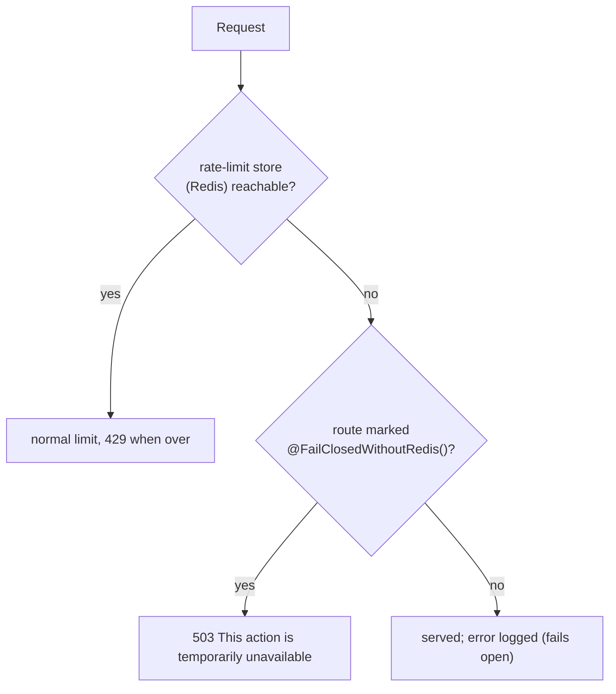

The mark is a decorator on the handler or controller, read by `AppThrottlerGuard` through
`Reflector`, so the rule moves with the route. An unmarked route fails open, so two tests make
the choice explicit:

- `app-throttler.guard.spec.ts` checks every route on the sign-in controllers listed in
  `server/test/helpers/redis-outage-routes.ts` (everything under `/auth` and `/account`, plus
  `UserController`). Each route must be in `FAIL_CLOSED` (and carry the mark) or in `FAIL_OPEN`
  (and not carry it). A new route on these controllers, for example
  `POST /auth/magic-link/verify`, fails the spec until someone puts it in one list.
- `route-guard-coverage.e2e-spec.ts` fails when a controller under `/auth*` or `/account*`
  (for example a new `auth/passkeys`) is missing from that controller list.

A password- or code-checking route on any other controller is not caught; review it by hand.

| Part                                                                                                                                                              | Redis down                                                                                                           |
| ----------------------------------------------------------------------------------------------------------------------------------------------------------------- | -------------------------------------------------------------------------------------------------------------------- |
| Sign-in, activation, OTP, reset, register, step-up, `change-password`, social sign-in/link/unlink, Meta's data-deletion callback, `POST /users/me/contact-change` | 503 (`@FailClosedWithoutRedis()`)                                                                                    |
| `POST /auth/refresh`, `logout`, `logout-all`, `GET/DELETE /auth/sessions`                                                                                         | work (refresh tokens are DB rows)                                                                                    |
| `GET /auth/social/providers`, `/identities`, `/facebook/data-deletion/status`                                                                                     | work (read-only)                                                                                                     |
| Every other route                                                                                                                                                 | served, no rate limit (fails open)                                                                                   |
| Login lockout, access-token denylist                                                                                                                              | fail open                                                                                                            |
| "Log out everywhere", member removal                                                                                                                              | still ends every session: they set `users.tokens_valid_after` in Postgres, which `JwtStrategy` reads on each request |
| Single-session revoke (`DELETE /auth/sessions/:id`)                                                                                                               | waits out the 15-minute access token                                                                                 |
| `/health/ready`                                                                                                                                                   | `degraded` (HTTP 200), not `fail`                                                                                    |

### Password hashing (75.11)

Every password hash comes from one place, `auth/password-hash.ts`: bcrypt, cost **12**.

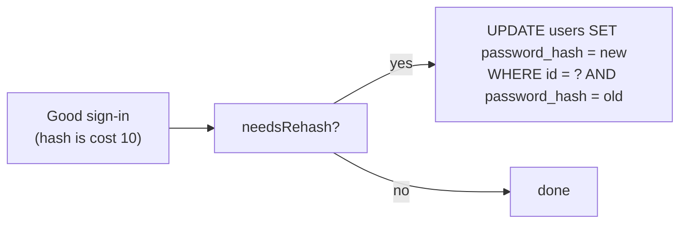

- **Upgrade on sign-in.** After the password is proven, a cheaper hash is rewritten. The `AND password_hash = old` condition means a password changed in the meantime always wins. A failed sign-in never rewrites anything.
- **72-byte limit.** bcrypt ignores bytes past 72, so a _new_ password longer than that is refused with `PASSWORD_TOO_LONG` (72 Latin letters, or 24 Bangla letters). Sign-in is never checked, so an older long password keeps working.
- **Dummy hash.** When no user matches, login compares against `DUMMY_PASSWORD_HASH` so the response takes as long as a real one. It is a precomputed cost-12 literal (hashing at import cost every process ~250 ms); `password-hash.spec.ts` fails if its cost ever differs from `BCRYPT_COST`.

## Password recovery

`POST /auth/forgot-password` and `POST /auth/reset-password`
(`server/src/modules/account-access/recovery.service.ts`) let a locked-out
user recover on their own, without an admin's help. The channel is picked
by **which field on the account the typed identifier matched** — not by
preference:

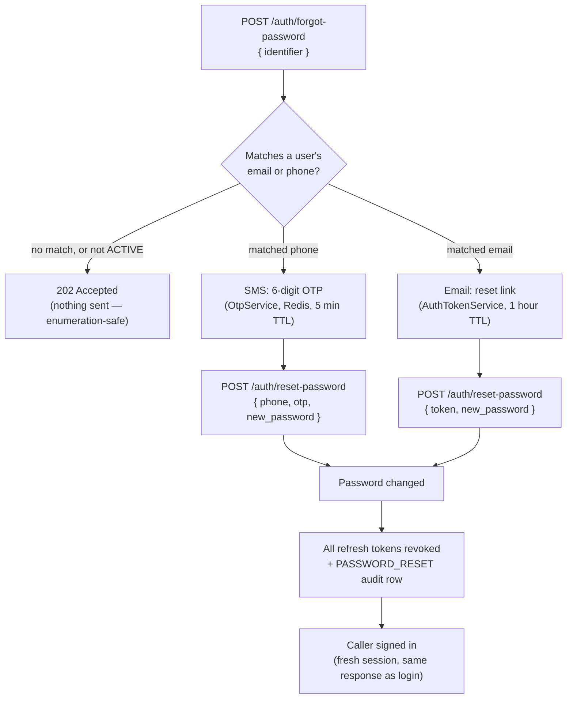

Both endpoints are public and `strict`-rate-limited, same as `/auth/login`.

- **Enumeration safety.** An unknown identifier, a suspended account, or an
  account with no matching contact all return the exact same `202` as a
  real request that dispatched something — `RecoveryService.forgot()`
  never lets the caller distinguish "sent" from "nothing to send".
- **OTP lockout** is `OtpService`'s own counter (D3, epic #409), separate
  from `login-attempt.service.ts`'s: **6 digits, 5-minute code TTL, 5 wrong
  guesses locks the identifier for 15 minutes, with a 60-second cooldown**
  between two OTP requests for the same identifier. A reset link instead
  expires outright after **1 hour** and is single-use (`AuthTokenService
.consume`) — there's no "wrong guess" to lock out.
- **Multi-tenant wrinkle (D28).** A login identifier lives on the `users` row,
  not on any one school, but a message still needs a sender. The rule depends
  on how many distinct schools the user has a live membership in
  (`AuthService.primaryTenantId()`). Roles don't count: a teacher who is also
  a guardian in the same school has two membership rows but one school.

  | User belongs to               | Message sender     | Gateway                              | Audit row `tenant_id` | School comm log      |
  | ----------------------------- | ------------------ | ------------------------------------ | --------------------- | -------------------- |
  | 1 school, any number of roles | that school's name | that school's (or platform fallback) | that school           | yes                  |
  | 2+ schools                    | "SchoolManager"    | platform env config                  | `NULL` (platform)     | no (one Logger line) |

  For forgot-password and OTP sign-in, a user in no school gets nothing (same 202 as an unknown account).
  A signed-in user in no school who asks to change their phone or email gets a
  `403 no_school`, so platform-paid codes never go to an address they pick. So
  one school never sees another school's logins and never pays for their codes.

- **Sessions.** On success, every refresh token for the account is revoked
  (`RefreshTokenService.revokeAllForUser`) before the caller is signed back
  in with a fresh session — mirrors `AuthService.changePassword`'s "kill
  every other session" behavior, since a password reset is exactly the
  moment an attacker who guessed or leaked the old password must be cut
  off.
- **Recovery prefers a verified contact (12.7, D5 extension).** If the
  contact that matched is itself unverified (`email_verified_at`/
  `phone_verified_at` is `NULL`) **and** the account's other contact IS
  verified, the reset goes to the verified one instead — a stronger
  guarantee the right person receives it. An unverified-only account (no
  verified contact at all) still gets the reset at its one contact:
  refusing outright would make such an account unrecoverable except by an
  admin, which is worse. Either way the response is still the same `202`.
- **Admin-initiated reset** (`POST /users/:id/reset-password`, ADMIN only)
  is the same machinery with one difference: the target's sessions are
  revoked **immediately**, before the OTP/link is even sent — an admin
  resetting a compromised account must not leave a live session running
  while the reset is in flight.

**Everything after the lookup runs after the response (75.17).**
`forgot-password`, `otp/request` and `activate/resend` do one thing before they
answer: look the identifier up (one `users` query). Every other step runs in
`AccountAccessDeliveryService.detach()` (`setImmediate`) after the `202` is
sent, for every branch:

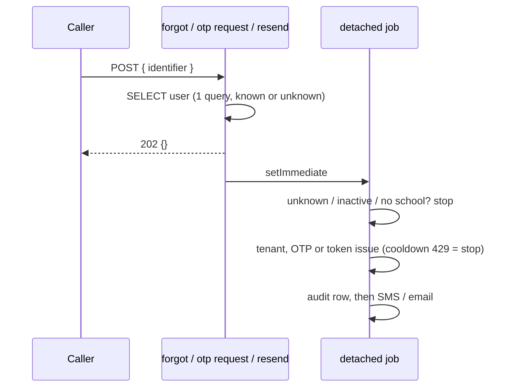

So a known and an unknown identifier cost the same one query; neither the
provider, the membership reads, the OTP/token write nor the audit insert can
show which accounts exist. A job failure is logged (with its flow and stack;
a resend losing the activation race logs at `warn`), never returned. The
rate limit (`STRICT_RATE_LIMIT`) still runs before the handler, and a cooldown
or per-destination cap still ends in the same `{}`.

Echo mode (`ACCOUNT_ACCESS_ECHO_SECRETS=true`, refused at boot in production)
awaits the job instead, so tests can read `debug.otp` / `debug.token`.
`NODE_ENV=test` on its own does not.

What is left: the known branch's job runs on the same process and DB pool
right after the response, so it can slow the _next_ request a little. A deploy
can also drop a job that is in flight: the token or OTP and the audit row are
written, the 202 went out, but the send never happens, so the user waits out
the cooldown and asks again. The window is milliseconds per request; a queue is
the fix if it ever matters. Admin-initiated flows (admin reset, contact
change) still wait and return 503 on failure: the caller is an admin acting on a known person.

## Contact verification (12.7)

`users.email_verified_at`/`users.phone_verified_at` record the moment a
contact was PROVEN owned, not just "typed into a form". Every path that
proves ownership stamps one of them, with a `CONTACT_VERIFIED` audit row:

- **Activation** (accepting an invite) verifies whichever contact the
  invite actually went out on.
- **OTP login** verifies the phone or email the code was sent to.
- **Password reset** verifies the OTP branch's phone / the link branch's
  email.
- **The contact-change flow below** verifies the NEW value, once
  confirmed.

An **admin edit** to `email`/`phone` (`PATCH /users/:id`) clears the
matching `*_verified_at` back to `NULL` — the admin route has no
proof-of-ownership step, so its own edit cannot leave a stale "verified"
label standing.

**Changing your own contact** (`PATCH /users/me` no longer accepts
`email`/`phone` at all — a 400 pointing here) is commit-on-verify: the OLD
value stays on the account until the NEW one is proven owned.

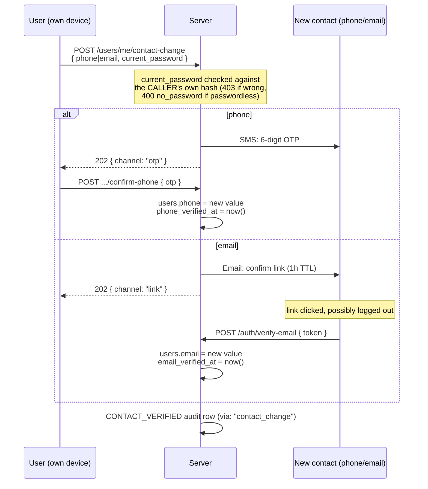

The old value is never touched until the confirm step succeeds — a
mistyped new number/address just leaves the request expiring unconfirmed,
with the account's real contact untouched throughout.

**A school admin changing a shared person's contact (75.1, D3/D23).** If the
person also belongs to another school, `PATCH /users/:id` does **not** write a
new email/phone. It holds the change until the person approves it:

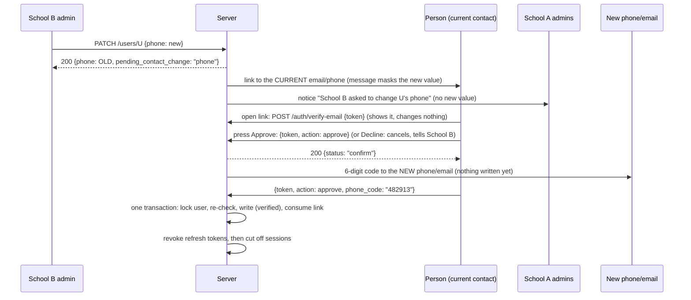

Why two steps (D23, review M1 on #2460): the masked value can't tell
`john@gmail.com` from `jack@gmail.com`, so a person could approve an address
a malicious admin typed. Approving is only **consent** from the current
contact; the code to the **new** contact is **ownership**. Until the code
comes back, the old value stays the login, so OTP sign-in and password
recovery can never reach the proposed value. A removal (`null`) needs no code.

- The link goes to the person's current verified email, else current verified
  phone, else whatever they have; never to the proposed value. No contact on
  file: `409 NO_CONTACT`.
- It is an `EMAIL_VERIFY` token with `metadata.kind = 'ADMIN_PROPOSAL'` (3-day
  TTL); the latest proposal from a school revokes its earlier proposal only
  (never the person's own email-change link). The token stores where the link
  was sent; if that contact has changed by approval time the link is refused.
- Opening the link never approves: the page shows the school and the **full**
  new value (`+8801712345998`, `jack@gmail.com`) with Approve and Decline. The
  message itself masks it (`+88017••••998`); the page can show it in full
  because only the person reaches it, through a link sent to their own current
  contact (D25). Seeing the full value lets them spot an address that is not
  theirs, such as one the admin typed for themselves to receive the code.
- Approval re-checks, under a row lock, that the account keeps an email or
  phone and that the new value is still unique; a refusal leaves the link usable.
- Approval also re-checks that School B still has the person and that the
  admin who asked is still an active ADMIN there (or a platform SUPER_ADMIN,
  who has no ADMIN row in the school); if not, the link is revoked and the
  answer is `409 PROPOSAL_WITHDRAWN`. These membership rows are read
  `FOR SHARE`, so a removal committing at the same moment is waited for. The
  person's `users` row is locked `FOR NO KEY UPDATE` (not `FOR UPDATE`), so the
  person leaving that school at the same moment, whose audit row points at the
  same `users` row, does not deadlock with the approval.
- Re-saving the form with the same pending value **by the same admin** sends
  nothing again, but only once the link was really delivered (the token is
  stamped `sent: true` as the very last step, after the notices and the audit
  row, so a save that answered 503 is never deduped). A different admin's save
  sends a fresh link and revokes the old one.
- The delivery service reports a gateway outage as `FAILED`; it never throws.
  So the server checks the result: an approval link that was not `SENT` is
  revoked and the admin gets a 503 (other fields stay saved). A code that
  could not reach the new contact is a 503 to the person, never `confirm`.
- The codes use their own OTP purpose, `CONTACT_PROPOSAL`, so a self-service
  phone change to the same number can't overwrite, cool down or lock them.
  Before a re-send, every value's cooldown and cap are checked, and only then
  are codes issued and sent. So a 429 on one value sends nothing **and** keeps
  the code the person already holds for the other (a new code replaces the old
  one, so issuing it first would have wiped it).
  Approving with only one of two codes re-sends just the missing one.
- Any contact change that is written (approved, or a single-school user's
  admin edit) sets `users.tokens_valid_after` and revokes refresh tokens, so
  whoever held the old contact is signed out everywhere.
- `POST /users/:id/reset-password` on a shared user still returns
  `409 SHARED_IDENTITY`.

## Passwordless sign-in (OTP login)

`POST /auth/otp/request` and `POST /auth/otp/verify`
(`server/src/modules/account-access/otp-login.service.ts`) let an account with
no password (a guardian who was never given one) sign in without one, by phone or
email.
It reuses the same building blocks as password recovery above: `OtpService`
for the code, `AuthService.startSession()` for the session.

Everything after the identifier lookup (the opt-out check, the code, its delivery) runs after the response, exactly as for password recovery above (75.17): known and unknown identifiers cost the same one query before the `202`.

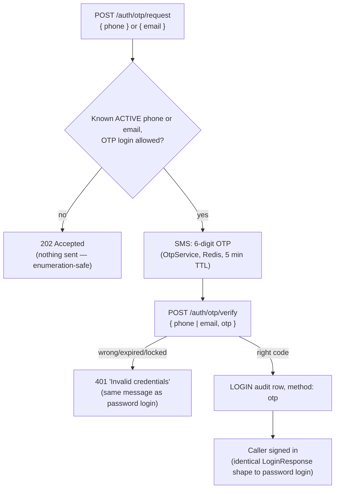

- **Same response shape as password login.** Both `/auth/login` and
  `/auth/otp/verify` return `{ access_token, memberships }` plus the same
  `__Host-refresh_token` cookie — a client can't tell which credential type
  was used from the response alone.
- **Same failure message.** Unknown phone, wrong code, expired code, an
  inactive user, and a tenant that switched OTP login off all throw the
  identical `401 "Invalid credentials"` password login uses — none of those
  reasons is distinguishable from the outside.
- **OTP lockout** is `OtpService`'s own counter — the same 6-digit/5-minute
  TTL, 5-wrong-guesses/15-minute lock, 60-second resend cooldown that
  password recovery's OTP branch uses (see above). A locked-out phone gets
  `429` with `Retry-After: 900`.
- **Per-tenant switchable, deny wins.** `auth.otpLoginEnabled` on tenant
  settings (default `true`) lets a school turn this off. A user can belong
  to more than one school; OTP login is allowed only if **every** tenant
  they belong to has it enabled — one school opting out can't be bypassed
  by signing in through a different membership (`OtpLoginService.allowed`).
- **The OTP itself is never logged** — `OtpService` only ever logs
  purpose/identifier, matching the rule password recovery's OTP already
  follows.

## Public sign-up route (Epic 13.0)

`POST /auth/register/start | resend | verify` are open to strangers, so each
layer below stops a different abuse.

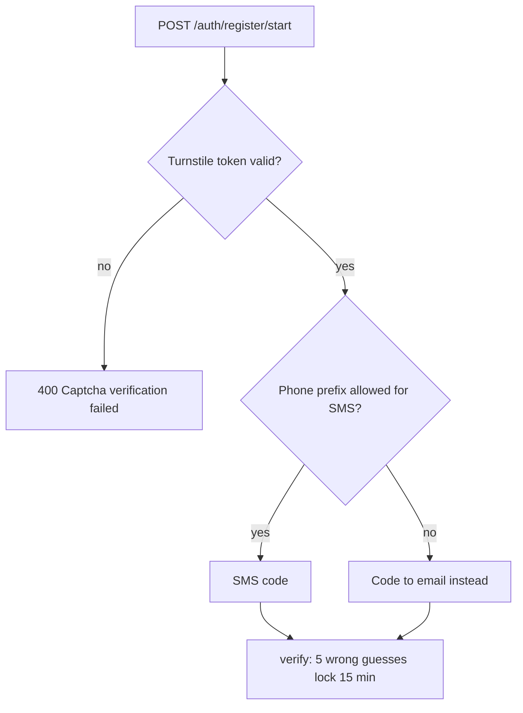

| Protection       | Detail                                                                                                                                                                                                                                                      |
| ---------------- | ----------------------------------------------------------------------------------------------------------------------------------------------------------------------------------------------------------------------------------------------------------- |
| Captcha          | Cloudflare Turnstile, checked on `start` (`registration/turnstile.service.ts`). With no `TURNSTILE_SECRET_KEY`, dev and test skip it; **production returns 503** and the routes stay closed (never fail open).                                              |
| Rate limit       | `STRICT_RATE_LIMIT`, 5 requests per 60 s per client, on all three routes.                                                                                                                                                                                   |
| Per-number limit | Resend cooldown 60 s, at most 3 resends per stage, and the OTP lockout above. One captcha buys one stage.                                                                                                                                                   |
| Allowed prefixes | SMS only to `OTP_SMS_ALLOWED_PREFIXES` (default `+880`), so the route cannot be used to run up SMS bills abroad. Others get an email code.                                                                                                                  |
| Enumeration      | `start` and `resend` always answer 202 and never say whether the contact is known. **Exception:** `verify` answers `409 CONTACT_IN_USE` or `SIGN_IN_REQUIRED` once the code is proven. This reveals that an account exists and is an accepted product call. |
| Consent          | Terms acceptance is stored in the audit log with the school id.                                                                                                                                                                                             |

Gaps: the server has no captcha-specific error code (#1700) and does not
normalise phone numbers (#1701). See [34-onboarding.md](34-onboarding.md).

## Connecting a social account (75.3)

A stolen or borrowed session must not be able to plant a permanent Google or
Facebook sign-in. So connecting one asks for the account's **current password**
first. The reverse also holds: a password reset removes every connected social
account (`RecoveryService.applyNewPassword`, #2239).

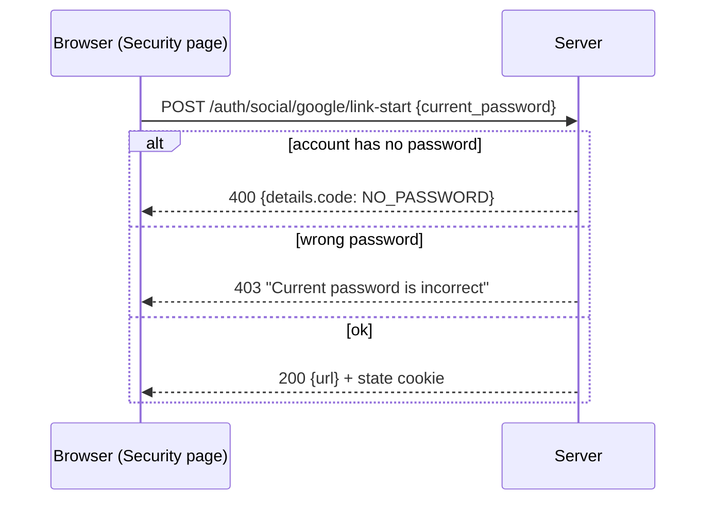

- 403, not 401, on a wrong password, so the client's 401 refresh-and-replay never re-sends it.
- A passwordless (OTP-only) account must set a password first (`NO_PASSWORD`).
- The route keeps `STRICT_RATE_LIMIT`, which is now also the password-guess limit.
- Social sign-in, sign-up, disconnect and the Facebook data-deletion routes are unchanged.

## Session & token lifecycle

`POST /auth/login` returns two things: a short-lived (**15 minutes** by
default, `ACCESS_TOKEN_TTL_MS`) bearer access token in the JSON body, and a
long-lived (**30 days** by default, `REFRESH_TOKEN_TTL_MS`) refresh token
set as an `httpOnly`, `__Host-`-prefixed cookie (`server/src/modules/auth/token-cookie.ts`).

**Transport decision:** bearer access token + httpOnly-cookie refresh token,
per the plan in issue #42. This is why the API's CORS config sets
`credentials: true` — it carries a cookie, not just a header — and why
**CSRF protection (issue #48) was real, required work**, not the N/A verdict
it would have been under a pure-bearer design. See "CSRF posture" below for
how that's addressed.

**Rotation and reuse detection** (`server/src/modules/auth/refresh-token.service.ts`):
every refresh token belongs to a rotation "family" started at login. Using a
refresh token invalidates it and issues a new one in the same family
(`POST /auth/refresh`). Presenting an already-used token is treated as
theft — the **entire family is revoked** and a `TOKEN_REUSE_DETECTED` audit
row is written — _unless_ it's within a 10-second grace window of its own
rotation, which is treated as two concurrent requests racing on the same
token rather than an attack, and both get a valid fresh pair instead of one
being wrongly logged out.

Refresh tokens are stored as a hash (SHA-256 of a 256-bit random secret,
selector/validator split) — the raw token is never persisted, only ever
seen by the client.

**Revocation:**

- `POST /auth/logout` revokes the presented refresh token. It does **not**
  require a live access token — the access token has likely already expired
  by the time a user gets around to logging out, and that must not block
  revoking the refresh token.
- `POST /auth/logout-all` (requires a valid access token) revokes every
  refresh token for the user and denylists the access token used to call it,
  so that specific session ends immediately rather than riding out its
  remaining ~15-minute lifetime. The denylist
  (`server/src/modules/auth/access-token-denylist.service.ts`) is a Redis
  key per `jti` with a TTL matching the access token's own lifetime — viable
  specifically because that lifetime is now short; this is not a full
  blacklist of every issued token.
- A tenant/role change (`user_tenants`) takes effect on the _next refresh_,
  not after the old token's full lifetime — `POST /auth/refresh` re-fetches
  memberships rather than copying them from the token being replaced.
  Removal from a school is faster still (#2297): it also sets a per-user
  cut-off key (`access-denylist:user:<id>`, holding the removal time in ms),
  and every access token whose `iat_ms` is at or before it is refused on the
  very next request. `iat_ms` is taken before the memberships are read, so a
  token signed during the removal never outlives it.

**Session cut-off (75.2, D12)** — the DB-backed cut-off. One column,
`users.tokens_valid_after`, and one primary-key read per request in
`JwtStrategy` (`server/src/modules/auth/strategies/jwt.strategy.ts`). No Redis.

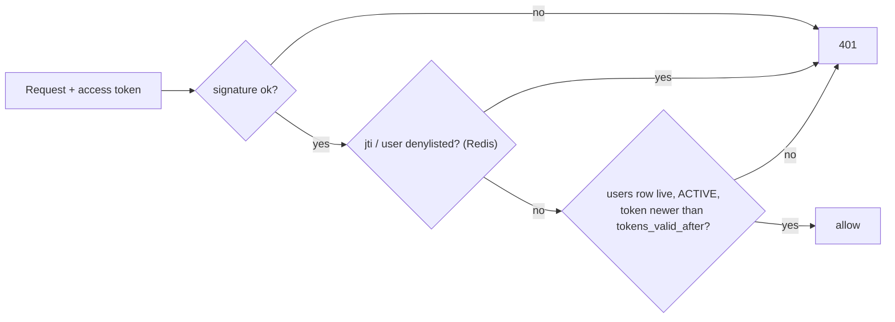

- What sets it (`SessionCutoffService.cutOff`): removing or leaving a school
  (same transaction as the membership delete), a completed password reset
  (self-service or admin-started).
- What does not: `POST /auth/change-password` (the caller keeps their own
  token), `logout-all` and `DELETE /auth/sessions/:id` (still the `jti` denylist).
- A user who is soft-deleted or not `ACTIVE` (for example `SUSPENDED`) is also
  refused on the next request.
- Precision: the token's `iat_ms` is compared with the cut-off in milliseconds.
  A legacy token with only whole-second `iat` that was minted in the same
  second as the cut-off survives (`<`, not `<=`, so a refresh racing the
  cut-off is never rejected in a loop).
- Example: admin removes Rahim from school A at 10:00:00.000 -> his token
  issued 09:55 gets 401 -> the client refreshes -> the new token has no school A.
- Refresh rotation vs "revoke every refresh token" (review m-new-2 on #2460):
  both lock the user row first, so a rotation in flight either finishes first
  (and its successor is revoked too) or waits and finds its token already
  revoked. Without the lock, a successor inserted just after the revoke stayed
  live.

  ```mermaid
  sequenceDiagram
    participant R as Refresh (rotateRow)
    participant V as revokeAllForUser
    participant DB as Postgres
    R->>DB: users row FOR SHARE (granted)
    V->>DB: users row FOR UPDATE (waits for R)
    R->>DB: claim old token, INSERT successor, COMMIT
    V->>DB: lock granted, revoke every live token (successor included)
    Note over R,V: Other order: V locks first, R waits,<br/>then finds its old token revoked (401)
  ```

Expired `refresh_tokens` rows (revoked or not) are deleted by an hourly
BullMQ job (`refresh-token-cleanup.processor.ts`/`.scheduler.ts`).

### Token signing and rotating `JWT_SECRET` (75.9)

Every JWT is signed **HS256** with issuer `biddaloy`. Access tokens also carry
audience `biddaloy:access`; the Passport strategy requires all three, so an
HS512 token, an `alg: none` token, or an approval token used as a Bearer all
get 401. Approval tokens (`X-Approval-Token`) are checked for algorithm and
issuer too, and the rate-limit tracker verifies the same way.

To rotate the secret without logging anyone out, the old value moves to
`JWT_SECRET_PREVIOUS`. It is tried **for verification only** (after
`JWT_SECRET`); new tokens are always signed with `JWT_SECRET`. An empty
`JWT_SECRET_PREVIOUS` counts as unset.

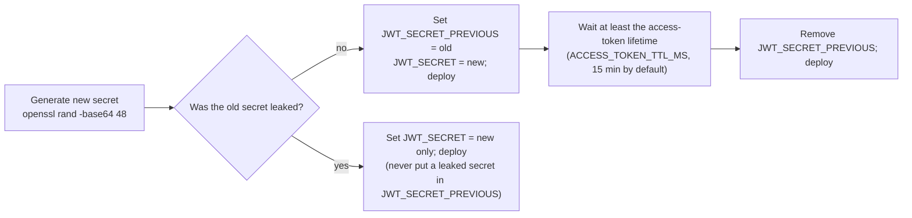

Why the wait is minutes, not 30 days: only access tokens (15 min) and approval
tokens (5 min) are signed with `JWT_SECRET`. Refresh tokens are opaque DB rows,
so they keep working through any rotation and re-mint access tokens with the new
secret.

**After a leak, rotate hard.** Do not set `JWT_SECRET_PREVIOUS`: that would keep
the leaked secret valid for verification. Every access token gets one 401, the
client's refresh path re-mints it with the new secret, and nobody types a
password again. Anyone holding only a forged token is out at once.

There is no transition window for the format change itself (D21): tokens minted
before this change have no `iss`/`aud` and get 401 once. The client's refresh
path re-mints them, because refresh tokens are opaque DB rows, not JWTs.

### Self-service revocation (12.8)

A "session" in the API is a refresh-token **family**, not a row — rotation
means many rows can belong to one family over its lifetime, but at most one
is ever live. `GET /auth/sessions` lists the caller's live families (device
hint, first-seen, last-used, a `current` marker); `DELETE
/auth/sessions/:id` revokes one. Both routes are identified entirely by
`JwtPayload.sub` — no `X-Tenant-ID`, since a session spans every tenant the
user belongs to, not one of them.

```json
// GET /auth/sessions
{
  "data": [
    {
      "id": "b2b1c1b0-....",
      "started_at": "2026-08-01T09:00:00.000Z",
      "last_used_at": "2026-09-07T04:12:00.000Z",
      "user_agent": "Mozilla/5.0 (iPhone; ...) Safari",
      "ip_address": "203.0.113.5",
      "current": true
    }
  ]
}
```

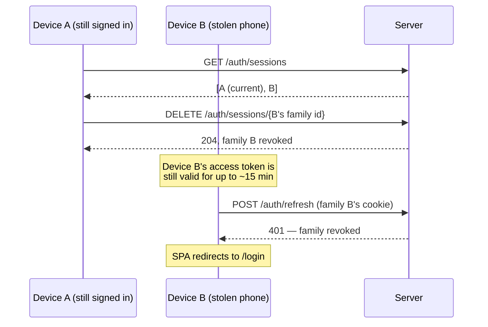

Revoking the **current** family (the one behind the caller's own refresh
cookie) also denylists the caller's access token and clears the cookie, so
that device is cut off immediately, exactly like `logout`. Revoking any
other family only takes effect at that device's _next_ refresh — up to ~15
minutes of access-token life remains on it, same as every other revocation
path in this section.

A family that doesn't belong to the caller is a **404, never a 403** — a 403
would confirm to the caller that some other user's family id exists. An
already-revoked family is an idempotent 204. Each successful revoke writes a
`SESSION_REVOKED` audit row with `tenant_id` from the request's active
tenant if present, else `null` — a session isn't tenant-scoped, so `null` is
the honest value when there's no active tenant to record.

Out of scope for this ticket: a "new sign-in to your account" notification
(needs a per-user notification-preference surface that doesn't exist yet).

## Dev seed safety (75.12)

`yarn seed`, `db:reset` and `db:clear` call `assertLocalSeedTarget` first and exit 1 when:

1. `NODE_ENV=production`, or
2. `DATABASE_URL` is missing or not a URL, or
3. its host is not `localhost`, `127.0.0.1` or `::1` (an SSH tunnel to localhost works for a deliberate remote seed).

The message names the script and host, never the password. The dev seed's attendance device gets a fresh random key per database, printed once as `Seed attendance device key (shown once): bd_...`; re-runs do not reprint it. Specs that call `ensureAttendanceSeed` directly keep the fixed `SEED_DEVICE_KEY` from `seed.util.ts`; `e2e/seed-contract.ts` no longer exports one, since a Playwright spec cannot know the random key.

## Demo seed safety (58.1.03)

`yarn seed:demo` does not call `assertLocalSeedTarget`: the nightly demo reset runs with `NODE_ENV=production` against a Docker-service host, which that guard refuses by design. It runs its own three checks, in this order, before any write:

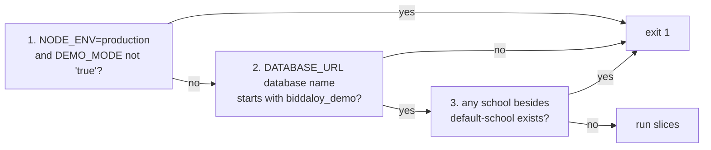

Example: `postgres://u:p@db:5432/biddaloy` is refused at step 2; `.../biddaloy_demo_next` on a freshly migrated database passes. The host is not checked because the database name already limits the blast radius, and the real database can never be called `biddaloy_demo*`. `default-school` is the platform row every migrated database already holds, so it does not count as data.

## Demo boot check (58.1.01)

A server or script started with `DEMO_MODE=true` first checks that the database is a demo one. It runs **before** `NestFactory.create`, in `main.ts`, in `createScriptAppContext` and in `generate-openapi.ts`. `main.ts` exits 1 on a refusal even with Sentry on.

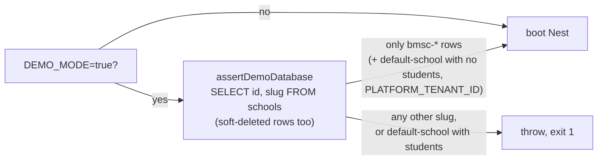

`default-school` counts only while it has no students: a pre-multi-tenant install moved all its real data into that row.

Why not a Nest `onApplicationBootstrap` hook: every module's `onModuleInit` runs first. On a real Redis that already removes the real trial and backup schedulers and starts the BullMQ workers, and a worker could settle a real queued SMS as SENT through the test-inbox sink. Example: a copied env file with `DEMO_MODE=true` pointed at the real `biddaloy` database stops with `DEMO_MODE refuses to start: database holds non-demo schools (...)` before any of that runs.

## No runtime styles under the CSP (#3214)

helmet sends `style-src 'self'` (`server/src/security-headers.ts`). The browser then loads CSS only from our own `.css` files. It blocks a `<style>` tag or a `style="..."` attribute made by JavaScript. Setting one property, like `el.style.width = '10px'`, is still allowed.

```mermaid
flowchart LR
  L["library adds a &lt;style&gt; tag"] -->|blocked by CSP| X["its CSS is lost"]
  B["vite build: csp-no-runtime-style"] -->|removes that code| OK["CSS comes from globals.css"]
  S["e2e/pwa/csp-inline-style.spec.ts"] -->|adds the CSP, fails on a violation| L
```

Two libraries did this, and both were lost in production:

| Library                                   | What broke                                                | Fix                                                               |
| ----------------------------------------- | --------------------------------------------------------- | ----------------------------------------------------------------- |
| sonner (toasts)                           | Toasts had no styles. The list was not fixed to a corner. | `@import "sonner/dist/styles.css"` in `ui/src/styles/globals.css` |
| react-style-singleton (Radix scroll lock) | The page scrolled behind an open dialog.                  | `body[data-scroll-locked] { overflow: hidden }` in globals.css    |

The plugin in `client-admin/vite.config.ts` removes each library's injector. If an upgrade changes that code, the build fails. One gap remains: when a dialog opens, the page does not reserve the scrollbar's width, so content can move a little on a desktop with a visible scrollbar.

Example failure from the spec, before the fix:

```text
style-src-elem: [data-sonner-toaster][dir=ltr],html[dir= (.../assets/use-sync-queue-CD_BqAWJ.js:65)
```

Nothing before this spec saw the bug, because `vite dev` and `vite preview` send no CSP. Only the deployed server does.

## CSRF posture

The API splits cleanly into two authentication modes, and the CSRF argument
depends entirely on which one a route uses:

- **Bearer-authenticated routes** — everything except `POST /auth/login`
  and the two cookie-authenticated routes below — read the access token
  from the `Authorization` header. Browsers never attach that header
  automatically to a request they didn't construct, so a cross-site page
  cannot make an authenticated call to these routes no matter what it does
  — there's no ambient credential to ride. This is the vast majority of
  the API and needs no CSRF handling at all; adding blanket CSRF
  middleware here would add token plumbing to every request for zero
  additional protection, which is why there isn't any.
- `POST /auth/login` requires no authentication at all — it's how a client
  obtains a token in the first place, so there's nothing for a cross-site
  request to ride: it can trigger a login with attacker-known credentials,
  but not act as the victim.
- **Cookie-authenticated routes** — `POST /auth/refresh` and
  `POST /auth/logout` — read the refresh cookie, which _is_ an ambient
  credential a browser attaches automatically. These are the only routes
  where CSRF is a real question, and they're deliberately layered:
  1. **`SameSite=Strict`** on the cookie (`token-cookie.ts`) is the primary
     defense: the browser simply never attaches it to a cross-site
     request in the first place. This alone closes the practical attack
     for this deployment, where the SPAs are served same-origin by this
     same app (`main.ts`).
  2. **`SameOriginGuard`** (`server/src/modules/auth/guards/same-origin.guard.ts`)
     checks the `Origin` header against the request's own origin as a
     second, independent layer — in case `SameSite` is ever bypassed by a
     legacy browser or a future relaxation to `Lax`. A request with no
     `Origin` header (not something a browser sends for a state-changing
     method) passes through rather than being rejected, since that shape
     of request is outside this check's threat model, not a bypass of it.
  3. The `__Host-` cookie prefix (`token-cookie.ts`) is a related but
     separate guarantee: it stops a compromised sibling origin on the same
     parent domain from ever setting a cookie that shadows this one.
- `POST /auth/logout-all` is bearer-authenticated (`AuthGuard('jwt')`, not
  the cookie) despite being auth-adjacent, so it falls in the first
  category and needs neither of the above.

**The invariant this rests on:** the SPAs are same-origin with the API. If
that ever stops being true — the SPAs move to their own domain/CDN — `Origin`
becomes cross-origin by definition and `SameOriginGuard` needs a real
allowlist (reusing `CORS_ORIGINS`) instead of a same-origin check, and
double-submit CSRF tokens become worth adding on top. Nothing about today's
implementation prevents that; it just isn't needed yet.

## Audit trail

Every significant action — login/logout, a fee-structure edit, an invoice
being generated, a payment received, a reminder sent, a student bulk upload —
is recorded to the write-only `audit_logs` table via a single entry point,
`AuditService.record()` (`server/src/modules/audit/`). No other module holds
a direct repository for this table.

- **Tenant scoping.** `audit_logs.tenant_id` is nullable, unlike other
  tenant-scoped tables: `LOGIN`/`LOGIN_FAILED` can happen against an
  unrecognized identifier _before_ a tenant is ever selected, and there is
  genuinely no tenant to attribute that attempt to. Every other action is
  tenant-scoped and always gets one. The admin read endpoint
  (`GET /audit-logs`) is itself tenant-scoped, so an unattributed row simply
  never surfaces on any tenant's trail — that's correct, not a gap.
- **Redaction.** `old_values`/`new_values` are `jsonb` snapshots, recursively
  scrubbed against a denylist (`password_hash`, `token`, `refresh_token`,
  `api_key`, `secret`, `jti`, and variants — see `redact.util.ts`) before
  they're ever written, since the write-only trigger means a bad value here
  can never be corrected after the fact.
- **Transactional vs. ancillary writes.** `record()` takes an optional
  `EntityManager`. Passed one (payment receipt, invoice-from-payment), the
  write participates in the caller's transaction and a failure rolls back
  with it — the audit row is part of the record of truth. Without one
  (login, a fee-structure edit, a reminder send), the write is ancillary to
  an already-decided outcome and fails open (catches, logs, never throws) —
  a DB hiccup on the audit write must not turn a successful action into a 500.
- **Mechanical CRUD vs. direct calls.** The `@Audited()` decorator +
  `AuditInterceptor` cover the one case where a response body alone is
  enough to write a useful record (`POST /invoices` — a pure create with no
  prior state to diff). Deliberately not a blanket interceptor: an update
  needs old-vs-new diffing the response can't provide (fee-structure
  changes call `AuditService.record()` directly, using the pre-update
  entity already fetched for validation), and a batch send needs one row
  per action rather than one per response (bulk/single reminders do the
  same).

**Retention.** The write-only trigger (`block_audit_logs_write_only`, added
in the initial migration) blocks `UPDATE` and `DELETE` on every row, so a
naive "delete rows older than N days" job cannot work — it would hit the
same trigger a manual edit would. This is documented rather than
implemented, since the table has not yet grown large enough to need it: the
mechanism that respects the write-only guarantee is range partitioning by
`created_at` (e.g. yearly), with old partitions retired via `DROP TABLE`
rather than `DELETE FROM` — a table drop isn't a row-level write the
trigger fires on. An archival job that copies old partitions to cold
storage before dropping them is the natural next step once retention
actually needs enforcing.

## Data protection: transit, at rest, and logs

This app handles student/guardian PII and payment records. The posture below
covers connection security, storage, and what does (and deliberately does
not) get encrypted at the column level.

**Request ids.** An incoming `X-Request-Id` is kept only if it is 1-64 letters, digits, `_` or `-` (`resolveRequestId`). Anything else is replaced with a fresh UUID, so a client cannot inject newlines or huge strings into logs or Sentry tags.

**Transit to Postgres.** `DATABASE_URL` carries the DB password, and every
query carries whatever PII it touches, over whatever transport TypeORM is
given — a bare TCP socket unless told otherwise. `DB_SSL` (`server/src/db-ssl.ts`)
controls this:

- Unset or not `production`: SSL is off by default (a local docker-compose
  Postgres has none to negotiate), but can still be opted into by setting
  `DB_SSL=true`.
- `NODE_ENV=production`: `DB_SSL` **must** be exactly `"true"` — the app
  refuses to boot otherwise, the same "loud failure beats a silent gap"
  posture as `ENABLE_API_DOCS`'s Basic Auth requirement. Use an
  `sslmode=require`-style `DATABASE_URL` (or the managed provider's
  equivalent) alongside it.
- `DB_SSL_REJECT_UNAUTHORIZED=false` disables certificate verification —
  sometimes genuinely necessary for a managed Postgres with a self-signed
  cert, but logs a boot-time warning every time it's set, since it's also a
  common copy-paste that silently defeats the whole point of enabling TLS.
- This requirement is unconditional — it does not matter whether Postgres
  happens to be on the same private Docker network as the app. The bundled
  `docker-compose.yml`'s `db` service does not configure TLS today, so
  deploying it as-is with `NODE_ENV=production` will refuse to boot until
  that's addressed (see [07-deployment.md](07-deployment.md)) — a known gap,
  not an oversight papered over here.

**Transit to SeaweedFS/S3.** Same shape of gap as Postgres above: `StorageService`
and the `backup`/`restore` scripts reject a plaintext `http://` `S3_ENDPOINT`
by default and require an explicit `S3_ALLOW_INSECURE_HTTP=true` opt-in to
accept one (see [`server/src/modules/storage/storage.service.ts`](../../server/src/modules/storage/storage.service.ts)
and [`scripts/backup/backup.sh`](../../scripts/backup/backup.sh)). The bundled
`docker-compose.yml` sets that opt-in for its `app`/`backup` services,
because the SeaweedFS container there isn't TLS-terminated. SeaweedFS S3 is
published on host loopback `127.0.0.1:9000` only; its filer (`:8888`) and
volume HTTP ports are reachable without credentials from other containers on
the Compose network — the same trust boundary already accepted for the
unauthenticated `redis` on that network — but are not published to the host
or internet. That network transport is still cleartext. Standing up
SeaweedFS with TLS (a CA, certs distributed to every client container) is
tracked as follow-up work, not done here — deploying the bundled Compose
stack as-is means SeaweedFS traffic stays unencrypted between containers,
the same trade-off already accepted for `db` above.

**At rest.** Required as a deployment property, not an optional hardening
step: the Postgres data volume must sit on encrypted storage — either the
self-hosted compose stack's volume backed by a LUKS-encrypted (or
cloud-provider-encrypted) disk, or a managed Postgres with encryption at
rest enabled (the default on every major provider today). There is
currently no automated check for this; it's an operational requirement on
whoever provisions the host/database.

**PII column inventory** (for any future data-subject/erasure request):

| Entity               | Column(s)                                                                                                                                                                                                                        |
| -------------------- | -------------------------------------------------------------------------------------------------------------------------------------------------------------------------------------------------------------------------------- |
| `User`               | `email`, `phone`, `full_name`, `password_hash` (bcrypt, already hashed), `profile_picture_url`                                                                                                                                   |
| `Guardian`           | `full_name`, `phone`, `alternate_phone`, `email`, `address`, `occupation`                                                                                                                                                        |
| `Student`            | `full_name`, `date_of_birth`, `gender`, `home_address`                                                                                                                                                                           |
| `AdmissionApplicant` | applicant name, `date_of_birth`, `gender`, guardian name/phone/email, `home_address`, and its `admission-documents/` files in storage                                                                                            |
| `School`             | `address`, `phone`, `email` (tenant-level contact info)                                                                                                                                                                          |
| `RefreshToken`       | `ip_address`, `user_agent`                                                                                                                                                                                                       |
| `AuditLog`           | `ip_address`, `user_agent`, and `old_values`/`new_values` jsonb snapshots — redacted for credentials/tokens (`redact.util.ts`), but can still carry names/emails/phones since those aren't secrets by that redactor's definition |
| `CommunicationLog`   | `recipient_address`, `recipient_name`, `message_body` (free text)                                                                                                                                                                |
| `Payment`            | `remarks` (free text)                                                                                                                                                                                                            |
| `Invoice`            | `notes` (free text)                                                                                                                                                                                                              |

Admission documents of a REJECTED applicant can be deleted by hand (`DELETE /admission/applicants/:id/documents`, audited). The retention period is #1792's decision.

**Column-level encryption: deliberately deferred.** The original ask was to
evaluate encrypting PII columns directly. Evaluated and not done, because it
breaks core access patterns this app depends on:

- Login (`AuthService.validateUser`) looks users up by **exact match** on
  `email`/`phone`. Encrypting those columns makes login impossible without
  a deterministic scheme or a blind index — and a deterministic scheme
  leaks equality anyway (two rows with the same email produce the same
  ciphertext), buying much less protection than it costs in complexity.
- Student/guardian name search and sort are core to every list view.
  Encrypted columns can't be `LIKE`-searched, range-scanned, or usefully
  indexed.
- The threat model volume/managed encryption at rest actually addresses is
  **stolen storage media** — a disk, volume, snapshot, or backup taken
  without valid database credentials. It does _not_ protect a `pg_dump`
  (or any other logical export) taken by someone who already has DB
  credentials: Postgres decrypts pages before returning query results, so a
  logical dump is plaintext regardless of what the underlying storage does.
  That scenario is a credential/access-control problem — least-privilege DB
  roles, credential rotation, and the audit trail (#37) — not a storage-
  encryption one, and column-level encryption wouldn't fully close it either
  (an attacker with valid app-level credentials can just query the API).

Neither at-rest volume encryption nor this deferral claims to fully defend
against a compromised, credentialed actor — that requires the access-control
and credential-hygiene work above, not a storage or column-encryption
mechanism.

This would be revisited if either changes: a regulatory requirement forcing
column-level encryption regardless of the login/search cost, or a KMS
becoming available that makes searchable/blind-index encryption practical
without hand-rolling one.

**Logs.** TypeORM's query logger (`server/src/db-logger.ts`) logs query text
but never bound parameters — the default logger appends them as a trailing
`-- PARAMETERS: [...]` comment, which is exactly where an email or phone
passed into a `WHERE` clause would otherwise land in plaintext. The global
exception filter (`AllExceptionsFilter`) redacts email- and phone-shaped
substrings, plus known-sensitive query-param values, from the request URL
and error detail before logging (`common/redact-log.util.ts`) — verified
against a _failing_ request, not just a successful one, since the leak is
usually in an error log written under debugging pressure. Request bodies
(the login path carries a plaintext password) are never logged at all.
nginx uses the `redacted` access-log format (`nginx/templates/default.conf.template`):
it logs the path without the query string, masks the calendar-feed,
public-verify and public-invoice path tokens and the SPA share pages
(`/i/<token>`, `/v/<token>`), and omits the Referer, because
reset/invite/verify links are bearer secrets and must not sit in log files.
`redactPii` masks the same three API path tokens plus the two SPA pages, so
the pino request serializer, the exception filter and Sentry all hide them.
All server blocks, including the two catch-all default servers, use the
`redacted` format, so scanner traffic is logged in the same safe shape.

| URL shape                      | nginx access log | pino / exception filter / Sentry |
| ------------------------------ | ---------------- | -------------------------------- |
| `/api/v1/public/invoices/:tok` | masked           | masked                           |
| `/api/v1/public/verify/:tok`   | masked           | masked                           |
| `/api/v1/calendar/feed/:tok`   | masked           | masked                           |
| `/i/:tok`, `/v/:tok` (SPA)     | masked           | masked, also in full URLs        |
| `?token=` (reset, activate…)   | query dropped    | `token=[REDACTED]`               |

The audit's national-ID item was checked: no NID number field exists in
server code (NID is only an uploaded document file), so there is nothing to
redact.

Example: `GET /api/v1/calendar/feed/abc123.ics` is logged as
`GET /api/v1/calendar/feed/[REDACTED]`.

Known gap: nginx's **error** log (502/504, client aborts) still writes the
full request line, token included. Only the access log is masked.

## Repository and GitHub settings

Some protection lives in GitHub settings, not in code. Reporters are sent to
[`.github/SECURITY.md`](../../.github/SECURITY.md); risky paths auto-request the
owner's review through `.github/CODEOWNERS` (requested, not enforced).

```mermaid
flowchart LR
    R[Researcher] -->|"Security > Report a vulnerability"| P[Private advisory]
    P --> O[Owner @tareq89]
    PR[PR touching /nginx/, /server/src/modules/auth/ ...] -->|CODEOWNERS| O
```

State read with `gh api` on 2026-10-12 (**Today**) and the value to reach (**Target**).
Rows marked **owner to apply** are writes to repo settings; the implementer did not
make them, and the **Today** column stays until the owner does and updates it.

| Setting                                         | Today                                     | Target                                                   | Status                 |
| ----------------------------------------------- | ----------------------------------------- | -------------------------------------------------------- | ---------------------- |
| Visibility                                      | public                                    | -                                                        | -                      |
| Private vulnerability reporting                 | disabled                                  | enabled (SECURITY.md points at it)                       | owner to apply         |
| Secret scanning / push protection               | enabled / enabled                         | keep                                                     | ok                     |
| Secret scanning non-provider patterns, validity | disabled / disabled                       | enabled / enabled                                        | owner to apply         |
| Dependabot security updates                     | enabled                                   | keep                                                     | ok                     |
| Default `GITHUB_TOKEN` permission               | `read`, cannot approve PRs                | keep                                                     | ok                     |
| Fork PR workflow approval                       | `first_time_contributors`                 | `all_external_contributors`                              | owner to apply         |
| Branch protection / rulesets on `main`          | none                                      | minimal ruleset: block deletion and force-push of `main` | owner decision pending |
| `--frozen-lockfile` in CI                       | yes (`.github/actions/setup`, Dockerfile) | keep                                                     | ok                     |
| CodeQL                                          | `.github/workflows/codeql.yml`            | keep                                                     | ok                     |

Branch protection: the recommended option is the last two rules of
`scripts/apply-main-ruleset.sh` (no deletion, no force-push), with no required checks and
no merge queue. The full `main-gate` changes how every PR merges and needs the merge
queue to have run green once, so it is a separate decision. Record the chosen option,
the date and the reason here when the owner decides.

Apply (the repo owner runs these; they change live GitHub settings):

```bash
# private vulnerability reporting on
gh api -X PUT repos/tareq89/biddaloy/private-vulnerability-reporting
# secret scanning: non-provider patterns + validity checks
gh api -X PATCH repos/tareq89/biddaloy \
  -F 'security_and_analysis[secret_scanning_non_provider_patterns][status]=enabled' \
  -F 'security_and_analysis[secret_scanning_validity_checks][status]=enabled'
# fork PRs from any outside contributor wait for approval before workflows run
gh api -X PUT repos/tareq89/biddaloy/actions/permissions/fork-pr-contributor-approval \
  -f approval_policy=all_external_contributors
```

Verify after applying (each should match **Target**):

```bash
gh api repos/tareq89/biddaloy/codeowners/errors --jq '.errors'                       # []
gh api repos/tareq89/biddaloy/private-vulnerability-reporting --jq .enabled         # true
gh api repos/tareq89/biddaloy --jq '.security_and_analysis'
gh api repos/tareq89/biddaloy/actions/permissions/workflow
gh api repos/tareq89/biddaloy/actions/permissions/fork-pr-contributor-approval --jq .approval_policy
gh api repos/tareq89/biddaloy/rulesets --jq '.[].name'
```

## Accepted dependency risks (Epic 51.0)

`yarn audit` (this is a Yarn 1 repo, so `npm audit` does not work) still
reports three advisories after Epic 51.0. We looked at each one and chose not
to force a version. If `yarn audit` shows anything else, it is new: fix it.

CI enforces this with `scripts/ci-audit.js`. All three advisories are entries
in its `ALLOWLIST`, each with a `recheckBy` date (next: **2027-01-24**). Past
that date the job fails until someone re-reviews. The `tmp` advisory no longer
needs an entry, because the `resolutions` block below forces a patched version.

| Mode       | Command                                 | Blocks on                       |
| ---------- | --------------------------------------- | ------------------------------- |
| default    | `node scripts/ci-audit.js`              | high/critical, all dependencies |
| production | `node scripts/ci-audit.js --production` | moderate+, production deps only |

The `uuid` row below is the one production-reachable advisory, which is why
it must be an allowlist entry and not just prose.

```mermaid
flowchart LR
  lhci["@lhci/cli (dev/CI only)"] --> lh["lighthouse 12.6.1"] --> pp["puppeteer-core 24.x"] --> pb["@puppeteer/browsers 2.x"] --> ez["extract-zip 2.0.1<br/>no patched version"]
  server["@biddaloy/server"] --> xl["exceljs 4.4.0"] --> uuid["uuid 8.3.2<br/>only v4 is called"]
  lhci --> uuid
```

| Advisory            | Package                                                                                                              | Why we accept it                                                                                                                                                                                                                                                                                                                                                              | Revisit when                                                                                                                                                                                           |
| ------------------- | -------------------------------------------------------------------------------------------------------------------- | ----------------------------------------------------------------------------------------------------------------------------------------------------------------------------------------------------------------------------------------------------------------------------------------------------------------------------------------------------------------------------- | ------------------------------------------------------------------------------------------------------------------------------------------------------------------------------------------------------ |
| GHSA-7pqw-9j4j-h8q3 | `extract-zip` 2.0.1 (arbitrary file write via symlink entries)                                                       | No patched version exists. Dev/CI only, and it only runs if something triggers a browser download (`@puppeteer/browsers install`). lhci does not: it launches the Chrome already installed on the machine (via chrome-launcher).                                                                                                                                              | `@lhci/cli` ships a lighthouse that uses puppeteer-core 25 or later (`@puppeteer/browsers` 3.x has no `extract-zip`; our own root `puppeteer` 25 already uses 3.x), or a patched `extract-zip` appears |
| GHSA-jmr9-qjv8-65gv | `extract-zip` 2.0.1 (symlink path traversal)                                                                         | Same as above.                                                                                                                                                                                                                                                                                                                                                                | Same as above                                                                                                                                                                                          |
| GHSA-w5hq-g745-h8pq | `uuid` 8.3.2 via `exceljs` and `@lhci/cli` (missing buffer bounds check in v3/v5/v6 when a `buf` argument is passed) | Both callers only use v4 with no buffer, so the vulnerable path is never called. `exceljs` does `const {v4: uuidv4} = require('uuid')` (`node_modules/exceljs/lib/xlsx/xform/sheet/cf-ext/cf-rule-ext-xform.js:1`); `@lhci/cli` calls `uuid.v4()` (`node_modules/@lhci/cli/src/collect/node-runner.js:65`). Forcing uuid 11 on them is a 3-major jump for code we do not use. | `exceljs` or `@lhci/cli` bumps `uuid`, or we replace `exceljs`                                                                                                                                         |

So `yarn audit` lists `uuid` on two paths, `@biddaloy/server>exceljs>uuid`
and `@lhci/cli>uuid`. Both are this one accepted advisory, not a new finding.

Re-check the `uuid` claim after any `exceljs` or `@lhci/cli` upgrade:
`rg -n "require\(['\"]uuid" node_modules/exceljs/lib node_modules/@lhci/cli/src`
must show only `v4`.

### Forced versions (`resolutions`)

Epic 51.0 also forced three patched versions through the root
`package.json` `resolutions` block. Yarn 1 does not allow comments there, so
the reason for each one, and when it can go, lives here.

All three exist only because `@lhci/cli` 0.15.1 (dev/CI only) still pulls in
old ranges. The production server does not need any of them.

| Resolution                | Advisory                                 | What forces it (from `yarn.lock`)                                                                                                                                                                                                                    | Remove when                                                             |
| ------------------------- | ---------------------------------------- | ---------------------------------------------------------------------------------------------------------------------------------------------------------------------------------------------------------------------------------------------------- | ----------------------------------------------------------------------- |
| `"qs": "^6.16.0"`         | GHSA-4mjr-xmp4-gh2g, GHSA-x5fp-wj9c-mxmx | `@lhci/cli` → `express` 4.22.2 and `body-parser` 1.20.6, which both ask for `qs ~6.15.1` (6.16 is out of a tilde range). The server's `express` 5.2.1 (`qs ^6.14.0`) and `body-parser` 2.x (`qs ^6.15.2`) already allow 6.16 without the resolution. | `@lhci/cli` moves off express 4 (or its express 4 asks for `qs` ≥ 6.16) |
| `"tmp": "^0.2.7"`         | GHSA-ph9p-34f9-6g65, GHSA-52f5-9888-hmc6 | `@lhci/cli` asks for `tmp ^0.1.0` directly, and through `inquirer` 6 → `external-editor` for `tmp ^0.0.33`                                                                                                                                           | `@lhci/cli` (and its `inquirer`) ask for `tmp` ≥ 0.2.7                  |
| `"compression": "^1.8.2"` | GHSA-vc2v-76pw-4v95                      | `@lhci/cli` asks for `compression ^1.7.4`. 1.8.2 is in that range; the resolution makes sure a fresh install can never pick an older one.                                                                                                            | `@lhci/cli` asks for `compression` ≥ 1.8.2                              |

A row can go only when **every** upstream range in `yarn.lock` excludes the
vulnerable versions. A clean `yarn audit` after deleting the row does not
prove this: Yarn 1 keeps the already-locked patched version, so the audit
stays clean even though a fresh lockfile could resolve an old one.

Example: `compression ^1.7.4` still allows the vulnerable 1.8.1. Delete the
row today and `yarn audit` stays clean, because `yarn.lock` still says 1.8.2.
The row can go once `@lhci/cli` asks for `^1.8.2` or higher.

To check, read the ranges, not the audit:

```bash
grep -E '^"?compression@' yarn.lock   # every range listed must start at >= 1.8.2
```

## Learnings log (Epic 75)

Raw notes from each wave close, kept as the history behind the
[Security rules](#security-rules). They are not polished on purpose. Format:
what surprised us — what it cost — fix — rule candidate — and, since 75.36,
an arrow to the rule it became (`→ Rule N`) or `→ no rule` with the reason.

### Wave 0 — 2026-10-13

- The first route-status snapshot had one `SUPER_ADMIN` column, but a tenant-local super admin and a platform super admin (no tenant) are guarded differently, so the column hid real 401/403 differences — one review round — fix: `PLATFORM_SA` column in `server/src/route-status-snapshot.e2e-spec.ts` (#2439) — rule candidate: a snapshot gets one column per distinct guard path, not per role name. → Rule 20
- Snapshot diff since wave start is one line, `POST /api/v1/invoices/:id/share/regenerate` (new route, same guards as the other share routes) — none; the 403 → 404 teacher changes are in services, which a guard-only snapshot never sees — fix: #2438 — rule candidate: the snapshot proves guards only; handler-level scope needs its own e2e spec. → Rule 20, Rule 2
- Opening a contact-change approval link applied the change on GET, so a mail scanner or anyone holding the link could take over a shared person's email/phone (D11) — a rework of 75.1 — fix: explicit Approve/Decline under a row lock (#2309, b95ed16a2) — rule candidate: a link in a message never changes state on open; it shows a page with a button. → Rule 17
- Flipping `PermissionsGuard` to fail closed was safe only because every identity route got a readable `@AuthenticatedOnly()` marker first, checked both ways against `IDENTITY_SCOPED` — two tickets instead of one — fix: #2315 then #2436 — rule candidate: a deny-by-default flip ships behind a marker plus a two-way CI check, never on a hand list. → Rule 1
- Teacher scope has to be current academic year only (D2): a past-year SUBJECT assignment kept leaking students. One exception survives (D31): marks read and write stay open for last year's section while its class still has a DRAFT exam (X-07), so the marks-due alerts and the marks gate agree. The window keys on DRAFT only, so after rollover a PROCESSED (not yet published) exam of last year is corrected by an admin, not by its subject teacher, who gets the teacher-miss 404 (D45) — fix: `teacher-scope.service.ts` (#2314, `rolesInSection().inYearWindow`) — rule candidate: every "which sections does this teacher see" question goes through `TeacherScopeService`, never a raw `teacher_class_sections` query. → Rule 2
- `TeacherScopeService` lived in `ClassModule`, which fees, fines and communications cannot import (load-order cycle), so #2434 was blocked until it was exported from `StudentModule` — a blocked lane — fix: 6c7a4a121 — rule candidate: a cross-cutting scope service is exported from the module its consumers already import, decided in the plan. → no rule (a planning lesson, not a security rule: the plan decides which module exports a cross-cutting service)
- Under a full `ci:local` (4 busy workers) specs leak into each other and slow tests pass the 5 s timeout, then pass alone — repeated red runs to triage — fix: #2456 (open) — rule candidate: a spec that fails only under load is checked alone and against #2456 before anyone "fixes" it. → no rule (test infrastructure, tracked in #2456)
- Review found three ways past the first xlsx zip-bomb guard: a crafted EOCD (count 0, decoy prefix, zip64 sentinel), directory entries that reuse the same compressed bytes, and the calendar import that was not guarded at all — three fix commits — fix: `server/src/common/utils/xlsx-guard.util.ts` (#2330) — rule candidate: a parser guard is reviewed against crafted inputs, and every upload path is listed in the ticket by grep, not memory. → Rule 6
- The Lighthouse login waited for a `লগ ইন` button that the Epic 31 sign-in rework renamed to `সাইন ইন করুন`; the job broke silently on main too — a red lighthouse section to diagnose — fix: b6ce4ba00 — rule candidate: e2e/Lighthouse helpers find buttons by i18n key or test id, never by copied UI text. → no rule (a test-helper lesson: find buttons by i18n key or test id)

### Wave 1 — 2026-10-14

Closed on the PR 4 accumulating branch (`epic/75.0/accum-4`), which stands in
for `main` (D21). Wave start = `0d6254672` (accum-3 head).

```mermaid
flowchart LR
  L["POST /auth/login"] --> T{"Redis up?"}
  T -- no --> X["503, sign-in closed (75.18)"]
  T -- yes --> J["JWT HS256 + iss + aud (75.9)"]
  L --> P["verifyPassword: always one cost-12 unit (75.11)"]
  R["Redis probe every 30 s"] -- "3 fails" --> A["platform_alerts row + SMS (75.34)"]
  A --> B["GET /platform/alerts<br/>PlatformSuperAdminGuard → red banner (75.35)"]
```

- **JWT pin and rotation.** Pinning HS256 + issuer + audience logs out every token minted before the change once (no `iss`/`aud`), by design (D21) — none in practice, the client's refresh path re-mints because refresh tokens are DB rows — fix: #2317 — rule candidate: a token-format change ships with a note that names who gets one 401 and why it self-heals; secret rotation is "old value to `JWT_SECRET_PREVIOUS`, wait out the access-token lifetime (15 min), remove", and after a leak a hard swap with no `JWT_SECRET_PREVIOUS` (refresh re-mints, so nobody signs in again). → Rule 10
- **bcrypt timing padding.** Raising the cost to 12 _reversed_ the enumeration oracle instead of closing it: every real account still had a cost-10 hash (~80 ms) while an unknown identifier paid the cost-12 dummy (~320 ms) — one review round — fix: `verifyPassword` in `auth/password-hash.ts` pads a cost-`r` check with throw-away hashes at costs `r..11`, run one after another, and every password check (login, change-password, step-up, social connect, contact-change) goes through it (#2319, d9f2b4ea2) — rule candidate: a security cost change is checked for _every_ stored-data state the system is in on deploy day, not just new rows; no `bcrypt.compare` on a password outside `password-hash.ts`. → Rule 9
- **Redis-down policy.** "Fail open everywhere" would mean unlimited password guessing while Redis is down, and "fail closed everywhere" would take the whole app down with it — the split is per route (D4) — fix: `AppThrottlerGuard` returns 503 only for routes marked `@FailClosedWithoutRedis()` (first a hand-kept route-string list, which was too wide, closing read-only social GETs, and fragile, since a renamed route failed open silently: review r1, F11); refresh, logout and every other route fail open; `/health/ready` reports `degraded` (#2326) — rule candidate: each Redis-backed control states its own down-mode in the ticket, and an e2e spec with a throwing store proves it (`app-throttler.guard.e2e-spec.ts`). → Rule 15
- **Platform-only guards.** `@Roles(SUPER_ADMIN)` is also passed by a _school-local_ SUPER_ADMIN, so `GET /platform/alerts` and `GET /platform/attention/health` were open to every school's super admin, and the alert SMS went to them too — one review round — fix: `PlatformSuperAdminGuard` after `ContextGuard` on both routes (snapshot `TENANT_SA` PASS → 403), SMS recipients limited to the platform tenant's SUPER_ADMINs (14805b9ae, 7b013cdca) — rule candidate: a `/platform/*` route always carries `PlatformSuperAdminGuard`; the snapshot's `TENANT_SA` column must read 403 on every `/platform/*` row. `route-permissions.txt` does not record this guard, so only the route-status snapshot catches it. → Rule 20
- **Enum-order drift is real, not a macOS artifact.** After the platform-alert backend (#2441), `api:types` reordered the literals of 12 enum unions in `ui/src/api/schema.d.ts` (e.g. `"TERM" | "MONTHLY" | "MODEL" | "OTHER"` → `"TERM" | "OTHER" | "MONTHLY" | "MODEL"`). It was written off as "macOS only" and reverted by hand, and CI's `check-api-types` then failed, so the integration and server e2e suites never ran on that head. Cause: the `@nestjs/swagger` CLI plugin writes a string-literal union in the order TypeScript created those literal types. `health.module.ts` started importing the SMS gateways and the platform-alerts service, which moved files that mention `'OTHER'`, `'WEEKLY'`, `'ACCEPTED'` and `'REJECTED'` earlier in the program, so the checker created those literals first. The order is the same on macOS and Linux for the same code (the base branch had 0 drift on both) — fix: regenerate and commit the reorder (review r1, F1) — rule candidate: an `api:types` reorder is real drift; commit it, never revert it by hand. If it only shows up on one machine, rebuild from clean (`rm -rf server/dist`) before calling it platform noise. → no rule (tooling: `check-api-types` catches it; commit the reorder)
- **Cost 12 slows every test login.** The shared test fixture hash (`server/test/constants.ts`) was cost 10, so each fixture login paid the cost-12 padding _plus_ a rehash write (~580 ms instead of ~70 ms). Specs that sign in ten roles per test hit the 10 s hook timeout, and bcrypt work still running when the vitest thread was torn down aborted the whole server e2e run (`libc++abi: Napi::Error`, SIGABRT) — two red full runs — fix: fixture hash at cost 12 (2c33d0ead); a login is still ~4x slower than before, so login-heavy specs (documents journey: 1.3 s → 2.9 s alone) have less headroom under load (#2456) — rule candidate: when a security cost goes up, test fixtures move to the same cost in the same ticket, and the slowest login-heavy spec is timed before and after. → Rule 9 (fixtures move to the same cost)
- **Global tables and parallel e2e.** The banner Playwright spec opened and cleared the one global `platform_alerts` table from four tests running in parallel, so one test's clear hid another's banner — flaky first tries — fix: `test.describe.configure({ mode: 'serial' })` (969908a88) — rule candidate: a Playwright spec that writes a table with no tenant column runs serial. → no rule (test hygiene: a spec that writes a table with no tenant column runs serial)
- **Transient URLs under load.** Slower activation (cost-12 hash) made `toHaveURL(/dashboard/)` miss the brief `/dashboard` before the first-visit gate moved a new school's admin to `/welcome` — fix: accept either (bb02fb5d9) — rule candidate: assert the URL a page settles on, never one it passes through. → no rule (test hygiene: assert the URL a page settles on)
- **Seed device key.** The dev seed printed the "shown once" key when only the _revoked_ seed device was inserted, because `devices` counted both rows — a review LOW — fix: `ensureAttendanceSeed` returns `activeDeviceCreated` and the print keys on it (#2320) — rule candidate: a "shown once" secret is printed on the flag of the exact row that holds it, never on a count. → no rule (one-off: dev seed only)
- **Redis-down drill not run live (D48).** Stopping the shared `redis` container would break every other agent's test-env slice, so the drill in #2444 is an owner action after deploy. What covers it until then: `app-throttler.guard.e2e-spec.ts` (throwing store → 503), `platform-alerts.service.spec.ts` (3 fails open one row, one "recovered" text, the hourly repeat sends only when its conditional UPDATE wins), `platform-alerts.controller.e2e-spec.ts` (platform-only), and `e2e/platform/platform-alert-banner.spec.ts` (banner) — rule candidate: a drill that needs a shared container stopped runs on a deploy target, never on the shared local stack. → Rule 15 (the live drill is an owner action after deploy)

### Wave 2 — 2026-10-14

Closed on the PR 6 accumulating branch (`epic/75.0/accum-6`), which stands in
for `main` (D21). The Wave 2 tickets landed across PR 1, PR 5 and PR 6, so
wave start = `origin/epic/75.0/accum-3`. The route-status snapshot diff since
then has two lines, both from Wave 1's platform alerts (75.34): the new
`GET /platform/alerts` row and `GET /platform/attention/health` going
`TENANT_SA` PASS → 403. No Wave 2 ticket changed a guard, as expected: pipes,
`limit` caps and the Turnstile check all run after the guards.

```mermaid
flowchart LR
  G["guards"] --> U["ParseUUIDPipe on :id (75.13)<br/>not-a-uuid → 400"]
  U --> V["DTO: limit ≤ 100, money ≤ MONEY_MAX,<br/>2 decimals (75.14)"]
  V --> T["public admission: Turnstile first (75.16)"]
  V --> S["search → normalizeSearchTerm / escapeLikePattern (75.15)"]
  V --> A["recovery, OTP, resend: one lookup,<br/>rest in detach() (75.17)"]
```

- **A hand-picked list of params missed whole modules.** 75.13 added `ParseUUIDPipe` to the modules its ticket named, and academics, attendance and calendar params still let a malformed id reach Postgres as a 500 — a second ticket (75.13-b, #2437) — fix: `param-uuid-coverage.spec.ts`, which fails on any `@Param` with no pipe that is not on a reviewed allowlist (9eebbc45b). Review then found it counted _any_ pipe as covered and missed an `@Param(` spread over several lines (2a23dafc6) — rule candidate: every `:id` param goes through `ParseUUIDPipe`, enforced by a whole-file contract spec, not by a list in a ticket. → Rule 3
- **A server cap silently cut three client callers.** Capping `GET /students` at `limit=100` meant bulk certificates refused any class over 100, program-enrol "select all" covered only the first 100, and the generate-fines preview showed "—" past row 100 — one review round — fix: `useAllStudents` pages through `fetchAllPages` (ef87bc053, #2322) — rule candidate: before a ticket adds a server-side cap, it greps every client and e2e caller that asks for more and pages them in the same ticket. → Rule 5
- **A 400 test passed for the wrong reason.** One DTO-bounds case got its 400 from "Student not found" (the setup wiped the student), not from the field it meant to test — review r1 — fix: every 400 case asserts the message names the field under test (a8d24e3d5) — rule candidate: a validation test asserts _which_ field failed, not just the status. → Rule 5
- **One raw ILIKE survived.** `PaymentService.findAll` still built its search pattern by hand, so `%` matched every row — fix: it now goes through `normalizeSearchTerm`, plus `sql-interpolation.contract.spec.ts`, which fails on a `${}` reaching a query call (acc013700). Review widened the spec to generic `.query<T>(`, join conditions, `orHaving` and `distinctOn`, with the allowlist pinned to exact expressions per file (b21e251cb) — rule candidate: no `${}` in SQL; LIKE input goes through the escape helper; the contract spec names its own blind spots. → Rule 4
- **"Detach the send" was not enough to hide account existence.** The first 75.17 commit only moved the provider send after the response. The inactive, opt-out and cooldown checks, the token issue and the audit insert still ran on the request path for known accounts only, so the timing gap stayed — one review round — fix: the request path does the one identifier lookup and nothing else; everything after it runs inside one `detach()` job, and specs assert exactly one query on the request path for known and unknown identifiers (2f66eaa09, fceda0c28). `detach()` awaits only under `ACCOUNT_ACCESS_ECHO_SECRETS`, which production refuses to boot with — rule candidate: "takes equal time" means equal work before the response, proved by counting queries, not by a stopwatch. → Rule 18
- **A required field broke a journey nobody listed.** Making `captcha_token` required on the public admission submit broke `e2e/journeys/office-staff-role.spec.ts`, which posts to that route — review r1 — fix: the journey sends `no-captcha` like `e2e/responsive/routes.ts` (9443101fd, #2324) — rule candidate: a ticket that adds a required field to a route greps `e2e/` and the clients for every caller of that route. → Rule 22
- **Turnstile fails closed with no warning at boot.** With no `TURNSTILE_SECRET_KEY` in production every admission submit is a 503, which is safe, but nothing tells the operator at start-up — fix: not in this epic (#2476: boot check, multipart text limits, `required` in `@ApiBody`) — rule candidate: a fail-closed dependency also gets a boot-time check, or a deploy turns the feature off silently. → Rule 22 (boot check still open: #2476)
- **Small leaks: one text per operation.** The duplicate-user 409 echoed the email address, and after 75.19 the pre-check and the unique-index race path still used different texts, so the two paths could be told apart — fix: both say "That email address or phone number is already in use" (fc82db119, 79b4bef7f). `X-Request-Id` is kept only if it is 1-64 of `[A-Za-z0-9_-]` — rule candidate: a uniqueness 409 never repeats the value, and within one operation every path that can raise it uses the same text. → Rule 23, Rule 13
- **Share-link expiry had three side doors.** The first migration backfilled then set NOT NULL (two statements, a rolling deploy could insert NULLs between them), a rollback would have revived expired links, and the service worker kept serving a receipt link offline after it expired, because Workbox ignores `no-store` — review r1 — fix: one metadata-only `ADD COLUMN … DEFAULT now() + 30 days` (0576eb5ca), `down()` revokes expired links before dropping the column, `/api/v1/public/invoices/*` is excluded from the service-worker cache (86c4c422f), and regenerate holds a per-invoice advisory lock (454c29782, #2438) — rule candidate: an expiring public link is checked on every path that can still serve it: DB, rollback and offline cache. → Rule 16, Rule 14
- **Spot-checks, live.** On a built server against a seeded test-env database: `GET /students/not-a-uuid` → 400; `?limit=100000` → 400 and `?limit=1` → 200; `?search=%` → 1 of 19 rows, the one whose name holds a literal `%`; a public admission submit with no `captcha_token` → 400. Share link minted before the migration (a row with `created_at` 100 days ago and no `expires_at`, inserted after reverting the migration): after migrating, `expires_at` = migration time + 30.000 days and the link opens (200); after `POST /invoices/:id/share/regenerate` the old link is 404 and the new one 200 (D9, D22). Smoke 7/7. `yarn config:check` with `.env.example` loaded refuses to start (placeholder `JWT_SECRET` fails its length check, and `DB_SSL` is not `true`). → no rule (verification record)
- **Demo seed.** 75.19-b added `invoice_share_tokens.expires_at`. The demo-seed runner is not on `main` yet, so the column is recorded on #2177 (slice `invoices.ts`, `expires_at = now() + 30 days`), as `22-demo-seed.md` says. The column's DB default already gives every seeded link a valid value. → no rule (covered by the demo-seed rule in root `CLAUDE.md`)

### Wave 3 — 2026-10-14

Closed on the PR 5 accumulating branch (`epic/75.0/accum-5`), which stands in
for `main` (D21). The Wave 3 tickets (#2328–#2332) landed in PR 1 and PR 3, so
wave start = `196a1c6bd` (accum-4 head). The route-status snapshot diff is
empty: this wave changes headers, logs and outbound calls, not guards.

```mermaid
flowchart LR
  R["request"] --> N["nginx: redacted access log,<br/>client timeouts, server_tokens off (75.21, 75.23)"]
  N --> A{"path"}
  A -- "/api/*" --> S["Cache-Control: no-store (75.20)"]
  A -- "index.html, sw.js" --> C["Cache-Control: no-cache (75.20)"]
  A -- "/assets/x.js.map" --> M["404: no .map in the build (75.21)"]
  S --> O["outbound HTTP only via pinned-http.ts (75.24)"]
```

- **Cache headers by default.** `no-store` is set on every `/api/*` response before the handler runs, and a route that needs its own value (the ICS feed, immutable asset routes) overwrites it — none — fix: `apiNoStoreByDefault` and `setStaticCacheHeaders` in `server/src/cache-control.ts` (#2328) — rule candidate: a cache header is a default set in one place, with per-route overrides, never a per-route opt-in. Checked live on a built server: `GET /api/v1/students` (200) and an unauthenticated 401 both carry `Cache-Control: no-store`. The SPA shell header is only served with `NODE_ENV=production`, which refuses a non-TLS local Postgres (`DB_SSL`), so `cache-control.e2e-spec.ts` covers it and the compose check is an owner action. → Rule 14
- **Source maps.** A failed Sentry upload could leave hidden `.map` files in `client-admin/dist`, so "Vite does not emit them" was not enough — fix: `scripts/build-all.sh` deletes every `*.map` before it finishes (#2329) — rule candidate: a "never ship X" rule is enforced on the build output, not on the build config. → no rule (one place enforces it: `scripts/build-all.sh` deletes every `*.map`)
- **Infra test bugs, not nginx bugs.** CI failed three hardening checks: the template aligns values with extra spaces and the check matched one space, and the slow-header timer wrapped the whole pipeline, so it always read ~21 s. The CI loop also stopped at the first failing script, so later infra tests never ran — one fix round — fix: squeeze spaces before matching, time the client itself, run every `*.infra.test.sh` and fail at the end (3a81ded87) — rule candidate: a test loop over scripts runs them all and reports at the end; config greps normalise whitespace first. → no rule (test hygiene: a test loop runs every script and fails at the end)
- **Token redaction has two layers.** nginx's `redacted` access-log format masks path and query tokens, and pino's `redactPii` masks them again in the API log. The SPA share links (`/i/:token`, `/v/:token`) slipped through until the pattern also matched inside full URLs and `next=/i/tok` — one review round — fix: 37cedfd52 (#2331). Checked live: `GET /api/v1/public/invoices/<token>` and `?token=<value>` both log as `[REDACTED]`, and the raw values appear nowhere in the log — rule candidate: every new secret-bearing URL shape is added to `redactPii` and its spec in the same ticket that adds the route. → Rule 13
- **Outbound HTTP guard.** The first contract spec only matched `fetch(`; review found `globalThis.fetch`, `fetch` passed as a value, dynamic imports, `ws`, raw `net`/`tls` and AWS SDK clients — one review round — fix: 75704314d (#2332) — rule candidate: a "no X outside helper Y" contract spec lists its own blind spots in a comment, so a reviewer knows what it cannot see. → Rule 7
- **xlsx guard on the event loop.** Measuring each zip entry with sync inflate blocked every request while one upload was checked — fix: async `zlib.inflateRaw` with `maxOutputLength`, and "too large" is no longer reported as "not a valid file" (9dce2379f, #2330) — rule candidate: a guard that does CPU work on user input runs off the event loop. → Rule 6
- **Live compose checks are owner actions.** Smoke through nginx, `.map` denial, the nginx access log and an SSRF refusal per migrated caller on the compose stack need Docker containers, which this run may not start. Covered here by the smoke run against a built server on a seeded test-env database (7/7) by the `nginx/test/*.infra.test.sh` scripts that CI's `infra` job runs, and for SSRF by `outbound-http.contract.spec.ts` plus the SMS gateway specs. → no rule (verification record)

### Wave 4 — 2026-10-14

Closed on the same PR 5 branch (`epic/75.0/accum-5`), standing in for `main`
(D21). Wave start = `196a1c6bd`. #2335 (75.27) landed in PR 3; #2334, #2336
and #2337 (75.26, 75.28, 75.29) were cherry-picked onto this branch without
conflicts. The route-status snapshot diff is empty, as expected: nothing in
this wave touches a guard.

```mermaid
flowchart LR
  W[".github/workflows/*.yml"] --> P["uses: owner/action@&lt;40-char SHA&gt; # vX<br/>checkout: persist-credentials: false (75.26)"]
  P --> L["actionlint + check-tracked-files.mjs<br/>in the audit job (75.26, 75.28)"]
  D["Dockerfile, scripts/backup/Dockerfile,<br/>docker-compose.yml"] --> I["image@sha256:… (75.29)"]
  I --> B["backup: uid 10001 under supercronic,<br/>schedule-only crontab (75.29)"]
```

- **A lane's territory left a file out.** The image-pin lane owned `docker-compose.yml` and the backup Dockerfile, not the root `Dockerfile`, so the app's own `node:26-alpine` base stayed on a floating tag after the lane said "done" — one integration commit — fix: 92e522e70 pins it and extends the infra test's `FROM` check (#2337) — rule candidate: an "every X in the repo" ticket lists its files with `git ls-files`, and its check scans the same list, not the lane's territory. → Rule 21
- **Healthcheck dependencies change boot timing.** Making nginx wait for `app: service_healthy` meant a cold app boot slower than ~90 s aborted `docker compose up` — a review finding — fix: `start_period: 60s` on the app healthcheck (60cce35ac) — rule candidate: a new `depends_on: condition: service_healthy` comes with a `start_period` sized to the slowest real cold boot. → no rule (ops: size `start_period` to the slowest cold boot)
- **Non-root cron needs a different cron.** busybox `crond` needs root and drops the container env, which is why the old backup image wrote secrets into a crontab file. supercronic runs as uid 10001 and passes the env to jobs, so the crontab now holds the schedule only — fix: 295385ea3 (#2337) — rule candidate: when a container moves off root, check every tool in it that assumed root, and what it did to work around the env. → no rule (one-off: the backup image)
- **Untracking without rewriting history.** `server/graphify-out/` and `.epic-8.5-state.md` were removed from the index only, so the files stay on disk and old commits still hold them (D18) — fix: `.gitignore` entries plus `scripts/check-tracked-files.mjs`, run in the `ci:local` audit section and the CI audit job (#2336) — rule candidate: "this must stay local" is a CI guard, not a `.gitignore` line, because `.gitignore` does nothing for a file someone force-adds. Checked here: the guard prints `OK`, and `git ls-files` only holds the two deliberately tracked root `graphify-out/README.md` and `cost.json`. → no rule (enforced by `scripts/check-tracked-files.mjs` in CI)
- **SHA pins and the timings push.** Turning off `persist-credentials` on every checkout broke nothing except the one job that pushes CI timings, which now gets a step-scoped token — fix: 9c133ba58 (#2334) — rule candidate: before removing a default credential, grep the workflows for `git push` and give only those steps a token. Checked here: no `uses:` without a 40-character SHA, every `actions/checkout` sets `persist-credentials: false`, and `actionlint` is clean. Whether the GitHub Actions run on `main` stays green with the pins is only provable after the merge. → Rule 21
- **Owner actions left open.** Rebuilding the compose stack from the pinned images (`docker compose build --no-cache && docker compose up -d`), the healthy-status check, `docker compose exec backup id -u` and the GitHub settings in "Repository and GitHub settings" above all need Docker or repo admin rights, which this run did not use. Statically: the backup Dockerfile ends in `USER backup` (uid 10001), and every `FROM` and pulled `image:` carries `@sha256:` (the two locally built images, `biddaloy-app` and `biddaloy-backup`, have no registry digest by design). → no rule (verification record)
- **`ci:local --full` reused one database across sections.** The integration section's vitest global-setup drops the run's database and re-creates it with test fixtures only, and the e2e section then ran `seed` on top of it. With no `default-school` row, the dev platform tenant could not be resolved, so every platform SUPER_ADMIN call got 403 and `/admission/default-school` said "school not found": 16 red Playwright specs that all pass alone, and pass in CI, where each job has its own database — one full run to triage — fix: `fresh_stack` in `scripts/ci-local.sh` gives the e2e and lighthouse sections a fresh test-env slice — rule candidate: a local runner that mirrors several CI jobs gives each job the same fresh state CI does; a spec that fails only in the full local run is first checked for state left by an earlier section. → no rule (test infrastructure, fixed in `scripts/ci-local.sh`)

## Learnings log (Epic 2642)

Raw notes from the QA audit, same format as the
[Epic 75 log](#learnings-log-epic-75): surprise — cost — fix — rule candidate
→ rule N or `→ no rule`. Full class table: [27-qa-audit-lessons.md](27-qa-audit-lessons.md).

### Wave 1 — 2026-10-19

- A sibling service (`payment-allocation.service.ts`) still echoed `idempotency_key` after checkout stopped — a Rule 23 gap at wave close — fix: id-free wording (#2650) — rule candidate: removing an echo means grepping siblings for the same shape. → Rule 24
- A `NOT VALID` CHECK still checks new and changed rows, so restoring an old backup can hit `CHK_sf_paid_plus_discount` — found in review — fix: deploy step with data audit (#2662) — rule candidate: money CHECKs ship with a restore note. → Rule 26
- A new permission (`STEP_UP_REQUEST`) broke an unrelated exact-list pin in `shared/src/enums/permissions.spec.ts` — one red at close — fix: pin updated — rule candidate: grep exact-list specs when granting a permission. → no rule (checklist)

### Wave 2 — 2026-10-19

- Client and server phone rules drifted (`1[3-9]`, no dash) — a valid-looking form value 400d — fix: #2619 — rule candidate: tightening a server regex greps the client pattern. → no rule
- Money compared with a tolerance in three places (wallet auto-apply, collections report, fee rows) — fix: whole-paisa compare (#2644, #2626) — rule candidate: no tolerance in money. → Rule 26

### Wave 3 — 2026-10-19

- The delete-guard registry found 45 unguarded parent-child pairs — filed as #2675-#2680 — rule candidate: a registry test beats a review checklist. → Rule 27
- Backup validate parsed the workbook more than once per process; 10k students took 74 s and about 1.8 GB — fix: one parse per process, one set of limits (#2624); streaming read is #2686. → no rule (limits live in 14-school-workbook.md)

### Wave 4 — 2026-10-19

- Writes auto-retried on 5xx, so a lost reply made two records — fix: `retry: false` plus an unknown-outcome toast (#2596) — rule candidate: no auto-retry of a write without a key. → Rule 25
- A shared-shell default overrode a page's own empty state (#2591, #2653) — rule candidate: shared-shell changes grep pages setting the same prop. → no rule (#2681 tracks the rest)

### Wave 5 — 2026-10-19

- A double click sent one SMS twice — fix: server replay by Idempotency-Key (#2631), registry of dialogs (#2656) — the interceptor entry in [Rule 15](#rule-15-redis-down-has-a-written-answer-per-route) was written then. → Rule 25
- Some bulk routes (`fees/generate`, `fees/schedules/run-now`, `fees/fines/generate`) stay outside the interceptor until a unique constraint is verified (#2691). → follow-up
- The wave-close full runs (ci-local, e2e, pwa, axe, 10x flake gate) were not run in Waves 3-5: no Docker, shared ports 3000/5174. → run on a free machine
