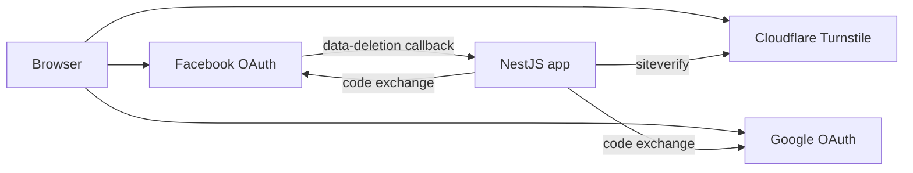
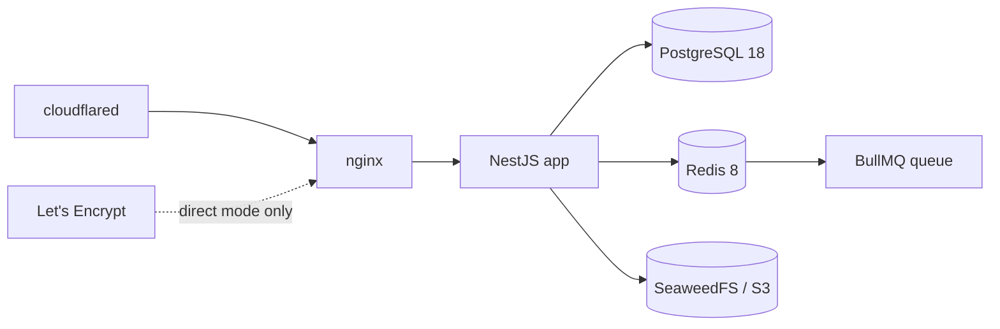
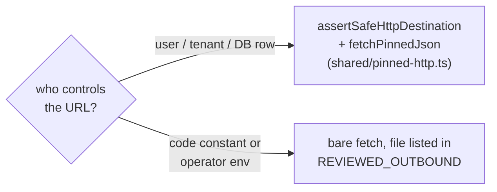
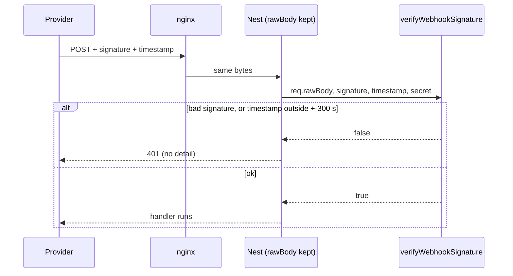

# Third-Party Services

What SchoolManager talks to outside its own containers, and what it deliberately
doesn't.

## Sign-up and sign-in services (Epic 13.0)

| Service              | What it is for                                                                                                                                                                                                                                                                                        | Env values                                                                                                                      |
| -------------------- | ----------------------------------------------------------------------------------------------------------------------------------------------------------------------------------------------------------------------------------------------------------------------------------------------------- | ------------------------------------------------------------------------------------------------------------------------------- |
| Cloudflare Turnstile | Captcha on the public `/register` form and the public admission form (`POST /public/admission/:slug/applicants`). The widget loads from `https://challenges.cloudflare.com` (allowed in the CSP, see [07-deployment.md](07-deployment.md)).                                                           | `TURNSTILE_SECRET_KEY` (server). `VITE_TURNSTILE_SITE_KEY` (build arg; no key means the widget is hidden). Set both or neither. |
| Mailpit              | Test inbox: catches every email, SMS and WhatsApp message on staging and demo. Self-hosted, non-prod only, no key. How to deploy it: [28-platform-runbook.md, part 10b](28-platform-runbook.md#10b-deploy-the-test-inbox-epic-87-staging-and-demo). See [05-communications.md](05-communications.md). | `MESSAGE_SINK=mailpit`, `MESSAGE_SINK_SMTP_URL`, `MESSAGE_SINK_PUBLIC_URL`. Never set on prod.                                  |
| Google sign-in       | "Continue with Google" at login and register, and "connect" on the security page.                                                                                                                                                                                                                     | `GOOGLE_OAUTH_CLIENT_ID`, `GOOGLE_OAUTH_CLIENT_SECRET`. A provider with no credentials is not listed.                           |
| Facebook sign-in     | "Continue with Facebook", same places as Google. PKCE; Graph API `GRAPH_VERSION` is pinned in `facebook.provider.ts`. Meta also calls our data-deletion callback (`POST /api/v1/auth/social/facebook/data-deletion`), which links to a public status page. See [34-onboarding.md](34-onboarding.md).  | `FACEBOOK_OAUTH_CLIENT_ID`, `FACEBOOK_OAUTH_CLIENT_SECRET`. Set the callback URL in the Meta app dashboard.                     |

## Self-hosted infrastructure

Runs as containers on the one VM, from `deploy/stack.yml` (one copy per
environment), `deploy/edge.yml` and `deploy/ops.yml` — not managed cloud
services, but still "third party" software the app depends on. Layout:
[07-deployment.md](07-deployment.md).

| Service                     | Image                                | Role                                                                                      |
| --------------------------- | ------------------------------------ | ----------------------------------------------------------------------------------------- |
| PostgreSQL                  | `postgres:18-alpine`                 | Primary database, all tenant data; one per environment, self-signed TLS (`DB_SSL=true`)   |
| Redis                       | `redis:8-alpine`                     | BullMQ queue backend + distributed rate-limit storage                                     |
| SeaweedFS                   | `chrislusf/seaweedfs`                | S3-compatible object storage — tenant uploads                                             |
| nginx                       | `nginx:1.31-alpine`                  | Reverse proxy at the edge; TLS only in direct mode                                        |
| cloudflared                 | `cloudflare/cloudflared`             | Tunnel mode: dials out to Cloudflare, so no public web port; checks Access tokens         |
| Let's Encrypt               | `certbot/certbot` (direct mode only) | Certificate for the public hostnames, HTTP-01, renewed by the `certbot` container         |
| Uptime Kuma, Beszel, Dozzle | `ops.yml`                            | Uptime and push monitors, host metrics, log viewer ([12-operations.md](12-operations.md)) |

Server libraries that talk to these (see
[`server/package.json`](../../server/package.json)):

- `pg` + `typeorm` + `@nestjs/typeorm` — Postgres, with TLS enforced in
  production via `DB_SSL=true` (see [`server/src/db-ssl.ts`](../../server/src/db-ssl.ts)).
- `ioredis` — Redis client.
- `bullmq` + `@nestjs/bullmq` — job queue, backs the communications module.
- `@nest-lab/throttler-storage-redis` + `@nestjs/throttler` — rate limiting
  state shared across app instances via Redis.
- `@aws-sdk/client-s3` — S3-compatible object storage client (`StorageService`,
  [`server/src/modules/storage`](../../server/src/modules/storage)), talking
  to the bundled SeaweedFS in dev/self-hosted Compose or a managed S3 bucket in
  production. See [13-backup-restore.md](13-backup-restore.md) for the
  backup/restore flow that also uses this bucket.

## External APIs called at runtime

All optional — every one no-ops or is simply unavailable if its env vars are
unset. None are required to boot the app.

| Provider                     | Host                   | Purpose                              | Config                                                                           |
| ---------------------------- | ---------------------- | ------------------------------------ | -------------------------------------------------------------------------------- |
| GreenWeb                     | `api.greenweb.com.bd`  | SMS (Bangladesh)                     | `GREENWEB_API_KEY`                                                               |
| MiM SMS                      | `api.mimsms.com`       | SMS (Bangladesh)                     | `MIMSMS_API_KEY`, `MIMSMS_SENDER_ID`                                             |
| Meta WhatsApp Business Cloud | `graph.facebook.com`   | WhatsApp messages                    | `WHATSAPP_ACCESS_TOKEN`, `WHATSAPP_PHONE_NUMBER_ID`                              |
| SMTP (any provider)          | operator-supplied host | Email, via `nodemailer`              | `SMTP_HOST`, `SMTP_PORT`, `SMTP_USER`, `SMTP_PASSWORD`, `SMTP_FROM`              |
| Sentry                       | `*.ingest.sentry.io`   | Frontend error tracking + Web Vitals | `SENTRY_DSN_WEB`, served at runtime (see [`07-deployment.md`](07-deployment.md)) |

`SMS_PROVIDER` selects `greenweb` or `mimsms`. All calls go through `undici`
directly — no vendor SDK is installed for any of these. See
[`05-communications.md`](05-communications.md) for how the communications
module dispatches to them.

**Per-tenant credentials.** A school can supply its own WhatsApp/SMS/email
credentials instead of the platform-wide ones above. Those are encrypted at
rest with AES-256-GCM (`SETTINGS_ENCRYPTION_KEY`), in
[`server/src/modules/schools/settings`](../../server/src/modules/schools/settings).

## Services the platform itself uses (not the app)

Called by the deploy, the timers and the containers around the app, never by
tenant code. All are fixed hosts or operator-owned.

| Service                               | Host                                     | Used by                                                                                            | Config                                                                                                |
| ------------------------------------- | ---------------------------------------- | -------------------------------------------------------------------------------------------------- | ----------------------------------------------------------------------------------------------------- |
| Cloudflare (DNS, Access, tunnel, WAF) | `*.cloudflare.com`                       | every request in tunnel mode; `cloudflared` keeps one outbound connection                          | `CLOUDFLARE_TUNNEL_*`, `CF_ACCESS_*` in `edge.enc.env`; [25-cloudflare.md](25-cloudflare.md)          |
| Cloudflare R2                         | `<acct>.r2.cloudflarestorage.com`        | hourly backup, files sync, log archive (prod, read-write); nightly restore drill (read-only token) | `BACKUP_S3_*`, `LOG_ARCHIVE_*`; [13-backup-restore.md](13-backup-restore.md)                          |
| Cloudflare Turnstile                  | `challenges.cloudflare.com`              | public forms (browser and server check)                                                            | `TURNSTILE_SITE_KEY`, `TURNSTILE_SECRET_KEY`                                                          |
| Let's Encrypt (direct mode only)      | `acme-v02.api.letsencrypt.org`           | `certbot`, HTTP-01 on port 80                                                                      | none read by the compose files today (`LETSENCRYPT_EMAIL` is listed in `edge.example.env` but unused) |
| GitHub Container Registry             | `ghcr.io`                                | every deploy pulls the images with a read-only token                                               | `GHCR_PULL_USER`, `GHCR_PULL_TOKEN` (`read:packages`) in `edge.enc.env`                               |
| GitHub (git over SSH)                 | `github.com`                             | `biddaloy-deploy` fetches the repo; Actions runs the Deploy workflow over SSH                      | the VM's repo deploy key; the `production` Environment secrets                                        |
| Telegram Bot API                      | `api.telegram.org`                       | one message per deploy result (fails open)                                                         | `TELEGRAM_BOT_TOKEN`, `TELEGRAM_CHAT_ID` in `edge.enc.env`                                            |
| Uptime Kuma push (self-hosted)        | `https://<KUMA_DOMAIN>/api/push/<token>` | backup and nightly jobs report ok / failed                                                         | `BACKUP_PUSH_URL`, `RESTORE_DRILL_PUSH_URL`, `DEMO_RESET_PUSH_URL`, `LOG_ARCHIVE_PUSH_URL`            |

Kuma's own Telegram and SMS notifiers are set in Kuma's UI, not in the repo.

## Outbound HTTP rule ([75.24])

A URL a user or tenant can influence must never reach a bare `fetch`.

`server/src/outbound-http.contract.spec.ts` fails CI on any new outbound
call (`fetch`, undici, axios, node `http(s)`, `web-push`, S3/SMTP/Sentry
clients) outside the helper and that list. It also fails on a stale entry.
The reviewed files and why each is safe:

| Host                                                       | Who controls it                                                     |
| ---------------------------------------------------------- | ------------------------------------------------------------------- |
| `graph.facebook.com` (WhatsApp, Messenger, Facebook login) | code constant; tenant ids pass `isValidGraphApiId`                  |
| Google OAuth token URL, `challenges.cloudflare.com`        | code constant                                                       |
| `calendar.google.com`, `date.nager.at`                     | code constant; path from a validated country code                   |
| MiM SMS balance URL                                        | code constant (sending uses the pinned helper)                      |
| `SENTRY_CRON_URL`, `SENTRY_DSN`, `S3_ENDPOINT`             | operator env                                                        |
| Web Push subscription endpoint                             | user-supplied, but the DTO allowlists push-service hosts over https |
| SMTP host                                                  | tenant-supplied, checked by `assertSafeSmtpDestination`             |

## Inbound webhooks (kit only)

No inbound webhook route exists yet. When one is added (bKash, SSLCommerz,
Stripe, SMS delivery reports), it verifies the request with
`verifyWebhookSignature` from `server/src/common/webhooks/webhook-signature.util.ts`.

Rules:

- Read `(req as RawBodyRequest<Request>).rawBody`. Never `JSON.stringify(body)`:
  re-serialising changes the spacing and key order, so the signature no longer matches.
  `main.ts` turns on Nest's `rawBody` option, and the 1 MB JSON limit still applies.
- The secret comes from an env var, one per provider.
- Signed text is `` `${timestamp}.${rawBody}` ``, HMAC-SHA256, lowercase hex, compared in constant time.
  A provider with another header format (Stripe's `t=...,v1=...`) maps it onto the same three inputs.
- Not built yet: a table of seen provider event ids (idempotency) and provider adapters.
  The first gateway ticket adds them.

Worked example (checked by `webhook-signature.util.spec.ts`):

| Input     | Value                                                              |
| --------- | ------------------------------------------------------------------ |
| secret    | `whsec_test`                                                       |
| timestamp | `1760000000`                                                       |
| body      | `{"event":"ping"}`                                                 |
| signature | `7b3dfb12b416238df73d3eb92d1702951e3ebe69a71967d039b03ccc93c8d291` |

## Dev / CI only

Not present in the running application — only used to build, test, and ship
it: GitHub Actions, CodeQL, Lighthouse CI (`@lhci/cli`), CodeRabbit,
Playwright, Storybook.

CodeRabbit only auto-reviews PRs into `main`, `develop`, `feature-*` and
`epic-*`, and it has a review limit. Stacked PRs (base `epic/97/accum-3`,
`claude/...-pr2`) and rate-limited PRs need someone to comment
`@coderabbitai full review`. `scripts/coderabbit-review-queue.sh` does that one
PR at a time: it waits for CodeRabbit's "Next included review available in N
minutes", and 60 minutes after the last review, before it asks again. Run it
with `--help` for the settings.

## Deliberately not used

Worth stating explicitly so nobody assumes one of these is wired up
somewhere:

- **No payment gateway for school fees.** No Nagad, SSLCommerz, or Stripe. Fee
  payments are recorded manually as `Payment` rows — see
  [`04-fees-payments-invoices.md`](04-fees-payments-invoices.md). The one
  exception is the platform's own seat billing, which takes **bKash** (Epic 49):
  [`38-billing.md`](38-billing.md).
- **Object storage is now wired up** (Epic 15.0/#521) — an S3-compatible
  bucket (SeaweedFS in dev) via `server/src/modules/storage/`, see
  [`13-backup-restore.md`](13-backup-restore.md). It backs uploaded assets
  (school logos) and backup archives. Excel exports still generate
  in-process with `exceljs`, unrelated to this.
- **No GCS or Cloudinary.** Object storage is SeaweedFS/S3-compatible only (see
  above).
- **No Twilio, no Firebase, no external auth/identity provider.** JWTs are
  issued in-house (`@nestjs/jwt`, `passport-jwt`, `bcrypt`).
