# Attendance

Attendance answers three questions: who was in class today, who gets a
low-attendance flag this month, and — for a future exam module — how much of
the year did a student actually attend.

## 1. What attendance is here

A **register** is one section, on one school day (or one period, if a school
marks period-by-period). Every student in that section gets one **mark**:
`PRESENT`, `ABSENT`, `LATE`, or `LEAVE`. A mark is never deleted — it's
corrected, and every correction leaves an audit trail a teacher or admin can
read later (["The correction rules"](#4-the-correction-rules) below).

## 2. Entities

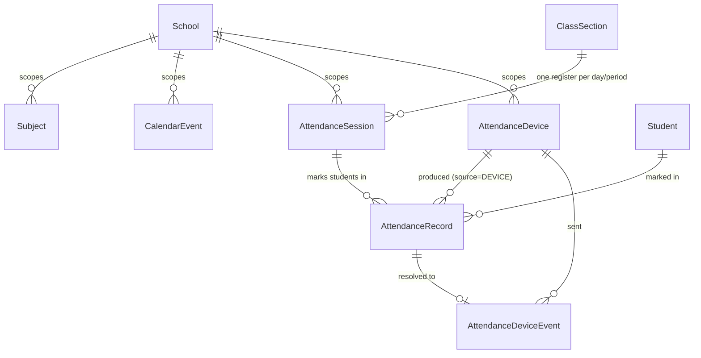

- **`AttendanceSession`** (`server/src/modules/attendance/entities/attendance-session.entity.ts`)
  — one register. Holds no marks itself; `version` (a TypeORM
  `@VersionColumn`) is what the offline-conflict dialog checks against.
- **`AttendanceRecord`** — one student's mark within one session.
  `source` (`TEACHER` / `DEVICE` / `IMPORT` / `SYSTEM`) says who produced it —
  see ["Teacher authority wins"](#7-integrating-a-device). Approved student
  leave ([24-applications.md](24-applications.md)) writes `LEAVE` with
  `source = SYSTEM` into the whole-day register (`period_no` NULL):

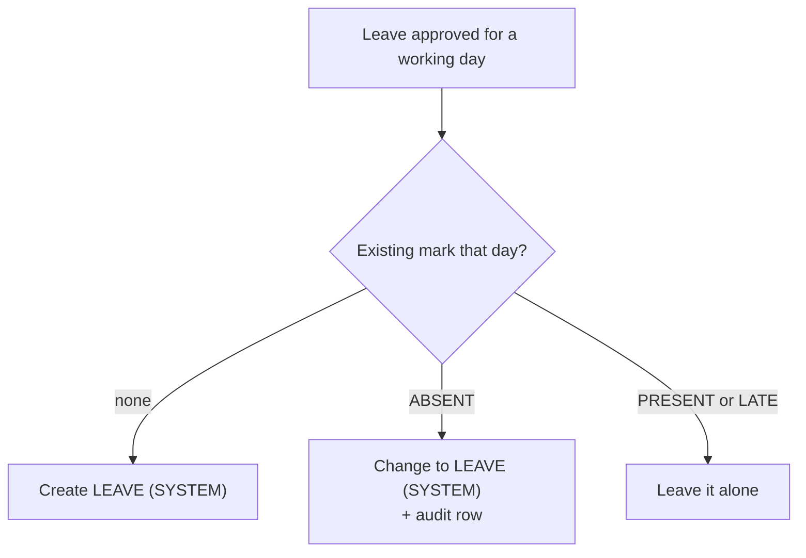

Cancelling the leave removes only **future** `SYSTEM` `LEAVE` marks. Past days
and teacher-marked rows stay.

- **`AttendanceDevice`** / **`AttendanceDeviceEvent`** — see
  ["Integrating a device"](#7-integrating-a-device).
- **`CalendarEvent`** (`modules/calendar`, [16-academic-calendar.md](16-academic-calendar.md)) — a
  calendar entry the working-day calculator reads. Renamed from
  `SchoolHoliday` in [17.1.2]. A `calendar` concern, not an attendance one;
  attendance only ever reads it, and only published (non-draft) events —
  a draft never counts toward working-day math or attendance.
- **`Subject`** (`modules/academics`) — only set on period registers
  (`AttendanceSession.subject_id`, copied from the routine when the register
  is first saved — see [§4a](#4a-period-attendance)).

See [01-domain-model.md](01-domain-model.md) for the full-schema diagram and
each entity's own docstring for column-level detail.

## 3. How a mark gets recorded

Four paths write the same tables, but not the same contract: teacher
writes (one day, or a whole month at once; online or replayed from the
offline queue) share the
`base_version`/`client_request_id` conflict contract; device ingest has
no `base_version` — it uses `device_event_id` idempotency, a per-event
outcome, and teacher precedence instead (see [§7](#7-integrating-a-device)).

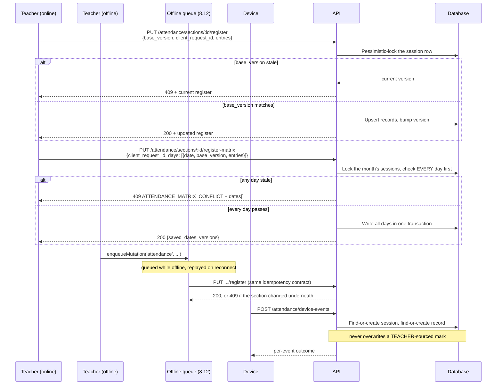

`client_request_id` is the offline-replay idempotency key: a re-sent write
that already succeeded returns the same 200 and writes nothing a second
time — the fix for the duplicate-write hole `ui/src/api/mutation-queue.ts`
used to document as unresolved (see
[06-frontend-architecture.md](06-frontend-architecture.md)).

### The teacher's check-list: `GET /attendance/my-sections`

Only sections of the current academic year (`is_current`) are listed, the same rule as My Class. Older registers are still reachable by direct link.

The landing screen asks one question per section: "has today's register been
started?" Each item carries what the screen needs, with no second call:

| Field                | Meaning                                                                             |
| -------------------- | ----------------------------------------------------------------------------------- |
| `class_id`           | The class (a holiday can be class-scoped, so the working-day check uses it).        |
| `class_teacher_name` | The section's `CLASS_TEACHER` only (not assistants or subject teachers), or `null`. |
| `is_working_day`     | `false` on a weekly-off day or a holiday for that class.                            |
| `today`              | `null` = **not started**; otherwise `state` (`DRAFT`/`FINALIZED`) and the counts.   |

Example, a Monday in the demo school (`yarn seed` creates exactly this):

```jsonc
[
  {
    "section_name": "A",
    "class_teacher_name": "Demo Teacher",
    "is_working_day": true,
    "today": null,
  },
  {
    "section_name": "B",
    "class_teacher_name": null,
    "is_working_day": true,
    "today": { "state": "DRAFT", "present": 2, "absent": 1, "late": 0, "leave": 0, "unmarked": 0 },
  },
]
```

Only the whole-day register counts here; a period register on the same date
never shows up in `today`. A future `date` is 422 `ATTENDANCE_FUTURE_DATE`
(the same rule as saving a register) unless the school has `allowFutureDates`
on.

### Saving a whole month: `PUT /attendance/sections/:id/register-matrix`

The monthly grid sends many days of one section in one request. It is
**all-or-nothing**: every day is checked first, and one bad day rejects the
whole save, so the grid never half-saves.

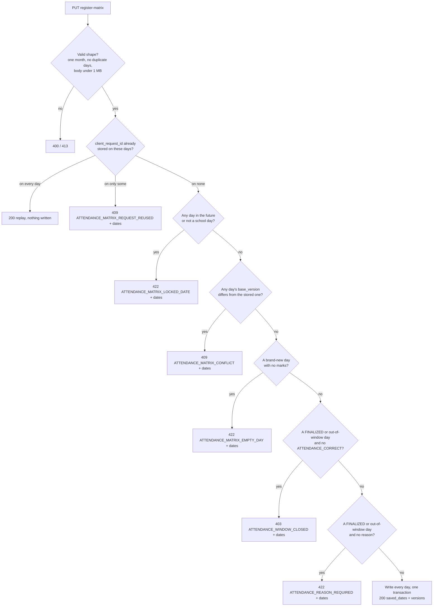

Things worth knowing:

- `base_version` is `null` for "I saw no register for this day" and a number
  (minimum 1) for an existing one. A mismatch is the 409.
- A **past day that has no register yet is born `FINALIZED`**; **today's stays
  `DRAFT`**. An existing register keeps its state. A new day must carry at
  least one mark, because a finalized empty day could only be fixed with
  `ATTENDANCE_CORRECT`.
- **Send only the days you changed.** Every day in the request is checked as
  a correction, even if its marks are the same. A `FINALIZED` or
  out-of-window day needs `ATTENDANCE_CORRECT` (else 403
  `ATTENDANCE_WINDOW_CLOSED`) and a `reason` (else 422
  `ATTENDANCE_REASON_REQUIRED`).
- `client_request_id` is one key for the whole request. A replay (the id is
  already on every day) returns 200 and writes nothing. If the id is on only
  some of the days, either it was already used for a different save or some
  of these days changed since (someone else saved them after your first
  try): 409 `ATTENDANCE_MATRIX_REQUEST_REUSED`, nothing written. The grid
  should treat it like `ATTENDANCE_MATRIX_CONFLICT` and reload the month.
- The grid sends a status only. A **new** `LATE` mark is saved with
  `minutes_late = NULL` (a mark that was already `LATE` keeps its minutes). A
  fine rule with `min_minutes_late` still counts a `NULL` (see
  [section 9](#9-attendance-fines)). **Open product question:** should a
  grid-entered `LATE` count toward a minimum-minutes rule? Kept as-is for now.
- It never touches period registers and never queues a guardian notification.
- JSON bodies are capped at 1 MB (`JSON_BODY_LIMIT`, `server/src/body-parser.ts`),
  which is far above a 31-day section grid.
- The reply's `versions` map (`{ "2026-09-04": 3, ... }`) is what the grid
  sends back as each day's next `base_version`. `GET .../register-matrix`
  returns the same `versions` map.

## 3a. The check-list and the month edit screens

### The pending check-list

"Pending" means: **a section with students, on a school day for its class,
whose register for the day is not `FINALIZED`**. That includes a section nobody
has touched ("Not started") and a `DRAFT` one (marks saved, not finalized).
Left out of the list and the count:

- a section with no students;
- a section whose **class** has no school that day (`is_working_day` is per
  class: an exam break, a class-level holiday). It cannot be marked, so it
  must not sit in "pending" all day.

When no class has school, the list shows "School is closed" and no count.

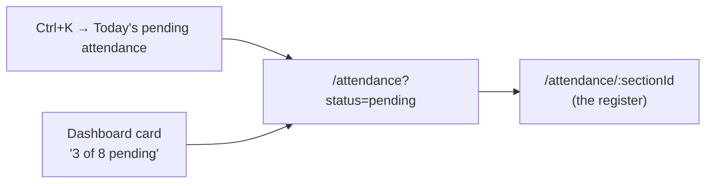

Both entry points show the **same number**, because both read
`GET /attendance/my-sections` (an admin sees every section, a teacher only
their own). Example: with 8 sections, 5 finalized and 1 draft, the header reads
"3 of 8 sections pending" and the filtered list has 3 rows.

### Editing a month from the grid

`/attendance/register?edit=true` turns the month register into an editable grid
(desktop only). The grid only remembers the cells you changed. Save sends
**only the changed days**, in one request.

**Who can save what.** Opening the grid needs `ATTENDANCE_MARK`. Saving a day
is a different question, answered per day by the server:

| The changed day                                                 | Needs                                              |
| --------------------------------------------------------------- | -------------------------------------------------- |
| has no register yet                                             | nothing extra (a past one is born `FINALIZED`)     |
| has a `DRAFT` register inside the correction window             | nothing extra                                      |
| has a register that is `FINALIZED` **or** older than the window | `ATTENDANCE_CORRECT` **and** a reason (3+ letters) |

So a teacher (`ATTENDANCE_MARK` only) can fill gaps and fix this week's drafts,
but gets `403 ATTENDANCE_WINDOW_CLOSED` for almost any older day, because
teachers finalize every day and back-filled days are born finalized.

**The reason field.** Whatever the user types (3+ letters) is always sent. It
is marked required up front only when the page can see it is needed: a changed
day that already has a register and is older than the window. (The window is
the tenant's own for `SETTINGS_MANAGE`, else the 2-day default.) A finalized
day inside the window looks the same as a draft in the matrix, so for that one
the server's 422 turns the field red.

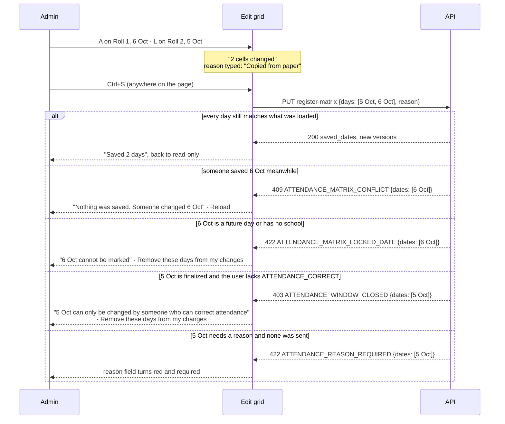

The save is all-or-nothing (see the API section above), so after any refusal
**no** day is written. Closing the "someone changed" (409) dialog any way (Esc,
outside click) also reloads the month, so a stale draft cannot fail the next
Save again. The "cannot be marked" and "only someone who can correct" dialogs
just close and keep the draft: only the listed days are the problem, so the
user removes those days or keeps editing. A reason of 1–2 letters is refused
even when none is required, rather than dropped from the save without a word.

Keyboard: arrows move, `P` / `A` / `L` / `E` set the status, `Space` flips
present/absent, `Home` / `End` jump to the first / last open day, `Esc`
cancels. `Ctrl+S` saves from anywhere on the page while editing, the reason
field included, but not while one of these dialogs is open. The palette reaches it with **Edit monthly register**.

## 3b. Uploading a sheet (Epic 76)

A teacher or admin-level user (anyone with `ATTENDANCE_MARK`; office staff do
not have it) can fill a day's marks in a spreadsheet instead of the grid. Three steps. Nothing is written until step 3.

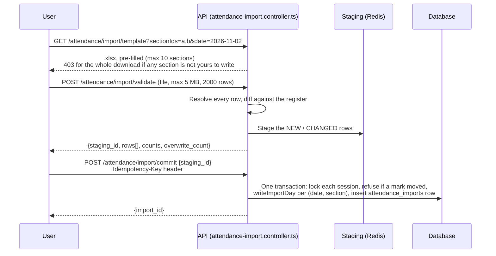

Rules that hold:

- **All or nothing.** One transaction; any failure leaves the register untouched.
- **Source is `IMPORT`, and a sheet never finalizes** a register.
- **Stale check.** If a teacher saved a mark after validate, commit answers
  `409` with `details.code = "ATTENDANCE_IMPORT_STALE"`. Upload again.
- **Nothing to save, nothing staged.** `staging_id` is `null` when every row is
  `UNCHANGED` or `ERROR`.
- **Same gate as the grid.** `dailySource` ([§4b](#4b-who-marks-the-day--dailysource-epic-76))
  applies; a section the caller may not write gives `NOT_ALLOWED_SECTION`.
- A teacher sees only their own uploads in `GET /attendance/imports`;
  other roles see all. `GET /attendance/imports/:id` returns the rows plus the
  record's `current` status.
- **The screen restarts on any 4xx at commit.** `410`/`404` shows "expired",
  `403` shows "not allowed", `STALE` shows the stale text, any other 4xx shows
  "failed" and the wizard goes back to the upload step. A `5xx` or a dropped
  connection keeps the review so the user can press Save again (safe, because
  of the `Idempotency-Key`).
- **A refused download shows its own sentence.** The `403` from the template
  route reads "You cannot fill in one of these sections on this day. Pick fewer
  sections or another date." (`attendanceImport:download.denied`).
- **Who column.** The list and detail pages show `You` for the caller's own
  upload and `A staff member` when the uploader's name is not on the row.

### Row-error codes

Source: `shared/src/types/attendance-import.types.ts`, set in
`attendance-import.service.ts` `resolveRows`.

| `code`                     | Outcome | Meaning                                                                    |
| -------------------------- | ------- | -------------------------------------------------------------------------- |
| `BAD_STATUS`               | ERROR   | Not `P`/`A`/`L`/`LV` (or `উ`/`অ`/`দে`/`ছু`).                               |
| `DUPLICATE_ROW`            | ERROR   | Same date, section and roll twice in one sheet.                            |
| `SECTION_NOT_FOUND`        | ERROR   | Section not in this school's current year, or two sections share the name. |
| `DATE_OUTSIDE_YEAR`        | ERROR   | Date is outside the section's academic year, or cannot be read.            |
| `NOT_ALLOWED_SECTION`      | ERROR   | Caller may not write that section's day register.                          |
| `NON_WORKING_DAY`          | ERROR   | Holiday or weekly off-day for that class.                                  |
| `FUTURE_DATE`              | ERROR   | Future date. Allowed only with `allowFutureDates` on and status `LV`.      |
| `ROLL_NOT_IN_SECTION`      | ERROR   | No student, or two students, with that roll.                               |
| `NEEDS_CORRECT_PERMISSION` | ERROR   | Register finalized or past the correction window; caller lacks it.         |
| `NAME_MISMATCH`            | warning | Name column differs from the roster. The row still saves (D6).             |

A blank status cell is `UNCHANGED`: the existing mark stays.

### What `attendance_imports` stores

One row per committed sheet (`entities/attendance-import.entity.ts`).
Tenant-scoped, no soft delete, not in the workbook backup. `rows` is jsonb,
one entry per sheet row, including the errors.
The demo seed writes one (`demo-seed/slices/attendance.ts`, `bmsc-primary`):

```jsonc
{
  "file_name": "class-attendance.xlsx",
  "count_new": 37,
  "count_changed": 2,
  "count_unchanged": 0,
  "count_error": 1,
  "supersedes_import_id": null, // set when a re-upload supersedes an earlier sheet; history link only, marks not in the new sheet keep their values
  "rows": [
    // CHANGED: the sheet overwrote a mark
    {
      "date": "<day>",
      "sectionId": "<uuid>",
      "roll": 1,
      "before": "PRESENT",
      "after": "ABSENT",
      "outcome": "CHANGED",
      "recordId": "<uuid>",
    },
    // ERROR: row kept for the history, nothing written
    {
      "date": "<day>",
      "sectionId": "<uuid>",
      "roll": 41,
      "before": null,
      "after": null,
      "outcome": "ERROR",
      "recordId": null,
      "code": "ROLL_NOT_IN_SECTION",
    },
  ],
}
```

Dates are relative to "today" in the seed (rule: no literal dates, see
[22-demo-seed.md](22-demo-seed.md)), so they are shown as `<day>` here.

## 4. The correction rules

| Situation                                                                 | Who                                                            | Requires                               |
| ------------------------------------------------------------------------- | -------------------------------------------------------------- | -------------------------------------- |
| Marking today's register for the first time                               | Any caller with section access                                 | Nothing extra                          |
| Editing a register inside the tenant's correction window (default 2 days) | Any caller with section access                                 | Nothing extra                          |
| Editing a register **outside** the window                                 | A caller holding `ATTENDANCE_CORRECT`                          | A reason (≥ 3 characters)              |
| Editing a **finalized** register                                          | A caller holding `ATTENDANCE_CORRECT`                          | A reason                               |
| Marking a **future** date                                                 | A caller with section access, only if `allowFutureDates` is on | Status must be `LEAVE` — nothing else  |
| Marking a date **outside the section's academic year**                    | Nobody                                                         | 422 `ATTENDANCE_OUTSIDE_ACADEMIC_YEAR` |
| Marking a non-working day (holiday/weekly-off)                            | A caller holding `ATTENDANCE_CORRECT`                          | `force_non_working_day: true`          |
| Saving several days from the monthly grid                                 | Same rules, per day                                            | One reason for the whole save          |

Every correction that touches an existing mark writes an `audit_logs` row
(`entity_type: 'AttendanceRecord'`, `old_values`, `new_values`, the reason)
— `GET /attendance/records/:id/history` renders it. No soft-delete column
exists on either attendance table; there is nothing to delete, only marks to
correct.

### Who is on a register (#2269)

The roster comes from `enrollments` for that section, not from the
student's current placement. Only students who are still there count:

| Enrollment status here | On the register, summaries and absence SMS? | Why                                 |
| ---------------------- | ------------------------------------------- | ----------------------------------- |
| `ACTIVE`               | Yes                                         | In the class (also after promotion) |
| `GRADUATED`            | Yes                                         | Finished that year in this section  |
| `INACTIVE`             | No                                          | Withdrawn or moved section          |
| `TRANSFERRED`          | No                                          | Left the school                     |

The exam cohort is different: it keeps every status (`excludeLeft` is off).

### Guardian SMS after a correction (#2262)

Once a register's absence notice went out, a corrected mark re-tells the
guardian only when the absent / not-absent answer changes from what they
were **last told** (the newest notice or correction that did not fail).

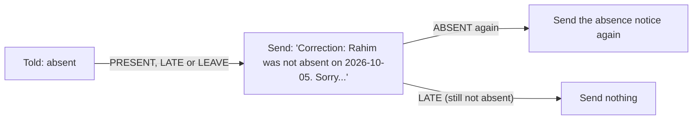

A notice that failed (no credit, no provider) counts as never told.

## 4a. Period attendance

Off by default. A school turns it on with `settings.attendance.periodAttendance.enabled`
([§8](#8-tenant-policy-settings)). While it is off, every period route refuses
with `403 ATTENDANCE_PERIOD_DISABLED`, and `GET .../periods` returns `[]`.

A **period register** is an ordinary register with two extra columns:

- `period_no` — the **period slot's sequence** in the shift (period 1, period 2 ...).
- `subject_id` — a **snapshot** of the routine's subject, copied when the
  register is first saved. Later routine edits never rewrite an old register.

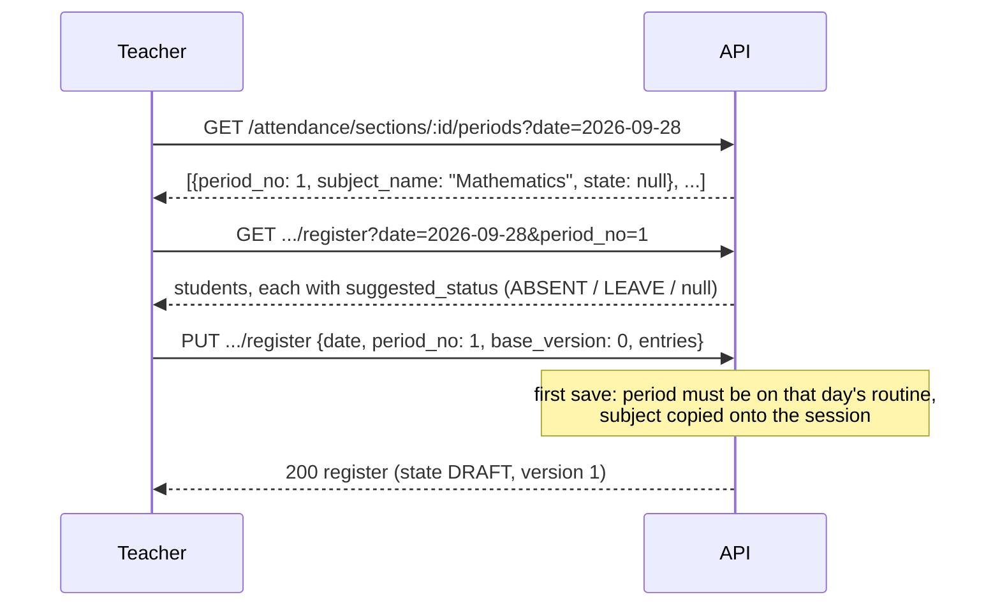

Rules:

- **Who may mark.** Anyone with section access. Beyond that, a teacher who is
  that date's **substitute** for a period may open and mark that one period of
  that one date: not the day register, another period, or another date.
  Everyone else gets the same 403 as a section they cannot see.
- **Which periods are listed.** The routine's slots for that date, cancelled
  ones removed. With section access you see all of them; as a substitute only
  your own.
- **Prefill.** An unsaved period register suggests `ABSENT` or `LEAVE` from
  that day's whole-day register (`suggested_status`), so a student on approved
  leave is suggested `LEAVE` in every period. It is read-only: nothing
  is stored until the teacher saves.
- **First save only is checked against the routine.** A new period register for
  a period the routine does not schedule is `400 ATTENDANCE_PERIOD_NOT_SCHEDULED`.
  An existing one is never re-checked, so a routine edit cannot lock a teacher
  out of their own draft.
- **What period marks never feed.** The monthly percentage, flags, fines and
  guardian SMS all read **whole-day registers only**. Period marks reach exactly
  one place: the subject-wise summary below.

### Subject-wise summary

`GET /attendance/sections/:id/subject-summary?from=&to=` answers "how often was
each student in Mathematics?". `held` is the number of period registers saved
for that subject in the range; each student's `by_subject[subject_id]` holds
`present` / `late` / `absent` / `leave` / `attended` / `percentage`.

```jsonc
{
  "subjects": [{ "subject_id": "…", "name": "Mathematics", "held": 2 }],
  "rows": [
    {
      "roll_number": 3,
      "full_name": "…",
      "by_subject": {
        "…": { "present": 1, "absent": 1, "late": 0, "leave": 0, "attended": 1, "percentage": 50 },
      },
    },
  ],
}
```

`percentage` is `null` (not 0) when the student has no mark for that subject.
It uses the school's `lateCountsAsPresent`. Denominator = `held`
(`WORKING_DAYS`) or the periods the student was marked in (`MARKED_DAYS`),
minus leave unless `leaveCountsAsWorkingDay`. A range over 400 days is refused
(`422 SCHOOL_CALENDAR_RANGE_TOO_WIDE`), and a switched-off school gets
`403 ATTENDANCE_PERIOD_DISABLED`.

### The period switcher and the subject-wise report

With the period switch on, the register screen shows a tab row above the
roster: **Whole day** plus one tab per period of that date's routine
(`Period 1 · Mathematics  8:00`). A period that already has a register carries
a badge, with the same words as the check-list: **Draft** or **Submitted**
(Submitted = `FINALIZED`). A substitute teacher sees only the tab of the period
they cover, no Whole day tab, and lands on the first period even from a link
without `?period=`. Pick a tab and the same roster now saves a period
register; if the day register has absentees, the roster opens with them
pre-marked and says so ("Students absent or on leave today are already filled
in").

`/attendance/reports` gets a **By subject** tab, shown when the switch is on.
**Known limitation:** the page reads the switch from the school settings, which
only `SETTINGS_MANAGE` (admins) may read. So today only admins ever see the tab;
a teacher's settings read is refused and the tab stays hidden. Tracked in
[#1686](https://github.com/tareq89/biddaloy/issues/1686).
One column per subject, headed `Mathematics (8)` where 8 is `held`. Each cell is
`attended/held`, with the percentage under it.

```text
Roll  Student   Mathematics (8)
 3    Rahim     7/8
                87.5 %
```

Worked example: 8 Mathematics periods were held this month. Rahim was `PRESENT`
in 6, `LATE` in 1 and `ABSENT` in 1. With `lateCountsAsPresent` on, he attended
6 + 1 = 7 of 8, so 7 / 8 = **87.5 %**.

## 4b. Who marks the day — `dailySource` (Epic 76)

`settings.attendance.dailySource` decides **who may write the whole-day
register**. It is a **write gate only** (D2): it never changes how a mark is
computed, only who may save one. Period registers ignore it.

| `dailySource`   | Who may write a section's day register                                               | `write_reason` when refused |
| --------------- | ------------------------------------------------------------------------------------ | --------------------------- |
| `ANY` (default) | Anyone with section access, as before Epic 76.                                       | never refused               |
| `CLASS_TEACHER` | The section's class teacher or assistant class teacher.                              | `CLASS_TEACHER_ONLY`        |
| `FIRST_PERIOD`  | Class teachers, plus whoever covers period 1 that date (a substitute replaces them). | `FIRST_PERIOD_ONLY`         |
| `DEVICE`        | Class teachers correct; devices and the sweep fill in. Others are refused.           | `DEVICE_SCHOOL`             |

Admin-level roles (tenant-wide access) always pass. The month grid
(`register-matrix`) refuses the first-period teacher (D31). Code:
`attendance-access.service.ts` `assertCanWriteDayRegister` (throws) and
`dayRegisterWriteState` (never throws, feeds the read view). The refusal is
`403` with `details: { reason }` and a message that names nobody (Rule 23).
`GET .../register-matrix` sends the same answer as `can_write` and `write_reason`, so
the month page hides **Edit** and says why instead of letting a save fail.

### A DEVICE school's day

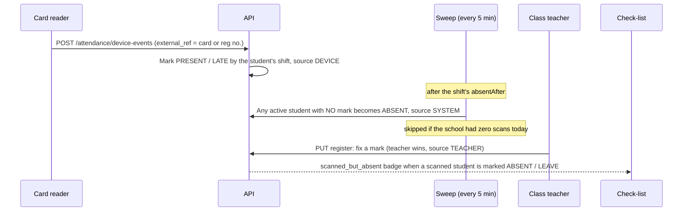

- The sweep (`device-absent-sweep.scheduler.ts`) is **insert-only**: it never
  touches an existing mark, leaves the register `DRAFT` for the teacher, and
  skips FINALIZED registers, non-working days and non-`DEVICE` schools.
  A dead machine (no scans at all) marks nobody absent. Redis down: the sweep
  does not run (D41).
- A scan that arrives after a teacher marked `ABSENT` / `LEAVE` keeps the
  teacher's status but stores `check_in_at`. That is what `scanned_at` and the
  mismatch badge show (D5).
- Alerts: in a `DEVICE` school the register stays `DRAFT`, so the "attendance
  not taken" alert stays open until every student has a mark, not until the
  register is submitted (table in [23-attention.md](23-attention.md), D28).

### The register read: `can_write` and `write_reason`

`GET /attendance/sections/:id/register?date=...` (shape: `RegisterResponseDto`).
A teacher who is not this section's class teacher, in a `CLASS_TEACHER` school:

```jsonc
{
  "section": { "id": "<uuid>", "section_name": "A", "class_name": "Class 8" },
  "session": {
    "id": "<uuid>",
    "date": "2026-11-02",
    "period_no": null,
    "state": "DRAFT",
    "version": 2,
    "marked_by_user_id": "<uuid>",
    "marked_at": "2026-11-02T02:30:00.000Z",
    "finalized_at": null,
  },
  "editable": true,
  "reason_required": false,
  "non_working_day": false,
  "policy": { "late_after": "08:15", "correction_window_days": 2, "allow_future_dates": false },
  "can_write": false,
  "write_reason": "CLASS_TEACHER_ONLY",
  "first_period_today": false,
  "period_attendance_enabled": false,
  "students": [
    {
      "student_id": "<uuid>",
      "roll_number": 1,
      "full_name": "…",
      "record_id": "<uuid>",
      "status": "ABSENT",
      "minutes_late": null,
      "remarks": null,
      "source": "TEACHER",
      "scanned_at": "2026-11-02T02:05:00.000Z",
      "suggested_status": null,
      "correction_count": 0,
    },
  ],
}
```

`can_write` is separate from `editable`: a finalized or old register can be
`can_write: true` and still refuse the save. A caller without
`ATTENDANCE_MARK`, or with no access to the section, gets `can_write: false`
with `write_reason: null`. `scanned_at` is set only when the scan contradicts
the mark (status `ABSENT` or `LEAVE`). The check-list counts these as
`scanned_but_absent` (`MySectionTodayDto`).

## 5. Working days and the percentage

`working_days` itself comes from `modules/calendar`'s
`SchoolCalendarService.getWorkingDays` — it walks the date range and
subtracts every published `CalendarEvent` with `counts_as_working_day =
false` (plus the weekly off-day). See
[16-academic-calendar.md](16-academic-calendar.md) for how that calendar is
built; this section only covers what attendance does with the number.

The formula, from `attendance-summary.service.ts`'s
`computeAttendancePercentage`:

```text
denominator = (percentageDenominator === 'MARKED_DAYS' ? marked_days : working_days)
              − (leaveCountsAsWorkingDay ? 0 : leave_days)
numerator   = present_days + (lateCountsAsPresent ? late_days : 0)
percentage  = round(numerator / denominator × 100, 2)   — or null if denominator ≤ 0
```

**Worked example** (the tenant's default policy: `lateCountsAsPresent: true`,
`leaveCountsAsWorkingDay: false`):

> September 2026 has 30 days. Fridays are the school's weekly off (4 of
> them). Eid holidays cover 3 more. So `working_days = 23`.
> Rahim was present 19 days, late 2, absent 1, on approved leave 1.
> `denominator = 23 − 1 = 22`, `numerator = 19 + 2 = 21`,
> `percentage = 21 / 22 × 100 = 95.45`.

This exact case (23 working days → 95.45%) is asserted in
`attendance-percentage.spec.ts`, so the doc cannot silently drift from the
code.

### Which holidays count for which student

A holiday counts for a student when it is **school-wide** (no class rows)
or **scoped to the student's class**. Summaries call `getWorkingDays` once
per class, never once per student.

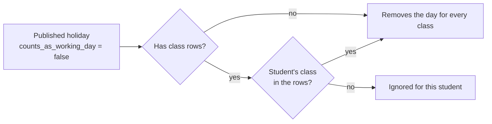

**Example.** A published holiday on 2026-09-10 is scoped to Class 9 only.
A Class 9 student has `working_days = 22` for September. A Class 11
student has `23`. The 95.45% case above is unchanged.

**Whole days only.** Percentage, the month matrix, low-attendance flags and
fines read whole-day registers only (`period_no IS NULL`). A period
register (see `periodAttendance` in section 8) never counts toward them.

**`null`, never `0`.** A student with zero working days in the requested
range (a brand-new enrollment, a range entirely on holidays) gets `null`,
not `0` — `0%` would read as "attended nothing," which is a different claim
than "there is nothing to measure yet." Every UI surface (the portal
summary card, the reports table) renders `null` as an em dash.

## 6. The exam-module contract

`AttendanceSummaryService`'s `AttendanceSummary` type is a frozen key set —
the contract a future exam module (or any other consumer) can depend on
without reading this module's internals:

```ts
interface AttendanceSummary {
  student_id: string;
  from: string;
  to: string;
  working_days: number;
  marked_days: number;
  present_days: number;
  late_days: number;
  absent_days: number;
  leave_days: number;
  unmarked_days: number;
  attendance_percentage: number | null;
  policy: {
    late_counts_as_present: boolean;
    leave_counts_as_working_day: boolean;
    denominator: 'WORKING_DAYS' | 'MARKED_DAYS';
  };
}
```

Adding a key is fine. Renaming or removing one is a breaking change that
needs a decision, not a silent edit —
`attendance-summary.contract.spec.ts` is what makes that deliberate: it
fails CI the moment the key set changes.

## 7. Integrating a device

A biometric fingerprint reader, a face-recognition camera, or an RFID card
turnstile can post attendance directly, without a human ever opening the app.
SchoolManager authenticates these devices with a long-lived key instead of the
usual login — there's no user to log in as, and no browser to hold a session.

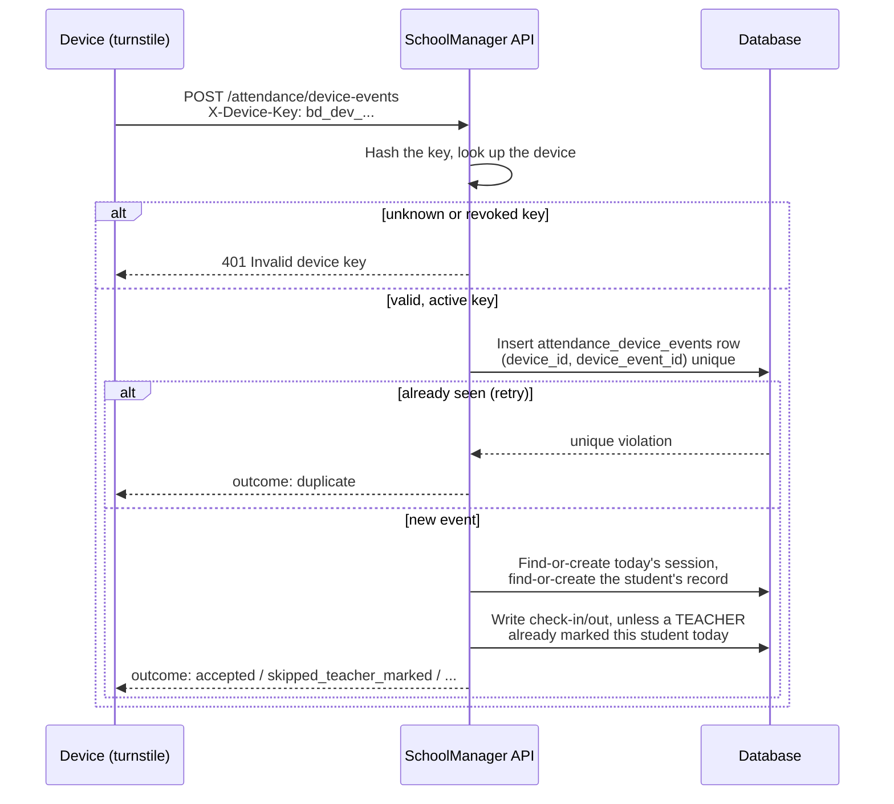

### The key lifecycle

1. An `ADMIN`/`EXECUTIVE` calls `POST /attendance/devices` (ordinary JWT
   auth). The response is the **only time** the raw key is ever shown:
   `{ "device": { "id": "...", "token_last4": "9f3a", ... }, "key": "bd_dev_..." }`.
2. The device stores that key and sends it as `X-Device-Key` on every
   request from then on. SchoolManager stores only a SHA-256 hash of it — even a
   database leak doesn't hand out working credentials.
3. If a key leaks, `POST /attendance/devices/:id/rotate` issues a new one
   immediately — the old key stops working the instant the call succeeds,
   no grace period.
4. `DELETE /attendance/devices/:id` revokes a device. This sets
   `status = REVOKED`; it never deletes the row, so the device's past scans
   still resolve to a named device in the history.

### A worked example

```bash
curl -X POST https://school.example.com/api/v1/attendance/device-events \
  -H 'X-Device-Key: bd_dev_9f3a...' \
  -H 'Content-Type: application/json' \
  -d '{
        "events": [
          {
            "device_event_id": "scan-88213",
            "occurred_at": "2026-09-04T02:12:00Z",
            "direction": "IN",
            "external_ref": "REG-2026-0042"
          }
        ]
      }'
```

Response — always `200`, even when individual events failed, since a batch is
not atomic (one bad scan must not fail the other 199):

```jsonc
{
  "results": [
    {
      "device_event_id": "scan-88213",
      "outcome": "accepted",
      "student_id": "...",
      "status": "LATE",
      "minutes_late": 12,
    },
  ],
  "accepted": 1,
  "duplicate": 0,
  "failed": 0,
}
```

### Outcomes

| `outcome`                | Meaning                                                                                                                                                                           |
| ------------------------ | --------------------------------------------------------------------------------------------------------------------------------------------------------------------------------- |
| `accepted`               | A new check-in/out was recorded.                                                                                                                                                  |
| `duplicate`              | This exact `device_event_id` was already processed — the device retried a batch it wasn't sure went through.                                                                      |
| `unknown_student`        | Neither `student_id` nor `external_ref` (registration number **or card number**) matched a student in this device's tenant.                                                       |
| `skipped_teacher_marked` | A teacher already marked this student today. The device may still fill a blank `check_in_at`, but the `status` a teacher set is never overwritten.                                |
| `out_of_window`          | `occurred_at` is more than 2 days from today — a scanner with a badly-set clock cannot rewrite attendance history.                                                                |
| `rejected`               | Everything else: an `OUT` scan with no matching `IN` (`reason: "no_check_in"`), or a section-bound device scanning a student from another section (`reason: "section_mismatch"`). |

### The card number (Epic 76)

A reader sends whatever the card carries in `external_ref`. The API looks it up
in **one query on both columns**: `students.registration_number OR students.card_no`
(`devices/device-events.service.ts`). If one student's registration number equals
another's card number, the registration number wins. A staff scan does the
same on `staff_profiles.employee_id OR staff_profiles.card_no`; the employee id
wins a tie.

- One card per person (D9). `card_no` is unique per school among live students
  (`UQ_students_tenant_card_no`, ends `AND "deleted_at" IS NULL`) and among
  staff (`UQ_staff_profiles_tenant_card_no`, no soft delete). A clash returns
  the fixed 409 from `known-errors.ts`, never the raw DB text.
- The register read shows `scanned_at` per student (see [§4b](#4b-who-marks-the-day--dailysource-epic-76)).
- The demo seed gives students a 10-digit number from `ctx.rng`
  ([22-demo-seed.md](22-demo-seed.md)).

### Late or on time? The student's own shift decides

A scan is judged against the late/absent times of the **student's own class
shift**, not the device's section. If `settings.attendance.shiftTimes` has an
entry for that shift, its `lateAfter` / `absentAfter` are used; a class with
no shift, or a shift with no entry, uses the school-wide pair
(`policyForShift`, `attendance-policy.util.ts`).

Example: the school pair is `08:15` / `10:00`, and the Day shift has
`{ lateAfter: "12:15", absentAfter: "14:00" }`. A Day-shift student scanning in
at 12:00 is `PRESENT`; a Morning-shift student at 12:00 is `ABSENT`.

### Teacher authority wins

A record with `source: "TEACHER"` is never overwritten by a device event —
a device may only fill in `check_in_at`/`check_out_at` if the teacher left
them blank. This is a deliberate contract for a future exam module, tested in
both directions: a device scan can never turn a teacher's `PRESENT` into
`ABSENT`, and a teacher's later correction can still override anything a
device wrote first.

A device's clock can be off — the ±2-day window above is the guard for
that — and `attendance_device_events` (the raw-scan forensic trail) grows
without bound; there is no retention job for it yet (see below).

## 8. Tenant policy settings

Every field lives under `School.settings.attendance`, resolved against
these defaults (`tenant-settings-defaults.ts`):

| Field                               | Default        | What visibly changes when you move it                                                                                                                               |
| ----------------------------------- | -------------- | ------------------------------------------------------------------------------------------------------------------------------------------------------------------- |
| `weeklyOffDays`                     | `[5]` (Friday) | Which weekdays never need marking and never count as a working day.                                                                                                 |
| `lateAfter`                         | `08:15`        | The check-in cutoff (local time) after which a mark becomes `LATE` instead of `PRESENT`.                                                                            |
| `absentAfter`                       | `10:00`        | The cutoff after which a mark becomes `ABSENT` instead of `LATE`.                                                                                                   |
| `correctionWindowDays`              | `2`            | How many days after a register's date it stays editable without `ATTENDANCE_CORRECT`.                                                                               |
| `lowAttendanceThresholdPercent`     | `75`           | The cutoff `GET /attendance/flags/low` and the reports page use to flag a student.                                                                                  |
| `lateCountsAsPresent`               | `true`         | Whether a `LATE` day adds to the percentage's numerator.                                                                                                            |
| `leaveCountsAsWorkingDay`           | `false`        | Whether a `LEAVE` day stays in the denominator (`false` = removed).                                                                                                 |
| `percentageDenominator`             | `WORKING_DAYS` | Whether the percentage divides by calendar working days or by days actually marked.                                                                                 |
| `allowFutureDates`                  | `false`        | Whether a future date can be marked at all (and then, only `LEAVE`).                                                                                                |
| `shiftTimes`                        | `[]`           | Per-shift `lateAfter` / `absentAfter` (`{ shiftId, lateAfter, absentAfter }`). A shift with an entry uses its own cutoffs; others use the two fields above.         |
| `periodAttendance.enabled`          | `false`        | Whether teachers can take a per-period register on top of the whole-day one. Period registers never feed the percentage or fines.                                   |
| `autoAbsentNotification.enabled`    | `false`        | Whether finalizing a register triggers guardian notifications for that day's absences.                                                                              |
| `autoAbsentNotification.cutoffTime` | `11:00`        | The local time after which the auto-absent sweep considers a register due.                                                                                          |
| `dailySource`                       | `ANY`          | Who may write the whole-day register: `ANY`, `CLASS_TEACHER`, `FIRST_PERIOD` or `DEVICE`. A write gate only. See [§4b](#4b-who-marks-the-day--dailysource-epic-76). |

`policyForShift(policy, shiftId)` (`attendance-policy.util.ts`) returns the
policy with that shift's cutoffs swapped in. No shift id, or no entry for
it, returns the policy unchanged.

**Saving is a shallow merge.** `PATCH` on settings merges `attendance` one
level deep: fields you omit (for example `shiftTimes` or
`periodAttendance`, which an older form never sends) keep their stored
value. Fields you send replace the stored value whole. So sending
`shiftTimes: []` clears every shift, and sending one entry removes the
others.

Example: an older settings form that knows nothing about shifts or period
registers sends the whole `attendance` object it knows, without those two keys.

```jsonc
// stored
{
  "attendance": {
    "weeklyOffDays": [5], "lateAfter": "08:15", "absentAfter": "10:00",
    "shiftTimes": [
      { "shiftId": "0b6f8a52-3c1e-4d7a-9f20-5e8c1a2b3c4d", "lateAfter": "07:45", "absentAfter": "09:30" }
    ],
    "periodAttendance": { "enabled": true }
  }
}

// PATCH /schools/:id/settings — every attendance field except shiftTimes and periodAttendance
{
  "version": 1,
  "attendance": {
    "weeklyOffDays": [5], "lateAfter": "08:30", "absentAfter": "10:00",
    "correctionWindowDays": 2, "lowAttendanceThresholdPercent": 75,
    "lateCountsAsPresent": true, "leaveCountsAsWorkingDay": false,
    "percentageDenominator": "WORKING_DAYS", "allowFutureDates": false,
    "autoAbsentNotification": { "enabled": false, "cutoffTime": "11:00" }
  }
}

// result: lateAfter is now "08:30"; shiftTimes and periodAttendance are unchanged
{
  "attendance": {
    "weeklyOffDays": [5], "lateAfter": "08:30", "absentAfter": "10:00",
    "correctionWindowDays": 2, "lowAttendanceThresholdPercent": 75,
    "lateCountsAsPresent": true, "leaveCountsAsWorkingDay": false,
    "percentageDenominator": "WORKING_DAYS", "allowFutureDates": false,
    "autoAbsentNotification": { "enabled": false, "cutoffTime": "11:00" },
    "shiftTimes": [
      { "shiftId": "0b6f8a52-3c1e-4d7a-9f20-5e8c1a2b3c4d", "lateAfter": "07:45", "absentAfter": "09:30" }
    ],
    "periodAttendance": { "enabled": true }
  }
}
```

`yarn seed` turns `periodAttendance.enabled` on for the demo school, but only
when it was never set: a hand-set value (even `false`) survives a re-run.

## 9. Attendance fines

`ABSENT` and `LATE` marks can trigger a fine, but the billing logic lives
outside this module. `FineSweepService` reads attendance the same way a
report does — it never writes a mark back. See
[04-fees-payments-invoices.md § Fines](04-fees-payments-invoices.md#fines)
for the full flow (rule setup, the monthly sweep, the resulting bill).

The two triggers it reads from this module:

- **`ATTENDANCE_ABSENT`** — counts `ABSENT` marks in the month.
- **`ATTENDANCE_LATE`** — counts `LATE` marks in the month; a rule can add
  `min_minutes_late` to only count a `LATE` mark once its `minutes_late`
  crosses that number (a `LATE` with `minutes_late` still `NULL` always
  counts — see D23 in 04's decisions table). The month grid always saves a
  new `LATE` with `NULL` minutes, so with such a rule every grid-entered
  `LATE` counts. Whether it should is an open product question.

## 10. Streaks

A **streak** is a student who has been absent, late or present for many
day-registers in a row. The My class screen (Epic 47.0) shows them as one
"Attendance flags" card, so a class teacher spots a problem early.

| Status    | Flagged at  |
| --------- | ----------- |
| `ABSENT`  | 3 in a row  |
| `LATE`    | 3 in a row  |
| `PRESENT` | 15 in a row |

The numbers are constants (`STREAK_THRESHOLDS` in
`server/src/modules/attendance/attendance-streaks.util.ts`), not tenant
settings. Make them settings when a school asks for different numbers.

The rule (47.0 D22):

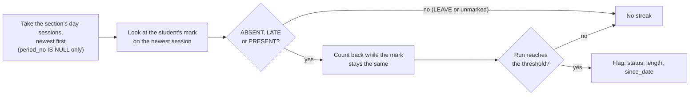

- Counting starts at the section's **latest** day-session, not today.
- Any other mark breaks the run. `LEAVE` breaks every run, and so does a
  missing record.
- Days with no session (holidays, weekends) are skipped. They do not break a
  run.
- Period-level sessions are ignored. Only whole-day registers count.

Example, newest day first:

| Student | Last marks (newest first) | Result                         |
| ------- | ------------------------- | ------------------------------ |
| Rina    | A, A, A, P                | flagged: `ABSENT`, length 3    |
| Sumon   | A, A, L                   | not flagged: the run is only 2 |
| Tania   | L, L, L, L                | flagged: `LATE`, length 4      |

Endpoint: `GET /attendance/sections/:sectionId/streaks`. It sits in the
attendance-summary controller, needs `ATTENDANCE_READ`, and is gated by
`AttendanceAccessService.assertCanAccessSection` (a teacher must belong to
the section). Response:

```json
{
  "as_of_date": "2026-10-03",
  "items": [
    {
      "student_id": "…",
      "student_name": "Rina Akter",
      "roll_number": 4,
      "status": "ABSENT",
      "length": 3,
      "since_date": "2026-10-01"
    }
  ]
}
```

`items` is sorted `ABSENT`, `LATE`, `PRESENT`, then longest run first, then
roll number. `as_of_date` is `null` when the section has no day-session yet.
The service loads at most the 15 newest sessions (the longest threshold).

## 10a. Arrival notices (Epic 84)

A guardian asks (or staff set it for them) to be told when their child is
marked in. One row per (student, guardian) in `arrival_notice_subscriptions`.

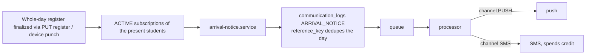

Example: Anika's guardian is `ACTIVE`, channel `PUSH`. The class teacher
finalizes 8-A at 08:20. One log
`arrival:2026-10-12:<anika>:<guardian>` is queued and a push says
"Anika is present today at 08:20 - Mrs Rahman". The gate reader says
"reached school ... Main Gate Reader" instead (D12).

### Data model

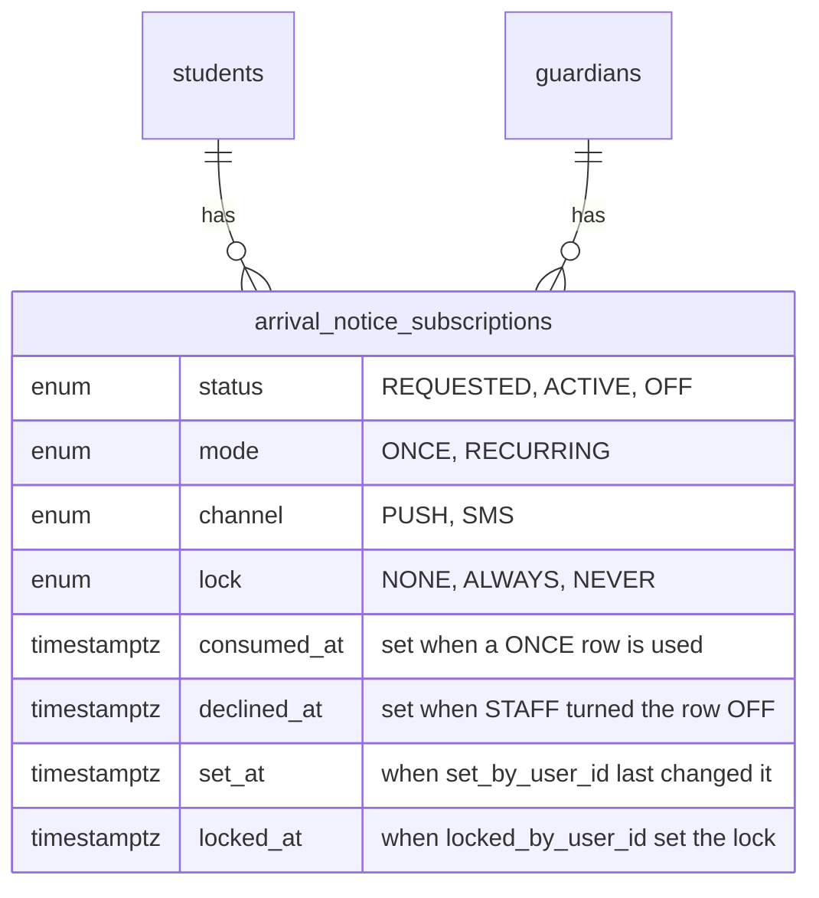

One row per (tenant, student, guardian): a unique index
(`UQ_arrival_notice_subscriptions_tenant_student_guardian`) refuses a second.
Deleting the student or guardian deletes the row. `guardian_id` has its own index.

The database refuses rows that break the lock rules (CHECKs, D35):

| CHECK                         | Meaning                                             |
| ----------------------------- | --------------------------------------------------- |
| `..._never_off`               | `NEVER` implies `status = OFF`                      |
| `..._always_active_recurring` | `ALWAYS` implies `ACTIVE` + `RECURRING`, unconsumed |
| `..._consumed_once`           | `consumed_at` only on a `ONCE` row                  |
| `..._declined_off`            | `declined_at` only on an `OFF` row                  |

| Column    | Values                       | Plain meaning                                                                     |
| --------- | ---------------------------- | --------------------------------------------------------------------------------- |
| `status`  | `REQUESTED`, `ACTIVE`, `OFF` | Asked and waiting for staff / sending / the guardian opted out                    |
| `mode`    | `ONCE`, `RECURRING`          | Tell me one time ("once") / every school day                                      |
| `channel` | `PUSH`, `SMS`                | In the app (free) / text message (spends SMS credit, needs the school switch)     |
| `lock`    | `NONE`, `ALWAYS`, `NEVER`    | Free choice / school forces it on (`ACTIVE` + `RECURRING`) / school forces it off |

### Who may do what

| Who                                        | Can do                                                                            | Route                                                                               |
| ------------------------------------------ | --------------------------------------------------------------------------------- | ----------------------------------------------------------------------------------- |
| Guardian (role `PARENT`) of the child      | Ask, or switch off, for their own linked children                                 | `GET /portal/arrival-subscriptions`, `PUT /portal/arrival-subscriptions/:studentId` |
| Class teacher (own section only)           | List, add, confirm or decline a row                                               | `/attendance/arrival-subscriptions`                                                 |
| `ADMIN` or `EXECUTIVE` (any section)       | The same, school-wide, from a student's Guardians tab                             | `/attendance/arrival-subscriptions`                                                 |
| Holder of `ATTENDANCE_ARRIVAL_NOTICE_LOCK` | Set a lock (`ALWAYS` or `NEVER`); `ADMIN` and `EXECUTIVE` (the principal) hold it | `PATCH /attendance/arrival-subscriptions/:id/lock`                                  |

A lock beats the guardian: under `NEVER` the guardian cannot ask, under
`ALWAYS` they cannot switch off or choose "once". `ALWAYS` rewrites the row to
`ACTIVE` + `RECURRING` (channel kept); `NEVER` rewrites it to `OFF`; setting
`NONE` leaves the row as it is.

### What the lists show

`GET /attendance/arrival-subscriptions` (staff) takes `sectionId`, `studentId`
(UUID), `status`, `limit` (max 100), `offset`. Each row adds:

| Field                         | Plain meaning                                                            |
| ----------------------------- | ------------------------------------------------------------------------ |
| `notifications_enabled`       | `false` = the guardian turned all notifications off; nothing is sent     |
| `set_by_name`, `set_at`       | Who last changed the row, and when (a guardian's own change counts)      |
| `locked_by_name`, `locked_at` | Who set the current lock, and when; both `null` while the lock is `NONE` |

Both lists carry `declined_at`. It is set when **staff** turn a row `OFF`
(decline a request or switch it off) and cleared on any later confirm or new
request. A guardian's own switch-off leaves it `null`, so the portal tells
"the teacher declined" (`status: OFF`, `declined_at` set) from "you switched
it off" (`declined_at: null`).

### The two wordings

| Who marked the child in          | Bangla (as sent)                                        | English                                                   |
| -------------------------------- | ------------------------------------------------------- | --------------------------------------------------------- |
| A teacher finalized the register | `আনিকা আজ সকাল ৮:২০-এ উপস্থিত — মিসেস রহমান।`           | `Anika is present today at 08:20 - Mrs Rahman.`           |
| A gate device read the card      | `আনিকা আজ সকাল ৮:২০-এ স্কুলে পৌঁছেছে — মেইন গেট রিডার।` | `Anika reached school today at 08:20 - Main Gate Reader.` |

The time is `formatArrivalTime` (`arrival-notice.service.ts`, D39): in Bangla a
day-part word (`সকাল` / `দুপুর` / `বিকাল`) then 12-hour `h:mm` with no leading
zero; in English 24-hour `HH:mm`, in the school's timezone.

The last part is the teacher's name (or "the office" / `অফিস`) or the device
name exactly as saved. Text always says "today", so a late upload of an old
punch, or finalizing an earlier day, sends nothing. Bangla text is kept to
two SMS segments.

### Rules that always hold

- One message per (student, guardian, day): the unique `reference_key`
  (`arrival:<date>:<student>:<guardian>`) decides, not a code check (D22). A
  gate punch in the morning blocks the later register message.
- `OFF` is never sent, even under an `ALWAYS` lock. `ONCE` flips to used
  (`consumed_at`) when its message is queued.
- `SMS` is sent only when the school has turned `arrivalNotice.smsAllowed`
  on, and the credit is reserved first. No credit means nothing is queued
  and a `ONCE` row stays unused.
- Only `PRESENT` and `LATE` students send.

### What a Redis outage does (D26)

It fails open. The register still saves; the notice is skipped, the skip is
logged, held SMS credit is released, and a `ONCE` row is not used up.
Nobody gets a half-sent message and the teacher sees no error.

### Known limits

- The school switch `arrivalNotice.enabled` gates the send hooks **and** every
  write route (`POST`, `PATCH :id`, `PATCH :id/lock`, `PUT /portal/...`): while
  it is off they answer `409 "Arrival notices are turned off at this school."`.
  The two `GET` routes still answer, so the portal can read `school.enabled`.
- Both switches default to off (`enabled: false`, `smsAllowed: false`). The
  e2e dev seed turns `enabled` on (app only, `ensureArrivalNoticeSetting`), so
  no Playwright spec ever switches it: specs run in parallel, and one spec
  turning it off would silence another spec's register.
- Saving Settings with notices off also saves `smsAllowed: false`, so SMS
  (which spends credit) never comes back on by itself.

Screens: the My class card (guardian requests, answer "once" or "every
school day"), the register bell, and the two switches in Settings >
Attendance policy. `Ctrl+K` "arrival" opens My class with the card in focus.
The processor side is in
[05-communications](05-communications.md#the-arrival-notice-branch-8413--d44).

## 11. What this epic deliberately did not build

- **A period check-list** — "Pending" ([§3a](#3a-the-check-list-and-the-month-edit-screens))
  looks at whole-day registers only; there is no "which periods are still
  unmarked today" list.
- **A portal / student-detail subject view** — the subject-wise report is a staff
  screen under `/attendance/reports`. Guardians and the student page do not
  show per-subject attendance.
- **Remind a teacher** — the check-list shows which sections are pending but
  has no "nudge the teacher" action.
- **Half-day and "excused" statuses** — only `PRESENT` / `ABSENT` / `LATE` /
  `LEAVE` exist. `LEAVE` is the only "not a plain absence" state.
- **Approval workflows for corrections** — a correction with a reason is
  immediate, not a request that waits on someone else's approval.
- **Class-level (not section-level) rollups** — every read endpoint is
  scoped to a section or a student, never "this whole class across all its
  sections."
- **CSV export** of registers, summaries, or the low-attendance list.
- **A device-management UI** — device create/rotate/revoke is API-only
  today (see [§7](#7-integrating-a-device)).
- **`attendance_device_events` retention** — every raw scan is kept
  forever; there is no job that prunes old ones (#489).

Left out by Epic 76 (#2429) on purpose, with the reason:

- **A different `dailySource` per class shift** (D1) — one value per school.
  A school that gates one shift only runs the gate for all.
- **A second card per person** (D9) — one `card_no` each.
- **Copying period-1 marks into the day register** (D3).
- **Undoing a whole upload** (D12) — a re-upload with `supersedes_import_id`
  overwrites; there is no revert.
- **Staff attendance sheet upload** — students only; same kit if a school asks.
- **API-level batch attendance writes** (Epic 93, #3276) — the sheet is the one
  bulk path; API/MCP/webhook batching is for that epic.
- **A Finalize action on the check-list** (D26, #1690).
- **Face or fingerprint template storage** — the machines keep their own.

One line each here so the next person who goes looking for one of these
knows it was a decision, not an oversight.

**Staff attendance is a separate model, not an extension of this one** —
no shared tables, no shared code, just the same status enum reused. See
[18-staff-attendance-leave.md](18-staff-attendance-leave.md).

## Learnings

- **2026-10-28 · Epic 84 W1 — a new tenant setting is three edits, not one.**
  Surprise: the ticket pointed at `attendance-policy.util.ts`, but that file only
  reads `settings.attendance`; the default lives in
  `schools/settings/tenant-settings-defaults.ts`, and a `PATCH /settings` body is
  rejected unless `AttendancePolicyDto` knows the key. Cost: a setting that
  resolved fine but could not be saved from the UI. Fix: default + DTO +
  regenerated `schema.d.ts` together. Rule candidate: a settings ticket lists the
  defaults file and the DTO, not the policy util.
- **2026-10-28 · Epic 84 W1 — migration prefixes collide across open epics.**
  Surprise: `1791900000500` was already taken by Epic 86/87 branches that had not
  merged. Cost: two migrations with one timestamp would order unpredictably.
  Fix: took the max prefix across `origin/main` and every open `epic/*` branch
  (`1791900000700`). Rule candidate: check all remote branches, not just `main`.
- **2026-10-28 · Epic 84 W2 — a new entity needs a demo-seed slice `covers` entry.**
  Surprise: `arrival_notice_subscriptions` was in neither a slice's `covers` nor
  `EXEMPT`, so the coverage spec's check (a) failed. Cost: a red W2 close for a
  table nobody had seeded. Fix: seed it in `slices/attendance.ts` and add the
  entity to that slice's `covers`. Rule candidate: a table ticket lists the slice
  file, not just the migration.
- **2026-10-28 · Epic 84 W2 — one write hook, one `Idempotency-Key` per attempt.**
  Surprise: the ticket said "clone students.ts", but the key-per-attempt pattern
  lives in `useIdempotencyKey` (see `reminders.ts`). Cost: a copied hook would
  have replayed an old key for a different body. Fix: `keyFor(body)` per mutation
  and `retry: false`. Rule candidate: new write hooks copy `reminders.ts`.
- **2026-10-29 · Epic 84 W3 close — a palette action can be stricter than its route.**
  Surprise: `arrival-notice.requests` needs `ATTENDANCE_ARRIVAL_NOTICE_MANAGE`
  but lands on `/my-class`, gated by `MY_CLASS_VIEW`; the registry test demands
  equal permissions. Cost: a red test for a correct design. Fix: keep the
  stricter permission, list the id in `ROUTE_PERMISSION_EXCEPTIONS`, add
  `alsoRequires` for the route gate. Rule candidate: a ticket that names a
  stricter permission also names the exception list.
- **2026-10-29 · Epic 84 W3 close — attendance records repeat a date per period.**
  Surprise: a student can have several `attendance_records` for one day
  (period sessions), so "last 10 present days" made duplicate `reference_key`s.
  Cost: a unique-index crash in the demo seed. Fix: `SELECT DISTINCT` the date.
  Rule candidate: day-level seed queries over `attendance_records` dedupe dates.
- **2026-10-29 · Epic 84 W4 close — a push notice has no screen to assert on.**
  Surprise: the plan had the guardian see the message in `/portal/notifications`,
  but a `PUSH` arrival notice goes to a browser push device and never to the alerts
  worklist; the e2e guardian has no device, so the log ends `FAILED`
  (`NO_PUSH_DEVICE`). Cost: the last leg of the journey could not be written as
  planned. Fix: assert the push row in `GET /communications/student/:id`. Rule
  candidate: a notification ticket names the screen that really renders it.
- **2026-10-29 · Epic 84 W4 close — specs written but never run hide wrong locators.**
  Surprise: `#my-class-arrival` is the card's `<h2>`, not the card, so the "answer a
  request" spec could never click anything, and the bell spec silently skipped
  because it used a teacher session under an admin login. Cost: two W3 specs were
  green only by skipping. Fix: locate by `getByRole('region', ...)`, and seed one
  ACTIVE row so the specs need no setup. Rule candidate: a spec ticket is not done
  until the spec has run once, with zero skips.
- **2026-10-29 · Epic 84 W4 close — a notice that fires once per day cannot be a shared fixture.**
  Surprise: the notice is sent only when today's register is finalized, and other
  attendance specs finalize the same Class 6 / A register. Cost: the journey cannot
  rerun on one database and may be pre-empted. Fix (review round 1): the journey
  builds its own section, child, guardian account (batch invite + first sign-in
  with a code) and class teacher, and hard-asserts the register is not finalized;
  the bell spec has its own section too. Rule candidate: give a once-per-day
  journey its own section.
- **2026-10-29 · Epic 84 PR 2 review — a skip is not a pass, and a shared switch is a race.**
  Surprise: the journey's two key legs skipped (green) whenever another spec had
  finalized Class 6 / A first, and three spec files changed the same seeded row and
  the school switch in parallel (`fullyParallel`, 4 workers). Cost: the end-to-end
  proof could stay unrun in CI with the suite green. Fix: own data per spec, the
  switch set once by the seed, settings restores merge only their own key. Rule
  candidate: a spec never writes a tenant switch another file depends on.
- **2026-11-06 · Epic 76 W1 close — partial unique index shape differs per table.**
  Surprise: `students` has soft delete, `staff_profiles` does not, so
  `UQ_students_tenant_card_no` ends `AND "deleted_at" IS NULL` and
  `UQ_staff_profiles_tenant_card_no` cannot. Cost: a staff card number stays
  taken after the person leaves; a new card must be issued. Fix: documented
  here, no workaround. Rule candidate: a partial unique index copies the
  table's own soft-delete column, and a table without one says so in the doc.
- **2026-11-06 · Epic 76 W1 close — a new column is a catalogue append.**
  Surprise: `card_no` on students and staff also needed
  `entity-coverage.ts`, the workbook tabs and their specs. Cost: the workbook
  round trip would have dropped the column silently. Fix: append the column to
  the catalogue and both tabs in the same ticket. Rule candidate: a column
  ticket lists `entity-coverage.ts` and the workbook tab.
- **2026-11-06 · Epic 76 W1 close — resolver fixup must not mutate shared defaults.**
  Surprise: the `dailySource` fallback wrote into the object `overlayOnDefaults`
  returned, which can be the shared `DEFAULT_ATTENDANCE_SETTINGS`. Cost: one
  bad stored value could change the default for every school in the process.
  Fix: `attendance = { ...attendance, dailySource }` plus a spec. Rule
  candidate: a resolver never assigns into an overlay result.
- **2026-11-06 · Epic 76 W1 close — new entity is `EXEMPT` until its seed slice lands.**
  Surprise: `AttendanceImport` has no demo-seed slice yet. Cost: the coverage
  guard would fail. Fix: entry in `demo-seed/slices.ts` `EXEMPT`, owed by #3556
  (W2 #3550 fills it). Rule candidate: the entity ticket adds the `EXEMPT` line
  with the owning ticket number.
- **2026-11-06 · Epic 76 W1 close — `ci:local` on Node 24 stops at the first red step.**
  Surprise: the server unit step failed on two specs W1 never touched:
  `sql-interpolation.contract.spec.ts` (unreviewed `${REPORT_DB_ROLE}` in
  `report-runner.service.ts`, same on `main`) and a 5 s timeout in
  `config-check.spec.ts` (passes alone). Cost: the later sections never ran.
  Fix: ran `frontend,landing,audit,infra` with `--only` (all green) and the
  migration-schema and restore integration specs alone (green); the unrelated
  reds are reported, not fixed here. Rule candidate: a close ticket runs the
  remaining sections with `--only` when an unrelated spec blocks the run.

- **2026-11-06 · Epic 76 W2 close — a new required response field breaks old test fixtures.**
  Surprise: `scanned_at` is required on `RegisterStudent` in the regenerated
  `schema.d.ts`, so `-correction-dialog.test.tsx` stopped type-checking (the
  `ci:local` verify step caught it, no lane did). Cost: one red verify run.
  Fix: fixture gets `scanned_at: null`. Rule candidate: a ticket that adds a
  response field greps the UI tests that build that type by hand.
- **2026-11-06 · Epic 76 W2 close — the `@Roles` narrowing check catches read routes too.**
  Surprise: `GET /attendance/imports` and `/imports/:id` use `@Roles` to keep
  parent/student out although they hold `ATTENDANCE_READ`; the permission
  matrix wanted a `ROLE_NARROWINGS` entry per route. Cost: two red matrix
  tests at close. Fix: two entries in `permission-matrix.e2e-spec.ts`. Rule
  candidate: a route ticket that adds `@Roles` also adds its `ROLE_NARROWINGS`
  entry.
- **2026-11-06 · Epic 76 W2 close — api-types regen reorders an unrelated enum.**
  Surprise: `required_document_types` / `type` unions changed order
  (`"PHOTO" | "BIRTH_CERTIFICATE"` swapped) with no source change. Cost: two
  noise lines in `schema.d.ts`. Fix: kept, since `check:api-types` compares
  against the generator. Rule candidate: none, generator order follows the
  enum declaration.
- **2026-11-06 · Epic 76 W6 close — the sheet commit must re-check the marks it validated against.**
  Surprise: validate and commit are two requests, so a teacher can save between
  them and a blind commit would overwrite that mark. Cost: a lost mark with no
  trace. Fix: commit locks each session and answers `409`
  `ATTENDANCE_IMPORT_STALE` if any staged mark moved (`assertMarksUnchanged`).
  Rule candidate: any validate-then-commit flow re-reads what it diffed against
  inside the commit transaction.
- **2026-11-06 · Epic 76 W6 close — `can_write` is not `editable`.**
  Surprise: the school gate (`dailySource`) and the register state (finalized,
  past the window) are two separate answers. Cost: a screen reading only
  `can_write: true` can still get `ATTENDANCE_FINALIZED` on save. Fix: the read
  returns both fields and the DTO says to check both (§4b). Rule candidate: a
  new permission-like flag on a read gets its own field, never folded into
  `editable`.
- **2026-11-06 · Epic 76 W6 close — an auto-absent sweep needs a "dead machine" guard.**
  Surprise: with no scans at all the sweep would mark the whole school absent.
  Cost: would have been a school-wide false absence, with SMS following.
  Fix: skip a school with zero device scans today; insert-only, never touch an
  existing mark. Rule candidate: a job that writes the absence of data first
  checks that the data source was alive.
