# Operations

> Written for whoever's on call at 2 a.m. Each section is short on purpose —
> if you need more detail than this, follow the link out to the code.

> Operator steps (day 0, first deploy, releases, alerts, restore) live in
> [28-platform-runbook.md](28-platform-runbook.md). This page keeps the thresholds and runbooks.

## 1. What is monitored

Four tools, each watching something different. The ops tools run as a second
Compose stack (`docker-compose.ops.yml`, started by `infra/ansible/ops.yml`)
and are reached behind Cloudflare Access: Dozzle at `https://ops.<domain>/dozzle/`,
Kuma and Beszel over an SSH tunnel for now (see "Known limits" below).

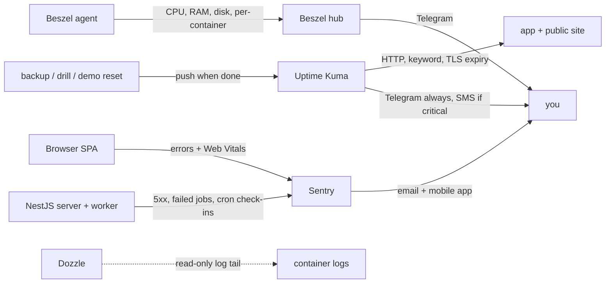

| Tool        | Watches                                             | Alerts to                                 |
| ----------- | --------------------------------------------------- | ----------------------------------------- |
| Sentry      | App errors, failed jobs, cron check-ins             | Email + Sentry mobile app                 |
| Uptime Kuma | Is it up, is it fast enough, did the cron jobs run  | Telegram; SMS for the three critical ones |
| Beszel      | The VM and each container: CPU, RAM, disk, restarts | Telegram                                  |
| Dozzle      | Nothing on its own. Live log tail, view-only (D23)  | Nothing (no alerts configured)            |

- **`GET /api/health`** — liveness. Cheap, no dependency checks. Never fails
  because Postgres or Redis is down.
- **`GET /api/health/ready`** — readiness. Checks Postgres, Redis, the
  communications queue, and the attention engine heartbeat. Only Postgres
  down is `fail` (503); Redis, the queue or a stale engine is `degraded` (200),
  so a Redis outage does not take the instance out of the load balancer.
  Token-protected (`X-Health-Token`) and blocked at nginx from outside, so only
  Kuma, inside the Docker network, can call it — see [§3.2](#32-readiness-failing).
- Sentry details: [`10-third-party-services.md`](10-third-party-services.md),
  `ui/src/api/sentry.ts`, and [§6](#6-what-gets-attached-and-what-gets-scrubbed).

### Uptime Kuma monitors

This table is the source of truth. Kuma keeps its config in its own database, so
if you add or change a monitor in the UI, change this table in the same PR.

| Name                 | Type           | Target                                                                                                                                                                     | Interval               | Notifies       |
| -------------------- | -------------- | -------------------------------------------------------------------------------------------------------------------------------------------------------------------------- | ---------------------- | -------------- |
| `app-internal-ready` | HTTP           | `http://prod-app:3000/api/health/ready` (alias on `biddaloy-ops-edge`), header `X-Health-Token`, accepted status 200-299 (no keyword: `degraded` is 200 and must not page) | 60 s                   | Telegram       |
| `app-public`         | HTTP           | `https://<app domain>/api/health`, retries 3                                                                                                                               | 60 s                   | Telegram + SMS |
| `login-page`         | HTTP + keyword | `https://<app domain>/login`                                                                                                                                               | 60 s                   | Telegram       |
| `demo-public`        | HTTP           | `https://<demo domain>/api/health`                                                                                                                                         | 60 s                   | Telegram       |
| `backup-hourly`      | Push           | `BACKUP_PUSH_URL=http://uptime-kuma:3001/api/push/<token>` (prod `.env`, step 5)                                                                                           | 3600 s, grace 900 s    | Telegram + SMS |
| `drill-weekly`       | Push           | `DRILL_PUSH_URL=http://uptime-kuma:3001/api/push/<token>` (prod `.env`, step 5)                                                                                            | 604800 s, grace 7200 s | Telegram + SMS |
| `demo-reset-nightly` | Push           | `DEMO_RESET_PUSH_URL=https://ops.<domain>/kuma/api/push/<token>` + Access service token (demo `.env`, step 5). Blocked: `/kuma/` does not load (limits below)              | 86400 s, grace 3600 s  | Telegram       |

TLS expiry is built into every HTTPS monitor above (warn at 14 days, Telegram).
`app-public` retrying 3 times at 60 s means the SMS arrives about 3 minutes
after the app goes down.

### Setting the tools up (by hand, once)

The ops tools keep their settings in their own databases, so none of this is
in the repo. Their one repo value is `BESZEL_KEY` (not a secret; key list in
`infra/secrets/ops.example.env`). `OPS_DOMAIN` is not an ops value: prod nginx
reads it from the **prod** `.env` (`infra/secrets/prod.example.env`).

The order is the safety. Kuma and Beszel make the first visitor of their setup
page the admin, and Dozzle has no login, so nothing may answer on `ops.<domain>`
before Cloudflare Access does:

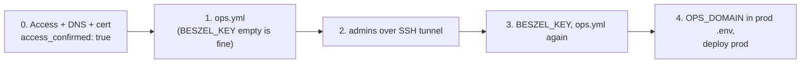

0. **Cloudflare Access first.** Follow [25-cloudflare.md, Ops](25-cloudflare.md#ops-opsdomain):
   Access application, then the proxied DNS record, then the `302` check. The
   Origin CA certificate must cover `ops.<domain>` (wildcard or an extra name),
   or "Full (strict)" fails. Then set `access_confirmed: true` in
   `infra/ansible/inventory/prod.yml`. Until it is `true`, a prod deploy refuses
   a `prod.enc.env` that sets `OPS_DOMAIN` (or `STAGING_DOMAIN`).
1. **Start the stack.** Nothing is exposed yet: the UIs bind loopback only, and
   prod nginx answers `ops.invalid` until `OPS_DOMAIN` is set.
   ```bash
   sops infra/secrets/ops.enc.env           # BESZEL_KEY= stays empty for now
   ansible-playbook -i infra/ansible/inventory infra/ansible/ops.yml
   ```
   The `beszel-agent` container restarts until step 3; the hub, Kuma and Dozzle run.
2. **Admins, over an SSH tunnel** (no public exposure at all):
   ```bash
   ssh -L 8090:127.0.0.1:8090 -L 3001:127.0.0.1:3001 deploy@<host>
   # Beszel: http://localhost:8090   Kuma: http://localhost:3001
   ```
   Create both admins now.
3. **Beszel agent.** In Beszel, "Add system": host `/beszel_socket/beszel.sock` (the agent's
   unix socket, `deploy/edge.yml`; the port field is ignored).
   Copy the public key it shows into `BESZEL_KEY` (`sops infra/secrets/ops.enc.env`),
   then run `ops.yml` again (the whole playbook: `--tags env` would only write
   the file). Alerts: add a Shoutrrr Telegram URL in the hub settings;
   thresholds are in [§2](#2-alert-thresholds).
4. **Expose Dozzle.** Put `OPS_DOMAIN=ops.<domain>` in `prod.enc.env`, commit,
   and deploy prod at that new commit (secrets come from the checkout). Check `https://ops.<domain>/dozzle/` asks for the Access login first.
5. **Uptime Kuma monitors.** Add the monitors from the table above. Create the
   push monitors first. Kuma shows each push URL as `http://localhost:3001/...`
   (the tunnel); do **not** paste that, it points at the pushing container itself.
   Keep only the token and use the URL each pusher can reach:

   | Variable              | `.env` | URL to paste                                 | How it reaches Kuma                                                                                                                                                                                                                   |
   | --------------------- | ------ | -------------------------------------------- | ------------------------------------------------------------------------------------------------------------------------------------------------------------------------------------------------------------------------------------- |
   | `BACKUP_PUSH_URL`     | prod   | `http://uptime-kuma:3001/api/push/<token>`   | the `backup` container sits on `biddaloy-ops-edge` (`tasks/attach-edge.yml`)                                                                                                                                                          |
   | `DRILL_PUSH_URL`      | prod   | `http://uptime-kuma:3001/api/push/<token>`   | same container                                                                                                                                                                                                                        |
   | `DEMO_RESET_PUSH_URL` | demo   | `https://ops.<domain>/kuma/api/push/<token>` | other host: through Cloudflare Access with a service token, `DEMO_RESET_PUSH_ACCESS_CLIENT_ID` / `_SECRET` ([25-cloudflare.md, Ops](25-cloudflare.md#ops-opsdomain)). Blocked until Kuma has its own hostname: `/kuma/` does not load |

   `scripts/demo/reset.sh` pushes up on a good reset and down on a failed one.
   Every pusher logs `Kuma push got HTTP <code>, not 2xx` when a push does not
   land (a `302` is Access's login page, `000` is no connection). Check the log
   once after setup:
   `docker compose -p biddaloy-prod logs backup | grep 'Kuma push'` prints nothing.

6. **Notifications.** Telegram notifier (bot + private group), default-on for
   every monitor. SMS notifier: Kuma "Webhook" with a custom body, pointed at the
   SMS gateway's HTTP API (URL shape:
   `server/src/modules/communications/providers/sms/*.gateway.ts`), attached only
   to `app-public`, `backup-hourly` and `drill-weekly`.
7. **Dozzle** needs nothing else: view-only, no alerts.
8. **Sentry rules** are listed in [§2](#2-alert-thresholds).

Known limits:

- **`/kuma/` and `/beszel/` will not work.** Uptime Kuma 1.x has no base-path
  support (upstream issue louislam/uptime-kuma#147): its page asks for
  `/assets/*` and `/socket.io/` from the root, which this origin answers with 404. Beszel is not built for a sub-path either. The two `location` blocks in
  `nginx/templates/ops.conf.template` stay only until the owner decides the
  layout. The documented path is one hostname each (`kuma.<domain>`,
  `beszel.<domain>`, each with its own Access application and server block);
  until that change lands, use the SSH tunnel from step 2.
- Dozzle and the Beszel agent mount `docker.sock` read-only. That limits the
  mount, not the Docker API: treat access to them as root on the VM (hence
  Cloudflare Access).
- The ops UIs share a network only with prod nginx and the prod app
  (`biddaloy-ops-edge`, drawn in [07-deployment.md, Staging](07-deployment.md#staging)),
  never prod's own network, so they cannot reach prod's Postgres or Redis.

## 2. Alert thresholds

Where each alert is set up. Kuma monitors and intervals: the table in [§1](#uptime-kuma-monitors).

| Signal                               | Threshold                                                                                                                                                                        | Where to configure                                     |
| ------------------------------------ | -------------------------------------------------------------------------------------------------------------------------------------------------------------------------------- | ------------------------------------------------------ |
| App down                             | `app-public` fails 3 times in a row (~3 min)                                                                                                                                     | Uptime Kuma monitor, Telegram + SMS                    |
| Readiness failing (Postgres down)    | `app-internal-ready` fails for > 2 min                                                                                                                                           | Uptime Kuma monitor                                    |
| Engine stale reported by readiness   | Covered by the attention cron check-in below                                                                                                                                     | Sentry Cron Monitor (readiness stays 200 when stale)   |
| Backup / drill / demo reset missed   | No push inside interval + grace                                                                                                                                                  | Uptime Kuma push monitors                              |
| TLS certificate close to expiry      | < 14 days                                                                                                                                                                        | Uptime Kuma, built into HTTPS monitors                 |
| CPU                                  | > 90% for 15 min                                                                                                                                                                 | Beszel hub, system `biddaloy-prod`, Telegram           |
| Memory                               | > 90% for 10 min                                                                                                                                                                 | Beszel hub, Telegram                                   |
| Disk                                 | > 80%, immediate                                                                                                                                                                 | Beszel hub, Telegram                                   |
| Host down (agent unreachable)        | Immediate (Beszel "Status"). Fires when the agent stops, not when the whole VM dies: that only misses Sentry cron check-ins                                                      | Beszel hub, Telegram                                   |
| Container down                       | Immediate, for `app`, `db`, `redis`, `seaweedfs`, `nginx`, `backup` (prod). UNVERIFIED, [28 Known gaps](28-platform-runbook.md#known-gaps) #7; the demo needs its own agent (#6) | Beszel hub, per container, Telegram                    |
| Postgres connections                 | More than 80% of `max_connections=300`, i.e. count > 240. Does not work as built, [28 Known gaps](28-platform-runbook.md#known-gaps) #5                                          | Uptime Kuma Postgres monitor, read-only `monitor` role |
| 5xx rate                             | > 1% of requests over 5 min                                                                                                                                                      | Sentry alert rule on the server project                |
| `communications job stalled` message | any occurrence                                                                                                                                                                   | Sentry alert rule (issue alert, not metric)            |
| Attention cron check-in missed       | > 15 min                                                                                                                                                                         | Sentry Cron Monitor (5-min schedule, 15-min margin)    |
| Other cron check-ins                 | `SENTRY_CRON_MONITOR_URL`, `SENTRY_CRONS_URL`                                                                                                                                    | Sentry Cron Monitors                                   |

## 3. Runbooks

### 3.1 5xx spike

1. Open the Sentry issue — it carries `route`, `tenant_id`, `request_id`,
   `http_status` tags (never the request body/headers).
2. Cross-reference the production log by `request_id` — one JSON line per
   request, see [§4](#4-env-var-reference) for `LOG_LEVEL`.
3. If it's one tenant: check that tenant's recent config changes (schools
   settings) before assuming a code bug.
4. If it's every tenant: check the last deploy and Postgres/Redis health
   (`/health/ready`) first — a bad deploy or a dependency outage looks like
   "everything 500s at once."

### 3.2 Readiness failing

`/health/ready`'s body names exactly which dependency failed —
`{ "status": "fail", "checks": { "db": "ok", "redis": "fail", "queue": "ok" } }`
— never a hostname or error message (that would leak infra details to
anything that can reach the token-gated route).

1. **`db: fail`** — check the `db` container/instance is up and accepting
   connections; check `DATABASE_URL` hasn't rotated.
2. **`redis: fail`** — status is `degraded` (HTTP 200), not `fail`. Check the
   `redis` container/instance and `REDIS_URL`. BullMQ (the communications
   queue) and the rate limiter depend on it; see "When Redis is down" in
   [`08-security.md`](08-security.md). The uptime monitor will not page for
   this: the platform alert covers a Redis outage, see [§3.6](#36-platform-alert-redis-down).
3. **`queue: fail`** — Redis is reachable but the queue itself can't be
   read; check for a BullMQ version mismatch or a stuck connection pool.

Each probe is bounded to 2 seconds — a slow dependency fails fast rather
than hanging the whole check.

### 3.3 Failed / stalled communication jobs

A communication (SMS/WhatsApp/email) job that exhausts its retries, or
stalls, sends a Sentry event tagged `queue`, `job_name`, `tenant_id`,
`communication_log_id`, `medium` — never the recipient address or message
body.

1. Take `communication_log_id` from the Sentry tag.
2. Look up that row: `SELECT * FROM communication_log WHERE id = '<id>'` —
   `metadata.error` has the provider's failure reason.
3. **Retry**: re-queue the same log id through the normal reminder/resend
   flow (see [`05-communications.md`](05-communications.md)) — don't hand-edit
   the row's status, that bypasses the batch-outcome accounting.
4. **Mark failed and move on**: leave the row as `FAILED`; nothing further
   happens automatically — a stuck `PROCESSING` row past its worker's lock
   window is what "stalled" means, and BullMQ already retries it once on
   your behalf before this alert fires.

### 3.4 Attention engine stale or slow

The engine writes a heartbeat after every sweep. "Stale" means the FAST heartbeat
is missing, older than 15 minutes, or every school failed. Users then see old
alerts (`GET /attention/summary` reports `staleMinutes`). Nothing else breaks.

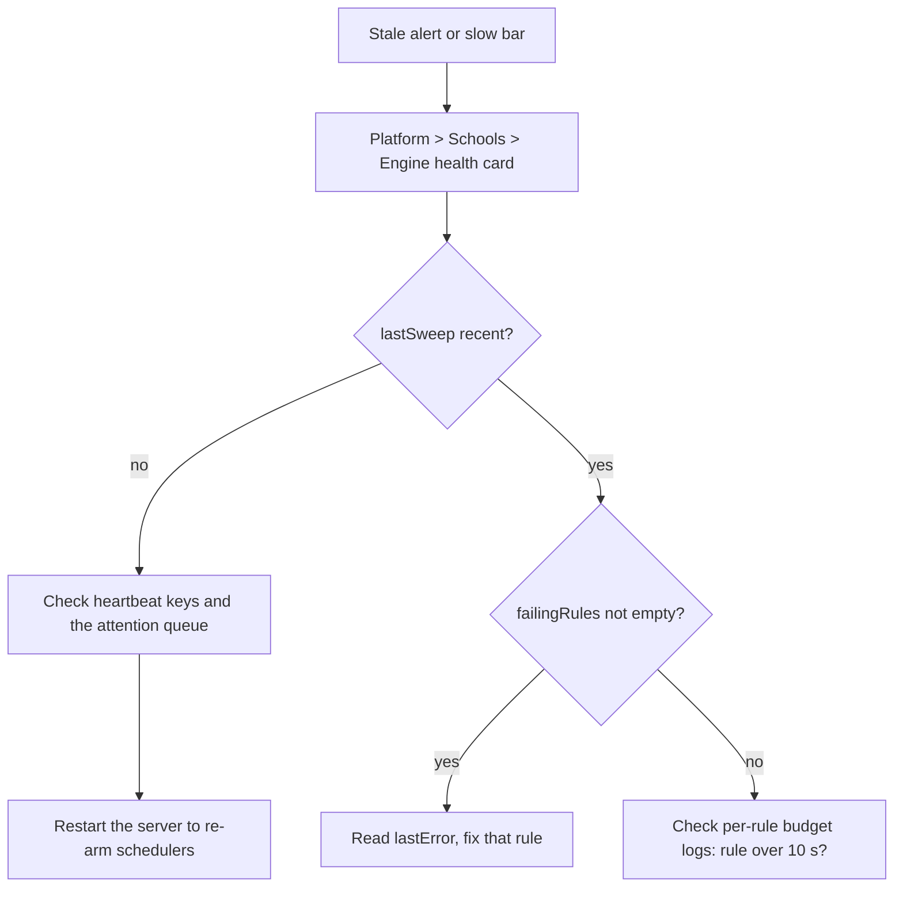

1. **Heartbeat.** In Redis: `GET attention:heartbeat:FAST` (also `HOURLY`, `DAILY`).
   Example: `{"at":"2026-10-10T08:15:02Z","durationMs":412,"tenants":3,"failures":0}`.
   An old `at` means no sweep has finished.
2. **Queue.** BullMQ queue `attention` (sweeps) and `attention-delivery`
   (delayed pushes). Look for a paused queue, a dead worker, or a pile of
   waiting jobs.
3. **Failing rules.** `GET /platform/attention/health` (SUPER_ADMIN), or the card.
   `failingRules[].lastError` is the first 200 characters of the error. Keys
   live in Redis as `attention:failing:<rule>` for 24 hours.
4. **Slow rules.** Search the server log for `Rule <key> failed for tenant ...:
rule budget exceeded`. A rule gets 10 seconds, then is skipped for that
   school; other rules still run. Sweep time is also logged:
   `Attention FAST sweep: 3 tenants in 412ms`.
5. **Re-arm.** Schedulers are registered at boot with `upsertJobScheduler`, so
   a restart of the server re-creates them. No manual step beyond that.
6. **Alerts look wrong but the engine is fine?** The summary is cached for 60
   seconds; a snoozed item wakes on the next FAST sweep.

Measured sweep and summary timings: [23-attention.md](23-attention.md#performance).

### 3.5 Cloudflare IP ranges changed

Behind Cloudflare, every request reaches nginx from a Cloudflare edge address.
`TRUSTED_PROXY_CIDRS` lists those addresses. When the TCP peer is in the list,
nginx takes the visitor IP from `CF-Connecting-IP`. Anyone else sending that
header is ignored, so nobody can fake their IP.

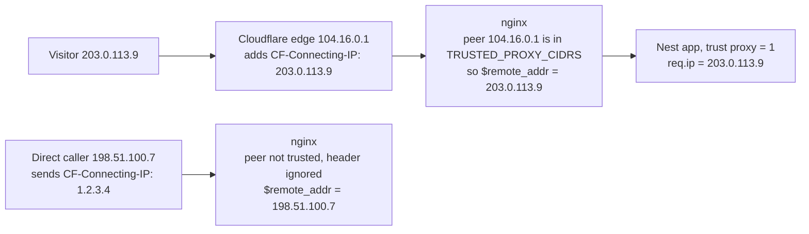

Cloudflare publishes new ranges now and then. To refresh:

1. Fetch `https://www.cloudflare.com/ips-v4/` and `https://www.cloudflare.com/ips-v6/`.
2. Put all lines, space separated, in `TRUSTED_PROXY_CIDRS` in `.env`
   (example list in `.env.example`).
3. Check: `docker compose run --rm nginx nginx -t`. A bad entry fails with
   `trusted-proxies.sh: invalid entry '<x>'`.
4. Apply: `docker compose up -d nginx`. That recreates nginx, which drops its
   edge networks (staging and ops answer 502), so then run, from `infra/ansible`
   on your laptop, `ansible-playbook deploy.yml -e env=prod -e version=<running sha> --tags edge`.

Check the lists again whenever the quarterly checklist ([75.31]) says so.

After enabling the list, confirm the app logs show real client IPs, not a
Docker bridge gateway (`172.x`). If they show the gateway, the host uses
Docker's userland proxy, which hides the source IP: do not enable the origin
lock-down on that host. Loopback is the only always-allowed range; private
ranges are not exempt.

Rollback: set `TRUSTED_PROXY_CIDRS=` (empty) and `docker compose up -d nginx`,
then the same `--tags edge` run. Empty means no CDN trust at all, which is how
the stack behaved before. Empty `OPS_DOMAIN` and `STAGING_DOMAIN` with it: a
prod deploy refuses them without the list ([25-cloudflare.md, Access policies](25-cloudflare.md#access-policies)).

### 3.6 Platform alert: Redis down

Redis down means sign-in is closed (75.18), but `/health/ready` is only `degraded`, so an uptime
monitor does not page. The API raises its own alert, kept in Postgres so it works with Redis gone.

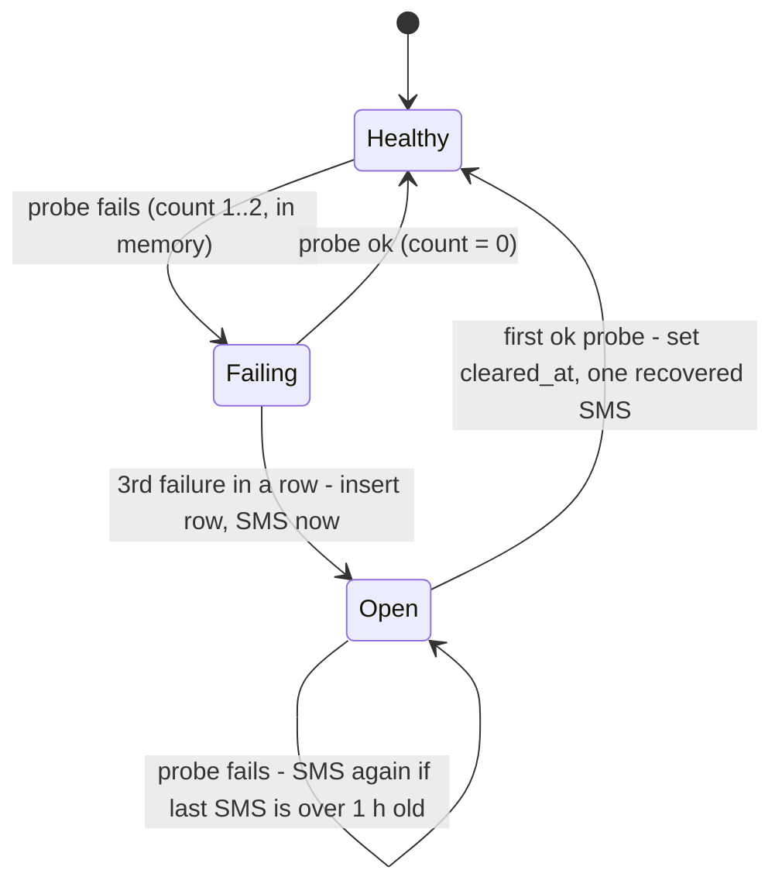

Order of events (a probe runs every 30 s, so about 90 s after Redis dies):

1. A `platform_alerts` row `REDIS_DOWN` opens (at most one open row, enforced by a unique index).
2. Every verified phone of a platform SUPER_ADMIN (a SUPER_ADMIN of the platform tenant) gets a
   text, then another every hour. With no platform tenant (production without `PLATFORM_TENANT_ID`)
   only `PLATFORM_ALERT_PHONES` is texted, never a school's SUPER_ADMIN:
   `[production] ALERT: Redis is down since 08:02 UTC. Sign-in is closed. Repeats hourly until fixed.`
3. `GET /api/v1/platform/alerts` (platform SUPER_ADMIN only; a school's SUPER_ADMIN gets 403) returns the open row for the banner (75.35).
4. The first good probe clears the row and sends one text:
   `[production] RECOVERED: Redis is back at 08:40 UTC after 38 min. Sign-in is open again.`

Limit: a platform SUPER_ADMIN who is already signed in keeps seeing the banner for the whole
outage, because `POST /auth/refresh` keeps working without Redis (refresh tokens are DB rows). One
who is _not_ signed in cannot sign in to see it, since sign-in answers 503. The SMS is their channel.

Limit: with several API instances in a partial partition (one reaches Redis, another does not), the
alert re-opens and closes about every 2 minutes, so ALERT and RECOVERED texts repeat.

**Confirm recovery:** `GET /api/v1/platform/alerts` returns `{ "alerts": [] }` and `/health/ready`
shows `"redis": "ok"`.

The loop runs in the API process only (not in scripts, not under `NODE_ENV=test`), uses no BullMQ,
and sends SMS straight to the provider with the platform's own key, not a school's credits. With no
`PLATFORM_SMS_API_KEY` it logs `platform alert SMS not configured; would text N phone(s): ...`.

### 3.7 Demo reset failed (Sentry cron alert)

**What the alert means.** The demo site's Sentry cron monitor (`SENTRY_CRONS_URL`) got `status=error`, or no check-in
at all. Either way, tonight's rebuild did not finish. The demo is **not down**: until the swap, yesterday's database
keeps serving. Sentry alerts when a night has no `ok` check-in.

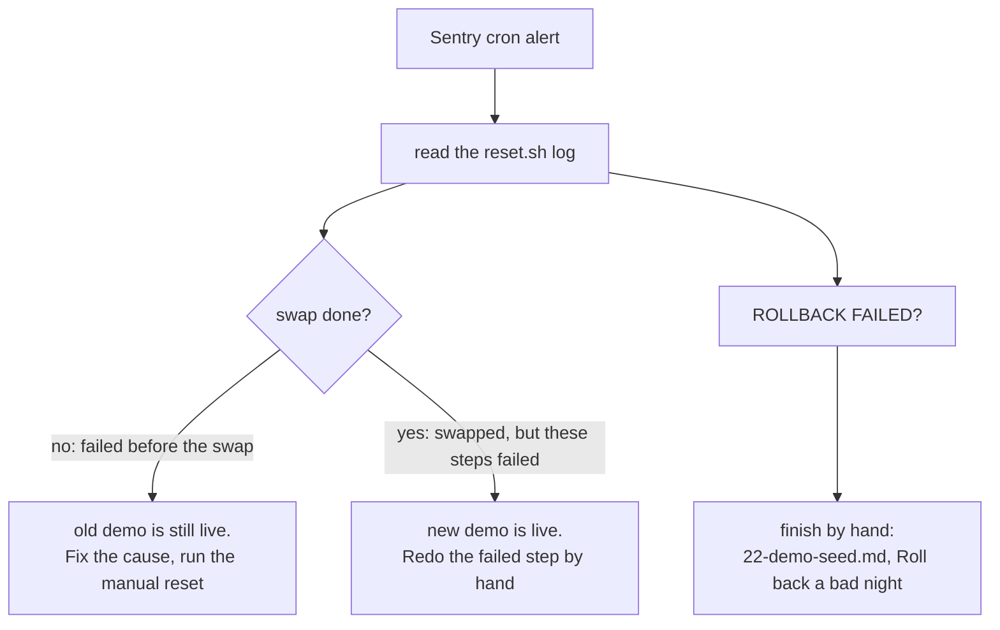

**See the log.** Cron runs `reset.sh` inside `demo-reset`, so the log is the container log:

```bash
docker compose -f docker-compose.yml -f docker-compose.demo.yml logs --since 24h demo-reset | grep reset.sh
```

Lines to look for: `validator found violations`, `sweep failed (exit N)`, `rolled back:`, `ROLLBACK FAILED`,
`swapped, but these steps failed: ...`, `another reset is running`.

**Manual reset** (same script as the nightly run; `--now` skips the wait for 02:00):

```bash
docker compose -f docker-compose.yml -f docker-compose.demo.yml run --rm demo-reset /app/reset.sh --now
```

**Roll back to yesterday** (`biddaloy_demo_prev`): follow "Roll back a bad night" in
[22-demo-seed.md](22-demo-seed.md#roll-back-a-bad-night). It stops `demo-reset` and `app`, renames the databases back,
rewrites the id file, flushes Redis and starts again.

**Two traps.** `PlatformAlertsService` texts operators straight through the SMS gateway, so `DEMO_MODE` does not silence
it: leave `PLATFORM_SMS_API_KEY` and `PLATFORM_ALERT_PHONES` unset on the demo host. The boot guard runs after the BullMQ
workers start, so a non-demo school row stops the process a moment after it begins.

### 3.8 Validate the student_fees money CHECKs (#2662)

`CHK_sf_paid_plus_discount` and `CHK_sf_waived_settled` were added `NOT VALID`. New and changed rows are
already checked. Old rows are not, until someone validates. Do it once per environment, after the audit.

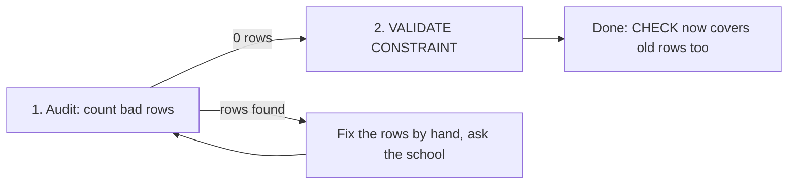

```sql
-- 1. Audit. Both must return 0.
SELECT count(*) FROM student_fees WHERE paid_amount + discount_amount > total_amount;
SELECT count(*) FROM student_fees
 WHERE status = 'WAIVED' AND paid_amount + discount_amount <> total_amount;

-- 2. Validate. Takes only a SHARE UPDATE EXCLUSIVE lock: reads and writes continue.
ALTER TABLE student_fees VALIDATE CONSTRAINT "CHK_sf_paid_plus_discount";
ALTER TABLE student_fees VALIDATE CONSTRAINT "CHK_sf_waived_settled";
```

A restored old backup can hit these CHECKs on insert. Audit the backup the same way before restoring.

## 4. Env var reference

| Variable                    | Required in prod?      | What it does                                                                       |
| --------------------------- | ---------------------- | ---------------------------------------------------------------------------------- |
| `SENTRY_DSN`                | No (recommended)       | Server Sentry project. Unset = server Sentry is a no-op.                           |
| `SENTRY_ENVIRONMENT`        | No                     | Defaults to `NODE_ENV`.                                                            |
| `SENTRY_RELEASE`            | No                     | Tags events with a release/version string.                                         |
| `SENTRY_TRACES_SAMPLE_RATE` | No                     | Fraction of requests traced, default `0.1`.                                        |
| `HEALTH_TOKEN`              | No (recommended)       | Required to call `/health/ready` at all — unset means that route 404s.             |
| `LOG_LEVEL`                 | No                     | Pino's log level; see `.env.example`.                                              |
| `ATTENTION_SENTRY_CRON_URL` | No (recommended)       | Sentry Cron Monitor check-in URL for attention sweeps; unset = no check-ins.       |
| `TRUSTED_PROXY_CIDRS`       | No (only behind a CDN) | nginx only. CDN ranges whose `CF-Connecting-IP` is trusted; empty = off (§3.5).    |
| `PLATFORM_SMS_PROVIDER`     | No (for alert SMS)     | `greenweb` (default) or `mimsms`. Provider for platform alert texts (§3.6).        |
| `PLATFORM_SMS_API_KEY`      | No (recommended)       | Unset = alert SMS is only logged, never sent.                                      |
| `PLATFORM_SMS_SENDER_ID`    | With `mimsms`          | Sender id for MimSMS.                                                              |
| `PLATFORM_SMS_API_URL`      | No                     | Overrides the provider's send URL.                                                 |
| `PLATFORM_ALERT_PHONES`     | No                     | Comma-separated fallback phones, used only when no SUPER_ADMIN has a verified one. |

Smoke-check variables (read by `scripts/smoke-post-deploy.mjs`, see §7). They
are **operator machine only, never in the app's env**:

| Variable                                         | What it does                                                                           |
| ------------------------------------------------ | -------------------------------------------------------------------------------------- |
| `SMOKE_BASE_URL`                                 | Base URL when `--base-url` is not passed.                                              |
| `SMOKE_ADMIN_EMAIL` / `SMOKE_ADMIN_PASSWORD`     | Login for the ADMIN smoke account.                                                     |
| `SMOKE_TEACHER_EMAIL` / `SMOKE_TEACHER_PASSWORD` | Login for the TEACHER smoke account.                                                   |
| `SMOKE_SUPER_ADMIN_EMAIL` / `_PASSWORD`          | Login for the SUPER_ADMIN smoke account.                                               |
| `SMOKE_PAID_STUDENT_FEE_ID`                      | Optional. An already-paid student fee id; adds the `#2592` checkout 409 row.           |
| `SMOKE_OPEN_STUDENT_FEE_ID`                      | Optional. An outstanding student fee id; adds the `#2636` over-balance 400 row.        |
| `SMOKE_PARENT_EMAIL` / `SMOKE_PARENT_PASSWORD`   | Optional. A PARENT smoke account; adds the `#2639` step-up 403 row.                    |
| `SMOKE_HEALTH_TOKEN`                             | Optional. Adds a `/api/health/ready` check (internal URL only; nginx 404s it outside). |

## 5. Web push (VAPID keys)

Web push (browser/OS notifications — see
[`05-communications.md`](05-communications.md#push-first-dispatch-for-routine-automated-notifications-555))
needs a **VAPID** keypair. VAPID (Voluntary Application Server
Identification) is just a signature: it proves to the browser vendor's
push service (Chrome's, Firefox's, etc.) that notifications came from
_this_ server, not an impersonator.

### Generating and storing keys

```bash
node scripts/generate-vapid-keys.mjs
```

prints a public/private keypair. Three env vars, all required together
(`PushConfigService.isPushEnabled()` — push silently no-ops if any is
missing, it never crashes boot):

| Variable            | Where it goes     | Notes                                                                                               |
| ------------------- | ----------------- | --------------------------------------------------------------------------------------------------- |
| `VAPID_PUBLIC_KEY`  | Host env (server) | Also handed to the client SW to subscribe.                                                          |
| `VAPID_PRIVATE_KEY` | **Host env only** | **Never commit it. Never log it.** Anyone with this key can send push notifications as this server. |
| `VAPID_SUBJECT`     | Host env (server) | A `mailto:` address or `https:` URL identifying this deployment — not generated, set it yourself.   |

### Rotation cost

Rotating the keypair is not free — state this plainly to anyone about to
do it:

- A new keypair makes existing subscriptions incompatible with it.
  Browsers reject push messages signed by a key they didn't subscribe
  with.
- A send to an old subscription may be rejected for invalid VAPID
  authentication. `PushService.sendToUser` only prunes the row on a
  404/410 from the browser's push service (a truly dead subscription,
  same cleanup path as a guardian who uninstalled the PWA) — other
  rejections just increment `failure_count` and the row stays.
- Clients do not silently re-subscribe. A guardian must run the
  subscribe flow again (toggling push on in the portal) to create a
  subscription bound to the new `VAPID_PUBLIC_KEY`.
- **Net effect**: after rotating, every guardian falls back to their
  normal channel (SMS/WhatsApp/email) for routine notices until they
  explicitly re-subscribe. Rotate only when you have to (e.g. key
  compromise) — not as routine hygiene.

### Send flow

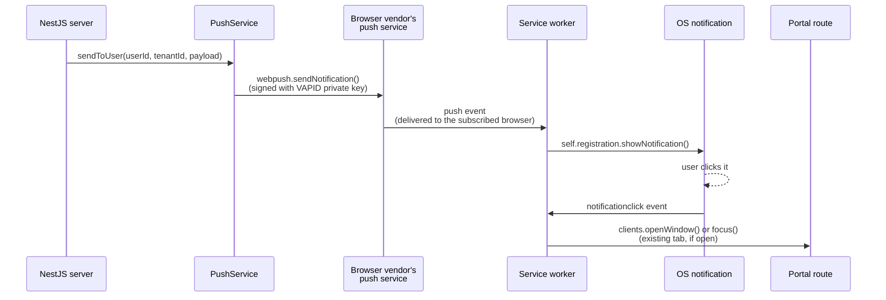

See `server/src/modules/push/push.service.ts` for the server side and
`client-admin/src/sw.ts` / `sw-push.ts` for the service-worker handlers.

## 6. What gets attached and what gets scrubbed

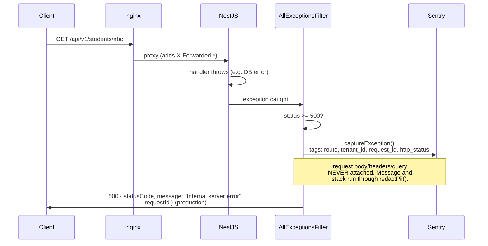

Example event a support engineer actually sees in Sentry (illustrative,
not a real capture):

```json
{
  "message": "duplicate key for [REDACTED_EMAIL]",
  "tags": {
    "route": "/api/v1/students/:id",
    "tenant_id": "8f1c...",
    "request_id": "b6e2...",
    "http_status": 500
  },
  "request": null
}
```

Redaction reuses one function, `redactPii` in
[`server/src/common/redact-log.util.ts`](../../server/src/common/redact-log.util.ts)
— the production log line, the Sentry event, and the client-side scrubber
in `ui/src/api/sentry.ts` all apply the same email/phone/sensitive-key
patterns, so there's exactly one place to update if the PII shape ever
changes.

## 7. Post-deploy smoke check

`yarn smoke:post-deploy --base-url <url>` checks, in about 5 seconds, that a
fresh deploy answers the nine things a real school needs. It stops at the first
failure. Run it after every deploy and in every Epic 75 wave-close.

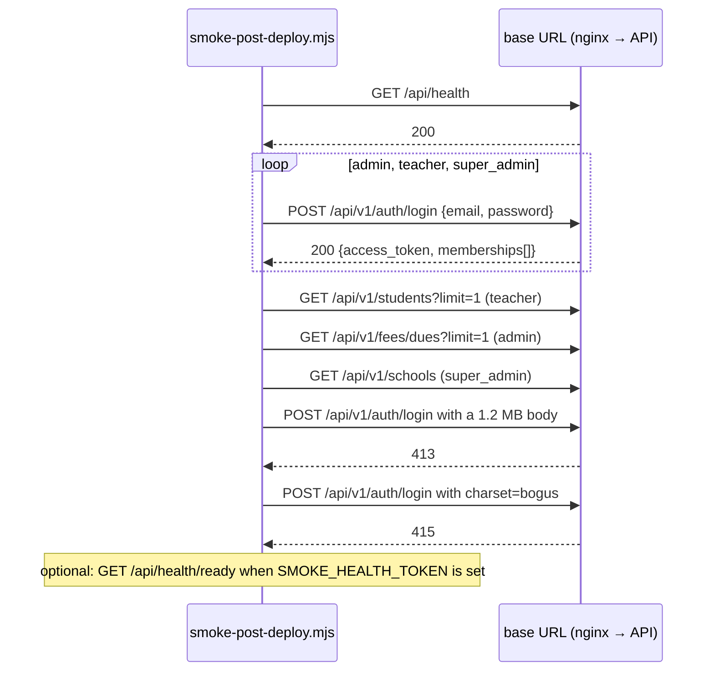

Example run:

```text
$ yarn smoke:post-deploy --base-url https://staging.example.com
PASS  GET  /api/health  200  41ms
PASS  POST /api/v1/auth/login (admin)  200  212ms
PASS  POST /api/v1/auth/login (teacher)  200  198ms
PASS  POST /api/v1/auth/login (super_admin)  200  205ms
PASS  GET  /api/v1/students?limit=1 (teacher)  200  63ms
PASS  GET  /api/v1/fees/dues?limit=1 (admin)  200  88ms
PASS  GET  /api/v1/schools (super_admin)  200  52ms
PASS  POST /api/v1/auth/login (#2634 413)  413  18ms
PASS  POST /api/v1/auth/login (#2634 415)  415  9ms
smoke: 9/9 passed
```

**Optional write-rejection checks.** Each runs only when its variables are set.
Every one is refused before any write, so none changes data. The two checkout
rows also carry a hard guard: each line has a `0.01` one-off discount and no
`X-Approval-Token` is sent. Checkout burns the `fees.discount` token as its last
check before writing, so if the "paid" fee ever becomes payable again (its
payment reversed, the bill regenerated) the row fails with a 403. It never
records a real payment.

| Row     | Runs when                                      | Expects                                                     |
| ------- | ---------------------------------------------- | ----------------------------------------------------------- |
| `#2592` | `SMOKE_PAID_STUDENT_FEE_ID`                    | checkout of an already-paid fee: 409 `CHECKOUT_FEE_SETTLED` |
| `#2636` | `SMOKE_OPEN_STUDENT_FEE_ID`                    | checkout of `99999999.99`: 400 "outstanding balance"        |
| `#2639` | `SMOKE_PARENT_EMAIL` + `SMOKE_PARENT_PASSWORD` | parent asks for a step-up OTP: 403                          |

The `#2638` deleted-student invoice row is added by #2651 (Wave 2).

Credentials come from the `SMOKE_*` env vars in §4, never from arguments. Exit
code: 0 all passed, 1 a check failed, 2 bad usage (missing variable). Output
never contains a token, password, email or response body.

The only write is the login: one refresh-token row and one audit row per
account per run. In production use **dedicated smoke accounts** for this
reason.

Against the local dev stack with the seed accounts:

```bash
SMOKE_ADMIN_EMAIL=admin@biddaloy.test SMOKE_ADMIN_PASSWORD=$SEED_ADMIN_PASSWORD \
SMOKE_TEACHER_EMAIL=teacher@biddaloy.test SMOKE_TEACHER_PASSWORD=$SEED_ADMIN_PASSWORD \
SMOKE_SUPER_ADMIN_EMAIL=superadmin@biddaloy.test SMOKE_SUPER_ADMIN_PASSWORD=$SEED_ADMIN_PASSWORD \
  yarn smoke:post-deploy --base-url http://localhost:3000
```

### What a FAIL means

| Failing line                                | Go to                                                                         |
| ------------------------------------------- | ----------------------------------------------------------------------------- |
| `GET /api/health`                           | [§3.1](#31-5xx-spike)                                                         |
| `POST /api/v1/auth/login`                   | If Redis is down, sign-in is closed on purpose: [§3.2](#32-readiness-failing) |
| `GET /api/health/ready`                     | [§3.2](#32-readiness-failing)                                                 |
| Any line ending `timeout`                   | The API is hung or unreachable in time: [§3.1](#31-5xx-spike)                 |
| Any line ending `network error`             | Nothing answered at the base URL: check DNS, nginx and that the app is up     |
| A read (`students`, `fees/dues`, `schools`) | [§3.1](#31-5xx-spike) for 5xx; a 401/403 means a smoke account lost its role  |

## 8. Secrets and rotation

Secrets live encrypted in `infra/secrets/*.enc.env` (sops + age, two recipients).
How to set up and edit them: [`infra/secrets/README.md`](../../infra/secrets/README.md).
Ansible decrypts on the operator's laptop and writes `/opt/biddaloy/<env>/.env`
with `infra/ansible/tasks/write-env.yml`. Task output never shows a value (`no_log`).

| Path                                 | Owner         | Mode        | Why                                                                     |
| ------------------------------------ | ------------- | ----------- | ----------------------------------------------------------------------- |
| `/opt/biddaloy/<env>/`               | `root:deploy` | 0750        | root writes; `deploy` runs `docker compose` here                        |
| `/opt/biddaloy/<env>/.env`           | `root:deploy` | 0640        | `docker compose` reads `.env` on the client side, even for `exec`       |
| `/opt/biddaloy/<env>/drill/`         | `10001`       | 0500        | mounted into `backup` only; holds the drill key (D18)                   |
| `/opt/biddaloy/<env>/drill/key.txt`  | `10001`       | 0400        | read only by the `backup` container's user, for the restore drill (D18) |
| `/opt/biddaloy/certs/` and its files | `root:root`   | 0700 / 0600 | only nginx (started by the root Docker daemon) needs them               |

`infra/ansible/provision.yml` creates the directories (`ops.yml` sets the same
owner and mode on `ops/`); `write-env.yml` only writes files, and keeps
`root:deploy 0640` on every deploy. This differs from D19's "mode 0600 root" for
`.env`: with that, `deploy` could not run any compose command without `sudo`.

**The age key (`drill/key.txt`) is put on the host by hand, once per env that runs backups**
(prod). Its master copy lives in the password manager and is never committed
([13-backup-restore.md, Key handling](13-backup-restore.md#key-handling)), so
no playbook writes it. From the laptop, without a temp file on the host:

```bash
ssh deploy@<host> "sudo sh -c 'umask 0377; cat > /opt/biddaloy/prod/drill/key.txt && chown 10001:10001 /opt/biddaloy/prod/drill/key.txt'" < ~/age-key.txt
ssh deploy@<host> sudo stat -c '%u %a' /opt/biddaloy/prod/drill/key.txt   # must print: 10001 400
```

A prod deploy checks it in pre-flight and stops if it is missing or has the
wrong owner or mode.

**A rotation is a full deploy of the commit that holds the new value.** The
deploy decrypts `infra/secrets/*` from your checkout and needs `HEAD` equal to
`version`, so an older SHA would write the old value back and still log `ok`.
The full deploy writes the new `.env`, takes the backup, and restarts what
changed, with the readiness check, the smoke test and a `deploys.log` line.
`--tags env` alone only rewrites `.env` and restarts nothing (and refuses any
version but the running one).

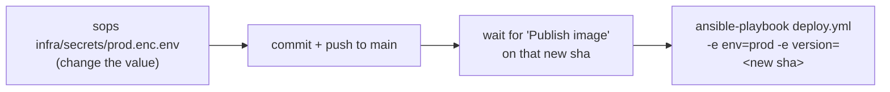

Commands and a value-free check: [28-platform-runbook.md, Rotate a secret](28-platform-runbook.md#rotate-a-secret).

Every rotation is those same steps plus the extra step in the table.

| Secret                                      | Extra step                                                                                                                                                                                                                                                                                                                                                                                                  | What breaks                                                                                                       | How often                  |
| ------------------------------------------- | ----------------------------------------------------------------------------------------------------------------------------------------------------------------------------------------------------------------------------------------------------------------------------------------------------------------------------------------------------------------------------------------------------------- | ----------------------------------------------------------------------------------------------------------------- | -------------------------- |
| `JWT_SECRET`, scheduled                     | Old value to `JWT_SECRET_PREVIOUS` (verify-only, Rule 10), set the new one, deploy. Wait out the access-token lifetime (15 min), empty `JWT_SECRET_PREVIOUS`, deploy again.                                                                                                                                                                                                                                 | Nothing.                                                                                                          | Yearly                     |
| `JWT_SECRET`, leaked                        | Set the new value and leave `JWT_SECRET_PREVIOUS` **empty**, deploy. Never keep a leaked value as `_PREVIOUS`: anyone holding it could still forge tokens.                                                                                                                                                                                                                                                  | Open access tokens get one 401; clients re-mint through their refresh token (a DB row), so nobody signs in again. | On leak                    |
| `SETTINGS_ENCRYPTION_KEY`                   | Old value to `SETTINGS_ENCRYPTION_KEY_PREVIOUS`, deploy, run `yarn settings:reencrypt` (a ts-node script in `server/`; the prod image has no ts-node and no `src/`, so run it from a server checkout on the VM with `DATABASE_URL` at `127.0.0.1:5432` and both keys set), then empty `_PREVIOUS` and deploy. On a leak, do all of it at once: `_PREVIOUS` is needed to re-encrypt, so drop it right after. | Stored provider settings unreadable if the re-encrypt step is skipped.                                            | Yearly, or on leak         |
| `POSTGRES_PASSWORD`                         | `ALTER ROLE ... PASSWORD` in the running db first, then change the value and redeploy.                                                                                                                                                                                                                                                                                                                      | App cannot connect between the two steps.                                                                         | Yearly                     |
| `S3_ACCESS_KEY_ID` / `S3_SECRET_ACCESS_KEY` | Change the value and redeploy. SeaweedFS reads the same two env vars, so the deploy recreates `seaweedfs`, `app` and `backup` together.                                                                                                                                                                                                                                                                     | Uploads fail only for the seconds between container restarts.                                                     | Yearly                     |
| `BACKUP_AGE_PUBLIC_KEY`                     | Make a new age keypair. In the **same deploy**, replace `/opt/biddaloy/<env>/drill/key.txt` with the new private key (owner 10001, mode 0400). Keep the **old private key** offline until the dumps made with it are aged out.                                                                                                                                                                              | Old dumps still need the old key; losing it loses them. Without the host swap the next drill fails at `restore`.  | On leak of the private key |
| `BACKUP_S3_*`                               | Make a new bucket key in the storage console, change the value, redeploy.                                                                                                                                                                                                                                                                                                                                   | Backups fail to upload until updated.                                                                             | Yearly                     |
| `BACKUP_RCLONE_CRYPT_PASSWORD` / `_SALT`    | Re-sync the remote with the new values (old files are unreadable under new ones).                                                                                                                                                                                                                                                                                                                           | Existing backup copies unreadable until re-synced.                                                                | Only on leak               |
| `TURNSTILE_SECRET_KEY`                      | Rotate in the Cloudflare dashboard, change the value, redeploy.                                                                                                                                                                                                                                                                                                                                             | Public forms fail closed in production (Rule 22) until updated.                                                   | On leak                    |
| `GOOGLE_OAUTH_*`, `FACEBOOK_OAUTH_*`        | Reset the client secret in the provider console, change the value, redeploy.                                                                                                                                                                                                                                                                                                                                | Social sign-in fails until updated; password sign-in works.                                                       | On leak                    |
| `PLATFORM_SMS_API_KEY`                      | New key at the SMS provider, change the value, redeploy.                                                                                                                                                                                                                                                                                                                                                    | Platform alert SMS is only logged, not sent.                                                                      | On leak                    |
| `HEALTH_TOKEN`                              | Change the value, redeploy, update the uptime monitor's header.                                                                                                                                                                                                                                                                                                                                             | The monitor sees 401 until its header matches.                                                                    | Yearly                     |
| Origin CA cert + key                        | Cloudflare dashboard: re-issue, `sops` the two `origin-ca*.enc.pem` files, run with `write_certs`.                                                                                                                                                                                                                                                                                                          | Cloudflare returns 526 if the cert on the host expires.                                                           | Before expiry (15y)        |

Log of practised rotations (fill in when done): `JWT_SECRET` on staging (61.2):
_not yet practised_.
