# Operations

> Written for whoever's on call at 2 a.m. Each section is short on purpose —
> if you need more detail than this, follow the link out to the code.

> The commands for day 0, deploys, releases and restore live in
> [28-platform-runbook.md](28-platform-runbook.md). This page keeps what is
> monitored, the thresholds and the incident runbooks.

**First step of every runbook below:** run `biddaloy-doctor` on the VM. It is
one read-only table of the host, edge, prod, staging, demo, backup age and the
nightly jobs. Every line that is not OK has a `Next:` command under it.

```bash
biddaloy-doctor            # everything
biddaloy-doctor prod       # one group: prod | staging | demo | edge
biddaloy-doctor --json     # same rows, for scripts
```

```text
CHECK              STATUS  DETAIL
disk /             OK      61% free
prod ready         OK      ready (200)
backup age         WARN    newest hourly backup is 84 min old
  Next: docker compose -p prod --project-directory /opt/biddaloy/prod -f /opt/biddaloy/repo/deploy/stack.yml logs --tail 50 backup
```

Exit code 0 means all OK, 1 any WARN, 2 any FAIL. Thresholds it applies:
disk under 20% free warns and under 10% fails; backup older than 70 minutes
warns and older than 130 fails; database connections at 80% warn and 95%
fail; a certificate (direct mode) under 20 days warns.

## 1. What is monitored

Four tools, each watching something different. The ops tools are the `ops`
project (`deploy/ops.yml`, deployed with `biddaloy-deploy ops <sha>`). Each has
its own hostname behind the edge: `kuma.<domain>`, `beszel.<domain>`,
`logs.<domain>` (Dozzle).

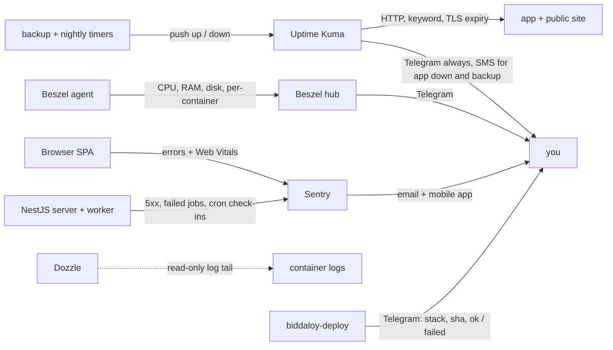

| Tool        | Watches                                             | Alerts to                                  |
| ----------- | --------------------------------------------------- | ------------------------------------------ |
| Sentry      | App errors, failed jobs, cron check-ins             | Email + Sentry mobile app                  |
| Uptime Kuma | Is it up, is it fast enough, did the jobs run       | Telegram; SMS for app-down and backup only |
| Beszel      | The VM and each container: CPU, RAM, disk, restarts | Telegram                                   |
| Dozzle      | Nothing on its own. Live log tail, view-only (D9)   | Nothing (no alerts configured)             |

- **`GET /api/health`** — liveness. Cheap, no dependency checks. Never fails
  because Postgres or Redis is down.
- **`GET /api/health/ready`** — readiness. Checks Postgres, Redis, the
  communications queue, and the attention engine heartbeat. Only Postgres
  down is `fail` (503); Redis, the queue or a stale engine is `degraded` (200),
  so a Redis outage does not take the instance out of rotation.
  Token-protected (`X-Health-Token`) and answered with 404 by the edge nginx,
  so the public route is closed; only a caller on an allowed internal network
  that holds `HEALTH_TOKEN` can reach it. The deploy's rolling
  restart and `biddaloy-doctor <stack>` do exactly that; **Kuma cannot**,
  because Kuma sits on `biddaloy-ops-edge` and the app does not (see
  [07-deployment.md](07-deployment.md#networks-who-joins-what)). See
  [§3.2](#32-readiness-failing).
- Sentry details: [`10-third-party-services.md`](10-third-party-services.md),
  `ui/src/api/sentry.ts`, and [§6](#6-what-gets-attached-and-what-gets-scrubbed).

### The nightly timeline

Host time is Asia/Dhaka. The hourly backup runs inside the prod `backup`
container; the three nightly jobs are systemd timers
(`biddaloy-nightly@<job>.timer`) that run `/usr/local/bin/biddaloy-nightly <job>`
as the `deploy` user.

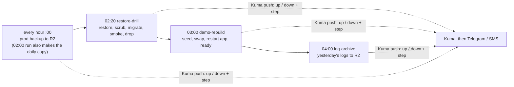

Each timed job ends in **exactly one** Kuma push: `up` with `ok` (or
`ok, warning: <what>`), or `down` with the step that failed. A job that takes a
lock waits up to an hour for `deploy.lock` and for the swap lock; a deploy and a
nightly job never overlap. A push that cannot reach Kuma is logged and ignored,
so Kuma being down never fails a job.

```bash
systemctl list-timers 'biddaloy-nightly@*'
journalctl -u 'biddaloy-nightly@*' -n 100 --no-pager
```

### Uptime Kuma monitors

This table is the source of truth. Kuma keeps its config in its own database, so
if you add or change a monitor in the UI, change this table in the same PR.
`<domain>` values come from `infra/secrets/edge.enc.env`.

| Name                   | Type           | Target                                                                              | Interval                 | Notifies       |
| ---------------------- | -------------- | ----------------------------------------------------------------------------------- | ------------------------ | -------------- |
| `app-public`           | HTTP           | `https://<APP_DOMAIN>/api/health`, retries 3                                        | 60 s                     | Telegram + SMS |
| `login-page`           | HTTP + keyword | `https://<APP_DOMAIN>/login`                                                        | 60 s                     | Telegram       |
| `demo-public`          | HTTP           | `https://<DEMO_DOMAIN>/api/health`                                                  | 60 s                     | Telegram       |
| `backup-hourly`        | Push           | `BACKUP_PUSH_URL` (prod `.env`), sent by the prod `backup` container                | 3600 s, grace 900 s      | Telegram + SMS |
| `restore-drill`        | Push           | `RESTORE_DRILL_PUSH_URL` (staging `.env`), sent by `biddaloy-nightly restore-drill` | heartbeat 26 h (93600 s) | Telegram + SMS |
| `demo-rebuild-nightly` | Push           | `DEMO_RESET_PUSH_URL` (demo `.env`), sent by `biddaloy-nightly demo-rebuild`        | 86400 s, grace 3600 s    | Telegram       |
| `log-archive-nightly`  | Push           | `LOG_ARCHIVE_PUSH_URL` (prod `.env`), sent by `biddaloy-nightly log-archive`        | 86400 s, grace 3600 s    | Telegram       |

There is no `drill-weekly` monitor any more: the nightly `restore-drill` restores
a real backup every night into a throwaway database (D5). It replaced the
`staging-refresh-nightly` monitor: delete that one in Kuma. There is no
`app-internal-ready` monitor either (reason above). TLS expiry is built into
every HTTPS monitor (warn at 14 days, Telegram). `app-public` retrying 3 times
at 60 s means the SMS arrives about 3 minutes after the app goes down.

**Who is told when the restore drill fails (Epic 88):**

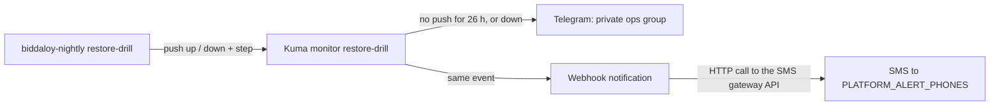

Example: the 02:00 backup never ran, so at 02:50 the drill pushes
`down?msg=refresh`. The Telegram group and the phones in `PLATFORM_ALERT_PHONES`
(the platform owner's numbers, not any school's) both hear about it within a
minute. If the VM or the timer is dead, no push comes at all, and Kuma fires on
its own 26 h later. 26 h is the nightly 24 h plus a 2 h margin for a late daily.
The SMS webhook notification from step 5 below is shared with `app-public` and
`backup-hourly`: attach it to `restore-drill` too.

The push URL is public: `https://<KUMA_DOMAIN>/api/push/<token>`. The tunnel
routes exactly `/api/push/` on the Kuma host without the Access login (D14), and
the demo and nightly pushes send **no** Access headers. Kuma checks the token
itself. In direct mode nginx skips basic auth for that same path.

### Setting the tools up (by hand, once)

The ops tools keep their settings in their own databases, so none of this is
in the repo. The repo values are in `infra/secrets/ops.enc.env` (`BESZEL_KEY`,
`DOZZLE_USERS_YML`) and the hostnames in `edge.enc.env`.

Two login layers guard every ops host (D14). The outer one is Cloudflare
Access in tunnel mode (`cloudflared` rejects a request with no valid Access
token) and nginx basic auth in direct mode. The inner one is each tool's own
login. Kuma and Beszel make the first visitor of their setup page the admin, so
build the outer layer first.

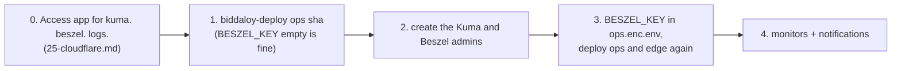

0. **Outer login first.** Tunnel mode: create the Cloudflare Access application
   for the ops hosts ([25-cloudflare.md, Ops hosts](25-cloudflare.md#ops-hosts-kuma-beszel-logs)) and put its
   audience tag in `CF_ACCESS_AUD_OPS` of `edge.enc.env`. Direct mode: put the
   users in `BASIC_AUTH_HTPASSWD`.
1. **Deploy the stack.** `biddaloy-deploy edge <sha>` then `biddaloy-deploy ops <sha>`.
   Leave `BESZEL_KEY` empty for now; the agent restarts until step 3.
2. **Admins.** Open `https://<KUMA_DOMAIN>` and `https://<BESZEL_DOMAIN>`, pass the
   outer login, and create both admins. Dozzle needs no setup: its users come
   from `DOZZLE_USERS_YML` (bcrypt hashes) in `ops.enc.env`.
3. **Beszel agent.** In Beszel, "Add system": host `/beszel_socket/beszel.sock`
   (the agent's unix socket; the port field is ignored). Copy the public key it
   shows into `BESZEL_KEY` in **both** `ops.enc.env` and `edge.enc.env` (the
   agent runs in the edge project, the hub in ops; it is one public value), commit, and
   deploy `ops` and `edge` at that new commit. Alerts: add a Shoutrrr Telegram
   URL in the hub settings; thresholds are in [§2](#2-alert-thresholds).
4. **Kuma monitors.** Add the monitors from the table above. Create the push
   monitors first. Kuma shows each push URL as `http://localhost:3001/api/push/<token>`;
   keep only the token and paste `https://<KUMA_DOMAIN>/api/push/<token>` into
   `BACKUP_PUSH_URL` (prod), `RESTORE_DRILL_PUSH_URL` (staging; the old `STAGING_REFRESH_PUSH_URL` is still read for one release),
   `DEMO_RESET_PUSH_URL` (demo) and `LOG_ARCHIVE_PUSH_URL` (prod) in `sops`.
   Commit, push to `main`, then `biddaloy-deploy` each project at that commit.
   Every pusher logs `Kuma push got HTTP <code>, not 2xx` when a push does not
   land (a `302` means the Access login got in the way: the tunnel push rule
   is missing).
5. **Notifications.** Telegram notifier (bot + private group), default-on for
   every monitor. SMS notifier: Kuma "Webhook" with a custom body, pointed at the
   SMS gateway's HTTP API (URL shape:
   `server/src/modules/communications/providers/sms/*.gateway.ts`), attached only
   to `app-public`, `backup-hourly` and `restore-drill`. The deploy's own Telegram message uses
   `TELEGRAM_BOT_TOKEN` and `TELEGRAM_CHAT_ID` in `edge.enc.env`; it is separate
   from Kuma's notifier.
6. **Sentry rules** are listed in [§2](#2-alert-thresholds).

Known limits:

- **Same VM until ops moves.** Kuma, Beszel and Dozzle run on the VM they watch.
  If the VM dies, nothing pages you: the only signal is a missing Sentry cron
  check-in (#2749). Moving ops to its own VM is the first future-work item in
  [30-deployment-target.md](30-deployment-target.md#future-work-with-the-trigger-that-brings-each-back).
- Dozzle and the Beszel agent mount `docker.sock` read-only. That limits the
  mount, not the Docker API: treat access to them as root on the VM (hence the
  two login layers).
- The ops UIs share a network only with the edge nginx (`biddaloy-ops-edge`),
  never with an app network, so they cannot reach any Postgres or Redis.

## 2. Alert thresholds

Where each alert is set up. Kuma monitors and intervals: the table in [§1](#uptime-kuma-monitors).

| Signal                                                     | Threshold                                                                                                                   | Where to configure                                   |
| ---------------------------------------------------------- | --------------------------------------------------------------------------------------------------------------------------- | ---------------------------------------------------- |
| App down                                                   | `app-public` fails 3 times in a row (~3 min)                                                                                | Uptime Kuma monitor, Telegram + SMS                  |
| Readiness failing (Postgres down)                          | Not alerted by Kuma. A failed deploy or `biddaloy-doctor prod` shows it; a Postgres outage also fails `app-public`          | `biddaloy-doctor`, deploy report                     |
| Engine stale reported by readiness                         | Covered by the attention cron check-in below                                                                                | Sentry Cron Monitor (readiness stays 200 when stale) |
| Backup / restore drill / demo rebuild / log archive missed | No push inside interval + grace                                                                                             | Uptime Kuma push monitors                            |
| TLS certificate close to expiry                            | < 14 days                                                                                                                   | Uptime Kuma, built into HTTPS monitors               |
| CPU                                                        | > 90% for 15 min                                                                                                            | Beszel hub, system `biddaloy-prod`, Telegram         |
| Memory                                                     | > 90% for 10 min                                                                                                            | Beszel hub, Telegram                                 |
| Disk                                                       | > 80%, immediate                                                                                                            | Beszel hub, Telegram                                 |
| Host down (agent unreachable)                              | Immediate (Beszel "Status"). Fires when the agent stops, not when the whole VM dies: that only misses Sentry cron check-ins | Beszel hub, Telegram                                 |
| Container down                                             | Immediate, for `app`, `db`, `redis`, `seaweedfs`, `nginx`, `backup` (prod). Not yet proven on a real host                   | Beszel hub, per container, Telegram                  |
| Postgres connections                                       | `biddaloy-doctor` warns above 80% and fails above 95% of `max_connections`. It is a manual check, not an alert              | `biddaloy-doctor prod`                               |
| 5xx rate                                                   | > 1% of requests over 5 min                                                                                                 | Sentry alert rule on the server project              |
| `communications job stalled` message                       | any occurrence                                                                                                              | Sentry alert rule (issue alert, not metric)          |
| Attention cron check-in missed                             | > 15 min                                                                                                                    | Sentry Cron Monitor (5-min schedule, 15-min margin)  |
| Other cron check-ins                                       | `SENTRY_CRON_MONITOR_URL`, `SENTRY_CRONS_URL`                                                                               | Sentry Cron Monitors                                 |

## 3. Runbooks

Every runbook starts the same way: on the VM, run `biddaloy-doctor` (or
`biddaloy-doctor prod`) and follow its `Next:` lines. Compose commands name the
project and files, because a bare `docker compose` in a project directory finds
nothing. Short form used below:

```bash
# $DC <project> ...  is shorthand for:
DC() { p=$1; shift; docker compose -p "$p" --project-directory "/opt/biddaloy/$p" -f /opt/biddaloy/repo/deploy/stack.yml "$@"; }
```

### 3.1 5xx spike

0. `biddaloy-doctor prod`.
1. Open the Sentry issue — it carries `route`, `tenant_id`, `request_id`,
   `http_status` tags (never the request body/headers).
2. Cross-reference the production log by `request_id` — one JSON line per
   request, see [§4](#4-env-var-reference) for `LOG_LEVEL`.
3. If it's one tenant: check that tenant's recent config changes (schools
   settings) before assuming a code bug.
4. If it's every tenant: check the last deploy (`tail -n 5 /opt/biddaloy/prod/deploys.log`;
   to go back, `biddaloy-deploy prod <previous ok sha>`) and Postgres/Redis health
   (`biddaloy-doctor prod` prints `prod ready`) first — a bad deploy or a dependency outage looks like
   "everything 500s at once."

### 3.2 Readiness failing

`/health/ready`'s body names exactly which dependency failed —
`{ "status": "fail", "checks": { "db": "ok", "redis": "fail", "queue": "ok" } }`
— never a hostname or error message (that would leak infra details to
anything that can reach the token-gated route).

To see the body yourself, from inside the app container (the edge answers 404):
`DC prod exec app sh -c 'wget -qO- --header "X-Health-Token: $HEALTH_TOKEN" http://127.0.0.1:3000/api/health/ready'`.

1. **`db: fail`** — `DC prod ps db` and `DC prod logs --tail 100 db`; check the
   password in `/opt/biddaloy/prod/.env` hasn't drifted from the database role.
2. **`redis: fail`** — status is `degraded` (HTTP 200), not `fail`. `DC prod ps redis`. BullMQ (the communications
   queue) and the rate limiter depend on it; see "When Redis is down" in
   [`08-security.md`](08-security.md). The uptime monitor will not page for
   this: the platform alert covers a Redis outage, see [§3.6](#36-platform-alert-redis-down).
3. **`queue: fail`** — Redis is reachable but the queue itself can't be
   read; check for a BullMQ version mismatch or a stuck connection pool.

Each probe is bounded to 2 seconds — a slow dependency fails fast rather
than hanging the whole check.

### 3.3 Failed / stalled communication jobs

A communication (SMS/WhatsApp/email) job that exhausts its retries, or
stalls, sends a Sentry event tagged `queue`, `job_name`, `tenant_id`,
`communication_log_id`, `medium` — never the recipient address or message
body.

1. Take `communication_log_id` from the Sentry tag.
2. Look up that row: `SELECT * FROM communication_log WHERE id = '<id>'` —
   `metadata.error` has the provider's failure reason.
3. **Retry**: re-queue the same log id through the normal reminder/resend
   flow (see [`05-communications.md`](05-communications.md)) — don't hand-edit
   the row's status, that bypasses the batch-outcome accounting.
4. **Mark failed and move on**: leave the row as `FAILED`; nothing further
   happens automatically — a stuck `PROCESSING` row past its worker's lock
   window is what "stalled" means, and BullMQ already retries it once on
   your behalf before this alert fires.

### 3.4 Attention engine stale or slow

The engine writes a heartbeat after every sweep. "Stale" means the FAST heartbeat
is missing, older than 15 minutes, or every school failed. Users then see old
alerts (`GET /attention/summary` reports `staleMinutes`). Nothing else breaks.

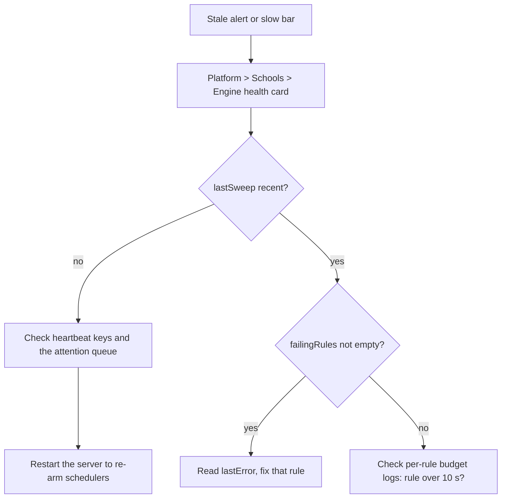

1. **Heartbeat.** In Redis: `GET attention:heartbeat:FAST` (also `HOURLY`, `DAILY`).
   Example: `{"at":"2026-10-10T08:15:02Z","durationMs":412,"tenants":3,"failures":0}`.
   An old `at` means no sweep has finished.
2. **Queue.** BullMQ queue `attention` (sweeps) and `attention-delivery`
   (delayed pushes). Look for a paused queue, a dead worker, or a pile of
   waiting jobs.
3. **Failing rules.** `GET /platform/attention/health` (SUPER_ADMIN), or the card.
   `failingRules[].lastError` is the first 200 characters of the error. Keys
   live in Redis as `attention:failing:<rule>` for 24 hours.
4. **Slow rules.** Search the server log for `Rule <key> failed for tenant ...:
rule budget exceeded`. A rule gets 10 seconds, then is skipped for that
   school; other rules still run. Sweep time is also logged:
   `Attention FAST sweep: 3 tenants in 412ms`.
5. **Re-arm.** Schedulers are registered at boot with `upsertJobScheduler`, so
   a restart of the server re-creates them. No manual step beyond that.
6. **Alerts look wrong but the engine is fine?** The summary is cached for 60
   seconds; a snoozed item wakes on the next FAST sweep.

Measured sweep and summary timings: [23-attention.md](23-attention.md#performance).

### 3.5 Edge or tunnel problem

Symptom: `app-public` is red, but `biddaloy-doctor prod` says prod is ready. The
trouble is between the visitor and the app: the tunnel, nginx, or (direct
mode) the certificate.

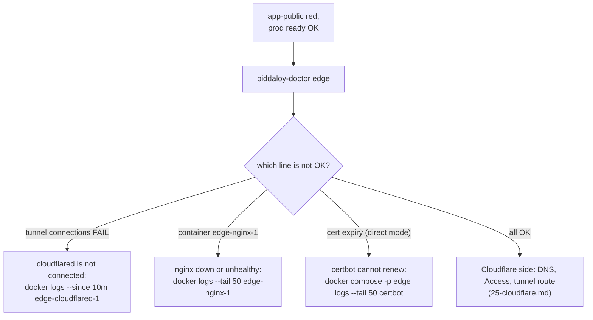

1. **Tunnel connections FAIL.** `doctor` counts `Registered tunnel connection`
   lines in the last 10 minutes. None means `cloudflared` cannot reach
   Cloudflare, or its credentials are wrong. Look at the log, then check the
   tunnel in Zero Trust > Networks > Tunnels. Redeploying the edge rewrites the
   credentials file from `edge.enc.env`: `biddaloy-deploy edge $(biddaloy-deploy --last-ok edge)`.
2. **nginx will not start.** Its start-up script `edge-mode.sh` stops the
   container on a bad value (`EDGE_MODE`, or `EDGE_TRUSTED_CIDR` empty in tunnel
   mode). The message names the value. Fix `edge.enc.env`, commit, redeploy the edge.
3. **Everyone shares one IP** (the app logs show the same address for all
   visitors, or one abuser's login throttle locks everyone out). `EDGE_TRUSTED_CIDR`
   is not the subnet of `biddaloy-edge`. Compare
   `docker network inspect biddaloy-edge --format '{{range .IPAM.Config}}{{.Subnet}}{{end}}'`
   with the value in `/opt/biddaloy/edge/.env`; they must be equal (`172.30.0.0/24`).
4. **Direct mode, certificate.** Let's Encrypt renews through HTTP-01 on port 80.
   `doctor` warns at 20 days left. If renewal fails, check that port 80 reaches
   nginx and DNS points at this VM. The first deploy serves a 30-day self-signed
   placeholder until the real certificate is requested by hand, once
   ([07-deployment.md](07-deployment.md#the-two-edge-modes)).
5. **A hostname gets an empty reply (`444`).** nginx answers only the domains in
   `edge.enc.env`; anything else is dropped on purpose.

Rollback of an edge change is a redeploy of the previous SHA:
`biddaloy-deploy edge <previous sha>`. No data is involved.

### 3.6 Platform alert: Redis down

Redis down means sign-in is closed (75.18), but `/health/ready` is only `degraded`, so an uptime
monitor does not page. The API raises its own alert, kept in Postgres so it works with Redis gone.

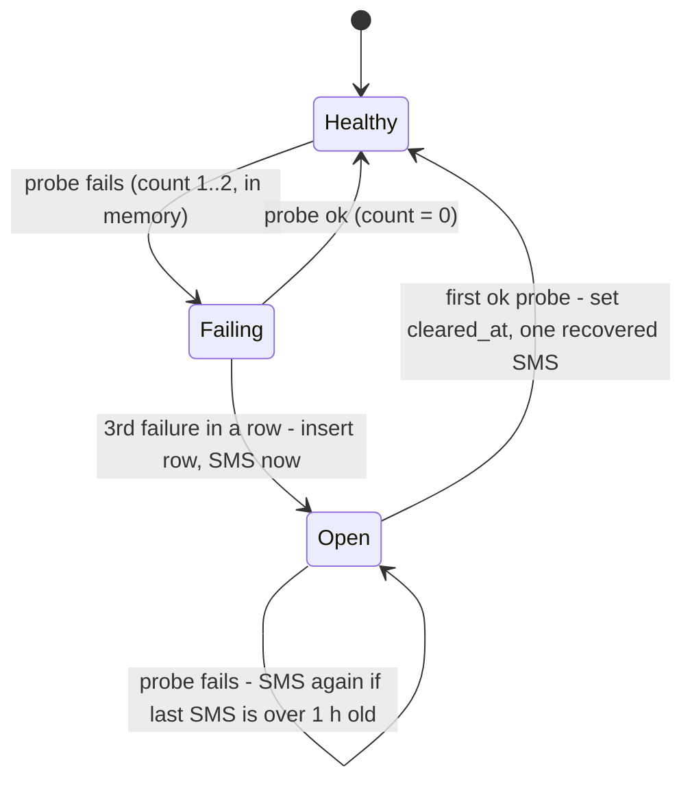

Order of events (a probe runs every 30 s, so about 90 s after Redis dies):

1. A `platform_alerts` row `REDIS_DOWN` opens (at most one open row, enforced by a unique index).
2. Every verified phone of a platform SUPER_ADMIN (a SUPER_ADMIN of the platform tenant) gets a
   text, then another every hour. With no platform tenant (production without `PLATFORM_TENANT_ID`)
   only `PLATFORM_ALERT_PHONES` is texted, never a school's SUPER_ADMIN:
   `[production] ALERT: Redis is down since 08:02 UTC. Sign-in is closed. Repeats hourly until fixed.`
3. `GET /api/v1/platform/alerts` (platform SUPER_ADMIN only; a school's SUPER_ADMIN gets 403) returns the open row for the banner (75.35).
4. The first good probe clears the row and sends one text:
   `[production] RECOVERED: Redis is back at 08:40 UTC after 38 min. Sign-in is open again.`

Limit: a platform SUPER_ADMIN who is already signed in keeps seeing the banner for the whole
outage, because `POST /auth/refresh` keeps working without Redis (refresh tokens are DB rows). One
who is _not_ signed in cannot sign in to see it, since sign-in answers 503. The SMS is their channel.

Limit: with several API instances in a partial partition (one reaches Redis, another does not), the
alert re-opens and closes about every 2 minutes, so ALERT and RECOVERED texts repeat.

**Confirm recovery:** `GET /api/v1/platform/alerts` returns `{ "alerts": [] }` and `/health/ready`
shows `"redis": "ok"`.

The loop runs in the API process only (not in scripts, not under `NODE_ENV=test`), uses no BullMQ,
and sends SMS straight to the provider with the platform's own key, not a school's credits. With no
`PLATFORM_SMS_API_KEY` it logs `platform alert SMS not configured; would text N phone(s): ...`.

On staging and demo (`MESSAGE_SINK=mailpit`) these alerts go to the test inbox as SMS-tagged messages instead of the provider.

### 3.7 Demo reset failed (Sentry cron alert)

**What the alert means.** The `demo-rebuild-nightly` Kuma push went `down` (or
never came), and the demo's Sentry cron monitor (`SENTRY_CRONS_URL`) got
`status=error` or no check-in. Tonight's rebuild did not finish. The demo is
**not down**: until the swap, yesterday's database keeps serving.

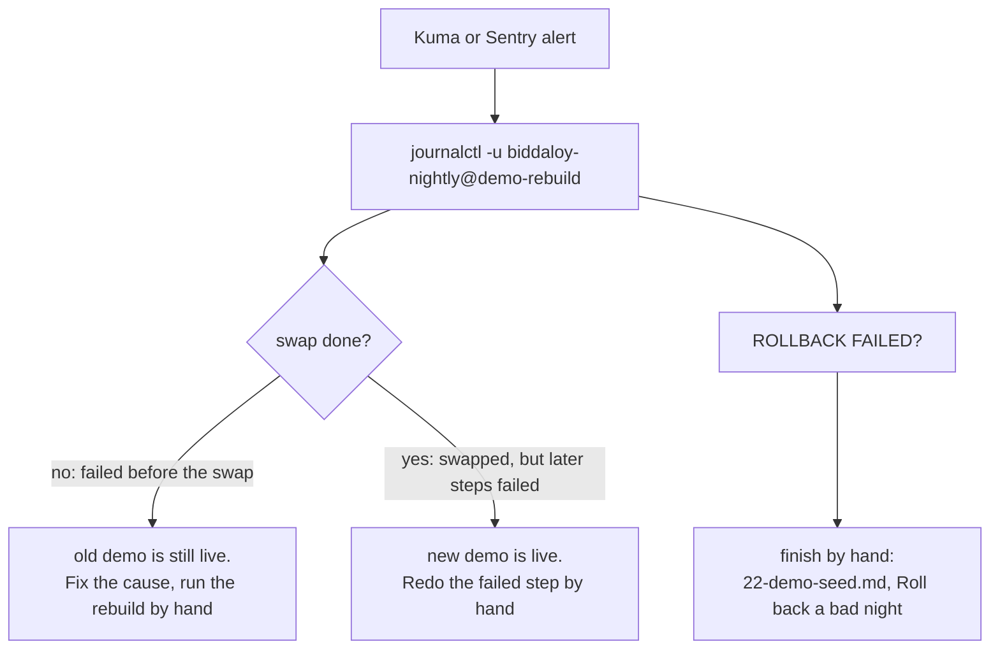

**See the log.** The timer runs `biddaloy-nightly demo-rebuild`, which runs
`reset.sh` in the `demo-reset` container and then restarts the app:

```bash
journalctl -u biddaloy-nightly@demo-rebuild.service -n 200 --no-pager
```

The push message names the failing step: `reset`, `restart-app` or `ready`.
Lines to look for in the output: `validator found violations`, `sweep failed (exit N)`,
`rolled back:`, `ROLLBACK FAILED`, `swapped, but these steps failed: ...`,
`another reset is running`. `reset.sh` exit 3 means the swap happened but a
cleanup step failed; the nightly job still restarts the app and pushes
`ok, warning: swapped but cleanup failed`.

**Manual rebuild** (same job as the timer; it takes `deploy.lock` and the swap
lock, so it waits for a running deploy):

```bash
sudo systemctl start biddaloy-nightly@demo-rebuild.service
```

**Roll back to yesterday** (`biddaloy_demo_prev`): follow "Roll back a bad night" in
[22-demo-seed.md](22-demo-seed.md#roll-back-a-bad-night).

**Two traps.** `PlatformAlertsService` texts operators straight through the SMS gateway, so `DEMO_MODE` does not silence
it: leave `PLATFORM_SMS_API_KEY` and `PLATFORM_ALERT_PHONES` unset in `demo.enc.env`. The boot guard runs after the BullMQ
workers start, so a non-demo school row stops the process a moment after it begins.

### 3.8 Validate the student_fees money CHECKs (#2662)

`CHK_sf_paid_plus_discount` and `CHK_sf_waived_settled` were added `NOT VALID`. New and changed rows are
already checked. Old rows are not, until someone validates. Do it once per environment, after the audit.

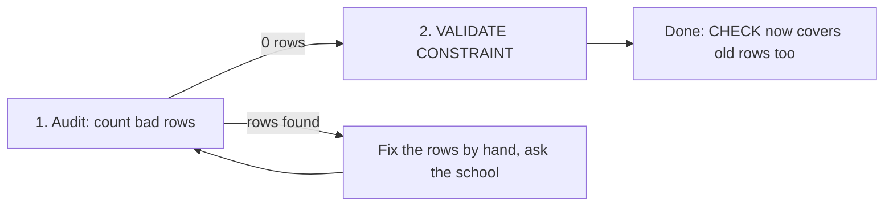

```sql
-- 1. Audit. Both must return 0.
SELECT count(*) FROM student_fees WHERE paid_amount + discount_amount > total_amount;
SELECT count(*) FROM student_fees
 WHERE status = 'WAIVED' AND paid_amount + discount_amount <> total_amount;

-- 2. Validate. Takes only a SHARE UPDATE EXCLUSIVE lock: reads and writes continue.
ALTER TABLE student_fees VALIDATE CONSTRAINT "CHK_sf_paid_plus_discount";
ALTER TABLE student_fees VALIDATE CONSTRAINT "CHK_sf_waived_settled";
```

A restored old backup can hit these CHECKs on insert. Audit the backup the same way before restoring.

### 3.9 Hourly backup late or failed

Symptom: `backup-hourly` red (SMS), or `biddaloy-doctor prod` shows `backup age`
WARN (over 70 min) or FAIL (over 130 min).

1. `DC prod logs --tail 100 backup`. The push message names the failing step:
   `config`, `dump`, `uploaded`, `daily-copy`, `prune-hourly`, `prune-daily`, `files-sync`, `prune-trash`.
2. Run one by hand and watch it: `DC prod exec backup /app/backup.sh`.
3. Common causes: the R2 token was rotated and `BACKUP_S3_*` was not updated; the
   disk is full (`df -h /var/lib/docker`); the files sync refused because it would
   delete more than `BACKUP_FILES_MAX_DELETE` (500) files (see
   [13-backup-restore.md](13-backup-restore.md#how-a-backup-happens)).
4. A prod deploy takes its own backup first and stops if it fails. Do not use
   `--skip-backup` while this alert is open unless you accept losing up to the
   age of the last good backup.

### 3.10 Restore drill or log archive failed

Symptom: `restore-drill` or `log-archive-nightly` red.

```bash
journalctl -u biddaloy-nightly@restore-drill.service -n 200 --no-pager
biddaloy-doctor staging        # the "restore drill" line shows the last clean night
cat /opt/biddaloy/staging/last-drill
```

- The push message is the failed step: `guard`, `not enough memory`, `refresh`,
  `migrate`, `smoke`, `export`, `archive`.
- `not enough memory`: under 1 GB was free, so the drill skipped itself. Look at
  `free -m` and what else is running; nothing was changed.
- `refresh` failed: the drill database was not built. The usual cause is the
  day's backup not existing yet (the job waits until 02:50 for
  `db/daily/<today>.dump.age`, so check `backup-hourly` first), or a scrub step
  that hit a new column (the `staging-scrub` spec exists to catch this in CI).
- `migrate` failed: tonight's prod data does not migrate with staging's code. This
  is a real finding, not noise: it means the same migration would fail on prod.
- `smoke` failed: the restored data loads but the app cannot serve it.
- Staging itself is never touched by the drill, so nobody is blocked; only the
  restore proof is missing for that night.
- If Kuma says `ok, warning: drill db not dropped`, drop it by hand:
  `docker compose ... exec db psql -U "$POSTGRES_USER" -d postgres -c 'DROP DATABASE "biddaloy_staging_drill" WITH (FORCE)'`.
- Run again: `sudo systemctl start biddaloy-nightly@restore-drill.service`.

## 4. Env var reference

| Variable                                                         | Required in prod?  | What it does                                                                                                                                        |
| ---------------------------------------------------------------- | ------------------ | --------------------------------------------------------------------------------------------------------------------------------------------------- |
| `SENTRY_DSN`                                                     | No (recommended)   | Server Sentry project. Unset = server Sentry is a no-op.                                                                                            |
| `SENTRY_ENVIRONMENT`                                             | No                 | Defaults to `NODE_ENV`.                                                                                                                             |
| `SENTRY_RELEASE`                                                 | No                 | Tags events with a release/version string.                                                                                                          |
| `SENTRY_DSN_WEB`                                                 | No (recommended)   | Browser Sentry project, served to the SPA by `/runtime-config.js` at boot.                                                                          |
| `SENTRY_TRACES_SAMPLE_RATE`                                      | No                 | Fraction of requests traced, default `0.1`.                                                                                                         |
| `HEALTH_TOKEN`                                                   | No (recommended)   | Required to call `/health/ready` at all — unset means that route 404s.                                                                              |
| `LOG_LEVEL`                                                      | No                 | Pino's log level; see `.env.example`.                                                                                                               |
| `ATTENTION_SENTRY_CRON_URL`                                      | No (recommended)   | Sentry Cron Monitor check-in URL for attention sweeps; unset = no check-ins.                                                                        |
| `SMS_PROVIDER`                                                   | No (for alert SMS) | Registered SMS provider name (`greenweb`, `mimsms`, `onecodesoft`). Empty = default.                                                                |
| `<PREFIX>_<FIELD>`                                               | With its provider  | The provider's own keys, e.g. `ONECODESOFT_API_KEY` / `_SENDER_ID` / `_API_URL`, `MIMSMS_SENDER_ID`. Prod config check requires every required one. |
| `PLATFORM_SMS_PROVIDER` / `_API_KEY` / `_SENDER_ID` / `_API_URL` | No (deprecated)    | Read for one more release, only when `SMS_PROVIDER` is unset. Boot logs the key names.                                                              |
| `PLATFORM_ALERT_PHONES`                                          | No                 | Comma-separated fallback phones, used only when no SUPER_ADMIN has a verified one.                                                                  |

Smoke-check variables (read by `scripts/smoke-post-deploy.mjs`, see §7). The
deploy passes them by name from the project's secrets file into a throwaway
container; the app itself never reads them. For a run from your own machine:

| Variable                                         | What it does                                                                            |
| ------------------------------------------------ | --------------------------------------------------------------------------------------- |
| `SMOKE_BASE_URL`                                 | Base URL when `--base-url` is not passed.                                               |
| `SMOKE_ADMIN_EMAIL` / `SMOKE_ADMIN_PASSWORD`     | Login for the ADMIN smoke account.                                                      |
| `SMOKE_TEACHER_EMAIL` / `SMOKE_TEACHER_PASSWORD` | Login for the TEACHER smoke account.                                                    |
| `SMOKE_SUPER_ADMIN_EMAIL` / `_PASSWORD`          | Login for the SUPER_ADMIN smoke account.                                                |
| `SMOKE_PAID_STUDENT_FEE_ID`                      | Optional. An already-paid student fee id; adds the `#2592` checkout 409 row.            |
| `SMOKE_OPEN_STUDENT_FEE_ID`                      | Optional. An outstanding student fee id; adds the `#2636` over-balance 400 row.         |
| `SMOKE_PARENT_EMAIL` / `SMOKE_PARENT_PASSWORD`   | Optional. A PARENT smoke account; adds the `#2639` step-up 403 row.                     |
| `SMOKE_HEALTH_TOKEN`                             | Optional. Adds a `/api/health/ready` check (internal URL only; nginx 404s it outside).  |
| `SMOKE_INBOX_API_URL`                            | Optional. Mailpit API (staging: `http://staging-mailpit:8025`); adds the `inbox` check. |

## 5. Web push (VAPID keys)

Web push (browser/OS notifications — see
[`05-communications.md`](05-communications.md#push-first-dispatch-for-routine-automated-notifications-555))
needs a **VAPID** keypair. VAPID (Voluntary Application Server
Identification) is just a signature: it proves to the browser vendor's
push service (Chrome's, Firefox's, etc.) that notifications came from
_this_ server, not an impersonator.

### Generating and storing keys

```bash
node scripts/generate-vapid-keys.mjs
```

prints a public/private keypair. Three env vars, all required together
(`PushConfigService.isPushEnabled()` — push silently no-ops if any is
missing, it never crashes boot):

| Variable            | Where it goes     | Notes                                                                                               |
| ------------------- | ----------------- | --------------------------------------------------------------------------------------------------- |
| `VAPID_PUBLIC_KEY`  | Host env (server) | Also handed to the client SW to subscribe.                                                          |
| `VAPID_PRIVATE_KEY` | **Host env only** | **Never commit it. Never log it.** Anyone with this key can send push notifications as this server. |
| `VAPID_SUBJECT`     | Host env (server) | A `mailto:` address or `https:` URL identifying this deployment — not generated, set it yourself.   |

### Rotation cost

Rotating the keypair is not free — state this plainly to anyone about to
do it:

- A new keypair makes existing subscriptions incompatible with it.
  Browsers reject push messages signed by a key they didn't subscribe
  with.
- A send to an old subscription may be rejected for invalid VAPID
  authentication. `PushService.sendToUser` only prunes the row on a
  404/410 from the browser's push service (a truly dead subscription,
  same cleanup path as a guardian who uninstalled the PWA) — other
  rejections just increment `failure_count` and the row stays.
- Clients do not silently re-subscribe. A guardian must run the
  subscribe flow again (toggling push on in the portal) to create a
  subscription bound to the new `VAPID_PUBLIC_KEY`.
- **Net effect**: after rotating, every guardian falls back to their
  normal channel (SMS/WhatsApp/email) for routine notices until they
  explicitly re-subscribe. Rotate only when you have to (e.g. key
  compromise) — not as routine hygiene.

### Send flow

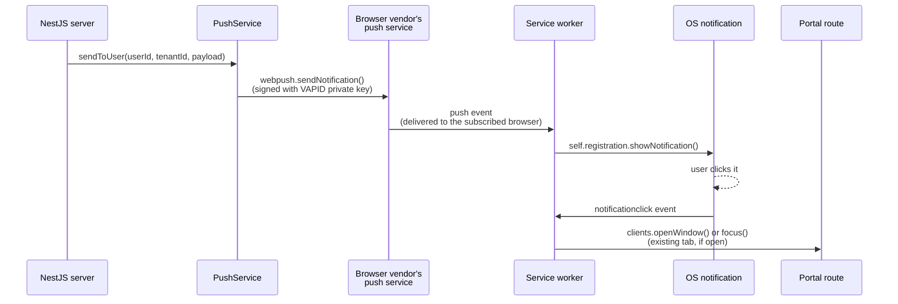

See `server/src/modules/push/push.service.ts` for the server side and
`client-admin/src/sw.ts` / `sw-push.ts` for the service-worker handlers.

## 6. What gets attached and what gets scrubbed

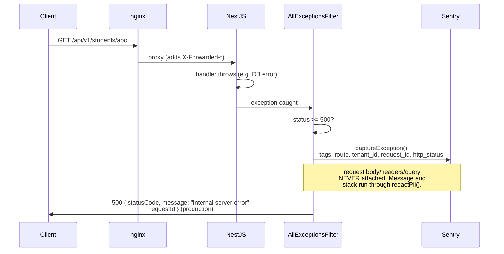

Example event a support engineer actually sees in Sentry (illustrative,
not a real capture):

```json
{
  "message": "duplicate key for [REDACTED_EMAIL]",
  "tags": {
    "route": "/api/v1/students/:id",
    "tenant_id": "8f1c...",
    "request_id": "b6e2...",
    "http_status": 500
  },
  "request": null
}
```

Redaction reuses one function, `redactPii` in
[`server/src/common/redact-log.util.ts`](../../server/src/common/redact-log.util.ts)
— the production log line, the Sentry event, and the client-side scrubber
in `ui/src/api/sentry.ts` all apply the same email/phone/sensitive-key
patterns, so there's exactly one place to update if the PII shape ever
changes.

## 7. Post-deploy smoke check

`scripts/smoke-post-deploy.mjs` checks, in about 5 seconds, that a fresh deploy
answers the nine things a real school needs. **The deploy runs it for you, on
the VM.** After the rolling restart, the playbook starts a throwaway container
from the app image on the `biddaloy-edge` network and runs the script against
`http://<project>-app:3000` (staging and prod; demo gets a health call only). No
Cloudflare layer is in the way, and the smoke credentials come from
`SMOKE_*` keys in `prod.enc.env` / `staging.enc.env`. A failing smoke fails the
deploy with `FAILED at: smoke`, and the previous version is put back. The nightly
restore drill runs the same script against its throwaway database.

You can still run it by hand against any URL, from a laptop or the VM:
`yarn smoke:post-deploy --base-url <url>`.

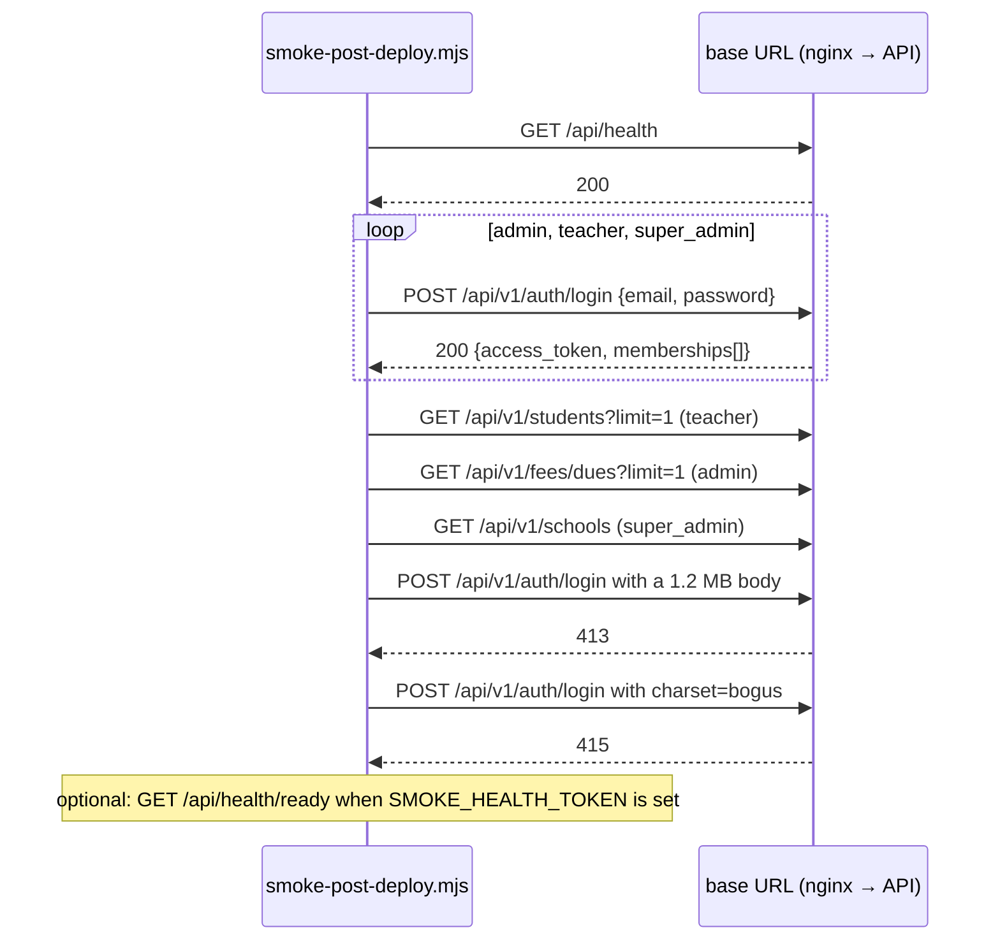

Example run:

```text
$ node /smoke.mjs --base-url http://staging-app:3000   # what the deploy runs, inside the edge network
PASS  GET  /api/health  200  41ms
PASS  POST /api/v1/auth/login (admin)  200  212ms
PASS  POST /api/v1/auth/login (teacher)  200  198ms
PASS  POST /api/v1/auth/login (super_admin)  200  205ms
PASS  GET  /api/v1/students?limit=1 (teacher)  200  63ms
PASS  GET  /api/v1/fees/dues?limit=1 (admin)  200  88ms
PASS  GET  /api/v1/schools (super_admin)  200  52ms
PASS  POST /api/v1/auth/login (#2634 413)  413  18ms
PASS  POST /api/v1/auth/login (#2634 415)  415  9ms
smoke: 9/9 passed
```

**Optional write-rejection checks.** Each runs only when its variables are set.
Every one is refused before any write, so none changes data. The two checkout
rows also carry a hard guard: each line has a `0.01` one-off discount and no
`X-Approval-Token` is sent. Checkout burns the `fees.discount` token as its last
check before writing, so if the "paid" fee ever becomes payable again (its
payment reversed, the bill regenerated) the row fails with a 403. It never
records a real payment.

| Row     | Runs when                                      | Expects                                                                      |
| ------- | ---------------------------------------------- | ---------------------------------------------------------------------------- |
| `#2592` | `SMOKE_PAID_STUDENT_FEE_ID`                    | checkout of an already-paid fee: 409 `CHECKOUT_FEE_SETTLED`                  |
| `#2636` | `SMOKE_OPEN_STUDENT_FEE_ID`                    | checkout of `99999999.99`: 400 "outstanding balance"                         |
| `#2639` | `SMOKE_PARENT_EMAIL` + `SMOKE_PARENT_PASSWORD` | parent asks for a step-up OTP: 403                                           |
| `inbox` | `SMOKE_INBOX_API_URL` (staging only)           | forgot-password for the admin, then the message shows in Mailpit within 30 s |

The `inbox` row is not a rejection check: it asks for a password reset and polls Mailpit every 2 s for up to 30 s, printing `inbox: ok`. Unset (prod), it prints `inbox: skipped (no SMOKE_INBOX_API_URL)`. A stopped Mailpit fails the deploy on the `inbox` line. If the password-reset cooldown is still running from a deploy just before, the app answers 202 but sends no mail, and the check fails with `message not found`; wait out the cooldown and redeploy.

The `#2638` deleted-student invoice row is added by #2651 (Wave 2).

Credentials come from the `SMOKE_*` env vars in §4, never from arguments. Exit
code: 0 all passed, 1 a check failed, 2 bad usage (missing variable). Output
never contains a token, password, email or response body.

The only write is the login: one refresh-token row and one audit row per
account per run. In production use **dedicated smoke accounts** for this
reason.

Against the local dev stack with the seed accounts:

```bash
SMOKE_ADMIN_EMAIL=admin@biddaloy.test SMOKE_ADMIN_PASSWORD=$SEED_ADMIN_PASSWORD \
SMOKE_TEACHER_EMAIL=teacher@biddaloy.test SMOKE_TEACHER_PASSWORD=$SEED_ADMIN_PASSWORD \
SMOKE_SUPER_ADMIN_EMAIL=superadmin@biddaloy.test SMOKE_SUPER_ADMIN_PASSWORD=$SEED_ADMIN_PASSWORD \
  yarn smoke:post-deploy --base-url http://localhost:3000
```

### What a FAIL means

| Failing line                                | Go to                                                                         |
| ------------------------------------------- | ----------------------------------------------------------------------------- |
| `GET /api/health`                           | [§3.1](#31-5xx-spike)                                                         |
| `POST /api/v1/auth/login`                   | If Redis is down, sign-in is closed on purpose: [§3.2](#32-readiness-failing) |
| `GET /api/health/ready`                     | [§3.2](#32-readiness-failing)                                                 |
| Any line ending `timeout`                   | The API is hung or unreachable in time: [§3.1](#31-5xx-spike)                 |
| Any line ending `network error`             | Nothing answered at the base URL: check DNS, nginx and that the app is up     |
| A read (`students`, `fees/dues`, `schools`) | [§3.1](#31-5xx-spike) for 5xx; a 401/403 means a smoke account lost its role  |

## 8. Secrets and rotation

Secrets live encrypted in `infra/secrets/*.enc.env` (sops + age; three keys:
yours, an offline recovery key, the VM's host key). How to set up and edit them:
[`infra/secrets/README.md`](../../infra/secrets/README.md). The **VM decrypts for
itself** during every deploy, with `/opt/biddaloy/keys/host.age`, and writes
`/opt/biddaloy/<project>/.env` with `infra/ansible/tasks/write-env.yml`. Task
output never shows a value (`no_log`).

| Path                                    | Owner         | Mode | Why                                                                                                  |
| --------------------------------------- | ------------- | ---- | ---------------------------------------------------------------------------------------------------- |
| `/opt/biddaloy/<project>/.env`          | `root:deploy` | 0640 | `docker compose` reads `.env` on the client side, even for `exec`                                    |
| `/opt/biddaloy/staging/restore/key.txt` | `10001`       | 0400 | the age private key the restore drill decrypts prod's backups with                                   |
| `/opt/biddaloy/<project>/pg-tls/`       | root          | 0755 | holds the per-project self-signed Postgres certificate; only `server.key` is secret (0600, owner 70) |
| `/opt/biddaloy/keys/host.age`           | root          | 0600 | the VM's own age key, one of the three that can decrypt                                              |
| `/opt/biddaloy/deploy.lock`             | `deploy`      | 0664 | one deploy at a time                                                                                 |
| `/opt/biddaloy/<project>/deploys.log`   | `root:deploy` | 0640 | one line per deploy: time, project, sha, result                                                      |

**Where the backup key is.** Prod holds only the **public** age key
(`BACKUP_AGE_PUBLIC_KEY`): it can write backups, not read them. The private key
is in `staging.enc.env` as `BACKUP_AGE_PRIVATE_KEY`, because staging decrypts the
daily backup every night. The master copy is offline in a password manager
([13-backup-restore.md, Key handling](13-backup-restore.md#key-handling)).

**A rotation is a deploy of the commit that holds the new value.** The deploy
decrypts `infra/secrets/*` from the checkout at that SHA, so an older SHA would
write the old value back and still log `ok`.

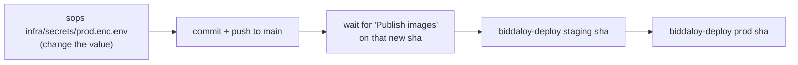

Prod will refuse a SHA staging has not passed, so a secret-only change still goes
through staging first (or use `--hotfix "rotate leaked JWT_SECRET"` when it
cannot wait). Commands and a value-free check:
[28-platform-runbook.md, Rotate a secret](28-platform-runbook.md#rotate-a-secret).

Every rotation is those same steps plus the extra step in the table.

| Secret                                      | Extra step                                                                                                                                                                                                                                                                                                                                                                                                  | What breaks                                                                                                                                        | How often                  |
| ------------------------------------------- | ----------------------------------------------------------------------------------------------------------------------------------------------------------------------------------------------------------------------------------------------------------------------------------------------------------------------------------------------------------------------------------------------------------- | -------------------------------------------------------------------------------------------------------------------------------------------------- | -------------------------- |
| `JWT_SECRET`, scheduled                     | Old value to `JWT_SECRET_PREVIOUS` (verify-only, Rule 10), set the new one, deploy. Wait out the access-token lifetime (15 min), empty `JWT_SECRET_PREVIOUS`, deploy again.                                                                                                                                                                                                                                 | Nothing.                                                                                                                                           | Yearly                     |
| `JWT_SECRET`, leaked                        | Set the new value and leave `JWT_SECRET_PREVIOUS` **empty**, deploy. Never keep a leaked value as `_PREVIOUS`: anyone holding it could still forge tokens.                                                                                                                                                                                                                                                  | Open access tokens get one 401; clients re-mint through their refresh token (a DB row), so nobody signs in again.                                  | On leak                    |
| `SETTINGS_ENCRYPTION_KEY`                   | Old value to `SETTINGS_ENCRYPTION_KEY_PREVIOUS`, deploy, run `yarn settings:reencrypt` (a ts-node script in `server/`; the prod image has no ts-node and no `src/`, so run it from a server checkout on the VM with `DATABASE_URL` at `127.0.0.1:5432` and both keys set), then empty `_PREVIOUS` and deploy. On a leak, do all of it at once: `_PREVIOUS` is needed to re-encrypt, so drop it right after. | Stored provider settings unreadable if the re-encrypt step is skipped.                                                                             | Yearly, or on leak         |
| `POSTGRES_PASSWORD`                         | `ALTER ROLE ... PASSWORD` in the running db first, then change the value and redeploy.                                                                                                                                                                                                                                                                                                                      | App cannot connect between the two steps.                                                                                                          | Yearly                     |
| `S3_ACCESS_KEY_ID` / `S3_SECRET_ACCESS_KEY` | Change the value and redeploy. SeaweedFS reads the same two env vars, so the deploy recreates `seaweedfs`, `app` and `backup` together.                                                                                                                                                                                                                                                                     | Uploads fail only for the seconds between container restarts.                                                                                      | Yearly                     |
| `BACKUP_AGE_PUBLIC_KEY`                     | Make a new age keypair. Put the new public key in `prod.enc.env` and the new private key in `staging.enc.env` (`BACKUP_AGE_PRIVATE_KEY`), deploy staging and prod. Keep the **old private key** offline until the dumps made with it are aged out.                                                                                                                                                          | Old dumps still need the old key; losing it loses them. If staging still has the old private key, tomorrow's refresh cannot decrypt the new dumps. | On leak of the private key |
| `BACKUP_S3_*`                               | Make a new bucket key in the storage console, change the value, redeploy.                                                                                                                                                                                                                                                                                                                                   | Backups fail to upload until updated.                                                                                                              | Yearly                     |
| `BACKUP_RCLONE_CRYPT_PASSWORD` / `_SALT`    | Re-sync the remote with the new values (old files are unreadable under new ones).                                                                                                                                                                                                                                                                                                                           | Existing backup copies unreadable until re-synced.                                                                                                 | Only on leak               |
| `TURNSTILE_SECRET_KEY`                      | Rotate in the Cloudflare dashboard, change the value, redeploy.                                                                                                                                                                                                                                                                                                                                             | Public forms fail closed in production (Rule 22) until updated.                                                                                    | On leak                    |
| `GOOGLE_OAUTH_*`, `FACEBOOK_OAUTH_*`        | Reset the client secret in the provider console, change the value, redeploy.                                                                                                                                                                                                                                                                                                                                | Social sign-in fails until updated; password sign-in works.                                                                                        | On leak                    |
| `PLATFORM_SMS_API_KEY`                      | New key at the SMS provider, change the value, redeploy.                                                                                                                                                                                                                                                                                                                                                    | Platform alert SMS is only logged, not sent.                                                                                                       | On leak                    |
| `HEALTH_TOKEN`                              | Change the value, redeploy. The deploy and `biddaloy-doctor` read it from the same `.env`, so nothing else needs updating.                                                                                                                                                                                                                                                                                  | Nothing, once the deploy finishes.                                                                                                                 | Yearly                     |
| `CLOUDFLARE_TUNNEL_CREDENTIALS_JSON`        | Create a new tunnel secret in Zero Trust, put the credentials JSON on one line in `edge.enc.env`, deploy `edge`.                                                                                                                                                                                                                                                                                            | The site is unreachable (tunnel mode) until `cloudflared` restarts with the new file.                                                              | On leak                    |
| `GHCR_PULL_TOKEN`                           | New token with only `read:packages`, put it in `edge.enc.env`, deploy any project.                                                                                                                                                                                                                                                                                                                          | Image pulls fail with `FAILED at: registry` until updated.                                                                                         | Yearly                     |
| `TELEGRAM_BOT_TOKEN`                        | New token from BotFather in `edge.enc.env`.                                                                                                                                                                                                                                                                                                                                                                 | Deploy messages stop; the deploy itself still works (it fails open).                                                                               | On leak                    |

Log of practised rotations (fill in when done): `JWT_SECRET` on staging:
_not yet practised_.
