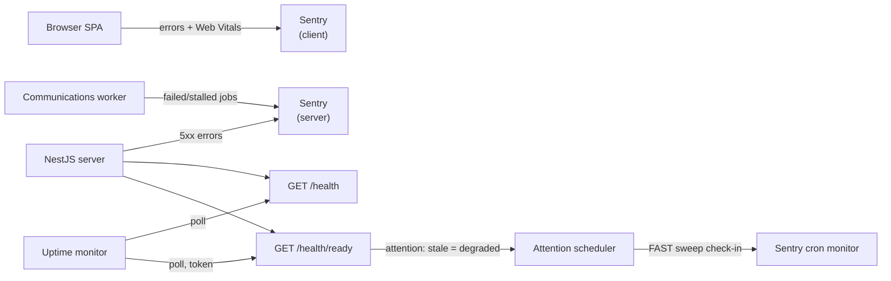
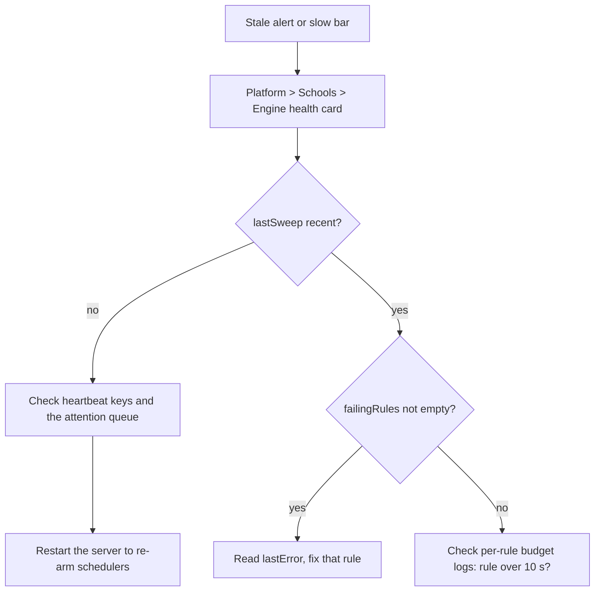
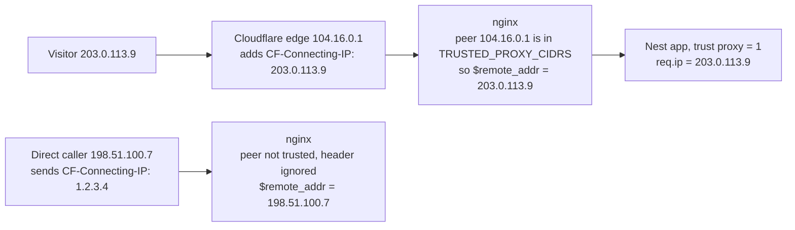
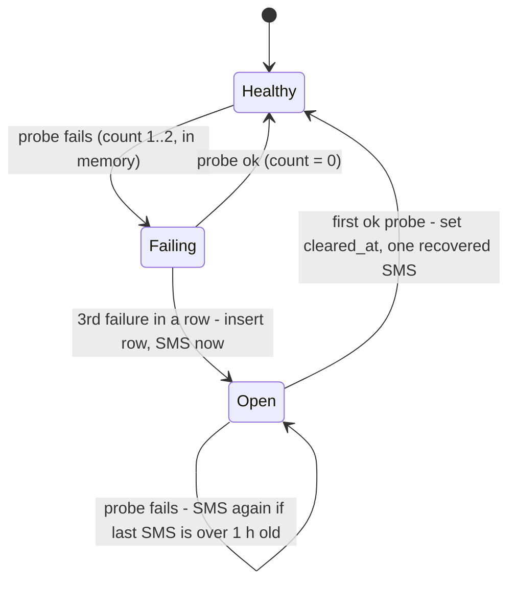
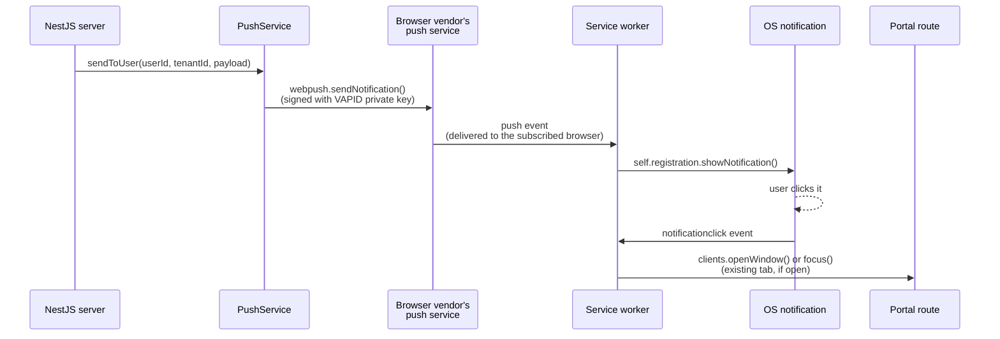
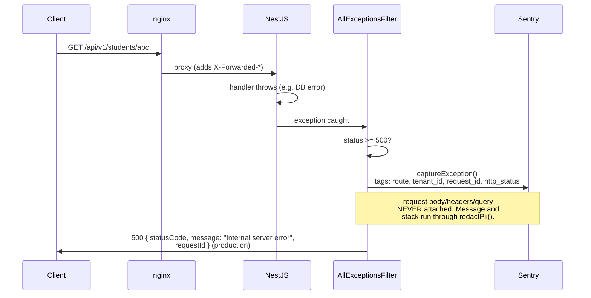
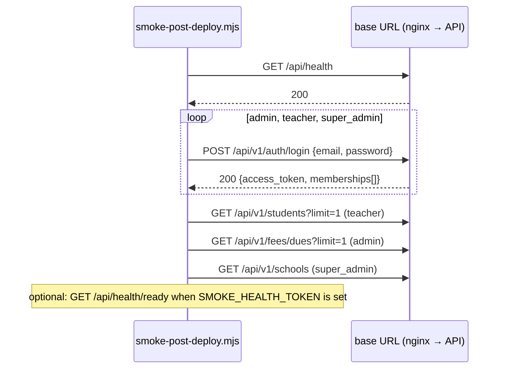

# Operations

> Written for whoever's on call at 2 a.m. Each section is short on purpose —
> if you need more detail than this, follow the link out to the code.

## 1. What is monitored



- **Sentry (client)** — render/route errors, LCP/CLS/INP. See
  [`10-third-party-services.md`](10-third-party-services.md) and
  `ui/src/api/sentry.ts`.
- **Sentry (server)** — every 5xx response and every terminal
  communications-job failure. See [§5](#5-what-gets-attached-and-what-gets-scrubbed) below.
- **`GET /health`** — liveness. Cheap, no dependency checks. Never fails
  because Postgres or Redis is down.
- **`GET /health/ready`** — readiness. Checks Postgres, Redis, the
  communications queue, and the attention engine heartbeat. Only Postgres
  down is `fail` (503); Redis, the queue or a stale engine is `degraded` (200),
  so a Redis outage does not take the instance out of the load balancer. Token-protected, blocked at nginx from outside the
  cluster — see [§3.2](#32-readiness-failing).

## 2. Alert thresholds (configure these in Sentry / your uptime tool)

| Signal                               | Threshold                                 | Where to configure                                           |
| ------------------------------------ | ----------------------------------------- | ------------------------------------------------------------ |
| 5xx rate                             | > 1% of requests over 5 min               | Sentry alert rule on the server project                      |
| `communications job stalled` message | any occurrence                            | Sentry alert rule (issue alert, not metric)                  |
| Readiness failing (Postgres down)    | `/health/ready` returns 503 for > 2 min   | Uptime monitor hitting `/health/ready` with `X-Health-Token` |
| Attention cron check-in missed       | > 15 min                                  | Sentry Cron Monitor (5-min schedule, 15-min margin)          |
| Engine stale reported by readiness   | `checks.attention = "stale"` for > 15 min | Uptime monitor body match on `/health/ready`                 |

## 3. Runbooks

### 3.1 5xx spike

1. Open the Sentry issue — it carries `route`, `tenant_id`, `request_id`,
   `http_status` tags (never the request body/headers).
2. Cross-reference the production log by `request_id` — one JSON line per
   request, see [§4](#4-env-var-reference) for `LOG_LEVEL`.
3. If it's one tenant: check that tenant's recent config changes (schools
   settings) before assuming a code bug.
4. If it's every tenant: check the last deploy and Postgres/Redis health
   (`/health/ready`) first — a bad deploy or a dependency outage looks like
   "everything 500s at once."

### 3.2 Readiness failing

`/health/ready`'s body names exactly which dependency failed —
`{ "status": "fail", "checks": { "db": "ok", "redis": "fail", "queue": "ok" } }`
— never a hostname or error message (that would leak infra details to
anything that can reach the token-gated route).

1. **`db: fail`** — check the `db` container/instance is up and accepting
   connections; check `DATABASE_URL` hasn't rotated.
2. **`redis: fail`** — status is `degraded` (HTTP 200), not `fail`. Check the
   `redis` container/instance and `REDIS_URL`. BullMQ (the communications
   queue) and the rate limiter depend on it; see "When Redis is down" in
   [`08-security.md`](08-security.md). The uptime monitor will not page for
   this: the platform alert covers a Redis outage, see [§3.6](#36-platform-alert-redis-down).
3. **`queue: fail`** — Redis is reachable but the queue itself can't be
   read; check for a BullMQ version mismatch or a stuck connection pool.

Each probe is bounded to 2 seconds — a slow dependency fails fast rather
than hanging the whole check.

### 3.3 Failed / stalled communication jobs

A communication (SMS/WhatsApp/email) job that exhausts its retries, or
stalls, sends a Sentry event tagged `queue`, `job_name`, `tenant_id`,
`communication_log_id`, `medium` — never the recipient address or message
body.

1. Take `communication_log_id` from the Sentry tag.
2. Look up that row: `SELECT * FROM communication_log WHERE id = '<id>'` —
   `metadata.error` has the provider's failure reason.
3. **Retry**: re-queue the same log id through the normal reminder/resend
   flow (see [`05-communications.md`](05-communications.md)) — don't hand-edit
   the row's status, that bypasses the batch-outcome accounting.
4. **Mark failed and move on**: leave the row as `FAILED`; nothing further
   happens automatically — a stuck `PROCESSING` row past its worker's lock
   window is what "stalled" means, and BullMQ already retries it once on
   your behalf before this alert fires.

### 3.4 Attention engine stale or slow

The engine writes a heartbeat after every sweep. "Stale" means the FAST heartbeat
is missing, older than 15 minutes, or every school failed. Users then see old
alerts (`GET /attention/summary` reports `staleMinutes`). Nothing else breaks.



1. **Heartbeat.** In Redis: `GET attention:heartbeat:FAST` (also `HOURLY`, `DAILY`).
   Example: `{"at":"2026-10-10T08:15:02Z","durationMs":412,"tenants":3,"failures":0}`.
   An old `at` means no sweep has finished.
2. **Queue.** BullMQ queue `attention` (sweeps) and `attention-delivery`
   (delayed pushes). Look for a paused queue, a dead worker, or a pile of
   waiting jobs.
3. **Failing rules.** `GET /platform/attention/health` (SUPER_ADMIN), or the card.
   `failingRules[].lastError` is the first 200 characters of the error. Keys
   live in Redis as `attention:failing:<rule>` for 24 hours.
4. **Slow rules.** Search the server log for `Rule <key> failed for tenant ...:
rule budget exceeded`. A rule gets 10 seconds, then is skipped for that
   school; other rules still run. Sweep time is also logged:
   `Attention FAST sweep: 3 tenants in 412ms`.
5. **Re-arm.** Schedulers are registered at boot with `upsertJobScheduler`, so
   a restart of the server re-creates them. No manual step beyond that.
6. **Alerts look wrong but the engine is fine?** The summary is cached for 60
   seconds; a snoozed item wakes on the next FAST sweep.

Measured sweep and summary timings: [23-attention.md](23-attention.md#performance).

### 3.5 Cloudflare IP ranges changed

Behind Cloudflare, every request reaches nginx from a Cloudflare edge address.
`TRUSTED_PROXY_CIDRS` lists those addresses. When the TCP peer is in the list,
nginx takes the visitor IP from `CF-Connecting-IP`. Anyone else sending that
header is ignored, so nobody can fake their IP.



Cloudflare publishes new ranges now and then. To refresh:

1. Fetch `https://www.cloudflare.com/ips-v4/` and `https://www.cloudflare.com/ips-v6/`.
2. Put all lines, space separated, in `TRUSTED_PROXY_CIDRS` in `.env`
   (example list in `.env.example`).
3. Check: `docker compose run --rm nginx nginx -t`. A bad entry fails with
   `trusted-proxies.sh: invalid entry '<x>'`.
4. Apply: `docker compose up -d nginx`.

Check the lists again whenever the quarterly checklist ([75.31]) says so.

After enabling the list, confirm the app logs show real client IPs, not a
Docker bridge gateway (`172.x`). If they show the gateway, the host uses
Docker's userland proxy, which hides the source IP: do not enable the origin
lock-down on that host. Loopback is the only always-allowed range; private
ranges are not exempt.

Rollback: set `TRUSTED_PROXY_CIDRS=` (empty) and `docker compose up -d nginx`.
Empty means no CDN trust at all, which is how the stack behaved before.

### 3.6 Platform alert: Redis down

Redis down means sign-in is closed (75.18), but `/health/ready` is only `degraded`, so an uptime
monitor does not page. The API raises its own alert, kept in Postgres so it works with Redis gone.



Order of events (a probe runs every 30 s, so about 90 s after Redis dies):

1. A `platform_alerts` row `REDIS_DOWN` opens (at most one open row, enforced by a unique index).
2. Every verified SUPER_ADMIN phone gets a text, then another every hour:
   `[production] ALERT: Redis is down since 08:02 UTC. Sign-in is closed. Repeats hourly until fixed.`
3. `GET /api/v1/platform/alerts` (SUPER_ADMIN only) returns the open row for the banner (75.35).
4. The first good probe clears the row and sends one text:
   `[production] RECOVERED: Redis is back at 08:40 UTC after 38 min. Sign-in is open again.`

Limit: a SUPER_ADMIN's 15-minute access token keeps working, but once it expires `/auth/refresh` is
closed too, so the banner can no longer be reached. The SMS is the channel that still arrives.

**Confirm recovery:** `GET /api/v1/platform/alerts` returns `{ "alerts": [] }` and `/health/ready`
shows `"redis": "ok"`.

The loop runs in the API process only (not in scripts, not under `NODE_ENV=test`), uses no BullMQ,
and sends SMS straight to the provider with the platform's own key, not a school's credits. With no
`PLATFORM_SMS_API_KEY` it logs `platform alert SMS not configured; would text N phone(s): ...`.

## 4. Env var reference

| Variable                    | Required in prod?      | What it does                                                                       |
| --------------------------- | ---------------------- | ---------------------------------------------------------------------------------- |
| `SENTRY_DSN`                | No (recommended)       | Server Sentry project. Unset = server Sentry is a no-op.                           |
| `SENTRY_ENVIRONMENT`        | No                     | Defaults to `NODE_ENV`.                                                            |
| `SENTRY_RELEASE`            | No                     | Tags events with a release/version string.                                         |
| `SENTRY_TRACES_SAMPLE_RATE` | No                     | Fraction of requests traced, default `0.1`.                                        |
| `HEALTH_TOKEN`              | No (recommended)       | Required to call `/health/ready` at all — unset means that route 404s.             |
| `LOG_LEVEL`                 | No                     | Pino's log level; see `.env.example`.                                              |
| `ATTENTION_SENTRY_CRON_URL` | No (recommended)       | Sentry Cron Monitor check-in URL for attention sweeps; unset = no check-ins.       |
| `TRUSTED_PROXY_CIDRS`       | No (only behind a CDN) | nginx only. CDN ranges whose `CF-Connecting-IP` is trusted; empty = off (§3.5).    |
| `PLATFORM_SMS_PROVIDER`     | No (for alert SMS)     | `greenweb` (default) or `mimsms`. Provider for platform alert texts (§3.6).        |
| `PLATFORM_SMS_API_KEY`      | No (recommended)       | Unset = alert SMS is only logged, never sent.                                      |
| `PLATFORM_SMS_SENDER_ID`    | With `mimsms`          | Sender id for MimSMS.                                                              |
| `PLATFORM_SMS_API_URL`      | No                     | Overrides the provider's send URL.                                                 |
| `PLATFORM_ALERT_PHONES`     | No                     | Comma-separated fallback phones, used only when no SUPER_ADMIN has a verified one. |

Smoke-check variables (read by `scripts/smoke-post-deploy.mjs`, see §7). They
are **operator machine only, never in the app's env**:

| Variable                                         | What it does                                                                           |
| ------------------------------------------------ | -------------------------------------------------------------------------------------- |
| `SMOKE_BASE_URL`                                 | Base URL when `--base-url` is not passed.                                              |
| `SMOKE_ADMIN_EMAIL` / `SMOKE_ADMIN_PASSWORD`     | Login for the ADMIN smoke account.                                                     |
| `SMOKE_TEACHER_EMAIL` / `SMOKE_TEACHER_PASSWORD` | Login for the TEACHER smoke account.                                                   |
| `SMOKE_SUPER_ADMIN_EMAIL` / `_PASSWORD`          | Login for the SUPER_ADMIN smoke account.                                               |
| `SMOKE_HEALTH_TOKEN`                             | Optional. Adds a `/api/health/ready` check (internal URL only; nginx 404s it outside). |

## 5. Web push (VAPID keys)

Web push (browser/OS notifications — see
[`05-communications.md`](05-communications.md#push-first-dispatch-for-routine-automated-notifications-555))
needs a **VAPID** keypair. VAPID (Voluntary Application Server
Identification) is just a signature: it proves to the browser vendor's
push service (Chrome's, Firefox's, etc.) that notifications came from
_this_ server, not an impersonator.

### Generating and storing keys

```bash
node scripts/generate-vapid-keys.mjs
```

prints a public/private keypair. Three env vars, all required together
(`PushConfigService.isPushEnabled()` — push silently no-ops if any is
missing, it never crashes boot):

| Variable            | Where it goes     | Notes                                                                                               |
| ------------------- | ----------------- | --------------------------------------------------------------------------------------------------- |
| `VAPID_PUBLIC_KEY`  | Host env (server) | Also handed to the client SW to subscribe.                                                          |
| `VAPID_PRIVATE_KEY` | **Host env only** | **Never commit it. Never log it.** Anyone with this key can send push notifications as this server. |
| `VAPID_SUBJECT`     | Host env (server) | A `mailto:` address or `https:` URL identifying this deployment — not generated, set it yourself.   |

### Rotation cost

Rotating the keypair is not free — state this plainly to anyone about to
do it:

- A new keypair makes existing subscriptions incompatible with it.
  Browsers reject push messages signed by a key they didn't subscribe
  with.
- A send to an old subscription may be rejected for invalid VAPID
  authentication. `PushService.sendToUser` only prunes the row on a
  404/410 from the browser's push service (a truly dead subscription,
  same cleanup path as a guardian who uninstalled the PWA) — other
  rejections just increment `failure_count` and the row stays.
- Clients do not silently re-subscribe. A guardian must run the
  subscribe flow again (toggling push on in the portal) to create a
  subscription bound to the new `VAPID_PUBLIC_KEY`.
- **Net effect**: after rotating, every guardian falls back to their
  normal channel (SMS/WhatsApp/email) for routine notices until they
  explicitly re-subscribe. Rotate only when you have to (e.g. key
  compromise) — not as routine hygiene.

### Send flow



See `server/src/modules/push/push.service.ts` for the server side and
`client-admin/src/sw.ts` / `sw-push.ts` for the service-worker handlers.

## 6. What gets attached and what gets scrubbed



Example event a support engineer actually sees in Sentry (illustrative,
not a real capture):

```json
{
  "message": "duplicate key for [REDACTED_EMAIL]",
  "tags": {
    "route": "/api/v1/students/:id",
    "tenant_id": "8f1c...",
    "request_id": "b6e2...",
    "http_status": 500
  },
  "request": null
}
```

Redaction reuses one function, `redactPii` in
[`server/src/common/redact-log.util.ts`](../../server/src/common/redact-log.util.ts)
— the production log line, the Sentry event, and the client-side scrubber
in `ui/src/api/sentry.ts` all apply the same email/phone/sensitive-key
patterns, so there's exactly one place to update if the PII shape ever
changes.

## 7. Post-deploy smoke check

`yarn smoke:post-deploy --base-url <url>` checks, in about 5 seconds, that a
fresh deploy answers the seven things a real school needs. It stops at the first
failure. Run it after every deploy and in every Epic 75 wave-close.



Example run:

```text
$ yarn smoke:post-deploy --base-url https://staging.example.com
PASS  GET  /api/health  200  41ms
PASS  POST /api/v1/auth/login (admin)  200  212ms
PASS  POST /api/v1/auth/login (teacher)  200  198ms
PASS  POST /api/v1/auth/login (super_admin)  200  205ms
PASS  GET  /api/v1/students?limit=1 (teacher)  200  63ms
PASS  GET  /api/v1/fees/dues?limit=1 (admin)  200  88ms
PASS  GET  /api/v1/schools (super_admin)  200  52ms
smoke: 7/7 passed
```

Credentials come from the `SMOKE_*` env vars in §4, never from arguments. Exit
code: 0 all passed, 1 a check failed, 2 bad usage (missing variable). Output
never contains a token, password, email or response body.

The only write is the login: one refresh-token row and one audit row per
account per run. In production use **dedicated smoke accounts** for this
reason.

Against the local dev stack with the seed accounts:

```bash
SMOKE_ADMIN_EMAIL=admin@biddaloy.test SMOKE_ADMIN_PASSWORD=$SEED_ADMIN_PASSWORD \
SMOKE_TEACHER_EMAIL=teacher@biddaloy.test SMOKE_TEACHER_PASSWORD=$SEED_ADMIN_PASSWORD \
SMOKE_SUPER_ADMIN_EMAIL=superadmin@biddaloy.test SMOKE_SUPER_ADMIN_PASSWORD=$SEED_ADMIN_PASSWORD \
  yarn smoke:post-deploy --base-url http://localhost:3000
```

### What a FAIL means

| Failing line                                | Go to                                                                           |
| ------------------------------------------- | ------------------------------------------------------------------------------- |
| `GET /api/health`                           | [§3.1](#31-5xx-spike)                                                           |
| `POST /api/v1/auth/login`                   | If Redis is down, `/auth/*` is closed on purpose: [§3.2](#32-readiness-failing) |
| `GET /api/health/ready`                     | [§3.2](#32-readiness-failing)                                                   |
| Any line ending `timeout`                   | The API is hung or unreachable in time: [§3.1](#31-5xx-spike)                   |
| Any line ending `network error`             | Nothing answered at the base URL: check DNS, nginx and that the app is up       |
| A read (`students`, `fees/dues`, `schools`) | [§3.1](#31-5xx-spike) for 5xx; a 401/403 means a smoke account lost its role    |
