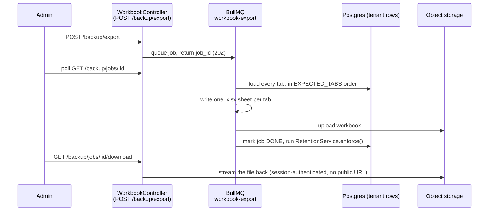
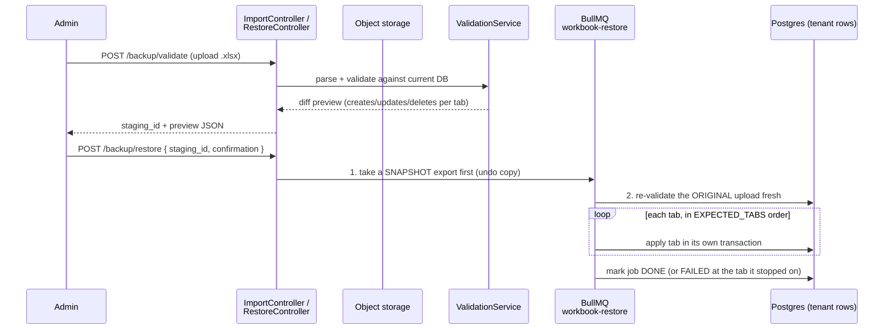
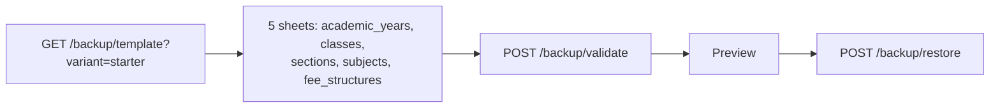
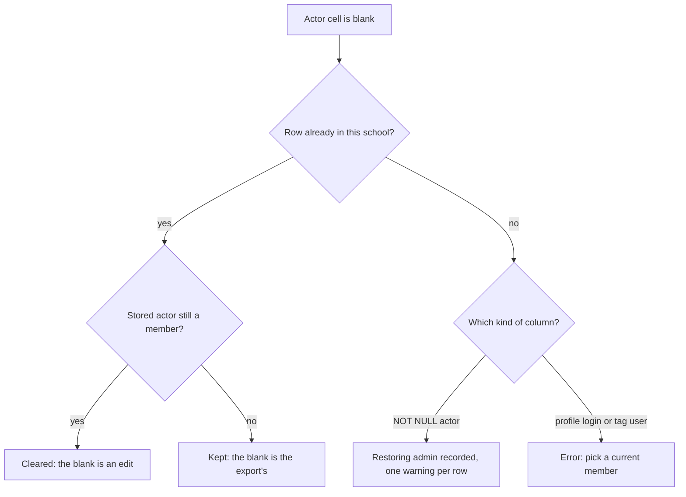
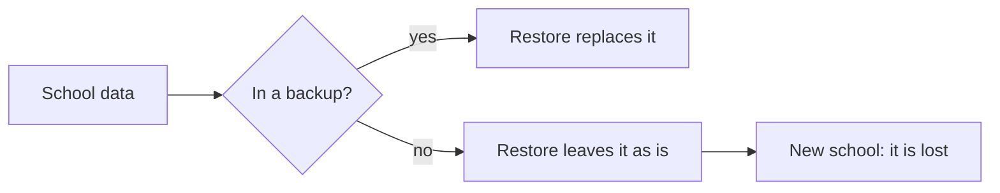
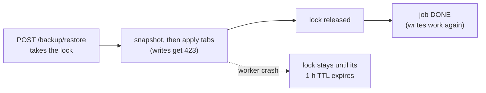
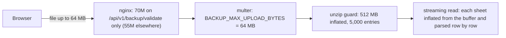
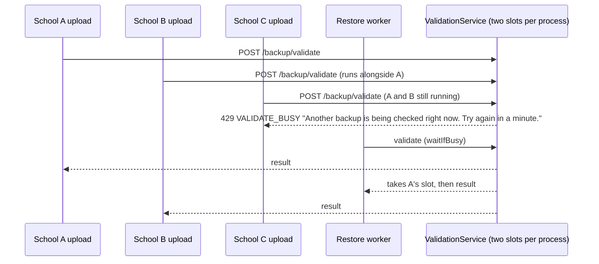

# The school workbook: per-school backup, restore & migration

An admin can export their **own school's data** (not the whole platform) to
one `.xlsx` file, and later restore from one. This is a different thing from
the nightly `pg_dump` covered in
[13-backup-restore.md](13-backup-restore.md) — see "Two kinds of backup" in
that doc for how they relate.

Everything below reflects what shipped in Epic 14 ("School Backup &
Migration", #427), all merged to `main` as of wave 4.

## Export flow



A finished export is a `workbook_jobs` row (`kind: EXPORT`) plus one object
in the bucket. There's never a public or signed link — every download goes
through the authenticated `GET /backup/jobs/:id/download` route, same as how
`13-backup-restore.md` describes school logos.

## Restore flow

Anonymous-survey answers found in an older file are skipped with a warning, and a restore refuses to change a survey's `anonymous` setting.



Two HTTP round trips, on purpose: `POST /backup/validate` never writes
tenant data — it only stages a dry-run preview an admin reviews before
typing the confirmation phrase. `POST /backup/restore` is the only route
that touches real rows.

## The starter workbook (Epic 13.0)

A brand-new school does not need all the tabs. `GET /backup/template?variant=starter`
returns a smaller blank file, and the onboarding wizard's Excel door uses it.



The five names are `STARTER_TABS` in
`server/src/modules/workbook/template/template.constants.ts`. The full
template (`variant=full`, the default) has every tab. A template file is
`TEMPLATE` kind, so it can never delete anything by absence (see below).
The wizard also enables "Create these" only when the preview has no updates or
deletes. That check is in the client; a server-side flag is open as #1698.
The starter file is also offered under Settings, Backup & restore.

**Why `seat_limit`, `trial_ends_at` and `onboarding` are in no tab.** They are
the destination school's commercial and setup state. A file must not be able
to extend a trial, raise a seat limit or fake finished setup. The `school`
tab leaves them out (`tabs/school/school.tab.ts`). Seats are still enforced
when a restore adds students, see [34-onboarding.md](34-onboarding.md).

## The tabs (table lists the original 18; later epics add more)

Applied (and exported) strictly in this order — a tab may only reference a
tab earlier in the list, so one forward pass is always a valid restore
order (`server/src/modules/workbook/codec/registry.ts`, `EXPECTED_TABS`).

| #   | Tab                            | Natural key                                                                    | Deletes by absence? | Notable exclusions (why)                                                                                                                                                                                                                                                                                                                          |
| --- | ------------------------------ | ------------------------------------------------------------------------------ | ------------------- | ------------------------------------------------------------------------------------------------------------------------------------------------------------------------------------------------------------------------------------------------------------------------------------------------------------------------------------------------- |
| 1   | `school`                       | `name`                                                                         | No                  | `slug`, `domain` — identity/DNS of the destination tenant, never overwritten by a restore. `logo_key` — lives in the bucket, not the workbook. `status`, `status_reason`, `status_changed_at` — destination's own lifecycle                                                                                                                       |
| 2   | `academic_years`               | `name`                                                                         | Yes                 | —                                                                                                                                                                                                                                                                                                                                                 |
| 3   | `classes`                      | `name` + `academic_year`                                                       | Yes                 | `numeric_grade` (display-sort hint, derivable)                                                                                                                                                                                                                                                                                                    |
| 4   | `sections`                     | `class` + `academic_year` + `section_name`                                     | Yes                 | —                                                                                                                                                                                                                                                                                                                                                 |
| 5   | `subjects`                     | `code`                                                                         | Yes                 | —                                                                                                                                                                                                                                                                                                                                                 |
| 6   | `class_subjects`               | `class` + `academic_year` + `subject`                                          | Yes                 | —                                                                                                                                                                                                                                                                                                                                                 |
| 7   | `holidays`                     | `academic_year` + `name` + `start_date`                                        | Yes                 | —                                                                                                                                                                                                                                                                                                                                                 |
| 8   | `users`                        | `email`                                                                        | Yes                 | `password_hash` — a credential never leaves the system; restored users re-onboard via the invitation flow. `email_verified_at`/`phone_verified_at` — proof of ownership belongs to the destination. `status`, `profile_picture_url` (bucket), `preferences`, `last_login_at`                                                                      |
| 9   | `teachers`                     | `employee_id`                                                                  | Yes                 | —                                                                                                                                                                                                                                                                                                                                                 |
| 10  | `teacher_assignments`          | `teacher` + `class` + `academic_year` + `section` + `subject`                  | Yes                 | Optional `role` column (`CLASS_TEACHER` / `ASSISTANT_CLASS_TEACHER` / `SUBJECT_TEACHER`). Blank = inferred (subject set → `SUBJECT_TEACHER`, else `CLASS_TEACHER`), so pre-47 files restore unchanged. A role that disagrees with the subject cell is a validation error. Restore replaces a section's class teacher; a `TEMPLATE` import cannot. |
| 10a | `coordinator_assignments`      | `teacher` + `class` + `subject` (blank subject = class coordinator)            | Yes                 | [83.2.3] Registered right after `teacher_assignments`. `assigned_by` is an optional actor (blank when that user left; kept on restore). `created_at` is not exported: the DB stamps it on insert. Rows of a soft-deleted teacher, class or subject are not exported.                                                                              |
| 11  | `guardians`                    | `phone` (falls back to email, then `full_name\|relationship` — see note below) | Yes                 | —                                                                                                                                                                                                                                                                                                                                                 |
| 12  | `students`                     | `registration_number` (globally unique)                                        | Yes                 | —                                                                                                                                                                                                                                                                                                                                                 |
| 13  | `enrollments`                  | `student` + `academic_year`                                                    | Yes                 | —                                                                                                                                                                                                                                                                                                                                                 |
| 14  | `fee_structures`               | `class` + `academic_year` + `section` + `fee_type` + `month` + `name`          | Yes                 | —                                                                                                                                                                                                                                                                                                                                                 |
| 15  | `student_fees`                 | `student` + `academic_year` + `month` + `year`                                 | Yes                 | —                                                                                                                                                                                                                                                                                                                                                 |
| 16  | `invoices`                     | `invoice_number`                                                               | Yes                 | `issuer_snapshot` — the frozen issuer identity at issue time is never carried forward; a restored row falls back to the live school profile instead (D9 of #508)                                                                                                                                                                                  |
| 17  | `payments`                     | `transaction_reference`                                                        | Yes                 | `issuer_snapshot` (same reasoning as invoices)                                                                                                                                                                                                                                                                                                    |
| 18  | `payment_allocations`          | `payment` + `student_fee`                                                      | Yes                 | —                                                                                                                                                                                                                                                                                                                                                 |
| —   | `exam_templates`               | `name`                                                                         | Yes                 | [35.1.5] `tenant_id`, timestamps, `deleted_at` (soft-delete marker). Sits just before `exams` in `EXPECTED_TABS`                                                                                                                                                                                                                                  |
| —   | `exam_template_components`     | `template` + `class_grade` + `subject_code` + `name`                           | Yes                 | [35.1.5] `template` is a ref to `exam_templates` by name; `tenant_id`, timestamps. Hard-deleted (no soft delete)                                                                                                                                                                                                                                  |
| —   | `study_plan_templates`         | `name`                                                                         | Yes                 | [66.1.03] Lessons are JSON in one cell; no topic links (D4)                                                                                                                                                                                                                                                                                       |
| —   | `study_plans`                  | `section` + `subject` + `term`                                                 | Yes                 | [66.1.03] `lessons` and `exam_markers` are JSON; blank `term` = whole year                                                                                                                                                                                                                                                                        |
| —   | `lesson_deliveries`            | `section` + `date` + `period_slot`                                             | Yes                 | [66.1.03]                                                                                                                                                                                                                                                                                                                                         |
| —   | `arrival_notice_subscriptions` | `student` + `guardian`                                                         | Yes                 | [84.2.3] `set_by_user_id`, `locked_by_user_id`, `set_at`, `locked_at` (users are not in a backup); `lock` and `declined_at` are kept; a row that breaks the DB CHECKs is refused on import. Last in `EXPECTED_TABS`                                                                                                                               |

[35.1.5] `class_subjects` also carries an optional `group_name` column (blank
= not group-specific). [35.1.10] It also carries an optional `choice_group` (blank = NULL; old backups lack it); `student_subject_choices` leaves its own `choice_group` out because a DB trigger fills it from the class subject. `school` exports `settings.preset` (it is not a
secret path) and deep-merges it back, so a restored school keeps its preset
claim (D37).

Every tab except `school` deletes by absence — a row missing from the
uploaded sheet is treated as "the admin deleted this row" and removed on
restore. `school` never deletes because it's a singleton profile row, not a
list.

**`guardians`' natural key isn't a real uniqueness guarantee** — `phone` has
a plain (non-unique) index, so two guardians can legitimately share one
phone number. Restore doesn't fail on that; it matches whichever guardian
the key resolves to rather than silently picking one, and treats it as an
accepted limitation of using a human-meaningful key instead of a database
id.

Most `ref`/`ref-list` columns (`class`, `section`, `academic_year`, ...) are
excluded from the raw column list only in the sense that the _foreign-key
id_ is excluded — the export instead writes the referenced tab's natural
key into the cell, and restore resolves it back to a real id.

## Restore semantics, in plain words

- **One database transaction per tab, not one for the whole restore.** If
  tab 12 (`students`) fails, tabs 1–11 stay committed. The safety net for a
  bad restore is the pre-restore snapshot (below), not an all-or-nothing
  rollback.
- **"Failed at tab X" means:** every tab before X in the 18-tab order is
  fully applied (upserts and deletes both), tab X itself did not commit at
  all, and every tab after X was never attempted. The job row is marked
  `FAILED` with `failed_tab` set to X's name — check `GET /backup/jobs/:id`
  for that field.
- **Money and marks are insert-only (D13).** A restore may add rows to
  `payments`, `payment_allocations`, `student_fees`, `invoices`, `exams`,
  `marks`, `mark_grids`, `results`, `result_subjects`, `exam_components`,
  `grading_scales` and `grading_bands`, but never change or remove one. Example: changing a mark from 38 to 78 in Excel fails validation:

  ```text
  Row 4 of "marks" changes value of an existing record. A restore can add marks
  rows but never change them; make this change in the app.
  ```

  Rows missing from the file are kept (warning). A backup from another school can only be
  restored by a platform SUPER_ADMIN.

- **The snapshot is the undo, for the data a backup contains** (except that money/marks rows added by a restore
  are not removed by restoring the snapshot either). Before touching a single row, `POST
/backup/restore` queues a `SNAPSHOT`-kind export of the tenant's _current_
  data and waits for it to finish. If the restore then fails partway (or
  the admin doesn't like the result), that snapshot is downloadable and
  re-uploadable through the exact same restore flow — there's no separate
  "undo" button, undoing is just restoring the snapshot.
- **Re-validation happens twice.** `POST /backup/validate` checks the
  upload against the DB _at preview time_, purely to build the diff the
  admin approves. `POST /backup/restore` re-validates the same original
  upload _again_, fresh, against whatever the DB looks like right before
  applying — because time has passed and someone else may have changed
  data. If that second validation finds any hard error, nothing is
  touched at all (not even tab 1) rather than risk `deleteByAbsence`
  misreading a parse failure as "the admin deleted this row."
- **A `TEMPLATE`-kind workbook can never delete.** `deleteByAbsence` is
  skipped entirely if the uploaded workbook is a blank template rather than
  a real export/restore round trip.
- **File keys stay inside the school (DATA-02).** A cell that names an
  uploaded file (`staff_documents.storage_key`, `students.photo_key`,
  `homework*.attachments[].key`, `admission_applicants.documents[].storage_key`)
  must sit under `tenants/<this school>/<that column's folder>/` (teacher
  `homework` attachments have no fixed folder until #1012). `print_assets`
  and `application_attachments` are checked against `tenants/<this school>/`
  only, with no folder yet (#2355). A key outside `tenants/`
  (for example `backups/db/20261009T020000Z.dump.age`) or in the wrong folder
  is a row error. Foreign keys are rewritten to this school's prefix with a
  warning, never stored: `tenants/<other school>/staff-documents/a.pdf`
  becomes `tenants/<this school>/staff-documents/a.pdf`, which 404s until the
  file is uploaded again. Helper:
  `server/src/modules/workbook/codec/storage-key-scope.ts`.

### A blank actor cell (who wrote, recorded or approved a row)

The export writes a blank in an actor cell when that person is no longer a
member of the school (they left, or they are a platform SUPER_ADMIN). So a
blank can mean "the person left" or "someone cleared it". Restore tells them
apart by looking at the row it already has:



| Blank actor cell                                                                            | Result                              |
| ------------------------------------------------------------------------------------------- | ----------------------------------- |
| Existing row, departed actor                                                                | Kept                                |
| Existing row, current actor, nullable                                                       | Cleared                             |
| Existing row, current actor, NOT NULL (note author, reviewer, requester, creator, uploader) | Kept                                |
| New row, NOT NULL actor                                                                     | The restoring admin, with a warning |
| New row, profile login (#2668)                                                              | Error                               |
| `invoices` and `payments` (insert-only)                                                     | Never changed (D13)                 |

Example. A student note was written by a teacher who has since left. Its
`author` cell is blank in the backup:

- Restored into the same school, the note keeps its stored author.
- Restored into a new school, the note is attributed to the admin running the
  restore. The preview shows: `This row's staff member has left the school; the
restore will record you instead.`

Two rows from different departed actors (same slot and note, or same applicant
and decision) stay two rows: the blank actor is keyed by the row id, not by an
empty string.

A profile login follows #2668: a departed login exports blank, the same school
keeps it, and a new school refuses the teacher or staff row. Workaround:
restore the membership in the source school and export again.

### What a backup does not contain

Some school data is in no backup file yet (tracked in #856). The restore
preview warns about it, so nobody mistakes a backup for a full copy.



Not in a backup: attendance registers and records, attendance devices,
student wallet balances and history, discount rules, recurring fee schedules,
fee generation runs, academic terms, SMS credit balance and history, school
memberships (who can sign in to this school), calendar event classes.

**Anonymous surveys.** A backup never holds the responses or answers of an
anonymous survey, because the file would show who answered what and when.
Example: "Teacher feedback, Term 1 (anonymous)": the backup has the questions
and targets, not the answers. Restoring in the same school keeps the answers
(rows that are not in the file are kept). Moving to a new school loses them.

## The school is read-only while a restore runs (#2210)

A restore deletes rows the workbook does not have. A save made during the
restore is in neither the workbook nor the snapshot, so it would be lost.
So while the restore lock is held, the school is read-only:

- **HTTP writes.** A `POST`/`PUT`/`PATCH`/`DELETE` that goes through
  `ContextGuard` (every school route) gets
  `423 { "message": "...", "details": { "code": "TENANT_RESTORING" } }`.
  Two routes without `ContextGuard` check by hand: the public admission form
  and device ingest (its 423 is documented as retryable; 503 is #2352).
- **Not covered:** the unauthenticated `/auth/*` account routes (activate,
  reset password, OTP login, verify email). They write user-level columns
  (`password_hash`, `status`, `*_verified_at`) that the restore never
  writes, and a user can belong to several schools, so there is no single
  school to freeze. (One edge: a `verify-email` mid-restore can be
  overwritten by the restored email, #2351.)
- **Background jobs that skip or wait:**

  | Job                                  | While the school is restoring                                                                                                                                                                                                                                                           |
  | ------------------------------------ | --------------------------------------------------------------------------------------------------------------------------------------------------------------------------------------------------------------------------------------------------------------------------------------- |
  | fees-daily (bills, late fees, fines) | Re-queues the school for the **same day** every 15 min until the lock clears. The nightly run only catches up a missed fire day while still inside that period, so a plain skip could lose the bills of a period that ends during the restore. `last_run_period` keeps it exactly-once. |
  | study-plan auto deliveries           | Skips; the next 15-minute tick that day writes the rows.                                                                                                                                                                                                                                |
  | scheduled backup                     | Skips that tick (the restore took its own snapshot), so a half-restored school is never saved as a normal backup and retention never prunes a good one for it.                                                                                                                          |
  | guardian invitation batch            | Parks the job for 1 min (`DelayedError`) and checks again.                                                                                                                                                                                                                              |

  Other scheduled senders (attention alerts, absence notices, homework
  defaulters, study-plan flags) do not check yet (#2350).

- `GET` still works.

Example: a MONTHLY schedule with `day_of_month = 1`, restore running at
00:30 on 1 March. fees-daily queues `{ tenantId, today: "2026-03-01" }`;
the run after the lock clears bills March, even if that is 2 March.



**Runbook: a stuck lock.** The lock is the Redis key
`workbook:restore-lock:<tenantId>`. It has a 1 hour TTL, renewed every
5 minutes while the job runs. If the worker crashes, the school stays
read-only until the TTL runs out. To unfreeze it at once, first check that
no restore job for that school is still `RUNNING`, then delete the key:

```bash
redis-cli DEL workbook:restore-lock:00000000-0000-4000-8000-000000000001
```

**Known gap.** The lock is checked when a request starts. A slow write that
started just before the lock was taken can still commit while the snapshot
runs. The window is small and not closed yet.

## Size limits

A backup has to get through four gates to be restorable. The numbers live in
one place, `server/src/modules/workbook/export/export.constants.ts`.



| Limit                      | Value  | Constant                    |
| -------------------------- | ------ | --------------------------- |
| Upload size (zipped file)  | 64 MB  | `BACKUP_MAX_UPLOAD_BYTES`   |
| Inflated size (all sheets) | 512 MB | `BACKUP_MAX_INFLATED_BYTES` |
| Zip entries                | 5,000  | `BACKUP_MAX_ENTRIES`        |

If an export is already over these limits, its job is still `DONE` (you can
download it) but `workbook_jobs.error` holds `RESTORE_LIMIT_EXCEEDED` and the
Backup screen says it is too big to restore.

**Worked example, the 10,000-student load school** (`yarn workspace @biddaloy/server load:seed`):
39.8 MB zipped, 281.9 MB unzipped, 104 entries. That fits under all three
limits with room to spare. Since #2686 the read streams: `readWorkbook`
inflates one sheet at a time straight out of the uploaded buffer and keeps
only the plain rows it returns, never exceljs's whole workbook object model.
What stays resident for the whole read, besides the upload and those rows,
is the workbook's shared-strings table and its styles (`openXlsx` parses
both once, up front, because any sheet may reference them) — that is why the
measured peak increase (RSS growth over the pre-read baseline) is about 1.5x the unzipped size rather than 1x, and what to
size `MAX_CONCURRENT_VALIDATES` against.
(It does not use exceljs's own `WorkbookReader` zip walk — in exceljs 4.4.0
that walk drops whichever zip parts come last, and our exports put the sheet
names last; the module doc comment in `workbook-codec.ts` has the details.)

**Measured validate run (D5 merge gate)**

| Date       | File                                                                                          | Validate time                                                                                         | Peak memory                                                                                                                                                                                                                                                                                                        | Container limit                                                                                                        | Result                                                                                                                                                                                                                                       |
| ---------- | --------------------------------------------------------------------------------------------- | ----------------------------------------------------------------------------------------------------- | ------------------------------------------------------------------------------------------------------------------------------------------------------------------------------------------------------------------------------------------------------------------------------------------------------------------ | ---------------------------------------------------------------------------------------------------------------------- | -------------------------------------------------------------------------------------------------------------------------------------------------------------------------------------------------------------------------------------------- |
| 2026-10-19 | 10k school, 38 MB zipped                                                                      | 74 s                                                                                                  | 1.8 GB RSS during validate (0.95 GB before it); 2.0 GB for the whole export + validate process                                                                                                                                                                                                                     | none: run in a plain Node 24 process on a laptop, not a container (no Docker). The deployment guide suggests 4 GB RAM. | Not refused, no out-of-memory, under Cloudflare's 100 s.                                                                                                                                                                                     |
| 2026-10-21 | 10k school, 38 MB zipped, 281.9 MB unzipped, 95 sheets / 602,482 rows (#2686, streaming read) | `readWorkbook` alone 10.5 s (old in-memory parse on the same file and box: 260.8 s); `validate` 301 s | `readWorkbook` alone: peak 883 MB RSS, +427 MB over the 456 MB before it, i.e. 1.5x the unzipped size (old parse on the same file: peak 510 MB, +264 MB, but 25x slower while V8 fought for heap). `validate` in the same process as the export: peak 1.46 GB, +446 MB over the 1.01 GB the export had left behind | none: Node 24 vitest worker on a laptop, next to another test run (the times are inflated by that; the memory is not)  | The peak increase over the pre-read baseline (+427 MB read, +446 MB validate) is well under 3x the unzipped size (846 MB); the absolute peak (883 MB read, 1.46 GB validate) includes memory already held before the call. No out-of-memory. |

**Two validates at a time per process** (D17). The read streams, but every
row it returns is still resident until the validate finishes (the sheets map
plus the typed rows), so `ValidationService` caps validates at two per API
process. The third upload gets `429 VALIDATE_BUSY`; the restore worker waits
its turn in arrival order (no polling):



An upload is refused straight away (fail closed, no queue of 64 MB buffers).
The restore worker waits instead, because a restore the admin already
confirmed must not fail for this. Raise the cap only after re-measuring the
table above.

Validation of that file reported 216 errors, all in `guardians` and `students` (blank `relationship`, guardians that share a phone number, open dues). They come from the load seed's data, not from size.

### Learnings (Epic #2642, Wave 3, 2026-10-19)

- **Final-attempt export bug (#2625).** An export that failed on its last retry stayed in a running state, and recorders who had left the school broke the user lookup. Cost: a stuck job. Fix: the strict `keyOf('users')` registry resolves departed recorders and a failed export is marked FAILED. Rule candidate: a retrying job sets its terminal state on the final attempt -> no rule.
- **Two sets of size limits (#2624).** Export, validate and restore each had their own caps. Fix: one set of limits, a 64 MB validate upload, and a warning when a restore is near its limit; the 10k-row run was measured. Rule candidate: a new limit reads the shared constant -> no rule.

## Retention, scheduling, and env vars

From `server/src/modules/workbook/schedule/retention.service.ts`, run once
per tenant at the end of every successful export:

| Rule                          | Value                                                                |
| ----------------------------- | -------------------------------------------------------------------- |
| Newest SCHEDULED exports kept | 8 (`KEEP_SCHEDULED_COUNT`)                                           |
| Newest MANUAL exports kept    | 3 (`KEEP_MANUAL_COUNT`)                                              |
| SNAPSHOT max age              | 30 days (`SNAPSHOT_RETENTION_DAYS`)                                  |
| Per-tenant storage cap        | 500 MB (`STORAGE_CAP_BYTES`), oldest unpinned DONE row evicted first |
| Pinned backups                | Exempt from every rule above (still count toward the storage cap)    |

**Scheduling** is a per-tenant setting, not an env var:
`settings.backup.schedule` is one of `OFF` / `DAILY` / `WEEKLY`
(`server/src/modules/workbook/schedule/backup-schedule.service.ts`), cron
`0 2 * * *` (daily) or `0 2 * * 0` (weekly), run in the school's own
timezone (`settings.region.timezone`, default `Asia/Dhaka`).

**Env vars:** the workbook feature reads no dedicated env vars of its own —
it stores to the same S3-compatible bucket every other upload uses. See
[13-backup-restore.md](13-backup-restore.md#env-vars-153x) for
`S3_ENDPOINT`, `S3_BUCKET`, `S3_ACCESS_KEY_ID`, etc. Don't duplicate that
table here.

## Adding a new tab

1. Copy an existing tab in the closest group directory as a starting
   point — `server/src/modules/workbook/tabs/school/school.tab.ts` is the
   simplest example (one row, no natural-key fallback chain).
2. Register the new `TabSpec` in that group's barrel (e.g.
   `tabs/academics/index.ts`), and add its name to `EXPECTED_TABS` in
   `codec/registry.ts` — in dependency order, right after every tab it
   references.
3. Run `codec/registry.completeness.spec.ts` — it fails if any entity
   column is missing from both `columns` and `excluded`, which catches a
   forgotten field immediately.
4. Run `export/export.integration.spec.ts` and
   `restore/restore.integration.spec.ts` — the round-trip tests that export
   real data and restore it back, tab by tab.

## Worked example: a 3-row `students` sheet

Say the uploaded workbook's `students` sheet has:

| id                  | registration_number | full_name    | roll_number | class | academic_year | section | ... |
| ------------------- | ------------------- | ------------ | ----------- | ----- | ------------- | ------- | --- |
| _(blank)_           | STU-2026-101        | Karim Rahman | 12          | Six   | 2026          | A       |     |
| _(blank)_           | STU-2026-102        | Fatima Begum | 5           | Six   | 2026          | A       |     |
| b1c9...-existing-id | STU-2025-044        | Nusrat Jahan | 1           | Six   | 2026          | B       |     |

Two rows are new (blank `id`), one matches an existing student by id. If the
tenant currently has 40 students and this sheet only lists these 3, the
other 37 are absent — `deleteByAbsence: true` means they'll be deleted on
restore.

`POST /backup/validate`'s diff preview for this tab looks like:

```json
{
  "name": "students",
  "present": true,
  "creates": 2,
  "updates": 1,
  "unchanged": 0,
  "deletes": 37
}
```

That's exactly what the admin reviews and must confirm before
`POST /backup/restore` is allowed to run.

## Every `/backup/*` route

All nine tenant-scoped routes require the `BACKUP_MANAGE` permission and
`ADMIN`/`SUPER_ADMIN` roles (`server/src/modules/auth/`).
`/platform/backups/health` is different: it's a cross-tenant,
`SUPER_ADMIN`-only route with no `BACKUP_MANAGE` check at all — see the
controller's own doc comment for why (it reports on every school, not the
caller's tenant).

| Method  | Route                                    | Permission                       | Controller                       |
| ------- | ---------------------------------------- | -------------------------------- | -------------------------------- |
| `POST`  | `/backup/export`                         | `BACKUP_MANAGE`                  | `WorkbookController`             |
| `GET`   | `/backup/jobs`                           | `BACKUP_MANAGE`                  | `WorkbookController`             |
| `GET`   | `/backup/jobs/:id`                       | `BACKUP_MANAGE`                  | `WorkbookController`             |
| `PATCH` | `/backup/jobs/:id/pin`                   | `BACKUP_MANAGE`                  | `WorkbookController`             |
| `GET`   | `/backup/jobs/:id/download`              | `BACKUP_MANAGE`                  | `WorkbookController`             |
| `POST`  | `/backup/restore`                        | `BACKUP_MANAGE`                  | `RestoreController`              |
| `POST`  | `/backup/validate`                       | `BACKUP_MANAGE`                  | `ImportController`               |
| `GET`   | `/backup/validate/:stagingId/errors.csv` | `BACKUP_MANAGE`                  | `ImportController`               |
| `GET`   | `/backup/template`                       | `BACKUP_MANAGE`                  | `TemplateController`             |
| `GET`   | `/platform/backups/health`               | _none — `SUPER_ADMIN` role only_ | `PlatformBackupHealthController` |
