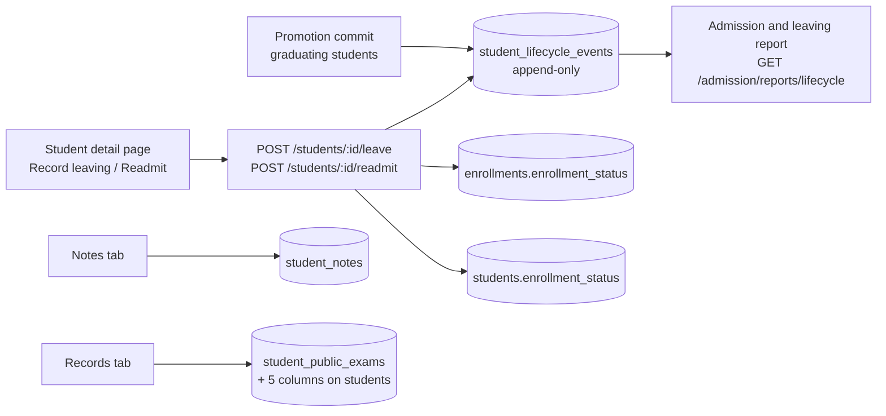
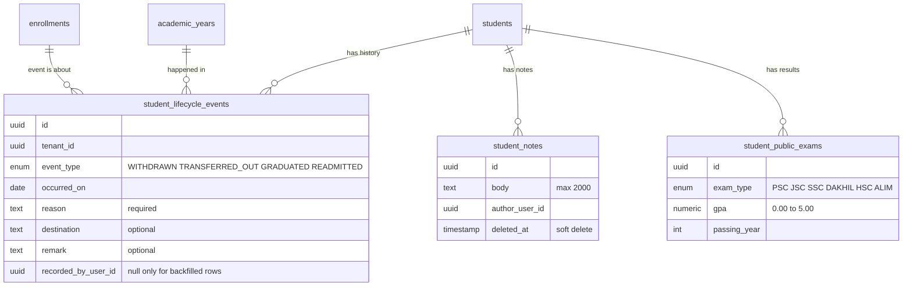
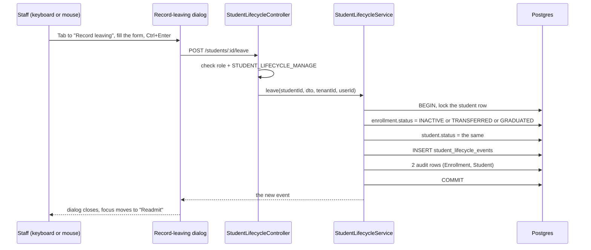
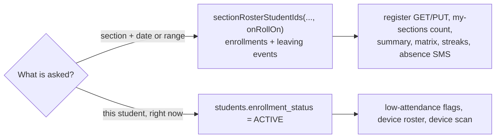
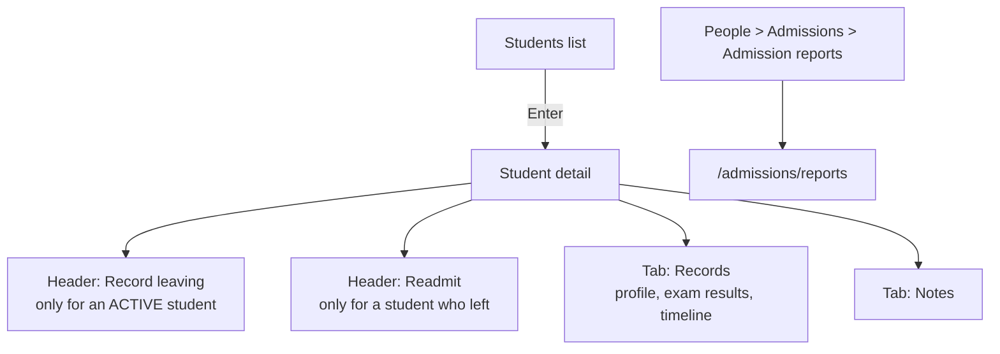
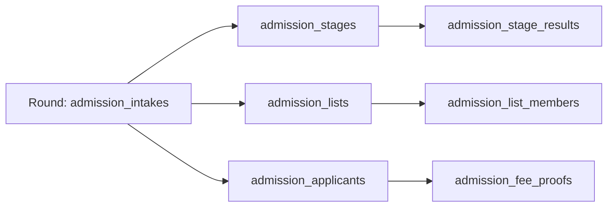
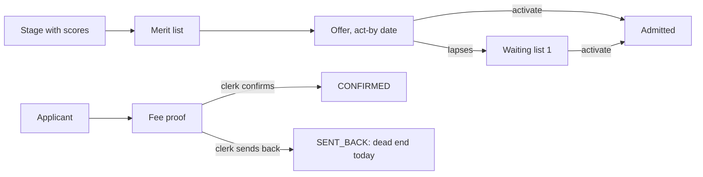

# Student records & lifecycle

Epic 39.0. Answers three questions the old "status dropdown" could not:
**when** did a student leave, graduate or come back, **why**, and **who recorded it**.
It also holds the deeper profile a school needs (religion, birth registration no., health
notes, parents' names), public-exam results, and dated staff notes.

It prints nothing. Epic 43.0 (#1129) prints transfer certificates and testimonials _from_ this
data.

## 1. The big picture



**The one rule that matters:** a student's status changes **only** by recording an event. The
status and the event are written in **one database transaction**, so you can never have one
without the other.

## 2. The data



`students` also gained five nullable columns: `religion`, `birth_reg_no`, `health_notes`,
`father_name`, `mother_name`. `birth_reg_no` is unique per school (a partial unique index).

- Every table has `tenant_id`, and every query filters on it.
- **Events are append-only.** No edit, no delete. A mistaken leave is undone by a `READMITTED`
  event, not by removing the row. (The database does not enforce this; the code just never
  offers an edit. See section 9.)
- The migration is `server/src/migrations/1790800000000-StudentLifecycle.ts`. It also
  **backfills** one event per existing non-ACTIVE enrollment, with `reason` and `remark` both set
  to `backfilled` and no recorder.

## 3. Recording a leaving



The real request and response:

```http
POST /api/v1/students/7c1f.../leave
X-Tenant-ID: <school>

{ "type": "WITHDRAWN", "occurred_on": "2026-09-30", "reason": "Family moved abroad" }
```

```json
{
  "id": "e0a9...",
  "student_id": "7c1f...",
  "enrollment_id": "3b52...",
  "academic_year_id": "9d10...",
  "event_type": "WITHDRAWN",
  "occurred_on": "2026-09-30",
  "reason": "Family moved abroad",
  "destination": null,
  "remark": null,
  "recorded_by_user_id": "a1b2...",
  "created_at": "2026-09-30T10:12:44.000Z"
}
```

What each event does to the status:

| Event             | Student and enrollment become              | Sent as                                               |
| ----------------- | ------------------------------------------ | ----------------------------------------------------- |
| `WITHDRAWN`       | `INACTIVE`                                 | `POST .../leave` with `type`                          |
| `TRANSFERRED_OUT` | `TRANSFERRED` (`destination` is free text) | `POST .../leave` with `type`                          |
| `GRADUATED`       | `GRADUATED`                                | `POST .../leave` with `type`, or the promotion commit |
| `READMITTED`      | `ACTIVE`                                   | `POST .../readmit`                                    |

Rules the server enforces (all covered by tests):

- **`occurred_on` is required** in both `leave` and `readmit` (`YYYY-MM-DD`). The API does **not**
  default it; only the two dialogs pre-fill today's date. Past dates are allowed, **future dates
  are rejected** (there is no scheduler to apply them later).
- **`reason` is required for a leave** (free text, not an enum) but **optional for a readmit**
  (stored as an empty string when omitted).
- Leave closes the student's **latest-year** ACTIVE enrollment. Fee generation only looks at
  ACTIVE students, so a student who has left stops being billed. The leave dialog _warns_ about
  unpaid dues but never blocks.
- **Readmit** reuses the same `students` row and the same registration number. In the **same**
  academic year it reactivates that year's enrollment row. For **another** year it creates a new
  enrollment (`EnrollmentsService.createInTransaction`). The caller picks the class section.
  Readmitting a student who is already ACTIVE is a 409 ("Student is already active"), and so is
  leaving a student who has no ACTIVE enrollment.
- The promotion commit writes a `GRADUATED` event for each graduating student, in the same
  transaction as the status change (`promotions.service.ts`).
- Why not call `EnrollmentsService.update`? It opens its own transaction and cannot join the
  caller's, which would break "status and event commit together". The service writes the
  enrollment and student rows itself through the transaction manager.

### What leaving does to attendance

A student is on a section's attendance roll on date D when their enrollment there is ACTIVE,
or their latest leaving event on that enrollment is dated **after** D. A saved mark always
shows, so a back-dated leave never hides one.

Example: Rahim leaves section 7-B on 3 Oct.

| Register date       | On the roll? |
| ------------------- | ------------ |
| 2 Oct               | yes          |
| 3 Oct (leaving day) | no           |
| 7 Oct               | no           |
| September matrix    | yes          |



A device scan from a student who is not ACTIVE is `rejected` with reason `not_on_roll` and
writes no record. Exams are not affected: the results cohort keeps leavers.

## 4. Status can change no other way

Before this epic, `PATCH /students/:id` and `PATCH /enrollments/:id` accepted
`enrollment_status`, so an ACCOUNTANT (who can update students but has no lifecycle permission)
could write `GRADUATED` directly: no reason, no date, no event. Reviews found **four** routes
that could do this or quietly reactivate a student. All are closed:

| Attempt                                                                  | Result now                                                                               |
| ------------------------------------------------------------------------ | ---------------------------------------------------------------------------------------- |
| `PATCH /students/:id` with `enrollment_status`                           | **400** (the field is not in the DTO; the strict validation pipe rejects unknown fields) |
| `PATCH /enrollments/:id` with `enrollment_status`                        | **400**, same reason                                                                     |
| `PATCH /students/:id` with `class_section_id` for a student who has left | **409**: _use "Readmit"_                                                                 |
| `POST /enrollments` for a student who has left                           | **409**: _use "Readmit"_                                                                 |

The only remaining writers of a status are the lifecycle service, the promotion commit, and a
**workbook restore** (an admin-only backup path that loads rows and never replays side effects).
`server/src/modules/students/student-records-access.e2e-spec.ts` proves each row above over HTTP
with real roles.

## 5. Who can do what

| Permission                      | Roles                                   | Gates                                                                                                            |
| ------------------------------- | --------------------------------------- | ---------------------------------------------------------------------------------------------------------------- |
| `STUDENT_LIFECYCLE_MANAGE`      | ADMIN, EXECUTIVE                        | leave, readmit, the report                                                                                       |
| `STUDENT_NOTES_READ` / `_WRITE` | ADMIN, EXECUTIVE, TEACHER               | the Notes tab (a TEACHER also needs to teach the student's section)                                              |
| `STUDENT_RECORDS_READ`          | ADMIN, EXECUTIVE, TEACHER, OFFICE_STAFF | seeing `health_notes` and the lifecycle history (`GET /students/:id/lifecycle-events`, the Records tab timeline) |
| `STUDENT_RECORDS_WRITE`         | ADMIN, EXECUTIVE, OFFICE_STAFF          | `PATCH /students/:id/records`                                                                                    |

ACCOUNTANT has none of these. A role that is not in a route's role list is refused with **403**
(for example an ACCOUNTANT or TEACHER calling `POST .../leave`).

**Notes never reach a guardian or student.** `health_notes` is stripped from every response
unless the caller has `STUDENT_RECORDS_READ`, including the student routes _and_ the guardian
routes that embed a student (`redactHealthNotes` in `students.service.ts` recurses into
`students`). `guardians.e2e-spec.ts` proves an ACCOUNTANT never sees it.

**Profile edits have their own route.** The Records tab saves through
`PATCH /students/:id/records`, which accepts only the five profile fields. That lets an
EXECUTIVE edit records without being given general student updates.

Every student edit writes an audit row with the changed fields only. `health_notes` is recorded
as _changed_ but its content is never copied into the log.

## 6. The screens



- **Tabs are query state, not routes** (`?tab=records`, via `useDetailShellTab`). So the only
  route this epic added is `/admissions/reports`. The plan first said tabs would be routes; the
  detail page already used `?tab=` for every tab (decision D28).
- **The keyboard path:** Students, `Enter`, detail, `Tab` to "Record leaving", form,
  `Ctrl+Enter`. After the dialog closes, focus moves to the new action ("Readmit"), never to
  `<body>`. The report is reached by `Tab` to its sidebar link.
- **Report:** `GET /admission/reports/lifecycle?academic_year_id=...&class_id=...` returns
  `counts` (`admitted`, `withdrawn`, `transferred_out`, `graduated`, `readmitted`), up to 500
  `rows`, and `truncated`. No export (Epic 8.15 owns exports). Two honest limits: an _admitted_
  row has no registration number (applicants are not linked to a student), and an applicant's
  year comes from intake, class, academic year, not from the admit date.
- **Palette actions are deferred.** The plan wanted "Add note", "Record leaving" and "Readmit"
  in the `Ctrl+K` palette. The palette can only _navigate_ and cannot carry a student id, so
  they are listed in `client-admin/src/unregistered-actions.ts` with `owningEpic: '31.0'`
  (decision D26; same precedent as `fines.log`).

## 7. Backup and restore

The workbook has three new tabs (`student_lifecycle_events`, `student_notes`,
`student_public_exams`) and the five new `students` columns.

- Restore **loads rows; it never replays the lifecycle service**, so it cannot fire events or
  status changes a second time.
- The events tab sets `allowDuplicateKeys`: two same-type events on one day are legitimate data
  (leave, readmit, leave, readmit in one day) and the export must restore.
- A `gpa` outside 0.00 to 5.00 becomes a per-row error, not a failure halfway through a restore.
- Open question: restore removes events that are absent from the workbook.

## 8. Where the code lives

| What                     | Where                                                                                                                                                     |
| ------------------------ | --------------------------------------------------------------------------------------------------------------------------------------------------------- |
| Leave / readmit / events | `server/src/modules/students/student-lifecycle.{service,controller}.ts`                                                                                   |
| Notes, public exams      | `server/src/modules/students/student-notes.*`, `student-public-exams.*`                                                                                   |
| Records route            | `students.controller.ts` (`PATCH students/:id/records`)                                                                                                   |
| Report                   | `server/src/modules/admission/admission-reports.*`                                                                                                        |
| Promotion hook           | `server/src/modules/promotions/promotions.service.ts`                                                                                                     |
| Workbook tabs            | `server/src/modules/workbook/tabs/people/student-*.tab.ts`                                                                                                |
| Student detail UI        | `client-admin/src/routes/_staff/students/-detail/` (`leave-dialog`, `readmit-dialog`, `records-tab`, `notes-tab`)                                         |
| Report UI                | `client-admin/src/features/admission/AdmissionReports.tsx`, route `routes/_staff/admissions/reports/index.tsx`                                            |
| Hooks                    | `ui/src/hooks/student-lifecycle.ts`, `admission-reports.ts`                                                                                               |
| Demo data                | `server/src/scripts/seed.lifecycle.ts` (all in the demo year `2026-2027`)                                                                                 |
| Tests                    | `student-lifecycle.e2e-spec.ts`, `student-records-access.e2e-spec.ts`, `e2e/keyboard/student-lifecycle.spec.ts`, `e2e/keyboard/admission-reports.spec.ts` |

## 9. Known gaps (honest list)

- **Leave closes only the latest-year ACTIVE enrollment (decided, Epic 69 D10, answers #1217).**
  A promoted student can keep an older year's enrollment ACTIVE (promotion does not close the
  source year). We keep it on purpose: once that older year is closed its rows are frozen, and
  `leave` never touches them (`student-lifecycle.service.ts`). Billing is unaffected, and
  readmitting into the older year stays a 409. Promote before you close: a student whose latest
  ACTIVE row is in a just-closed year with no next-year enrollment cannot be recorded as leaving
  until the year is reopened (409 `ACADEMIC_YEAR_CLOSED`).
- **Append-only is a convention, not a database rule.** Nothing at the database level blocks an
  `UPDATE` or `DELETE` on `student_lifecycle_events`.
- **Notes and exam edits are audited as entity `Student`.** The shared `AuditEntityType` has no
  dedicated value for them yet.
- **Other responses that embed a `Student`** may still expose `health_notes`. The student and
  guardian routes are covered; an audit of the rest is open.
- **The `/exams` sidebar link fails the a11y and target-size sweeps on every route.** Not from
  this epic; found while running the sweeps on the report route.
- The migration timestamp is `1790800000000`, not the planned `1790700000000` (Epic 32's print
  module already owned that one).
- **Device scans use current standing, not the scan date.** An offline scan from before a leave,
  uploaded after it, is rejected as `not_on_roll`; the teacher marks it by hand.
- **Left, readmitted, left again** counts as on the roll for the gap in between. Fixing it
  means reading the event sequence.
- **my-sections `unmarked` can read one low** after a back-dated leave: the saved mark counts
  as marked but the student is not in `student_count`.
- Low-attendance flags read `students.enrollment_status`, not enrollments, because older-year
  enrollments can stay ACTIVE after a leave (#1217, unchanged).

## 10. Epic 71 wave 1 learnings (admission pipeline foundation, 2026-11-15)

Each bullet: **surprise**, what it **cost**, the **fix**, and a **rule candidate**.



- **Stage delete races with result writes.** Surprise: stage delete checks "no results yet" under
  the round lock, but nothing that writes `admission_stage_results` takes that lock, so a
  concurrent write can slip in. Cost: a stage could vanish under a fresh result. Fix (owed): the
  ticket that writes results locks the round (or stage) first, or an FK guard blocks the delete.
  Rule candidate: a check made under a lock only holds if every writer takes the same lock.
- **Stage kind can change after results exist.** Surprise: the update path does not refuse it.
  Cost: a score recorded for a written test could end up under a lottery stage. Fix (owed):
  refuse a kind change once results exist. Rule candidate: a column that gives rows meaning is
  frozen once rows depend on it.
- **`publish_channels` and `tie_break` accept any short string.** Surprise: only a length cap
  guards them. Cost: a typo is stored silently. Fix (owed): pin the allowed values in a later
  ticket (shared enum + DTO `@IsIn`). Rule candidate: no free-text column that code later
  compares against fixed values.
- **No DB upper bound on `fee_amount_paisa`.** Surprise: the CHECK only forbids negatives; the DTO
  enforces `MONEY_MAX`. Cost: a direct insert can store an absurd fee. Fix: none yet, the DTO is
  the only guard. Rule candidate: Rule 26 asks for DB CHECKs behind money; add an upper bound
  when the column is next touched.
- **Migration `down()` deletes section-less rounds.** Surprise: rolling back removes rounds with
  no class section, together with their applicants and evaluations. Cost: data loss on rollback
  once pipeline rounds exist. Fix: none (the old schema cannot hold them); take a backup first.
  Rule candidate: say so in the migration header when `down()` is lossy.
- **Excel inline dropdown is capped at 255 characters.** Surprise: when `DocumentKind` grew, the
  print-templates tab of backup/restore broke. Cost: a red dropdown on a base branch. Fix:
  templates skip the dropdown for long enums (`hasInlineDropdown`); a dropdown fed from a hidden
  sheet would bring it back. Rule candidate: a growing enum must never be an inline list.
- **Five new entities were missing from the `app.module.ts` entity list.** Cost: tables existed
  in tests but not in the running app. Fix: added. Rule candidate: the entity-list guard should
  fail on any entity file not registered.
- **`AdmissionIntake` was missing from `YEAR_SCOPED_TABLES` (the `YEAR_SCOPED_WRITES` entry already existed).** Cost: a closed year's round could
  still be edited (Rule 28). Fix: added. Rule candidate: a new `academic_year_id` column joins
  the registry in the same PR.
- **Client-admin has an exhaustive `Record<AdmissionDocumentType>`.** Cost: adding a document
  type breaks the client build until the record is extended. Fix: extended. Rule candidate:
  prefer `Partial<Record<...>>` with a fallback label for enums that grow.
- **Demo seed:** the admission tables moved from the `people-ops` slice to their own `admission`
  slice, one open round per template (six), so every new table has demo rows.

## 11. Epic 71 wave 2 learnings (admission pipeline: scoring, lists, fees, 2026-11-15)

Same format as section 10. The wave built this flow; the bullets below are what it left open.



**Sent-back fee and `admit()`**

- **A sent-back fee applicant is stuck.** Surprise: there is no route to upload a new fee proof
  after a send-back. Cost: the applicant can never reach CONFIRMED. Fix (owed, follow-up
  ticket): a re-submit route for the guardian and for the clerk. Rule candidate: every state a
  user is pushed into needs a route out of it.
- **`admit()` self-exclusion race.** Surprise: the seat count excludes the applicant using a
  status read before the lock. Cost: a concurrent activate can cause a spurious 409 (it fails
  safe, no extra seat is given). Fix (owed): read the status after taking the lock. Rule
  candidate: read what a decision depends on after the lock, not before.

**Closed year (Rule 28)**

- **Three gaps.** Surprise: clerk create has no `assertYearOpen`; `YEAR_SCOPED_WRITES` lacks
  applicants; `admit()` skips the check when `intake.academic_year_id` is null. Cost: a closed
  year can still gain or admit applicants. Fix (owed): add all three. Rule candidate: a new
  table that hangs off a year joins the registry in the ticket that creates it.

**Scoring (#4180)**

- **Only `kind` is locked once results exist.** Surprise: `config.total_marks` can still change
  after scores. Cost: stored scores no longer match the total. Fix (owed): refuse a
  `total_marks` change when results exist. Rule candidate: freeze every field a stored value is
  measured against.
- **A new PUT on a scored stage clears `passed`.** Surprise: this voids a prior commit and nothing
  rechecks downstream; no test covers it. Cost: a list built from the old pass flags can go
  stale. Fix (owed): re-run or refuse, plus a test.

**Lists (#4182)**

- **`createWaiting` truncates MANUAL ids to capacity silently.** Cost: the admin thinks all
  were added. Fix (owed): a 400 naming the overflow.
- **A failed activate with `NO_SEATS_LEFT` rolls back the lapsed-offer expiry and its audit
  row.** Cost: the lapse is retried and re-audited next time. Fix (owed): record the expiry
  outside the activate transaction.
- **`patchMembers` removal returns the applicant to PENDING.** Cost: SHORTLISTED is lost. Fix
  (owed): restore the previous status.

**Money and numbering**

- **No UNIQUE index on `(tenant_id, intake_id, roll_number)`.** Cost: the roll lock is the only
  guard. Fix (owed): add the partial unique index.
- **No DB CHECK upper bound on `fee_amount_paisa`** (same gap as section 10). Rule 26 asks for one.

**Auto-activate job (#4185)**

- **The job swallows any 409 from activate.** Fix (owed): swallow only the four known codes.
- **The job spec mocks the list service,** so no real-database "activates once" test exists.
- **The system actor is `userId: null`** through an `as unknown as ResultActor` cast. Fix (owed):
  a real system-actor type.

**Notifications (#4184)**

- **SMS after commit is not durable.** Surprise: a crash between commit and send loses the SMS.
  Fix (owed): an outbox row written in the same transaction.
- **No unit test for the three new notification templates.**
- **`[CALL]` evaluation rows leak** into the applicant review history and the workbook
  `admission_evaluations` tab. Fix (owed): filter them out of both.
- **`setCalled` does not require the applicant to be on a list.**
- **The stage-PATCH-preserves-`published_at` fix has no regression test.**

**Import (#4181)**

- **The staging id is consumed before the transaction,** so a failed commit burns it. This is
  intentional (an id is never reused).
- **`matchesDeclaredType` has no xlsx case** (Rule 6). Fix (owed): add one in `file-signature.ts`.

**Wave 2 surprises**

- **Stage results had no `attended` column.** ABSENT is stored in `remarks`.
- **The stage `published` flag lives in the `config` JSON,** not a column.
- **The list schema gap needed an extra migration** (`1792310000000`).
- **Hand-copied snapshot rows were padded inconsistently** in 8 old rows; the `-u` regeneration
  at wave close is the only safe way to write them.
- **The git-grep based ops-queues spec cannot see untracked files.** Cost: a new file passes
  locally and fails after `git add`. Rule candidate: `git add -N` first.
- **Demo seed:** the `admission` slice now also builds waiting list 1 (not activated, act-by 10
  days after the anchor) and always shows one fee proof awaiting and one sent back.
