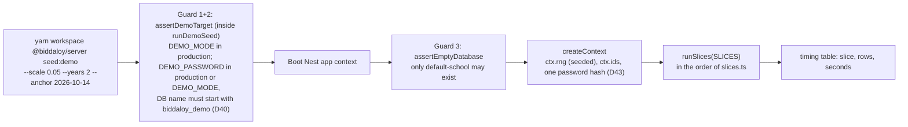
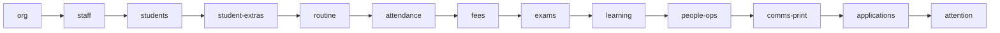
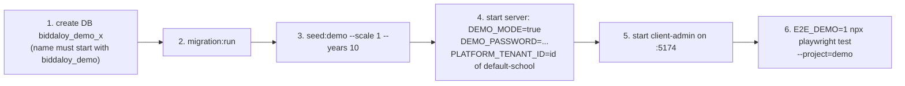
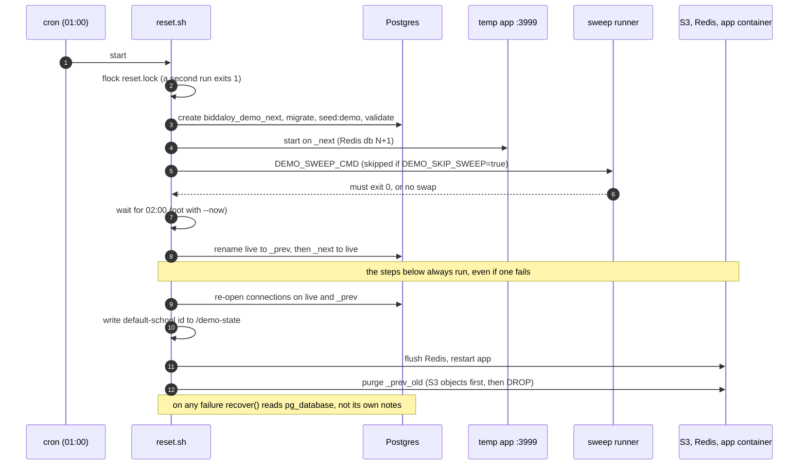
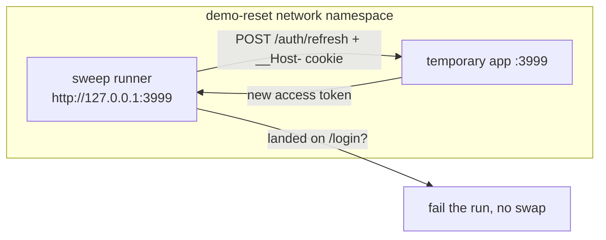
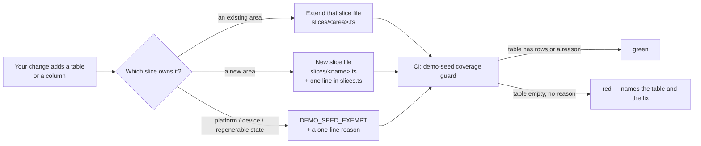
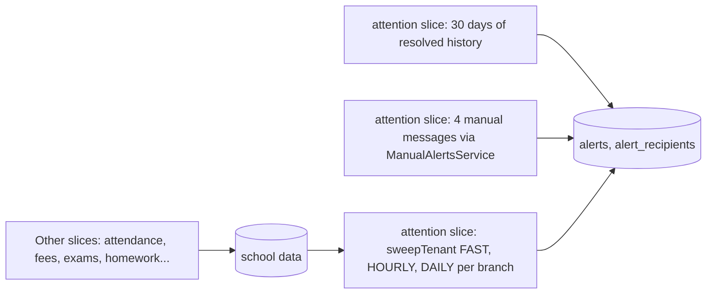

# Demo seed — the demo school every change must keep complete

Biddaloy has **two** seeds. They have different jobs, and this doc is about the
second one.

|            | Dev seed                                        | Demo seed                                                                                        |
| ---------- | ----------------------------------------------- | ------------------------------------------------------------------------------------------------ |
| Command    | `yarn workspace @biddaloy/server seed`          | `yarn workspace @biddaloy/server seed:demo`                                                      |
| Code       | `server/src/scripts/seed.ts`, `seed.util.ts`, … | `server/src/scripts/demo-seed/` (one file per _slice_)                                           |
| For        | e2e tests and local dev                         | the public demo site, staging, load tests, screenshots                                           |
| School     | `default-school` + 3 small test schools         | **Bangladesh Model School & College** — 3 branches (`bmsc-primary`, `bmsc-high`, `bmsc-college`) |
| Size       | 18 students, one month of attendance            | 1,200 students, ~55 staff, **10 years** of history (`--scale` changes the size)                  |
| Dates      | some fixed (`2026-03`)                          | every date derived from `--anchor` (default: today)                                              |
| Pinned by  | `e2e/seed-contract.ts` — don't rename anything  | `server/src/modules/demo/demo-accounts.ts` (the demo login cards)                                |
| Guarded by | review only                                     | a CI **coverage guard**: every table must have demo rows                                         |

The demo seed is built by Epic 58.0 (#1732). The runner (#2159) and the
coverage guard (#2161) are on main as of Wave 1; the slices are filled in
Waves 2 and 3.

## How to run it



| Flag       | Default                 | Meaning                                                       |
| ---------- | ----------------------- | ------------------------------------------------------------- |
| `--scale`  | `1`                     | Size multiplier. `0.05` is the small CI run.                  |
| `--years`  | `10`                    | Years of history (integer, >= 1).                             |
| `--anchor` | today (school timezone) | The demo's "today", `YYYY-MM-DD`. Every date derives from it. |

Before a run, know these:

- **S3 must be up.** The `applications` slice uploads one PDF leave note
  through the real storage service. The app does not boot without
  `S3_ENDPOINT`, `S3_REGION`, `S3_BUCKET`, `S3_ACCESS_KEY_ID` and
  `S3_SECRET_ACCESS_KEY`; if the store behind them is down, the slice fails
  near the end with a message naming those variables. Locally,
  `yarn test-env up` (or the compose `seaweedfs` service) provides one.
- **Set `DEMO_MODE=true`.** The `applications` slice decides requests through
  the real notify services. Only `DEMO_MODE` turns SMS and push into log
  rows; without it they would use the real providers. `seed:demo` prints a
  loud warning when it is not set.

- **`--anchor` must not be in a later month than the real clock.** The `fees`
  slice records last month's and this month's payments through the real
  checkout service, which dates them by the real clock. So
  `--anchor 2026-11-01` run on 2026-10-14 is refused up front, and with an
  earlier anchor the "this month" payments are dated on the run day.

- **A killed run leaves the attendance tables without their plain indexes.**
  The `attendance` slice drops them for its bulk load and rebuilds them at
  the end (UNIQUE indexes stay). A run killed in between (Ctrl-C, OOM) never
  rebuilds them. The seed only targets a fresh database, so drop it and re-run.

Where things live (all under `server/src/scripts/demo-seed/`):

| File                                     | Job                                                                                   |
| ---------------------------------------- | ------------------------------------------------------------------------------------- |
| `index.ts`                               | CLI, `parseArgs`, the three guards, `runSlices`, timing table                         |
| `context.ts`                             | `DemoSlice` and `DemoSeedContext` types; `ctx.rng`, `ctx.ids`, `ctx.demoPasswordHash` |
| `slices.ts`                              | `SLICES` (run order, `attention` last) and the `EXEMPT` map (entity -> reason)        |
| `slices/<area>.ts`                       | One file per slice                                                                    |
| `dates.ts`, `bulk.ts`                    | Date helpers from the anchor; `insertChunked` for bulk history                        |
| `validator.ts`                           | Invariant checks (teacher double-booking, money sums, ...)                            |
| `demo-seed.coverage.integration.spec.ts` | The CI guard                                                                          |

Slices run in this order. Later slices read ids that earlier ones publish in `ctx.ids`, and `attention` is always last
because it derives alerts from everything before it.



### The demo login cards (`DEMO_CARDS`)

Nine cards, defined once in `server/src/modules/demo/demo-accounts.ts`. The seed creates exactly these users and the
login screen shows exactly these cards. Every card uses `DEMO_PASSWORD`.

| Card key           | Role              | Email                     | Branch      | What to try                         |
| ------------------ | ----------------- | ------------------------- | ----------- | ----------------------------------- |
| `admin`            | `ADMIN`           | `admin@bmsc.example`      | `bmsc-high` | dashboard                           |
| `principal`        | `EXECUTIVE`       | `principal@bmsc.example`  | `bmsc-high` | overview                            |
| `accountant`       | `ACCOUNTANT`      | `accountant@bmsc.example` | `bmsc-high` | fees                                |
| `class-teacher-8a` | `TEACHER`         | `teacher8a@bmsc.example`  | `bmsc-high` | attendance                          |
| `exam-controller`  | `EXAM_CONTROLLER` | `exams@bmsc.example`      | `bmsc-high` | exams                               |
| `office-staff`     | `OFFICE_STAFF`    | `office@bmsc.example`     | `bmsc-high` | students                            |
| `committee`        | `COMMITTEE`       | `committee@bmsc.example`  | `bmsc-high` | overview                            |
| `guardian`         | `PARENT`          | `guardian@bmsc.example`   | `bmsc-high` | children (two kids, one in Primary) |
| `student-9b`       | `STUDENT`         | `student9b@bmsc.example`  | `bmsc-high` | homework                            |

`ctx.rng` is one seeded faker, so the same anchor and scale give the same data.
`ctx.ids` is how a slice hands tenant, year and user ids to later slices.
Every seeded login shares one bcrypt hash made once in `createContext` (cost 12
is about 250 ms, so never hash per user). The password is `DEMO_PASSWORD`,
with a local-only fallback.

Output of a run is a table like this (measured, Wave 2, laptop, 2026-10-14):

```text
yarn workspace @biddaloy/server seed:demo --scale 1 --years 10
slice               rows   seconds
org                 3407       1.9
staff                870       1.3
students           33429      36.5
student-extras      6569       2.4
routine             5410      22.5
                         total 80 s (budget: 8 min)

yarn workspace @biddaloy/server seed:demo --scale 0.05 --years 2
org                  588       1.9
staff                871       1.9
students             505       1.1
student-extras       234       1.2
routine             5410      26.6
                         total 52 s (budget: 90 s, D39)
```

`routine` costs the same at every scale: the teaching staff and the weekly
grid are not scaled. It runs the newest year through the real slot service
(8 slots at a time); serial it took 60 to 76 s. Slices after `routine` are
still empty (Wave 3), so these totals grow.

### Final timings (Wave 3 close, 2026-10-14)

Laptop, load average 5 to 6 (other lanes were running, so this is a worst case, not a quiet machine).
Quiet TypeORM logger on (`runDemoSeed` logs errors and warnings only).

```text
yarn workspace @biddaloy/server seed:demo --scale 1 --years 10
slice               rows   seconds
org                 3407       6.6
staff                870       1.9
students           33429      31.2
student-extras      6569       2.0
routine             5410      15.2
attendance       7673189    1057.7   <- 74% of the run
fees              547150     174.2
exams             394462      61.0
learning          120008       9.7
people-ops          3542       0.3
comms-print        32339      16.0
applications        8087       1.5
attention           1425      26.2
                         total 1425 s = 23.7 min (budget: 20 min, D8: OVER)

pg_database_size 2686 MB. Big tables: marks 183k, invoices 121k, payments 121k.
```

The small run in the coverage spec (scale 0.05, 2 years) took 101 s against its 90 s budget (D39) on the same loaded machine.
`attendance` already bulk-loads through `INSERT ... SELECT FROM unnest(...)`, so `insertChunked` would not help; the
rows themselves (7.7 M) are the cost. Both budgets are open items for the product owner, not silently raised.

After a run the invariant validator found nothing (scale 1, 10 years).

## Running the demo end to end



Two things that are easy to miss:

- Under `yarn test-env run -- ... seed:demo` the throwaway database is named `biddaloy_test_run_*`, which the
  seed refuses. Create a database whose name starts with `biddaloy_demo` (for example `biddaloy_demo_local`), run
  `CREATE EXTENSION "uuid-ossp"` in it, point `DATABASE_URL` at it, then `migration:run` and `seed:demo`.

- `DemoBootGuard` refuses to start if the database holds any school that is not
  a demo branch. A migrated database always has `default-school`, so set
  `PLATFORM_TENANT_ID` to its id (`SELECT id FROM schools WHERE slug = 'default-school'`).
- The `demo` project is opt-in. It only exists when `E2E_DEMO=1`, so a plain
  `playwright test` and the sweeps never run it. CI does not run it yet
  (58.4.02 wires it into the nightly pipeline).

```bash
E2E_DEMO=1 npx playwright test --project=demo --workers=1
```

It checks: 9 cards and one `<h1>` on `/login`; Enter on the focused first card;
the ribbon never covers the account button at 1440 and 390 px; "View as another
role" returns to `/login`; the guardian switches from the Secondary to the
Primary branch and sees the Class 3 child. Admin and the guardian have several
memberships, so they pass the school picker first (the card's `branchSlug`
is only a label today).

## The nightly reset (`scripts/demo/reset.sh`, #2178)

The demo host rebuilds itself every night. The new database is built **beside** the live one, so a
bad night costs nothing: the old demo keeps running.

Names used below: `biddaloy_demo` is the live database. `_next` is tomorrow's, built aside.
`_prev` is yesterday's. `_prev_old` is the one before that, waiting to be deleted.



Run it by hand (skips the 02:00 wait):

```bash
docker compose -f docker-compose.yml -f docker-compose.demo.yml run --rm demo-reset /app/reset.sh --now
```

The tests are `scripts/demo/reset.infra.test.sh`. CI runs them in the infra job (they start a throwaway Postgres there); locally they use the `yarn test-env up` Postgres.

### What goes wrong, and what is left behind

| Failure                              | State afterwards                                                                                     | Sentry |
| ------------------------------------ | ---------------------------------------------------------------------------------------------------- | ------ |
| Build, validate or sweep fails       | `_next` and its S3 objects are dropped. Yesterday's demo keeps running.                              | error  |
| A rename fails mid-swap              | `recover()` renames `_prev` back and logs `rolled back: yesterday's database is biddaloy_demo again` | error  |
| The rollback itself fails            | Log says `ROLLBACK FAILED` and names the databases. Finish by hand with the runbook below.           | error  |
| A step after the swap fails          | The new demo is live. Exit 1 with `swapped, but these steps failed: redis-flush purge-...`.          | error  |
| A second reset starts while one runs | Exits 1 with `another reset is running`. Nothing is touched.                                         | none   |

`recover()` asks `pg_database` what really happened, because psql can report an error for a rename that did commit.

### Safety, how it is built

- **Only `biddaloy_demo*` databases.** Every `DROP` and `RENAME` goes through one name check (`assert_demo_name`).
  The script refuses to start unless `DEMO_MODE=true`, `S3_BUCKET` is a plain bucket name containing `demo`
  (`biddaloy-demo` yes, `prod/demo` no), and no `SMS_*`, `SMTP_*` or `VAPID_*` variable is set (for example
  `SMTP_USER=mailer` is refused too).
- **One previous database is kept, with its files.** `_prev` keeps its S3 objects until it is dropped as `_prev_old`
  the next night, so a rollback brings back a demo whose files still exist.
- **The database is picked with `DATABASE_URL`** (the server reads no `DB_NAME`).
- **`PLATFORM_TENANT_ID` changes every night.** A fresh migration makes a new random `default-school` id, and
  `TenantStatusService.platformTenantId()` uses `PLATFORM_TENANT_ID` to find the platform tenant. The reset writes the id
  to the `demo-state` volume and the `app` service reads it at start. So `app` will not start until the first reset has
  run once (that first run logs `app not restarted: first run`).
- **Build-time Redis is not the app's.** Migrate, seed, validate and the temporary app use Redis db N+1, so the live
  app's workers never see jobs for tenants that exist only in `_next`.
- **S3 needs no prefix.** Keys are `tenants/<tenant-id>/...` and every reset creates new tenant ids, so a new run never
  collides with an old one. Instead of the planned `S3_PREFIX` or second bucket, the reset deletes `tenants/<id>/` for
  each `bmsc-%` school of a database it drops. Objects go first, the database second: if S3 fails, the database (and so
  the list of ids) stays, and the next run tries again.
- **The base `backup` service is off on the demo host** (its 02:00 dump would hit the 02:00 swap).

### Host env variables

Set these in the host `.env`. Compose passes them to `demo-reset`. Rows marked "set by compose" are fixed in
`docker-compose.demo.yml`: a value in `.env` does nothing for them.

| Variable                                       | Default                                      | Example                                            | Notes                                                                                                                                                                                                                       |
| ---------------------------------------------- | -------------------------------------------- | -------------------------------------------------- | --------------------------------------------------------------------------------------------------------------------------------------------------------------------------------------------------------------------------- |
| `DEMO_MODE`                                    | `true`, set by compose                       | `true`                                             | Leave it. `reset.sh` and the server refuse to run without it.                                                                                                                                                               |
| `DEMO_PASSWORD`                                | none, required                               | `Demo-Public-2026`                                 | Shown on the login screen, so it is public.                                                                                                                                                                                 |
| `S3_BUCKET`                                    | none, required                               | `biddaloy-demo`                                    | A plain name containing `demo`. The reset deletes objects in it.                                                                                                                                                            |
| `REDIS_URL`                                    | `redis://redis:6379` (db 0), set by compose  | `redis://redis:6379`                               | Fixed by compose for `app` and `demo-reset`. `reset.sh` needs a db below 15 (it builds on db N+1).                                                                                                                          |
| `SENTRY_CRONS_URL`                             | empty (no check-ins)                         | `https://o1.ingest.sentry.io/api/2/cron/demo/KEY/` | Gets `?status=in_progress`, then `ok` or `error`.                                                                                                                                                                           |
| `DEMO_RESET_PUSH_URL`                          | empty (no push)                              | `https://ops.<domain>/kuma/api/push/TOKEN`         | Uptime Kuma push monitor `demo-reset-nightly`: `?status=up&msg=ok` or `?status=down&msg=error`. Any query on the URL is dropped; the URL is never logged. A push that gets no 2xx is logged as `Kuma push got HTTP <code>`. |
| `DEMO_RESET_PUSH_ACCESS_CLIENT_ID` / `_SECRET` | empty (no headers)                           | the `demo-reset-push` Access service token         | Kuma is behind Cloudflare Access on the prod host, so the push sends these as `CF-Access-Client-Id` / `-Secret` (on stdin, never on the command line). Setup: [25-cloudflare.md, Ops](25-cloudflare.md#ops-opsdomain).      |
| `DEMO_RESET_SCHEDULE`                          | `0 1 * * *` (01:00 Asia/Dhaka)               | `30 0 * * *`                                       | One five-field cron expression. A start between 00:00 and 02:00 waits for 02:00 to swap; a start after 02:00 (or before midnight) swaps as soon as the build passes.                                                        |
| `DEMO_SKIP_SWEEP`                              | empty                                        | `true`                                             | Needed today. See "The nightly sweep".                                                                                                                                                                                      |
| `DEMO_SWEEP_CMD`                               | empty                                        | `/app/run-sweep.sh`                                | A command that drives a Playwright runner. Needed unless `DEMO_SKIP_SWEEP=true`.                                                                                                                                            |
| `DEMO_SWEEP_URL`                               | `http://127.0.0.1:3999` (compose and script) | `http://127.0.0.1:3999`                            | Where the sweep finds the temporary app. Plain HTTP must be loopback (see "Staying signed in").                                                                                                                             |
| `DEMO_SWEEP_TIMEOUT`                           | `1800` (seconds)                             | `900`                                              | The sweep is killed after this.                                                                                                                                                                                             |
| `DEMO_STATE_DIR`                               | `/demo-state`, set by compose                | `/demo-state`                                      | Holds `reset.lock` and `platform-tenant-id`.                                                                                                                                                                                |
| `DEMO_SCALE`                                   | `1`                                          | `0.05`                                             | Seed size.                                                                                                                                                                                                                  |
| `DEMO_YEARS`                                   | `10`                                         | `2`                                                | Years of history.                                                                                                                                                                                                           |
| `TURNSTILE_SECRET_KEY`                         | empty                                        | `0x4AAAAAAA...`                                    | Server. Needs its client twin below, or the public admission form refuses to submit (D42).                                                                                                                                  |
| `VITE_TURNSTILE_SITE_KEY`                      | empty                                        | `0x4AAAAAAA...`                                    | Client build arg. Make both keys in Cloudflare for the demo hostname.                                                                                                                                                       |

`reset.sh` also reads these. They are not host settings, because compose pins them or the script defaults them:
`DEMO_SWAP_AT` (default `02:00`; compose does **not** pass it, so change it only with `run -e DEMO_SWAP_AT=03:00`),
`DEMO_SWEEP_PORT` (`3999`), `DEMO_APP_CONTAINER` (`biddaloy-demo-app`),
`DEMO_RESTART_CMD` (default `docker restart $DEMO_APP_CONTAINER`), `DOCKER_HOST`, `S3_ENDPOINT`, `S3_REGION`,
`S3_ACCESS_KEY_ID`, `S3_SECRET_ACCESS_KEY`, `S3_ALLOW_INSECURE_HTTP`, and the test hooks
`DEMO_MIGRATE_CMD`, `DEMO_SEED_CMD`, `DEMO_VALIDATE_CMD`, `DEMO_APP_CMD`, `DEMO_PSQL`, `DEMO_REDIS_CLI`.

**Never set `SMS_*`, `SMTP_*` or `VAPID_*`** on the demo host. `reset.sh` refuses to run if any variable with one
of those prefixes is set (D2).
One hole remains: platform alerts text operators straight through the SMS gateway, outside the `DEMO_MODE`
log-only switch. So leave `PLATFORM_SMS_API_KEY` and `PLATFORM_ALERT_PHONES` unset on the demo host.

### The nightly sweep

Before the swap, a Playwright run signs in as each of the 9 demo cards and visits every route that role may see.
A 5xx response, an error boundary, a console error, or a page that lands on `/login` (the session was lost) fails
the run, and then **no swap happens**.

```bash
yarn workspace @biddaloy/shared build   # the sweep reads shared/dist
E2E_DEMO_NIGHTLY=1 DEMO_SWEEP_URL=http://127.0.0.1:3999 yarn e2e --project=demo-nightly --workers=3
```

Measured: scale 0.05 took 3.7 to 5.2 min with 3 workers (two runs) and 9.7 min with 1. The budget is 8 min at
full scale (`globalTimeout` is 8 min whenever `DEMO_SWEEP_URL` is set). Always pass `--project=demo-nightly`:
`DEMO_SWEEP_URL` adds that project but does not limit the run to it.

**Staying signed in on plain HTTP.** The refresh cookie is `__Host-refresh_token`, which is always `Secure`. Over
plain HTTP, Chromium keeps a `Secure` cookie only on `localhost` and `127.0.0.1`. At `http://demo-reset:3999` every
page would reload signed out. Measured on 2026-10-15 with a two-line cookie server:

| Sweep URL                  | Chromium flag `--unsafely-treat-insecure-origin-as-secure` | Cookie sent back |
| -------------------------- | ---------------------------------------------------------- | ---------------- |
| `http://demo-reset:<port>` | off                                                        | no               |
| `http://demo-reset:<port>` | on (page becomes a secure context)                         | **still no**     |
| `http://127.0.0.1:<port>`  | off                                                        | yes              |

So the runner shares `demo-reset`'s network namespace (`network_mode: service:demo-reset`) and uses
`http://127.0.0.1:3999`. The app's cookie stays exactly as it is in production. `playwright.config.ts` refuses a
plain-HTTP `DEMO_SWEEP_URL` that is not loopback, and each visit also fails if it lands on a signed-out page.



**The sweep cannot run on the demo host yet.** The `demo-reset` image is Alpine. It has no Playwright and no browsers,
and it cannot `docker run` one (it has no Docker socket). So today, **keep `DEMO_SKIP_SWEEP=true`** until a runner
service exists. That runner must share `demo-reset`'s network namespace and use `http://127.0.0.1:3999` (see above).

Three lists in `e2e/demo/sweep-allowlist.ts` decide what the sweep tolerates or skips (a fourth, `CONSOLE_ERROR_ALLOWLIST`, is empty):

| List             | Holds                                                                                                      | Edit it when                                                                                             |
| ---------------- | ---------------------------------------------------------------------------------------------------------- | -------------------------------------------------------------------------------------------------------- |
| `KNOWN_ISSUES`   | A route and the only roles whose error boundary is a known app bug, with the issue number                  | A real bug would block the swap and the fix is not in yet. Delete the entry when the issue is fixed.     |
| `EXPECTED_SKIPS` | Detail routes with no row link to open, at any scale (each entry says why)                                 | A new detail route has no way in. Any other skipped route fails the run.                                 |
| `NOT_SWEPT`      | Routes the sweep never visits, each with a reason (signed-out pages, platform console, hashed-token links) | A new route has no permission entry and no way to visit it. Without an entry the sweep refuses to start. |

Bugs the sweep found:

- **#2513**: `/attendance/staff` shows an error state for every staff role but admin (`GET /users` needs `USER_READ`). It is in `KNOWN_ISSUES`.
- **#2514**: the route permission map and the API guards disagree, so pages load but their data calls return 403 for allowed roles.

### Security of the reset host

- **`demo-docker-proxy` can stop, restart or kill ANY container on the host**, not only `biddaloy-demo-app`. The proxy
  image cannot name one container. A takeover of `demo-reset` could stop `db`, nginx or the proxy itself, but cannot create,
  exec into or inspect one. This is acceptable only because the host runs nothing but the demo. Follow-up: #2512.
- **`demo-reset` runs as root.** It needs that to write the `demo-state` volume, and it also holds the database superuser
  password. Follow-up: #2512.

### Roll back a bad night

Yesterday's database is still there as `biddaloy_demo_prev`, with its S3 objects. Run this on the demo host.

```bash
C="docker compose -f docker-compose.yml -f docker-compose.demo.yml"
SQL='psql -U "$POSTGRES_USER" -d postgres -c'

# 1. Stop both. A reset waiting for 02:00 would swap again on top of you.
$C stop demo-reset app

# 2. Swap the names back. The bad night becomes _prev_old, so the next reset deletes it AND its S3
#    objects (a database dropped by hand leaves its tenants/<id>/ files behind for good).
#    If a biddaloy_demo_prev_old already exists, purge it first: stop here and ask.
$C exec -T db sh -c "$SQL 'ALTER DATABASE biddaloy_demo RENAME TO biddaloy_demo_prev_old'"
$C exec -T db sh -c "$SQL 'ALTER DATABASE biddaloy_demo_prev RENAME TO biddaloy_demo'"

# 3. Rewrite the id file with the restored database's default-school id.
ID=$($C exec -T db sh -c "psql -U \"\$POSTGRES_USER\" -d biddaloy_demo -tAc \"SELECT id FROM schools WHERE slug = 'default-school'\"" | tr -d '[:space:]')
$C run --rm --no-deps demo-reset sh -c "echo $ID > /demo-state/platform-tenant-id"

# 4. Flush the app's Redis db: its caches and jobs belong to the bad night.
$C exec -T redis redis-cli FLUSHDB    # add -n <db> if REDIS_URL names a db

# 5. Start again. Do not drop biddaloy_demo_prev_old by hand: the next nightly reset deletes it with its files.
$C up -d app demo-reset
```

### Before the first live run

Nobody could check these locally. Tick each one on the host.

- [ ] Docker Compose is new enough for `additional_contexts: app: service:app` (2.20.2 reads it as a folder).
- [ ] The first `docker compose build` works. It installs `flock` and pulls the `docker-socket-proxy` image.
- [ ] `docker restart biddaloy-demo-app` works through the proxy. With the container missing it prints `No such container`, which is the first-run path.
- [ ] `nginx -t` passes on the host. (CI's infra job already runs `nginx -t` with `nginx/demo` mounted, and `docker compose ... config -q` on the overlay.)
- [ ] The sweep runner shares `demo-reset`'s network namespace and reaches `http://127.0.0.1:3999`.
- [ ] Swap downtime at scale 1 is under 10 s. Look for `swap done; downtime from backend terminate to reconnect: N s` in the log.
- [ ] The sweep finishes in under 8 min at full scale with 3 workers (it took 3.7 to 5.2 min at scale 0.05).
- [ ] `SENTRY_CRONS_URL` is set, and a test run shows `in_progress` then `ok` in Sentry.

### Demo mode switches

What `DEMO_MODE=true` does. The decision numbers are from Epic 58 (#1732).

| Decision | Behaviour                                                                                                                                                                                                                                                                                                                     |
| -------- | ----------------------------------------------------------------------------------------------------------------------------------------------------------------------------------------------------------------------------------------------------------------------------------------------------------------------------- |
| D2       | SMS, email and push are log-only. Password change, reset and OTP are off. No lockout. The trial and backup schedulers are off.                                                                                                                                                                                                |
| D23      | Destructive and bulk routes answer "disabled in demo": workbook restore and import, bulk upload, bulk delete, academic-year delete, removing demo accounts, school danger zone. The settings "Test connection" route (`POST /schools/:id/settings/test`) is blocked too.                                                      |
| D24      | Multipart bodies over 2 MB are refused.                                                                                                                                                                                                                                                                                       |
| D27      | Every response carries `X-Robots-Tag: noindex, nofollow`, and nginx serves a disallow-all `robots.txt` from `nginx/demo/`.                                                                                                                                                                                                    |
| D30      | Logins use the normal password login. The boot guard refuses to start if any school is not a `bmsc-*` branch (see [08-security.md](08-security.md#demo-boot-check-5801) and [Demo seed safety](08-security.md#demo-seed-safety-5813)). It runs after the BullMQ workers start, so a bad row stops the process a moment later. |

## The rule

> **Any change that adds or changes a database table or column also updates
> the demo seed so the feature has realistic data in the demo school.**
> That includes epics, single tickets and bug fixes.

Why: the demo site is how customers first see Biddaloy. A feature with an empty
screen in the demo looks broken, and nobody notices until a sales call.



### Before the guard exists (historic; it is on main now)

There is nothing to run yet. Instead:

1. In your PR description, add a line: `Demo seed: <entity> — needs rows for <story>`.
2. Comment the same line on #2177 (Epic 58's wave-close). Epic 58 absorbs
   everything that lands before its Wave 3 (decision D39 on #1732).

### After the guard is on main

1. Find the slice that owns your area. The table of slices and the entities
   each one `covers` is in `server/src/scripts/demo-seed/slices.ts`.
2. Add your entity to that slice's `covers` list and write its rows in `run()`.
   Use a new slice file if no area fits.
3. Run the guard locally:
   `yarn workspace @biddaloy/server vitest run src/scripts/demo-seed/demo-seed.coverage.integration.spec.ts`.

A real slice, trimmed (`slices/student-extras.ts`). It lists what it `covers`, reads earlier slices' ids, uses a
real service for files, and takes every random choice from `ctx.rng`:

```ts
export const slice: DemoSlice = {
  name: 'student-extras',
  covers: [StudentSubjectChoice, StudentNote, StudentPublicExam],
  run: async (ctx: DemoSeedContext) => {
    const org = orgIds(ctx); // ids the `org` slice published
    const { students } = studentIds(ctx); // ids the `students` slice published
    const storage = ctx.app.get(StorageService); // the real service
    for (const t of org.tenants) {
      // Named (not random) keys: the same seed must give the same data.
      const key = tenantObjectKeyNamed(t.id, 'student-photo', ctx.rng.string.uuid(), 'jpg');
      await storage.put(key, avatar(1), 'image/jpeg');
    }
    // ... then insertChunked(...) for the bulk rows, and return the row count
  },
};
```

Then add one line to `SLICES` in `slices.ts` (a new file) and run the guard.

## Safety rules for anyone touching the demo seed

These hold for every slice, forever. Reviewers reject a diff that breaks one.

| #   | Rule                                                                                                                                                                                                                                   | Why                                                                                            |
| --- | -------------------------------------------------------------------------------------------------------------------------------------------------------------------------------------------------------------------------------------- | ---------------------------------------------------------------------------------------------- |
| 1   | **No literal dates.** Derive every date from `ctx.anchor` (`dates.ts` helpers).                                                                                                                                                        | The site resets nightly; a fixed date goes stale on day 2. #1981 is this bug in the dev seed.  |
| 2   | **Fresh DB only.** No "find or update" logic, and never move existing rows to make dates fit.                                                                                                                                          | The runner refuses a non-empty DB. Atomicity comes from building a side DB and swapping it in. |
| 3   | **Randomness only from `ctx.rng`.** No `Math.random()`, no `Date.now()`.                                                                                                                                                               | Same anchor + same scale gives the same business data, so a failure is reproducible.           |
| 4   | **"Today" and anything with a hard invariant goes through the real service** (routine slots, fee generation, payments, promotions, result publishing). **Bulk history** uses `insertChunked` with the same columns the service writes. | Services enforce rules a raw insert skips (e.g. teacher double-booking).                       |
| 5   | **No real people or contacts.** Names come from `seed-data/demo-bn/`; phones run from `01700-000001`, emails end in `@bmsc.example`.                                                                                                   | The site is public.                                                                            |
| 6   | **Never call an SMS, email or push provider directly.** Messages go through the normal path; `DEMO_MODE` turns them into log rows.                                                                                                     | Nothing may leave the demo server.                                                             |
| 7   | **Stay inside the `bmsc-*` tenants.** Read ids from `ctx.ids`; never look rows up by display name.                                                                                                                                     | Tenant isolation, and names change.                                                            |
| 8   | **Money adds up.** Per student: fees = allocations + discounts + waivers + outstanding. The validator checks it.                                                                                                                       | Finance screens are the first thing a principal opens.                                         |
| 9   | **Stay inside the time budget.** The PR CI run (scale 0.05, 2 years) must stay under 90 s. The nightly full run (scale 1, 10 years) must stay under 20 min.                                                                            | A slow seed misses the 02:00 swap.                                                             |
| 10  | **Exempt only with a reason** in `DEMO_SEED_EXEMPT` (device-bound, platform-only, regenerable).                                                                                                                                        | An exemption without a reason is a hidden empty screen.                                        |
| 11  | **Fees, payments and invoices slices are money-tier review.**                                                                                                                                                                          | Same tier as the fees module itself.                                                           |
| 12  | **Don't change the dev seed to feed the demo**, and don't change the demo seed to feed e2e.                                                                                                                                            | They are pinned by different contracts.                                                        |

Rule 8 in practice: a bill's `paid_amount` must equal its allocations from live `SUCCESS` payments plus fee generation's wallet auto-apply (`DEBIT_GENERATION`, minus any `REVERSAL` of it). Reversed (`REFUNDED`) and `PENDING`/`FAILED` payments do not count.

### Yearly chore: the Bangladesh holiday table

`seed-data/public-holidays-bd.ts` (`BD_PUBLIC_HOLIDAYS_BY_YEAR`) ends at **2027**. Add **2028** before **2027-07-01**: that day College's 2027-2028 year starts, and the seed then needs 2028. A year missing from the table does not stop the reset. The org slice logs `BD_PUBLIC_HOLIDAYS_BY_YEAR has no 2028 …` and seeds that year with no public holidays, so the calendar looks thin until someone adds it. Each later year has the same deadline: add year N+1 before 1 July of year N.

Rule 6 has one exception: platform alerts (`platform-alerts.service.ts`) text the verified phones of platform SUPER_ADMINs straight through the gateway, outside the `DEMO_MODE` log-only swap. So the demo host leaves `PLATFORM_SMS_API_KEY` unset, and the demo seed never gives a platform SUPER_ADMIN a verified phone.

## What the CI guard checks

The guard is `server/src/scripts/demo-seed/demo-seed.coverage.integration.spec.ts`.
It is a copy of the workbook coverage guard
(`server/src/modules/workbook/codec/entity-coverage.ts`). CI runs it in the
`integration` job, inside `yarn test:integration`. That script runs it on its own,
after the parallel integration run, because rule (f) times the seed: beside the
4-worker pool the same seed code measured under 90 s, then 135 s, then 166 s, with runner load.

```text
server test:integration = vitest run 'integration.spec.ts' --exclude '**/demo-seed.coverage.integration.spec.ts'
                       && vitest run src/scripts/demo-seed/demo-seed.coverage.integration.spec.ts
```

`yarn ci:local --integration` calls the same script. The job's Postgres user is the
`postgres` superuser, so the guard can create and drop its databases. To run it
alone: `yarn test-env run -- yarn workspace @biddaloy/server vitest run src/scripts/demo-seed/demo-seed.coverage.integration.spec.ts`.
Entities with no rows on purpose are listed in the `EXEMPT` map in `slices.ts`,
each with a reason.

| Rule | Fails when                                                     | Exact message                                                                                                                                           |
| ---- | -------------------------------------------------------------- | ------------------------------------------------------------------------------------------------------------------------------------------------------- |
| (a)  | An entity is in no slice's `covers` and not exempt             | `<Entity> is in no slice's covers and not exempt. Add it to a slice's covers or to EXEMPT (slices.ts) with a reason.`                                   |
| (b)  | An entity is covered by two slices                             | `<Entity> is covered by <a> and <b>. Keep one.`                                                                                                         |
| (c)  | A finished slice (no `owedBy`) leaves a covered entity empty   | `<Entity> has 0 rows but slice "<s>" has no owedBy. Seed it in slices/<s>.ts or set owedBy.`                                                            |
| (d)  | A slice still marked `owedBy` already has rows                 | `<Entity> already has rows but slice "<s>" still has owedBy "<ticket>". Delete owedBy in slices/<s>.ts.`                                                |
| (e)  | An exemption is unknown, also covered, or has no reason        | `EXEMPT has unknown entity <E>. Remove it.`, `<E> is exempt but also in a covers. Remove one.`, `EXEMPT entry <E> has no reason. Say why it is exempt.` |
| (f)  | The small run (scale 0.05, 2 years) takes over its 90 s budget | `seed run ms` expected to be less than the budget                                                                                                       |

Three more checks run in the same spec:

- **Determinism.** Two runs with the same inputs give the same rows (clock columns are listed in `CLOCK_COLS`).
- **Alerts.** Every demo login opens the app to at least 3 open alerts (see "The attention slice").
- **Invariants.** The validator finds nothing. It checks: no double-booked teacher (also across branches), one current year per branch, money sums, attendance only on school days, every demo login works.

## The attention slice (`slices/attention.ts`, runs last)

Open alerts are never inserted by hand. The slice seeds the history and some manual messages, then runs
the attention engine over everything the other slices wrote, so the alerts are exactly what the rules derive.



- **History**: `RESOLVED` (3 in 4, cleared 10 to 90 minutes after being raised) and `EXPIRED` alerts, from the first day of
  last month up to yesterday, spread over four sections. The alerts report reads the previous local month, so it has data.
- **Manual messages**: the principal tells the teachers about a staff meeting; the admin sends three notices to roles the
  rules rarely reach (accountant, committee, office desk). Real send path, so the "sent by" screen is real.
- **Sweeps**: each branch gets FAST (10:30 on the anchor day), HOURLY (10:30) and DAILY (18:00, after the evening slot).
  All times come from `ctx.anchor`.
- **Coverage guard**: `demo-seed.coverage.integration.spec.ts` counts `OPEN` recipients of `ACTIVE` alerts per `DEMO_CARDS`
  login and fails below 3. If you add a role to the cards and it has no rule alerts, add a manual message for it.
- `alerts.raised_at` / `expires_at` / `last_evaluated_at` (MANUAL rows only) and `alert_recipients.pushed_at` are in the
  determinism guard's `CLOCK_COLS`: manual messages and push delivery use the real clock. Rule and history alerts are
  anchor-derived and must match exactly.
- **Manual alerts expire 7 real days after the seed.** The nightly reset (#2178) rebuilds the demo database, which keeps
  the accountant, committee and office cards at 3 open alerts. A demo database that is not reseeded for a week loses them.

## Where this rule is also written

- Root `CLAUDE.md`, "Seed data rule".
- `.claude/skills/plan-epic/SKILL.md`: every epic that adds a table carries a demo-seed slice ticket.
- `.claude/agents/issue-reviewer.md`: a diff that changes the schema without a slice change is a finding.
- `docs/architecture/15-ux-principles.md` §2: the "Seed data" registry row.
- [08-security.md](08-security.md#demo-seed-safety-5813), "Demo seed safety (58.1.03)": the three checks `seed:demo` runs before any write.
