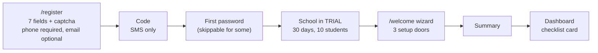
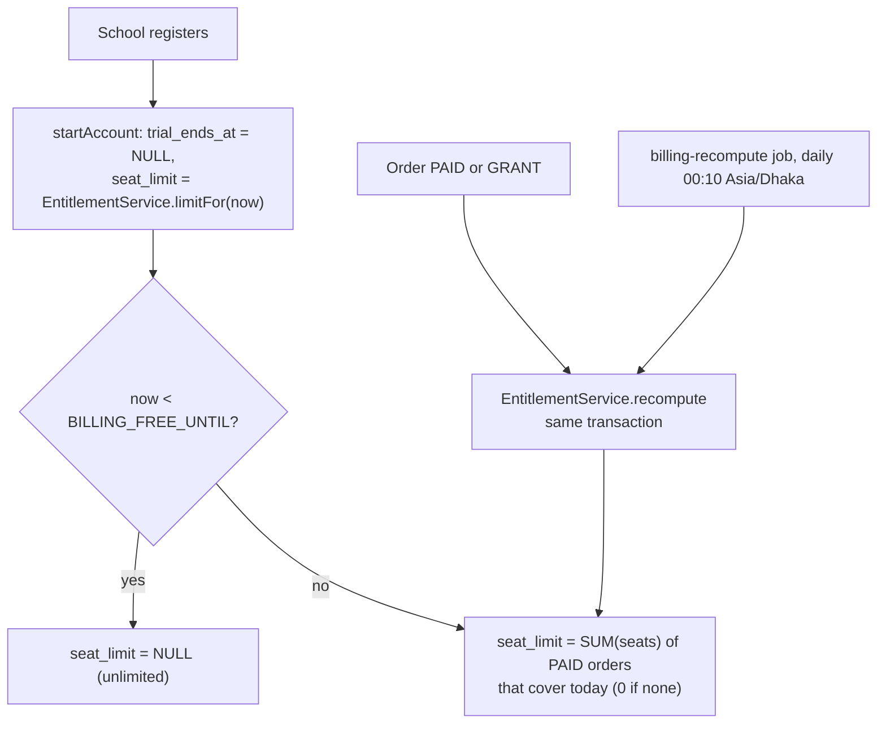
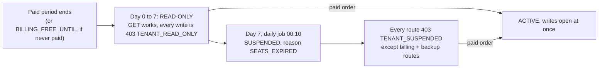
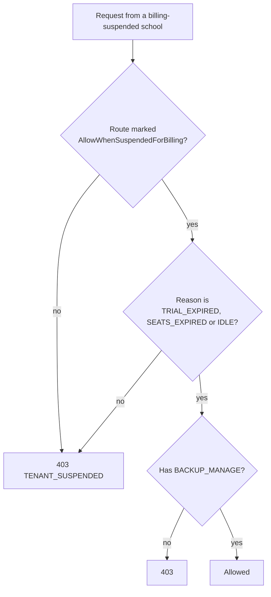
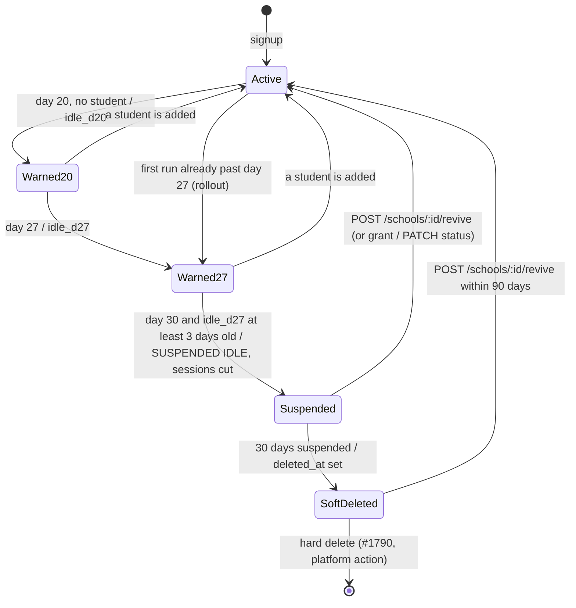
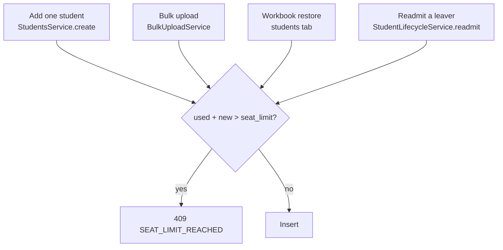
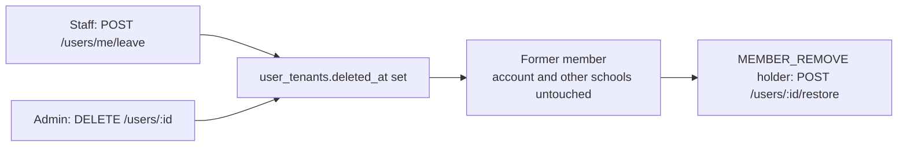
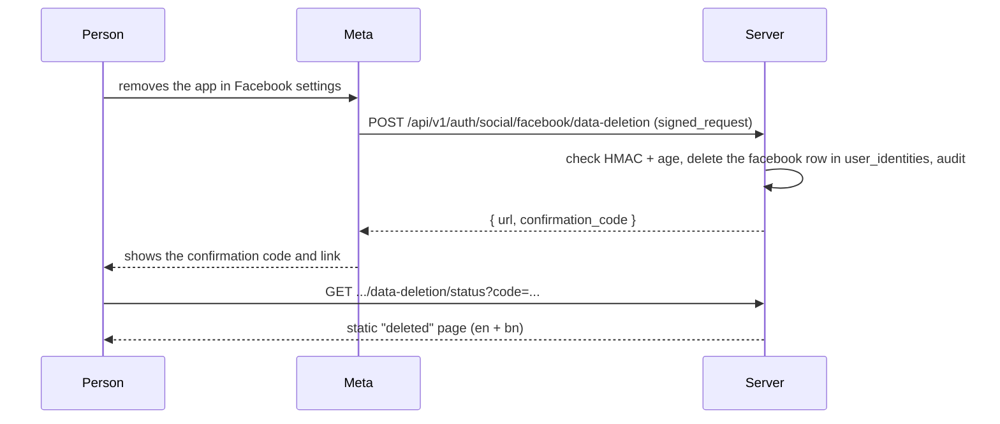

# Onboarding, registration, trial and sign-in methods

How a stranger becomes the admin of a working school, and what keeps the free
trial honest. Epic 13.0 (#416). Decisions D1–D42 live on the epic.

## The journey



Nothing is created until the code is proven. Until then the form answers sit
in Redis for 30 minutes under `registration:<uuid>`
(`server/src/modules/registration/registration-staging.service.ts`).

`/register` and `/auth/social/done` are public paths
(`client-admin/src/routes/__root.tsx`, `PUBLIC_PATHS`).

## Registration: `/register/start` → `/register/verify`

The routes are `POST /auth/register/start`, `/resend` and `/verify`
(`server/src/modules/registration/registration.controller.ts`). They sit under
`auth/` so the social-ticket cookie, scoped to `/api/v1/auth`, reaches `verify`.

```mermaid
sequenceDiagram
    participant U as Browser
    participant API
    participant R as Redis
    participant DB as Postgres
    U->>API: POST /auth/register/start (7 fields + captcha_token)
    API->>API: Turnstile siteverify
    API->>R: stage the details (30 min)
    API-->>U: 202 { registration_id, channel, resend_in: 60 }
    Note over U,API: the code always goes by SMS (D6); a phone outside the SMS prefixes gets 400
    U->>API: POST /auth/register/verify { registration_id, otp }
    API->>R: check code, then read-and-delete the stage
    API->>DB: one transaction: school in TRIAL, ADMIN user, audit row
    API-->>U: 200 { access_token, memberships, needs_password, password_required }
```

Example `start` body (`RegisterStartDto`):

```json
{
  "admin_name": "Rahim Uddin",
  "school_name": "Green Valley School",
  "country_code": "BD",
  "address": "Road 4, Dhanmondi, Dhaka",
  "phone": "01712345678",
  "email": "rahim@example.com",
  "terms_accepted": true,
  "captcha_token": "<Turnstile token>"
}
```

| Rule                         | What happens                                                                                                                                                 | Where                             |
| ---------------------------- | ------------------------------------------------------------------------------------------------------------------------------------------------------------ | --------------------------------- |
| Code channel (D6)            | Always SMS. A phone outside `OTP_SMS_ALLOWED_PREFIXES` (default `+880`) gets `400 Invalid phone format`, so foreign schools wait until the list is widened.  | `registration.service.ts` `start` |
| Email (D6)                   | Optional. Stored unverified (`email_verified_at` NULL) and verified later from the profile. If another user row already holds it, it is silently left out.   | `createSchool`                    |
| Resend                       | 60 s cooldown, at most 3 extra codes per stage.                                                                                                              | `MAX_RESENDS`                     |
| Existing account (D30)       | After the code, the new school is attached to that user. The old one-open-trial refusal (`TRIAL_ALREADY_OPEN`) no longer fires: no school has an open trial. | `createSchool`                    |
| Contact held by someone else | `409 CONTACT_IN_USE`. If any school of the user turned code sign-in off: `409 SIGN_IN_REQUIRED`.                                                             | `createSchool`                    |
| Consent (D24)                | `terms_accepted_at` and `country_code` go into one `Registration` audit row.                                                                                 | `createSchool`                    |
| Country (D35)                | The form preselects from `?country=`, else the browser time zone. There is no IP lookup.                                                                     | `register-details-form.tsx`       |

`CONTACT_IN_USE` and `SIGN_IN_REQUIRED` reveal that an account exists. That is
a known, accepted product call. See [08-security.md](08-security.md).

The register form sends the phone as typed (`01712345678`), the same string
sign-in uses. The server does not normalise it yet: #1701.

## Password step and the first-password gate

After `verify` (and after code sign-in) the API says whether a password is
wanted:

- `needs_password`: the account has no password.
- `password_required`: no password, a staff role, and no linked social account
  (D34: a staff user who joined with Google may skip).

The gate is client-side. It is remembered per account (the token `sub`) and
cleared on logout and when a password is set. The server does not enforce it
yet: #1697. Setting it is `POST /account/first-password` (`409` if a password
already exists). The account API has no `has_password` flag yet: #1694.

| Account's roles          | Rules                                       | Example that passes |
| ------------------------ | ------------------------------------------- | ------------------- |
| Any staff role, or a mix | 8+ characters, upper, lower, digit, special | `Green#2026`        |
| Only PARENT / STUDENT    | 8+ characters, a digit                      | `sunflower7`        |

Strictest wins across all of a user's memberships. The rules apply when a
password is set or changed, never at sign-in, so old passwords keep working
(`server/src/modules/auth/password-policy.ts`,
`shared/src/auth/password-rules.ts`). A failure is
`400 PASSWORD_TOO_WEAK` with `details.failed` listing the rule ids.

## Free period and seats

The 30-day trial is retired (Epic 49, #2716). A new school has no
`trial_ends_at`. Seats are free for everyone until `BILLING_FREE_UNTIL`
(default `2027-01-01T00:00+06:00`); after that a school has as many seats as it
has paid for.



- `EntitlementService` (`server/src/modules/billing/entitlement.service.ts`) is
  the only writer of `schools.seat_limit`. It audits a change as a `School`
  audit row with `event: SEAT_LIMIT_RECOMPUTED`.
- `OrdersService.createPending` prices an order at seats x months x 1000 paisa
  (BDT 10 per seat per month). `markPaid` flips `PENDING` to `PAID` once; a
  replay changes nothing. The period is set on payment: a purchase starts on
  the later of today and the day the school's last PAID period ends. So a
  renewal bought early extends the seats; it never counts them twice. A
  platform `GRANT` starts today and adds to the seats in force (a top-up).
  Example: 100 seats for Jan 1 to Jul 1, renewed for 6 months on Jun 1, run
  Jul 1 to Jan 1. June still has 100 seats, not 200.
- Paying also lifts an `IDLE` suspension at once, and the idle job never
  soft-deletes a school that has a PAID order.
- A daily BullMQ job (`billing.scheduler.ts`, `billing-recompute`, 00:10
  Asia/Dhaka, off in demo mode) recomputes every ACTIVE school so an order that
  ended yesterday stops counting.
- `GET /billing/summary` and `GET /billing/orders` (`SETTINGS_MANAGE`, own
  school only; `limit` at most 100).
- Platform billing (SUPER_ADMIN, `PlatformSuperAdminGuard`, `/platform/billing/*`):
  list and read every school's seats and orders, record an offline (bank / cash)
  payment on a PENDING order, and grant seats
  (`POST /platform/billing/schools/:id/grant { seats, months, reason, idempotency_key }`,
  a PAID order with method `GRANT`). `PATCH /schools/:id/trial` is gone.
- One-off per environment: `yarn workspace @biddaloy/server backfill-trials`
  (dry run; add `--apply --confirm-db=<name>`). It clears every
  `trial_ends_at` and reactivates schools suspended with `TRIAL_EXPIRED`.
- Receipts for paid orders: see [28-billing.md](28-billing.md#receipts).
- Legacy: the old trial warning mails, the `trial.ending` rule (now inert) and
  the `TRIAL_DAYS` / `TRIAL_SEAT_LIMIT` env values are gone or dead.
- The attention rule for expiring seats is `seats.expiring` (it replaces the
  `billing.renewal_due` placeholder; the rule is built in a later Epic 49 ticket).
  `recompute` already asks the engine to recheck it.

### Over the seats: 7 days read-only, then paused (D9)

Nothing is stored for the grace window; it is worked out from the data each time. A school is
**over** when it is `ACTIVE`, has a `seat_limit`, and has more `ACTIVE` students than that limit
(same count as the seat limit above).



- **Read-only until** = the end of the last `PAID` order's `period_end` that is on or before today
  (school time), else the `BILLING_FREE_UNTIL` date, plus 7 days, at 00:00 Asia/Dhaka
  (`billing/seat-grace.ts`). Example: paid period ends `2026-12-01`, so from 1 December the
  school (if over its seats) is read-only, and the job pauses it once `2026-12-08 00:00 +06:00` has passed.
- `ContextGuard` refuses `POST/PUT/PATCH/DELETE` for an over school with
  `403 { "details": { "code": "TENANT_READ_ONLY", "until": "2026-12-07T18:00:00.000Z" } }`.
  The text is the same for every write. Routes marked `@AllowWhenSuspendedForBilling`
  (the pay-to-reopen routes) and the platform tenant are exempt. The answer is cached 5 minutes
  and cleared by `invalidate` whenever `recompute` runs.
- `EntitlementService.suspendIfGraceOver` (called by the daily `BillingScheduler` after the
  recompute) pauses the school, bumps `users.tokens_valid_after` for every member (Rule 8) and
  sends the `seats_suspended` notice to the admins.
- `EntitlementService.recompute` (run when an order is marked paid) reactivates a
  `SUSPENDED` + `SEATS_EXPIRED` school once it is no longer over, inside the same transaction,
  even when the limit number itself did not change. It audits `REACTIVATE` / `SEATS_REACTIVATED`.
  It also lifts a `SUSPENDED` + `IDLE` school once it has a PAID order (`IDLE_REACTIVATED`).
- **Warnings (30 / 7 / 0 days):** `SeatNoticesService` and the `seats.expiring` rule count down to
  `seatCover` (`billing/seat-grace.ts`): the last PAID `period_end`, or the `BILLING_FREE_UNTIL` day
  when that is later. So a school that never paid is warned before the free period ends. An order
  of 31 days or less gets no 30-day warning. The notices say "read-only, then paused" only when
  the school has students (no order covers the day after, so any student puts it over).
- **Writes that stay open on purpose** (they never run `ContextGuard`, and are not "this school"
  requests by a signed-in member): device ingest, the public admission submit, public invoice
  payment, and invite accept. An over-seat school can still receive these.
- **A user's own writes stay open too** (they run `ContextGuard` but carry
  `@AllowWhenReadOnly()`, so the read-only check skips them; a suspension still blocks them).
  They change the signed-in user's own state, not the school's data:

  | Route                                                                | Why it stays open                  |
  | -------------------------------------------------------------------- | ---------------------------------- |
  | `POST /attention/items/seen`, `.../:recipientId/hide`, `.../snooze`  | the user's own alert list          |
  | `POST /auth/step-up`, `POST /auth/step-up/otp/request`               | proving who you are writes no data |
  | `POST /me/push/subscriptions`, `DELETE /me/push/subscriptions[/:id]` | the user's own devices             |
  | `PATCH /users/me/preferences/notifications`, `/dashboard`, `/digest` | the user's own settings            |

  The list is pinned by `allow-when-suspended-for-billing.decorator.spec.ts` (`@AllowWhenReadOnly
allowlist`) and by `USER_LEVEL_WRITES` in `read-only-route-walk.e2e-spec.ts`.

- **Manual reactivate while still over:** if a platform admin reactivates a school that is still
  over its seats, the school is read-only again at once (the window is already past), and the next
  daily run pauses it again. Buy seats or remove students to really reopen it.
- Known gap: the daily job only visits `ACTIVE` schools, so a paused school that later drops
  below its limit by itself is not reopened automatically; paying, or a platform reactivate, is.
- `read-only-route-walk.e2e-spec.ts` forces the seed school over its seats and proves every write
  route behind `ContextGuard` answers `TENANT_READ_ONLY`.

### What a billing suspension can still do

Every request is refused once a school is suspended for billing, with **one exception** (D16):
the three backup routes marked `@AllowWhenSuspendedForBilling`. An admin can take a
copy of the data. `ContextGuard` opens them for `SUSPENDED` + a billing reason
(`TRIAL_EXPIRED`, `SEATS_EXPIRED` or `IDLE`) only. A school suspended for any other reason stays fully blocked, and the
permission check (`BACKUP_MANAGE`) still applies.



Example: the admin clicks **Download your data**. The page calls
`POST /api/v1/backup/export` (202, `{ "job_id": "..." }`), polls
`GET /api/v1/backup/jobs/<id>` until it is `DONE`, then downloads
`GET /api/v1/backup/jobs/<id>/download`. `GET /api/v1/students` still returns 403.

### Idle account (D5)

A school that never adds a student is warned, paused, then soft-deleted. The check
counts ACTIVE students on every run, so adding one student stops the whole thing. There
is no flag to clear.



- **The clock** is `max(created_at, status_changed_at)`. Any reactivation (revive, a
  manual reactivate, a seat grant) restarts it, so a revived school is not suspended
  again the next night.
- **Warnings** are stored as ISO times in `schools.onboarding.idle_warnings`, for
  example `{ "idle_d20": "2026-11-20T19:00:00.000Z" }`. A stamp older than the clock does
  not count as sent. The stamp is written first and the message sent after it commits,
  so a crash can lose a notice but never send it twice.
- **Rollout:** a school already past day 27 gets only `idle_d27` on the first run. It is
  suspended at least 3 days later, never on the same run.
- **When it runs:** daily at 01:00 Asia/Dhaka (`IdleAccountScheduler`). It is skipped in
  demo mode, and it skips the platform tenant.
- **Suspend** sets `status = SUSPENDED`, `status_reason = IDLE`, cuts every member's
  sessions (Rule 8) and drops the tenant status cache. The school keeps the backup
  export (D16).
- **Soft delete** sets `deleted_at` 30 days after the suspension. From then on the
  school answers `401 "does not exist"`, and its members can still sign in to their other
  schools.
- **Dashboard:** the `account.idle` alert is WARNING from day 20 and CRITICAL from day 27.

Revive is a platform SUPER_ADMIN action, up to 90 days after `deleted_at`:

```http
POST /api/v1/schools/<id>/revive
{ "reason": "School called, starting next week" }

200 { "id": "<id>", "status": "ACTIVE", "status_reason": null, "status_changed_at": "2026-12-01T06:00:00.000Z" }
```

It answers `409 REVIVE_WINDOW_PASSED` after 90 days, and `409 NOT_IDLE` for a school that
was suspended for any other reason (use `PATCH /schools/:id/status` for those).

### The support link

Everything else is refused, so the ended screen cannot ask the server for the
link. The client bundle carries it, set at build time:

```text
SUPPORT_CONTACT_URL=https://example.com/support   # server env; Compose also uses it below
VITE_SUPPORT_URL=https://example.com/support       # build arg; Compose fills it from SUPPORT_CONTACT_URL
```

`isSafeSupportUrl` (`ui/src/utils/support-url.ts`) lets only `https:` and
`mailto:` through. `GET /onboarding/status` also returns the server's
`SUPPORT_CONTACT_URL` as `support_url`. Under Compose an unset value arrives as
`""`, not `null`: #1702.

## Seat limit (D29)

A seat is a student with `enrollment_status = ACTIVE` and no `deleted_at`.
`schools.seat_limit = NULL` means unlimited. Every path that adds an active
student takes the school row lock (`FOR NO KEY UPDATE`) first, so two parallel
adds cannot both pass the limit
(`server/src/modules/schools/trial/seat-limit.service.ts`).



The ticket names three guarded paths (create, bulk upload, workbook restore).
The code guards a fourth: a readmit takes a seat too
(`student-lifecycle.service.ts:167`).

Example (limit 10, 9 in use, an upload of 3):

```json
{
  "message": "Seat limit reached: 9 of 10 seats in use",
  "details": { "code": "SEAT_LIMIT_REACHED", "used": 9, "limit": 10, "requested": 3 }
}
```

## Welcome wizard and checklist

`/welcome` opens once for an ADMIN of an unfinished school, and only when they
land on the dashboard (D36, `welcome-gate.ts`). The migration
`1791400000000-OnboardingFoundation` marks every school that existed then as
finished, and `1791400000100-DismissChecklistForExistingSchools` also marks
them dismissed, so those schools never see the wizard or the dashboard
checklist. Example: an existing school's `onboarding` becomes
`{ "finished_at": "2026-10-06T…", "dismissed_at": "2026-10-06T…" }`.

The three doors:

- **Guided**: name + logo, curriculum preset, sections per class.
- **Excel**: the starter workbook, see [14-school-workbook.md](14-school-workbook.md).
- **Do this later**.

Progress lives in the `schools.onboarding` jsonb column, not in
`schools.settings`, which goes through encryption, masking and a DTO whitelist
(D42).

### `GET /onboarding/status`

ADMIN or SUPER_ADMIN, with the tenant header
(`server/src/modules/onboarding/onboarding.controller.ts`).

```http
GET /api/v1/onboarding/status
X-Tenant-ID: <school id>
Authorization: Bearer <token>
```

```json
{
  "finished_at": null,
  "dismissed_at": null,
  "seen": true,
  "setup_path": "guided",
  "items": [
    { "id": "profile", "done": true },
    { "id": "structure", "done": true },
    { "id": "sections", "done": false },
    { "id": "students", "done": false },
    { "id": "staff", "done": false },
    { "id": "feeStructures", "done": false },
    { "id": "guardianInvites", "done": false },
    { "id": "messageSettings", "done": false }
  ],
  "counts": { "classes": 4, "sections": 0, "students": 0, "staff": 1 },
  "trial": {
    "ends_at": "2026-11-05T09:30:00.000Z",
    "days_left": 30,
    "seats": { "used": 0, "limit": 10 }
  },
  "support_url": "https://example.com/support"
}
```

`trial` is `null` for every school created since Epic 49 (no trial). The `billing` block planned in #2716 needs a shared type change and arrives with the Epic 49 client ticket; read `GET /billing/summary` meanwhile. `seats.limit` is `null` for
unlimited. `seen` is true when the caller is in `onboarding.seen_by`.
`PATCH /onboarding` takes `setup_path`, `finished`, `dismissed`, `seen` and
writes nothing else.

### How each checklist item is derived

Items are computed from real rows on every call, never stored
(`onboarding.service.ts`, `getStatus`). A class made outside the wizard still
ticks `structure`.

| Item              | Done when                                                                                          |
| ----------------- | -------------------------------------------------------------------------------------------------- |
| `profile`         | the school has `name_bn` or a logo                                                                 |
| `structure`       | 1+ class                                                                                           |
| `sections`        | 1+ class section                                                                                   |
| `students`        | 1+ student                                                                                         |
| `staff`           | 2+ distinct people with an employee role (COMMITTEE does not count; ADMIN + TEACHER is one person) |
| `feeStructures`   | 1+ fee structure                                                                                   |
| `guardianInvites` | 1+ PARENT membership                                                                               |
| `messageSettings` | the SMS or the email communications setting is on                                                  |

## People who leave



The membership row is soft-deleted, never removed. Details in
[02-auth-and-multitenancy.md](02-auth-and-multitenancy.md).

## Facebook sign-in

Same flow as Google (server-side code + PKCE + `state`, see
[02-auth-and-multitenancy.md](02-auth-and-multitenancy.md)). Differences:

- Provider: `server/src/modules/auth/social/providers/facebook.provider.ts`.
  No id_token, so the identity is the Graph API `id` from `/me`. `email` is
  often missing (phone-only accounts); that is fine.
- `GRAPH_VERSION` (`v24.0`) is the one place the Graph API version lives.
  Bump it before Meta retires the version.
- Env: `FACEBOOK_OAUTH_CLIENT_ID`, `FACEBOOK_OAUTH_CLIENT_SECRET`. Both or the
  provider is not listed. The data-deletion callback needs only the secret, so
  removing the client id turns sign-in off but Meta's deletion requests still
  work. Keep the secret set while any Facebook identities exist.
- Meta requires a **data-deletion callback**. `POST /api/v1/auth/social/facebook/data-deletion`
  takes Meta's `signed_request`, checks the HMAC and its age (24 h), and removes
  only the Facebook identity (the user account stays). It answers
  `{ url, confirmation_code }`; the `url` is the public status page
  `GET /api/v1/auth/social/facebook/data-deletion/status?code=<uuid>`
  (plain HTML, English and Bangla).



Example response:

```json
{
  "url": "https://app.example.com/api/v1/auth/social/facebook/data-deletion/status?code=3f2b8c1e-6a4d-4e8f-9b1a-2c7d5e0f4a91",
  "confirmation_code": "3f2b8c1e-6a4d-4e8f-9b1a-2c7d5e0f4a91"
}
```

## Owner checklist

Things only the owner can do, outside the code. Tick as done.

**Base URL**

- [ ] Set `APP_BASE_URL` to the public `https://` origin that serves both the app
      and `/api`, for example `https://app.example.com`. The sign-in redirect URIs
      and the data-deletion status URL below are built from it. In production the
      server refuses social sign-in and data deletion without it.

**Google sign-in**

- [ ] Create a Google OAuth client. Redirect URI: `<APP_BASE_URL>/api/v1/auth/social/google/callback`.
- [ ] Set `GOOGLE_OAUTH_CLIENT_ID`, `GOOGLE_OAUTH_CLIENT_SECRET`.

**Facebook sign-in**

- [ ] Create a Meta app with Facebook Login. Redirect URI: `<APP_BASE_URL>/api/v1/auth/social/facebook/callback`.
- [ ] Set the data-deletion callback URL to `<APP_BASE_URL>/api/v1/auth/social/facebook/data-deletion`.
- [ ] Set `FACEBOOK_OAUTH_CLIENT_ID`, `FACEBOOK_OAUTH_CLIENT_SECRET`. To turn Facebook sign-in off later, remove only the client id; keep the secret while any Facebook identities exist, or Meta's deletion requests get a 404.
- [ ] Submit app review. Until it passes, only app testers can sign in; the button still works for them.
- [ ] Product call, #1705: a person who signed up with Facebook only and has no phone or email Facebook shares can be locked out. Decide the fix.

**Captcha**

- [ ] Create a Cloudflare Turnstile site. Set `VITE_TURNSTILE_SITE_KEY` (build arg) and `TURNSTILE_SECRET_KEY` (server). Set both or neither.
      No site key: the widget is hidden. No secret in production: every register route returns 503.

**Other settings**

- [ ] `SUPPORT_CONTACT_URL` and `VITE_SUPPORT_URL` (same value; `https:` or `mailto:`). Shown on the "trial ended" screen.
- [ ] Optional: `OTP_SMS_ALLOWED_PREFIXES` (default `+880`).
- [ ] Optional: `BILLING_FREE_UNTIL` (default `2027-01-01T00:00+06:00`): seats are unlimited before it.

**Legal pages and copy**

- [ ] Publish the terms and privacy pages. The URLs are not decided yet, and the
      register form's checkbox ("I agree to the terms and privacy policy") does not
      link to either. Once the URLs exist, link them from the label.
- [ ] A native Bangla speaker reads the new Bangla copy (register, welcome, import, security, the data-deletion page).

**Screen-reader pass** (needs a person; not automated)

Use VoiceOver (macOS/iOS) or NVDA (Windows). For each screen, check that every
control has a spoken name, errors are announced, focus lands somewhere sensible
after each step, and the order matches the visual order.

- [ ] `/register`: details, code, password
- [ ] `/login` in code mode
- [ ] `/welcome`: doors, guided, Excel, people, summary
- [ ] `/staff/import`
- [ ] `/security`

File each finding as its own issue and link it on #1648.

## Where the plan and the code differ

| Plan said                                     | What was built                                                                                               | Why                                                              |
| --------------------------------------------- | ------------------------------------------------------------------------------------------------------------ | ---------------------------------------------------------------- |
| Ended trial is stored as `deleted_at`         | `SUSPENDED` + `TRIAL_EXPIRED` (D39)                                                                          | suspension is already enforced everywhere and is reversible      |
| Country from an IP lookup                     | `?country=`, else browser time zone (D35)                                                                    | no IP service to depend on                                       |
| Three guarded seat paths                      | four: readmit checks too                                                                                     | a readmit takes a seat                                           |
| Code by SMS, or by email outside `+880` (D31) | SMS only; email optional and stored unverified (D6, #2718)                                                   | every school admin has a verified phone; email proof comes later |
| Google and Facebook at sign-up                | Both are built (Facebook in #1647). Neither is required: a provider with no credentials is simply not listed | Meta app review must not block launch (D9)                       |

## Open follow-ups

Not done. Do not rely on them.

| Issue | What                                                                     |
| ----- | ------------------------------------------------------------------------ |
| #1694 | account API has no `has_password` flag                                   |
| #1695 | social link callback always returns to `/security`                       |
| #1696 | staff bulk-upload errors carry no row codes                              |
| #1697 | enforce `password_required` on the server                                |
| #1698 | server-side `create_only` for the Excel restore                          |
| #1700 | captcha rejection needs its own error code                               |
| #1701 | normalise phone numbers on the server                                    |
| #1702 | `support_url` is `""`, not `null`, under Compose                         |
| #1703 | "registration expired" needs its own error code                          |
| #1704 | platform schools list: "Trial ended" label vs the Ended / Active filters |
