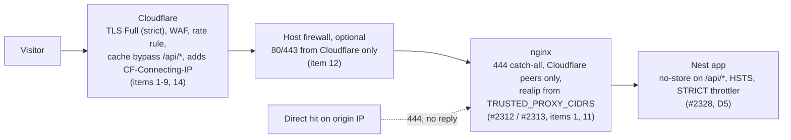

# 25. Cloudflare configuration checklist

Cloudflare sits in front of the origin (Epic 75, D1). The code assumes
certain dashboard settings. If one is wrong, users get blocked, caches leak
private data, or the origin IP stays exposed. This page lists every setting,
why it matters and how to check it.

## Request path



Two rules hold the whole thing together:

- DNS must be **proxied** (orange cloud). nginx answers only Cloudflare
  peers, so an unproxied record means users get 444.
- `TRUSTED_PROXY_CIDRS` must be set whenever DNS is proxied, and the other
  way round.

## Checklist

"Applied" is filled by the owner, who has dashboard access. Every cell
starts as `pending (owner)`. Write who, when, and a link or pasted output
from the verify step.

| #   | Setting                                    | Value                                                                                       | Why / code that relies on it                                                                                                                                                                                                                                                                                                                                                 | How to verify                                                                   | Applied (who, date) |
| --- | ------------------------------------------ | ------------------------------------------------------------------------------------------- | ---------------------------------------------------------------------------------------------------------------------------------------------------------------------------------------------------------------------------------------------------------------------------------------------------------------------------------------------------------------------------- | ------------------------------------------------------------------------------- | ------------------- |
| 1   | DNS for `APP_DOMAIN`                       | A/AAAA record **proxied**. No unproxied record points at the origin IP.                     | nginx drops non-Cloudflare peers with 444 (#2313, `nginx/templates/default.conf.template`, `$origin_allowed`).                                                                                                                                                                                                                                                               | V1, V5                                                                          | pending (owner)     |
| 2   | SSL/TLS mode                               | **Full (strict)**                                                                           | Origin holds a Let's Encrypt cert (`certbot` service, `docker-compose.yml:182-189`). Flexible would loop redirects; Full without strict skips cert checks.                                                                                                                                                                                                                   | V1                                                                              | pending (owner)     |
| 3   | Minimum TLS version                        | **1.2**; TLS 1.3 on                                                                         | Older TLS is broken. No client we support needs it.                                                                                                                                                                                                                                                                                                                          | V6                                                                              | pending (owner)     |
| 4   | Always Use HTTPS                           | **On**                                                                                      | Matches nginx's port-80 redirect. ACME HTTP-01 renewal still works because nginx serves `/.well-known/acme-challenge/` before redirecting (`default.conf.template:50-52`, #2313).                                                                                                                                                                                            | V7                                                                              | pending (owner)     |
| 5   | HSTS in Cloudflare                         | **Off**                                                                                     | The app sends it (`server/src/security-headers.ts:44`: `max-age=31536000; includeSubDomains`, no preload, D5, production only). Two sources would duplicate the header.                                                                                                                                                                                                      | V4                                                                              | pending (owner)     |
| 6   | Cache rule                                 | **Bypass cache** when URI path starts with `/api/`. No "Cache Everything" rule anywhere.    | `/api/*` sends `no-store` (`server/src/cache-control.ts`, `main.ts:60`); `index.html` and `sw.js` send `no-cache`; `/assets/*` is `public, max-age=31536000, immutable` (nginx `location ~ ^/assets/`). Caching `/api/*` would leak tenant data.                                                                                                                             | V2, V3                                                                          | pending (owner)     |
| 7   | WAF managed ruleset                        | Cloudflare managed ruleset **on**                                                           | First filter before the app. The app has no WAF of its own.                                                                                                                                                                                                                                                                                                                  | Dashboard: Security > WAF shows the ruleset enabled                             | pending (owner)     |
| 8   | Rate-limiting rule                         | One rule, expression covers `/api/v1/auth/` **and** `/api/v1/public/`, per IP, block 10 min | Outer limit. The free plan allows one rule, so one expression covers both. The app's own throttler (`STRICT_RATE_LIMIT` 5/min, `server/src/rate-limit.ts:34`) stays the inner limit.                                                                                                                                                                                         | V10                                                                             | pending (owner)     |
| 9   | Bot Fight Mode                             | **Off**. On a paid plan: Super Bot Fight Mode with skip rules for the paths below.          | It cannot skip paths on the free plan. It would challenge attendance devices (`POST /api/v1/attendance/device-events`, `GET /api/v1/attendance/devices/me/roster`, `device-ingest.controller.ts:58,80`), calendar apps polling `GET /api/v1/calendar/feed/:token.ics` (`calendar-feed.controller.ts:69`), and uptime monitors on `GET /api/health` (`app.controller.ts:12`). | V8, V9                                                                          | pending (owner)     |
| 10  | Authenticated Origin Pulls                 | **Not used**                                                                                | D17 chose the IP allowlist (`TRUSTED_PROXY_CIDRS`) instead.                                                                                                                                                                                                                                                                                                                  | n/a                                                                             | pending (owner)     |
| 11  | `TRUSTED_PROXY_CIDRS` in production `.env` | Current `https://www.cloudflare.com/ips-v4/` + `/ips-v6/`, space separated                  | nginx trusts `CF-Connecting-IP` only from these peers (#2312; example list in `.env.example:59`). Re-check **quarterly** and after any Cloudflare plan change. Runbook: [12-operations.md](12-operations.md) section 3.5.                                                                                                                                                    | V11                                                                             | pending (owner)     |
| 12  | Host firewall (optional)                   | ufw or cloud security group: 80/443 only from the same ranges                               | Defence in depth behind #2313. Skip if the host cannot do it.                                                                                                                                                                                                                                                                                                                | From a non-Cloudflare machine: `nc -vz <origin-ip> 443` times out               | pending (owner)     |
| 13  | Rotate the origin IP                       | New IP, after items 1-12 are on                                                             | The old IP lives in DNS history and internet-wide scan databases. Then repeat items 1 and 14.                                                                                                                                                                                                                                                                                | V1, V5                                                                          | pending (owner)     |
| 14  | Turnstile keys                             | `TURNSTILE_SECRET_KEY` and `VITE_TURNSTILE_SITE_KEY` both set (`.env.example:228-233`)      | Sign-up checks the token. A secret without a site key rejects every sign-up (`.env.example:232` says "set both or neither"). Widget lives in `client-admin/src/features/registration/turnstile.tsx`.                                                                                                                                                                         | Open `/register`: the widget renders. Submit a test sign-up: no Turnstile error | pending (owner)     |

Order for items 11-13: do 11 first, then 12, then 13. Items 11-13 touch the
server and DNS.

## Verify

Set the placeholders once. Use real values only in your own terminal, never
commit them.

```bash
export APP_DOMAIN=<your domain>
export ORIGIN_IP=<origin ip>
```

| Id  | Command                                                                                                                   | Expected                                                                                          |
| --- | ------------------------------------------------------------------------------------------------------------------------- | ------------------------------------------------------------------------------------------------- |
| V1  | `dig +short $APP_DOMAIN`                                                                                                  | Only Cloudflare addresses, never `$ORIGIN_IP`.                                                    |
| V2  | `curl -sI https://$APP_DOMAIN/api/health`                                                                                 | `cf-cache-status: DYNAMIC` or `BYPASS`, and `cache-control: no-store`.                            |
| V3  | `curl -sI https://$APP_DOMAIN/assets/<real chunk>.js` twice                                                               | Second reply has `cf-cache-status: HIT` and `cache-control: public, max-age=31536000, immutable`. |
| V4  | `curl -sI https://$APP_DOMAIN/ \| grep -ci strict-transport-security`                                                     | `1`, and the value is exactly `max-age=31536000; includeSubDomains`. No Cloudflare duplicate.     |
| V5  | `curl -sv --resolve $APP_DOMAIN:443:$ORIGIN_IP https://$APP_DOMAIN/` from a non-Cloudflare machine                        | Empty reply or reset (#2313).                                                                     |
| V6  | `curl -s --tlsv1.1 --tls-max 1.1 https://$APP_DOMAIN/`                                                                    | Fails (minimum TLS 1.2).                                                                          |
| V7  | `docker compose exec certbot certbot renew --dry-run`                                                                     | Success.                                                                                          |
| V8  | `curl -X POST https://$APP_DOMAIN/api/v1/attendance/device-events -H 'X-Device-Key: <test device key>' ...` (test school) | The app's own response (even a 4xx), not a Cloudflare challenge page.                             |
| V9  | `curl -s https://$APP_DOMAIN/api/v1/calendar/feed/<test token>.ics`                                                       | Calendar data or the app's 404, not a challenge page.                                             |
| V10 | 30 rapid `POST /api/v1/auth/login` with a wrong password from one IP                                                      | Cloudflare 429 or block page before the app's own lockout.                                        |
| V11 | `docker compose logs app \| tail`                                                                                         | Request IPs are real visitors, not `104.x` or `172.64.x` (#2312 working).                         |

Paste the real output next to each command in the PR that applies the
checklist. Do not paste it here: this page holds the method, the PR holds
the evidence.

Also confirm nothing broke for: the public invoice page (`/i/:token`), the
public verify page (`/v/:token`), sign-up with Turnstile, cert renewal.

## Re-check

Quarterly, and after any Cloudflare plan change. Items 7, 8, 9 and 11 are
the ones that drift.

## Rollback (lockout)

If users or devices get blocked, flip the item back in the dashboard first.
It takes effect in seconds.

If the origin lockdown is the cause, set `TRUSTED_PROXY_CIDRS=` (empty) and
run `docker compose up -d nginx`. Empty means no CDN trust at all.

Never turn DNS proxying off while `TRUSTED_PROXY_CIDRS` is set. Proxied DNS
must stay on whenever the list is set.
