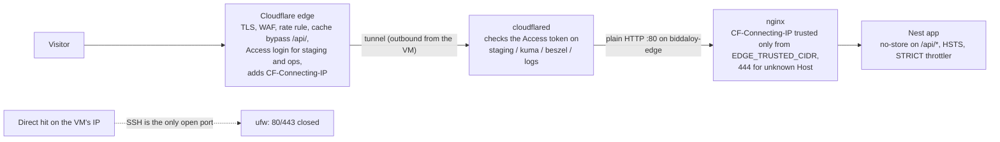
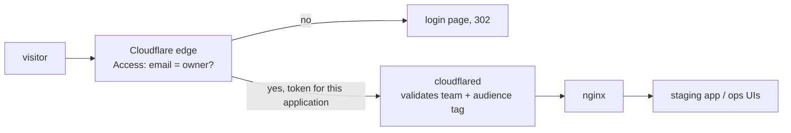
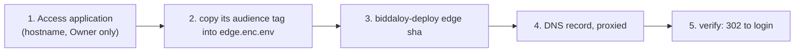

# 25. Cloudflare configuration checklist

Cloudflare sits in front of the VM and, in tunnel mode, is the only way in
(Epic 75 D1, Epic 79 D8/D14/D17). The code assumes certain dashboard settings.
If one is wrong, users get blocked, caches leak private data, or an ops tool
is open to the internet. This page lists every setting, why it matters and how
to check it.

> The commands for day 0 and deploys live in
> [28-platform-runbook.md](28-platform-runbook.md). This page keeps the dashboard settings.

## Request path

In tunnel mode no public web port exists on the VM. `cloudflared` (a container
in the edge project) dials **out** to Cloudflare and keeps the tunnel open.
Requests come back down that tunnel.



Three rules hold the whole thing together:

- DNS for every public name is a **proxied CNAME to the tunnel**
  (`<CLOUDFLARE_TUNNEL_ID>.cfargotunnel.com`). Leave no A record pointing at the VM.
- The tunnel config is in git (`infra/ansible/templates/cloudflared-config.yml.j2`,
  rendered to `/opt/biddaloy/edge/cloudflared/config.yml` on every edge deploy); the
  credentials JSON is in `edge.enc.env` (D17). Nothing is managed in the dashboard's
  "remotely managed" mode.
- `EDGE_TRUSTED_CIDR` must equal the subnet of the `biddaloy-edge` Docker network
  (`172.30.0.0/24`). nginx takes the visitor IP from `CF-Connecting-IP` only for
  peers in it, which in practice is `cloudflared` alone.

## Checklist

"Applied" is filled by the owner, who has dashboard access. Every cell
starts as `pending (owner)`. Write who, when, and a link or pasted output
from the verify step.

| #   | Setting                                                                                              | Value                                                                                                                                            | Why / code that relies on it                                                                                                                                                                                                                                                                                 | How to verify                                                                                       | Applied (who, date) |
| --- | ---------------------------------------------------------------------------------------------------- | ------------------------------------------------------------------------------------------------------------------------------------------------ | ------------------------------------------------------------------------------------------------------------------------------------------------------------------------------------------------------------------------------------------------------------------------------------------------------------ | --------------------------------------------------------------------------------------------------- | ------------------- |
| 1   | Tunnel                                                                                               | One tunnel; its id is `CLOUDFLARE_TUNNEL_ID`, its credentials JSON `CLOUDFLARE_TUNNEL_CREDENTIALS_JSON` (both in `edge.enc.env`)                 | `cloudflared` reads `config.yml` and `credentials.json` from `/opt/biddaloy/edge/cloudflared/`                                                                                                                                                                                                               | V7                                                                                                  | pending (owner)     |
| 2   | DNS for `APP_DOMAIN`, `DEMO_DOMAIN`, `STAGING_DOMAIN`, `INBOX_DEMO_DOMAIN`, `INBOX_STAGING_DOMAIN`, `KUMA_DOMAIN`, `BESZEL_DOMAIN`, `LOGS_DOMAIN` | CNAME to `<tunnel-id>.cfargotunnel.com`, **proxied**. No A/AAAA record at the VM's IP                                                            | The tunnel only carries proxied names. The ingress list in `config.yml` has a rule per hostname and ends in `http_status:404`, so an unlisted name gets 404                                                                                                                                                  | V1                                                                                                  | pending (owner)     |
| 3   | SSL/TLS mode                                                                                         | **Full (strict)**                                                                                                                                | Traffic to the origin travels inside the tunnel, so this setting does not change tunnel hosts. Keep it strict so a later switch to direct mode (a real Let's Encrypt certificate) needs no change. Never **Flexible**                                                                                        | V1                                                                                                  | pending (owner)     |
| 4   | Minimum TLS version                                                                                  | **1.2**; TLS 1.3 on                                                                                                                              | Older TLS is broken. No client we support needs it.                                                                                                                                                                                                                                                          | V6                                                                                                  | pending (owner)     |
| 5   | Always Use HTTPS                                                                                     | **On**                                                                                                                                           | Plain HTTP never reaches the origin in tunnel mode; Cloudflare must do the redirect.                                                                                                                                                                                                                         | V8                                                                                                  | pending (owner)     |
| 6   | HSTS in Cloudflare                                                                                   | **Off**                                                                                                                                          | The app sends it (`server/src/security-headers.ts`: `max-age=31536000; includeSubDomains`, no preload, D5, production only). Two sources would duplicate the header. In direct mode nginx also sets an HSTS header; the single owner is open work, [#2812](https://github.com/tareq89/biddaloy/issues/2812). | V4                                                                                                  | pending (owner)     |
| 7   | Cache rule                                                                                           | **Bypass cache** when URI path starts with `/api/`. No "Cache Everything" rule anywhere on the app host.                                         | `/api/*` sends `no-store` (`server/src/cache-control.ts`); `index.html` and `sw.js` send `no-cache`; `/assets/*` is `public, max-age=31536000, immutable`. Caching `/api/*` would leak tenant data.                                                                                                          | V2, V3                                                                                              | pending (owner)     |
| 8   | WAF managed ruleset                                                                                  | Cloudflare managed ruleset **on**                                                                                                                | First filter before the app. The app has no WAF of its own.                                                                                                                                                                                                                                                  | Dashboard: Security > WAF shows the ruleset enabled                                                 | pending (owner)     |
| 9   | Rate-limiting rule                                                                                   | One rule, expression covers `/api/v1/auth/` **and** `/api/v1/public/`, per IP, block 10 min                                                      | Outer limit. The free plan allows one rule, so one expression covers both. The app's own throttler (`STRICT_RATE_LIMIT` 5/min, `server/src/rate-limit.ts`) stays the inner limit.                                                                                                                            | V10                                                                                                 | pending (owner)     |
| 10  | Bot Fight Mode                                                                                       | **Off**. On a paid plan: Super Bot Fight Mode with skip rules for the paths below.                                                               | It cannot skip paths on the free plan. It would challenge attendance devices (`POST /api/v1/attendance/device-events`, `GET /api/v1/attendance/devices/me/roster`), calendar apps polling `GET /api/v1/calendar/feed/:token.ics`, and uptime monitors on `GET /api/health`.                                  | V9, V11                                                                                             | pending (owner)     |
| 11  | Authenticated Origin Pulls                                                                           | **Not used**                                                                                                                                     | The origin has no public port in tunnel mode, so there is nothing to authenticate.                                                                                                                                                                                                                           | n/a                                                                                                 | pending (owner)     |
| 12  | `EDGE_TRUSTED_CIDR`                                                                                  | Equals the `biddaloy-edge` subnet, `172.30.0.0/24`                                                                                               | nginx trusts `CF-Connecting-IP` only from here (Rule 11). A wrong value makes every visitor share cloudflared's address, so one person's login throttle locks out everyone. nginx refuses to start when it is empty.                                                                                         | V12                                                                                                 | pending (owner)     |
| 13  | VM firewall                                                                                          | ufw allows **SSH only** in tunnel mode (`allowed_public_tcp_ports` in `group_vars/all.yml`); provision sets it                                   | Nothing else may be reachable. The old origin IP can sit in DNS history and scan databases; with 80/443 closed it is harmless.                                                                                                                                                                               | V5                                                                                                  | pending (owner)     |
| 14  | Turnstile widgets                                                                                    | One widget **per environment**: prod, demo, and staging (use Cloudflare's always-pass test pair there). Each widget lists only its own hostname. | `TURNSTILE_SITE_KEY` and `TURNSTILE_SECRET_KEY` are set together per project in `<project>.enc.env`; a secret with no site key rejects every sign-up. The site key reaches the browser through `/runtime-config.js`, so one image serves all three.                                                          | Open `/register` on each host: the widget renders. Submit a test sign-up: no Turnstile error        | pending (owner)     |
| 15  | DNS for the landing apex                                                                             | CNAME to the tunnel for `LANDING_DOMAIN`, **proxied**; a second proxied CNAME for `www.<LANDING_DOMAIN>`                                         | The tunnel routes both `LANDING_DOMAIN` and `www.<LANDING_DOMAIN>` to nginx (`cloudflared-config.yml.j2` lists both). `nginx/templates/landing.conf.template` redirects `www.` to the apex. The `www.` DNS record is an owner step; without it `www.` does not resolve.                                      | V1 (with `LANDING_DOMAIN`)                                                                          | pending (owner)     |
| 16  | Cache rule for the landing site                                                                      | **Cache everything** when host is `LANDING_DOMAIN` **and** URI path starts with `/_astro/`. Nothing else.                                        | Those files are hashed and sent `public, max-age=31536000, immutable`. Scoped to the landing host and `/_astro/`, so row 7 still holds.                                                                                                                                                                      | `curl -sI https://$LANDING_DOMAIN/_astro/<file>` shows `cf-cache-status: HIT` on the second request | pending (owner)     |
| 17  | Access applications                                                                                  | `Staging` (staging host) and `Ops` (kuma, beszel, logs hosts); see "Access policies"                                                             | Outer login for staging and ops; `cloudflared` checks the token, so a missing app means the host answers nothing instead of opening up                                                                                                                                                                       | V13                                                                                                 | pending (owner)     |
| 18  | R2 API tokens                                                                                        | Two tokens, scoped to the one bucket: prod **Object Read & Write**; staging **Object Read only**                                                 | Prod writes `db/`, `files/` and `logs/`. Staging only reads `db/` dumps, so a stolen staging cannot overwrite or delete a backup. The log archive reuses the prod write token.                                                                                                                               | `aws s3 ls` with the staging token works; `aws s3 cp x s3://<bucket>/t` with it fails               | pending (owner)     |

## Verify

Set the placeholders once. Use real values only in your own terminal, never
commit them.

```bash
export APP_DOMAIN=<your app host>
export STAGING_DOMAIN=<your staging host>
export VM_IP=<the VM public IP>
```

| Id  | Command                                                                                                                                                    | Expected                                                                                          |
| --- | ---------------------------------------------------------------------------------------------------------------------------------------------------------- | ------------------------------------------------------------------------------------------------- |
| V1  | `dig +short $APP_DOMAIN`                                                                                                                                   | Only Cloudflare addresses, never `$VM_IP`.                                                        |
| V2  | `curl -sI https://$APP_DOMAIN/api/health`                                                                                                                  | `cf-cache-status: DYNAMIC` or `BYPASS`, and `cache-control: no-store`.                            |
| V3  | `curl -sI https://$APP_DOMAIN/assets/<real chunk>.js` twice                                                                                                | Second reply has `cf-cache-status: HIT` and `cache-control: public, max-age=31536000, immutable`. |
| V4  | `curl -sI https://$APP_DOMAIN/ \| grep -ci strict-transport-security`                                                                                      | `1`, and the value is exactly `max-age=31536000; includeSubDomains`. No Cloudflare duplicate.     |
| V5  | `nc -vz -w 5 $VM_IP 443` and `nc -vz -w 5 $VM_IP 80` from a laptop                                                                                         | Both time out or are refused. Only port 22 answers.                                               |
| V6  | `curl -s --tlsv1.1 --tls-max 1.1 https://$APP_DOMAIN/`                                                                                                     | Fails (minimum TLS 1.2).                                                                          |
| V7  | On the VM: `biddaloy-doctor edge`                                                                                                                          | `tunnel connections` OK ("registered in the last 10 min").                                        |
| V8  | `curl -sI http://$APP_DOMAIN/`                                                                                                                             | `301` to `https://`.                                                                              |
| V9  | `curl -X POST https://$APP_DOMAIN/api/v1/attendance/device-events -H 'X-Device-Key: <test device key>' ...` (test school)                                  | The app's own response (even a 4xx), not a Cloudflare challenge page.                             |
| V10 | 30 rapid `POST /api/v1/auth/login` with a wrong password from one IP                                                                                       | Cloudflare 429 or block page before the app's own lockout.                                        |
| V11 | `curl -s https://$APP_DOMAIN/api/v1/calendar/feed/<test token>.ics`                                                                                        | Calendar data or the app's 404, not a challenge page.                                             |
| V12 | On the VM: `docker network inspect biddaloy-edge --format '{{range .IPAM.Config}}{{.Subnet}}{{end}}'` and `grep EDGE_TRUSTED_CIDR /opt/biddaloy/edge/.env` | Both `172.30.0.0/24`. The app logs show real visitor IPs, not `172.30.`.                          |
| V13 | `curl -sI https://$STAGING_DOMAIN/` with no cookie                                                                                                         | `302` to `<team>.cloudflareaccess.com`, never a page. Same for the kuma, beszel and logs hosts.   |

Paste the real output next to each command in the PR that applies the
checklist. Do not paste it here: this page holds the method, the PR holds
the evidence.

Also confirm nothing broke for: the public invoice page (`/i/:token`), the
public verify page (`/v/:token`), sign-up with Turnstile.

## Access policies

Cloudflare Access puts a login in front of a hostname **at the edge**. In
tunnel mode `cloudflared` enforces it: each protected hostname in `config.yml`
has `originRequest.access.required: true` with the team name and an audience
tag, so a request without a valid Access token for that application is
rejected **before it reaches nginx**. That is a real check of the token, not a
header tripwire (D14, D17). It fails closed: if the Access application does not
exist, no token is ever issued and the host stays unreachable.



Two audience tags, two Access applications (they go in `edge.enc.env`):

| Application | Hostnames                                     | `edge.enc.env` key      | Policy                           | Check            |
| ----------- | --------------------------------------------- | ----------------------- | -------------------------------- | ---------------- |
| `Staging`   | `STAGING_DOMAIN`                              | `CF_ACCESS_AUD_STAGING` | `Owner only`, 24 h, One-time PIN | V13              |
| `Ops`       | `KUMA_DOMAIN`, `BESZEL_DOMAIN`, `LOGS_DOMAIN` | `CF_ACCESS_AUD_OPS`     | `Owner only`, same               | V13 on each host |

The team name is `CF_ACCESS_TEAM` (the part before `.cloudflareaccess.com`).

**Order matters: Access application first, then the DNS record.** Kuma and
Beszel give admin to the first visitor of their setup page.



### Staging (`staging.<domain>`)

1. Zero Trust > Access > Applications > **Add an application** > **Self-hosted**.
2. Name `Staging`. Session duration **24 hours**. Add public hostnames `staging.<domain>` and `inbox-staging.<domain>` (Mailpit test inbox; path empty).
3. Add policy: name `Owner only`, action **Allow**, include **Emails** = the owner's email. No other rule.
4. Identity provider: **One-time PIN** is enough. Save. Copy the application's **Audience (AUD) tag**.
5. `sops infra/secrets/edge.enc.env`: set `CF_ACCESS_TEAM` and `CF_ACCESS_AUD_STAGING` (and `INBOX_DEMO_DOMAIN`, `INBOX_STAGING_DOMAIN`). Commit, push to `main`, and `biddaloy-deploy edge <sha>`.
6. Cloudflare DNS: add the `staging` CNAME to the tunnel, **Proxied**.
7. Verify (V13): no cookie gives `302` to `<team>.cloudflareaccess.com`; in a private window the same URL asks for a login. After login, the response carries `X-Robots-Tag: noindex, nofollow`.

### Ops hosts (`kuma.`, `beszel.`, `logs.`)

Same steps with name `Ops`, the three hostnames added to one application, and
`CF_ACCESS_AUD_OPS`. These tools also have their own login (the inner layer):
Kuma and Beszel an admin account, Dozzle the users in `DOZZLE_USERS_YML`.

**The Kuma push exception (D14).** The VM's backup container and timers post job
results to `https://<KUMA_DOMAIN>/api/push/<token>` and cannot answer a login. The
tunnel config lists that one path **above** the Access rule:

```yaml
- hostname: kuma.example.com
  path: ^/api/push/
  service: http://nginx:80
```

No service token and no Access headers are needed. Kuma checks the token in the
URL itself, so treat a push URL as a secret. Setup order for the tools:
[12-operations.md §1](12-operations.md#setting-the-tools-up-by-hand-once).

## Direct mode: what replaces Cloudflare

Direct mode (`EDGE_MODE=direct`) is for a host where Cloudflare is not in front
(a BDIX data centre, later). Ports 80 and 443 are open and nginx terminates TLS.
Everything this page lists for Cloudflare either moves into the stack or is lost.

| Cloudflare did                   | Direct mode instead                                                                                                                                                                                                                                                                     |
| -------------------------------- | --------------------------------------------------------------------------------------------------------------------------------------------------------------------------------------------------------------------------------------------------------------------------------------- |
| TLS certificate                  | Let's Encrypt, HTTP-01, renewed by the `certbot` container; `cert-bootstrap` makes a 30-day self-signed one for the first start, and the first real one is requested by hand once ([07-deployment.md](07-deployment.md#the-two-edge-modes)). `biddaloy-doctor edge` warns under 20 days |
| Hid the origin IP                | Nothing. The VM is public: ufw opens SSH, 80 and 443 only                                                                                                                                                                                                                               |
| Access login for staging and ops | nginx **basic auth** from `BASIC_AUTH_HTPASSWD` (bcrypt, one line per user); ACME and the Kuma push path skip it                                                                                                                                                                        |
| Visitor IP                       | The TCP peer. No `real_ip` lines, and `CF-Connecting-IP` is ignored                                                                                                                                                                                                                     |
| WAF, outer rate limit, bot rules | **Lost.** Only the app's own throttler remains. Plan a WAF before relying on it                                                                                                                                                                                                         |
| Absorbing a flood of traffic     | **Lost.** The VM's own bandwidth is the limit                                                                                                                                                                                                                                           |
| Cache of `/assets/*`             | None; nginx sends the immutable header and the browser caches                                                                                                                                                                                                                           |
| HSTS                             | nginx adds it (see #2812 for the single-owner cleanup)                                                                                                                                                                                                                                  |
| DNS                              | Plain A records to the VM; moving VM means updating them                                                                                                                                                                                                                                |

What stays with Cloudflare even then: **Turnstile** (the captcha is a Cloudflare
service that does not need Cloudflare DNS) and **R2** (backups). Test it before
you need it: the switch procedure and the first-certificate check are in
[07-deployment.md](07-deployment.md#the-two-edge-modes), and step 8 of the W3
owner list in [30-deployment-target.md](30-deployment-target.md) records that it
has not yet run on a real host.

## Re-check

Quarterly, and after any Cloudflare plan change. Rows 8, 9, 10 and 12 are
the ones that drift.

## Rollback (lockout)

If users or devices get blocked, flip the item back in the dashboard first.
It takes effect in seconds.

If the tunnel itself is the problem, the edge deploy is the rollback:
`biddaloy-deploy edge <previous sha>` rewrites `config.yml` and the credentials
and restarts `cloudflared`. If a staging or ops host is locked out by a wrong
audience tag, fix `CF_ACCESS_AUD_STAGING` / `CF_ACCESS_AUD_OPS` in `edge.enc.env`
and deploy the edge again. Never open an ops host by removing `access.required`:
Kuma and Beszel make the first visitor an admin.
