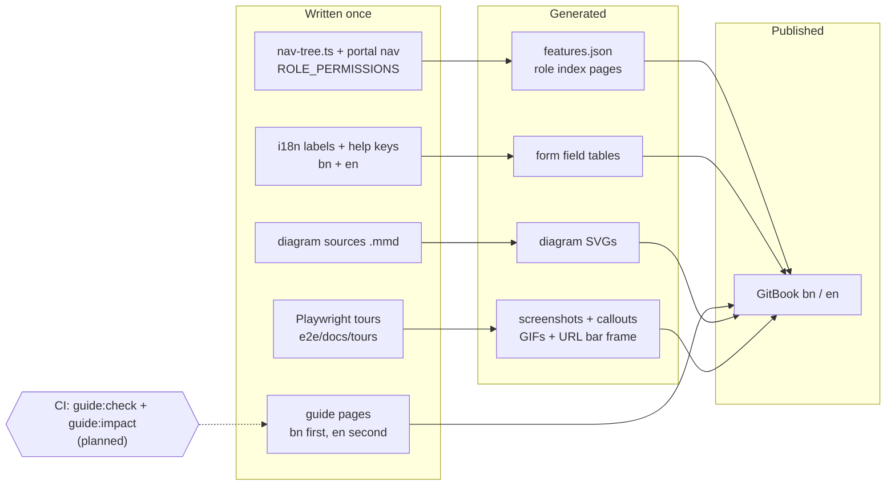
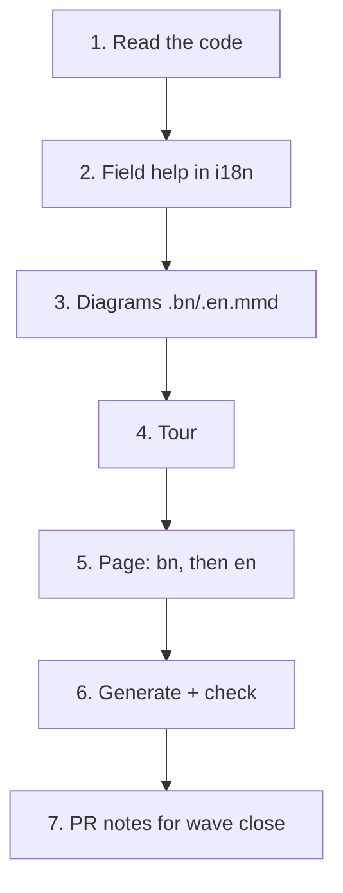
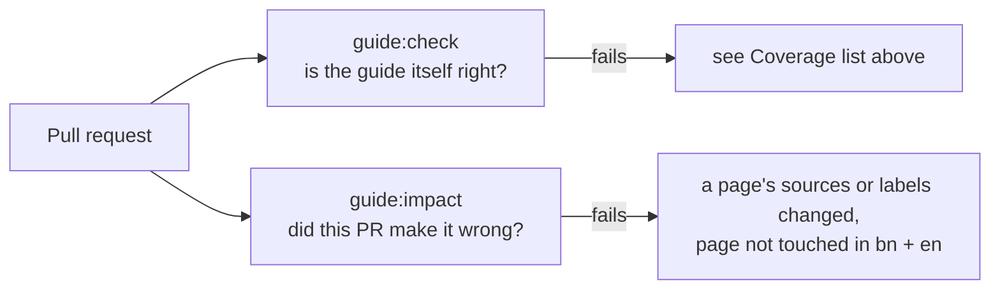
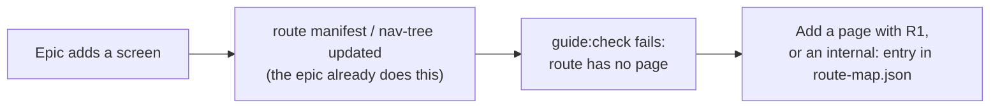

# User guide — the bilingual help site in `docs/user-guide/`

The guide is a GitBook site, built from Markdown in this repo, in Bangla and
English. Epic 42 (#860) builds it. This doc is for **developers and agents**: what
the pieces are, which files are generated, what CI checks, and how to add a page.
Writers also read [`docs/documentation/writing-guide.md`](../documentation/writing-guide.md).

**Status.** Wave 1 of Epic 42 is building the checks and generators. Anything marked
_(planned)_ below does not exist yet; each names the ticket that builds it. Do not
call a planned command in a script or CI step until its ticket has merged.



Narrated video, voice, the media bucket and YouTube are **not in this release**
(D48). They wait in the deferred Epic 85 (#2837).

## What the guide is

One canonical page per customer-facing screen, in two languages, written for
people who may never have used the app.

| Fact           | Value                                                                                           |
| -------------- | ----------------------------------------------------------------------------------------------- |
| Where          | `docs/user-guide/{bn,en}/`                                                                      |
| Published by   | GitBook Git Sync, configured in `gitbook-docs.yaml` (`bn` default space, `en` second)           |
| Languages      | Bangla first, English second (D17). Same file name and same ids in both                         |
| Roles covered  | every role with a sidebar. SUPER_ADMIN is out of the customer guide (D15)                       |
| Brand in prose | "SchoolManager" (see [`branding-compatibility.md`](../documentation/branding-compatibility.md)) |
| Page shape     | locked by [`page-template.md`](../documentation/page-template.md) (D44)                         |
| How to write   | [`writing-guide.md`](../documentation/writing-guide.md)                                         |
| How to draw    | [`diagram-style.md`](../documentation/diagram-style.md)                                         |
| Words          | glossary: [bn](../user-guide/bn/help/glossary.md), [en](../user-guide/en/help/glossary.md)      |

### Structure (same in `bn/` and `en/`)

| #   | Section                                                                              | Path                   |
| --- | ------------------------------------------------------------------------------------ | ---------------------- |
| 1   | Welcome: why SchoolManager, the dashboard story, "আপনি কে?" role cards               | `README.md`            |
| 2   | Getting started: sign in, phone and PWA install, language, account, Ctrl+K, sign out | `start/`               |
| 3   | For the admin: create your school, setup order, scenarios with Excel files           | `admin-setup/`         |
| 4   | Dashboard: every role's dashboard, each widget, thresholds, alerts and notifications | `dashboard/`           |
| 5   | Roles: one generated index per role                                                  | `roles/<role>.md`      |
| 6   | Features: one canonical page per sidebar or portal item                              | `<group>/<feature>.md` |
| 7   | Help: problems and fixes, "why can't I see this?", glossary                          | `help/`                |

## Contracts

These are the "pattern" every later epic reuses. All tickets follow them.

### Page metadata

Every page starts with a hidden HTML comment (invisible on GitHub and GitBook).
The full block is in [`page-template.md`](../documentation/page-template.md). Example:

```markdown
<!-- guide:meta
feature: attendance.attendance       # nav-tree id | portal.<seg> | start.<x> | admin.<x> | dashboard | dashboard.<x> | help.<x>
title: উপস্থিতি নেওয়া
summary: <= 160 characters; this is the HelpCard text (Epic 44)
roles: [TEACHER, ADMIN]
sources: [client-admin/src/routes/_staff/attendance/index.tsx]   # code this page documents
labels: [attendance:mark.*]                                       # i18n key globs (ns:keyGlob) the page quotes
helpIds: [attendance.attendance, attendance.attendance.action.submit]
devices: [desktop, phone]
entry: [sidebar, palette, dashboard:my-pending-sections]
keywords: [হাজিরা, attendance]
appVersion: 0.1.0 (7b776974b)
owner: tareq89
lastVerified: 2026-10-23
knownIssues:
  - { id: submit-stays-draft, checked: 2026-10-23, issue: null }
-->
```

The `bn` and `en` pages of one feature always have the same `feature`, `helpIds`
and `roles`.

### Ids and paths

- helpId grammar: `<feature>`, `<feature>.action.<name>`, `<feature>.field.<name>`, `<feature>.section.<name>`, `widget.<widgetKey>`.
- URL slugs are English kebab case in **both** languages (D27).
- The feature id maps to a path through `docs/user-guide/_generated/features.json` _(planned, 42.1.04)_.

### Page anchors

Headings carry explicit ASCII ids, because GitHub and GitBook slug Bangla
differently (D44). The fixed ids are `arrive`, `task-main`, `confirm`, `other`,
`trouble`, `roles`, `known-issues`, `more`. The section list and which are
required are in the [writing guide](../documentation/writing-guide.md#1-order-and-anchors).

### Generated files — never hand-edit

| File or block                                                                                                                                                                                                  | Made by                                           |
| -------------------------------------------------------------------------------------------------------------------------------------------------------------------------------------------------------------- | ------------------------------------------------- |
| `docs/user-guide/_generated/features.json`: `[{ id, kind: "nav"\|"portal"\|"start"\|"admin"\|"dashboard"\|"help", path, route, routes, roles }]`. `routes` lists every manifest route the page documents (D41) | `guide:gen` _(planned, 42.1.04)_                  |
| Marker blocks in a page: `<!-- guide:generated:<kind>:<id> -->` … `<!-- /guide:generated -->`, where kind is `fields`, `roles` or `widgets` (**`video` is not allowed**, D48)                                  | `guide:gen` _(planned)_                           |
| `docs/user-guide/roles/*`                                                                                                                                                                                      | `guide:gen` _(planned, 42.6.03)_                  |
| `docs/user-guide/<lang>/<section>/diagrams/*.svg`                                                                                                                                                              | `scripts/user-guide/render-diagrams.mjs` (exists) |

### Coverage

`docs/user-guide/coverage.json` holds `{ "<feature id>": "planned" | "done" }`.
`guide:check` _(planned, #2518)_ hard-fails when:

- a `features.json` id is missing from `coverage.json`;
- a `done` id lacks a bn or an en page;
- a route in `e2e/route-manifest.json` maps to no feature and has no `internal:` entry in `docs/user-guide/route-map.json` (D41);
- a `done` page lacks a required anchor id, or lacks `#arrive` while `entry` has more than `sidebar`/`palette` (D44, D45);
- a page bolds another page's title without a link, or a **সম্পর্কিত পাতা** link has no link back (D46);
- a page has a `guide:generated:video` marker (D48);
- a link or a helpId points at a missing page.

It warns when a `knownIssues` entry was `checked` more than 30 days ago.
42.6.06 flips every entry to `done`.

### Media files

| What           | Where                                                           | Limit                            |
| -------------- | --------------------------------------------------------------- | -------------------------------- |
| Screenshots    | `docs/user-guide/<lang>/<section>/img/<feature-kebab>-<nn>.png` | at most 300 KB, light mode (D31) |
| GIFs           | `…/img/<feature-kebab>-<workflow>.gif`                          | at most 2 MB, 20 s, 960 px wide  |
| Diagram source | `docs/user-guide/_diagrams/<name>.{bn,en}.mmd`                  | —                                |
| Diagram output | `docs/user-guide/<lang>/<section>/diagrams/<name>.svg`          | —                                |
| Tours          | `e2e/docs/tours/<feature-kebab>.tour.ts`                        | —                                |

No video file ever goes in git, and no video is made in this release (D48).

## Recipe R1 — one feature page

Every content ticket runs this per feature.

1. **Read the feature.** Its route files, the namespaces they load (`loadRouteNamespaces(…)`), its nav item and `ROLE_PERMISSIONS`. List every screen, workflow, form and role difference.
2. **Write field help.** Every form field gets `help.<field>` in its own namespace, in `ui/src/i18n/locales/bn/<ns>.json` first, then `en`. Mark the hard ones with a `<feature>.field.<name>` entry in `helpIds` (D18, D19).
3. **Write the diagrams** ([style](../documentation/diagram-style.md), D23). One overview diagram with who-sees-what; one per cross-feature flow. Each as `.bn.mmd` and `.en.mmd`.
4. **Write the tour** `e2e/docs/tours/<feature>.tour.ts` _(capture toolkit: planned, W1)_. Sign in as the demo-school login card for the role. It makes an overview shot, numbered callouts on every component, and one GIF per workflow. Desktop, plus phone for `devices: [phone]`.
5. **Write the page.** Copy [`page-template.md`](../documentation/page-template.md), write **bn first**, then en, following the [writing guide](../documentation/writing-guide.md). Verify every behaviour claim in code first.
6. **Generate and check.** `guide:gen`, `guide:shoot`, `guide:diagrams` and `guide:check` _(planned; until they land, run `node scripts/user-guide/render-diagrams.mjs` and `yarn prettier --check`)_.
7. **Files you do not touch.** Never edit `coverage.json` or `SUMMARY.md`; the wave close does. Need a reciprocal link in a page another ticket of the same wave owns? List it in the PR notes. Demo data missing? Open a follow-up on Epic 58; never fake data in a tour.



## Generated files

Why they exist and what makes them stale:

| Generated               | Source of truth                           | Stale when…                                        |
| ----------------------- | ----------------------------------------- | -------------------------------------------------- |
| `features.json`         | `nav-tree.ts`, portal nav, route manifest | a route or nav item is added or renamed            |
| Field tables (`fields`) | i18n `help.*` keys                        | a help key changes                                 |
| Role indexes            | `ROLE_PERMISSIONS` + `features.json`      | a permission or page changes                       |
| Diagram SVGs            | `.mmd` files (stamped with a source hash) | the `.mmd` changed but the SVG was not re-rendered |

Never fix a generated file by hand. Fix its source and regenerate. CI checks
freshness _(planned, #2518)_.

## CI checks: guide:check and guide:impact

Both are **planned**. `guide:check` is built by #2518; `guide:impact` by a later
W1 ticket in the same epic.



| Check          | Fails when                                                                                                                                              |
| -------------- | ------------------------------------------------------------------------------------------------------------------------------------------------------- |
| `guide:check`  | any item in the **Coverage** list above; a broken link or helpId; a generated block or `features.json` out of date; a key in `labels` missing from i18n |
| `guide:impact` | a PR changes a file named in a page's `sources`, or adds or renames i18n keys inside its `labels`, and does not touch that page in **both** bn and en   |

Media staleness (a screenshot older than its page) is a soft report, not a failure.

**The escape.** Put this line in the PR body when the change really does not
affect the guide, with a real reason:

```text
User guide: not affected — renamed an internal helper, no screen or text changed
```

The rule is also written into `CLAUDE.md` and the plan-epic and
implement-epic/issue skills (D16), so every change keeps the guide true.

## How a future epic adds a page



1. Add the screen as usual (route, nav item, i18n keys, `help.*` keys).
2. `guide:check` _(planned)_ will fail until the route maps to a page. Run **R1** above and write the bn page, then en.
3. Add the page's id to `coverage.json` as `planned`; the wave close flips it to `done`.
4. If the route needs no customer page, add an `internal:` entry with a reason to `route-map.json` instead (for example `internal: redirect`).
5. In the PR body, either list the new pages or write `User guide: not affected — <reason>`.

## How to regenerate media

Screenshots, GIFs and diagrams only. There is no video and no narration (D48).

| What                 | Command                                                                                                                   | Needs                                                                                                    |
| -------------------- | ------------------------------------------------------------------------------------------------------------------------- | -------------------------------------------------------------------------------------------------------- |
| Diagrams             | `node scripts/user-guide/render-diagrams.mjs [name-prefix]` (exists). `yarn guide:diagrams` is planned                    | `mmdc` (`MMDC` env) or `npx -p @mermaid-js/mermaid-cli mmdc`; `PUPPETEER_CONFIG` for an installed Chrome |
| Screenshots and GIFs | `yarn guide:shoot <feature>` _(planned, W1)_: runs `e2e/docs/tours/<feature>.tour.ts` through `playwright.docs.config.ts` | the demo school (Epic 58), Playwright                                                                    |

A tour never uses fake data. If the demo school lacks what a tour needs, open a
follow-up on Epic 58.

## Related

- [`docs/documentation/writing-guide.md`](../documentation/writing-guide.md): how to write a page.
- [`docs/documentation/page-template.md`](../documentation/page-template.md): the locked shape.
- [`docs/documentation/diagram-style.md`](../documentation/diagram-style.md): diagram rules.
- [`22-demo-seed.md`](22-demo-seed.md): the demo school the tours read.
- [`21-ui-patterns.md`](21-ui-patterns.md): the UI the pages describe.
