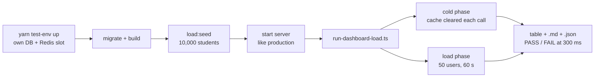

# Dashboard load test (manual)

Goal: prove every dashboard widget answers in **under 300 ms (p95)** while **50 people** use the
dashboard at once, on a school with **10,000 students** (Epic 169, D21). It is run by hand, on a
throwaway database, never in CI (D24).



## Safety (read first)

- The seed **refuses to run** unless all four are true: `LOAD_SEED_CONFIRM=yes`, `NODE_ENV` is not
  `production`, the database is on this machine, and the database name starts with
  `biddaloy_test_run_` or `biddaloy_load_`. A normal database such as `biddaloy` is rejected.
- It is not part of `yarn seed`, `seed:demo`, `ci:local` or any workflow.
- It writes only fake data: names like `Load Student 17`, phones like `00000001234` (not dialable),
  emails `load-*@biddaloy.test`. Dates are computed from today, "random" values come from a hash of
  the row id, so a fresh database always gets the same data.
- The run script only talks to a server on this machine, and only deletes the load school's own
  `tenant:<id>:dash:*` Redis keys. It never runs `FLUSHALL`.
- Run it once per database. A second `load:seed` says "already seeded" and exits. Drop the database
  to start over.

## Run it

Needs Node 24. Every command runs from the repo root.

```bash
nvm use 24
ENV_FILE=$(yarn --silent test-env up)       # makes DB biddaloy_test_run_<id> + a Redis slot
set -a; . "$ENV_FILE"; set +a
yarn build:shared
yarn workspace @biddaloy/server migration:run
LOAD_SEED_CONFIRM=yes LOAD_PASSWORD='choose-one-8+' yarn workspace @biddaloy/server load:seed   # about 2 minutes
```

`test-env` reuses the shared Docker stack and only adds a database and a Redis slot for this
worktree. It starts no containers.

Start the server the way production does (not watch mode, or compile time pollutes the numbers).
The rate limit is raised because 50 users from one machine would otherwise get 429s.

```bash
yarn workspace @biddaloy/server build
RATE_LIMIT_DEFAULT_LIMIT=1000000 NODE_ENV=test yarn workspace @biddaloy/server start:prod
```

In a second terminal (same `set -a; . "$ENV_FILE"` step), run the test:

```bash
LOAD_PASSWORD='choose-one-8+' yarn workspace @biddaloy/server exec ts-node src/scripts/load/run-dashboard-load.ts
```

Clean up: `yarn test-env down` (or `yarn test-env sweep` after a crash).

Settings (environment variables):

| Variable            | Default                  | Meaning                                       |
| ------------------- | ------------------------ | --------------------------------------------- |
| `LOAD_PASSWORD`     | required                 | Password given to the seed                    |
| `LOAD_BASE_URL`     | `http://localhost:3000`  | Server to hit. Must be on this machine        |
| `LOAD_USERS`        | `50`                     | Virtual users (mix: 20 teacher, 8 admin, ...) |
| `LOAD_DURATION_S`   | `60`                     | Length of the load phase                      |
| `LOAD_COLD_REPEATS` | `30`                     | Requests per endpoint in the cold phase       |
| `LOAD_PHASES`       | `cold,load`              | Run just one phase with `cold` or `load`      |
| `REDIS_URL`         | `redis://127.0.0.1:6379` | Where the dashboard cache lives (cold phase)  |
| `SCALE` (seed only) | `1`                      | Multiplies the student count (`0.02` = 200)   |

## Read the result

Two phases, because the widgets cache for 60 seconds:

- `cold`: the cache is cleared before every request, one request at a time. This is the real SQL
  cost of each widget.
- `load`: 50 users loop over their role's widgets with a short think time, cache on. This is a
  school morning.

```text
phase  role        endpoint                               n   p50    p95    max  err  result
cold   ACCOUNTANT  /dashboard/widgets/collection-by-month 30  106ms 1423ms 19514ms  0  FAIL
cold   ADMIN       /dashboard/widgets/staff-today         30   20ms   59ms    80ms  0  PASS
```

A row FAILS when its p95 is 300 ms or more, when it had any non-2xx answer, or when it has no
samples. A `404` on the first probe means the widget has no route yet: it is listed under
"Skipped" and not counted. The run writes `load-results-<time>.md` and `.json` in the current
folder and exits `1` if any row failed.

Things that make a number look worse than the widget really is:

- The load generator and the server share one machine. Close the browser and other work first.
- With 50 users in one Node process, a slow widget queues the others behind it. Compare the `load`
  p50 with the `cold` p50: if `load` is slow everywhere, the machine is saturated.
- Widgets whose data this seed does not create (see below) answer fast because they have nothing to
  read. Their PASS means little.

## What the seed contains

| Table                         | Rows at `SCALE=1`                                            |
| ----------------------------- | ------------------------------------------------------------ |
| academic years                | 5 (current + 4 past)                                         |
| classes / sections            | 10 / 50                                                      |
| students, guardians           | 10,000 each (2% guardians incomplete)                        |
| enrollments                   | about 46,000 (current + about 90% of the roll per past year) |
| attendance sessions / records | 3,000 / 600,000 (60 working days, Friday off)                |
| fee structures / student fees | 10 / 100,000 (10 months, PAID / PARTIAL / PENDING / WAIVED)  |
| payments                      | about 77,000 (SUCCESS, cash / bKash / bank)                  |
| logins                        | 8, one per role (`load-admin@biddaloy.test`, ...)            |

Not seeded yet (so these widgets read empty tables): exams and results, homework, syllabus,
routines, staff attendance, communication logs, admissions, seat plans, leave, and teacher
assignments. The at-risk precompute is not run either. Add them to `seed-load-10k.ts` before
trusting the PASS of the widgets that read them.

## If a row fails

Run `EXPLAIN (ANALYZE, BUFFERS)` on that widget's query against the same database, and check the
index the widget's ticket names. The first suspects are the full-register scans:
`attendance-today` and `committee-attendance` read 600,000 attendance records.

Record the result: paste the table into the Epic 169 issue as a comment with the date and commit.
