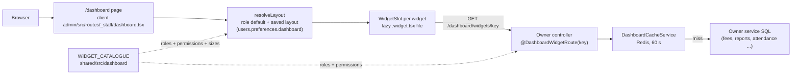
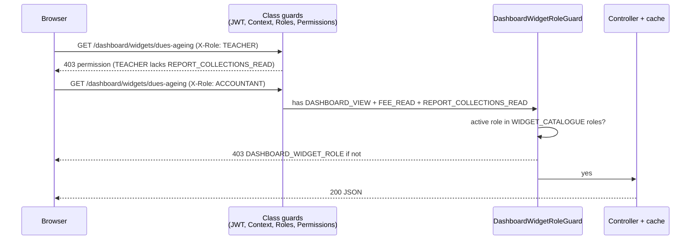
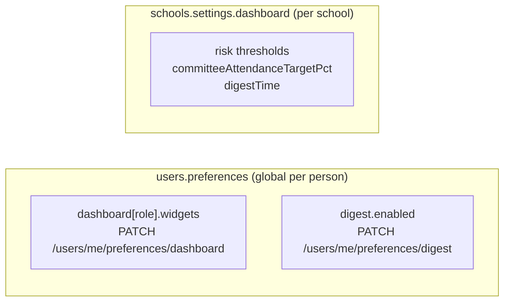
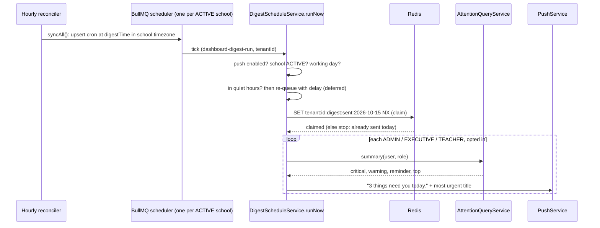

# 26 — Dashboard: role dashboards, widgets, preferences, morning summary

> **Why 26?** The ticket (#1919) said `22-dashboard.md`. By the time it was written, `22-demo-seed.md`, `22-onboarding.md` (now `34-onboarding.md`), `23-*`, `24-*` and `25-*` already existed, so the next free number is 26.

Epic #169. The staff `/dashboard` is a grid of **widgets**. Each widget is one small card that loads its own data from its own endpoint. This page explains how a widget is defined, served, cached, permission-checked, laid out and customised, and how to add a new one.

## 1. What a user sees

| Role                         | Default widgets (first 4, in order)                                                  | Phone tiles                         |
| ---------------------------- | ------------------------------------------------------------------------------------ | ----------------------------------- |
| ADMIN                        | attendance-today, staff-today, collection-month, approvals-pending … (11 total)      | yes, for widgets marked `phoneTile` |
| EXECUTIVE                    | same "school pulse" set as ADMIN, minus the system widgets (8)                       | yes                                 |
| TEACHER                      | my-routine-today, my-pending-sections, my-mark-deadlines, homework-to-check … (7)    | yes                                 |
| ACCOUNTANT                   | collection-today, collection-month, fee-generation-status, reminders-pending … (8)   | yes                                 |
| OFFICE_STAFF                 | admissions-today, students-added-today, guardians-incomplete, attendance-today … (7) | yes                                 |
| EXAM_CONTROLLER              | mark-entry-progress, results-state, seat-plan-status, print-queue, upcoming          | yes                                 |
| COMMITTEE                    | committee-enrollment, committee-attendance, committee-finance, committee-pass-rate   | yes                                 |
| PARENT, STUDENT, SUPER_ADMIN | none. Parents and students get the curated `/portal` cards (D2, no customising).     | no                                  |

The full lists are `ROLE_DEFAULT_LAYOUTS` in `shared/src/dashboard/widget-catalogue.ts`.

The **briefing** (the "3 things need you today" line above the grid) is not a dashboard route. See section 6.

## 2. The big picture



Key ideas:

- **One endpoint per widget** (D6, D28). A hidden widget is never fetched. A failing widget shows its own error and does not break the others.
- **The catalogue is shared.** `WIDGET_CATALOGUE` lives in `shared/` so the server (who may call it) and the client (who may see it) read the same rows.
- **Data code lives with the data owner** (D29). Fees widgets are in `modules/fees`, not in `modules/dashboard`. The `dashboard` module is only plumbing: the cache, the decorator, the at-risk job and the digest.

### The cache

`server/src/modules/dashboard/dashboard-cache.service.ts`. Keys look like this:

```
tenant:7c1e…:dash:v1:collection-month:school
tenant:7c1e…:dash:v1:my-mark-deadlines:user:3f9a…
tenant:7c1e…:dash:v2:collection-by-month:school
```

The `v1` part is a per-widget version (`WIDGET_CACHE_VERSION`). When a cached payload changes shape, bump that widget's number, e.g. `collection-by-month` is `v2` since #2941.

| Scope        | Used when                                                 | Example widgets               |
| ------------ | --------------------------------------------------------- | ----------------------------- |
| `school`     | The answer is the same for everyone allowed to see it     | collection-month, dues-ageing |
| `user:<sub>` | The answer depends on who asks (a teacher's own sections) | my-mark-deadlines             |

Notes:

- The TTL is 60 seconds (`DASHBOARD_CACHE_TTL_SECONDS`).
- If Redis is down, the loader just runs. Never a 500 (security Rule 15).
- Cached values must be JSON-safe (ISO date strings, never `Date`).
- Deviation: the epic plan also named a `role` scope. No widget needed it, so it is not built. Add it when a widget really differs by role.

## 3. One widget end to end: `collection-month`

**Catalogue row** (`shared/src/dashboard/widget-catalogue.ts`):

```ts
'collection-month': {
  permissions: [P.REPORT_COLLECTIONS_READ],
  roles: [R.ADMIN, R.EXECUTIVE, R.ACCOUNTANT],
  sizes: ['S', 'M'],      // first entry is the default size
  phoneTile: true,
},
```

**Route** (`server/src/modules/reports/reports-dashboard.controller.ts`). The decorator adds `DASHBOARD_VIEW` plus the catalogue permissions, and the role check.

```ts
@DashboardWidgetRoute(DashboardWidgetKey.COLLECTION_MONTH)
@ApiOkResponse({ type: CollectionMonthWidgetDto })
async collectionMonth(@CurrentTenant() tenant) {
  return this.cache.getOrLoad(tenant.id, DashboardWidgetKey.COLLECTION_MONTH, 'school', async () =>
    this.collectionsReport.getCollectionMonthWidget(tenant.id, await this.schools.todayFor(tenant.id)));
}
```

**Response** `GET /api/v1/dashboard/widgets/collection-month` (field names from `collection-month-widget.dto.ts`; numbers are examples):

```json
{
  "month": "2026-10",
  "as_of": "2026-10-07",
  "received": 412000,
  "billed_for_month": 980000,
  "received_pct": 42,
  "last_month_same_point": {
    "as_of": "2026-09-07",
    "received": 385000,
    "billed_for_month": 960000,
    "received_pct": 40
  },
  "last_year_same_point": null
}
```

`last_year_same_point` is `null` when last year had no data. The card shows "—", never 0.

**Client** (`client-admin/src/dashboard/widgets/finance/collection-month.widget.tsx`). It exports `widgetKey` and a default component that takes `variant`:

| Variant   | Where                    | Shows                            |
| --------- | ------------------------ | -------------------------------- |
| `tile`    | phone, 2-column KPI grid | one number                       |
| `compact` | phone, after tap         | number plus one sentence         |
| `full`    | desktop                  | meter, comparisons, table toggle |

**Reconciliation rule** (D29): the widget and its source page run the same query. `received` equals `totals.net` of `GET /reports/collections` for the same range. A test (`reports-dashboard.e2e-spec.ts`) checks they match.

## 4. Permissions



- D46: the server checks **both** the active role (catalogue `roles`) and the permissions. A role that holds the permission but is not listed still gets `403` with `details.code = "DASHBOARD_WIDGET_ROLE"`. Hiding a card in the UI is never the only guard.
- `DASHBOARD_VIEW` is added by the decorator. Never list it in a catalogue row.
- Some rows list **two** permissions on purpose. `dues-ageing` needs `FEE_READ` and `REPORT_COLLECTIONS_READ`, because TEACHER holds `FEE_READ` and school-wide dues must 403 for a teacher.
- Guard code: `server/src/modules/dashboard/widget-permission.decorator.ts`. Its tests: `widget-permission.decorator.spec.ts` and `.e2e-spec.ts`.

## 5. Layout and customise

`resolveLayout` (`client-admin/src/dashboard/layout/resolve-layout.ts`) is a pure function:

1. Start with the user's saved widgets for the **active role**, in saved order.
2. Append every role-default widget the user has not saved yet. New defaults still appear.
3. Drop any widget whose catalogue `roles` lack the active role, whose `permissions` the user lacks, or which has `needsEpic` and no widget file (section 10).
4. A saved `size` counts only if it is in the catalogue's `sizes`. Otherwise the first size is used.
5. Rows with `hidden: true` go to the "hidden" list. The rest are the grid.

**Saved preference** (D9, `users.preferences.dashboard[role]`):

```
PATCH /api/v1/users/me/preferences/dashboard
{ "widgets": [ { "key": "collection-month", "size": "M" }, { "key": "upcoming", "hidden": true } ] }
```

Limits (D34): known widget keys only, at most `DASHBOARD_LAYOUT_MAX_WIDGETS` (40) entries, at most 8192 bytes (`DASHBOARD_LAYOUT_MAX_BYTES`). **Deviation:** the plan said 30. ADMIN lists 31 widgets, so 30 would stop ADMIN from saving their own default.

**Customise mode** is in place on `/dashboard` (`?customize=1`), not a new route. Keyboard (D12), in `customise/customise-panel.tsx`: Space shows or hides, Alt+Up / Alt+Down moves, Enter saves, Esc cancels. Drag is an extra.

**Phone** (D16): one column, briefing first, then a 2-column grid of `tile` variants, lists capped at 3.

## 6. Preferences and settings



| What                        | Where                                                                                                            | Default             |
| --------------------------- | ---------------------------------------------------------------------------------------------------------------- | ------------------- |
| Layout                      | `PATCH /users/me/preferences/dashboard` (`users.controller.ts`)                                                  | none (role default) |
| Morning summary opt-out     | `PATCH /users/me/preferences/digest`, body `{ "enabled": false }` (D50)                                          | on                  |
| At-risk thresholds          | `settings.dashboard.risk`: `absentStreakDays` 3, `monthlyAttendancePct` 75, `failedSubjects` 1, `overdueDays` 60 | see left            |
| Committee attendance target | `settings.dashboard.committeeAttendanceTargetPct`                                                                | 90                  |
| Morning summary time        | `settings.dashboard.digestTime` (school-local)                                                                   | `07:30`             |

Defaults: `DEFAULT_DASHBOARD_SETTINGS` in `server/src/modules/schools/settings/tenant-settings-defaults.ts`.

- D50: the opt-out is its own route, not a field in the layout DTO. A person turns the push off in one place without touching their layout.
- At-risk student = any 2 of the 4 signals (D7). A nightly job (`insights/at-risk.processor.ts`, 00:30) precomputes the list per school.
- Both PATCH routes need `DASHBOARD_VIEW`, so PARENT and STUDENT cannot use them.

## 7. The briefing is NOT a dashboard route

The "3 things need you today" line comes from the **attention engine** (Epic 67), not from the dashboard module:

```
GET /api/v1/attention/summary   →  { critical, warning, reminder, top }
```

(`server/src/modules/attention/api/attention.controller.ts`.) The shell's attention bar reads the same endpoint. `client-admin/src/dashboard/layout/briefing-slot.tsx` turns it into the sentence on the client.

History: the epic planned `GET /dashboard/briefing` with a per-role priority list in `shared/` (D10, D30, D37). Epic 67 replaced that, so the catalogue file has no briefing priority and there is no `/dashboard/briefing`. If you see either name in an old ticket, it is superseded.

COMMITTEE has no briefing. Its summary sentence is built on the client from `committee-attendance` and `committee-finance` (D47, `layout/committee-summary.tsx`).

## 8. Morning summary push



Files are in `server/src/modules/dashboard/digest/`.

- **Who:** ADMIN, EXECUTIVE, TEACHER (`DIGEST_ROLES`). A person with two of these roles in one school gets one push, for the first role in that list.
- **When:** at `digestTime` in the school's `region.timezone`. Skipped on non-working days (`SchoolCalendarService.isNonWorkingDay`).
- **Quiet hours:** the same ones as attention pushes (D23). The run is held until they end.
- **Once per day:** the Redis claim `tenant:<id>:digest:sent:<local date>`. It is taken **before** sending, so a crash after the claim is not retried. A missed digest is better than a duplicate.
- **Empty means silent:** zero open items sends nothing.
- **Privacy:** a title that names a student, and MANUAL alerts, are left out of the body (`digest-templates.ts`). A lock screen never shows a name.
- **Content:** the plan said "that user's briefing line". Built as the attention summary, which is the same thing since the briefing moved to Epic 67.
- The scheduler is hourly-reconciled, so changing `digestTime` takes effect within the hour.

## 9. Time rules

- **Tenant "today"** always comes from `SchoolsService.todayFor(tenantId)` (reads the school's `region.timezone`). Controllers call it **inside** the cache loader, so a cached value is at most 60 s stale across midnight.
- `server/src/common/time.ts` still has `SCHOOL_TZ = 'Asia/Dhaka'` and `todayInSchoolTz()`. Some older callers use it (print jobs, promotions, fines, and the exams widgets via `localToday()` default). That is correct for every school today (all are in Bangladesh) and wrong for the first school in another timezone. The file marks each remaining caller with a `ponytail:` note. **New widget code must use `todayFor`.**
- Dates in JSON are `YYYY-MM-DD` strings in school time. Months are `YYYY-MM`.

## 10. Money widgets

- **"Applied to bills, not physical cash."** `received` in `collection-month` and `collection-today` is net SUCCESS payments applied to bills. A payment made from a wallet counts, though no cash moved. Label it that way in the UI.
- **SUCCESS only.** FAILED payments move no money and never enter a total. `recent-payments` lists up to 5, newest first. Its `total_of_shown` sums **only the SUCCESS rows shown** (`fees-dashboard.dto.ts`). A plain "sum of what is on screen" would add failed rows, so the ticket's wording was narrowed.
- Money is returned as a number from the server and formatted with `formatServerAmount`. The client does no money arithmetic, apart from percentage-point differences.
- Accrual (billed for the month) and cash basis (received) are different bases. `received_pct` can exceed 100 when arrears are paid.

## 11. Privacy

- **COMMITTEE sees aggregates only** (D44). The four committee widgets need `COMMITTEE_REPORT_READ` and return counts and percentages: no names, ids or contacts. They have no drill-down links (D23), only the chart/table toggle. Each committee widget has an e2e that walks the JSON at any depth and fails on an `id`, `*_id` or personal key (example: `server/src/modules/enrollments/enrollments-dashboard.e2e-spec.ts`).
- The committee report is `/print/committee-report` (permission-gated in `client-admin/src/route-permissions.ts`). It reuses the four committee endpoints for "this month as of today" (D48). Committee attendance serves days older than 8 days from a nightly Redis cache (key date = today-8), so those days lag corrections until the next nightly run; the last 7 days and today are computed live.
- **Teacher widgets** are scoped to the caller's own sections and cached per `user:<sub>`.
- **Portal (PARENT / STUDENT)** is not the widget engine. The cards in `client-admin/src/routes/portal/-*-card.tsx` call the existing family (guardian / student) endpoints, which are scoped to the signed-in account's own children. Do not add a widget route for them, and never trust a student id from the URL without that ownership check.
- The digest and the push body never carry student names (section 8).

## 12. Freshness and offline

- The client refetches every 5 minutes and on window focus (D32): `client-admin/src/dashboard/layout/use-dashboard-prefs.ts` (`refetchInterval: 5 * 60_000`).
- The server cache is 60 s. So the worst case is about 6 minutes old.
- Offline (D52): the service worker already caches `GET /api/v1/dashboard/*` network-first and stamps `x-sw-cached-at`. An axios interceptor (`layout/offline-freshness.ts`) records the age and `WidgetSlot` shows the "last saved figures" label (`offlineCached` in `dashboard.json`). `sw.ts` was not changed.

## 13. Known limits and decisions that differ from the tickets

| Item                     | Plan / ticket said                                 | Built                                                                                                                                                                                                                                                                       | Why                                                                                                                |
| ------------------------ | -------------------------------------------------- | --------------------------------------------------------------------------------------------------------------------------------------------------------------------------------------------------------------------------------------------------------------------------- | ------------------------------------------------------------------------------------------------------------------ |
| Doc number               | `22-dashboard.md`                                  | `26-dashboard.md`                                                                                                                                                                                                                                                           | 22 to 25 were taken                                                                                                |
| `needsEpic` (D42)        | Hide the widget until the dependency epic ships    | A `needsEpic` widget shows **exactly when its `.widget.tsx` file exists** (D51). The file list is the switch.                                                                                                                                                               | The four dependency epics shipped, and "file exists" needs no shared edit. `resolveLayout` says it supersedes D42. |
| Layout cap (D34)         | 30 widgets                                         | 40                                                                                                                                                                                                                                                                          | ADMIN has 31                                                                                                       |
| Briefing (D10, D30, D37) | `GET /dashboard/briefing`, priority list in shared | `GET /attention/summary` (Epic 67)                                                                                                                                                                                                                                          | One engine, one count, shell bar and dashboard agree                                                               |
| Cache scopes             | school / role / user                               | school / user                                                                                                                                                                                                                                                               | No widget differs by role alone                                                                                    |
| Digest opt-out (D50)     | in the layout DTO                                  | `PATCH /users/me/preferences/digest`                                                                                                                                                                                                                                        | Separate concern, separate route                                                                                   |
| Recent payments total    | total of shown rows                                | `total_of_shown` = SUCCESS rows shown only                                                                                                                                                                                                                                  | FAILED rows move no money                                                                                          |
| Phone tile tap           | tile itself is a button                            | A sibling overlay button (`dashboard-grid.tsx`) expands the tile. A CSS `:has()` rule (`group-has-[a,button:not([data-tile-toggle])]:hidden`) hides it when the tile holds its own link or button                                                                           | No button nested inside a button                                                                                   |
| Customise                | add from catalogue                                 | Hide, show, reorder and resize the widgets the role may see. There is no "add from catalogue" step: every allowed widget is already listed, hidden or not.                                                                                                                  | Allowed set is already in the list                                                                                 |
| Load test                | manual run doc                                     | The 10k-student run is manual only (D24). The run guide is [37-dashboard-load-test.md](37-dashboard-load-test.md) (`load:seed` and `run-dashboard-load.ts` under `server/src/scripts/load/`). The attention perf script `server/src/scripts/perf-attention.ts` also exists. | Epic 169 ticket 6-02                                                                                               |

Other limits:

- Performance target (D21): p95 under 300 ms per widget for a 10k-student school. Not run in CI.
- `needsEpic` rows today: `approvals-pending` (#1726), `print-queue` (#1373), `setup-checklist` (#1640), `syllabus-vs-plan` and `my-lessons-to-mark` (#1828). `setup-checklist` reuses the Epic 13 onboarding endpoint and has no `/dashboard/widgets` route (D53). Widgets whose file is missing are just skipped by the grid.
- Multi-branch combined dashboards, admin role templates and SMS digests are out of scope (D26).

## 14. How to add a widget

Say the key is `library-overdue`, for the ADMIN role.

1. **Catalogue row.** Add the key to `DashboardWidgetKey` and a row to `WIDGET_CATALOGUE` in `shared/src/dashboard/widget-catalogue.ts`. This is a shared change; there is no way around it. Choose `roles`, `permissions` (never `DASHBOARD_VIEW`), `sizes` (first = default), `phoneTile`. Add it to `ROLE_DEFAULT_LAYOUTS` if it should show by default. `widget-catalogue.spec.ts` checks the table.
2. **Server DTO.** `server/src/modules/<owner>/dto/<key>-widget.dto.ts`. Use `@ApiProperty` with examples and a plain description.
3. **Server query.** A method on the owner service. Use `SchoolsService.todayFor` for "today". Money: SUCCESS only. COMMITTEE-visible: aggregates only.
4. **Server route.** In the owner's `*-dashboard.controller.ts` (copy `server/src/modules/fees/fees-dashboard.controller.ts`):
   ```ts
   @DashboardWidgetRoute(DashboardWidgetKey.LIBRARY_OVERDUE)
   @ApiOkResponse({ type: LibraryOverdueWidgetDto })
   libraryOverdue(@CurrentTenant() tenant) {
     return this.cache.getOrLoad(tenant.id, DashboardWidgetKey.LIBRARY_OVERDUE, 'school', () => this.svc.overdue(tenant.id));
   }
   ```
   Use scope `` `user:${user.sub}` `` if the answer is personal. Register the controller and `DashboardCacheService` in the owner module.
5. **Briefing.** If it is urgent, add an alert rule in the attention engine (see [23-attention.md](23-attention.md)). There is no dashboard briefing provider.
6. **Route snapshots.** Update `server/src/route-status.snapshot.txt` and `server/src/__snapshots__/route-permissions.txt` (the PR explains each new line).
7. **OpenAPI types.** `cd server && yarn docs:generate`, then `cd ui && yarn api:types`. CI runs `yarn check:api-types`.
8. **Client widget.** `client-admin/src/dashboard/widgets/<group>/library-overdue.widget.tsx`. The **file name is the key**; the glob in `widgets/registry.ts` finds it with no list to edit. Export `widgetKey` and a default component handling `full`, `compact`, `tile`. Fetch with `dashboardQueryOptions` (`layout/use-dashboard-prefs.ts`). Compose `WidgetCard`, `StatTile`, `Meter` etc. from `ui/src/components/dashboard/`.
9. **Strings.** `widgets.library-overdue.*` in **both** `ui/src/i18n/locales/en/dashboard.json` and `bn/dashboard.json`.
10. **Client tests and story.** `library-overdue.widget.test.tsx` and `.stories.tsx` next to the widget (loading, empty, error, populated).
11. **Seed.** Add rows so the demo school shows data: `server/src/scripts/seed.dashboard.ts` (and its spec), plus the demo seed under `server/src/scripts/demo-seed/` (root `CLAUDE.md` seed rule).
12. **Server tests.** Unit test of the query, plus an e2e with a role matrix: every catalogue role gets 200, every other role gets 403 `DASHBOARD_WIDGET_ROLE` (pattern: `server/src/modules/fees/fees-dashboard.e2e-spec.ts`). If the widget mirrors a report, add the reconciliation check from section 3.
13. **Docs.** Add the widget to a table here only if it breaks a rule on this page.

Checklist to confirm before the PR: catalogue row, DTO, route, snapshots, `schema.d.ts`, widget file, both locale files, seed, tests.

## 15. Where things live

| What                                     | Path                                                              |
| ---------------------------------------- | ----------------------------------------------------------------- |
| Catalogue, default layouts, layout types | `shared/src/dashboard/widget-catalogue.ts`                        |
| Cache, decorator, role guard             | `server/src/modules/dashboard/`                                   |
| At-risk list and nightly job             | `server/src/modules/dashboard/insights/`                          |
| Morning summary                          | `server/src/modules/dashboard/digest/`                            |
| Owner widget routes                      | `server/src/modules/<owner>/*-dashboard.controller.ts`            |
| Layout save routes                       | `server/src/modules/users/users.controller.ts`                    |
| Settings defaults                        | `server/src/modules/schools/settings/tenant-settings-defaults.ts` |
| Page, grid, slot, customise              | `client-admin/src/dashboard/layout/`                              |
| Widget files and glob registry           | `client-admin/src/dashboard/widgets/`                             |
| Chart and card components                | `ui/src/components/dashboard/`                                    |
| Strings                                  | `ui/src/i18n/locales/{en,bn}/dashboard.json`                      |
| Portal cards                             | `client-admin/src/routes/portal/-*-card.tsx`                      |
| Committee report page                    | `/print/committee-report`                                         |
| Dashboard seed                           | `server/src/scripts/seed.dashboard.ts`                            |
| Briefing and attention                   | [23-attention.md](23-attention.md)                                |
