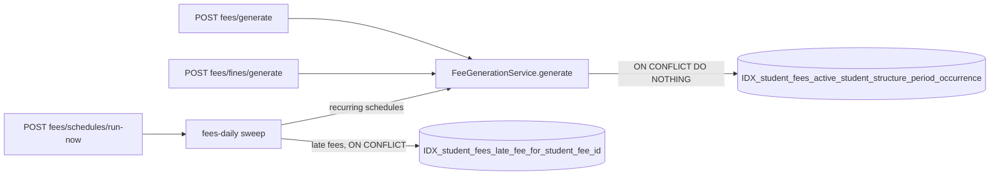
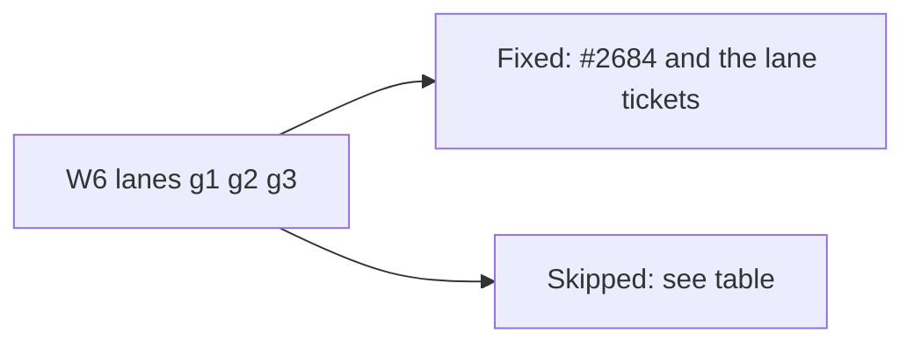

# QA audit lessons (Epic #2642)

Epic #2642 fixes what a pre-launch QA audit found. Each fix should leave
behind a rule and a test, so the same bug class cannot come back. This doc is
where that trail is kept: first the map, then the learnings from each wave,
then the baseline every wave-close ticket compares against.


## Defect classes

One row per class. The wave that fixes it is in the first cell. `TBD` is
filled in by that wave's close ticket. Wave 1-3 rows were filled from PRs #2664, #2669, #2670.

| Defect class                            | Root cause                                                                                                                                                                                    | Rule                                                                                                                                                                                                                                                                                                                                                                                | Enforcing test                                                                                        | Code                                                                                                |
| --------------------------------------- | --------------------------------------------------------------------------------------------------------------------------------------------------------------------------------------------- | ----------------------------------------------------------------------------------------------------------------------------------------------------------------------------------------------------------------------------------------------------------------------------------------------------------------------------------------------------------------------------------- | ----------------------------------------------------------------------------------------------------- | --------------------------------------------------------------------------------------------------- |
| Error mapping (W1)                      | Oversized body, bad charset, duplicate names and wrong upload field names escaped as 500 with raw constraint text                                                                             | Known errors map to fixed 4xx sentences in one place (Rule 24; #2634, #2612, #2616)                                                                                                                                                                                                                                                                                                 | `server/src/common/filters/known-errors.spec.ts`, `known-errors.e2e-spec.ts`                          | `server/src/common/filters/known-errors.ts`                                                         |
| Real dates and ranges (W1)              | Impossible dates (2026-02-30) rolled over or 500d; registers could be marked years before the academic year                                                                                   | Strict date check and academic-year range (#2610, #2611; bare `@IsDateString()` sweep is #2659)                                                                                                                                                                                                                                                                                     | attendance and invoice date specs, DTO ratchet                                                        | date validators, attendance service                                                                 |
| Checkout money and replay (W1)          | Checkout took 0.01 over the balance and change on a card; a replay ignored changed change handling or a reversal; another school saw different errors                                         | Whole paisa and DB CHECKs (Rule 26; #2636, #2637, #2640, #2617)                                                                                                                                                                                                                                                                                                                     | `server/test/student-fee-money-checks-migration.integration.spec.ts`, demo-seed `validator.spec.ts`   | `checkout.service.ts`, migration `1791900000300-StudentFeeMoneyChecks`                              |
| Step-up access (W1)                     | The "allow password" setting was ignored (`approval_mode` vs `approvalMode`); any account, even a parent, could lock approvers out                                                            | `STEP_UP_REQUEST` permission on the step-up routes (#2599, #2639); second-approver is docs-only (#2623, follow-up #2661, #2660)                                                                                                                                                                                                                                                     | `step-up.controller.e2e-spec.ts`, `step-up.service.spec.ts`                                           | `server/src/modules/auth/step-up.*`                                                                 |
| Input length and number range (W2)      | A varchar-backed string had no `@MaxLength`; roll numbers had no cap; phone rules drifted between client and server                                                                           | `@MaxLength` plus a CI guard, `ROLL_NUMBER_MAX`, one BD phone pattern (#2608, #2595, #2619)                                                                                                                                                                                                                                                                                         | `server/src/dto-string-length.spec.ts`                                                                | DTOs, public admission form                                                                         |
| Referential deletes (W2)                | Deleting an academic year, subject or room left bills and rows pointing at it                                                                                                                 | In-use guards (#2613, #2614); the registry that finds the rest is W3 below (Rule 27)                                                                                                                                                                                                                                                                                                | academic-year and subject service specs                                                               | each parent `remove()`                                                                              |
| Delete-guard registry (W3)              | A parent delete left child rows with no check; 45 gaps remain                                                                                                                                 | Every parent-child pair is guarded or listed in `KNOWN_GAPS` with an issue (#2655; issues #2675-#2680)                                                                                                                                                                                                                                                                              | `server/test/delete-guard-registry.integration.spec.ts`                                               | each parent remove()                                                                                |
| Report reads (W2)                       | The collections report built a query with interpolation and left wallet payouts out of totals; invoices vanished after a student was deleted                                                  | No interpolation, `wallet_paid_out` shown, invoices scoped by their own `tenant_id` (#2626, #2638)                                                                                                                                                                                                                                                                                  | collections report and invoice read specs                                                             | reports service, invoices service                                                                   |
| Fee rows (W2)                           | Wallet auto-apply, the scheduler (cadence change), the late-fee sweep and discount PATCH compared money or periods loosely                                                                    | Whole-paisa compare, date-range cover, closed-month check, discount bound (#2644-#2648; leftover #2685)                                                                                                                                                                                                                                                                             | fee generation, scheduler and fines integration specs                                                 | `server/src/modules/fees/*`                                                                         |
| Import (W3)                             | Import wrote partly then returned 500; the template's registration_number column was ignored; roll cap and held rolls were checked too late                                                   | Validate before write; honour the template columns (#2606, #2607)                                                                                                                                                                                                                                                                                                                   | student import specs                                                                                  | student import service                                                                              |
| Backup and restore (W3)                 | Departed recorders broke export; three sets of size limits; final retry left no terminal state                                                                                                | Strict `keyOf('users')` registry (#2625); one set of limits (#2624)                                                                                                                                                                                                                                                                                                                 | backup export and limits specs                                                                        | backup module                                                                                       |
| Accessibility and responsive (W3)       | Tab panels without focus ring or real target; bare grid cells; unfocusable scroll region                                                                                                      | Tab, grid and scroll-region patterns in 21-ui-patterns (#2601, #2628-#2630)                                                                                                                                                                                                                                                                                                         | axe suite `e2e/a11y`                                                                                  | ui Tabs, calendar grid, invoice table                                                               |
| Mutation retries and double submit (W4) | Writes auto-retried on 5xx, so a lost reply created the record twice; submit buttons stayed live during the first request                                                                     | Mutations never retry: `retry` is `false` or absent, and the guard fails on anything else (#2596). `POST /students` sends an Idempotency-Key, and since #2631 (W5) the server replays the first reply, so a resend after a lost reply no longer creates a second student; create dialogs and forms guard double submit with a ref (#2594, #2622); the sweep of other forms is #2656 | `ui/src/hooks/mutation-retry.guard.spec.ts`, `ui/src/api/query-client.test.ts`                        | `ui/src/api/query-client.ts`, create dialogs                                                        |
| URL-held state (W4)                     | List selection lived in the URL, so hundreds of ids made the URL too long and a refresh failed                                                                                                | Selection is in memory, the URL holds only filters (#2602)                                                                                                                                                                                                                                                                                                                          | students list specs, `e2e/journeys/url-state.spec.ts`                                                 | students list route                                                                                 |
| Empty vs no-match state (W4)            | A search with no rows showed the first-time empty state                                                                                                                                       | `ListShell` shows a no-match state with Clear whenever a rendered filter is set; a page's own `kind: 'no-results'` keeps its words (#2591)                                                                                                                                                                                                                                          | `ui/src/shells/list-shell` specs, `client-admin/src/routes/_staff/exams/index.test.tsx`               | `ui/src/shells/list-shell.tsx`                                                                      |
| Phone layout (W4)                       | Tab strips and snooze/close buttons overflowed at 390px                                                                                                                                       | Scroll inside the strip; short visible word, full text stays the accessible name (#2593, #2600)                                                                                                                                                                                                                                                                                     | `e2e/responsive/analysis-phone.spec.ts`, `e2e/responsive/notifications-phone.spec.ts`                 | analysis tabs, alerts                                                                               |
| Student form and send (W5)              | Edit sent the whole form, so a stale form overwrote other edits; a double click sent one SMS twice; a failed SMS said "sending started"; a missing record offered Retry (#2603, #2604, #2598) | Edit sends only changed fields; sending and billing routes carry an Idempotency-Key and replay the stored reply (#2631); every create/send dialog is in the double-submit registry (#2656); `recordWithAllocation` removed so checkout is the only payment path (#2649)                                                                                                             | `server/src/common/idempotency/idempotency.interceptor.spec.ts`, `e2e/journeys/double-submit.spec.ts` | student edit form, `idempotency.interceptor.ts`, `double-submit.registry.ts`, `checkout.service.ts` |

## Learnings log

Raw notes from each wave close, same format as the
[Learnings log in 08-security.md](08-security.md#learnings-log-epic-75): what
surprised us, what it cost, the fix, a rule candidate, then an arrow to the
rule it became (`→ Rule N`) or `→ no rule` with the reason.

### Wave 1

Learnings log, 2026-10-19 (format: surprise, cost, fix, rule candidate -> rule or no rule).

- **A new Permission broke an unrelated "exact list" pin.** Granting `STEP_UP_REQUEST` to EXAM_CONTROLLER failed the D16 pin in `shared/src/enums/permissions.spec.ts`; only the full suite showed it. Cost: one red at wave close. Fix: pin updated. Rule candidate: a ticket that adds a permission or role grant greps the `*.spec.ts` exact-list pins and runs the shared permissions spec first -> checklist item, no security rule.
- **A sibling service kept the bug the first one lost.** `payment-allocation.service.ts` still echoed `idempotency_key` after checkout stopped. Cost: Rule 23 gap found at wave close. Fix: id-free wording. Rule candidate: when removing an echo in one service, grep sibling services for the same message shape -> Rule 23 (add a "grep siblings" note when rules 24-27 are written).
- **Load timeouts look like red tests.** About 12 integration tests timed out on a shared machine and all passed alone. Cost: about 20 minutes of triage. Fix: rerun failures alone under `yarn test-env run` before judging. -> no rule (D18 wording).
- **Browser suites cannot run while dev servers hold ports 3000 and 5174.** `playwright.config.ts` hard-codes both. Cost: e2e, pwa and axe were not run at the baseline or the wave-1 close. Fix: none yet; run them on a machine with free ports. -> no rule.
- **NOT VALID CHECKs still check new and changed rows.** A restore of an old backup can hit `CHK_sf_paid_plus_discount`. Found by the PR 1 review. Fix: per-row restore validation and a deploy step (#2662). -> Rule candidate for rules 24-27 (money CHECKs and restore).

### Wave 2

Learnings log, 2026-10-19 (same format as Wave 1).

- **Client and server phone rules drifted.** The public admission form sent the raw phone (placeholder `01712-345678` has a dash) and the BD region pattern `/^1\d{9}$/` allowed operator prefixes 10-12, but server `BD_PHONE_REGEX` wants `1[3-9]` and no dash. Found by lane w2-g1 (#2619). Cost: a valid-looking form value 400s. Fix: the form sends digits with a leading 0 and the region pattern is `/^1[3-9]\d{8}$/`. Rule candidate: when a server regex is tightened, grep the client region/validation pattern for the same field -> checklist item, no security rule.
- **The OpenAPI document needs a database.** `generate-openapi.js` boots the full Nest app, so it fails without env. Fix: run it under `yarn test-env run -- node server/dist/scripts/generate-openapi.js`, after `yarn workspace @biddaloy/shared build` (a stale shared build hides new enums such as `STEP_UP_REQUEST`). -> no rule.
- **Wave-2 API changes were small in the schema.** `wallet_paid_out` / `paid_out` and `maxLength` hints produced a 6-line `schema.d.ts` diff; one regeneration at wave close was enough. -> no rule.

### Wave 3

Learnings log, 2026-10-19 (same format as Wave 1). Details sit in 04, 14 and 21.

- **45 delete-guard gaps found.** The registry (#2655) listed 45 child-parent pairs where remove() checks nothing. Cost: filed as six issues, one per parent (#2675 AcademicYear, #2676 Class, #2677 ClassSection, #2678 Subject, #2679 Room, #2680 FeeStructure). Rule candidate: a new FK to a parent joins the registry or fails the test -> already enforced.
- **Shared i18n keys land in the close ticket.** `noMatches`, `recordNotFound` and `outcomeUnknown` were added to `common.json` once, so W4 and W5 tickets do not collide. -> no rule.
- **Wave-close full run not done by this ticket.** The ci-local, e2e, axe and flake-report runs of #2652 step 4 were not run here (no Docker, shared ports). -> run on a free machine.

### Wave 4

Learnings log, 2026-10-19 (same format as Wave 1). Details sit in 06 and 21.

- **A new ListShell default silently overrode a page's own empty state.** #2591 swaps in a generic no-match state whenever a filter is set, unless the page passes `kind: 'no-results'`. `exams/index.tsx` passed no kind, so its own words were lost and `exams/index.test.tsx` "shows the empty state, and a no-match variant when filtered" went red. Cost: found at wave close. Fix: the page sets `kind: 'no-results'` (#2653). Rule candidate: a shared-shell change that overrides page props greps every page that sets the same prop -> checklist item, no rule. Other pages that set a filtered `emptyState` without `kind` may have the same gap (see follow-ups).
- **A stale comment outlived its cause.** `-student-form.tsx` still said `TError` is `unknown` because of `shouldRetryQuery`; #2596 removed that retry. Fixed in #2653. -> no rule.
- **Shared i18n keys were consumed as planned.** `noMatches.*` through `ListShell` (namespace `common`), `outcomeUnknown` through `query-client.ts` and the e2e `t('common.outcomeUnknown')`. -> no rule.
- **Wave-close full run not done by this ticket.** `ci-local --integration --e2e`, `e2e:pwa`, axe, responsive, the 10x flake gate and `flake-report` were not run (no Docker, shared ports). Only the affected vitest specs and `tsc -p ui` were. -> run on a free machine; same gap as Wave 3.

### Wave 5

Learnings log, 2026-10-19 (same format as Wave 1). Details sit in 21 and 09.

- **A removed class left its name in comments.** #2649 deleted `recordWithAllocation`, but `checkout.service.ts` and `payment.entity.ts` still named it. Cost: misleading comments found at wave close. Fix: reworded in #2654 and the rest in #2683 (`checkout.service.ts`, `payment.entity.ts`, `payment-reversal.service.ts`, `03-backend-modules.md`, the MSW handler). Rule candidate: removing a class greps its name in comments, not only code -> checklist item, no rule.
- **`schema.d.ts` was stale after an API field change.** #2604 added `error: string | null` to `CommunicationResponseDto` without regenerating. Cost: `check-api-types` would fail in CI. Fix: regenerated in #2654 (one line). Rule candidate: a DTO change in a ticket regenerates in the wave-close ticket, as W2 did -> no rule.
- **A fresh worktree cannot build the OpenAPI document.** `docs:generate` failed with a bare TS2307 until `@biddaloy/shared` was built, then needed `yarn test-env run`. Filed as #2695. -> no rule.
- **Some write routes stay outside the Idempotency-Key interceptor.** `fees/generate`, `fees/schedules/run-now`, `fees/fines/generate` need a verified DB unique constraint (#2691). Also open: e2e for invoice send (#2692), double-submit leftovers (#2693), pre-send "no SMS gateway" warning (#2694). -> follow-ups, no rule yet.
- **Wave-close full run not done by this ticket.** `ci-local --integration --e2e`, `e2e:pwa`, axe, responsive and the 10x flake gate were not run (no Docker, shared ports). Same gap as Waves 3 and 4. Rules 24-27 and their pointers in `08-security.md` and `CLAUDE.md` were written in #2683. -> run on a free machine.

### Epic 78 Wave 1

Learnings log, 2026-10-21 (same format as Wave 1 above). Epic 78 (#2752) works the follow-ups Epic 2642 left open.

- **A test passed in Dhaka and failed in CI.** #2705 made `enrolled_at` the school-timezone day (Asia/Dhaka), but the exam-cohort fallback sitting day still used the UTC day (`toISOString().slice(0, 10)`). CI runs in UTC, so between 18:00 and 24:00 UTC the two days differ by one. Cost: six red integration tests on the first CI run. Fix: the fallback uses `localDate(...)`, plus regression test `m7` in `results.service.integration.spec.ts`. Rule candidate: when one query moves to the school day, grep the siblings that build the same date from a `Date` -> checklist item, no security rule.
- **An unordered `getOne()` made a spec depend on seed data.** `resolve-routine.service.ts` picks the covering year with no `ORDER BY`, so two overlapping years return an arbitrary routine. Cost: three attendance-access failures until the spec year moved to 2027. Fix: spec only; the resolver is filed as #2774. -> no rule yet (overlapping years are #1169).
- **Dependency advisories land mid-epic.** Three new advisories appeared while the epic ran: follow-redirects (high), vite 8.3.0 via launch-editor (high) and sanitize-html below 2.18 (moderate). The scan fails on moderate for production dependencies and on high for the rest. Cost: the scan was red on every branch, not only ours. Fix: root `resolutions` pins (`follow-redirects ^1.16.1`, `vite ^8.3.4`, `sanitize-html ^2.18.1`). -> no rule.
- **A load timeout can leave a half-run migration behind.** Vitest does not cancel a hook that timed out, so the still-running migration raced the next file's reset on the same worker database and every later file failed with `relation does not exist`. Cost: 207 of 275 integration suites red locally. Fix: run integration on an isolated runner (GitHub CI) or on a quiet machine; the repo is unchanged. If it reproduces on a quiet machine, file it against `test/setup.ts`. -> no rule.
- **A slow test is not a broken test.** `entity-catalog.spec.ts` took 7.7 s inside the 440-file parallel suite and under 1 s alone. Fix: a 30 s timeout on that `it`. -> no rule.
- **The workbook tabs had two sweeps hiding in one ticket.** #2687 fixed the blank departed-actor cells in the tabs it named, and the same pattern ("a relation joined in `load()` beats the FK column on save") exists in other tabs. Cost: two follow-ups, #2760 and #2761, so the ticket stayed finishable. -> no rule.

### Epic 78 Wave 2

Learnings log, 2026-10-21 (same format as Wave 1 above).

- **exceljs's own reader silently drops sheets.** `WorkbookReader` walks the zip through `unzipper`, which emits `end` at the central directory while entries are still queued, so the tail parts are lost. Our exports put `workbook.xml` last. Measured over 20 runs: 14 wrong sheet names or a missing `_meta`, 1 crash, 5 fine. Cost: the plan's step 2 (use `WorkbookReader`) was unusable. Fix: `openXlsx` in `workbook-codec.ts` reads the zip central directory itself and drives exceljs's part parsers per sheet (#2686). Rule candidate: any exceljs upgrade re-runs `workbook-codec.spec.ts` first, because we rely on its internals -> checklist item, no security rule.
- **A "single admin" test had no admin.** The #2661 integration cases deleted every `user_tenants` row and never re-inserted the actor's own ADMIN row, so the `Not(actorUserId)` clause was untested: delete it and every test still passed, while every real single-admin school would have been refused. Found by the money review. Fix: the actor's own row is inserted in all five allow-path cases, and the lane proved the cases fail without the clause. Rule candidate: for a guard that excludes "the caller", the allow-path test must include the caller's own row -> checklist item.
- **Composing the scope into the OTP id fans every per-id limit out nine times.** #2660 binds the step-up code to its scope, so one approver can hold one live code per `ApprovalScope`. Still bounded by the unscoped request cap and attempt counters, so the extra cost is SMS volume only. Passing `scope` as OtpService's `bind` argument would keep one code per pair. -> no rule, noted for #2660 follow-ups.
- **Codes issued before the deploy fail once.** The OTP key changed shape, so a code requested just before the deploy gets a 401, and an old UI bundle that sends no `scope` gets a 400 until it reloads. The code lives 5 minutes. -> no rule.
- **The post-deploy smoke test sent an invalid body.** `scripts/smoke-post-deploy.mjs` still posted `{ identifier }` after `scope` became required; it passed only because the permission guard returns 403 before validation. Fix: the body carries `scope: 'payments.reverse'` so the 403 stays attributable to the role. -> no rule.
- **Lane agents stop and wait on their own test runs.** Several times a lane reported "waiting on background work" and went quiet for 20-40 minutes while its DB specs ran one at a time (they cannot overlap `api:types`). Cost: hours of wall clock, not wrong code. Fix: a status message resumes the agent. -> no rule.

## One click, one effect


Example: an admin double-clicks "Send reminder". Both requests carry
`Idempotency-Key: 7f3c9a10`. The first sends one SMS and stores the reply.
The second gets that same reply back. One SMS leaves.

## Follow-up issues filed by the epic

Waves 1-2 (PR #2664, #2669): #2657, #2658, #2659, #2660, #2661, #2662,
#2663, #2665, #2666, #2667, #2671. Wave 3 (PR #2670): #2668, #2675-#2680,
#2686-#2690. Wave 4 (PR #2674): #2672, #2673, #2681. Wave 5 (PR #2683):
#2682, #2684, #2685, #2691-#2695.

## Appendix: Baseline on 901764f4a

Measured on clean `origin/main` `901764f4a`, 2026-10-19, Node v24.20.0, in a
fresh worktree. "Red" = failed alone and in the full run. "Flaky" = failed in
the full run, passed on re-run with no code change (D18). Wave-close tickets
treat the red list as "known red".

| Suite                         | Command                                                                                         | Result                                                                                                      | Red tests | Flaky tests    |
| ----------------------------- | ----------------------------------------------------------------------------------------------- | ----------------------------------------------------------------------------------------------------------- | --------- | -------------- |
| Typecheck                     | `yarn typecheck`                                                                                | pass (717 s)                                                                                                | none      | none           |
| Verify (lint, format, guards) | `bash scripts/ci-local.sh --integration --e2e` (verify section)                                 | pass                                                                                                        | none      | none           |
| Frontend                      | same run (frontend section)                                                                     | pass: 787 files, 8868 tests                                                                                 | none      | none           |
| Audit                         | `bash scripts/ci-local.sh --only audit`                                                         | pass (allowlisted advisories only)                                                                          | none      | none           |
| Server integration            | same run (integration section)                                                                  | 16 failed, 3298 passed, 13 skipped (270 files); all 16 pass when the 13 files are re-run alone (282 passed) | none      | see list below |
| Server e2e (API)              | `ci-local.sh` stops at the first red section, so not reached; `--only e2e` also could not start | not run                                                                                                     | unknown   | unknown        |
| Playwright e2e                | `yarn e2e`                                                                                      | not run: ports 3000 and 5174 held by a foreign long-lived dev stack                                         | unknown   | unknown        |
| PWA                           | `yarn e2e:pwa`                                                                                  | not run: same port 3000 clash                                                                               | unknown   | unknown        |
| Axe                           | `yarn e2e e2e/a11y`                                                                             | not run: same port clash                                                                                    | unknown   | unknown        |

Why the browser suites did not run: `playwright.config.ts` hard-codes
`localhost:3000` and `:5174`. On the baseline machine a dev API (`dist/main`,
started Oct 17) and a vite server (started Oct 16) from another checkout were
already listening. They were not mine to kill, and reusing them would not
measure clean `main`. A wave-close ticket on a machine with free ports should
run these three and fill the rows.

Flaky server integration tests (all failed with a 5 s test or 10 s hook
timeout while other lanes loaded the machine, passed alone):

- `src/modules/seat-plans/seat-plans.integration.spec.ts` (suite hook)
- `test/subject-choice-groups-migration.integration.spec.ts`
- `src/modules/attendance/absence-notice.service.integration.spec.ts`
- `src/modules/attendance/attendance-summary.service.integration.spec.ts`
- `src/modules/audit/audit-dashboard.integration.spec.ts`
- `src/modules/calendar/calendar-import.service.integration.spec.ts`
- `src/modules/invoices/invoice-send.sms-credit.integration.spec.ts`
- `src/modules/presets/preset-apply.integration.spec.ts`
- `src/modules/promotions/promotions.service.integration.spec.ts`
- `src/modules/users/users.service.integration.spec.ts`
- `src/modules/workbook/export/export.integration.spec.ts`
- `src/modules/workbook/restore/restore.integration.spec.ts` (5 tests)
- `src/modules/workbook/tabs/academics/study-plans.tabs.integration.spec.ts`

Frontend flake pass (`yarn vitest run --reporter=json`, 3 passes, then
`node scripts/flake-report.mjs`):

```text
All green across 3 passes. No flakes, no failures.
```

## Routes without an Idempotency-Key (#2691)

Three routes skip `IdempotencyInterceptor` (#2631). A repeated call is still a no-op, because the
database refuses the duplicate row. One exception: `CREATE_ANYWAY` stacks the next `occurrence`
on purpose. Its approval token is used up on the first call, so a plain retry is refused, but a
retry with a fresh approval creates one more bill. That is a second, approved decision, not a
replay. `fee-generation.service.integration.spec.ts` checks the generate index exists. The late-fee index is made by a migration only (TypeORM `@Index` has no `WHERE`), and `late-fee.service.integration.spec.ts` covers its `ON CONFLICT`.



| Route                    | Repeat is a no-op because of                                                                                                           |
| ------------------------ | -------------------------------------------------------------------------------------------------------------------------------------- |
| `fees/generate`          | Unique `(student_id, fee_structure_id, period_start, occurrence)` where `deleted_at IS NULL`. `CREATE_ANYWAY` needs an approval token. |
| `fees/fines/generate`    | Same index: fines go through `FeeGenerationService.generate`.                                                                          |
| `fees/schedules/run-now` | Same index for the bills, plus unique `late_fee_for_student_fee_id` for late fees, plus `last_run_period` on schedules.                |

## W6 follow-ups

| Issue                    | Outcome | Why                                                                      |
| ------------------------ | ------- | ------------------------------------------------------------------------ |
| #2684 (Rule 23 messages) | Fixed   | fees/invoices now say `Student not found` (no id echo), like enrollments |
| #2657                    | Skipped | The migration is too big for this wave                                   |
| #2660                    | Skipped | The requester is already bound                                           |
| #2668, #2690             | Skipped | Product call needed                                                      |
| #2686, #2687             | Skipped | Too large for this wave                                                  |
| #2661                    | Skipped | Needs a settings schema and UI                                           |
| #2693, #2694             | Skipped | Need Playwright / the SMS-credit UI                                      |
| #2689 (item 1)           | Skipped | Item 1 left out of this wave                                             |
| #2699                    | Skipped | Needs a server delta contract                                            |



## Epic 86 — guide bugs

Wave 0 (#2979): five security fixes found while writing the user guide.

- 2026-10-27 — #2975's plan said a zod `validateSearch` on the route is enough. It was not: `useListUrlState` reads `useSearch({ strict: false })`, which keeps unvalidated parent search, so the stray `?date=` chip stayed. Cost: one failing test and a page-level key filter. Fix: filter `filters` to the schema's keys in the page. Rule candidate: a list page with `validateSearch` must also be checked in a render test with a stray param. The shared hook still leaks on every list page (follow-up filed).
- 2026-10-27 — #2863's planned `rg` for echoed ids missed messages whose template literal sits on the line after `new NotFoundException(`. The reviewer found three more. Rule candidate: grep with `-U` (multiline) for Rule 23 sweeps.
- 2026-10-27 — #2859: two existing e2e specs treated a tenant-local SUPER_ADMIN as the platform admin and broke once the guard landed. Fix: move their SA onto the platform tenant, as `platform-alerts.controller.e2e-spec.ts` does.
- 2026-10-27 — Sandbox refused `git commit` inside worktree agents (once). The orchestrator committed the staged files from the parent.

### Wave 1 — people, staff and admissions (#2980)

- 2026-10-27 — #2878: the body said the form re-seeds after a close; it seeds once, so the fix resets the form. #2882: component tests need a `RegionConfigProvider` or numbers print as Bangla digits.
- 2026-10-27 — #2995 and #2880 share files, so they were committed as two commits from one tree. Rule candidate: give tickets that share a file one lane and one commit order from the start.
- 2026-10-27 — #2864: a new "needs a contact" guard broke every fixture that created a user with only a name. Rule candidate: grep fixtures for the factory before tightening a service guard.
- 2026-10-27 — workers cannot `git commit` through the rtk-wrapped git; `/usr/bin/git -C <worktree>` works.

### Wave 2 — academics, calendar and attendance (#2981)

- 2026-10-27 — #2909: a new route also changes `server/src/__snapshots__/route-permissions.txt`, not only `route-status.snapshot.txt`. The ticket named only the second. Rule candidate: any ticket that adds a route lists both snapshots under Files.
- 2026-10-27 — #2871: `bulkAdd` ran outside one transaction. The fix passes the transaction manager to `CalendarEventsService.create`, so the holiday and its audit row roll back together. Notifications use their own connections, so a rollback does not undo them.
- 2026-10-27 — #2872: the test went into `-calendar-route.test.tsx`, which already has the fixed-date route harness, not the file the ticket named.
- 2026-10-27 — a worker-added prop (`today`) on `GovernmentHolidaysDialog` broke two existing renders; type-check, not tests, would have caught it. `tsc` is unusable in worktrees until the ui `.tsout` is built.

### Wave 3 — routines (#2982)

- 2026-10-27 — #2898 and #2891 both change who sees routine slots in REVIEW. #2898's body named `resolve-routine.service.ts`, but an earlier fix had moved the rule into `routine-visibility.ts`; it was changed there once so resolve and slots agree. Rule candidate: before a ticket edits a rule, grep for a shared helper that now owns it.
- 2026-10-27 — #2892 added a route, so `ROLE_NARROWINGS` in `permission-matrix.e2e-spec.ts` also needed an entry; the ticket named only the two route snapshots.
- 2026-10-27 — #2895 logs its audit entry under `RoutineSlot` because `RoutineSubstitution` is not in the shared audit entity catalog. Follow-up: add it.
- 2026-10-27 — #2893 changed period slots to update in place; changing a time now also changes it on past days. Versioned period times are out of scope.

### Wave 4 — exams, results and promotion (#2983)

- 2026-10-27 — #2925: hiding Graduate in a normal run left the `g` keyboard shortcut sending GRADUATE, which the server now refuses. Rule candidate: when a server refuses a value, grep the client for every path that can send it (shortcuts, mobile cards), not only the select.
- 2026-10-27 — #2922: stopping the page from loading the exam detail query broke the breadcrumb, which was keyed on that query. The fix moved the resolver key. Rule candidate: before removing a query from a page, grep the breadcrumb resolver for its key.
- 2026-10-27 — #2916: `progress()` gained a `grids` array instead of widening `outstanding`, so the results-processing gate keeps its meaning.
- 2026-10-27 — #2913 also closed #2914, #2918 also closed #2919 and #2920, #2916 also closed #2978: those issues were duplicates of one cause.

### Wave 5 — finance and communications (#2984)

- 2026-10-27 — All nine wave 5 tickets were client-side (copy, buttons, role gates). The server already enforced each rule, so no route snapshot changed.
- 2026-10-27 — #2932: the body asked for a "role without SCHEDULE_MANAGE sees no Delete" test. The whole route is gated on that permission, so no such role can reach the page; the test was dropped and the guard kept as defence in depth.
- 2026-10-27 — #2939: the body said to use `regionConfig`, but that variable belongs to the parent component; `useRegionConfig()` in the same component is the sibling pattern.
- 2026-10-27 — #2936 fix is client-only: the server already refuses a wallet pick across siblings (`checkout.service.ts`), the UI just summed them.
