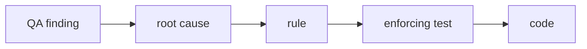

# QA audit lessons (Epic #2642)

Epic #2642 fixes what a pre-launch QA audit found. Each fix should leave
behind a rule and a test, so the same bug class cannot come back. This doc is
where that trail is kept: first the map, then the learnings from each wave,
then the baseline every wave-close ticket compares against.



## Defect classes

One row per class. The wave that fixes it is in the first cell. `TBD` is
filled in by that wave's close ticket.

| Defect class | Root cause | Rule | Enforcing test | Code |
| --- | --- | --- | --- | --- |
| Error mapping (W1) | TBD | TBD | TBD | TBD |
| Real dates and ranges (W1) | TBD | TBD | TBD | TBD |
| Checkout money and replay (W1) | TBD | TBD | TBD | TBD |
| Step-up access (W1) | TBD | TBD | TBD | TBD |
| Input length and number range (W2) | TBD | TBD | TBD | TBD |
| Referential deletes (W2) | TBD | TBD | TBD | TBD |
| Delete-guard registry (W3) | A parent delete left child rows with no check; 45 gaps remain | Every parent-child pair is guarded or listed in `KNOWN_GAPS` with an issue (#2655; issues #2675-#2680) | `server/test/delete-guard-registry.ts` | each parent remove() |
| Report reads (W2) | TBD | TBD | TBD | TBD |
| Fee rows (W2) | TBD | TBD | TBD | TBD |
| Import (W3) | Import wrote partly then returned 500; the template's registration_number column was ignored; roll cap and held rolls were checked too late | Validate before write; honour the template columns (#2606, #2607) | student import specs | student import service |
| Backup and restore (W3) | Departed recorders broke export; three sets of size limits; final retry left no terminal state | Strict `keyOf('users')` registry (#2625); one set of limits (#2624) | backup export and limits specs | backup module |
| Accessibility and responsive (W3) | Tab panels without focus ring or real target; bare grid cells; unfocusable scroll region | Tab, grid and scroll-region patterns in 21-ui-patterns (#2601, #2628-#2630) | axe suite `e2e/a11y` | ui Tabs, calendar grid, invoice table |
| Mutation retries and double submit (W4) | TBD | TBD | TBD | TBD |
| Truthful lists and phone input (W4) | TBD | TBD | TBD | TBD |
| Student form and send (W5) | TBD | TBD | TBD | TBD |

## Learnings log

Raw notes from each wave close, same format as the
[Learnings log in 08-security.md](08-security.md#learnings-log-epic-75): what
surprised us, what it cost, the fix, a rule candidate, then an arrow to the
rule it became (`→ Rule N`) or `→ no rule` with the reason.

### Wave 1

Learnings log, 2026-10-19 (format: surprise, cost, fix, rule candidate -> rule or no rule).

- **A new Permission broke an unrelated "exact list" pin.** Granting `STEP_UP_REQUEST` to EXAM_CONTROLLER failed the D16 pin in `shared/src/enums/permissions.spec.ts`; only the full suite showed it. Cost: one red at wave close. Fix: pin updated. Rule candidate: a ticket that adds a permission or role grant greps the `*.spec.ts` exact-list pins and runs the shared permissions spec first -> checklist item, no security rule.
- **A sibling service kept the bug the first one lost.** `payment-allocation.service.ts` still echoed `idempotency_key` after checkout stopped. Cost: Rule 23 gap found at wave close. Fix: id-free wording. Rule candidate: when removing an echo in one service, grep sibling services for the same message shape -> Rule 23 (add a "grep siblings" note when rules 24-27 are written).
- **Load timeouts look like red tests.** About 12 integration tests timed out on a shared machine and all passed alone. Cost: about 20 minutes of triage. Fix: rerun failures alone under `yarn test-env run` before judging. -> no rule (D18 wording).
- **Browser suites cannot run while dev servers hold ports 3000 and 5174.** `playwright.config.ts` hard-codes both. Cost: e2e, pwa and axe were not run at the baseline or the wave-1 close. Fix: none yet; run them on a machine with free ports. -> no rule.
- **NOT VALID CHECKs still check new and changed rows.** A restore of an old backup can hit `CHK_sf_paid_plus_discount`. Found by the PR 1 review. Fix: per-row restore validation and a deploy step (#2662). -> Rule candidate for rules 24-27 (money CHECKs and restore).

### Wave 2

Learnings log, 2026-10-19 (same format as Wave 1).

- **Client and server phone rules drifted.** The public admission form sent the raw phone (placeholder `01712-345678` has a dash) and the BD region pattern `/^1\d{9}$/` allowed operator prefixes 10-12, but server `BD_PHONE_REGEX` wants `1[3-9]` and no dash. Found by lane w2-g1 (#2619). Cost: a valid-looking form value 400s. Fix: the form sends digits with a leading 0 and the region pattern is `/^1[3-9]\d{8}$/`. Rule candidate: when a server regex is tightened, grep the client region/validation pattern for the same field -> checklist item, no security rule.
- **The OpenAPI document needs a database.** `generate-openapi.js` boots the full Nest app, so it fails without env. Fix: run it under `yarn test-env run -- node server/dist/scripts/generate-openapi.js`, after `yarn workspace @biddaloy/shared build` (a stale shared build hides new enums such as `STEP_UP_REQUEST`). -> no rule.
- **Wave-2 API changes were small in the schema.** `wallet_paid_out` / `paid_out` and `maxLength` hints produced a 6-line `schema.d.ts` diff; one regeneration at wave close was enough. -> no rule.

### Wave 3

Learnings log, 2026-10-19 (same format as Wave 1). Details sit in 04, 14 and 21.

- **45 delete-guard gaps found.** The registry (#2655) listed 45 child-parent pairs where remove() checks nothing. Cost: filed as six issues, one per parent (#2675 AcademicYear, #2676 Class, #2677 ClassSection, #2678 Subject, #2679 Room, #2680 FeeStructure). Rule candidate: a new FK to a parent joins the registry or fails the test -> already enforced.
- **Shared i18n keys land in the close ticket.** `noMatches`, `recordNotFound` and `outcomeUnknown` were added to `common.json` once, so W4 and W5 tickets do not collide. -> no rule.
- **Wave-close full run not done by this ticket.** The ci-local, e2e, axe and flake-report runs of #2652 step 4 were not run here (no Docker, shared ports). -> run on a free machine.

### Wave 4

### Wave 5

## Appendix: Baseline on 901764f4a

Measured on clean `origin/main` `901764f4a`, 2026-10-19, Node v24.20.0, in a
fresh worktree. "Red" = failed alone and in the full run. "Flaky" = failed in
the full run, passed on re-run with no code change (D18). Wave-close tickets
treat the red list as "known red".

| Suite | Command | Result | Red tests | Flaky tests |
| --- | --- | --- | --- | --- |
| Typecheck | `yarn typecheck` | pass (717 s) | none | none |
| Verify (lint, format, guards) | `bash scripts/ci-local.sh --integration --e2e` (verify section) | pass | none | none |
| Frontend | same run (frontend section) | pass: 787 files, 8868 tests | none | none |
| Audit | `bash scripts/ci-local.sh --only audit` | pass (allowlisted advisories only) | none | none |
| Server integration | same run (integration section) | 16 failed, 3298 passed, 13 skipped (270 files); all 16 pass when the 13 files are re-run alone (282 passed) | none | see list below |
| Server e2e (API) | `ci-local.sh` stops at the first red section, so not reached; `--only e2e` also could not start | not run | unknown | unknown |
| Playwright e2e | `yarn e2e` | not run: ports 3000 and 5174 held by a foreign long-lived dev stack | unknown | unknown |
| PWA | `yarn e2e:pwa` | not run: same port 3000 clash | unknown | unknown |
| Axe | `yarn e2e e2e/a11y` | not run: same port clash | unknown | unknown |

Why the browser suites did not run: `playwright.config.ts` hard-codes
`localhost:3000` and `:5174`. On the baseline machine a dev API (`dist/main`,
started Oct 17) and a vite server (started Oct 16) from another checkout were
already listening. They were not mine to kill, and reusing them would not
measure clean `main`. A wave-close ticket on a machine with free ports should
run these three and fill the rows.

Flaky server integration tests (all failed with a 5 s test or 10 s hook
timeout while other lanes loaded the machine, passed alone):

- `src/modules/seat-plans/seat-plans.integration.spec.ts` (suite hook)
- `test/subject-choice-groups-migration.integration.spec.ts`
- `src/modules/attendance/absence-notice.service.integration.spec.ts`
- `src/modules/attendance/attendance-summary.service.integration.spec.ts`
- `src/modules/audit/audit-dashboard.integration.spec.ts`
- `src/modules/calendar/calendar-import.service.integration.spec.ts`
- `src/modules/invoices/invoice-send.sms-credit.integration.spec.ts`
- `src/modules/presets/preset-apply.integration.spec.ts`
- `src/modules/promotions/promotions.service.integration.spec.ts`
- `src/modules/users/users.service.integration.spec.ts`
- `src/modules/workbook/export/export.integration.spec.ts`
- `src/modules/workbook/restore/restore.integration.spec.ts` (5 tests)
- `src/modules/workbook/tabs/academics/study-plans.tabs.integration.spec.ts`

Frontend flake pass (`yarn vitest run --reporter=json`, 3 passes, then
`node scripts/flake-report.mjs`):

```text
All green across 3 passes. No flakes, no failures.
```
