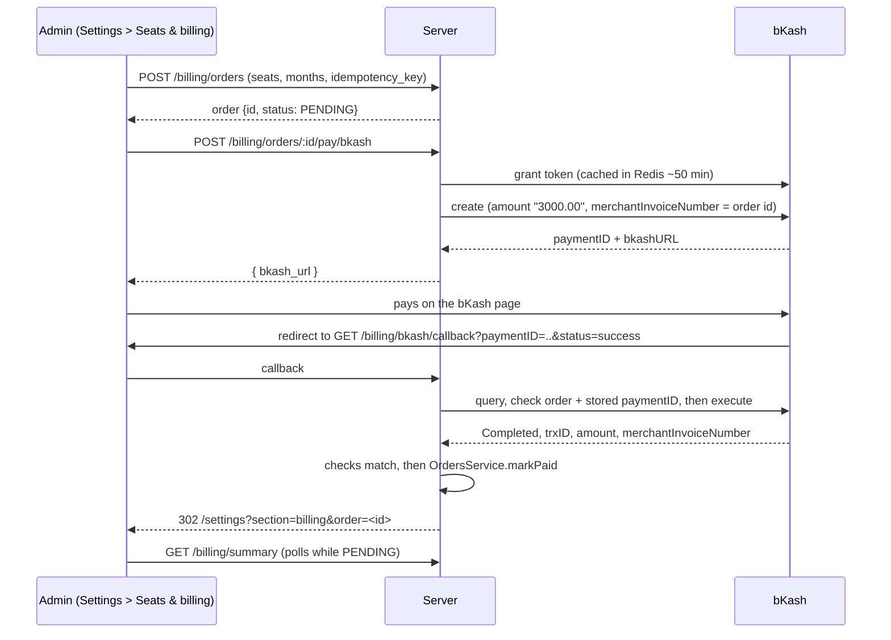

# Billing: seat orders and bKash payment

A school buys **seats** (BDT 10 per student per month). An order starts `PENDING`, becomes
`PAID` once, and `EntitlementService` recomputes `schools.seat_limit` from paid orders.
This doc covers the **bKash pay step** (Epic 49 W4, #1820). Code: `server/src/modules/billing/bkash/`.

## The flow



## What is trusted

The URL the browser comes back with is **never trusted**. `paymentID` and `status` only say
_which_ payment to ask bKash about. The order is paid only when bKash itself answers:

| Check                                                                   | Why                                       |
| ----------------------------------------------------------------------- | ----------------------------------------- |
| `transactionStatus = Completed`                                         | not cancelled, not still pending          |
| `merchantInvoiceNumber` is our order id                                 | the payment belongs to an order we made   |
| `amount` equals the order amount (BDT, 2 decimals) and `currency = BDT` | no short payment                          |
| `trxID` present                                                         | it is the `platform_payments.gateway_ref` |

Anything else redirects to the generic error page (`payment=error`) and changes nothing (Rule 23: the message never echoes
the paymentID). Details go to the log, not the response.

Before any of that, the callback costs **no bKash call** unless the paymentID is one we made:
it must look like a bKash paymentID (`^[A-Za-z0-9]{1,64}$`) and `bkash:pid:<paymentID>` (set at
create, 25 h) must name an order. bKash's own `merchantInvoiceNumber` must then be that same order.

## Money bKash took for nothing

Two paths have the money already captured but pay no order: the completed payment does not match
the order (amount, currency or trxID), or the order is no longer `PENDING` (paid offline meanwhile).
Both still write a `platform_payments` row, flagged as an **orphan**, so the money is never lost:

```json
{
  "method": "BKASH",
  "gateway_ref": "TRX1",
  "amount_paisa": 300000,
  "raw": { "trxID": "TRX1", "orphan": true, "orphan_reason": "ORDER_NOT_PENDING", "...": "..." }
}
```

- It is keyed on `(method, gateway_ref)`, so a replay, or the same trxID that did pay the order,
  inserts nothing (`ON CONFLICT DO NOTHING`).
- Orphans never count as the order's payment method or receipt.
- The **`platform.bkash.refund_due`** alert (critical, hourly) shows the platform SUPER_ADMIN the
  count and trxIDs until each one is refunded. After refunding in the bKash merchant panel, stamp it:

```sql
UPDATE platform_payments SET raw = raw || jsonb_build_object('refunded_at', now())
 WHERE method = 'BKASH' AND gateway_ref = 'TRX1';
```

The browser still gets the generic error redirect (Rule 23).

## Pay route answers

| Answer | `details.code`      | Meaning                                    | Buy dialog                |
| ------ | ------------------- | ------------------------------------------ | ------------------------- |
| 404    | -                   | not this school's order                    | back to the form, new key |
| 409    | `ORDER_NOT_PENDING` | order is `PAID`/`FAILED`/...               | back to the form, new key |
| 409    | `PAYMENT_STARTING`  | another click is creating the payment      | stays on Pay, same order  |
| 503    | -                   | bKash not configured or refused the create | stays on Pay, same key    |

Only a closed order gets a new idempotency key, so a double click never makes a second `PENDING` order.

## Idempotency

`OrdersService.markPaid` does `UPDATE ... WHERE status = 'PENDING'`. A replayed callback finds
the order `PAID`, writes no second `platform_payments` row, and does not recompute. The unique
`(method, gateway_ref)` key is the second guard. Example: opening the callback link twice gives one
payment row and the same seats.

Creating an order is idempotent per `(school, idempotency_key)`: the same body returns the first
order; a different `seats`/`months` body on a used key is `409 IDEMPOTENCY_KEY_REUSED`.

A paid purchase's period starts on the later of today and the school's last PAID `period_end`, so
paying early extends the seats instead of counting them twice. A platform `GRANT` starts today and
adds seats (see [22-onboarding.md](22-onboarding.md#free-period-and-seats)).

## Orders that stay PENDING

- **Cancelled or failed return**: the order stays `PENDING`. It is never set `FAILED` from the
  callback, because a late payment could still arrive and the order must be able to take it.
  The dead checkout URL is dropped from `bkash:pay:<orderId>` (the paymentID stays, for the
  reconciler), so the next Pay creates a new bKash payment instead of handing back the dead page.
  A double start is locked by `bkash:creating:<orderId>` (`SET NX`, 60 s).
- **Callback lost** (browser closed, execute timed out): `BkashReconciler` (BullMQ, every 10 min)
  asks bKash `query` about `PENDING` orders whose payment started under 24 h ago and settles the ones that are already `Completed` (e.g. `execute` worked but `markPaid` failed). A payment the customer approved but never executed is not completed by bKash and lapses unpaid, so no money moves and the admin pays again. After a callback fails, the callback re-queries once after 1 s (not 3 times).
  The order id to paymentID link lives in Redis (`bkash:pay:<orderId>`, 25 h), so no new table.
- **Create fails** at bKash (nothing was charged): the order becomes `FAILED`; the admin makes a new
  order. The Buy dialog already uses a fresh idempotency key when the numbers change.

## Safety rules applied

- **Outbound (Rule 7)**: every bKash call goes `assertSafeHttpDestination` then `fetchPinnedJson`.
  The host is operator config (`BKASH_BASE_URL`), so sandbox vs production is just which URL is set.
- **Public route (Rule 1)**: `GET /billing/bkash/callback` is on the route-guard allowlist
  (`server/test/helpers/route-path.helper.ts`) with a reason. It is throttled `STRICT_RATE_LIMIT`.
- **Redis down (Rule 15)**: the pay route is `@FailClosedWithoutRedis()` (it creates money state).
  The callback is **not** fail-closed (no 503 on a gateway redirect): the token cache falls back
  to a fresh grant, but the stored paymentID cannot be matched, so the callback redirects to the
  generic error page. Nothing is executed, so nobody is charged; the payment lapses and the admin pays again.
- **Known limit**: the order-to-paymentID link is Redis only. If `markPaid` fails after `execute` and Redis is flushed before the reconciler runs, a completed payment must be matched by hand from the bKash merchant panel.
- **Snapshot (Rule 20)**: `route-status.snapshot.txt` has the callback (open) and the pay route (admin only).

## Configuration

All five are needed; if any is missing the pay route answers a generic 503.

| Variable                            | Example                                                |
| ----------------------------------- | ------------------------------------------------------ |
| `BKASH_BASE_URL`                    | sandbox `https://tokenized.sandbox.bka.sh/v1.2.0-beta` |
| `BKASH_APP_KEY`, `BKASH_APP_SECRET` | from the bKash merchant portal                         |
| `BKASH_USERNAME`, `BKASH_PASSWORD`  | the merchant API user                                  |

The callback URL bKash redirects to is `<APP_BASE_URL>/api/v1/billing/bkash/callback`.

## Not done here

- **IPN / webhook**: tokenized checkout settles through the callback plus the reconciler. If the
  merchant account enables IPN, add it through `verifyWebhookSignature` (Rule 19) and call the same
  `markPaid`.
- **Manual sandbox run**: needs the merchant credentials from #1816. Run one payment on the
  sandbox, check the order turns `PAID` and the seats update, and add the screenshots here.
- **CI**: no real bKash call (no credentials); the client and service are covered by unit specs
  with a mocked bKash, and the API e2e covers the public callback's refusal paths.
