# 28. Platform runbook

> **Planned replacement:** the agreed target setup (one VM, all environments, tunnel, staging from prod) is in [30-deployment-target.md](30-deployment-target.md). This page describes what runs today until Epic 79.0 lands.

One page for the person who runs the servers. With this page, the repo, an age
key and a fresh VM you can bring up prod, demo, staging and the ops tools, ship a
version, read the alerts, rotate a secret, restore a backup and move to a bigger
machine.

Every command here exists in the repo today. Where something is not proven on a
real host yet, it is listed in [Known gaps](#known-gaps), not hidden.

> Numbering: `27` is taken by [27-qa-audit-lessons.md](27-qa-audit-lessons.md), so
> this runbook is **28**. Tickets and older docs that say "27" mean this page.

Jargon, once:

- **VM** - the one rented server. Everything runs on it.
- **Compose project** - a group of containers started together (`biddaloy-prod`, `biddaloy-demo`, `biddaloy-staging`, `biddaloy-ops`).
- **sops + age** - how secrets are stored encrypted in git. `age` is the key, `sops` is the tool.
- **Ansible playbook** - a script that logs in to the VM over SSH and makes it match a description.
- **R2** - Cloudflare's file storage. Backups go there.
- **Kuma / Beszel / Dozzle** - the ops tools: uptime checks, host and container graphs, live logs.

## 1. What you are operating

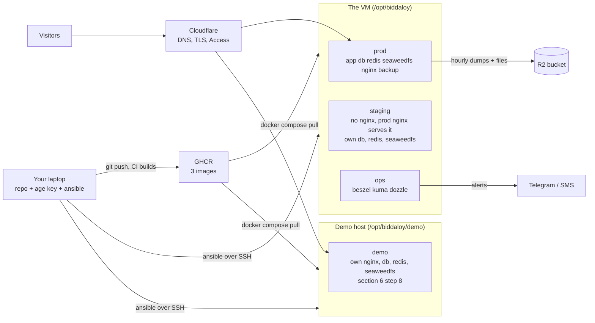

The demo binds ports 80/443 like prod, so it runs on a **second host**. The ops
tools on the VM do not see it (section 8).

Who can talk to whom. Staging and the ops UIs never join prod's network: each
box below is a Docker network, and prod nginx is the only bridge. The reason and
the proof step are in [07-deployment.md, Staging](07-deployment.md#staging).

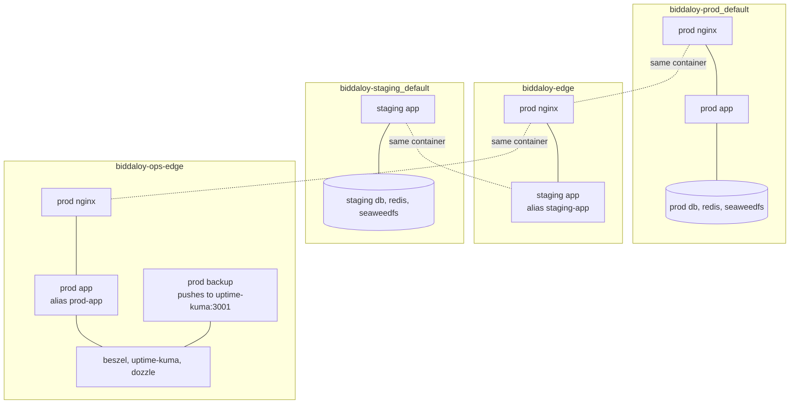

`biddaloy-edge` and `biddaloy-ops-edge` belong to no compose project.
`tasks/attach-edge.yml` creates and joins them after every `compose up`. A
container recreated by hand loses its attach. Redo only the attach with
`--tags edge` (section 12).

| Thing          | Where it lives                                                                                                                                                                |
| -------------- | ----------------------------------------------------------------------------------------------------------------------------------------------------------------------------- |
| Images         | `ghcr.io/tareq89/biddaloy-app`, `-backup`, `-demo-reset`, tagged with the full 40-character git SHA                                                                           |
| Host folders   | `/opt/biddaloy/{prod,demo,staging,ops}` and `/opt/biddaloy/certs`                                                                                                             |
| Secrets in git | `infra/secrets/*.enc.env`, `origin-ca*.enc.pem` ([infra/secrets/README.md](../../infra/secrets/README.md))                                                                    |
| Playbooks      | `infra/ansible/provision.yml`, `deploy.yml`, `ops.yml`, tasks `write-env.yml`, `compose-up.yml`, `attach-edge.yml` ([infra/ansible/README.md](../../infra/ansible/README.md)) |
| Domains        | `app_domain` in `infra/ansible/inventory/prod.yml`; `OPS_DOMAIN` and `STAGING_DOMAIN` in `prod.enc.env` (what nginx reads)                                                    |

## 2. Day 0 checklist (before any command)

Tick each box. Nothing below needs the VM except the first one.

- [ ] **VM bought.** Ubuntu LTS, root SSH works, public IP noted (example `203.0.113.10`). Size: see section 11.
- [ ] **Laptop has an SSH key** at `~/.ssh/id_ed25519.pub` (provision copies it to the `deploy` user).
- [ ] **Cloudflare zone** for the domain. DNS records, all **Proxied** (orange cloud): `app` and `demo` now. Add `staging` and `ops` only after their Access application exists (next item and [25-cloudflare.md](25-cloudflare.md#access-policies)).
- [ ] **SSL/TLS = Full (strict).** Origin CA certificate issued (15 years) and it **covers every name you serve**: `app.`, `demo.`, `ops.` and `staging.<domain>` (a wildcard `*.<domain>` does all four). prod nginx serves app, ops and staging with the same `origin.pem`; a name it does not cover fails strict TLS.
- [ ] **Access applications** for `staging.<domain>` and `ops.<domain>`, built **before** either name is exposed ([25-cloudflare.md](25-cloudflare.md#access-policies)). Kuma and Beszel make the first visitor the admin, and Dozzle has no login. On the `Ops` application also add the **Service Auth** policy for the `demo-reset-push` service token ([25-cloudflare.md, Ops](25-cloudflare.md#ops-opsdomain)); its id and secret go in `demo.enc.env`. Two locks enforce the order: a prod deploy refuses `OPS_DOMAIN` / `STAGING_DOMAIN` until `access_confirmed: true` is set in `inventory/prod.yml`, and nginx drops any request without a `Cf-Access-Jwt-Assertion` header.
- [ ] **R2 bucket** (backups) and an API token with object read and write on that bucket only.
- [ ] **`TRUSTED_PROXY_CIDRS`** value ready: Cloudflare's current ranges ([12-operations.md section 3.5](12-operations.md#35-cloudflare-ip-ranges-changed)).
- [ ] **Telegram bot** and a private group; note the bot token and the group id.
- [ ] **SMS gateway key** (for the three critical alerts).
- [ ] **Sentry projects** (server, client) and the cron monitor URLs.
- [ ] **GitHub repo variables** `VITE_TURNSTILE_SITE_KEY` and `VITE_SUPPORT_URL` set (Settings > Secrets and variables > Actions > Variables). `publish-image.yml` bakes them into the SPA at build time (`vars.*`). Unset means a build with no Turnstile widget.
- [ ] **GHCR packages public** - after the first publish, make all three packages (`biddaloy-app`, `biddaloy-backup`, `biddaloy-demo-reset`) public (GitHub > your profile > Packages > package > Package settings > Change visibility). The VM pulls without a login. If they stay private the first `deploy.yml` fails at "Check the image tag exists in the registry".

## 3. Laptop setup

```bash
brew install ansible sops age rclone          # sops must be 3.9 or newer
yarn install                                  # in the repo root: a staging deploy runs `yarn config:check` on your laptop
cd infra/ansible
ansible-galaxy install -r requirements.yml    # roles + collections
mkdir -p ~/.config/sops/age
age-keygen -o ~/.config/sops/age/keys.txt     # prints "Public key: age1..."
export SOPS_AGE_KEY_FILE=~/.config/sops/age/keys.txt
export BIDDALOY_PROD_HOST=203.0.113.10        # the VM's public IP
```

Add `SOPS_AGE_KEY_FILE` and `BIDDALOY_PROD_HOST` to your shell profile. Every
playbook reads them.

## 4. Secrets

Full detail and the CI guard: [infra/secrets/README.md](../../infra/secrets/README.md).

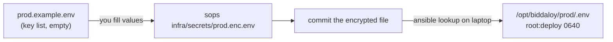

1. Do the one-time key setup in the secrets README (operator key, recovery key on a different machine, both public keys into `.sops.yaml`).
2. Create each file with the sops editor, so no plaintext copy hits disk:

   ```bash
   sops infra/secrets/prod.enc.env      # paste keys from prod.example.env, fill values
   sops infra/secrets/demo.enc.env
   sops infra/secrets/staging.enc.env
   sops infra/secrets/ops.enc.env       # only BESZEL_KEY=, leave it empty for now (section 6 step 5)
   ```

   Make random values with `openssl rand -hex 32`. Hex only: `$ @ / :` break `.env` expansion and `DATABASE_URL`.

3. Encrypt the Origin CA pair (whole files, so a short-lived temp file):

   ```bash
   umask 077; t=$(mktemp)               # paste the certificate PEM into $t, then:
   sops --encrypt --filename-override infra/secrets/origin-ca.enc.pem \
     --input-type binary --output-type binary "$t" > infra/secrets/origin-ca.enc.pem
   rm -f "$t"                            # repeat for origin-ca-key.enc.pem with the key
   ```

4. Check both keys open the files (recovery check on a clean machine):

   ```bash
   sops -d infra/secrets/prod.enc.env >/dev/null && echo laptop ok
   HOME=$(mktemp -d) SOPS_AGE_KEY_FILE=/Volumes/usb/recovery.txt sops -d infra/secrets/prod.enc.env >/dev/null && echo recovery ok
   ```

5. The prod file must also set `HEALTH_TOKEN`, `TLS_CERT_DIR=/opt/biddaloy/certs`, `TRUSTED_PROXY_CIDRS`, `BACKUP_AGE_KEY_DIR=/opt/biddaloy/prod/drill` (the directory; the key is `key.txt` inside, section 5), `BACKUP_PUSH_URL`, `DRILL_PUSH_URL`. All are listed in `prod.example.env`. **Leave `OPS_DOMAIN=` and `STAGING_DOMAIN=` empty for now.** They are `ops.<domain>` and `staging.<domain>`, and go in only at the end of section 6, after Access is up. `ops.enc.env` holds `BESZEL_KEY` and nothing else.

The `*.enc.env` files do not exist in git until **you** create them. Commit them
when done. `scripts/check-tracked-files.mjs` fails CI on any plaintext value.

**Secrets come from your checkout.** A deploy decrypts `infra/secrets/*` from the
commit you have checked out, and it refuses to run unless `HEAD` equals
`version`. So the commit you deploy must contain the secrets you want:

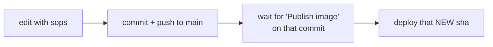

An older SHA carries older (or no) secrets files. Deploying it writes those.

## 5. Provision (once per VM)

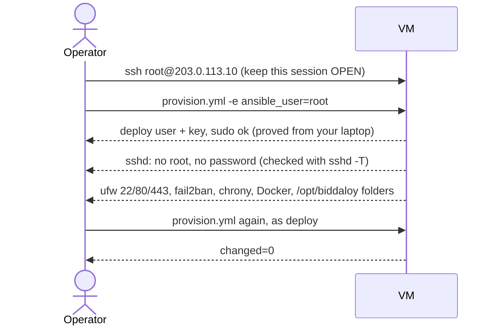

```bash
cd infra/ansible
ansible-playbook -i inventory/prod.yml provision.yml -e ansible_user=root   # first run
ansible-playbook -i inventory/prod.yml provision.yml | tail -3              # second run: changed=0
```

**Keep a root SSH session open until the second run succeeds.** The first run
turns root and password login off. It first runs
`ssh -o BatchMode=yes deploy@<host> sudo -n true` from your laptop and stops if
that fails. If you are locked out anyway, use the provider's VNC console.

Folders and owners it creates (from `provision.yml`):

| Path                                     | Owner         | Mode                        |
| ---------------------------------------- | ------------- | --------------------------- |
| `/opt/biddaloy/{prod,demo,staging,ops}/` | `root:deploy` | 0750                        |
| `/opt/biddaloy/<env>/.env`               | `root:deploy` | 0640                        |
| `/opt/biddaloy/certs/`, its files        | `root:root`   | 0700 / 0600                 |
| `/opt/biddaloy/<env>/drill/` (not ops)   | `10001:10001` | 0500                        |
| `/opt/biddaloy/<env>/drill/key.txt`      | `10001`       | 0400 (you copy it in)       |
| `/opt/biddaloy/ops/.env`                 | `root:deploy` | 0640 (written by `ops.yml`) |

Check from outside: `nmap -Pn 203.0.113.10` shows only 22, 80, 443. This is only
meaningful after prod is up (section 6), because the play's own public-port check
sees nothing on a fresh VM.

Put the backup age **private** key on the host by hand. Nothing writes it (its
master copy is in your password manager, never in git). The `backup` container
needs it, and a prod deploy checks it in pre-flight: missing, wrong owner or
wrong mode stops the deploy before anything changes. From the laptop, with no
temp file on the host ([12-operations.md section 8](12-operations.md#8-secrets-and-rotation)):

```bash
ssh deploy@203.0.113.10 "sudo sh -c 'umask 0377; cat > /opt/biddaloy/prod/drill/key.txt && chown 10001:10001 /opt/biddaloy/prod/drill/key.txt'" < ~/age-key.txt
ssh deploy@203.0.113.10 sudo stat -c '%u %a' /opt/biddaloy/prod/drill/key.txt   # must print: 10001 400
```

Put the Cloudflare Origin CA pair on the host too. No play does it yet (Known
gaps #4, issue #2745). `/opt/biddaloy/certs` is root-only, so pipe it through
`sudo`:

```bash
sops -d --input-type binary --output-type binary infra/secrets/origin-ca.enc.pem \
  | ssh deploy@203.0.113.10 "sudo sh -c 'umask 077; cat > /opt/biddaloy/certs/origin.pem'"
sops -d --input-type binary --output-type binary infra/secrets/origin-ca-key.enc.pem \
  | ssh deploy@203.0.113.10 "sudo sh -c 'umask 077; cat > /opt/biddaloy/certs/origin.key'"
ssh deploy@203.0.113.10 "sudo stat -c '%n %U %a' /opt/biddaloy/certs/origin.pem /opt/biddaloy/certs/origin.key"   # both: root 600
```

## 6. First deploy (prod, demo, ops)

Order matters. Access comes before anything is exposed. Then prod, then ops
(its UIs are reached over an SSH tunnel until the last step), then demo and
staging.

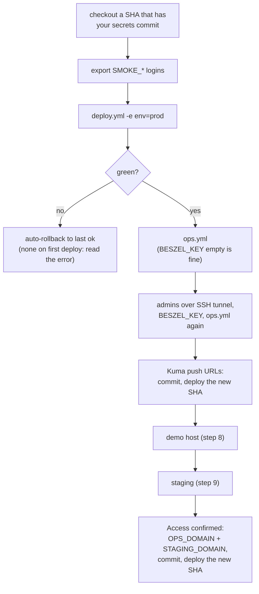

Run every `ansible-playbook` line below from `infra/ansible` (`cd infra/ansible`). Run `git` from the repo root.

1. **Find the SHA.** It is the 40-character commit of the build you want, and it must contain your secrets commit from section 4 (the deploy reads secrets from the checkout). Take the newest `main` commit with a green run: GitHub > Actions > "Publish image" > the commit.

   ```bash
   git fetch && git checkout 3f9c2ab1d4e5f60718293a4b5c6d7e8f90a1b2c3   # example SHA
   ls infra/secrets/*.enc.env                                          # prod, demo, staging, ops
   export SMOKE_ADMIN_EMAIL=... SMOKE_ADMIN_PASSWORD=... \
          SMOKE_TEACHER_EMAIL=... SMOKE_TEACHER_PASSWORD=... \
          SMOKE_SUPER_ADMIN_EMAIL=... SMOKE_SUPER_ADMIN_PASSWORD=...
   ```

   The play refuses to start unless `HEAD` equals `version`, or if `docker-compose*.yml` or `nginx/` has uncommitted changes (they are copied from your checkout). `version` must be the full 40 characters; a short SHA fails pre-flight.

2. **Plan first:** `ansible-playbook -i inventory/prod.yml deploy.yml -e env=prod -e version=$(git rev-parse HEAD) --check`
3. **Deploy:** `ansible-playbook -i inventory/prod.yml deploy.yml -e env=prod -e version=$(git rev-parse HEAD)`

   Watch it run, in this order:
   1. Pre-flight: inputs, checkout, image tags, Access gate, age key. Nothing changes yet.
   2. `.env`, with `APP_VERSION` inside.
   3. `nginx -t` on the new templates. A failure puts the old files back.
   4. Pull.
   5. Backup. Skipped only when the volume `biddaloy-prod_pgdata` does not exist yet, i.e. the very first deploy.
   6. Migrations, `up`, nginx recreate, edge networks.
   7. Wait for `/api/health/ready` (up to 2 min).
   8. Smoke test, then the `deploys.log` line.

4. **Ops stack.** Cloudflare Access for `ops.<domain>` must already exist (day 0). `BESZEL_KEY` stays empty in `ops.enc.env`:

   ```bash
   ansible-playbook -i inventory/prod.yml ops.yml
   ```

   It writes `/opt/biddaloy/ops/.env`, creates `biddaloy-ops-edge` if prod has not, and starts the stack. Nothing is exposed: the UIs bind `127.0.0.1`. The `beszel-agent` container restarts in a loop until step 5; that is expected, and the play prints what is left.

5. **Admins, over an SSH tunnel.** `/kuma/` and `/beszel/` do not load under `ops.<domain>` (Known gaps #2), so the tunnel is the way in for now:

   ```bash
   ssh -L 8090:127.0.0.1:8090 -L 3001:127.0.0.1:3001 deploy@203.0.113.10
   # Beszel: http://localhost:8090    Kuma: http://localhost:3001
   ```

   **Beszel:** create the admin, "Add system", host `beszel-agent`, port `45876`. Copy the public key it shows into `sops infra/secrets/ops.enc.env` as `BESZEL_KEY`, then **run the whole `ops.yml` again**. `--tags env` would only write the file and start nothing. Add a Shoutrrr Telegram URL in hub settings (`telegram://<bot-token>@telegram?chats=<group-id>`).

6. **Uptime Kuma** (tunnel, `http://localhost:3001`). Create the admin, then:
   1. Create the push monitors `backup-hourly` and `drill-weekly`. Kuma shows each push URL as `http://localhost:3001/api/push/<token>` (you came in over the tunnel). Keep only the token. In `sops infra/secrets/prod.enc.env` set `BACKUP_PUSH_URL` and `DRILL_PUSH_URL` to `http://uptime-kuma:3001/api/push/<token>`.
   2. Skip `demo-reset-nightly` for now. The demo host can reach Kuma only through `https://ops.<domain>/kuma/` with the `demo-reset-push` service token, and `/kuma/` does not load (Known gaps #2). Until Kuma has its own hostname, the demo's Sentry cron (`SENTRY_CRONS_URL`, [12-operations 3.7](12-operations.md#37-demo-reset-failed-sentry-cron-alert)) is its only alert.
   3. Apply: commit `prod.enc.env`, push to `main`, wait for "Publish image", and deploy **that new SHA** (section 10, rotate a secret).
   4. After the next full hour, on the VM: `cd /opt/biddaloy/prod && docker compose -p biddaloy-prod logs backup | grep 'Kuma push'` prints nothing.
   5. Add the other monitors from the table in [12-operations.md section 1](12-operations.md#uptime-kuma-monitors). `app-internal-ready`: URL `http://prod-app:3000/api/health/ready`, header `X-Health-Token: <HEALTH_TOKEN from prod.enc.env>`, accepted 200-299, no keyword.
   6. Notifications: Telegram default-on; SMS "Webhook" attached only to `app-public`, `backup-hourly`, `drill-weekly`.
7. **Postgres connections monitor and its read-only role:** [section 8](#8-alerts-the-postgres-monitor-and-the-verification-log). Read the warning there first.
8. **Demo, on its own host.** It binds ports 80/443 like prod, so it cannot share the VM. `inventory/prod.yml` lists only prod, so pass the demo IP as an ad-hoc inventory (`-i '<demo-ip>,'`, the comma matters). That inventory has no `ansible_user`, so name the user each time. Untested end to end (Known gaps #6).
   1. Provision it, keeping a root session open as in section 5:

      ```bash
      ansible-playbook -i '<demo-ip>,' provision.yml -e ansible_user=root
      ```

   2. Put the Origin CA pair in its `/opt/biddaloy/certs/` with the section 5 commands (demo nginx mounts `TLS_CERT_DIR` too).
   3. Copy the files and `.env`. The play's last `up` may fail, because `app` refuses to boot before the first reset. That is expected.

      ```bash
      ansible-playbook -i '<demo-ip>,' -u deploy deploy.yml -e env=demo -e version=$(git rev-parse HEAD)
      ```

   4. First start, on the demo host. Keep `-p biddaloy-demo`: it is the project name `deploy.yml` uses. Without it compose makes a second project (`demo`) with empty volumes.

      ```bash
      cd /opt/biddaloy/demo
      C="docker compose -p biddaloy-demo -f docker-compose.yml -f docker-compose.demo.yml"
      $C up -d db redis seaweedfs
      $C run --rm demo-reset /app/reset.sh --now    # first run logs "app not restarted: first run"
      $C up -d
      ```

   5. The smoke test is skipped for demo until `demo_domain` is in the inventory.

9. **Staging** (same VM as prod, see section 7): `ansible-playbook -i inventory/prod.yml deploy.yml -e env=staging -e version=$(git rev-parse HEAD)`. It runs `yarn config:check --env staging` on your laptop first and stops on a provider key, a prod database or a real Turnstile secret. Seed it once: [07-deployment.md Staging](07-deployment.md#staging).
10. **Open the front door for ops and staging.** Only now, with both Access applications verified (`curl -sI` gives `302` to `cloudflareaccess.com`):
    1. Set `access_confirmed: true` in `infra/ansible/inventory/prod.yml`.
    2. `sops infra/secrets/prod.enc.env`: set `OPS_DOMAIN=ops.<domain>` and `STAGING_DOMAIN=staging.<domain>`.
    3. Commit both files, push to `main`, wait for "Publish image", and deploy prod at **that new SHA**. The deploy reads both files from the checkout, so the running SHA would still say "no". nginx is recreated and now serves both names.
    4. Check `https://ops.<domain>/dozzle/` asks for the Access login first, and the origin check in [25-cloudflare.md](25-cloudflare.md#access-policies) returns an empty reply.

## 7. Every release

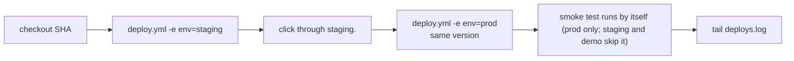

```bash
git fetch && git checkout <40-char sha>   # repo root; SMOKE_* exported (section 6 step 1)
cd infra/ansible
ansible-playbook -i inventory/prod.yml deploy.yml -e env=staging -e version=<40-char sha>
ansible-playbook -i inventory/prod.yml deploy.yml -e env=prod    -e version=<40-char sha>
ssh deploy@203.0.113.10 'sudo tail -n 5 /opt/biddaloy/prod/deploys.log'   # file is root-owned, 0640
# 2026-10-20T09:00:00Z prod 3f9c2ab... ok
```

`deploys.log` lines are `<time> <env> <version> <ok|rolled-back|failed>`.

**What rollback does and does not do** (decision D11: migrations are never rolled back).

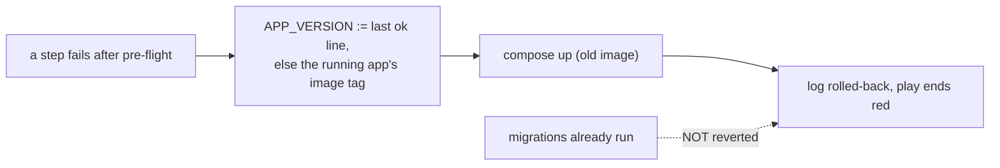

- It redeploys the old **image** only. New compose and nginx files stay on the host (the nginx ones already passed `nginx -t`).
- Migrations are not reverted. Every migration must keep the old code working.
- The target is the last `ok` line in `deploys.log`. With none (log deleted, stack started by hand), it is the tag of the `app` container running now. With neither (first ever deploy) there is nothing to go back to.
- If the app is still down, on the VM: `cd /opt/biddaloy/prod && docker compose -p biddaloy-prod ps -a`, then `docker compose -p biddaloy-prod logs --tail 100 app`. Without `-p` compose looks at an empty project named `prod`. Then [07-deployment.md "When rollback also fails"](07-deployment.md#when-rollback-also-fails).
- Skip the pre-migration backup only on purpose: `-e skip_backup=true`.

## 8. Alerts, the Postgres monitor and the verification log

Thresholds live in [12-operations.md section 2](12-operations.md#2-alert-thresholds). The alert path:

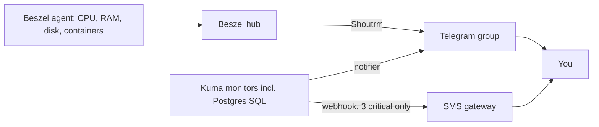

### The read-only `monitor` role

Run once on the VM (the db container already has `POSTGRES_USER` and `POSTGRES_DB`).
Make a hex password with `openssl rand -hex 24`, and type it only at the
`\password` prompt, so it stays out of shell history:

```bash
cd /opt/biddaloy/prod
docker compose -p biddaloy-prod exec db sh -c 'psql -U "$POSTGRES_USER" -d "$POSTGRES_DB"'
```

```sql
CREATE ROLE monitor LOGIN CONNECTION LIMIT 3;
GRANT pg_monitor TO monitor;   -- read-only stats views, no table access
\password monitor
\q
```

`pg_monitor` can read only stats and settings views, no tables. If Postgres is at
`max_connections=300`, the monitor cannot connect either, and that also alerts.

### Kuma click path (Postgres monitor)

> **Warning, does not work as built.** Kuma sits only on `biddaloy-ops-edge`. Prod's
> `db` is on `biddaloy-prod_default` and published only on the host's `127.0.0.1:5432`,
> so the connection string below cannot be reached from Kuma (Known gaps #5). Until
> that is decided, run the same query from a host cron job and push the result to a
> Kuma **Push** monitor. UNVERIFIED, untested.

1. Kuma > **Add New Monitor** > type **Postgres**.
2. Name `postgres-connections`. Connection string
   `postgres://monitor:<password>@biddaloy-prod-db-1:5432/<POSTGRES_DB>?sslmode=<match DB_SSL>` (the name Kuma would use if it could reach the db).
3. Query: `SELECT CASE WHEN count(*) > 240 THEN 1/0 ELSE 1 END FROM pg_stat_activity`
   (the division by zero is an error, and an error means "down": it fires above 80% of `max_connections=300`).
4. Interval 60 s, retries 2, notifier Telegram. Save.
5. Add the row to the monitors table in 12-operations section 1 in the same PR.

### Beszel click path (host and containers)

Beszel hub (tunnel, `http://localhost:8090`) > system `biddaloy-prod` > bell icon (**Alerts**). Set CPU, Memory, Disk, Status
as in the table. Then open a container row and enable its container-down alert for
`biddaloy-prod-app-1`, `db-1`, `redis-1`, `seaweedfs-1`, `nginx-1` and `backup-1`
(if the UI has no per-container alert, see Known gaps #7). Bandwidth stays off. Notification: the Shoutrrr Telegram URL.

The VM's agent sees only the VM's own containers. `biddaloy-demo-app` runs on the
demo host, so alerting on it needs a second `beszel-agent` there. That is not built.

### Verification (one alert at a time)

Fire each alert once, see the Telegram message **and** the recovery message, then
write the date in the log below.

**Where to run it.** Best on the rehearsal VM (Known gaps #1), before go-live.
On the live VM, only in an announced off-hours window: the RAM and disk tests
squeeze the same machine that runs prod Postgres. Size them as below, never by
guess. A test past 100% means the OOM killer or a full disk, and Postgres stops.

```bash
# RAM alert (Memory > 90% for 10 min). Brings use to 92%. Needs: sudo apt install stress-ng
read -r total used <<<"$(free -m | awk '/^Mem:/ {print $2, $3}')"
stress-ng --vm 1 --vm-bytes $(( total * 92 / 100 - used ))M --timeout 11m

# Disk alert (Disk > 80%). Brings use to 82%, then delete the file.
read -r size used <<<"$(df -B1 --output=size,used / | tail -1)"
sudo fallocate -l $(( size * 82 / 100 - used )) /var/tmp/disk-alert-test
sudo rm /var/tmp/disk-alert-test

# Container-down alert. Between :10 and :50, so no hourly backup is due.
docker stop biddaloy-prod-backup-1       # wait for Telegram, then:
docker start biddaloy-prod-backup-1

# Host-down alert (really "agent unreachable")
docker stop biddaloy-ops-beszel-agent-1  # wait for Telegram, then:
docker start biddaloy-ops-beszel-agent-1
```

A negative number in the RAM or disk line means use is already past the line:
do not run it, find out why first.

CPU alert: `stress-ng --cpu 0 --timeout 16m`. Postgres: temporarily set the Kuma
threshold to `> 1`, wait for the alert, then put it back.

> **A dead VM pages nobody.** Kuma, Beszel and the SMS webhook all run on the VM.
> Beszel's "Status" fires when the agent stops, not when the whole VM is gone.
> Then only off-host Sentry cron monitors notice (the attention check-in, about
> 15 min). Known gaps #9.

Verification log (fill the date after each alert fired and recovered; #1771):

| Alert                         | Fired (date) | Recovered (date) | Who |
| ----------------------------- | ------------ | ---------------- | --- |
| CPU > 90% for 15 min          |              |                  |     |
| Memory > 90% for 10 min       |              |                  |     |
| Disk > 80%                    |              |                  |     |
| Host down (agent unreachable) |              |                  |     |
| Container down (prod backup)  |              |                  |     |
| Postgres connections > 240    |              |                  |     |

## 9. When Telegram pings

| Message (monitor name)         | Means                                          | First command (on the VM as `deploy`, unless it says otherwise)                                                                                                                      | Then read                                                                    |
| ------------------------------ | ---------------------------------------------- | ------------------------------------------------------------------------------------------------------------------------------------------------------------------------------------ | ---------------------------------------------------------------------------- |
| `app-public` down (+ SMS)      | The public app does not answer                 | `cd /opt/biddaloy/prod && docker compose -p biddaloy-prod ps`                                                                                                                        | [12-operations 3.2](12-operations.md#32-readiness-failing)                   |
| `app-internal-ready` down      | Postgres is down (only that is `fail`)         | `cd /opt/biddaloy/prod && docker compose -p biddaloy-prod logs --tail 50 db`                                                                                                         | 12-operations 3.2                                                            |
| `backup-hourly` missed (+ SMS) | No dump in the last hour plus grace            | `cd /opt/biddaloy/prod && docker compose -p biddaloy-prod logs --tail 50 backup`                                                                                                     | [13-backup-restore](13-backup-restore.md)                                    |
| `drill-weekly` red (+ SMS)     | A restore did not work; message names the step | `cd /opt/biddaloy/prod && docker compose -p biddaloy-prod exec backup /app/drill.sh`                                                                                                 | 13-backup-restore "Drill"                                                    |
| `demo-reset-nightly` missed    | Demo not rebuilt (on the demo host)            | `cd /opt/biddaloy/demo && docker compose -p biddaloy-demo -f docker-compose.yml -f docker-compose.demo.yml logs --tail 50 demo-reset`                                                | [12-operations 3.7](12-operations.md#37-demo-reset-failed-sentry-cron-alert) |
| TLS expires in < 14 days       | Cloudflare's edge cert near its end            | Cloudflare > SSL/TLS > Edge Certificates. Kuma never sees the 15-year Origin CA, only the edge cert, which renews itself                                                             | [25-cloudflare](25-cloudflare.md)                                            |
| Beszel disk > 80%              | Disk filling                                   | `df -h /; docker system df`                                                                                                                                                          | section 12 "Check disk"                                                      |
| Beszel memory/CPU high         | Leak or load                                   | `docker stats --no-stream`                                                                                                                                                           | Dozzle logs, section 12                                                      |
| Container down                 | A container exited                             | `cd /opt/biddaloy/prod && docker compose -p biddaloy-prod ps -a`                                                                                                                     | `logs --tail 100 <service>`                                                  |
| `postgres-connections`         | More than 240 of 300 connections used          | `cd /opt/biddaloy/prod && docker compose -p biddaloy-prod exec -T db sh -c 'psql -U "$POSTGRES_USER" -d "$POSTGRES_DB" -c "SELECT state,count(*) FROM pg_stat_activity GROUP BY 1"'` | 12-operations 3.1                                                            |
| Sentry 5xx spike               | Errors after a deploy or from one tenant       | Open the Sentry issue, look at `request_id`                                                                                                                                          | [12-operations 3.1](12-operations.md#31-5xx-spike)                           |

## 10. Backups and secrets

### Where backups are

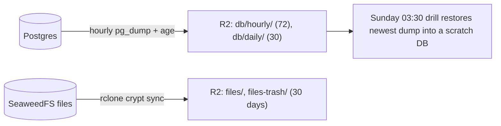

Confirm last hour's backup: the `backup-hourly` Kuma monitor is green, and in the R2
console `db/hourly/` has a key from the last hour (example `db/hourly/20260920T200000Z.dump.age`).
Names under `files/` are encrypted on purpose; only `db/` is readable.

- **Restore the database:** [13-backup-restore.md "Restore runbook"](13-backup-restore.md#restore-runbook) (`scripts/backup/restore.sh db/hourly/<key>.dump.age <target-url>`, never into prod's own URL).
- **Restore one file** (through the encrypted remote):

  ```bash
  rclone copy r2crypt:files/tenants/<tenant-id> ./out
  rclone copy r2crypt:files-trash/2026-10-20/tenants/<tenant-id> ./out-trash
  ```

  Build the `r2` and `r2crypt` remotes as in [13-backup-restore.md "Restore files from R2"](13-backup-restore.md#restore-files-from-r2).

- **Drill result:** one green `drill-weekly` beat a week, message `ok-<n>-tables` (example `ok-8-tables`). A red beat names the step.

### Rotate a secret

Per-secret extra steps: [12-operations.md section 8](12-operations.md#8-secrets-and-rotation).

A deploy reads secrets from the commit you have checked out (section 4). So a
rotation is: commit the new value, then a full deploy of **that new commit**.
Deploying the old running SHA would put the old value back and still log `ok`.

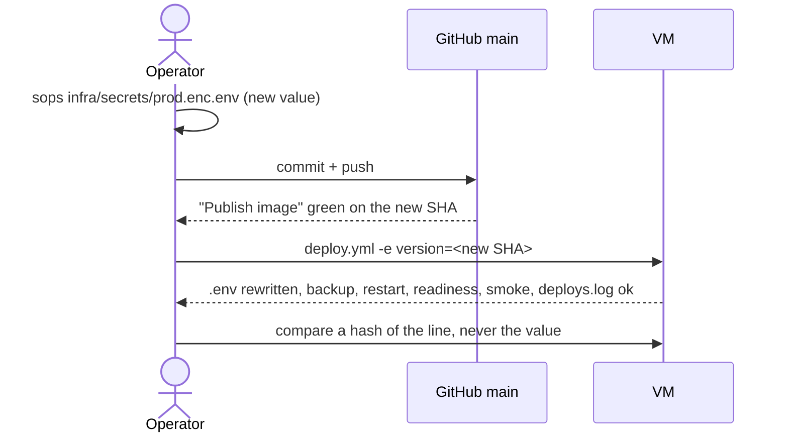

```bash
sops infra/secrets/prod.enc.env                          # 1. change the value
git add infra/secrets/prod.enc.env && git commit -m "chore(secrets): rotate JWT_SECRET" && git push
V=$(git rev-parse HEAD)                                  # 2. wait for "Publish image" on $V, then:
cd infra/ansible && ansible-playbook -i inventory/prod.yml deploy.yml -e env=prod -e version=$V
cd ../..                                                 # 3. verify: the two hashes match
sops -d infra/secrets/prod.enc.env | grep '^JWT_SECRET=' | sha256sum
ssh deploy@203.0.113.10 "sudo grep '^JWT_SECRET=' /opt/biddaloy/prod/.env | sha256sum"
```

The new SHA also ships every other commit on `main` since the running one. If
there are any, take it through staging first, as for any release (section 7).

`--tags env` is not the rotation. It only rewrites `.env` and restarts nothing, and
the play refuses it unless `version` equals the running version.

To re-issue the Origin CA cert: re-issue in Cloudflare, `sops` the two `origin-ca*.enc.pem` files (section 4), commit them, then put them on the host with the section 5 commands (Known gaps #4). nginx reloads itself every 6 hours (`nginx/reload-loop.sh`), so the new pair is live within 6 hours with no restart.

## 11. Grow or move

Moving to a bigger VM is a restore onto a new host. Untested end to end (Known gaps #1).

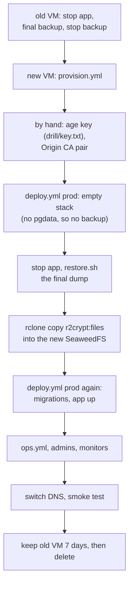

1. **Old VM: stop writes.** The site is down from here until DNS moves. The final run also syncs the files.

   ```bash
   cd /opt/biddaloy/prod
   docker compose -p biddaloy-prod stop app
   docker compose -p biddaloy-prod run --rm --no-deps --entrypoint /app/backup.sh backup   # final dump + files
   docker compose -p biddaloy-prod stop backup     # two VMs must never back up to one bucket
   ```

2. **New VM.** `export BIDDALOY_PROD_HOST=<new ip>`, then provision it (section 5).
3. **By hand** (git holds neither): the age key into `drill/key.txt` and the Origin CA pair, with the section 5 commands.
4. **Deploy prod** at the running SHA, with `-e app_domain=` added. It comes up empty and skips the backup (no `biddaloy-prod_pgdata` yet). `-e app_domain=` skips the smoke test, which would otherwise reach the old VM through DNS.
5. **Restore the database.** Steps 5 and 6 run on your laptop (needs `age`, `pg_restore`, `aws`, `rclone`) over a tunnel: `ssh -L 5432:127.0.0.1:5432 -L 9000:127.0.0.1:9000 deploy@<new ip>`. On the new VM: `docker compose -p biddaloy-prod stop app`. Then run `restore.sh` on the newest key under `db/hourly/` (the final dump) into `postgres://<POSTGRES_USER>:<POSTGRES_PASSWORD>@127.0.0.1:5432/<POSTGRES_DB>` with `--no-migrate`, as in [13-backup-restore.md "Restore runbook"](13-backup-restore.md#restore-runbook). It refuses a target equal to its own shell's `DATABASE_URL`.
6. **Restore the files.** Build `r2` and `r2crypt` as in [13-backup-restore.md "Restore files from R2"](13-backup-restore.md#restore-files-from-r2), plus a `src` S3 remote for the new SeaweedFS (`http://127.0.0.1:9000`, the `S3_*` keys from `prod.enc.env`). Then:

   ```bash
   rclone copy r2crypt:files src:<S3_BUCKET>
   rclone size r2crypt:files; rclone size src:<S3_BUCKET>   # files restored: the counts match
   ```

7. **Deploy prod again** (same SHA, `-e app_domain=` again). Migrations run, the app starts, readiness passes.
8. **Ops.** `ops.yml`, then redo section 6 steps 5 and 6 and the section 8 alerts. Copying the `biddaloy-ops_kuma_data` and `biddaloy-ops_beszel_data` volumes instead is untested.
9. **Switch DNS** in Cloudflare (`app`, `ops`, `staging` to the new IP). Then, from the repo root: `node scripts/smoke-post-deploy.mjs --base-url https://app.<domain>`. Redeploy staging (section 6 step 9).
10. **Keep the old VM 7 days**, then delete it.

Grow when any of these is true for a week (placeholder triggers, tune with real data):

| Signal               | Trigger               |
| -------------------- | --------------------- |
| Memory               | > 80% most of the day |
| Disk                 | > 70% and growing     |
| CPU                  | > 70% at peak, daily  |
| Postgres connections | > 200 at peak         |
| Restore drill        | fails the `disk` step |

## 12. Small jobs

- **Turn staging off or on.** Off: `cd /opt/biddaloy/staging && docker compose -p biddaloy-staging -f docker-compose.yml -f docker-compose.staging.yml down` (data stays; `-v` deletes it). On: `deploy.yml -e env=staging -e version=<sha>`. Prod can go down while staging runs: `biddaloy-edge` belongs to no compose project. Staging answers 502 until prod nginx is re-attached ([07-deployment.md](07-deployment.md#staging)).
- **Re-attach the edge networks only** (after a container was recreated by hand, or staging answers 502). From `infra/ansible`, with the running SHA checked out (`HEAD` must equal `version`, like every run): `ansible-playbook -i inventory/prod.yml deploy.yml -e env=prod -e version=<running sha> --tags edge`.
- **Rebuild demo.** `cd /opt/biddaloy/demo && docker compose -p biddaloy-demo -f docker-compose.yml -f docker-compose.demo.yml run --rm demo-reset /app/reset.sh --now` on the demo host. Nightly it rebuilds itself at 01:00 and swaps at 02:00.
- **Check disk.** `df -h /` then `docker system df`. Weekly prune runs Sunday 04:00 and keeps the newest 4 of our images, so a rollback needs no GHCR.
- **Read logs in Dozzle.** `https://ops.<domain>/dozzle/` (behind Cloudflare Access; nginx also drops requests with no Access token header), view-only. Or `cd /opt/biddaloy/prod && docker compose -p biddaloy-prod logs --tail 100 -f app`.

## Known gaps

Read these before you trust the page. Each one is a real hole or an unproven step.

| #   | Gap                                                                                                                                                                                                                                                                                                        | Workaround / who fixes it                                                                                                                                                                      |
| --- | ---------------------------------------------------------------------------------------------------------------------------------------------------------------------------------------------------------------------------------------------------------------------------------------------------------- | ---------------------------------------------------------------------------------------------------------------------------------------------------------------------------------------------- |
| 1   | **Nothing here has run on a real host.** `deploy.yml`, `ops.yml` and `attach-edge.yml` were written from the files and tested only by `--check`, `--syntax-check`, lint and unit tests.                                                                                                                    | The rehearsal VM. Every command that fails there is a doc bug.                                                                                                                                 |
| 2   | **`/kuma/` and `/beszel/` will not work.** Kuma 1.x and Beszel have no sub-path support ([12-operations.md](12-operations.md#setting-the-tools-up-by-hand-once)). Dozzle at `/dozzle/` does work. This also blocks the demo-reset push: the demo host can reach Kuma only at `https://ops.<domain>/kuma/`. | Per-host names (`kuma.<domain>`, `beszel.<domain>`, own Access app each) are the documented path and are not built. Stopgap: the SSH tunnel (section 6 step 5); for the demo, its Sentry cron. |
| 3   | **`prod.enc.env`, `demo.enc.env`, `staging.enc.env`, `ops.enc.env` and the two `origin-ca*.enc.pem` files do not exist in git.** The operator creates them (section 4).                                                                                                                                    | Operator, once.                                                                                                                                                                                |
| 4   | **No play places the Origin CA pair.** `write_certs` in `write-env.yml` is a flag no playbook passes, so `/opt/biddaloy/certs/origin.{pem,key}` is a manual step (section 5).                                                                                                                              | The section 5 commands; issue #2745.                                                                                                                                                           |
| 5   | **Kuma cannot reach prod's Postgres**, so the `postgres-connections` monitor in section 8 cannot work as written. `biddaloy-ops-edge` has no db on it; the db port is on the host's loopback only.                                                                                                         | Host cron plus a Kuma Push monitor (UNVERIFIED), or an owner decision.                                                                                                                         |
| 6   | **Demo needs its own host**, and `demo_domain` is not in `inventory/prod.yml`, so its smoke test is skipped. The demo first-start order is untested. The VM's Beszel cannot see the demo's containers.                                                                                                     | Add the host and `demo_domain` when the demo host exists; a `beszel-agent` there for container alerts.                                                                                         |
| 7   | **Alerts (#1771) live in Beszel's and Kuma's own databases**, so the repo cannot hold them. The verification log (section 8) starts empty. Whether Beszel 0.21.0 offers a per-container "down" alert is UNVERIFIED.                                                                                        | Operator fills the log; if the UI has no such alert, use a Kuma Docker monitor.                                                                                                                |
| 8   | **R2 Bucket Lock** on `db/` is recommended (a stolen R2 token could otherwise delete every backup) and is not set up. Lock must allow the backup's own prune, so test it on a scratch bucket first.                                                                                                        | Owner decision.                                                                                                                                                                                |
| 9   | **A dead VM pages nobody.** Kuma, Beszel and the SMS webhook run on the VM itself. Beszel "Status" fires when the agent stops, not when the VM is gone. Only the off-host Sentry cron monitors notice (about 15 min).                                                                                      | An off-host check (Cloudflare health check or an external Kuma). Not built.                                                                                                                    |
