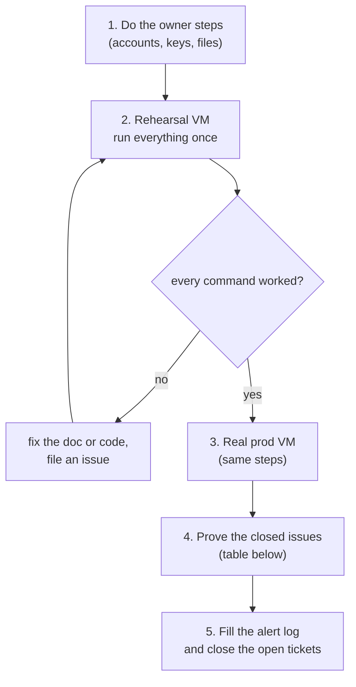

# 29. Epic 61 go-live: what is left for you

Epic 61 (#1766) is merged. **The code is on `main`. Nothing in it has run on a real server yet.**
This page is the short list of what you still have to do, in order, and what was closed
without being proven. The full commands live in [28-platform-runbook.md](28-platform-runbook.md);
this page only says _what comes next_ and _why_.

## The path in one picture



Why a rehearsal first: the playbooks were checked with `--syntax-check`, lint and unit tests only.
Every command that fails on the rehearsal VM is a bug in the doc or the code. Find it there, not on prod.

## Step 1. Owner steps (only you can do these)

Do them in this order. Each one points at the runbook section with the exact commands.

| #   | What                                                                                                                                                                                | Where                                                                     |
| --- | ----------------------------------------------------------------------------------------------------------------------------------------------------------------------------------- | ------------------------------------------------------------------------- |
| 1   | Buy the VM. Ubuntu LTS, root SSH works.                                                                                                                                             | [runbook §2](28-platform-runbook.md#2-day-0-checklist-before-any-command) |
| 2   | Cloudflare: zone, `app` and `demo` records (proxied), SSL/TLS = Full (strict), Origin CA certificate that covers `app.`, `demo.`, `ops.` and `staging.<domain>`.                    | runbook §2                                                                |
| 3   | Cloudflare Access apps for `ops.` and `staging.` **before** those names go live, plus the Service Auth policy for the demo-reset token.                                             | runbook §2, [25-cloudflare.md](25-cloudflare.md#access-policies)          |
| 4   | R2 bucket and an API token limited to that bucket.                                                                                                                                  | runbook §2                                                                |
| 5   | Telegram bot and group, SMS gateway key, Sentry projects.                                                                                                                           | runbook §2                                                                |
| 6   | GitHub repo variables `VITE_TURNSTILE_SITE_KEY` and `VITE_SUPPORT_URL` (Settings > Secrets and variables > Actions > Variables).                                                    | runbook §2                                                                |
| 7   | After the first "Publish image" run, make the three GHCR packages public: `biddaloy-app`, `biddaloy-backup`, `biddaloy-demo-reset`.                                                 | runbook §2                                                                |
| 8   | Create the encrypted files `prod.enc.env`, `demo.enc.env`, `staging.enc.env`, `ops.enc.env` and the two `origin-ca*.enc.pem` files with your own age keys. They are **not in git**. | [runbook §4](28-platform-runbook.md#4-secrets), `infra/secrets/README.md` |
| 9   | Put the age **backup** key on the host at `/opt/biddaloy/prod/drill/key.txt` (owner 10001, mode 0400). The deploy stops without it.                                                 | runbook §10                                                               |
| 10  | Confirm the guessed hostnames in `infra/ansible/inventory/prod.yml`: `app.`, `ops.`, `staging.schoolmanagerp.com`.                                                                  | `infra/ansible/inventory/prod.yml`                                        |

Two settings that will **stop a deploy** if you forget them:

- `prod.enc.env` must set `TRUSTED_PROXY_CIDRS` before `OPS_DOMAIN` or `STAGING_DOMAIN` is allowed.
- Check `PLATFORM_TENANT_ID` in `prod.enc.env` before the first deploy. This version passes it to the
  app for the first time, and that school's super admins get platform rights at once.

## Step 2. Rehearse, then do prod

Follow [runbook §3 to §6](28-platform-runbook.md#3-laptop-setup) in order: laptop setup, secrets, provision,
first deploy, ops stack, demo, staging. Deploy a commit that **contains your secrets commit**: the
playbooks read secrets from the checkout, not from your working folder.

A real example of the one command you will run most:

```bash
cd infra/ansible
ansible-playbook deploy.yml -e env=prod -e version=$(git rev-parse HEAD)   # 40-char SHA
```

## Step 3. Prove what was closed without proof

These issues are closed because the **code** is on `main`. The checks below were never run. Run them
on the rehearsal VM, then on prod, and write the result in the verification log
([runbook §8](28-platform-runbook.md#8-alerts-the-postgres-monitor-and-the-verification-log)).

| Issue | What to prove                                                                                                    | How you know it passed                                                     |
| ----- | ---------------------------------------------------------------------------------------------------------------- | -------------------------------------------------------------------------- |
| #1758 | Fresh VM, provision twice.                                                                                       | Second run says `changed=0`.                                               |
| #1758 | Only the right ports are open. `nmap <vm-ip>` from outside.                                                      | Only 22, 80, 443. Root SSH and password SSH are refused. fail2ban is on.   |
| #1767 | One command deploys; `deploys.log` gets a line; readiness and smoke pass.                                        | `/opt/biddaloy/prod/deploys.log` ends with `... ok`.                       |
| #1767 | An unknown tag stops before any container changes.                                                               | Deploy aborts at "Check the image tag exists".                             |
| #1767 | A failure after `up` rolls back to the previous tag.                                                             | App is back on the old version; log says rollback.                         |
| #1768 | Staging is live, seeded, behind Access, `noindex`; one release goes staging then prod.                           | Staging login works only through Access; the same SHA is deployed to prod. |
| #1774 | The weekly restore drill pushes `up` to Kuma, and a forced failure pushes `down` and leaves no `biddaloy_drill`. | Kuma shows the history; no scratch database remains.                       |

If any of these fails, **re-open the issue** and say which line failed.

## Step 4. What stays open on purpose

| Issue        | Why it is still open                                                                                           |
| ------------ | -------------------------------------------------------------------------------------------------------------- |
| #1756        | Needs your encrypted files and age keys (Step 1, item 8).                                                      |
| #1769        | Needs `ops.enc.env`, the Cloudflare Access app, the alert drills and the Sentry rules.                         |
| #1771        | The alerts live in Beszel's and Kuma's own databases, so the repo cannot hold them. Fill the verification log. |
| #2712        | Skipped on purpose.                                                                                            |
| #1766 (epic) | Closes when the four above are done.                                                                           |

## Step 5. Known holes (follow-up issues)

These are real gaps, already filed. Read the first two before you rely on the ops tools.

| Issue | Gap                                                                                                                                                  |
| ----- | ---------------------------------------------------------------------------------------------------------------------------------------------------- |
| #2747 | Kuma and Beszel do not work under `/kuma/` and `/beszel/`. Use an SSH tunnel until each gets its own hostname. This also blocks the demo-reset push. |
| #2744 | Kuma cannot reach prod's Postgres, so the `postgres-connections` monitor needs a host cron plus a Push monitor.                                      |
| #2745 | No playbook places the Origin CA pair on the host. It is a manual copy (runbook §5).                                                                 |
| #2748 | There is no safe command to restore a backup into a fresh prod database (the move-VM flow).                                                          |
| #2749 | A dead VM pages nobody, because Kuma and Beszel run on the same VM.                                                                                  |
| #2750 | The `ops.` and `staging.` check is only "the Access header is present". It is not real authentication.                                               |
| #2751 | Small leftovers: `deploys.log` clock, rollback scope, R2 Bucket Lock, the macOS `timeout` test guard.                                                |
