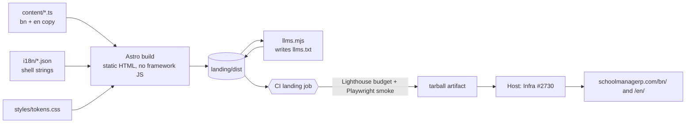
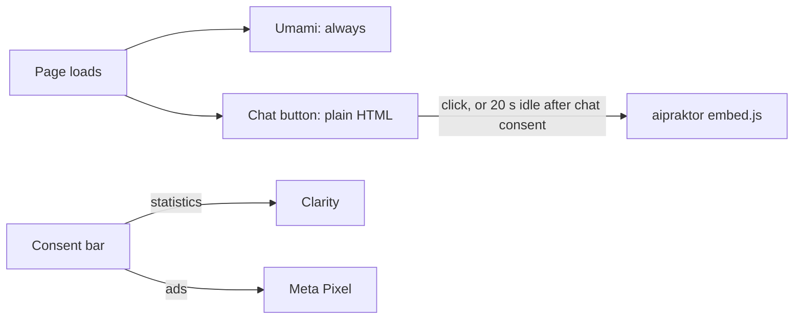
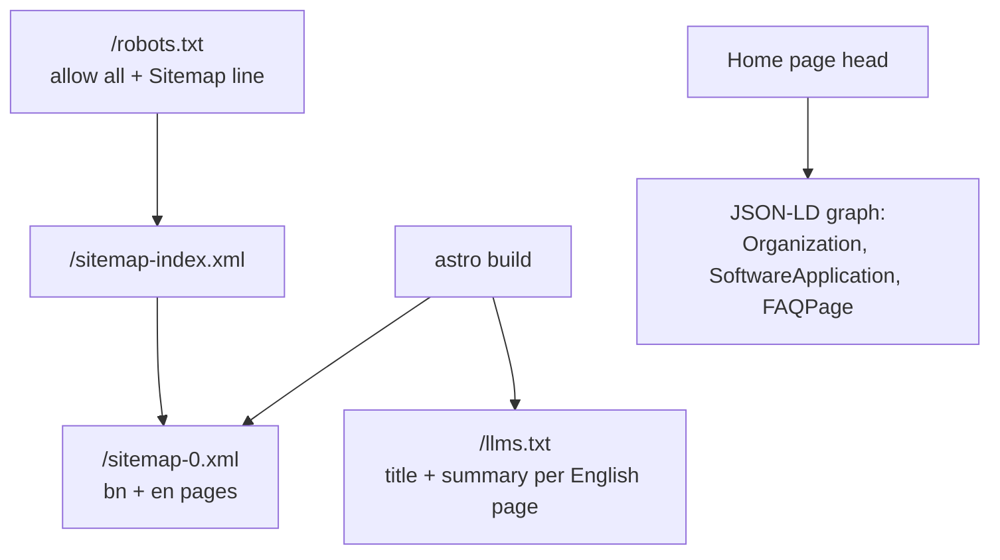
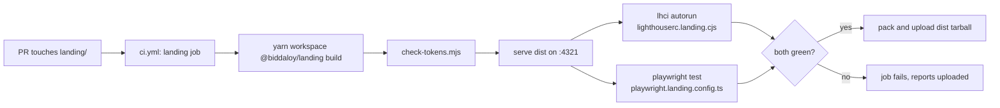
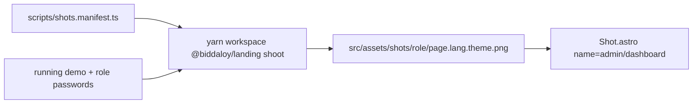
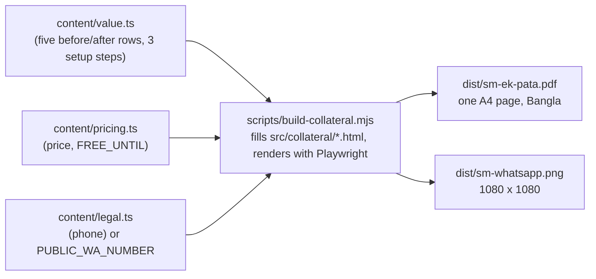

# 29 — Landing site (`landing/`)

The public marketing site at `schoolmanagerp.com`. Astro 7, static, no framework JS. Epic 50 (#1650).

> Built by #2724 to #2731 (Epic 50). This page is the map; the code is the detail.

## The big picture



Every page exists twice, `/bn/...` (default) and `/en/...`. `/` redirects to `/bn/`.

Example: `landing/src/content/faq.ts` holds one FAQ list. The home page shows it (`Faq.astro`) and the same list becomes the `FAQPage` JSON-LD (`JsonLd.astro`), so the two never disagree.

## Content flags

Page copy lives in `landing/src/content/*.ts` with `bn` / `en` fields (never in `i18n/*.json`, which holds shell strings only). Some of it is switched or filled in later:

| Flag / value                                         | File                                  | Default                        | Flip when                                                                                                                                                                           |
| ---------------------------------------------------- | ------------------------------------- | ------------------------------ | ----------------------------------------------------------------------------------------------------------------------------------------------------------------------------------- |
| `SHOW_TESTIMONIALS`                                  | `landing/src/content/testimonials.ts` | `false`                        | three real testimonials are in `testimonials[]` (D13). While off, `/bn/testimonials/` still builds but carries `<meta name="robots" content="noindex">` and is linked from nowhere. |
| `company.*` (address, phone, email, maps URL, hours) | `landing/src/content/legal.ts`        | bracketed placeholders / empty | Epic 62 (#1783) supplies the registered company details. Used by the contact office card (D35), privacy and terms.                                                                  |

Example: with `SHOW_TESTIMONIALS = false`, `testimonialsNoindex()` returns `true` and the testimonials page emits the `noindex` meta in its static `<head>` (via the `noindex` prop on `Base.astro`). `flags.test.ts` only tests `testimonialsNoindex()` and the quote lengths, not the rendered HTML.

## Third parties

Nothing third-party loads before the visitor acts, except Umami (our own server, no cookies).



| Host                                       | What it gets                         | When it loads                               | Consent                               |
| ------------------------------------------ | ------------------------------------ | ------------------------------------------- | ------------------------------------- |
| `stats.schoolmanagerp.com`                 | page views and D22 events, no cookie | every page                                  | none needed (cookieless, first-party) |
| `www.aipraktor.com`                        | the chat text, IP                    | chat click, or 20 s idle after chat consent | opening the chat counts (D15)         |
| `www.clarity.ms` (+ `*.clarity.ms`)        | session recording, IP                | after "statistics" is allowed               | statistics                            |
| `connect.facebook.net`, `www.facebook.com` | ad pixel events, IP                  | after "ads" is allowed                      | ads                                   |
| `wa.me`                                    | nothing until the link is clicked    | link click only                             | none (user navigates)                 |

If chat does not become ready within 5 s, or the script fails, the chat button opens WhatsApp instead (D27).

### Hosts nginx needs in the CSP (#2730)

CSP comes from nginx, not a `<meta>` tag.

- `script-src`: `'self'` `https://stats.schoolmanagerp.com` `https://www.aipraktor.com` `https://*.clarity.ms` `https://connect.facebook.net` (plus `'unsafe-inline'` or hashes for the inline theme/consent/analytics snippets)
- `connect-src`: `'self'` `https://stats.schoolmanagerp.com` `https://www.aipraktor.com` `https://*.clarity.ms` `https://www.facebook.com`
- `img-src`: `'self'` `data:` `https://www.facebook.com` `https://*.clarity.ms`
- `frame-src`: `https://www.aipraktor.com`

Accepted trade-offs (review of #2778):

- `script-src 'unsafe-inline'` is a known gap; hash the inline snippets at build time later.
- HSTS `includeSubDomains` needs every `*.schoolmanagerp.com` subdomain to be HTTPS-only before it ships.
- Collateral files (PDFs, `llms.txt`, the WhatsApp image, fonts) are cached for `max-age=3600`, so a redeploy can serve a stale copy for up to an hour.
- Demo auto-login (`/login?role=`) is login CSRF by design: it is accepted on the demo host, which holds synthetic data and a public password (D8). A visitor who is already signed in is never switched.

Build ids are `PUBLIC_*` variables, see `landing/.env.example`.

## For search engines and AI crawlers (D21)



| File                                 | Made by                                              | What is in it                                                                   |
| ------------------------------------ | ---------------------------------------------------- | ------------------------------------------------------------------------------- |
| `public/robots.txt`                  | hand-written                                         | `Allow: /` and `Sitemap: https://schoolmanagerp.com/sitemap-index.xml`          |
| `sitemap-index.xml`, `sitemap-0.xml` | `@astrojs/sitemap` (config in `astro.config.mjs`)    | one `<loc>` per page, both languages                                            |
| `llms.txt`                           | `landing/scripts/llms.mjs`, run after `astro build`  | `- [Title](url): description` for each indexable English page                   |
| JSON-LD                              | `src/components/JsonLd.astro`, used by the home page | `Organization`; `SoftwareApplication` with `offers` price `10` `BDT`; `FAQPage` |
| `<link rel="alternate" hreflang>`    | `Base.astro`                                         | `bn`, `en` and `x-default` (= bn) on every page                                 |

### Unlisted pages stay out of every file

While `SHOW_TESTIMONIALS = false`, the testimonials page is `noindex` and linked from nowhere (see Content flags). The same flag keeps it out of the other files:

- **Sitemap:** `astro.config.mjs` drops any URL containing `/testimonials/` when `testimonialsNoindex()` is true. So `/bn/testimonials/` and `/en/testimonials/` are not in `sitemap-0.xml`.
- **llms.txt:** `llms.mjs` skips any built page that has `<meta name="robots" content="noindex">`.

Flip the flag (three real testimonials) and the next build lists the page everywhere, with no other edit. `e2e/landing/smoke.spec.ts` checks that the sitemap and `llms.txt` do not contain `/testimonials/`.

Check JSON-LD by hand after a schema change: paste the page URL into <https://validator.schema.org/> and look for 0 errors.

## Budgets (D21)

`lighthouserc.landing.cjs` runs Lighthouse 3 times on four URLs (`/bn/`, `/bn/pricing/`, `/en/`, `/bn/for/madrasa/`) with the same phone-on-3G profile as the app's `lighthouserc.cjs`.

| Check                 | Limit                                | Status    |
| --------------------- | ------------------------------------ | --------- |
| Accessibility score   | 1                                    | enforced  |
| Layout shift (CLS)    | 0.05                                 | enforced  |
| JavaScript downloaded | 51 200 bytes (50 KB)                 | enforced  |
| Performance score     | target 0.95, **enforced 0.8**        | see below |
| Largest paint (LCP)   | target 1500 ms, **enforced 4500 ms** | see below |

Measured on 2026-10-21 (built site, 3G profile): performance 0.83 to 0.93, LCP 2.8 to 3.6 s, JavaScript about 3 KB, CLS 0, accessibility 1.

**Why the performance numbers are below the target.** On the simulated 3G link one round trip is 400 ms, and the browser needs about three before the first byte arrives. That is 1.2 s before any HTML, so 1.5 s for LCP leaves almost nothing. The enforced numbers are the measured floor plus headroom, so a regression still fails CI. To reach the target, either make the page lighter again or measure on a slow-4G profile (`rttMs 150`, `throughputKbps 1638`), where `/bn/` measured 1.6 s. Raising a limit is a deliberate decision, never a CI fix.

What got the numbers where they are:

- Fonts are `font-display: optional`. On a first visit the page keeps the system font; **after the first paint** a small script in `Base.astro` only prefetches the Hind Siliguri files and sets `localStorage` `sm:wf`. When that flag is set, the next page links `public/fonts/fonts.css` in the head, so the cached font is there at first paint and nothing re-wraps. Before this, fonts (190 KB) pushed LCP past 5 s and caused layout shift.
- All CSS is inlined into each page (`inlineStylesheets: 'always'`), so there is no extra stylesheet request.

## Tests and CI



| Layer  | Where                                                                | Covers                                                                                                                                                                                                                                            |
| ------ | -------------------------------------------------------------------- | ------------------------------------------------------------------------------------------------------------------------------------------------------------------------------------------------------------------------------------------------- |
| Unit   | `landing/src/**/*.test.ts` (`yarn workspace @biddaloy/landing test`) | i18n parity, flags, pricing copy, events, shots manifest                                                                                                                                                                                          |
| Smoke  | `e2e/landing/*.spec.ts` (Playwright project `landing`)               | `/` goes to `/bn/`; language switch keeps the path; theme persists; consent bar; hreflang pairs; axe 0 violations; no sideways scroll at 390 px; every internal link answers 200; sitemap, robots, `llms.txt`, JSON-LD; no payment-provider words |
| Budget | `lighthouserc.landing.cjs`                                           | the table above                                                                                                                                                                                                                                   |

Run locally (no database, no API, no login):

```bash
yarn workspace @biddaloy/landing build
npx playwright test -c playwright.landing.config.ts          # starts `serve` itself
CHROME_PATH=... npx lhci autorun --config lighthouserc.landing.cjs   # with `serve landing/dist -l 4321` running
```

`playwright.config.ts` ignores `e2e/landing/**`, so the app's e2e run never picks these up. The smoke test checks `*.pdf` links too: `build-collateral.mjs` writes `dist/sm-ek-pata.pdf` during `build`.

Proof that the gate bites: adding a 70 KB script to the home page made `resource-summary:script:size` fail (73 662 > 51 200) and performance drop under 0.8.

## Copy rules

- **No payment-provider words.** The site never names bKash, Nagad or SSLCommerz and never asks for a card. `e2e/landing/no-payment-words.spec.ts` checks raw HTML and visible text; `pricing.test.ts` checks the pricing copy. "No card needed" and "ID cards" are fine.
- **Easy Bangla first.** Short words, no jargon.
- **Bangla and English together.** Every string has both (the parity test fails otherwise).
- **One price, written plainly:** ৳10 per student per month. No packages, no hidden costs.

## Screenshots

Product screenshots come from the demo school, never from a real one.



Until a PNG exists, `Shot.astro` shows a dashed placeholder. Steps and environment variables are in `landing/README.md`.

## Deploy

CI is the only builder: the `landing` job uploads `landing-dist-<sha>.tar.gz`. The host serves it from `releases/<sha>/` behind a `current` symlink (nginx template + `infra/ansible/landing.yml`); see [07-deployment.md](07-deployment.md) and [28-platform-runbook.md](28-platform-runbook.md). The CSP hosts the site needs are listed under Third parties above.

## Lessons from building it

| Surprise                                                                                | Cost                                         | Fix                                                                             | Rule to keep                                              |
| --------------------------------------------------------------------------------------- | -------------------------------------------- | ------------------------------------------------------------------------------- | --------------------------------------------------------- |
| Accent colours (teal, amber, coral) used as text failed contrast (2.3 to 3.4, need 4.5) | axe found about 50 violations                | `--teal-ink`, `--amber-ink`, `--coral-ink` tokens; dark theme reuses the accent | Use `--*-ink` for text, `--*` for fills and borders       |
| The chat button sat on top of the consent bar's "No" button                             | consent could not be clicked on desktop      | consent bar `z-index: 50`, above the chat button                                | A bar the visitor must answer goes above floating buttons |
| Web fonts delayed first paint and LCP (5 s on 3G)                                       | Lighthouse performance 0.65                  | `font-display: optional`, fonts added after first paint                         | Nothing render-critical depends on a font download        |
| The 3G profile cannot reach LCP 1.5 s                                                   | the written target was not testable as given | gate at the measured floor, target kept in the config comment                   | Check a budget is reachable before writing it into CI     |
| Home page linked to `/sm-ek-pata.pdf`, which did not exist yet                          | link check returned 404                      | `.pdf` was skipped in the link test; the skip is gone now that the PDF ships    | Never skip a link kind in the link test                   |

## Events (D22)

`demo_click{role}`, `register_click`, `whatsapp_click`, `pricing_slider`, `chat_open`, `lang_switch{slug=target lang}`, `theme_toggle`. Elements carry `data-ev="<name>"`; `landing/src/scripts/events.ts` forwards them to Umami.

## Collateral

Two offline files are built from the same content files as the home page, so the sales message cannot drift from the site (D44).



- **Where the numbers come from:** headline date from `FREE_UNTIL`, `৳১০` from `PRICE_PER_SEAT_PAISA`, `৳৫,০০০` from `total(500, 1)`. Change those files, not the templates.
- **Regenerate:** `yarn workspace @biddaloy/landing build` (runs after `astro build`), or only the collateral: `node landing/scripts/build-collateral.mjs`. Needs Node 24 and a Playwright Chromium (`npx playwright install chromium`).
- **The build fails** if the PDF is not exactly one page or is over 300 KB. `landing/src/collateral/collateral.test.ts` runs the script and checks the same, plus the PNG is 1080 x 1080.
- **Links:** `/sm-ek-pata.pdf` from the home page final call-to-action and the footer ("কমিটির জন্য ১ পাতা"), both `data-ev="pdf_download"`.
- The QR code points to `https://schoolmanagerp.com`; the phone number is a placeholder until D7 (set `PUBLIC_WA_NUMBER` to override).
