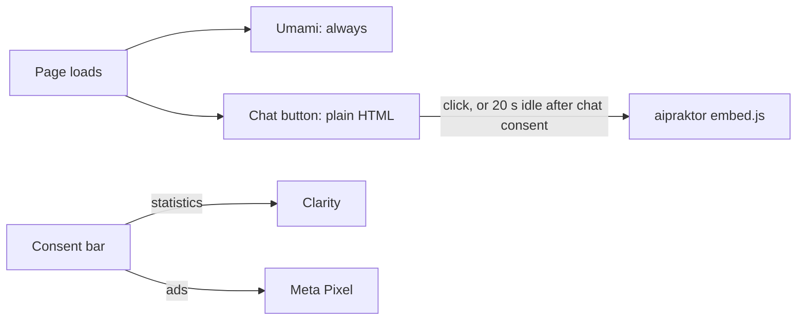
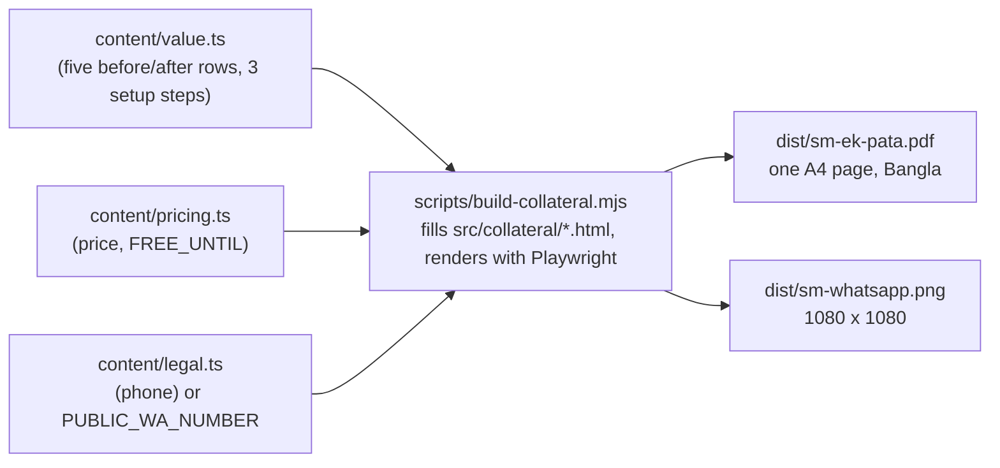

# 29 — Landing site (`landing/`)

The public marketing site at `schoolmanagerp.com`. Astro 7, static, no framework JS. Epic 50 (#1650).

> Started by #2724; #2731 (50.13) completes this doc.

## Content flags

Page copy lives in `landing/src/content/*.ts` with `bn` / `en` fields (never in `i18n/*.json`, which holds shell strings only). Some of it is switched or filled in later:

| Flag / value                                                       | File                                  | Default                        | Flip when                                                                                                                                                                           |
| ------------------------------------------------------------------ | ------------------------------------- | ------------------------------ | ----------------------------------------------------------------------------------------------------------------------------------------------------------------------------------- |
| `SHOW_TESTIMONIALS`                                                | `landing/src/content/testimonials.ts` | `false`                        | three real testimonials are in `testimonials[]` (D13). While off, `/bn/testimonials/` still builds but carries `<meta name="robots" content="noindex">` and is linked from nowhere. |
| `company.*` (address, phone, email, maps URL, hours) | `landing/src/content/legal.ts`        | bracketed placeholders / empty | Epic 62 (#1783) supplies the registered company details. Used by the contact office card (D35), privacy and terms.                                                                  |

Example: with `SHOW_TESTIMONIALS = false`, `testimonialsNoindex()` returns `true` and the testimonials page emits the `noindex` meta in its static `<head>` (via the `noindex` prop on `Base.astro`). `flags.test.ts` only tests `testimonialsNoindex()` and the quote lengths, not the rendered HTML.

## Third parties

Nothing third-party loads before the visitor acts, except Umami (our own server, no cookies).

| Host                                 | What it gets                       | When it loads                                  | Consent                              |
| ------------------------------------ | ---------------------------------- | ---------------------------------------------- | ------------------------------------ |
| `stats.schoolmanagerp.com`           | page views and D22 events, no cookie | every page                                   | none needed (cookieless, first-party) |
| `www.aipraktor.com`                  | the chat text, IP                  | chat click, or 20 s idle after chat consent    | opening the chat counts (D15)        |
| `www.clarity.ms` (+ `*.clarity.ms`)  | session recording, IP              | after "statistics" is allowed                  | statistics                           |
| `connect.facebook.net`, `www.facebook.com` | ad pixel events, IP          | after "ads" is allowed                         | ads                                  |
| `wa.me`                              | nothing until the link is clicked  | link click only                                | none (user navigates)                |

If chat does not become ready within 5 s, or the script fails, the chat button opens WhatsApp instead (D27).

### Hosts nginx needs in the CSP (#2730)

CSP comes from nginx, not a `<meta>` tag.

- `script-src`: `'self'` `https://stats.schoolmanagerp.com` `https://www.aipraktor.com` `https://www.clarity.ms` `https://connect.facebook.net` (plus `'unsafe-inline'` or hashes for the inline theme/consent/analytics snippets)
- `connect-src`: `'self'` `https://stats.schoolmanagerp.com` `https://www.aipraktor.com` `https://*.clarity.ms` `https://www.facebook.com`
- `img-src`: `'self'` `data:` `https://www.facebook.com` `https://*.clarity.ms`
- `frame-src`: `https://www.aipraktor.com`

Build ids are `PUBLIC_*` variables, see `landing/.env.example`.

## Events (D22)

`demo_click{role}`, `register_click`, `whatsapp_click`, `pricing_slider`, `chat_open`, `lang_switch{slug=target lang}`, `theme_toggle`. Elements carry `data-ev="<name>"`; `landing/src/scripts/events.ts` forwards them to Umami.

## Collateral

Two offline files are built from the same content files as the home page, so the sales message cannot drift from the site (D44).

- **Where the numbers come from:** headline date from `FREE_UNTIL`, `৳১০` from `PRICE_PER_SEAT_PAISA`, `৳৫,০০০` from `total(500, 1)`. Change those files, not the templates.
- **Regenerate:** `yarn workspace @biddaloy/landing build` (runs after `astro build`), or only the collateral: `node landing/scripts/build-collateral.mjs`. Needs Node 24 and a Playwright Chromium (`npx playwright install chromium`).
- **The build fails** if the PDF is not exactly one page or is over 300 KB. `landing/src/collateral/collateral.test.ts` runs the script and checks the same, plus the PNG is 1080 x 1080.
- **Links:** `/sm-ek-pata.pdf` from the home page final call-to-action and the footer ("কমিটির জন্য ১ পাতা"), both `data-ev="pdf_download"`.
- The QR code points to `https://schoolmanagerp.com`; the phone number is a placeholder until D7 (set `PUBLIC_WA_NUMBER` to override).
