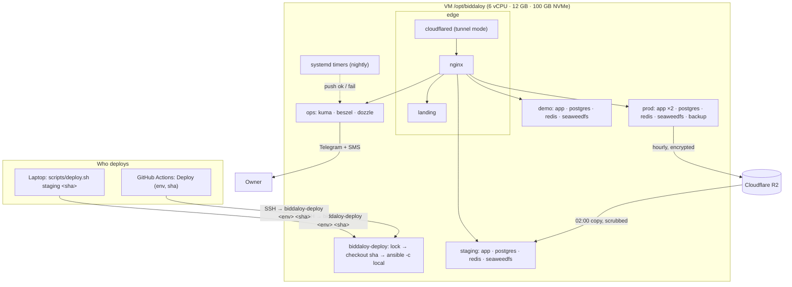
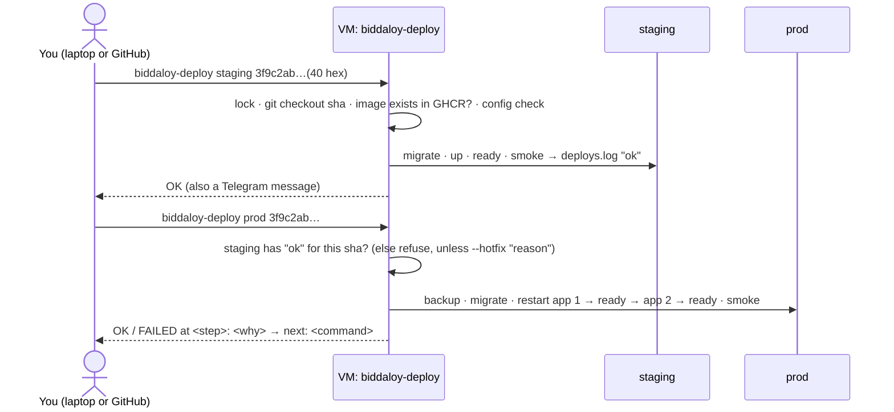
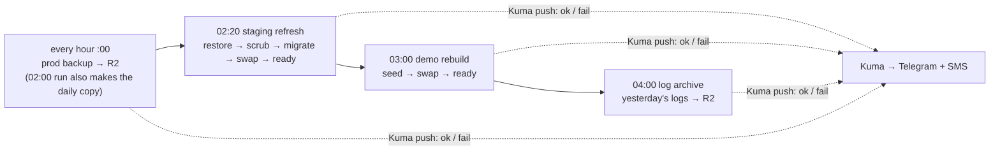
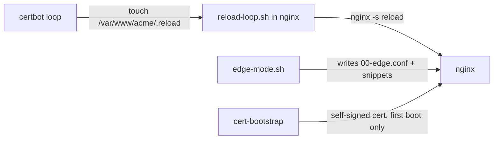

# 30. Deployment target: one VM, every environment (Epic 79.0, [#2786](https://github.com/tareq89/biddaloy/issues/2786))

> **Status: decided 2026-10-22, not built yet.** This page records the
> deployment we agreed to build, why, and what we deliberately left for later.
> Until Epic 79.0 lands, [07-deployment.md](07-deployment.md) and
> [28-platform-runbook.md](28-platform-runbook.md) still describe what runs
> today. When the epic is done, those pages are rewritten from this one and
> this page keeps only the decisions and the future-work list.

## In one picture

One VM runs five things. Prod, staging and demo are each a complete,
self-sufficient copy of the stack with their own database, Redis and file
store. Only nginx can reach all of them.



| Hostname | What | Data | Every night |
|---|---|---|---|
| `schoolmanagerp.com` (`www.` redirects) | landing (static) | none | — |
| `app.schoolmanagerp.com` | prod | real schools | backed up every hour |
| `staging.schoolmanagerp.com` | staging | yesterday's prod, scrubbed | replaced from the 02:00 backup |
| `demo.schoolmanagerp.com` | demo | demo seed | rebuilt from scripts |
| `kuma.` / `beszel.` / `logs.` | ops (uptime, host metrics, log viewer) | ops only | — |

## What was wrong with the old setup (found 2026-10-22)

These are the reasons the setup was rebuilt rather than patched.

| Finding | Where | Effect |
|---|---|---|
| Production requires `DB_SSL=true`, but the bundled Postgres has no TLS | `server/src/db-ssl.ts:26` | prod would not boot |
| `DEMO_MODE=true` refuses to boot on real school data | `server/src/modules/demo/demo-boot-check.ts:37` | staging could never run a prod copy |
| Demo's Docker socket proxy can stop any container on the host | `docker-compose.demo.yml:121` | unsafe once demo shares a VM with prod |
| Staging joins prod's nginx through a hand-attached network | `infra/ansible/tasks/attach-edge.yml` | three overlays, hardcoded container names |
| Kuma and Beszel do not work under `/kuma/`, `/beszel/` paths | `nginx/templates/ops.conf.template:10` | ops UI unreachable (#2747) |
| The frontend bakes Turnstile key, support URL and Sentry DSN at build time | `Dockerfile:41`, `client-admin/src/main.tsx:113` | one image cannot serve three envs |
| No command restores a backup onto a fresh VM | `docs/architecture/29-epic61-go-live.md` | moving VM is a manual tunnel dance (#2748) |

## How a deploy works

You pick a commit SHA. It goes to staging first, then the **same image**
goes to prod. Laptop and GitHub run the exact same command on the VM.



Command shape (D21):

```bash
# from the laptop (a thin ssh wrapper)
scripts/deploy.sh staging 3f9c2ab4e1d07a5b6c8f9e0d1a2b3c4d5e6f7a8b
scripts/deploy.sh prod    3f9c2ab4e1d07a5b6c8f9e0d1a2b3c4d5e6f7a8b
scripts/deploy.sh prod    <sha> --hotfix "login broken for all schools"

# on the VM (what the wrapper and GitHub actually run)
biddaloy-deploy <prod|staging|demo|edge|ops|all> <sha> [--hotfix "reason"] [--skip-backup]
```

Every failure prints the same three lines, so the message alone is enough
to start debugging:

```text
FAILED at: migrate (prod, 3f9c2ab)
Why:       migration 1797… failed: relation "fee_items" does not exist
Next:      biddaloy-doctor prod   ·   logs: docker compose -p prod logs app
```

## Every night (Asia/Dhaka)



- Backups keep the last **100 hourly** and **30 daily** copies (D2).
- The staging refresh is also the **restore drill**: if it works, last
  night's backup is proven restorable (D5).
- Staging is **scrubbed** before the app sees it: contacts, names,
  addresses, notes, school provider keys, tokens, and every password set to
  `STAGING_PASSWORD`. It can never send a real SMS or email (D6).
- Uploaded files are not copied to staging. Missing images there are expected.

## Edge: two modes, same nginx

The edge can run in two modes. Both are built and tested (D8), so moving to
a BDIX host without Cloudflare is a config switch, not new work.

| | Tunnel mode (now) | Direct mode (BDIX later) |
|---|---|---|
| Public web ports | none; `cloudflared` dials out | 80 and 443 |
| TLS | Cloudflare edge | Let's Encrypt HTTP-01, auto-renew |
| Client IP | `CF-Connecting-IP` from cloudflared | the TCP peer |
| Staging/ops outer login | Cloudflare Access, checked by cloudflared | nginx basic auth |
| Inner login | each tool's own (Kuma, Beszel, Dozzle, app) | same |
| Moving VM | DNS does not change | update DNS A records |

## Secrets and accounts

Secrets stay in git, encrypted with sops + age (chosen over Infisical and
Bitwarden: no outside service). Each file is encrypted for three keys: yours, the offline recovery key, and
the VM's own host key.

| File | Holds |
|---|---|
| `infra/secrets/prod.enc.env` | prod app, DB, R2 backup write token, SMS, OAuth, Turnstile, Sentry |
| `infra/secrets/staging.enc.env` | staging app, `STAGING_PASSWORD`, R2 **read-only** token |
| `infra/secrets/demo.enc.env` | demo app, `DEMO_PASSWORD` |
| `infra/secrets/edge.enc.env` | tunnel credentials, GHCR pull token, basic-auth users (direct mode) |
| `infra/secrets/ops.enc.env` | Beszel key, Dozzle users, Telegram bot |

GitHub holds only what it needs to SSH in: the host, a pinned host key and a
deploy key that can run nothing but `biddaloy-deploy` (D12).

## Decisions

Full text lives in the Epic 79.0 issue ([#2786](https://github.com/tareq89/biddaloy/issues/2786)), with the owner's pre-grill choices P1–P16 and the widen items W1–W7. One line each:

| # | Decision | Chosen over |
|---|---|---|
| D1 | Deploy runs on the VM; laptop and GitHub only SSH in | Ansible on the laptop or runner (age key in GitHub) |
| D2 | Keep 100 hourly + 30 daily backups | 100 hourly only (≈ 4 days) |
| D3 | Per-env self-signed Postgres TLS, `DB_SSL=true` | a code exemption for private networks |
| D4 | Job results go to Kuma push monitors | healthchecks.io (Kuma will move to its own VM) |
| D5 | Nightly staging restore replaces the weekly drill | keeping both |
| D6 | Full staging scrub | contacts and secrets only |
| D7 | Logs archived to R2 for 180 days | other retention |
| D8 | Tunnel and direct edge modes both built now | seam only |
| D9 | Dozzle kept at `logs.` | dropping it |
| D10 | Prod refuses a SHA staging has not passed; `--hotfix` overrides and is logged | no override |
| D11 | Nightly jobs run from host systemd timers; no Docker socket proxy | cron inside containers |
| D12 | GitHub's SSH key is a forced command | a full shell |
| D13 | Memory and CPU limits per env | none |
| D14 | Two auth layers on staging/ops; Kuma `/api/push/*` bypasses the outer one | one layer |
| D15 | New Epic 79.0; Epic 61 leftovers closed as superseded | rewriting #1766 |
| D16 | Production compose moves to `deploy/`; root compose is dev-only | one file for both |
| D17 | Tunnel config in git, credentials in sops | dashboard-managed token |
| D18 | Direct-mode certs via Let's Encrypt HTTP-01 | DNS-01 |
| D19 | Staging waits until 02:50 for the daily copy, reads R2 read-only | — |
| D20 | A "Smoke Test School" in prod lets staging run the full smoke | health-only staging smoke |
| D21 | `biddaloy-deploy <env> <sha>` CLI, `all` for a fresh VM | — |
| D22 | Hostnames as in the table above | — |
| D23 | Starting memory limits; tune from Beszel | — |
| D24 | Staging refresh and log archive extend the backup image; one shared DB-swap script | new images |
| D25 | Prod runs 2 app containers, restarted one at a time | load balancer + several VMs |
| D26 | This page holds the summary, decisions and future work | chat only |

## How this compares with established companies

**Matches standard practice:** build once and promote the same image ·
staging gate before prod · infrastructure as code · secrets encrypted in git
· off-site encrypted backups restored every night · scrubbed prod copy in
staging · no public web ports · forward-only migrations · errors that name
the next command.

**Deliberately smaller than a large company:**

| Area | Large company | Here, and why |
|---|---|---|
| Hosts | prod on its own machines | prod, staging, demo on one VM; cost; isolated networks + limits |
| Redundancy | several app servers behind a load balancer | one VM, two app containers; the DB is the real single point |
| Database | managed Postgres, point-in-time recovery | Postgres in a container, hourly dumps (≤ 1 h data loss) |
| Monitoring | off-box | same VM until ops moves |
| Deploy source | CI only | laptop or CI; `deploys.log` + Telegram keep the record |
| Orchestration | Kubernetes / GitOps | Ansible + Compose; right for one or two VMs |

## Future work, with the trigger that brings each back

| Work | Trigger | First step |
|---|---|---|
| Move ops (Kuma, Beszel, Dozzle) to its own VM | as soon as budget allows; until then **a dead VM pages nobody** (#2749) | point the inventory `ops` group at the new host, run `biddaloy-deploy ops` |
| Move staging and demo off the prod VM | first paying schools | change their inventory host |
| Managed or replicated Postgres, WAL backups (pgBackRest) | DB > ~5 GB, or 1 h data loss no longer acceptable | — |
| Load balancer + second app VM | a written uptime SLA, or one VM no longer fits | only after the database is HA |
| R2 Bucket Lock | when retention moves to lifecycle rules | lock must be shorter than the pruning window |
| Cloudflare as code (Terraform) | more hosts, or frequent DNS/Access changes | — |
| CI minutes on the private repo | the repo goes private (~54k min / 30 days vs 2k free) | separate issue (see the epic) |
| Status page (#1770), load tests (#1772), capacity plan (#1773) | before 10 schools | unchanged from Epic 61 |

## Learnings

Wave 1 (2026-10-22): runtime config, alert probe, compose stacks, nginx edge modes, backup and demo reset. Each lane was built alone, so the wiring between them was only checked in the closing sub-wave.



### What surprised us

| Surprise | Cost | Fix / rule |
|---|---|---|
| Lanes disagreed on the edge wiring: `edge.yml` still mounted the removed `trusted-proxies.sh`, and certbot touched `/var/www/acme/.reload` while `reload-loop.sh` watched `/etc/letsencrypt/.reload`. | nginx would not have booted; renewals would only load after the 6 h fallback. | Closing sub-wave rewired it: `edge.yml` mounts `edge-mode.sh` and sets `RELOAD_FLAG`. Rule: a file mounted by one lane and written by another needs one owner and one path. |
| ACME HTTP-01 got `401` on basic-auth hosts. | A renewal for `staging` / `ops` would fail. | `location ^~ /.well-known/acme-challenge/ { auth_basic off; }` in every direct-mode server (`edge-mode.sh`). |
| Kuma push monitors live under the same host as the basic-auth UI. | Probes would be asked to log in. | Match the push path exactly (percent-decoded, normalised) and skip auth only there. nginx matches the decoded path but forwards the raw one, so check both. |
| `X-Forwarded-Proto` in tunnel mode: cloudflared talks plain HTTP, so the app saw `http`. | `SameOriginGuard` rejected valid requests. | Tunnel mode forces `$edge_proto` to `https`. |
| `proxy_connect_timeout` too long on a down upstream. | A dead staging or app2 hung requests instead of failing fast. | Short connect timeout; upstreams use `resolve` so nginx boots with a container missing. |
| `reset.sh` exit codes. | The caller could not tell "swapped, some steps failed" from "nothing moved". | Contract: **0 or 3 means the swap happened, restart the app**; 1 failed and rolled back; 2 refused. Only 0 and 3 restart. |

### Decisions taken in the lanes (recommended option each time)

- Direct mode first certificate: a one-shot `cert-bootstrap` makes a 30-day self-signed cert, so nginx can serve the ACME challenge. Option rejected: a manual `certbot standalone` run before `up` (a step a human forgets).
- `EDGE_TRUSTED_CIDR` is required in tunnel mode; `edge-mode.sh` stops nginx when it is empty. `biddaloy-edge` is `external: true` here, so the deploy that creates it (W3.01) must pin the subnet (`docker network create --subnet 172.30.0.0/24 biddaloy-edge`) and set the variable to it. Options rejected: `ipam` in `edge.yml` (cannot pin an external network); detecting the subnet at boot (`cloudflared` starts after nginx is healthy, so the lookup always fell back to `eth0`, which could be the ops network: every visitor would then share one address and one login throttle, Rule 11).
- `demo-reset` is `restart: 'no'` and has no Docker socket proxy; it is a run-once job.
- Ops-less hosts drop `conf.d/ops.conf` when `OPS_UPSTREAM_HOST` is empty.

### Open follow-ups

- Sentry `release` was served but not sent. Fixed here (`initSentry` takes `release`, `client-admin/src/main.tsx` passes it).
- Not run in this sub-wave (no Docker allowed): `docker/test/compose.infra.test.sh`, `nginx/test/*.infra.test.sh`, `scripts/backup/*.test.sh`, `scripts/demo/reset.infra.test.sh`. Run them at integration (`yarn ci:local` on Node 24). `cert-bootstrap` needs the `openssl` binary in the certbot image: unverified.
- Old docs and Ansible still mention `TRUSTED_PROXY_CIDRS`, `trusted-proxies.sh`, `demo-docker-proxy`, `nginx/demo` (`docs/architecture/07-deployment.md`, `12-operations.md`, `22-demo-seed.md`, `infra/ansible/deploy.yml`). They go away in the later waves that replace that setup.
- Issue #2792 steps 1 to 4 (`ci:local`, snapshots, `api:types`) are for the integration run.
