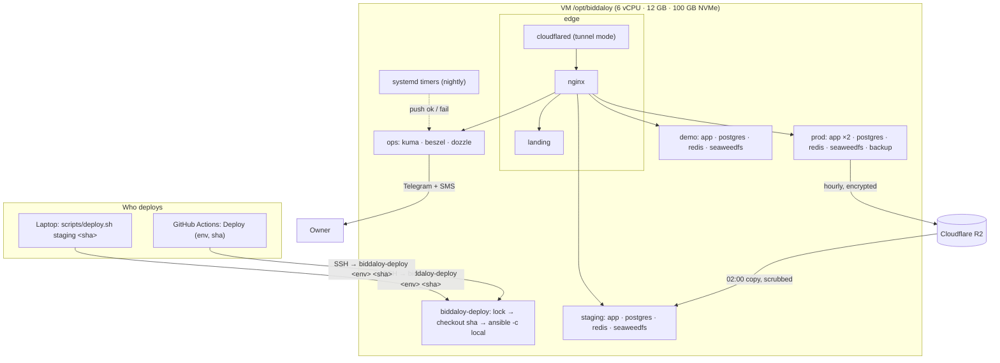
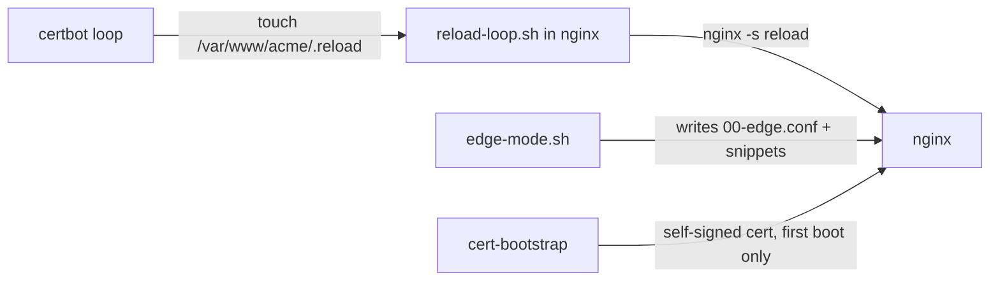
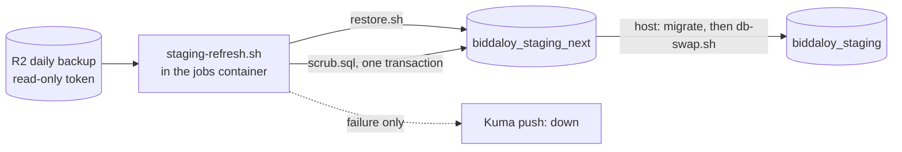
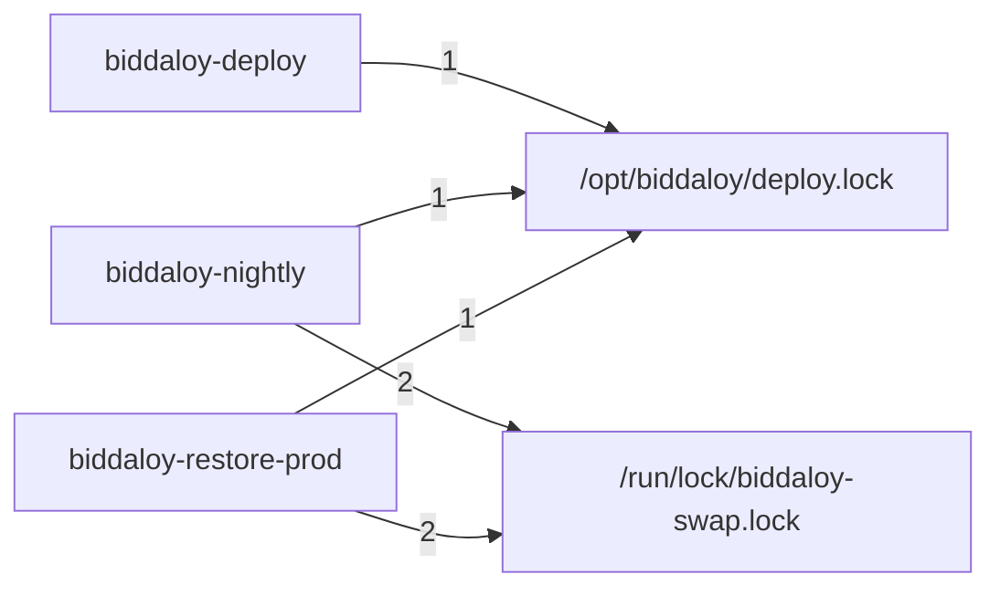
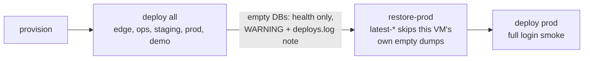

# 30. Deployment target: one VM, every environment (Epic 79.0, [#2786](https://github.com/tareq89/biddaloy/issues/2786))

> **Status: built (Epic 79.0, 2026-10-22).** This page keeps the decisions,
> the comparison with larger companies, the future-work triggers and the
> learnings of each wave. How it is operated lives elsewhere:
>
> | Question                                                          | Page                                             |
> | ----------------------------------------------------------------- | ------------------------------------------------ |
> | How is it shaped (networks, images, edge modes, deploy sequence)? | [07-deployment.md](07-deployment.md)             |
> | What do I do at 2 a.m. (monitors, alerts, runbooks)?              | [12-operations.md](12-operations.md)             |
> | How do backups, the nightly staging copy and restore work?        | [13-backup-restore.md](13-backup-restore.md)     |
> | Which Cloudflare settings does it rely on?                        | [25-cloudflare.md](25-cloudflare.md)             |
> | Which commands do I type (day 0, deploy, rollback)?               | [28-platform-runbook.md](28-platform-runbook.md) |

## In one picture

One VM runs five things. Prod, staging and demo are each a complete,
self-sufficient copy of the stack with their own database, Redis and file
store. Only nginx can reach all of them.

| Hostname                                | What                                   | Data                       | Every night                    |
| --------------------------------------- | -------------------------------------- | -------------------------- | ------------------------------ |
| `schoolmanagerp.com` (`www.` redirects) | landing (static)                       | none                       | —                              |
| `app.schoolmanagerp.com`                | prod                                   | real schools               | backed up every hour           |
| `staging.schoolmanagerp.com`            | staging                                | yesterday's prod, scrubbed | replaced from the 02:00 backup |
| `demo.schoolmanagerp.com`               | demo                                   | demo seed                  | rebuilt from scripts           |
| `kuma.` / `beszel.` / `logs.`           | ops (uptime, host metrics, log viewer) | ops only                   | —                              |

## Edge: two modes, same nginx

The edge can run in two modes. Both are built and tested locally (D8), so moving to
a BDIX host without Cloudflare is a config switch, not new code. Direct mode
has **not** run on a real host: Let's Encrypt issuance, and the `openssl`
binary that `cert-bootstrap` needs in the certbot image, are unverified (see
the real-VM checklist below). The design
(files, networks, what each mode turns on) is in
[07-deployment.md](07-deployment.md#the-two-edge-modes).

|                         | Tunnel mode (now)                           | Direct mode (BDIX later)          |
| ----------------------- | ------------------------------------------- | --------------------------------- |
| Public web ports        | none; `cloudflared` dials out               | 80 and 443                        |
| TLS                     | Cloudflare edge                             | Let's Encrypt HTTP-01, auto-renew |
| Client IP               | `CF-Connecting-IP` from cloudflared         | the TCP peer                      |
| Staging/ops outer login | Cloudflare Access, checked by cloudflared   | nginx basic auth                  |
| Inner login             | each tool's own (Kuma, Beszel, Dozzle, app) | same                              |
| Moving VM               | DNS does not change                         | update DNS A records              |

## Where the details moved

| Was here                                                    | Now in                                                          |
| ----------------------------------------------------------- | --------------------------------------------------------------- |
| How a deploy works (sequence, command shape, failure lines) | [07-deployment.md](07-deployment.md#how-a-deploy-runs)          |
| The nightly timeline                                        | [12-operations.md](12-operations.md#the-nightly-timeline)       |
| Backups, staging refresh, scrub, restore                    | [13-backup-restore.md](13-backup-restore.md)                    |
| Secrets files and who reads them                            | [07-deployment.md](07-deployment.md#runtime-config-and-secrets) |

## Decisions

Full text lives in the Epic 79.0 issue ([#2786](https://github.com/tareq89/biddaloy/issues/2786)), with the owner's pre-grill choices P1–P16 and the widen items W1–W7. One line each:

| #   | Decision                                                                           | Chosen over                                         |
| --- | ---------------------------------------------------------------------------------- | --------------------------------------------------- |
| D1  | Deploy runs on the VM; laptop and GitHub only SSH in                               | Ansible on the laptop or runner (age key in GitHub) |
| D2  | Keep 100 hourly + 30 daily backups                                                 | 100 hourly only (≈ 4 days)                          |
| D3  | Per-env self-signed Postgres TLS, `DB_SSL=true`                                    | a code exemption for private networks               |
| D4  | Job results go to Kuma push monitors                                               | healthchecks.io (Kuma will move to its own VM)      |
| D5  | Nightly staging restore replaces the weekly drill                                  | keeping both                                        |
| D6  | Full staging scrub                                                                 | contacts and secrets only                           |
| D7  | Logs archived to R2 for 180 days                                                   | other retention                                     |
| D8  | Tunnel and direct edge modes both built now                                        | seam only                                           |
| D9  | Dozzle kept at `logs.`                                                             | dropping it                                         |
| D10 | Prod refuses a SHA staging has not passed; `--hotfix` overrides and is logged      | no override                                         |
| D11 | Nightly jobs run from host systemd timers; no Docker socket proxy                  | cron inside containers                              |
| D12 | GitHub's SSH key is a forced command                                               | a full shell                                        |
| D13 | Memory and CPU limits per env                                                      | none                                                |
| D14 | Two auth layers on staging/ops; Kuma `/api/push/*` bypasses the outer one          | one layer                                           |
| D15 | New Epic 79.0; Epic 61 leftovers closed as superseded                              | rewriting #1766                                     |
| D16 | Production compose moves to `deploy/`; root compose is dev-only                    | one file for both                                   |
| D17 | Tunnel config in git, credentials in sops                                          | dashboard-managed token                             |
| D18 | Direct-mode certs via Let's Encrypt HTTP-01                                        | DNS-01                                              |
| D19 | Staging waits until 02:50 for the daily copy, reads R2 read-only                   | —                                                   |
| D20 | A "Smoke Test School" in prod lets staging run the full smoke                      | health-only staging smoke                           |
| D21 | `biddaloy-deploy <env> <sha>` CLI, `all` for a fresh VM                            | —                                                   |
| D22 | Hostnames as in the table above                                                    | —                                                   |
| D23 | Starting memory limits; tune from Beszel                                           | —                                                   |
| D24 | Staging refresh and log archive extend the backup image; one shared DB-swap script | new images                                          |
| D25 | Prod runs 2 app containers, restarted one at a time                                | load balancer + several VMs                         |
| D26 | This page holds the summary, decisions and future work                             | chat only                                           |

## How this compares with established companies

**Matches standard practice:** build once and promote the same image ·
staging gate before prod · infrastructure as code · secrets encrypted in git
· off-site encrypted backups restored every night · scrubbed prod copy in
staging · no public web ports · forward-only migrations · errors that name
the next command.

**Deliberately smaller than a large company:**

| Area          | Large company                              | Here, and why                                                   |
| ------------- | ------------------------------------------ | --------------------------------------------------------------- |
| Hosts         | prod on its own machines                   | prod, staging, demo on one VM; cost; isolated networks + limits |
| Redundancy    | several app servers behind a load balancer | one VM, two app containers; the DB is the real single point     |
| Database      | managed Postgres, point-in-time recovery   | Postgres in a container, hourly dumps (≤ 1 h data loss)         |
| Monitoring    | off-box                                    | same VM until ops moves                                         |
| Deploy source | CI only                                    | laptop or CI; `deploys.log` + Telegram keep the record          |
| Orchestration | Kubernetes / GitOps                        | Ansible + Compose; right for one or two VMs                     |

## Future work, with the trigger that brings each back

Tracked as issues: load balancer #2816, staging/demo off the VM #2817, managed Postgres/PITR #2818, ops on its own VM #2819, R2 Bucket Lock #2820, Cloudflare as code #2821, CI minutes #2808. Also open: first platform super admin command #2822, W3 review leftovers #2823.

| Work                                                           | Trigger                                                                 | First step                                                                 |
| -------------------------------------------------------------- | ----------------------------------------------------------------------- | -------------------------------------------------------------------------- |
| Move ops (Kuma, Beszel, Dozzle) to its own VM                  | as soon as budget allows; until then **a dead VM pages nobody** (#2749) | point the inventory `ops` group at the new host, run `biddaloy-deploy ops` |
| Move staging and demo off the prod VM                          | first paying schools                                                    | change their inventory host                                                |
| Managed or replicated Postgres, WAL backups (pgBackRest)       | DB > ~5 GB, or 1 h data loss no longer acceptable                       | —                                                                          |
| Load balancer + second app VM                                  | a written uptime SLA, or one VM no longer fits                          | only after the database is HA                                              |
| R2 Bucket Lock                                                 | when retention moves to lifecycle rules                                 | lock must be shorter than the pruning window                               |
| Cloudflare as code (Terraform)                                 | more hosts, or frequent DNS/Access changes                              | —                                                                          |
| CI minutes on the private repo                                 | the repo goes private (~54k min / 30 days vs 2k free)                   | separate issue (see the epic)                                              |
| Status page (#1770), load tests (#1772), capacity plan (#1773) | before 10 schools                                                       | unchanged from Epic 61                                                     |

## Learnings

Wave 1 (2026-10-22): runtime config, alert probe, compose stacks, nginx edge modes, backup and demo reset. Each lane was built alone, so the wiring between them was only checked in the closing sub-wave.

### What surprised us

| Surprise                                                                                                                                                                                              | Cost                                                                          | Fix / rule                                                                                                                                                                  |
| ----------------------------------------------------------------------------------------------------------------------------------------------------------------------------------------------------- | ----------------------------------------------------------------------------- | --------------------------------------------------------------------------------------------------------------------------------------------------------------------------- |
| Lanes disagreed on the edge wiring: `edge.yml` still mounted the removed `trusted-proxies.sh`, and certbot touched `/var/www/acme/.reload` while `reload-loop.sh` watched `/etc/letsencrypt/.reload`. | nginx would not have booted; renewals would only load after the 6 h fallback. | Closing sub-wave rewired it: `edge.yml` mounts `edge-mode.sh` and sets `RELOAD_FLAG`. Rule: a file mounted by one lane and written by another needs one owner and one path. |
| ACME HTTP-01 got `401` on basic-auth hosts.                                                                                                                                                           | A renewal for `staging` / `ops` would fail.                                   | `location ^~ /.well-known/acme-challenge/ { auth_basic off; }` in every direct-mode server (`edge-mode.sh`).                                                                |
| Kuma push monitors live under the same host as the basic-auth UI.                                                                                                                                     | Probes would be asked to log in.                                              | Match the push path exactly (percent-decoded, normalised) and skip auth only there. nginx matches the decoded path but forwards the raw one, so check both.                 |
| `X-Forwarded-Proto` in tunnel mode: cloudflared talks plain HTTP, so the app saw `http`.                                                                                                              | `SameOriginGuard` rejected valid requests.                                    | Tunnel mode forces `$edge_proto` to `https`.                                                                                                                                |
| `proxy_connect_timeout` too long on a down upstream.                                                                                                                                                  | A dead staging or app2 hung requests instead of failing fast.                 | Short connect timeout; upstreams use `resolve` so nginx boots with a container missing.                                                                                     |
| `reset.sh` exit codes.                                                                                                                                                                                | The caller could not tell "swapped, some steps failed" from "nothing moved".  | Contract: **0 or 3 means the swap happened, restart the app**; 1 failed and rolled back; 2 refused. Only 0 and 3 restart.                                                   |

### Decisions taken in the lanes (recommended option each time)

- Direct mode first certificate: a one-shot `cert-bootstrap` makes a 30-day self-signed cert, so nginx can serve the ACME challenge. Option rejected: a manual `certbot standalone` run before `up` (a step a human forgets).
- `EDGE_TRUSTED_CIDR` is required in tunnel mode; `edge-mode.sh` stops nginx when it is empty. `biddaloy-edge` is `external: true` here, so the deploy that creates it (W3.01) must pin the subnet (`docker network create --subnet 172.30.0.0/24 biddaloy-edge`) and set the variable to it. Options rejected: `ipam` in `edge.yml` (cannot pin an external network); detecting the subnet at boot (`cloudflared` starts after nginx is healthy, so the lookup always fell back to `eth0`, which could be the ops network: every visitor would then share one address and one login throttle, Rule 11).
- `demo-reset` is `restart: 'no'` and has no Docker socket proxy; it is a run-once job.
- Ops-less hosts drop `conf.d/ops.conf` when `OPS_UPSTREAM_HOST` is empty.

### Open follow-ups

- Sentry `release` was served but not sent. Fixed here (`initSentry` takes `release`, `client-admin/src/main.tsx` passes it).
- Not run in this sub-wave (no Docker allowed): `docker/test/compose.infra.test.sh`, `nginx/test/*.infra.test.sh`, `scripts/backup/*.test.sh`, `scripts/demo/reset.infra.test.sh`. Run them at integration (`yarn ci:local` on Node 24). `cert-bootstrap` needs the `openssl` binary in the certbot image: unverified.
- Stale pages that still described the removed per-host proxy list, the demo Docker proxy and the old nginx demo folder were rewritten in W4 (see the W4 section).
- Issue #2792 steps 1 to 4 (`ci:local`, snapshots, `api:types`) are for the integration run.

### Wave 2 (2026-10-22): staging scrub, staging refresh, DB swap, Ansible

W2 added the nightly staging copy: prod backup in, scrub, `_next` database, swap. Four lanes built the pieces alone; the closing sub-wave checked the wiring between them.

#### What the reviews caught that mattered

| Finding                                                                                                                                           | Why it mattered                                                                                       | Rule that came out of it                                                                                                                            |
| ------------------------------------------------------------------------------------------------------------------------------------------------- | ----------------------------------------------------------------------------------------------------- | --------------------------------------------------------------------------------------------------------------------------------------------------- |
| The forced-command key line was built by joining parts with a newline.                                                                            | One key could have carried a second `authorized_keys` line: a shell instead of the one command.       | Build the line from one validated string, reject `\n` and `\r` in every part.                                                                       |
| `scrub.sql` passed on the fixture but real data broke a CHECK or a write-block trigger (override note, withdraw reason, frozen invoice snapshot). | The refresh would have failed every night on real rows.                                               | A scrubbed value must satisfy the column's CHECK (`'[scrubbed]'`, not empty). Append-only triggers are lifted inside the scrub transaction only.    |
| Fake values were not unique (`user-1@...` style).                                                                                                 | A UNIQUE index on email, phone or token hash would abort the whole transaction.                       | Fakes carry the whole row id (emails) or a per-table running number (phones).                                                                       |
| `config-check` still required variables of a compose file that was deleted.                                                                       | `--env staging` would fail on a variable nothing reads.                                               | `COMMON_REQUIRED` is pinned to the `:?` list of `deploy/stack.yml` by a spec. Change both together.                                                 |
| Dependabot did not scan the stack images (#2811).                                                                                                 | Image digests would never get update PRs.                                                             | Rename stack files to a name Dependabot reads (open).                                                                                               |
| The `jobs` service never passed `STAGING_PASSWORD_HASH`, `SMOKE_SCHOOL_SLUG`, `PLATFORM_TENANT_ID`, `POSTGRES_*`, `STAGING_REFRESH_*`.            | Found only here: each lane tested its own half. `staging-refresh.sh` would exit 2 on its first guard. | Fixed in `deploy/stack.yml`; the new names are in the staging example env. `check-tracked-files.mjs` (drift guard) caught the missing example keys. |

#### Decisions taken in the lanes (recommended option each time)

- The staging password is one bcrypt cost-12 hash, made by the caller with the app's `hashPassword` (Rule 9). The script never hashes. Option rejected: `crypt()` in SQL (a second hash cost and format).
- PR #2813 review: the hash is carried base64-encoded (`STAGING_PASSWORD_HASH_B64`), because compose expands every `$` in a `.env` value. Option rejected: single quotes around the raw hash (every tool that writes or reads the file, sops and `config:check` included, would have to keep them). `config:check --env staging` decodes it and runs `verifyPassword(STAGING_PASSWORD, hash)`, so the two cannot drift.
- Contacts and free text are scrubbed; **dates of birth are shifted, not removed**, and **religion and blood group are kept**: the app needs them to behave like prod, and alone they do not identify a person. Revisit if the data-protection review says otherwise.
- The refresh stops at a ready `_next` database. Migrations and the swap run on the host with the staging app image (W3.04), so the backup image never needs app code.
- The lock is the host's: `biddaloy-nightly@.service` runs each job under `flock` on `/run/lock/biddaloy-swap.lock`. PR #2813 review: the script's own lock is now off unless `STAGING_REFRESH_LOCK` names a file (the old default under `/run/lock` was not writable by uid 10001, and a bind mount of the host file would wait on the host's own lock). `db-swap.sh` locks `/tmp/db-swap-<live>.lock`, container-local.

#### Open follow-ups

- #2811: Dependabot filename for the stack files.
- #2812: edge HSTS owner and the narrower cloudflared push bypass.
- Ansible `venv_constraints` pins: installed clean with `ansible-core==2.18.6` on a scratch venv (Python 3.15, macOS). Not yet tried on the VM's own Python; a wheel missing for it is the likely failure.
- The deploy (W3) takes the same host lock before a swap.

#### Never run yet (no Docker in the closing sub-wave)

Run these once at integration (`yarn ci:local`, Node 24, Docker allowed):

- `nginx/test/*.infra.test.sh`
- `scripts/backup/db-swap.infra.test.sh`
- `scripts/demo/reset.infra.test.sh`
- `scripts/backup/staging-refresh.infra.test.sh`
- the tail of `docker/test/compose.infra.test.sh`

Done instead, without a daemon: `docker compose config` on prod (profiles `replica,backup`), staging, demo, edge tunnel, edge direct and ops with filled copies of the example envs (all parse); `ansible-playbook --syntax-check` on `provision.yml` and `deploy.yml` (prod and staging); the config-check, env.validation, runtime-config and security-headers specs; `check-tracked-files`; `staging-scrub.integration.spec.ts` (5 passed).

### Wave 3 (2026-10-22): deploy CLI, deploy playbook, nightly jobs, doctor, restore-prod

W3 made the VM run itself: `biddaloy-deploy` (one command for laptop and GitHub), `deploy.yml` (one playbook, five stacks), `biddaloy-nightly` (systemd timers), `biddaloy-doctor` and `biddaloy-restore-prod`. Five lanes built them alone; the closing ticket (#2803) wired them together. Who holds which lock:

Everyone takes `deploy.lock` first, then the swap lock. Same order everywhere, so two jobs can wait for each other but never deadlock.

#### What surprised us

| Surprise                                                                                                                                                                                                                              | Cost                                                                                                     | Fix / rule                                                                                                                                                                                                                                                                                                                                                                                                    |
| ------------------------------------------------------------------------------------------------------------------------------------------------------------------------------------------------------------------------------------- | -------------------------------------------------------------------------------------------------------- | ------------------------------------------------------------------------------------------------------------------------------------------------------------------------------------------------------------------------------------------------------------------------------------------------------------------------------------------------------------------------------------------------------------- |
| Compose resolves relative bind mounts against `--project-directory` (`/opt/biddaloy/edge`), not the folder of the compose file (`/opt/biddaloy/repo/deploy`).                                                                         | Edge nginx would have mounted empty paths for its templates and scripts.                                 | `edge.yml` mounts `${REPO_DIR}/nginx/...`; `write-env.yml` sets `REPO_DIR` (fix round 1 moved it to a per-deploy copy, below). Rule: with `--project-directory`, every relative path in a compose file needs a variable.                                                                                                                                                                                      |
| `COMPOSE_PROFILES` in a `.env` (prod: `replica,backup`) turns on every service in those profiles for a bare `docker compose up`.                                                                                                      | A deploy could start one-off job containers as if they were services.                                    | Every app-stack `up` (and the rollback `up`) names its services.                                                                                                                                                                                                                                                                                                                                              |
| Ansible templates `-e` extra vars. A hotfix reason `{{ lookup('pipe', 'touch /tmp/x') }}` passed as `-e hotfix_reason=...` runs as root. Checked: the same payload through `-e` created the file; through the environment it did not. | Anyone who can start a deploy with a reason could run code as root.                                      | The reason travels as `BIDDALOY_HOTFIX_REASON`; `deploy.yml` reads it with `lookup('env')`, whose result is never templated again. `biddaloy-deploy` checks `stack` against the five names and `version` against `^[0-9a-f]{40}$`, and refuses `{ } % #` in anything it forwards. `deploy/bin/test/biddaloy-deploy.test.sh` proves both halves (the playbook half where `ansible-playbook` exists, as in CI). |
| The nightly unit ran `flock swap.lock biddaloy-nightly`, and the script then took `deploy.lock`. `biddaloy-restore-prod` takes them the other way round.                                                                              | Nightly and a restore could each hold one lock and wait forever for the other.                           | The unit runs the script bare (`ExecStart=/usr/local/bin/biddaloy-nightly %i`); the script takes both locks in order. The `BIDDALOY_SWAP_LOCK_HELD` bypass is gone. A test pins the `ExecStart` line.                                                                                                                                                                                                         |
| Postgres TLS directory permissions.                                                                                                                                                                                                   | `pg-tls/` at 0700 stops Postgres (uid 70) and the app (uid 1001) from entering it: the db does not boot. | `pg-tls/` is root 0755; only `server.key` is secret (0600, owner 70). The comment that said provision makes it 0700 was wrong and is fixed.                                                                                                                                                                                                                                                                   |
| A bcrypt hash in a `.env` (`$2b$12$...`): compose expands every `$`.                                                                                                                                                                  | The staging password hash arrived mangled.                                                               | W2: the hash is carried as `STAGING_PASSWORD_HASH_B64`; W3: `write-env.yml` single-quotes every value. The closing ticket also removed a second hash that `biddaloy-nightly` computed (`STAGING_PASSWORD_HASH`): `staging-refresh.sh` never read it.                                                                                                                                                          |
| Provision did not create `/opt/biddaloy/deploy.lock` or `/opt/biddaloy/logs/`, and `/opt/biddaloy` is root's.                                                                                                                         | The first `biddaloy-deploy` (running as `deploy`) would have stopped at "cannot open the lock file".     | Provision makes `deploy.lock` (deploy, 0664) and `logs/` (deploy, 0775), and adds `deploy` to `systemd-journal` so the 04:00 log archive can read the host journal.                                                                                                                                                                                                                                           |

#### Fix round 1 (PR #2815 review): what a fresh VM would have hit

| Surprise                                                                                                                                                                          | What it would have done                                                                                        | Fix / rule                                                                                                                                                                                                                                                                                                                     |
| --------------------------------------------------------------------------------------------------------------------------------------------------------------------------------- | -------------------------------------------------------------------------------------------------------------- | ------------------------------------------------------------------------------------------------------------------------------------------------------------------------------------------------------------------------------------------------------------------------------------------------------------------------------ |
| The login smoke needs the `SMOKE_*` users, and a fresh VM's databases have no users.                                                                                              | `deploy all` stopped at the staging smoke, so prod never came up and `restore-prod` could not run.             | `smoke.yml` counts `public.users`. Zero means a first deploy: health only, a `WARNING` line, `note: smoke-login-skipped` on the `deploys.log` line and in Telegram. An unreadable count fails the deploy. The staging `ok` line still opens the prod gate.                                                                     |
| The new VM's own prod `backup` service writes hourly dumps of its empty database to the same `db/hourly/` prefix.                                                                 | `restore-prod --from latest-hourly` could restore an empty schema.                                             | `latest-*` ignores every dump written at or after the VM's `prod_pgdata` volume was made (`docker volume inspect`). An unreadable volume time fails closed. An exact `--from` is taken as given.                                                                                                                               |
| `edge.yml` bind-mounted nginx/ from the shared checkout, which moves with every deploy of any stack.                                                                              | A failed edge deploy, or a staging deploy, decided what nginx renders at its next restart, without `nginx -t`. | The edge deploy copies `nginx/` to `edge/release.new`, runs `nginx -t` on that copy, then renames it to `edge/release` (`REPO_DIR`). The old copy becomes `release.prev`, and a rollback puts it back and recreates nginx. App stacks keep `<stack>/stack.yml` from their last ok deploy for nightly, doctor and restore-prod. |
| The demo app refuses to start before a first rebuild writes `default-school`'s id.                                                                                                | A fresh `deploy demo` stopped at the app rollout.                                                              | `deploy.yml` runs `reset.sh --now` once when the demo-state volume has no id yet.                                                                                                                                                                                                                                              |
| The prod `jobs` service mounts `BACKUP_AGE_KEY_DIR`, which only staging set.                                                                                                      | The nightly log archive could not start its container.                                                         | Prod derives `BACKUP_AGE_KEY_DIR=/opt/biddaloy/prod/restore`. Provision makes that directory empty (root 0755), and it is where `restore-prod` reads its key.                                                                                                                                                                  |
| CI is Linux. The deploy test faked a busy `flock` only where no real one exists, read the mode with BSD `stat` first, and let `ansible.cfg`'s `become` make its output root-only. | 7 red checks in the Ansible step.                                                                              | Run the shim case only without a real `flock`, call `stat -c` first, set `become: false` in the generated play. Rule: a test that shims a tool must also pass where the real tool exists.                                                                                                                                      |
| Nothing wrote `/opt/biddaloy/host-groups`, which `deploy all` reads to decide on ops.                                                                                             | `deploy all` always skipped ops.                                                                               | Provision writes the host's inventory groups there.                                                                                                                                                                                                                                                                            |

#### Decisions taken in fix round 1

- **First deploy smoke.** Options: skip the login part on an empty database; a `--no-smoke` flag; restore-prod starting `db` itself; reorder `all`. Chosen: skip on zero users, because it needs no new flag, cannot be used to skip a smoke on a database with data, and keeps the prod gate as it is.
- **Own dumps in `restore-prod`.** Options: stop `backup` before listing; skip dumps newer than the VM. Chosen: skip by the `prod_pgdata` volume's creation time. Stopping first does not remove the empty dumps already written in the hour(s) after `deploy all`, and it would break the "nothing changes before the choice" rule.
- **Edge templates.** Options: a per-deploy copy; re-checkout the last ok sha after a failure. Chosen: the copy (`edge/release`), plus `<stack>/stack.yml` for the host scripts. A checkout is shared by five stacks, so no single "last ok sha" fits it.
- **Log export permissions.** Options: a shared group; `--user` on the container; no bind mount. Chosen: no bind mount. The export stays deploy-only (0700), the job reads a tar on stdin, and the host copy is removed only after the job exits 0.
- **`LOG_ARCHIVE_S3_*`.** Removed from `edge.example.env`: they never reached the prod `jobs` container. `log-archive.sh` uses prod's `BACKUP_*` R2 settings, as the comment there already said.
- **`access_confirmed`.** Removed from the inventory: no playbook read it. Staging and ops stay closed without it: cloudflared rejects requests to them without a valid Access token for their audience (tunnel), and basic auth guards them (direct).
- **`deploys.log` from `restore-prod`.** deploy cannot append to the `root:deploy 0640` file, so it goes through `sudo -n tee -a`. If that fails too, a `WARN` prints the line to add by hand.
- **Doctor certificate check.** It reads the certificate nginx serves on `127.0.0.1:443`, because certbot's `live/` is root-only.

#### Fix round 2 (PR #2815 review b)

| Surprise                                                                                      | What it would have done                                                                                                                | Fix / rule                                                                                                                                                                                                 |
| --------------------------------------------------------------------------------------------- | -------------------------------------------------------------------------------------------------------------------------------------- | ---------------------------------------------------------------------------------------------------------------------------------------------------------------------------------------------------------- |
| GNU `date -d ""` exits 0 and prints today 00:00. BSD `date -d` is a different flag and fails. | On Linux, an unreadable volume time gave a cutoff anyway: the "fail closed" path failed open. CI was red on it; the Mac run was green. | `restore-prod` checks the `CreatedAt` shape before any date parsing. The test feeds docker's real `+06:00` form and empty or odd answers. Rule: never let `date -d` judge input; validate the shape first. |
| The skip counted users after the migration.                                                   | A migration that empties `users` skipped the login smoke on staging, opened the prod gate, and did the same on prod.                   | `deploy.yml` counts users before the migration (a missing table is 0). Only "0 before and 0 after" skips (`tasks/smoke-gate.yml`, tested in `report.infra.test.sh`).                                       |
| A fresh prod started its hourly `backup` against the live R2 prefixes.                        | Empty dumps every hour: real hourlies pushed out of retention, maybe an empty daily, Kuma alerts.                                      | `backup` (and the pre-migrate backup) are held back while prod had no user before the deploy. The restore cutoff stays as a second guard.                                                                  |
| The rollback ran the previous version with the failing commit's compose file.                 | A new `${X:?}` or a renamed service made the rollback fail too.                                                                        | The rollback uses `<stack>/stack.yml` (and `edge/release/edge*.yml`) from the last ok deploy, else the checkout's.                                                                                         |
| `docker compose run` exits 1 for its own errors.                                              | The demo "built yet?" probe read any compose error as "not built" and started a full rebuild.                                          | The probe exits 42 for "not built"; only 42 starts the rebuild.                                                                                                                                            |
| The nightly staging smoke mounted the script from the checkout.                               | Another stack's deploy could change the checks that run against staging's older image.                                                 | The deploy keeps `smoke-post-deploy.mjs` next to `<stack>/stack.yml`; `deploy/bin/lib.sh` `kept_file` is the one lookup for nightly, doctor and restore-prod.                                              |

Decisions: the before/after count over "no previous ok line" (staging is redeployed before its first refresh, while still empty). Hold `backup` back rather than only filtering at restore time (it also protects retention and the daily key). `latest-*` stays for a dead old VM; a planned move passes the printed newest skipped dump as an exact `--from`.

- **Not done:** one `sops -d` per file instead of two. Turning the dotenv text into a dict in Jinja needs a split on the first `=`, and a quoted value makes that easy to get wrong. The two restore tests still run twice in CI (the audit job's loop and the infra job's shim). The Beszel agent still runs on every host from `edge.yml` (noted, not changed).

#### Decisions taken in the closing ticket (recommended option each time)

- **Telegram keys live in `edge.enc.env`.** Options: `ops.enc.env` (what this doc said) or `edge.enc.env` (what the playbook read). Chosen: edge, because every host decrypts it before every deploy, and ops may run on another host. Kuma's own Telegram alert is set in Kuma's UI and needs no key here.
- **The smoke test over plain HTTP needs no change for `SameOriginGuard`.** The guard sits only on `POST /auth/refresh`, `POST /auth/logout` and `DELETE /auth/sessions/:id`; the smoke calls none of them. It also lets a request with no `Origin` header through, and Node's `fetch` sends none. Option rejected: send `X-Forwarded-Proto: https` from the smoke (it would test nothing new).
- **The `biddaloy-edge` subnet is pinned where the network is made, and only there:** the networks step of `deploy.yml` (`docker network create --subnet 172.30.0.0/24`). Provision makes no Docker network. `EDGE_TRUSTED_CIDR` is the subnet read back from the live network, so an older network that was made without the pin still gets a matching value.
- **`BIDDALOY_HOTFIX_REASON` is always set, empty without `--hotfix`.** A value left in the caller's shell can never open the staging gate.
- **CI runs every `deploy/bin/test/*.test.sh`** in the Ansible step, where `ansible-playbook` is installed, so the Jinja check runs there.

#### Owner to run on a VM (W5)

None of this has run on a real host yet. It cannot be faked from CI. Record each output in the PR.

1. Throwaway VM, tunnel mode, test hostnames (`*-test` subdomains or a spare zone): `ansible-playbook provision.yml -e ansible_user=root`, then again as `deploy`; the second run must end `changed=0`.
2. Check: `ls -l /opt/biddaloy/deploy.lock` shows `deploy deploy` and `-rw-rw-r--`; `id deploy` lists `systemd-journal`; `docker network inspect biddaloy-edge` shows `172.30.0.0/24` after the first deploy.
3. `biddaloy-deploy all <branch sha>` (no `--hotfix`: `all` deploys staging before prod). On the empty databases the prod and staging login smoke is skipped with a `WARNING` and `note: smoke-login-skipped` in `deploys.log`; demo runs its first rebuild.
4. After the branch is merged, from GitHub (`workflow_dispatch` on main; the `production` environment and the VM both refuse anything not on main): staging, then prod, by sha.
5. `sudo systemctl start biddaloy-nightly@restore-drill.service` (then `demo-rebuild`, `log-archive`); `journalctl -u 'biddaloy-nightly@*'` shows each run and its Kuma push.
6. `biddaloy-doctor`: every line OK, or a WARN with a `Next:`.
7. A second fresh VM, **on its own Cloudflare tunnel** (a separate tunnel id, credentials and test hostnames in that VM's edge secrets). Two connectors on the first VM's tunnel would split real traffic between the two VMs, so users of the first VM would reach an empty prod. For a real cutover instead, stop `cloudflared` on the old VM first. Then: provision, `biddaloy-deploy all <sha>`, put the key in `/opt/biddaloy/prod/restore/` (`sudo install -o 10001 -g 10001 -m 0400 key.txt /opt/biddaloy/prod/restore/key.txt`), `biddaloy-restore-prod --age-key-file /opt/biddaloy/prod/restore/key.txt --from latest-daily --yes-restore-prod biddaloy_prod` (the first VM still runs, so this is a planned move: pass the printed `newest skipped` dump as an exact `--from` to get the newest data, see 13-backup-restore.md), then `biddaloy-deploy prod <sha>` (full login smoke now), then `sudo rm /opt/biddaloy/prod/restore/key.txt`.
8. Switch the first VM to direct mode (`edge_mode: direct`, `EDGE_MODE=direct`), provision again, `biddaloy-deploy edge <sha>`. Check that Let's Encrypt issues a real certificate and that staging and ops ask for basic auth (D8).

#### Left for W4 (done in W4)

`07-deployment.md`, `12-operations.md`, `13-backup-restore.md`, `25-cloudflare.md`, `22-demo-seed.md`, `10-third-party-services.md` and the root `README.md` were rewritten for this setup, and the Epic 61 go-live page was deleted. `28-platform-runbook.md` and `infra/ansible/README.md` were rewritten in a parallel lane.

#### Run in the closing ticket

`bash -n` and `shellcheck` on every touched script; every `deploy/bin/test/*.test.sh` (deploy test also with a real `ansible-playbook` 2.18.6, so the Jinja check ran); `ansible-playbook --syntax-check` on `provision.yml` and on `deploy.yml` for all five stacks (`-c local -i localhost,`); `ansible-lint` on the touched Ansible files; the `config-check` and `check-tracked-files` specs. Not run (no Docker here): the `*.infra.test.sh` files that start containers, and `yarn ci:local`.

### Wave 4 and epic close

- Docs were rewritten against the code, not the plan: writing the setup guide found nine places where the W3 code disagreed with the plan (first-deploy smoke, `www.` routing, `host-groups`, stale `access_confirmed`, demo first deploy, `LETSENCRYPT_EMAIL`, hints that did not run). All were fixed in PR 3 before this one.
- Nothing here has run on a real VM. W5 (owner, test VM) is the first real proof; its checklist is in W3 Learnings. Treat every `UNVERIFIED` mark in the setup guide as a to-do.
- Known gap: no command creates the first platform super admin (#2822).
