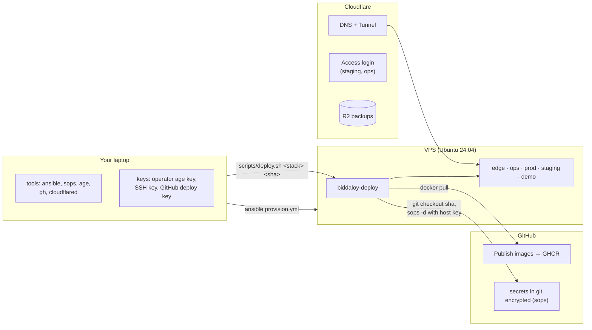

# 31. VPS deploy walkthrough (as actually done)

The first real deploy of Epic 79, written down step by step while it happened
(October 2026, Contabo VPS, branch `epic/79/accum-4`). Use it to set up the next VPS.

- **Why** the setup looks like this: [30-deployment-target.md](30-deployment-target.md).
- **Every option and edge case:** [28-platform-runbook.md](28-platform-runbook.md). This page is
  the short path that worked, plus the problems we hit and how we fixed them.

> Status: steps 1–9 done and verified. Steps 10–12 are the planned order; this page is
> updated as they run.

## The picture



Order of work:

| #   | Step                                           | Who               | Time                               |
| --- | ---------------------------------------------- | ----------------- | ---------------------------------- |
| 1   | Laptop tools                                   | you               | 10 min                             |
| 2   | Keys                                           | you               | 10 min                             |
| 3   | Buy the VPS, first SSH                         | you               | 15 min                             |
| 4   | Cloudflare: tunnel, DNS, Access, Turnstile, R2 | you (browser)     | 40 min                             |
| 5   | GitHub: pull token, Deploy secrets             | you               | 10 min                             |
| 6   | Telegram, Sentry, SMS                          | you               | later (optional for the first run) |
| 7   | Provision the VPS                              | one command       | 15 min                             |
| 8   | Secrets files                                  | script + 7 values | 15 min                             |
| 9   | Build images for the deploy commit             | GitHub Actions    | 20 min                             |
| 10  | First deploy: edge, ops, prod                  | one command each  | 20 min                             |
| 11  | Super admin, Smoke Test School, Kuma, Beszel   | you               | 30 min                             |
| 12  | Deploy staging and demo                        | one command each  | 15 min                             |

Rule for values below: 🟢 public (fine in chat, notes, commits), 🔴 secret (password manager,
then only inside `sops`).

---

## 1. Laptop tools

```bash
brew install ansible sops cloudflared       # age, gh, htpasswd: often already installed
cd ~/Workspace-personal/biddaloy            # the repo, on the branch you deploy
ansible-galaxy install -r infra/ansible/requirements.yml
gh auth login
```

Check:

```bash
ansible --version | head -1; sops --version | head -1; cloudflared --version; age --version
```

Seen working: ansible-core 2.21.5, sops 3.13.3, cloudflared 2026.10.3, age 1.3.2. The VPS
pins its own ansible-core (2.18.6), so your laptop version only runs `provision.yml`.

## 2. Keys

| Key               | Command                                                                                  | Private half lives                       | Public half goes                   |
| ----------------- | ---------------------------------------------------------------------------------------- | ---------------------------------------- | ---------------------------------- |
| Operator age key  | `mkdir -p ~/.config/sops/age && age-keygen -o ~/.config/sops/age/keys.txt`               | laptop                                   | `.sops.yaml`                       |
| Recovery age key  | `age-keygen -o /Volumes/<USB>/biddaloy-recovery.txt` (straight onto a USB stick)         | USB + printed copy, **never** the laptop | `.sops.yaml`                       |
| Your SSH key      | `ssh-keygen -t ed25519 -C "you-laptop"` (Enter for the default path, then a passphrase)  | `~/.ssh/id_ed25519`                      | VPS root (step 3)                  |
| GitHub deploy key | `ssh-keygen -t ed25519 -N '' -C biddaloy-github-deploy -f ~/.ssh/biddaloy_github_deploy` | GitHub secret (step 5)                   | `infra/ansible/inventory/prod.yml` |

Then make sops find your key in every terminal, and let macOS remember the SSH passphrase:

```bash
echo 'export SOPS_AGE_KEY_FILE=~/.config/sops/age/keys.txt' >> ~/.zshrc && source ~/.zshrc
ssh-add --apple-use-keychain ~/.ssh/id_ed25519
```

Write down the two `Public key: age1...` lines.

> **What went wrong for us.** A first `ssh-keygen` run answered the file-name prompt with `y`,
> which wrote a key pair called `y` / `y.pub` into the repo folder. It was never committed;
> we deleted it. Press **Enter** at that prompt.

## 3. Buy the VPS, first SSH

Order **Ubuntu 24.04 LTS** (not 22.04). We used Contabo "Cloud VPS 6 NVMe": 6 vCPU, 12 GB RAM,
100 GB NVMe, one public IPv4.

```bash
ssh-copy-id -i ~/.ssh/id_ed25519.pub root@<VPS_IP>      # asks the root password once
ssh root@<VPS_IP> 'grep VERSION= /etc/os-release'        # VERSION="24.04.x LTS (Noble Numbat)"
```

Take a snapshot in the provider panel now; it is free insurance.

> **What went wrong for us.** We first installed Ubuntu 22.04. Provision refused it at its first
> check (`the host Ubuntu 24.04 or newer`): the deploy runs ansible-core 2.18 **on the VPS**,
> and that needs Python 3.11+; 22.04 has 3.10. We reinstalled 24.04 from the Contabo panel
> (Reinstall, 10 minutes). After a reinstall the host fingerprint changes, so run
> `ssh-keygen -R <VPS_IP>` on the laptop and update `DEPLOY_SSH_KNOWN_HOSTS` (step 5).

## 4. Cloudflare

The domain was bought at Cloudflare, so the zone already existed and was Active.

**4a. Tunnel and DNS (terminal):**

```bash
cloudflared tunnel login                   # browser: pick the zone, Authorize
cloudflared tunnel create biddaloy         # prints the tunnel id  → 🟢 CLOUDFLARE_TUNNEL_ID
for h in schoolmanagerp.com www.schoolmanagerp.com app.schoolmanagerp.com demo.schoolmanagerp.com \
         staging.schoolmanagerp.com kuma.schoolmanagerp.com beszel.schoolmanagerp.com logs.schoolmanagerp.com; do
  cloudflared tunnel route dns biddaloy "$h"
done
```

The credentials file `~/.cloudflared/<tunnel-id>.json` is 🔴. You do not copy it anywhere by
hand: step 8's script reads it.

**4b. Zero Trust Access (browser).** Zero Trust → pick a team name (🟢 `CF_ACCESS_TEAM`) →
Settings → Authentication → enable **One-time PIN** → Access → Applications → Add →
Self-hosted:

| App         | Hostnames                           | Policy               | Gives                                |
| ----------- | ----------------------------------- | -------------------- | ------------------------------------ |
| `Staging`   | `staging.<domain>`                  | Allow, Emails = you  | 🟢 AUD tag → `CF_ACCESS_AUD_STAGING` |
| `Ops`       | `kuma.`, `beszel.`, `logs.<domain>` | Allow, Emails = you  | 🟢 AUD tag → `CF_ACCESS_AUD_OPS`     |
| `Kuma push` | `kuma.<domain>`, path `api/push/*`  | **Bypass**, Everyone | (lets the nightly jobs report)       |

**4c. Turnstile.** Two widgets, mode Managed: `app.<domain>` and `demo.<domain>`. Each gives a
🟢 site key and a 🔴 secret key. Staging uses Cloudflare's always-pass test pair (already in the
script).

**4d. R2.** Create bucket `biddaloy-backups`. Note the 🟢 account id. Create two API tokens,
both limited to that bucket:

| Token                 | Permission          | Used by                                                  |
| --------------------- | ------------------- | -------------------------------------------------------- |
| `biddaloy-prod-rw`    | Object Read & Write | prod backups, log archive                                |
| `biddaloy-staging-ro` | Object Read only    | staging's nightly restore (it can never delete a backup) |

Each token shows an Access Key ID and a Secret Access Key, both 🔴 (the secret is shown once).

## 5. GitHub

**5a. GHCR pull token.** Settings → Developer settings → Tokens (classic) → scope
**`read:packages` only** → 🔴 `ghp_...`. The VPS uses it to pull images once the repo is private.

**5b. The `production` environment** (the Deploy button's locked box): repo Settings →
Environments → New `production` → Deployment branches → Selected: `main` (and, while testing a
branch, that branch, e.g. `epic/79/accum-4`; remove it after merging). Then:

```bash
gh secret set DEPLOY_HOST --env production --body <VPS_IP>
gh secret set DEPLOY_SSH_KEY --env production < ~/.ssh/biddaloy_github_deploy
ssh-keyscan -t ed25519 <VPS_IP> 2>/dev/null | grep -v '^#' | gh secret set DEPLOY_SSH_KNOWN_HOSTS --env production
```

Before trusting the scanned key, compare fingerprints:

```bash
ssh-keyscan -t ed25519 <VPS_IP> 2>/dev/null > /tmp/kh && ssh-keygen -lf /tmp/kh
ssh root@<VPS_IP> 'ssh-keygen -lf /etc/ssh/ssh_host_ed25519_key.pub'     # same SHA256:...
```

**5c. Pin the GitHub deploy public key** in `infra/ansible/inventory/prod.yml`
(`github_deploy_pubkey_pinned: ssh-ed25519 AAAA... biddaloy-github-deploy`), commit, push. On the
VPS that key can run only `biddaloy-deploy` (a forced command).

**5d. Images from a branch.** Images are built by **Publish images**. A push to `main` builds them;
any other branch builds them when you start the workflow by hand (tags `:<sha>` only, never
`:main`):

```bash
gh workflow run publish-image.yml --ref <branch>
gh run list -w publish-image.yml --branch <branch> --limit 1
```

> **What went wrong for us.**
>
> 1. The workflow only ran on `main`, so a branch could not be deployed before merging. Fixed:
>    manual runs on any branch publish `:<sha>` (commit `4f685ef`).
> 2. The app image build failed: `Tsconfig not found astro/tsconfigs/strict`. The service-worker
>    build follows the root tsconfig to `landing/`, whose tsconfig needs `astro`, which the
>    Docker build never installed. `main` had been red since 2026-10-21 for this. Fixed by
>    installing `landing/package.json` in the Dockerfile's build stage (`a32410d`).
> 3. The landing image failed the token-drift check: the new logo's `--logo-*` colours were not
>    on the landing-only list in `landing/scripts/check-tokens.mjs`. Fixed (`2d2edaa`).

## 6. Telegram, Sentry, SMS (optional for the first run)

We left these to the end. With them empty, deploy messages and error reports are simply off;
nothing fails. Add them later with the `setsecret` helper from step 8b:

| Value                                                                              | File                | How to get it                                                                                                                              |
| ---------------------------------------------------------------------------------- | ------------------- | ------------------------------------------------------------------------------------------------------------------------------------------ |
| `TELEGRAM_BOT_TOKEN`, `TELEGRAM_CHAT_ID`                                           | edge                | @BotFather `/newbot`; add the bot to a group; `curl -s "https://api.telegram.org/bot<TOKEN>/getUpdates" \| jq '.result[].message.chat.id'` |
| `SENTRY_DSN` (Node.js project), `SENTRY_DSN_WEB` (React project)                   | prod, staging, demo | sentry.io project settings                                                                                                                 |
| `SENTRY_AUTH_TOKEN` (repo secret), `SENTRY_ORG`, `SENTRY_PROJECT` (repo variables) | GitHub              | Sentry → Auth Tokens (`project:releases`)                                                                                                  |
| `PLATFORM_SMS_*`, `PLATFORM_ALERT_PHONES`                                          | prod only           | your SMS gateway                                                                                                                           |

## 7. Provision the VPS

Keep one root SSH session open in another terminal until this step is done.

```bash
cd ~/Workspace-personal/biddaloy/infra/ansible
export BIDDALOY_HOST=<VPS_IP>
ansible-playbook provision.yml -e ansible_user=root      # first run, as root
```

It ends with two values:

| Printed                               | Goes to                                                                               |
| ------------------------------------- | ------------------------------------------------------------------------------------- |
| `HOST AGE PUBLIC KEY: age1...` 🟢     | third line of `.sops.yaml` (step 8)                                                   |
| `REPO DEPLOY KEY: ssh-ed25519 ...` 🟢 | GitHub repo → Settings → Deploy keys → Add, title `biddaloy-vm`, **write access off** |

Then run it again as `deploy` and check:

```bash
ansible-playbook provision.yml | tail -3                  # changed=0
ssh deploy@<VPS_IP> 'id; command -v biddaloy-deploy'      # groups include docker; /usr/local/bin/biddaloy-deploy
ssh root@<VPS_IP> true                                    # Permission denied (publickey)  ← good
ssh deploy@<VPS_IP> 'ssh -T git@github.com'               # "successfully authenticated"   ← the VPS can read the repo
```

After the repo deploy key is on GitHub, run provision once more so it clones the repo
(`biddaloy-deploy` lives inside it). Before Epic 79 is merged, name the branch that has it:

```bash
ansible-playbook provision.yml -e repo_bootstrap_ref=epic/79/accum-4 | grep -E 'Repo (cloned|NOT)|changed='
ssh deploy@<VPS_IP> 'test -x /usr/local/bin/biddaloy-deploy && echo ready'      # ready
```

> **What went wrong for us.** The first run stopped halfway with `root@...: Permission denied`:
> the security role turned root login off, then the docker role reconnected as root. The
> `deploy` user was already working, so we finished with `ansible-playbook provision.yml` (no
> `-e ansible_user=root`). Fixed for next time: the docker role now runs before the security
> role (`bb888fb`).
>
> And `biddaloy-deploy` was a broken link: it points into `/opt/biddaloy/repo`, which nothing had
> cloned (the command was meant to clone the repo itself, but it lives in the repo). Fixed:
> provision now clones the repo once the deploy key works (`repo_bootstrap_ref`, default `main`,
> `13a0c75`).

## 8. Secrets

### 8a. `.sops.yaml` and the five files

Put the three public keys into `.sops.yaml` in this order: operator, recovery, host. Then run
the bootstrap script with your 🟢 values:

```bash
cd ~/Workspace-personal/biddaloy
DOMAIN=schoolmanagerp.com \
TUNNEL_ID=<tunnel id> \
CF_ACCESS_TEAM=<team> CF_ACCESS_AUD_STAGING=<aud> CF_ACCESS_AUD_OPS=<aud> \
R2_ACCOUNT_ID=<account id> \
TURNSTILE_SITE_KEY_PROD=<site key> TURNSTILE_SITE_KEY_DEMO=<site key> \
GHCR_PULL_USER=<github username> \
bash scripts/bootstrap-secrets.sh
```

```text
wrote infra/secrets/edge.enc.env (16 keys, FILL_ME: 1)
wrote infra/secrets/ops.enc.env (2 keys, FILL_ME: 0)
wrote infra/secrets/prod.enc.env (35 keys, FILL_ME: 3)
wrote infra/secrets/staging.enc.env (36 keys, FILL_ME: 2)
wrote infra/secrets/demo.enc.env (23 keys, FILL_ME: 1)
```

What the script does (`scripts/bootstrap-secrets.sh`):

- fills every public value (domains, tunnel id, Access tags, R2 endpoint, site keys)
- reads the tunnel credentials JSON from `~/.cloudflared/`
- makes every random secret (DB passwords, JWT, encryption keys, health tokens, the backup age
  pair, the staging password and its hash, a Dozzle login) and pipes it straight into sops, so
  nothing is printed and no plaintext touches the disk
- sets the smoke-test logins (`smoke-admin@`, `smoke-teacher@`, `smoke-super@<domain>`, school
  slug `smoke-test-school`); you create these accounts in step 11
- writes `FILL_ME` for the 7 values only you have, and leaves out empty keys

### 8b. Fill the 7 account values

```bash
setsecret() { printf "%s → %s: " "$1" "$2"; read -rs v; echo; sops set "infra/secrets/$1.enc.env" "[\"$2\"]" "\"$v\""; unset v; }
setsecret edge    GHCR_PULL_TOKEN                # step 5a
setsecret prod    BACKUP_S3_ACCESS_KEY_ID        # R2 biddaloy-prod-rw
setsecret prod    BACKUP_S3_SECRET_ACCESS_KEY    # R2 biddaloy-prod-rw
setsecret prod    TURNSTILE_SECRET_KEY           # Turnstile, app widget
setsecret staging BACKUP_S3_ACCESS_KEY_ID        # R2 biddaloy-staging-ro
setsecret staging BACKUP_S3_SECRET_ACCESS_KEY    # R2 biddaloy-staging-ro
setsecret demo    TURNSTILE_SECRET_KEY           # Turnstile, demo widget
for f in edge prod staging demo; do echo "$f: $(sops -d infra/secrets/$f.enc.env | grep -c '=FILL_ME$') left"; done
```

All four lines must say `0 left`. Prod gets the **rw** token, staging the **ro** one.

### 8c. Commit

```bash
git add .sops.yaml infra/secrets/*.enc.env
node scripts/check-tracked-files.mjs            # OK
git commit -m "chore(secrets): first encrypted secrets" && git push
```

Read a value back when you need it (it prints only that one value):

```bash
sops -d --extract '["STAGING_PASSWORD"]' infra/secrets/staging.enc.env
sops -d --extract '["DOZZLE_OWNER_PASSWORD"]' infra/secrets/ops.enc.env
sops -d --extract '["DEMO_PASSWORD"]' infra/secrets/demo.enc.env
```

> **What went wrong for us.**
>
> 1. `check-tracked-files.mjs` refused the files: sops leaves an **empty** value (`KEY=`) in plain
>    text, and the guard wants every value encrypted. Fix: leave empty keys out (the script does).
> 2. Prod's deploy preflight needs every `SMOKE_*` key **even on the first deploy**, before those
>    accounts can exist. Fix: decide the smoke logins up front (the script does) and create the
>    accounts with exactly those values in step 11.

## 9. Build images for the deploy commit

Every secrets change is a new commit, and a deploy pulls images tagged with that exact commit.

Before you spend 20 minutes on a build, run the same config check the deploy runs, against an
image that already exists on the VPS (it names variables, never values):

```bash
for s in prod demo; do
  { sops -d infra/secrets/$s.enc.env; echo APP_VERSION=<any built sha>; } |
    ssh deploy@<VPS_IP> "docker run --rm -i ghcr.io/tareq89/biddaloy-app:<any built sha> node server/dist/scripts/config-check.js --env $s --file /dev/stdin"
done                                                      # config ok, config ok
```

```bash
git rev-parse HEAD                                        # the sha you will deploy
gh workflow run publish-image.yml --ref <branch>          # on main: merging does it
gh run watch $(gh run list -w publish-image.yml --branch <branch> --limit 1 --json databaseId -q '.[0].databaseId')
for i in app backup demo-reset landing; do
  docker manifest inspect ghcr.io/tareq89/biddaloy-$i:<sha> >/dev/null && echo "$i ok"
done
```

Ours: `0571a91cd86797dc932ed32232c87e8daea54a4d`, four images, 2026-10-22.

A later docs-only commit does not need new images: you keep deploying the sha that has them.

## 10. First deploy: edge, ops, prod

Do **not** use `all` for the very first deploy. `all` runs staging before prod, and staging needs
prod's platform school id (`PLATFORM_TENANT_ID`), which exists only after prod is up.

```bash
cd ~/Workspace-personal/biddaloy
export BIDDALOY_HOST=<VPS_IP>
SHA=<sha from step 9>
scripts/deploy.sh edge "$SHA"
scripts/deploy.sh ops  "$SHA"
scripts/deploy.sh prod "$SHA" --hotfix "first deploy"      # no staging ok line exists yet
```

Each one ends with `PLAY RECAP ... failed=0` and a line in `/opt/biddaloy/<stack>/deploys.log`.
Prod's login smoke is skipped on the first deploy (the database has no users yet) and says so.
A failure always prints three lines: `FAILED at`, `Why`, `Next`. Start with the `Next` command,
then:

```bash
ssh deploy@<VPS_IP> biddaloy-doctor
```

## 11. After the first deploy

1. **Platform super admin** (runbook 11a; there is no bootstrap command yet). Find the platform
   school id and put it in `PLATFORM_TENANT_ID` of prod **and** staging:
   ```bash
   ssh deploy@<VPS_IP>
   dcp() { docker compose -p "$1" --project-directory "/opt/biddaloy/$1" -f /opt/biddaloy/repo/deploy/stack.yml "${@:2}"; }
   dcp prod exec -T db sh -c 'psql -U "$POSTGRES_USER" -d "$POSTGRES_DB" -tA -c "SELECT id, slug FROM schools"'
   ```
2. **Smoke Test School**: register it with slug `smoke-test-school`, grant it seats from the
   platform billing page, create the admin and teacher with the emails and passwords already in
   `prod.enc.env` (`sops -d --extract '["SMOKE_ADMIN_PASSWORD"]' infra/secrets/prod.enc.env`).
3. **Kuma**, **Beszel**, **Dozzle** at `kuma.`, `beszel.`, `logs.` (runbook 11c–11e). Put each
   Kuma push URL into its key (`BACKUP_PUSH_URL`, `LOG_ARCHIVE_PUSH_URL` in prod,
   `STAGING_REFRESH_PUSH_URL` in staging, `DEMO_RESET_PUSH_URL` in demo) and `BESZEL_KEY` into
   edge and ops.
4. Commit, build images (step 9), redeploy prod with the new sha.

## 12. Staging and demo

```bash
scripts/deploy.sh staging "$SHA"
scripts/deploy.sh demo    "$SHA"
scripts/deploy.sh prod    "$SHA"            # now passes the staging gate without --hotfix
```

From here on every release is: merge (or build the branch) → `scripts/deploy.sh staging <sha>` →
check → `scripts/deploy.sh prod <sha>`, from the laptop or the GitHub **Deploy** workflow.

## Problems we hit, in one table

| Symptom                                                                  | Cause                                                                                                      | Fix                                                                                                                                                                    |
| ------------------------------------------------------------------------ | ---------------------------------------------------------------------------------------------------------- | ---------------------------------------------------------------------------------------------------------------------------------------------------------------------- |
| `the host Ubuntu 24.04 or newer`                                         | VPS on 22.04 (Python 3.10)                                                                                 | reinstall 24.04; guide corrected (`7f72d57`)                                                                                                                           |
| `root@...: Permission denied` halfway through provision                  | docker role reconnected after root login was off                                                           | finish as `deploy`; roles reordered (`bb888fb`)                                                                                                                        |
| `Tsconfig not found astro/tsconfigs/strict` in the app image             | Docker build stage never installed `landing/`                                                              | `COPY landing/package.json` (`a32410d`)                                                                                                                                |
| `landing token drift: --logo-ink ...`                                    | new logo colours not on the landing-only list                                                              | added them (`2d2edaa`)                                                                                                                                                 |
| Branch images never built                                                | publish workflow was main-only                                                                             | manual runs publish `:<sha>` (`4f685ef`)                                                                                                                               |
| `tracked but must stay local: infra/secrets/*.enc.env`                   | empty `KEY=` lines stay plaintext in sops                                                                  | leave empty keys out                                                                                                                                                   |
| Prod preflight wants `SMOKE_*` before any account exists                 | settings check runs on the first deploy too                                                                | set the smoke logins up front, create the accounts in step 11                                                                                                          |
| `biddaloy-deploy` missing on the VPS                                     | the link points into a repo nobody had cloned                                                              | add the repo deploy key, re-run provision (it clones now, `13a0c75`)                                                                                                   |
| prod `config-check`: `SETTINGS_ENCRYPTION_KEY is required in production` | the empty-key filter (`grep -v '=$'`) also dropped base64 values ending in `=`                             | new key with `sops set`; filter now matches only `KEY=` lines                                                                                                          |
| prod app restarting, `Cannot find module 'express'`, ready timeout       | `server/src/main.ts` imports `express` but only a dev tool pulled it in; the production install skipped it | `express` 5.2.1 declared in `server/package.json`; Publish images now runs `scripts/check-image-requires.cjs` inside the image so this fails the build, not the deploy |
| `y` and `y.pub` in the repo folder                                       | `y` typed at ssh-keygen's file-name prompt                                                                 | delete them; press Enter at that prompt                                                                                                                                |
