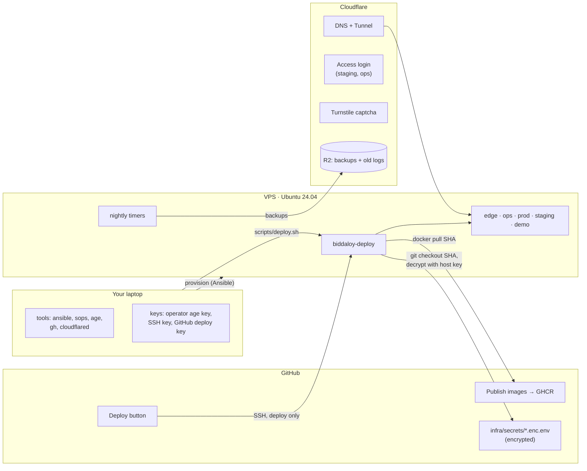
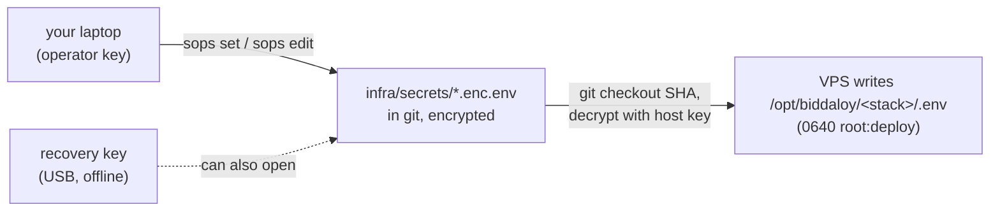
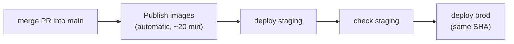
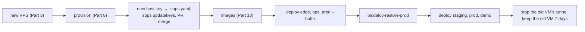

# 31. Deploy from zero: the complete guide

This page takes you from an empty laptop to a running, monitored system:

- **prod** (the real app)
- **staging** (a scrubbed copy of prod when you load one; a nightly drill proves restores)
- **demo** (a public demo school, rebuilt every night)
- **ops** (uptime, server metrics and live logs)
- **landing** (the marketing site)

It works for any domain, any VM provider and any environment. Every command, every value and
every place a value goes is written here. It was written while doing the first real deploy
(October 2026, a Contabo VPS, domain `schoolmanagerp.com`), so every problem we actually hit is
in it, with its fix.

Related pages, if you want more depth (you do not need them to follow this one):

| Page                                               | What it adds                                         |
| -------------------------------------------------- | ---------------------------------------------------- |
| [30-deployment-target.md](30-deployment-target.md) | **Why** the setup looks like this (decisions D1–D26) |
| [28-platform-runbook.md](28-platform-runbook.md)   | Long reference: every option and edge case           |
| [12-operations.md](12-operations.md)               | Alert thresholds and incident runbooks               |
| [13-backup-restore.md](13-backup-restore.md)       | How backups and restores work inside                 |
| [25-cloudflare.md](25-cloudflare.md)               | Cloudflare dashboard settings                        |

---

## How to read this page

**Placeholders.** Replace these everywhere you see them:

| Placeholder | Meaning                                    | Our first deploy used                      |
| ----------- | ------------------------------------------ | ------------------------------------------ |
| `<DOMAIN>`  | your apex domain                           | `schoolmanagerp.com`                       |
| `<VPS_IP>`  | the VM's public IPv4                       | `169.58.184.85`                            |
| `<GH_USER>` | your GitHub user or org                    | `tareq89`                                  |
| `<SHA>`     | the full 40-character commit id you deploy | `3adf58a770c3635f023653ee972d4771ada555c1` |

**Two kinds of value.**

- 🟢 **Public.** Safe to write in notes, chat or a commit (domains, ids, public keys).
- 🔴 **Secret.** Goes only into your password manager, and then into the encrypted secret
  files with `sops`. Never paste a secret into a chat, an issue, a commit message or a plain file.

**Where commands run.** Every command block starts with a comment saying where it runs:
`# laptop` (your Mac, in the repo folder) or `# VPS` (after `ssh deploy@<VPS_IP>`).

**If a deploy fails** it always prints three lines. Start with the `Next:` command.

```text
FAILED at: migrate (prod, 3f9c2ab4e1d0)
Why:       migration 1797… failed: relation "fee_items" does not exist
Next:      biddaloy-doctor prod   ·   logs: docker compose -p prod logs app
```

---

## Part 0. The picture



**Words used on this page:**

| Word       | Meaning                                                                                                                 |
| ---------- | ----------------------------------------------------------------------------------------------------------------------- |
| VPS / VM   | the rented server                                                                                                       |
| stack      | one group of containers: `prod`, `staging`, `demo`, `edge` (nginx, tunnel, landing), `ops` (Kuma, Beszel, Dozzle)       |
| image      | a packaged build of the app, stored in GitHub's registry (GHCR) and tagged with a commit SHA                            |
| SHA        | a commit's full 40-character id. A deploy always names one.                                                             |
| tunnel     | `cloudflared` on the VPS calls out to Cloudflare. Visitors reach the VPS through that call, so **no web port is open**. |
| sops + age | encrypt the secret files. `age` makes the keys, `sops` edits the files.                                                 |
| Ansible    | sets up the VPS from your laptop (`provision.yml`) and runs deploys on the VPS (`deploy.yml`)                           |
| smoke test | after each deploy, logs in as test accounts to prove the app works                                                      |

**Order of work and rough time:**

| Part | Step                                                   | Who                    | Time                      |
| ---- | ------------------------------------------------------ | ---------------------- | ------------------------- |
| 1    | Laptop tools                                           | you                    | 10 min                    |
| 2    | Keys                                                   | you                    | 10 min                    |
| 3    | Buy the VPS                                            | you                    | 15 min                    |
| 4    | Cloudflare: domain, tunnel, DNS, Access, Turnstile, R2 | you, browser           | 40 min                    |
| 5    | GitHub: tokens, Deploy secrets                         | you                    | 15 min                    |
| 6    | Telegram, Sentry, SMS (collect the values)             | you                    | 20 min                    |
| 7    | A different domain? (only if not `schoolmanagerp.com`) | you                    | 15 min                    |
| 8    | Provision the VPS                                      | one command            | 15 min                    |
| 9    | Secret files                                           | a script + your values | 20 min                    |
| 10   | Build images                                           | GitHub Actions         | 20 min                    |
| 11   | First deploy                                           | one command per stack  | 30 min                    |
| 12   | First accounts: super admin, Smoke Test School         | you                    | 20 min                    |
| 13   | Monitoring: Kuma, Beszel, Dozzle                       | you, browser           | 30 min                    |
| 14   | Final secrets round and deploy                         | you                    | 30 min                    |
| 15   | Verify                                                 | you                    | 10 min, then next morning |

Parts 16–21 are for later: everyday use, moving to another VM, a new domain, direct (BDIX)
mode, troubleshooting, and where everything lives.

**Keep a notes file** (not in git) for the 🟢 values as you collect them. We used
`.deploy-notes.md` in the repo root, excluded from git:

```bash
# laptop
grep -qxF '.deploy-notes.md' .git/info/exclude || echo '.deploy-notes.md' >> .git/info/exclude
```

---

## Part 1. Laptop tools

```bash
# laptop
brew install ansible sops age gh cloudflared jq     # htpasswd is built into macOS
cd ~/Workspace-personal/biddaloy                    # your clone of the repo
git checkout main && git pull
ansible-galaxy install -r infra/ansible/requirements.yml
gh auth login                                       # log in to GitHub in the terminal
```

Check:

```bash
# laptop
ansible --version | head -1; sops --version | head -1; age --version; gh --version | head -1; cloudflared --version
```

Seen working: ansible-core 2.21.5, sops 3.13.3, age 1.3.2, gh 2.96, cloudflared 2026.10.3. The
VPS installs its own pinned ansible-core (2.18.6); your laptop's version only runs `provision.yml`.

**If it fails.** `ansible-galaxy` says "role not found": check your internet, then
`ansible-galaxy install -r infra/ansible/requirements.yml --force`.

---

## Part 2. Keys

Four keys. Each has a **private** half (the real key, never shared) and a **public** half (safe
to share, like a padlock).

| Key               | What it does                                  | Make it with | Private half lives                             | Public half goes                   |
| ----------------- | --------------------------------------------- | ------------ | ---------------------------------------------- | ---------------------------------- |
| Operator age key  | opens the secret files on your laptop         | 2a           | `~/.config/sops/age/keys.txt`                  | `.sops.yaml`                       |
| Recovery age key  | opens the secret files if your laptop is lost | 2b           | USB stick + printed copy, **never the laptop** | `.sops.yaml`                       |
| Your SSH key      | you log in to the VPS                         | 2c           | `~/.ssh/id_ed25519`                            | the VPS (Part 3)                   |
| GitHub deploy key | the Deploy button logs in to the VPS          | 2d           | GitHub secret (Part 5)                         | `infra/ansible/inventory/prod.yml` |

The VPS makes two more keys of its own in Part 8 (a **host age key** and a **repo deploy key**).

### 2a. Operator age key

```bash
# laptop
mkdir -p ~/.config/sops/age
age-keygen -o ~/.config/sops/age/keys.txt
# Public key: age1...        ← 🟢 write it in your notes
echo 'export SOPS_AGE_KEY_FILE=~/.config/sops/age/keys.txt' >> ~/.zshrc && source ~/.zshrc
```

### 2b. Recovery age key

Plug in a USB stick and write the key **straight onto it**, so it never touches the laptop disk.
`<USB>` is the stick's name in Finder's sidebar.

```bash
# laptop
age-keygen -o /Volumes/<USB>/biddaloy-recovery.txt
# Public key: age1...        ← 🟢 write it in your notes
```

Eject the stick and keep it somewhere safe. A printed copy in a second safe place is better.
Rule: the operator key and the recovery key never live on the same laptop.

### 2c. Your SSH key

```bash
# laptop
ssh-keygen -t ed25519 -C "you-laptop"
#   "Enter file in which to save the key": press Enter (do NOT type anything)
#   "Enter passphrase": type a passphrase (protects the key if the laptop is stolen)
ssh-add --apple-use-keychain ~/.ssh/id_ed25519      # macOS remembers the passphrase
```

> **What went wrong for us.** Typing `y` at the file-name prompt wrote a key pair called `y` and
> `y.pub` into the repo folder. It was never committed; we deleted it. Press **Enter** there.

If you keep a key at a different path, add `-e operator_ssh_privkey=~/.ssh/<name>` to every
`ansible-playbook` command in Part 8.

### 2d. GitHub deploy key

No passphrase, because GitHub cannot type one. On the VPS this key can run **only** the deploy
command, nothing else.

```bash
# laptop
ssh-keygen -t ed25519 -N '' -C biddaloy-github-deploy -f ~/.ssh/biddaloy_github_deploy
cat ~/.ssh/biddaloy_github_deploy.pub     # 🟢 the public line, used in Part 5d
```

---

## Part 3. Buy the VPS

Order:

- **Ubuntu 24.04 LTS** or newer. **Not 22.04.** Provision refuses 22.04.
- 6 vCPU, 12 GB RAM, 100 GB NVMe (decision P12). We used Contabo "Cloud VPS 6 NVMe".
- One public IPv4 address.
- Your SSH public key for root if the order form has a field for it; otherwise a root password.

Put your key on root (asks the root password once), then check:

```bash
# laptop
ssh-copy-id -i ~/.ssh/id_ed25519.pub root@<VPS_IP>      # answer "yes", then the root password
ssh root@<VPS_IP> 'grep VERSION= /etc/os-release'       # VERSION="24.04.x LTS (Noble Numbat)"
```

Take a **snapshot** in the provider's panel now. It is free insurance: one click back to here.

> **What went wrong for us.** We first installed Ubuntu 22.04. Provision stopped at its first check
> (`the host Ubuntu 24.04 or newer`). The deploy runs Ansible **on the VPS**, and that Ansible needs
> Python 3.11 or newer; 22.04 ships 3.10. We reinstalled 24.04 from the provider panel (10 minutes).
> After a reinstall the VPS has a new identity (host key), so also run
> `ssh-keygen -R <VPS_IP>` on the laptop, and redo the `DEPLOY_SSH_KNOWN_HOSTS` secret (Part 5c).

---

## Part 4. Cloudflare

You need a Cloudflare account and the domain in it. If you bought the domain at Cloudflare the
zone already exists. Otherwise: dashboard → **Add a site** → your domain → Free plan, then change
the nameservers at your registrar to the two Cloudflare shows, and wait until the zone says
**Active**.

### 4a. Tunnel

```bash
# laptop
cloudflared tunnel login              # browser opens: pick your domain, click Authorize
cloudflared tunnel create biddaloy
# Created tunnel biddaloy with id 87fa4f76-...   ← 🟢 CLOUDFLARE_TUNNEL_ID
# Tunnel credentials written to ~/.cloudflared/<id>.json   ← 🔴 stays there; Part 9's script reads it
```

### 4b. DNS: send every hostname to the tunnel

```bash
# laptop
D=<DOMAIN>
for h in $D www.$D app.$D demo.$D staging.$D kuma.$D beszel.$D logs.$D; do
  cloudflared tunnel route dns biddaloy "$h"
done
# Added CNAME app.<DOMAIN> which will route to this tunnel   (one line per name)
```

Check: dashboard → your domain → **DNS → Records**. Eight CNAMEs, each with an orange cloud
(**Proxied**). These are the names and what they serve:

| Name                                | Serves             | Login in front                  |
| ----------------------------------- | ------------------ | ------------------------------- |
| `<DOMAIN>` (and `www.` → redirects) | landing site       | none                            |
| `app.<DOMAIN>`                      | prod               | the app's own login             |
| `demo.<DOMAIN>`                     | demo               | the app's own login             |
| `staging.<DOMAIN>`                  | staging            | Cloudflare Access, then the app |
| `kuma.<DOMAIN>`                     | uptime monitor     | Cloudflare Access, then Kuma    |
| `beszel.<DOMAIN>`                   | server metrics     | Cloudflare Access, then Beszel  |
| `logs.<DOMAIN>`                     | live logs (Dozzle) | Cloudflare Access, then Dozzle  |

### 4c. Access: the login gate for staging and ops

1. Dashboard → **Zero Trust**. The first time it asks for a **team name** (for example
   `old-fire-0768` was generated for us) → 🟢 `CF_ACCESS_TEAM`. Choose the **Free** plan; it may ask
   for a card but does not charge on Free.
2. **Settings → Authentication → Login methods**: make sure **One-time PIN** is on (a code is
   emailed to you at each login).
3. **Access → Applications → Add an application → Self-hosted**, three times:

| App name    | Hostnames                                                                        | Policy                                                               | Session | You copy                                                        |
| ----------- | -------------------------------------------------------------------------------- | -------------------------------------------------------------------- | ------- | --------------------------------------------------------------- |
| `Staging`   | `staging.<DOMAIN>`                                                               | name `Owner only`, action **Allow**, include **Emails** = your email | 24 h    | **Application Audience (AUD) Tag** → 🟢 `CF_ACCESS_AUD_STAGING` |
| `Ops`       | `kuma.<DOMAIN>`, `beszel.<DOMAIN>`, `logs.<DOMAIN>` (three hostnames in one app) | same `Owner only`                                                    | 24 h    | AUD tag → 🟢 `CF_ACCESS_AUD_OPS`                                |
| `Kuma push` | `kuma.<DOMAIN>`, **path** `api/push/*`                                           | action **Bypass**, include **Everyone**                              | —       | nothing                                                         |

Why `Kuma push`: the VPS's nightly jobs report "done" or "failed" to Kuma at
`https://kuma.<DOMAIN>/api/push/<token>`. A job cannot type a login code, so only that path is
open. The token in the URL is itself secret, and Kuma checks it.

### 4d. Turnstile (the captcha on public forms)

Dashboard → **Turnstile → Add widget**, mode **Managed**:

| Widget          | Hostname        | You get                    |
| --------------- | --------------- | -------------------------- |
| `Biddaloy prod` | `app.<DOMAIN>`  | 🟢 site key, 🔴 secret key |
| `Biddaloy demo` | `demo.<DOMAIN>` | 🟢 site key, 🔴 secret key |

Staging needs no widget: it uses Cloudflare's public always-pass test keys (already built in).

### 4e. R2 (backups and archived logs)

1. Dashboard → **R2 Object Storage**. The first time it may ask for a card (10 GB is free).
2. **Create bucket**: name `biddaloy-backups`, location Automatic.
3. On the R2 overview, copy the **Account ID** → 🟢. The storage address (endpoint) is
   `https://<account-id>.r2.cloudflarestorage.com`.
4. **Manage API tokens → Create API token**, twice. Limit both to the bucket `biddaloy-backups`:

| Token name            | Permission           | Used by                           | Why                                                 |
| --------------------- | -------------------- | --------------------------------- | --------------------------------------------------- |
| `biddaloy-prod-rw`    | Object Read & Write  | prod backups, log archive         | writes backups                                      |
| `biddaloy-staging-ro` | Object **Read only** | staging's restore drill and loads | staging can never delete or overwrite a prod backup |

Each token shows an **Access Key ID** and a **Secret Access Key**, both 🔴. Cloudflare shows the
secret once: save it now.

---

## Part 5. GitHub

### 5a. GHCR pull token (the VPS downloads images with it)

GitHub → your avatar → **Settings → Developer settings → Personal access tokens → Tokens
(classic) → Generate new token (classic)**:

- Note: `biddaloy-vps-pull`
- Expiration: no expiration, or 1 year with a calendar reminder
- Scopes: **only `read:packages`**

Save `ghp_...` → 🔴 `GHCR_PULL_TOKEN`. When the repo is private the images are private too, and
the VPS cannot pull without it.

### 5b. The `production` environment (the Deploy button's locked box)

Repo → **Settings → Environments → New environment**, name `production`.
**Deployment branches and tags → Selected branches and tags → add `main`.**

Only `main` may deploy from GitHub. (While testing an unmerged branch we added that branch
here; remove such extra branches once merged.)

### 5c. The three Deploy secrets

Check the VPS identity first, so GitHub trusts the real server:

```bash
# laptop
ssh-keyscan -t ed25519 <VPS_IP> 2>/dev/null > /tmp/kh && ssh-keygen -lf /tmp/kh
ssh root@<VPS_IP> 'ssh-keygen -lf /etc/ssh/ssh_host_ed25519_key.pub'
# both lines show the same SHA256:...  → safe
```

Then set the secrets in the `production` environment:

```bash
# laptop, in the repo folder
gh secret set DEPLOY_HOST --env production --body <VPS_IP>
gh secret set DEPLOY_SSH_KEY --env production < ~/.ssh/biddaloy_github_deploy
ssh-keyscan -t ed25519 <VPS_IP> 2>/dev/null | grep -v '^#' | gh secret set DEPLOY_SSH_KNOWN_HOSTS --env production
# ✓ Set Actions secret ... for production   (three times)
```

### 5d. Pin the GitHub deploy key

In `infra/ansible/inventory/prod.yml`, set the line to the public key from Part 2d:

```yaml
github_deploy_pubkey_pinned: ssh-ed25519 AAAA... biddaloy-github-deploy
```

It is public, so it is committed (Part 9 commits it with the secrets).

### 5e. Repository variables (landing site; all optional)

Repo → **Settings → Secrets and variables → Actions → Variables**: `PUBLIC_UMAMI_ID`,
`PUBLIC_UMAMI_SRC`, `PUBLIC_CLARITY_ID`, `PUBLIC_META_PIXEL_ID`, `PUBLIC_WA_NUMBER`,
`PUBLIC_AIPRAKTOR_SITE`. Empty means that tracker or widget is off. Sentry's variables come in
Part 6b.

---

## Part 6. Telegram, Sentry, SMS (collect the values now)

Collect these now, so Part 9 puts them in with everything else. Each is optional: empty means that
feature is simply off; nothing fails.

### 6a. Telegram (alerts and "deploy done" messages)

1. In Telegram, message **@BotFather**: `/newbot`. Give a name (`Biddaloy Alerts`) and a username
   ending in `bot` (`biddaloy_alerts_bot`).
2. BotFather replies with a token like `123456:ABC-...` → 🔴 `TELEGRAM_BOT_TOKEN`.
3. Make a Telegram **group** (`Biddaloy alerts`), add the bot, and send any message in the group.
4. Read the group id (`<TOKEN>` = your token):

   ```bash
   # laptop
   curl -s "https://api.telegram.org/bot<TOKEN>/getUpdates" | jq '.result[].message.chat | {id, title}'
   # { "id": -1001234567890, "title": "Biddaloy alerts" }
   ```

   The negative number → 🟢 `TELEGRAM_CHAT_ID`. Empty result? Send another message in the group and
   run it again.

### 6b. Sentry (error reports)

1. On [sentry.io](https://sentry.io), make two projects in one organisation:

   | Project           | Platform | Its DSN becomes  |
   | ----------------- | -------- | ---------------- |
   | `biddaloy-server` | Node.js  | `SENTRY_DSN`     |
   | `biddaloy-web`    | React    | `SENTRY_DSN_WEB` |

   A DSN looks like `https://abc123@o456.ingest.sentry.io/789` (project → Settings → Client Keys).
   Keep them with your secrets.

2. **Settings → Auth Tokens → Create**, scope `project:releases` → 🔴 `SENTRY_AUTH_TOKEN`. With it,
   browser errors show your real source lines instead of minified code.
3. Your organisation slug is in the URL `sentry.io/organizations/<org>/` → 🟢.
4. Put the token and names in GitHub (used when images are built):

   ```bash
   # laptop
   gh secret set SENTRY_AUTH_TOKEN               # paste the token
   gh variable set SENTRY_ORG --body <org>
   gh variable set SENTRY_PROJECT --body biddaloy-web
   ```

prod, staging and demo all use the same two DSNs. Sentry shows them as separate environments by
itself (the app sends `SENTRY_ENVIRONMENT` = the stack name).

Optional cron monitors: a Sentry cron check-in URL for prod's backup goes in `prod`
`SENTRY_CRON_MONITOR_URL`, and one for the demo rebuild in `demo` `SENTRY_CRONS_URL`.

### 6c. SMS gateway (prod only; platform alerts)

If you have a GreenWeb or MiM SMS account:

| Key (prod only)          | Value                                                      |
| ------------------------ | ---------------------------------------------------------- |
| `PLATFORM_SMS_PROVIDER`  | `greenweb` (default) or `mimsms`                           |
| `PLATFORM_SMS_API_KEY`   | 🔴 the gateway API key                                     |
| `PLATFORM_SMS_SENDER_ID` | your sender id (**required** for `mimsms`)                 |
| `PLATFORM_SMS_API_URL`   | the gateway's HTTP API URL (empty = the gateway's default) |
| `PLATFORM_ALERT_PHONES`  | your number(s), comma separated, e.g. `+8801XXXXXXXXX`     |

Staging and demo never get SMS keys; their config check refuses them.

### 6d. Google and Facebook sign-in (prod only, optional)

Make an OAuth client in Google Cloud Console and an app in Meta for Developers. Their ids and
secrets are `GOOGLE_OAUTH_CLIENT_ID`, `GOOGLE_OAUTH_CLIENT_SECRET`, `FACEBOOK_OAUTH_CLIENT_ID`,
`FACEBOOK_OAUTH_CLIENT_SECRET` in prod. Empty = the buttons are hidden.

---

## Part 7. Using a different domain

Skip this part if your domain is `schoolmanagerp.com`.

The **app** reads its domains from the secret files (Part 9's script fills them from `DOMAIN=`).
The **landing site and a few build defaults** have the domain written in code. Change all of these
in one commit on a branch, before Part 10:

| File                                                               | What to change                                                                                                 |
| ------------------------------------------------------------------ | -------------------------------------------------------------------------------------------------------------- |
| `infra/ansible/inventory/prod.yml`                                 | `landing_domain`, `app_domain`, `staging_domain`, `demo_domain`, `kuma_domain`, `beszel_domain`, `logs_domain` |
| `landing/src/i18n/index.ts`                                        | `APP_URL`, `DEMO_URL` (and `DOCS_URL` if your docs move)                                                       |
| `landing/astro.config.mjs`                                         | `site:`                                                                                                        |
| `landing/scripts/llms.mjs`, `landing/scripts/build-collateral.mjs` | the `site` / `SITE` constant                                                                                   |
| `landing/public/robots.txt`                                        | the `Sitemap:` line                                                                                            |
| `landing/nginx.conf`                                               | the analytics host in `Content-Security-Policy` (`stats.<DOMAIN>`)                                             |
| `landing/src/components/Analytics.astro`                           | the default `PUBLIC_UMAMI_SRC` and `data-domains`                                                              |
| `landing/.env.example`                                             | `PUBLIC_UMAMI_SRC`                                                                                             |
| `client-admin/vite.config.ts`                                      | the default `VITE_APP_URL` (used for the social-share image)                                                   |
| `e2e/landing/smoke.spec.ts`                                        | the expected URLs in the landing test                                                                          |

Find any you missed:

```bash
# laptop
git grep -n "schoolmanagerp" -- ':!docs' ':!*.md'
```

Landing page text (`landing/src/content/*`) may also name the old domain: read it once.

---

## Part 8. Provision the VPS

Provision turns the empty Ubuntu VPS into the hardened Docker host: SSH keys only, firewall,
fail2ban, automatic security updates, a 4 GB swap file, Docker, the `deploy` user, the
`/opt/biddaloy` folders, its own keys, the repo clone and the nightly timers. It does not deploy
the app.

**Keep one root SSH session open in another terminal** until this part is done. If something
locks you out, that session (or the provider's web console, or the snapshot) gets you back.

### 8a. First run, as root

```bash
# laptop
cd ~/Workspace-personal/biddaloy/infra/ansible
export BIDDALOY_HOST=<VPS_IP>
ansible-playbook provision.yml -e ansible_user=root
```

It takes 5–15 minutes. Green `ok` = already right, yellow `changed` = just set, purple `WARNING`
= usually harmless. A red `fatal`/`FAILED` = stop and read it.

It ends with:

```text
TASK [Keys to register]
  - 'HOST AGE PUBLIC KEY: age1...'
  - 'Add it to .sops.yaml, run `sops updatekeys infra/secrets/*.enc.env`, and commit.'
  - 'REPO DEPLOY KEY: ssh-ed25519 AAAA... biddaloy-repo-deploy'
  - 'Add it as a read-only deploy key on the GitHub repo (Settings > Deploy keys).'
  - 'Repo NOT cloned yet: add the deploy key above on GitHub, then re-run provision.'
```

| Printed value            | Where it goes                                                                                                              |
| ------------------------ | -------------------------------------------------------------------------------------------------------------------------- |
| `HOST AGE PUBLIC KEY` 🟢 | your notes; the third key in `.sops.yaml` (Part 9)                                                                         |
| `REPO DEPLOY KEY` 🟢     | GitHub repo → **Settings → Deploy keys → Add deploy key**, title `biddaloy-vm`, paste the line, **Allow write access OFF** |

You can print them again any time:
`ssh deploy@<VPS_IP> 'sudo age-keygen -y /opt/biddaloy/keys/host.age; cat ~/.ssh/github_repo.pub'`.

> **What went wrong for us.** The first run stopped halfway with `root@...: Permission denied`:
> the security role switched root login off, and then the docker role reconnected as root. The
> `deploy` user already worked, so finishing with the next command was enough. Fixed in the repo:
> the docker role now runs first.

### 8b. Second run, as `deploy` (this one also clones the repo)

```bash
# laptop, still in infra/ansible
ansible-playbook provision.yml | grep -E 'Repo (cloned|NOT)|changed='
# Repo cloned: biddaloy-deploy is ready.
```

The deploy command lives **inside** the repo, so provision clones it once the repo deploy key
works. It clones `main`. To test a branch that is not merged yet, add
`-e repo_bootstrap_ref=<branch>` (only needed once; later deploys check out their own SHA).

> **What went wrong for us.** `biddaloy-deploy` did not exist on the VPS: it is a link into the
> repo folder, and nothing had cloned the repo. Fixed: provision now clones it.

### 8c. Check

```bash
# laptop
ansible-playbook provision.yml | tail -3                        # changed=0  ← repeatable
ssh deploy@<VPS_IP> 'id; test -x /usr/local/bin/biddaloy-deploy && echo ready'
#   uid=...(deploy) ... docker ...      and      ready
ssh deploy@<VPS_IP> 'ssh -T git@github.com'                     # "successfully authenticated"
ssh root@<VPS_IP> true                                          # Permission denied (publickey)  ← good
```

Now you can close the root session.

---

## Part 9. Secret files

All secrets live **in git, encrypted**, in `infra/secrets/<stack>.enc.env`, one file per stack.
Each file opens with any one of three keys: yours, the recovery key, or the VPS host key. That is
how the VPS decrypts them during a deploy.



Work on a branch:

```bash
# laptop
cd ~/Workspace-personal/biddaloy
git checkout main && git pull && git checkout -b chore/first-secrets
```

### 9a. `.sops.yaml`

Replace the three placeholders with your three public keys, **in this order**: operator (2a),
recovery (2b), host (8a):

```yaml
creation_rules:
  - path_regex: infra/secrets/.*\.enc\.(env|pem)$
    age: >-
      age1...operator...,
      age1...recovery...,
      age1...host...
```

### 9b. Make the five files with the bootstrap script

```bash
# laptop, repo root
DOMAIN=<DOMAIN> \
TUNNEL_ID=<tunnel id from 4a> \
CF_ACCESS_TEAM=<team from 4c> \
CF_ACCESS_AUD_STAGING=<AUD tag> CF_ACCESS_AUD_OPS=<AUD tag> \
R2_ACCOUNT_ID=<account id from 4e> \
TURNSTILE_SITE_KEY_PROD=<site key> TURNSTILE_SITE_KEY_DEMO=<site key> \
GHCR_PULL_USER=<GH_USER> \
bash scripts/bootstrap-secrets.sh
```

```text
wrote infra/secrets/edge.enc.env (16 keys, FILL_ME: 1)
wrote infra/secrets/ops.enc.env (2 keys, FILL_ME: 0)
wrote infra/secrets/prod.enc.env (35 keys, FILL_ME: 3)
wrote infra/secrets/staging.enc.env (36 keys, FILL_ME: 2)
wrote infra/secrets/demo.enc.env (23 keys, FILL_ME: 1)
```

What [scripts/bootstrap-secrets.sh](../../scripts/bootstrap-secrets.sh) does for you:

- Fills every public value: domains, tunnel id, Access tags, R2 endpoint and bucket, site keys,
  memory limits, database and bucket names.
- Reads the tunnel credentials JSON from `~/.cloudflared/<id>.json`.
- **Makes every random secret itself** and pipes it straight into sops, so nothing is printed and no
  plaintext touches the disk:
  - database passwords, file-store keys, JWT secret, settings encryption key, health token
  - the backup encryption pair: its public half goes to prod, its private half to staging
  - the staging password and its hash, the demo password, a Dozzle login
- Sets the smoke-test logins: `smoke-admin@`, `smoke-teacher@`, `smoke-super@<DOMAIN>`, with random
  passwords, and a **placeholder** school slug `smoke-test-school`. You create the accounts in
  Part 12 and replace the slug with the real one there.
- Writes `FILL_ME` for the seven values only you have.
- **Leaves empty keys out.** sops keeps an empty value in plain text, which the repo's secrets guard
  refuses. Add a key later with `sops set` (next step).

### 9c. Fill the seven account values, plus the Part 6 integrations

Paste this helper once per terminal. It asks for the value without showing it:

```bash
# laptop
setsecret() { printf "%s → %s: " "$1" "$2"; read -rs v; echo; sops set "infra/secrets/$1.enc.env" "[\"$2\"]" "\"$v\""; unset v; }
```

The seven `FILL_ME`s:

```bash
setsecret edge    GHCR_PULL_TOKEN                # 5a
setsecret prod    BACKUP_S3_ACCESS_KEY_ID        # R2 token biddaloy-prod-rw
setsecret prod    BACKUP_S3_SECRET_ACCESS_KEY    # R2 token biddaloy-prod-rw
setsecret prod    TURNSTILE_SECRET_KEY           # Turnstile, app widget
setsecret staging BACKUP_S3_ACCESS_KEY_ID        # R2 token biddaloy-staging-ro
setsecret staging BACKUP_S3_SECRET_ACCESS_KEY    # R2 token biddaloy-staging-ro
setsecret demo    TURNSTILE_SECRET_KEY           # Turnstile, demo widget
```

⚠️ prod gets the **read & write** R2 token, staging the **read-only** one. Swapped, staging could
delete prod's backups.

The Part 6 integrations you collected (skip any you do not use):

```bash
setsecret edge TELEGRAM_BOT_TOKEN                 # 6a
setsecret edge TELEGRAM_CHAT_ID                   # 6a
for f in prod staging demo; do setsecret $f SENTRY_DSN; setsecret $f SENTRY_DSN_WEB; done   # 6b, same DSNs each time
setsecret prod PLATFORM_SMS_PROVIDER              # 6c
setsecret prod PLATFORM_SMS_API_KEY
setsecret prod PLATFORM_SMS_SENDER_ID
setsecret prod PLATFORM_SMS_API_URL
setsecret prod PLATFORM_ALERT_PHONES
setsecret prod GOOGLE_OAUTH_CLIENT_ID             # 6d (optional)
setsecret prod GOOGLE_OAUTH_CLIENT_SECRET
setsecret prod FACEBOOK_OAUTH_CLIENT_ID
setsecret prod FACEBOOK_OAUTH_CLIENT_SECRET
```

Check nothing is left:

```bash
# laptop
for f in edge prod staging demo; do echo "$f: $(sops -d infra/secrets/$f.enc.env | grep -c '=FILL_ME$') left"; done
# edge: 0 left / prod: 0 left / staging: 0 left / demo: 0 left
```

**Reading one value back later** (prints only that value):

```bash
sops -d --extract '["STAGING_PASSWORD"]' infra/secrets/staging.enc.env
sops -d --extract '["DEMO_PASSWORD"]' infra/secrets/demo.enc.env
sops -d --extract '["DOZZLE_OWNER_PASSWORD"]' infra/secrets/ops.enc.env
sops -d --extract '["SMOKE_SUPER_ADMIN_PASSWORD"]' infra/secrets/prod.enc.env
```

**Every key, and which file it is in:**

| File      | Keys you fill                                         | Keys the script makes                                                                                                        | Keys added later                                                                    |
| --------- | ----------------------------------------------------- | ---------------------------------------------------------------------------------------------------------------------------- | ----------------------------------------------------------------------------------- |
| `edge`    | `GHCR_PULL_TOKEN`, `TELEGRAM_*`                       | domains, tunnel id + credentials, Access team + AUD tags, `GHCR_PULL_USER`, `EDGE_MODE`, `OPS_UPSTREAM_HOST`                 | `BESZEL_KEY`, `LOG_ARCHIVE_PUSH_URL` (Part 14)                                      |
| `ops`     | —                                                     | `DOZZLE_USERS_YML`, `DOZZLE_OWNER_PASSWORD`                                                                                  | `BESZEL_KEY` (Part 14)                                                              |
| `prod`    | R2 rw keys, Turnstile secret, Sentry DSNs, SMS, OAuth | URLs, DB, S3, JWT, encryption key, health token, backup public key + rclone crypt, Turnstile site key, smoke logins          | `PLATFORM_TENANT_ID` (Part 12), `BACKUP_PUSH_URL`, `LOG_ARCHIVE_PUSH_URL` (Part 14) |
| `staging` | R2 read-only keys, Sentry DSNs                        | URLs, DB, S3, JWT, encryption key, health token, staging password + hash, backup key pair, test Turnstile keys, smoke logins | `PLATFORM_TENANT_ID` (Part 12), `RESTORE_DRILL_PUSH_URL` (Part 14)                  |
| `demo`    | Turnstile secret, Sentry DSNs                         | URLs, DB, S3, JWT, encryption key, health token, demo password, `DEMO_SKIP_SWEEP`                                            | `DEMO_RESET_PUSH_URL` (Part 14)                                                     |

> **What went wrong for us.**
>
> 1. The secrets guard (`scripts/check-tracked-files.mjs`) refused the files because empty
>    `KEY=` lines stay in plain text. Fix: leave empty keys out (the script does).
> 2. Our first filter for empty keys also dropped every value ending in `=`, and base64 values end
>    in `=`. Prod then refused to start: `SETTINGS_ENCRYPTION_KEY is required in production`. The
>    script's filter now matches only truly empty `KEY=` lines.
> 3. Prod's deploy check needs the smoke logins **even on the first deploy**, before the accounts can
>    exist. Fix: the script sets them up front, and you create the accounts in Part 12.

### 9d. Commit and merge

```bash
# laptop, repo root
git add .sops.yaml infra/secrets/*.enc.env infra/ansible/inventory/prod.yml
node scripts/check-tracked-files.mjs        # OK
git commit -m "chore(secrets): first encrypted secrets"
git push -u origin chore/first-secrets
gh pr create --fill
```

Merge the PR on GitHub. Part 7's domain changes, if any, can ride in the same PR.

---

## Part 10. Build images

A deploy pulls images tagged with the **exact commit** it deploys, and the VPS reads the secrets
from that same commit. So every secrets change is a new commit, and every new commit needs its
images. Merging into `main` starts **Publish images** by itself:

```bash
# laptop
git checkout main && git pull
SHA=$(git rev-parse HEAD); echo $SHA
gh run watch $(gh run list -w publish-image.yml --branch main --limit 1 --json databaseId -q '.[0].databaseId')
for i in app backup demo-reset landing; do
  docker manifest inspect ghcr.io/<GH_USER>/biddaloy-$i:$SHA >/dev/null && echo "$i ok"
done
# app ok / backup ok / demo-reset ok / landing ok
```

It takes 15–20 minutes and builds four images: `biddaloy-app`, `biddaloy-backup`,
`biddaloy-demo-reset`, `biddaloy-landing`. Inside the app build, a check makes sure the image can
load every package the server needs (`scripts/check-image-requires.cjs`), so a missing dependency
fails the **build**, not your deploy.

**A branch that is not merged yet** builds on demand (tags `:<sha>` only, never `:main`):
`gh workflow run publish-image.yml --ref <branch>`.

> **What went wrong for us.**
>
> 1. The workflow built only on `main`. Fixed: a manual run on any branch builds `:<sha>`.
> 2. The app build failed: `Tsconfig not found astro/tsconfigs/strict`. Fixed: the Docker build
>    installs the landing package's dependencies.
> 3. The landing build failed its colour check (`--logo-*` not on the landing-only list). Fixed.
> 4. Prod crashed at start: `Cannot find module 'express'`. The server used `express` without
>    declaring it, and the production install skipped it. Fixed, and the image check above now
>    catches this kind of error during the build.

**Optional, before a 20-minute build:** run the deploy's config check against an image already on
the VPS (it names variables, never values). Useful after editing secrets:

```bash
# laptop
OLD=$(ssh deploy@<VPS_IP> "tail -1 /opt/biddaloy/prod/deploys.log | cut -d' ' -f3")
for s in prod staging demo; do
  { sops -d infra/secrets/$s.enc.env; echo APP_VERSION=$OLD; } |
    ssh deploy@<VPS_IP> "docker run --rm -i ghcr.io/<GH_USER>/biddaloy-app:$OLD node server/dist/scripts/config-check.js --env $s --file /dev/stdin"
done
# config ok   (three times)
```

---

## Part 11. First deploy

Deploys run **on the VPS**. Your laptop only logs in and starts them. Run these from the repo
root, **one at a time**, and read the end of each before the next:

```bash
# laptop
export BIDDALOY_HOST=<VPS_IP>
SHA=<the sha from Part 10>
scripts/deploy.sh edge "$SHA"                            # nginx, tunnel, landing
scripts/deploy.sh ops  "$SHA"                            # Kuma, Beszel, Dozzle
scripts/deploy.sh prod "$SHA" --hotfix "first deploy"    # no staging run exists yet
```

Do **not** use `all` for the very first deploy. `all` deploys staging before prod, and staging needs
the platform school id that only exists once prod is up (Part 12).

Each deploy ends with `PLAY RECAP ... failed=0` and writes a line to
`/opt/biddaloy/<stack>/deploys.log`:

```text
2026-10-23T17:47:37Z edge 3adf58a770c3635f023653ee972d4771ada555c1 ok
```

What a prod deploy does, step by step:

| Step                  | What happens                                                                            |
| --------------------- | --------------------------------------------------------------------------------------- |
| inputs, checkout      | the SHA is 40 hex; the VPS checks it out with a clean tree                              |
| decrypt               | the host key opens the secret files                                                     |
| settings              | required keys are set (smoke logins, health token...)                                   |
| staging gate          | prod only: staging passed this SHA, or `--hotfix "reason"`                              |
| disk, registry, image | at least 10 GB free; GHCR login works; the SHA's images exist                           |
| config check          | the app image checks the new settings                                                   |
| env                   | writes `/opt/biddaloy/prod/.env`, the database TLS certificate (once)                   |
| pull, backup          | pulls images; backs up to R2 first (skipped while prod has no user)                     |
| migrate               | applies pending database migrations                                                     |
| rollout               | starts `app`, waits until ready, then `app2` (no downtime)                              |
| smoke                 | logs in as the smoke accounts (skipped, with a WARNING, while the database has no user) |

Expected on the first prod deploy:

```text
WARNING: smoke login checks SKIPPED for prod: its database has no user yet (first deploy) ...
```

Check from outside:

```bash
# laptop
curl -sI https://<DOMAIN>/ | head -3                     # 302, location /bn/
curl -s -o /dev/null -w '%{http_code}\n' https://app.<DOMAIN>/api/health    # 200
```

`https://staging.<DOMAIN>` and `https://kuma.<DOMAIN>` show the Cloudflare login. `demo.` gives
502 until Part 12 deploys it.

---

## Part 12. First accounts

A fresh prod database has one school, `default-school`, made by the first migration. That is the
**platform school**: its super admins can manage every school. Nobody can log in yet.

### 12a. The platform school id

```bash
# laptop
ssh deploy@<VPS_IP>
# VPS
dcp() { docker compose -p "$1" --project-directory "/opt/biddaloy/$1" -f /opt/biddaloy/repo/deploy/stack.yml "${@:2}"; }
dcp prod exec -T db sh -c 'psql -U "$POSTGRES_USER" -d "$POSTGRES_DB" -tA -c "SELECT id, slug FROM schools"'
# 1b71ca19-b3d4-4f28-a09e-2b8c2b0a524d|default-school
```

Put that id into **prod and staging**:

```bash
# laptop, repo root, on a new branch
git checkout main && git pull && git checkout -b chore/platform-tenant
sops set infra/secrets/prod.enc.env    '["PLATFORM_TENANT_ID"]' '"<the id>"'
sops set infra/secrets/staging.enc.env '["PLATFORM_TENANT_ID"]' '"<the id>"'
git add infra/secrets/*.enc.env && git commit -m "chore(secrets): platform school id" && git push -u origin HEAD && gh pr create --fill
```

Merge, wait for images (Part 10), then deploy everything with the new SHA. Prod's staging gate is
now open because staging deploys first:

```bash
# laptop
scripts/deploy.sh edge    "$SHA"
scripts/deploy.sh staging "$SHA"
scripts/deploy.sh prod    "$SHA"
scripts/deploy.sh demo    "$SHA"     # builds the demo school; takes a few minutes
```

### 12b. Platform super admins

`create-platform-admin` makes a super admin of the platform school. The password comes from the
`ADMIN_PASSWORD` environment variable, never from the command line (so it is not in your shell
history). Running it twice is safe: an existing password is never changed.

Make two: **you**, and the **smoke-test super admin** (its email is `smoke-super@<DOMAIN>`, its
password is `SMOKE_SUPER_ADMIN_PASSWORD` in `prod.enc.env`).

```bash
# laptop: get the smoke password first, you will paste it in a moment
sops -d --extract '["SMOKE_SUPER_ADMIN_PASSWORD"]' infra/secrets/prod.enc.env; echo

ssh deploy@<VPS_IP>
# VPS
dcp() { docker compose -p "$1" --project-directory "/opt/biddaloy/$1" -f /opt/biddaloy/repo/deploy/stack.yml "${@:2}"; }

read -rs ADMIN_PASSWORD && export ADMIN_PASSWORD            # your own password; nothing is shown
dcp prod run --rm --no-deps -e ADMIN_PASSWORD app node server/dist/scripts/create-platform-admin.js you@example.com "Your Name"
# you@example.com: created

read -rs ADMIN_PASSWORD && export ADMIN_PASSWORD            # paste SMOKE_SUPER_ADMIN_PASSWORD
dcp prod run --rm --no-deps -e ADMIN_PASSWORD app node server/dist/scripts/create-platform-admin.js smoke-super@<DOMAIN> "Smoke Super Admin"
unset ADMIN_PASSWORD
```

Log in at `https://app.<DOMAIN>/login` with your account.

### 12c. The Smoke Test School

After every prod deploy, the smoke test logs in as an admin and a teacher of a real school. The
staging load keeps this school's logins, so staging is tested the same way.

1. Open `https://app.<DOMAIN>/register` and register a school:
   - school name **Smoke Test School**
   - admin email **`smoke-admin@<DOMAIN>`**, password = `SMOKE_ADMIN_PASSWORD` from `prod.enc.env`
2. As **your** platform super admin: open the platform billing page and **grant this school seats**
   (so it never expires or gets blocked).
3. As the smoke admin, create a **teacher**: email `smoke-teacher@<DOMAIN>`, password =
   `SMOKE_TEACHER_PASSWORD` from `prod.enc.env`.
4. **Read the school's real slug.** Registration makes the slug from the name **plus a random
   suffix** (for example `smoke-test-school-a1b2c3`); you cannot choose it. The bootstrap script
   wrote a placeholder, `smoke-test-school`, so replace it in **prod and staging**:

   ```bash
   # VPS
   dcp prod exec -T db sh -c 'psql -U "$POSTGRES_USER" -d "$POSTGRES_DB" -tA -c "SELECT name, slug FROM schools"'
   # Default School|default-school
   # Smoke Test School|smoke-test-school-a1b2c3      ← this slug
   ```

   ```bash
   # laptop, on the Part 14 branch (it ships with that commit)
   sops set infra/secrets/prod.enc.env    '["SMOKE_SCHOOL_SLUG"]' '"smoke-test-school-a1b2c3"'
   sops set infra/secrets/staging.enc.env '["SMOKE_SCHOOL_SLUG"]' '"smoke-test-school-a1b2c3"'
   ```

   Why it matters: the staging load and the nightly restore drill keep the emails of this school's users (everyone
   else is scrubbed). With the wrong slug, staging's smoke accounts get scrubbed too and staging's
   smoke test fails.

From now on prod deploys run the full login smoke test. Staging runs it once a backup is loaded
(`biddaloy-staging load latest-daily --use`; the load copies these accounts and gives them
`STAGING_PASSWORD`). Commands: [28-platform-runbook.md](28-platform-runbook.md#staging-dev-staging-and-the-nightly-drill).

---

## Part 13. Monitoring: Kuma, Beszel, Dozzle

### 13a. Uptime Kuma (is the site up? did the nightly jobs run?)

1. Open `https://kuma.<DOMAIN>`: the Cloudflare login (email code) first, then Kuma asks you to
   create its **admin account**.
2. **Settings → Notifications → Setup Notification → Telegram**: bot token and chat id (6a). Tick
   **Default enabled** and **Apply on all existing monitors**. Click **Test**: a message arrives.
3. **Push monitors** (the nightly jobs report to these). **Add New Monitor → Push**:

| Monitor name           | Heartbeat interval (s) | Retry / grace (s) | Its URL goes to                          |
| ---------------------- | ---------------------- | ----------------- | ---------------------------------------- |
| `backup-hourly`        | 3600                   | 900               | prod `BACKUP_PUSH_URL`                   |
| `restore-drill`        | 93600                  | 0                 | staging `RESTORE_DRILL_PUSH_URL`         |
| `demo-rebuild-nightly` | 86400                  | 3600              | demo `DEMO_RESET_PUSH_URL`               |
| `log-archive-nightly`  | 86400                  | 3600              | prod **and** edge `LOG_ARCHIVE_PUSH_URL` |

Kuma shows a URL like `https://kuma.<DOMAIN>/api/push/AbC123xyz?status=up&msg=OK&ping=`.
**Store only the part before `?`**: `https://kuma.<DOMAIN>/api/push/AbC123xyz`. The scripts add
the rest themselves.

4. **HTTP monitors** (**Add New Monitor → HTTP(s)**):

| Name             | URL                                | Notes                                |
| ---------------- | ---------------------------------- | ------------------------------------ |
| `app-public`     | `https://app.<DOMAIN>/api/health`  | Retries 3 (alerts after about 3 min) |
| `demo-public`    | `https://demo.<DOMAIN>/api/health` |                                      |
| `landing-public` | `https://<DOMAIN>/`                |                                      |

5. **SMS for critical alerts (optional).** **Setup Notification → Webhook**: URL = your SMS
   gateway's HTTP API, body in the format the gateway documents. Attach it **only** to
   `app-public` and `backup-hourly`. The exact URL shape each gateway expects is in
   `server/src/modules/communications/providers/sms/*.gateway.ts`.

### 13b. Beszel (CPU, memory, disk)

1. Open `https://beszel.<DOMAIN>` and create the **admin account**.
2. **Add System**: name `biddaloy-1`, host `/beszel_socket/beszel.sock` (a socket path; any port
   is ignored).
3. Beszel shows a **public key** (`ssh-ed25519 AAAA...`) → 🟢 `BESZEL_KEY`. It goes into **both**
   edge and ops (Part 14). Until then the `beszel-agent` container keeps restarting; that is normal.
4. **Alerts** (the bell icon next to the system):

| Signal | Alert when           |
| ------ | -------------------- |
| CPU    | above 90% for 15 min |
| Memory | above 90% for 10 min |
| Disk   | above 80%            |
| Status | down                 |

5. **Settings → Notifications**, add the Telegram URL:
   `telegram://<TELEGRAM_BOT_TOKEN>@telegram?chats=<TELEGRAM_CHAT_ID>`

### 13c. Dozzle (live logs of every container)

`https://logs.<DOMAIN>`. User `owner`, password:

```bash
# laptop
sops -d --extract '["DOZZLE_OWNER_PASSWORD"]' infra/secrets/ops.enc.env; echo
```

---

## Part 14. Final secrets round and deploy

```bash
# laptop
cd ~/Workspace-personal/biddaloy
git checkout main && git pull && git checkout -b chore/monitoring-secrets
setsecret() { printf "%s → %s: " "$1" "$2"; read -rs v; echo; sops set "infra/secrets/$1.enc.env" "[\"$2\"]" "\"$v\""; unset v; }

setsecret prod    BACKUP_PUSH_URL
setsecret prod    LOG_ARCHIVE_PUSH_URL
setsecret edge    LOG_ARCHIVE_PUSH_URL
setsecret staging RESTORE_DRILL_PUSH_URL
setsecret demo    DEMO_RESET_PUSH_URL
setsecret edge    BESZEL_KEY
setsecret ops     BESZEL_KEY
setsecret prod    SMOKE_SCHOOL_SLUG              # the real slug from Part 12c step 4
setsecret staging SMOKE_SCHOOL_SLUG              # same value

git add infra/secrets/*.enc.env
node scripts/check-tracked-files.mjs                # OK
git commit -m "chore(secrets): Kuma push URLs and Beszel key"
git push -u origin HEAD && gh pr create --fill
```

Merge, wait for the images (Part 10), then deploy all five stacks:

```bash
# laptop
git checkout main && git pull && SHA=$(git rev-parse HEAD)
export BIDDALOY_HOST=<VPS_IP>
scripts/deploy.sh edge    "$SHA"
scripts/deploy.sh ops     "$SHA"
scripts/deploy.sh staging "$SHA"
scripts/deploy.sh prod    "$SHA"
scripts/deploy.sh demo    "$SHA"
```

⚠️ From now on prod has users, so prod deploys run the **full** smoke test. If you skipped Part 12c,
prod deploy fails at the smoke step: create the Smoke Test School first.

---

## Part 15. Verify

**Right away:**

| What            | Where                                                               | Good when                                          |
| --------------- | ------------------------------------------------------------------- | -------------------------------------------------- |
| Landing         | `https://<DOMAIN>`                                                  | the page loads (redirects to `/bn/`)               |
| Prod            | `https://app.<DOMAIN>`                                              | you can log in                                     |
| Demo            | `https://demo.<DOMAIN>`                                             | the demo login cards show                          |
| Staging         | `https://staging.<DOMAIN>`                                          | Cloudflare login, then the app                     |
| Deploy messages | Telegram group                                                      | a message after every deploy: `prod 3adf58a77… ok` |
| Kuma            | `kuma.<DOMAIN>`                                                     | HTTP monitors green                                |
| Beszel          | `beszel.<DOMAIN>`                                                   | `biddaloy-1` green with graphs                     |
| Containers      | `ssh deploy@<VPS_IP> 'docker ps --format "{{.Names}} {{.Status}}"'` | all `Up`, none `Restarting`                        |
| Everything      | `ssh deploy@<VPS_IP> biddaloy-doctor`                               | no `FAIL` lines (exit code 0)                      |
| Open ports      | `nmap <VPS_IP>` from the laptop                                     | only 22 (tunnel mode)                              |

**Next morning** (the nightly jobs run at 02:20 restore drill, 03:00 demo rebuild, 04:00 log
archive, Asia/Dhaka; prod backs up every hour):

| What                         | Good when                                                                                    |
| ---------------------------- | -------------------------------------------------------------------------------------------- |
| Kuma push monitors           | all four green                                                                               |
| R2 bucket `biddaloy-backups` | has `db/hourly/...`, `db/daily/<today>` and `logs/<yesterday>/`                              |
| Staging                      | log in with your email and `STAGING_PASSWORD`; people's phones look like `+8801…` (scrubbed) |
| Telegram                     | no "down" message overnight                                                                  |

---

## Part 16. Everyday use

### Release a change



From the laptop:

```bash
# laptop
git checkout main && git pull && SHA=$(git rev-parse HEAD)
export BIDDALOY_HOST=<VPS_IP>
scripts/deploy.sh staging "$SHA"
scripts/deploy.sh prod    "$SHA"
```

Or from GitHub: **Actions → Deploy → Run workflow**, choose the stack. For prod, leave the SHA
empty and it takes the last SHA that passed staging. GitHub can deploy only commits on `main`.

### A hotfix that cannot wait for staging

```bash
scripts/deploy.sh prod "$SHA" --hotfix "login broken for all schools"
```

The reason is written into `deploys.log` and the Telegram message.

### When something is wrong

```bash
ssh deploy@<VPS_IP> biddaloy-doctor            # one table: OK / WARN / FAIL, each with Next:
ssh deploy@<VPS_IP> biddaloy-doctor prod       # only prod
ssh deploy@<VPS_IP> 'tail -5 /opt/biddaloy/prod/deploys.log'
ssh deploy@<VPS_IP> 'less /opt/biddaloy/logs/prod-last-deploy.log'
ssh deploy@<VPS_IP> 'docker compose -p prod --project-directory /opt/biddaloy/prod -f /opt/biddaloy/repo/deploy/stack.yml logs --tail 200 app'
```

Recent logs are also in Dozzle (`logs.<DOMAIN>`). Older days are encrypted in R2 under `logs/`
for 180 days ([13-backup-restore.md](13-backup-restore.md)).

### Change a secret

```bash
# laptop, on a branch
setsecret prod SOME_KEY            # or: sops infra/secrets/prod.enc.env   (opens an editor)
git add infra/secrets/prod.enc.env && git commit -m "chore(secrets): ..." && git push && gh pr create --fill
# merge → wait for images → deploy the stack(s) that use the file
```

A secret change reaches the VPS **only through a new commit and a deploy**: the VPS reads the
secrets from the commit it deploys.

### Rollback

A failed deploy rolls back to the previous image by itself. To go back on purpose, deploy an older
SHA that has images: `scripts/deploy.sh prod <older sha> --hotfix "rollback"`. Database migrations
are never undone, which is why every migration must keep the previous release working.

---

## Part 17. Move to another VM (same domain)



1. **Buy and provision** the new VPS (Parts 3 and 8), and add its repo deploy key on GitHub.
2. **Let the new VPS open the secrets.** In `.sops.yaml`, replace the old host key with the new one
   (keep operator and recovery), then re-encrypt:

   ```bash
   # laptop, on a branch
   sops updatekeys -y infra/secrets/*.enc.env
   git add .sops.yaml infra/secrets/*.enc.env && git commit -m "chore(secrets): new VPS host key" && git push -u origin HEAD && gh pr create --fill
   ```

3. **GitHub:** update `DEPLOY_HOST` and `DEPLOY_SSH_KNOWN_HOSTS` (Part 5c) for the new IP.
4. Merge, build images, deploy `edge`, `ops`, then `prod --hotfix "new VM"`.
5. **Bring the data over.** On the **old** VM, if it still runs: stop prod's writes and note its
   last backup name. Then on the **new** VM:

   ```bash
   # laptop: the backup decryption key is in staging's secrets; copy it to the VPS without showing it
   sops -d --extract '["BACKUP_AGE_PRIVATE_KEY"]' infra/secrets/staging.enc.env |
     ssh deploy@<NEW_IP> 'umask 077; cat > ~/backup-age.key'
   ssh deploy@<NEW_IP>
   # VPS
   biddaloy-restore-prod --age-key-file ~/backup-age.key --from latest-hourly --yes-restore-prod <POSTGRES_DB of prod, e.g. biddaloy>
   shred -u ~/backup-age.key
   ```

   `--from latest-hourly` is for a dead old VM. For a planned move, pass the exact last backup:
   `--from db/hourly/<name>.dump.age`. The script refuses a database that already has users, and
   restores in one transaction (all or nothing). It does not start the app.

6. Deploy `staging`, `prod` and `demo` on the new VM.
7. **The domain does not change in tunnel mode.** Both VMs connect to the same tunnel, so stop the
   old one's: `ssh deploy@<OLD_IP> 'docker compose -p edge --project-directory /opt/biddaloy/edge -f /opt/biddaloy/repo/deploy/edge.yml stop cloudflared'`.
   Keep the old VM 7 days, then delete it.

## Part 18. A new domain or a second environment

- **New domain:** Part 4 for that domain (zone, tunnel or new DNS routes, Access apps, Turnstile
  widgets for the new hostnames), Part 7 (code), then new secret files or update the domain keys
  (`APP_DOMAIN`... in edge; `APP_BASE_URL`, `PUBLIC_APP_URL`, `CORS_ORIGINS` in prod, staging,
  demo; the smoke emails). Then build and deploy all stacks.
- **A completely separate copy** (another company, another domain, another VM): do this whole page
  in a fork or a copy of the repo. The repo holds one set of secret files, for one VM.

## Part 19. Direct mode (BDIX, no Cloudflare)

For a host where Cloudflare is not used. nginx then opens ports 80 and 443 itself and gets free
certificates from Let's Encrypt. In short ([28-platform-runbook.md](28-platform-runbook.md) part 14
has every step):

1. `infra/ansible/inventory/prod.yml`: `edge_mode: direct`. Re-run provision (opens ports 80/443).
2. `edge.enc.env`: `EDGE_MODE=direct`, `LETSENCRYPT_EMAIL=<you>`, and
   `BASIC_AUTH_HTPASSWD` = the output of `htpasswd -nbB <user> '<password>'` (the outer login for
   staging and ops, instead of Cloudflare Access).
3. DNS: an **A record** for each of the eight names, pointing to the VPS IP.
4. Commit, merge, images, `scripts/deploy.sh edge "$SHA"`.

## Part 20. Troubleshooting: everything we hit

| You see                                                                | Why                                                                                           | Fix                                                                             |
| ---------------------------------------------------------------------- | --------------------------------------------------------------------------------------------- | ------------------------------------------------------------------------------- |
| provision: `the host Ubuntu 24.04 or newer`                            | VPS on 22.04 (Python 3.10)                                                                    | reinstall Ubuntu 24.04; `ssh-keygen -R <VPS_IP>`; redo `DEPLOY_SSH_KNOWN_HOSTS` |
| provision halfway: `root@...: Permission denied`                       | old role order switched root off, then reconnected as root                                    | run `ansible-playbook provision.yml` (as deploy); fixed in the repo             |
| `biddaloy-deploy` missing on the VPS                                   | the repo was never cloned                                                                     | add the repo deploy key, re-run provision (it clones now)                       |
| app build: `Tsconfig not found astro/tsconfigs/strict`                 | landing packages not installed in the Docker build                                            | fixed in the `Dockerfile`                                                       |
| landing build: `landing token drift: --logo-ink ...`                   | new logo colours not on the landing-only list                                                 | fixed in `landing/scripts/check-tokens.mjs`                                     |
| no images for a branch                                                 | the workflow built only `main`                                                                | `gh workflow run publish-image.yml --ref <branch>`                              |
| `tracked but must stay local: infra/secrets/*.enc.env`                 | an empty `KEY=` line stays plain text                                                         | leave empty keys out; add later with `sops set`                                 |
| prod config check: `SETTINGS_ENCRYPTION_KEY is required in production` | a filter dropped base64 values ending in `=`                                                  | set a new key; the bootstrap script is fixed                                    |
| prod config check: `... is empty` for `SMOKE_*`                        | prod needs smoke logins even on the first deploy                                              | set them up front (the script does)                                             |
| staging config check: `PLATFORM_TENANT_ID must be set`                 | staging needs prod's platform school id                                                       | Part 12a                                                                        |
| prod app restarting, `Cannot find module 'express'`                    | a package missing from the production install                                                 | fixed; the build now checks every package                                       |
| nobody can log in on fresh prod                                        | no user exists, and there was no command                                                      | `create-platform-admin` (Part 12b)                                              |
| `https://<DOMAIN>/` redirects to `http://`                             | landing nginx built absolute redirects behind the tunnel                                      | fixed (`absolute_redirect off`)                                                 |
| `beszel-agent` keeps restarting                                        | `BESZEL_KEY` not set yet                                                                      | Part 13b + 14                                                                   |
| demo: 502                                                              | demo not deployed yet                                                                         | `scripts/deploy.sh demo "$SHA"`                                                 |
| prod deploy fails at smoke after users exist                           | the Smoke Test School or its accounts are missing or have other passwords                     | Part 12c, with the passwords from `prod.enc.env`                                |
| staging smoke fails after loading a backup                             | `SMOKE_SCHOOL_SLUG` is the placeholder, not the real slug (registration adds a random suffix) | Part 12c step 4                                                                 |
| GitHub Deploy refuses a SHA                                            | GitHub may deploy only commits on `main`                                                      | merge first, or deploy from the laptop                                          |
| `FAILED at: lock`                                                      | another deploy or a nightly job is running                                                    | wait, then run again                                                            |
| `y` / `y.pub` files in the repo folder                                 | `y` typed at ssh-keygen's file-name prompt                                                    | delete them; press Enter at that prompt                                         |

## Part 21. Where everything lives

**In the repo:**

| Path                                        | What                                                                              |
| ------------------------------------------- | --------------------------------------------------------------------------------- |
| `deploy/stack.yml`                          | one environment (run three times: prod, staging, demo)                            |
| `deploy/edge.yml`, `deploy/edge.direct.yml` | nginx, tunnel, landing, Beszel agent                                              |
| `deploy/ops.yml`                            | Kuma, Beszel, Dozzle                                                              |
| `deploy/bin/`                               | `biddaloy-deploy`, `biddaloy-doctor`, `biddaloy-nightly`, `biddaloy-restore-prod` |
| `infra/ansible/`                            | `provision.yml`, `deploy.yml`, inventory, group vars                              |
| `infra/secrets/*.enc.env`                   | encrypted secrets; `*.example.env` lists every key with a comment                 |
| `scripts/deploy.sh`                         | deploy from the laptop                                                            |
| `scripts/bootstrap-secrets.sh`              | make the five secret files (Part 9b)                                              |
| `.github/workflows/publish-image.yml`       | builds the four images                                                            |
| `.github/workflows/deploy.yml`              | the Deploy button                                                                 |

**On the VPS:**

| Path                                         | What                                                |
| -------------------------------------------- | --------------------------------------------------- |
| `/opt/biddaloy/repo`                         | the repo, checked out at the last deployed SHA      |
| `/opt/biddaloy/<stack>/.env`                 | that stack's decrypted settings (root:deploy, 0640) |
| `/opt/biddaloy/<stack>/deploys.log`          | one line per deploy: time, stack, SHA, result       |
| `/opt/biddaloy/logs/<stack>-last-deploy.log` | the full output of the last deploy                  |
| `/opt/biddaloy/keys/host.age`                | the VPS host age key (opens the secrets)            |
| `/usr/local/bin/biddaloy-*`                  | the four commands                                   |
| `systemctl list-timers 'biddaloy-*'`         | the nightly timers                                  |

**Accounts you have at the end:** Cloudflare (DNS, tunnel, Access, Turnstile, R2), the VPS provider,
GitHub (code, images, Deploy button), Telegram (bot and group), Sentry, the SMS gateway, and
optionally Google and Meta for sign-in.
