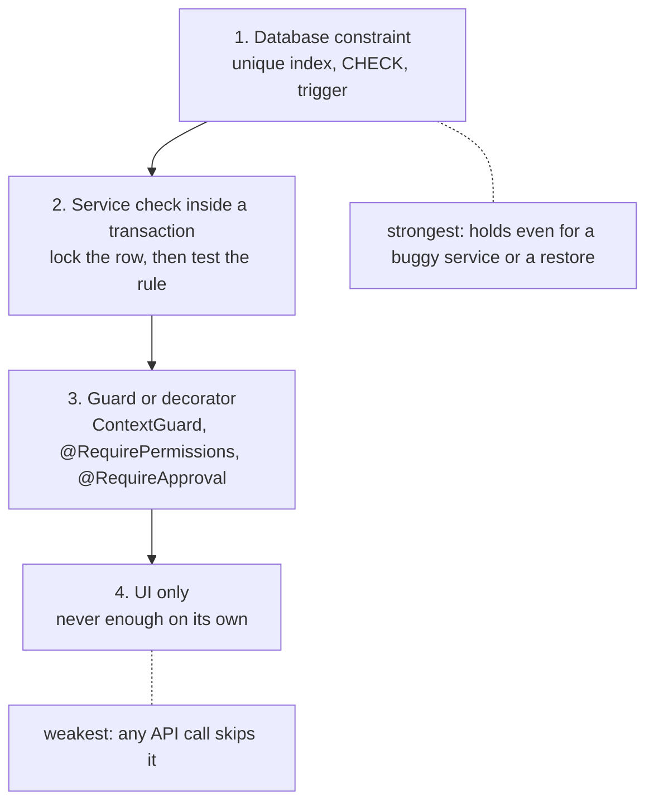

# Domain invariants

An **invariant** is a rule that must always be true, whatever the user clicks
or the API is sent. "A wallet never goes below zero" is one. This doc lists
every invariant the pre-launch audit (Epic 68, #2150) checked, one table per
domain, with the code that enforces it today or the open issue that will.

Read the section for your area before you change money, enrolment, results,
attendance, tenancy or permissions. If your change could break a row, keep
the row true, and add a row when you add a new rule.

## Where a rule can be enforced

The lower a rule sits in this list, the easier it is to bypass. Put each rule
as high as it can go.

## How to read the tables

- **Enforced by** names a file and a symbol. Paths are under
  `server/src/modules/` unless they start with `server/`, `client-admin/`
  or `ui/`. Example: `fees/wallet.service.ts` `WalletService.debit` is
  `server/src/modules/fees/wallet.service.ts`.
- **Status** is one of:
  - `enforced` — the code holds the rule on every path we know.
  - `partly` — it holds on most paths; the cell says which one is missing.
  - `not yet` — nothing holds it today; the cell names the open issue.
  - `by design` — the rule is deliberately weaker, and the cell names the
    decision (D12, D16 etc. are decisions on Epic 68, #2150).

## Tenancy and identity

One deployment hosts many schools (tenants). One person has one login that
can belong to several schools. See
[02-auth-and-multitenancy.md](02-auth-and-multitenancy.md#same-person-in-several-schools).

| Invariant                                                                                               | Enforced by                                                                                                                                                                                                                                                                                                                                                                 | Status                                                                                                                        |
| ------------------------------------------------------------------------------------------------------- | --------------------------------------------------------------------------------------------------------------------------------------------------------------------------------------------------------------------------------------------------------------------------------------------------------------------------------------------------------------------------- | ----------------------------------------------------------------------------------------------------------------------------- |
| Every unique key on a school's table includes `tenant_id`, so two schools never collide on a value.     | `server/test/tenant-unique-keys.integration.spec.ts` fails CI on a new platform-wide unique key; its `ALLOW_LIST` names the known ones                                                                                                                                                                                                                                      | yes                                                                                                                           |
| No school can change a login (email, phone, password) that also belongs to another school.              | `users/users.service.ts` `countOtherMemberships`, checked by `UserService.update` and `account-access/recovery.service.ts` `adminReset` (409 `SHARED_IDENTITY`), and by the restore tab `workbook/tabs/people/users.tab.ts` (`sharedElsewhere`)                                                                                                                             | enforced                                                                                                                      |
| Every change to a login's email, phone or name leaves an audit row with old and new values.             | `users/users.service.ts` `UserService.update` (audit `entity_type: 'User'` in the same transaction); `account-access/contact-change.service.ts` confirm steps                                                                                                                                                                                                               | enforced                                                                                                                      |
| An existing account joins a school only when the person accepts.                                        | `account-access/school-invite.service.ts` `insertJoinRequest` and `SchoolInviteService.accept`; used by platform provisioning (`schools/provisioning/provisioning.service.ts`), guardian invites (`account-access/invitation-batch.processor.ts`) and restore (`users.tab.ts`). "Add staff" (`POST /users`) refuses an existing email or phone with 409 and attaches nobody | enforced                                                                                                                      |
| Accounts are matched and linked only through a contact the person has proved.                           | `account-access/guardian-provisioning.service.ts` (verified contacts only); `registration/registration.service.ts` (stores only the verified contact); `account-access/activation.service.ts` (an invite never overwrites an existing password)                                                                                                                             | enforced                                                                                                                      |
| A reset link an admin sends can be used, and only for the email it was sent to.                         | `account-access/recovery.service.ts` (token `metadata.email`, checked again by `reset()`)                                                                                                                                                                                                                                                                                   | enforced                                                                                                                      |
| A password reset removes every connected Google or Facebook sign-in.                                    | `account-access/recovery.service.ts` `applyNewPassword` (deletes `user_identities` rows and audits each, one transaction)                                                                                                                                                                                                                                                   | enforced                                                                                                                      |
| One phone or email gets a bounded number of sign-in and reset codes.                                    | `account-access/otp.service.ts` (60 s cooldown, at most 5 per purpose per hour; admin reset is not capped)                                                                                                                                                                                                                                                                  | enforced                                                                                                                      |
| Login lockout counts per identifier, across all schools.                                                | `auth/login-attempt.service.ts` (Redis key `login-lockout:<identifier>`; fails open if Redis is down)                                                                                                                                                                                                                                                                       | by design — D16 "login lockout stays global"                                                                                  |
| A reset or invite link starts a session for all the person's schools, not only the school that sent it. | `account-access/recovery.service.ts` and `account-access/activation.service.ts` call `AuthService.startSession`                                                                                                                                                                                                                                                             | by design — one login spans every membership (D12)                                                                            |
| A removed member loses access to that school.                                                           | `DELETE /users/:id` soft-deletes that school's `user_tenants` row, then `auth/access-token-denylist.service.ts` `revokeUserTokensIssuedBefore` sets a per-user cut-off; `auth/strategies/jwt.strategy.ts` refuses every older token (`iat_ms`, taken before the memberships were read) on the next request, and `POST /auth/refresh` re-reads memberships                   | enforced — fails open while Redis is down (then up to 15 minutes)                                                             |
| A stored file's key always lives under `tenants/<own school id>/`, and the caller cannot choose it.     | `storage/storage-key.ts` `tenantObjectKey` (random UUID name); restore: `workbook/codec/storage-key-scope.ts` `ownStorageKey` / `rehomeStorageKey` in every tab with a file column                                                                                                                                                                                          | enforced                                                                                                                      |
| "Today" is the school's own date, in pages and in nightly jobs.                                         | `attendance/attendance-policy.util.ts` `localToday(settings.region.timezone)`, used by attendance, calendar, homework, study plans and attention                                                                                                                                                                                                                            | partly — `fees/fees-daily.scheduler.ts` and other users of `common/time.ts` `todayInSchoolTz` use a fixed `Asia/Dhaka`: #2295 |
| A parent's phone and email have one owner, the same for login and for SMS.                              | `students/linked-guardian-contacts.util.ts` `syncLinkedGuardianContacts` (called by `ContactChangeService` and `UserService.update`, same transaction); `students/students.service.ts` `assertContactNotOwnedByLogin` refuses a guardian-record edit (409 `CONTACT_OWNED_BY_LOGIN`)                                                                                         | partly — the workbook import and link time (invitation batch, join accept) still write the guardian copy on their own: #2495  |

Example: Rahim is an ADMIN at Greenview and a PARENT at Riverside.
Riverside's admin sends `PATCH /api/v1/users/<rahim>` with a new phone. The
server answers `409` with `details.code: "SHARED_IDENTITY"`, and nothing
changes. Rahim changes it himself from his profile.

## Authorization

Who may do what inside one school. The guard chain is in
[02-auth-and-multitenancy.md](02-auth-and-multitenancy.md#roles-and-permissions-both).

| Invariant                                                                                                                    | Enforced by                                                                                                                                                                                                                 | Status                                                                                               |
| ---------------------------------------------------------------------------------------------------------------------------- | --------------------------------------------------------------------------------------------------------------------------------------------------------------------------------------------------------------------------- | ---------------------------------------------------------------------------------------------------- |
| Every school route declares a permission, or is on a reviewed identity-scoped list.                                          | `server/src/permission-matrix.e2e-spec.ts` (`IDENTITY_SCOPED`, `ROLE_NARROWINGS`); every route's permission is pinned in `server/src/__snapshots__/route-permissions.txt`; `auth/guards/permissions.guard.ts`               | enforced                                                                                             |
| A request acts only in a school where the caller holds a membership.                                                         | `auth/guards/context.guard.ts` `resolveRole` (checks `X-Tenant-ID` against the token's memberships)                                                                                                                         | enforced                                                                                             |
| Platform-only routes need a real platform operator.                                                                          | `auth/guards/platform-super-admin.guard.ts` `PlatformSuperAdminGuard`, opt-in per route                                                                                                                                     | partly — some platform routes still accept SUPER_ADMIN from a school membership: #1307, #1312, #1313 |
| SUPER_ADMIN can never be granted from inside a school.                                                                       | `users/users.service.ts` `UserService.create`; `users/staff-bulk-upload.parser.ts` `IMPORTABLE_ROLES`; `workbook/tabs/people/users.tab.ts`                                                                                  | partly — old school-level SUPER_ADMIN rows still exist: #1313                                        |
| A suspended school gets no HTTP access, from the next request on.                                                            | `ContextGuard` calls `schools/tenant-status.service.ts` `TenantStatusService.isActive` on every request; the cache is cleared when the status changes                                                                       | enforced                                                                                             |
| A deactivated user cannot sign in by any route: password, refresh, code, Google/Facebook, first password, reset.             | `auth/auth.service.ts`, `account-access/otp-login.service.ts`, `auth/social/social-auth.service.ts`, `account-access/first-password.service.ts`, `account-access/recovery.service.ts`                                       | enforced                                                                                             |
| Google or Facebook sign-in never links an account by matching email.                                                         | `auth/social/social-auth.service.ts` (connect only from a signed-in session; `state` and PKCE)                                                                                                                              | enforced                                                                                             |
| A parent or student sees only their linked children.                                                                         | `students/family-access.service.ts` `FamilyAccessService.assertLinked` / `linkedStudentsQuery`; family pages such as `print/exam-documents/family-admit-card.service.ts` and `study-plans/family-study-plans.controller.ts` | enforced                                                                                             |
| A teacher sees only the students, guardian contacts and results of their own sections.                                       | `classes/teacher-scope.service.ts` `TeacherScopeService` (students, transcripts, results, homework, marks, alerts)                                                                                                          | partly — fee dues, payment history and merit lists: #1808, #1832, #1833                              |
| A teacher enters marks only for their own section and subject, unless they hold school-wide `MARK_ENTER`.                    | `exams/marks-authorization.util.ts` `MarksAuthorizationService.assertCanWrite`, called by `exams/marks.service.ts` and `exams/mark-grid.service.ts`                                                                         | enforced                                                                                             |
| An approval token works once, for one actor, one school and one scope.                                                       | `auth/guards/approval.guard.ts` `ApprovalGuard`; `auth/step-up.service.ts` (`tid` claim)                                                                                                                                    | enforced                                                                                             |
| Nobody decides their own application.                                                                                        | `applications/reviewer-scope.ts` `isOwn` (D49)                                                                                                                                                                              | enforced                                                                                             |
| A person sees only the alerts of the role they are acting as.                                                                | `attention/api/attention-query.service.ts` `assertOwnRole`                                                                                                                                                                  | enforced                                                                                             |
| Search stays inside one school and respects permissions; parents and students cannot search.                                 | `search/search.service.ts` (binds `tenant_id` on every join, one permission per result group)                                                                                                                               | enforced                                                                                             |
| A teacher never sees their own survey results or incidents filed about them; performance pages show only their own sections. | `surveys/survey-results.service.ts`, `incidents/incidents.service.ts`, `performance/staff-performance.service.ts`, `performance/performance.service.ts`                                                                     | enforced                                                                                             |

Example: Salma teaches Class 6-A only. Her student list shows Class 6-A
students only, because `TeacherScopeService` narrows the query to her own
sections on the server, not just in the menu. She can still list every
student's dues in the school today; closing that is #1808.

## Money

Fees, payments, wallets, invoices. Flow details are in
[04-fees-payments-invoices.md](04-fees-payments-invoices.md).

| Invariant                                                                                                                | Enforced by                                                                                                                                                                                                                                                                                             | Status                                                                                                                                      |
| ------------------------------------------------------------------------------------------------------------------------ | ------------------------------------------------------------------------------------------------------------------------------------------------------------------------------------------------------------------------------------------------------------------------------------------------------- | ------------------------------------------------------------------------------------------------------------------------------------------- |
| Two cashiers cannot over-collect the same bill.                                                                          | `fees/checkout.service.ts` (bill rows locked `FOR UPDATE` in id order, balance re-checked under the lock)                                                                                                                                                                                               | enforced                                                                                                                                    |
| A double click or a retry never charges twice.                                                                           | unique index `IDX_payments_tenant_idempotency_key` on (`tenant_id`, `idempotency_key`), re-checked under the lock in `checkout.service.ts`                                                                                                                                                              | enforced                                                                                                                                    |
| A payment and every allocation are positive.                                                                             | CHECKs `CHK_pay_total_amount` and `CHK_pa_allocated_amount` (InitialSchema migration)                                                                                                                                                                                                                   | enforced                                                                                                                                    |
| A wallet never goes below zero, and its ledger is never edited.                                                          | CHECK `CHK_sw_balance_non_negative`; trigger `trg_wallet_transactions_write_only`; `fees/wallet.service.ts` `WalletService.debit` locks the row                                                                                                                                                         | enforced                                                                                                                                    |
| A payment is reversed at most once, by an admin with an approval token. Nothing deletes a payment.                       | `fees/payment-reversal.service.ts` `assertReversible` under a row lock; `fees/checkout.controller.ts` `PAYMENT_REVERSE` + `@RequireApproval(PAYMENTS_REVERSE)`; no delete route in `route-permissions.txt`                                                                                              | partly — self-approval only in a single-admin school, unless `fees.requireSecondApprover` (78 D1); both ids and `self_approved` are audited |
| An issued invoice's amounts never change.                                                                                | trigger `trg_enforce_invoice_immutability` (migrations `1789800008000`, `1791600000300`)                                                                                                                                                                                                                | enforced                                                                                                                                    |
| Invoice and credit-note numbers are per school, in order, and unique.                                                    | `invoices/invoice-numbering.util.ts` `generateInvoiceNumber` / `generateCreditNoteNumber`                                                                                                                                                                                                               | enforced                                                                                                                                    |
| A bill's `paid_amount` equals the sum of its live allocations.                                                           | services only: `checkout.service.ts`, `payment-reversal.service.ts`, `fees/removed-bill-money.ts`; a restore cannot change money rows (`workbook/codec/insert-only-tabs.ts`)                                                                                                                            | partly — no database check ties the two together                                                                                            |
| A bill is never paid below zero or past its total.                                                                       | CHECKs `CHK_sf_paid_amount` (`paid_amount >= 0`), `CHK_sf_paid_plus_discount` (`paid + discount <= total`) and `CHK_sf_waived_settled` (a WAIVED bill has `paid + discount = total`), the last two NOT VALID (old rows are audited by hand); the checkout service compares in whole paisa, no tolerance | enforced for new rows (old rows: run the audit SQL in migration `1791900000300`, then `VALIDATE CONSTRAINT`)                                |
| Money is never lost when a bill or a student is removed.                                                                 | `fees/removed-bill-money.ts` `returnMoneyOfRemovedBills` (paid money goes to the wallet); `students/students.service.ts` `remove` refuses with 409 `STUDENT_HAS_OPEN_MONEY`; restore never changes or deletes money rows (`INSERT_ONLY_TABS`)                                                           | enforced                                                                                                                                    |
| Every money change leaves an audit row, committed with the change.                                                       | `checkout.service.ts`, `payment-reversal.service.ts`, `fees/late-fee.service.ts` (one row per sweep), `students/students.service.ts` (student create and delete)                                                                                                                                        | enforced                                                                                                                                    |
| In the collections report, net = collected − reversed, a past day never changes, and the breakdown adds up to the total. | `reports/collections-report.service.ts` (a reversal is its own row, on its own day; `CASH_RECEIVED_SQL`). Wallet payouts are reported separately as `wallet_paid_out`; cash in hand = net cash - paid out.                                                                                              | enforced                                                                                                                                    |
| Each recurring fee period is billed exactly once, even when the daily job missed a day.                                  | `fees/fees-daily.scheduler.ts` (`last_run_period` under a row lock, catch-up run) and `fees/recurrence.util.ts`                                                                                                                                                                                         | enforced                                                                                                                                    |
| A fine rule never bills the same fine twice.                                                                             | `fees/fines/fine-sweep.service.ts` (`DuplicateStrategy.SKIP`)                                                                                                                                                                                                                                           | enforced                                                                                                                                    |
| A discount needs an approval token.                                                                                      | `approvalService.consume(…, ApprovalScope.FEES_DISCOUNT)` in `checkout.service.ts` and `fees/fines/fines.service.ts`                                                                                                                                                                                    | partly — the approver may be the person acting (single-admin schools); both ids are audited                                                 |
| A fee structure's type cannot change once any bill uses it.                                                              | `fees/fees.service.ts` (type change refused while bills exist, checked under a row lock)                                                                                                                                                                                                                | enforced                                                                                                                                    |
| A year with enrollments, exams or bills cannot be deleted (409 `ACADEMIC_YEAR_IN_USE`).                                  | `academics/academic-year.service.ts` `remove`                                                                                                                                                                                                                                                           | enforced                                                                                                                                    |

Example: a cashier reverses a 1,500 tk payment taken on 3 March, on 5 March.
The collections report for 3 March still shows 1,500 collected. The report
for 5 March shows −1,500. The 3 March total never moves.

## Student lifecycle and admission

Admission, enrolment, leaving, readmission and promotion. See
[19-student-lifecycle.md](19-student-lifecycle.md).

| Invariant                                                                                        | Enforced by                                                                                                                                                                                          | Status                                                                      |
| ------------------------------------------------------------------------------------------------ | ---------------------------------------------------------------------------------------------------------------------------------------------------------------------------------------------------- | --------------------------------------------------------------------------- |
| A student's status changes only together with a lifecycle event.                                 | `students/student-lifecycle.service.ts` `StudentLifecycleService` (event and status in one transaction)                                                                                              | partly — a workbook restore can still change status or delete events: #1219 |
| Lifecycle events are never edited or deleted.                                                    | planned in #1219                                                                                                                                                                                     | not yet — #1219                                                             |
| A student has at most one ACTIVE enrollment per academic year.                                   | partial unique index `IDX_enr_active_student_year`                                                                                                                                                   | enforced                                                                    |
| A student who left comes back only through "Readmit".                                            | `enrollments/enrollments.service.ts` (a new enrollment cannot reactivate a student); `student-lifecycle.service.ts` `readmit`                                                                        | enforced                                                                    |
| Leaving closes every live enrollment, not only the latest year's.                                | planned in #1217                                                                                                                                                                                     | not yet — #1217                                                             |
| Roll numbers are unique within a section, and moving a student never crashes on a taken one.     | unique index on `students (class_section_id, roll_number)`; `students/students.service.ts` and `students/bulk-upload.service.ts` pick a free number                                                  | enforced                                                                    |
| Registration numbers are unique per school.                                                      | `IDX_students_tenant_id_registration_number`; `students.service.ts` takes the next number with `common/utils/next-serial.util.ts` `nextTenantSerial` (advisory lock plus numeric max)                | enforced                                                                    |
| Employee ids are unique per school.                                                              | unique index on `staff_profiles (tenant_id, employee_id)`; `StaffProfilesService.createFor` and `TeacherStaffProfileSubscriber` both use `nextTenantSerial`                                          | yes                                                                         |
| A section, class, academic year or grading scale still in use cannot be deleted.                 | `classes/classes.service.ts`, `academics/academic-year.service.ts`, `grading/grading.service.ts` (409 `GRADING_SCALE_IN_USE`); registry test `server/test/delete-guard-registry.integration.spec.ts` | enforced                                                                    |
| The promotion list is the live ACTIVE students of the source class.                              | `promotions/promotions.service.ts` `computeCohortStats`; "Refresh" drops leavers and adds joiners                                                                                                    | enforced                                                                    |
| One committed promotion run per source class and target year.                                    | partial unique index `IDX_promotion_runs_committed_unique`                                                                                                                                           | enforced                                                                    |
| Moving a student to another class, or overriding a promotion outcome, needs the promotion right. | `enrollments/enrollments.service.ts` and `applications/handlers/section-change.handler.ts` (`PROMOTION_MANAGE`); `promotions.service.ts` (`PROMOTION_OVERRIDE` plus step-up)                         | enforced                                                                    |
| The school's seat limit holds on create, readmit and bulk import.                                | `schools/trial/seat-limit.service.ts` `lockSeatUsage` / `assertSeatsAvailable`                                                                                                                       | enforced                                                                    |
| An intake's seat count holds when two admissions race.                                           | `admission/admission-applicant.service.ts` and `admission/applicant-review.service.ts` (intake row locked `pessimistic_write`)                                                                       | enforced                                                                    |
| A child is linked to an existing guardian only when staff picked that guardian.                  | `admission/applicant-review.service.ts`, `students/bulk-upload.service.ts`, `students.service.ts` `findByPhoneWithStudents`                                                                          | enforced                                                                    |
| Creating, deleting or promoting a student is audited.                                            | `students.service.ts` (CREATE audit in the same transaction); `promotions.service.ts` commit audit                                                                                                   | enforced                                                                    |
| Leave and fee-waiver approvals refuse a student who already left.                                | `applications/handlers/student-leave.handler.ts`, `applications/handlers/fee-waiver.handler.ts`                                                                                                      | enforced                                                                    |
| A valid Transfer Certificate means the student is not enrolled.                                  | `student-lifecycle.service.ts` `readmit` revokes the student's live TCs                                                                                                                              | enforced                                                                    |

Example: Nadia left in June and her guardian applies to bring her back in
August. Staff send `POST /api/v1/enrollments` for her. The server refuses:
"Use Readmit to bring them back". `POST /api/v1/students/<nadia>/readmit`
works, writes a READMITTED event and revokes her old Transfer Certificate.

## Exams and results

Marks, processing, publishing, certificates, seat plans, ACR.

| Invariant                                                                                                      | Enforced by                                                                                                                                                                                                              | Status                                                                                      |
| -------------------------------------------------------------------------------------------------------------- | ------------------------------------------------------------------------------------------------------------------------------------------------------------------------------------------------------------------------ | ------------------------------------------------------------------------------------------- |
| ABSENT is never stored or read as zero, and a blank cell is never a silent 0.                                  | CHECK `CHK_marks_value_only_when_present`; `exams/results.service.ts` reads PRESENT-with-no-value as ABSENT; `exams/result-rules.ts` `computeSubjectTotal`                                                               | enforced                                                                                    |
| A mark sheet with blank cells cannot be submitted or processed.                                                | `exams/mark-grid.service.ts` `blankCells`                                                                                                                                                                                | enforced                                                                                    |
| A mark is never above its component's full marks, and a published exam's parts cannot change.                  | `exams/marks.service.ts` (value ≤ `full_marks` at write); `exams/exam-components.service.ts` `lockEditableExam`                                                                                                          | enforced                                                                                    |
| Marks go only to students on that section's sheet.                                                             | `exams/marks.service.ts` (ACTIVE enrollment check)                                                                                                                                                                       | enforced                                                                                    |
| Marks are frozen once results are published.                                                                   | `exams/marks.service.ts` status check; `lockExam` (`FOR SHARE`) in `results.service.ts`; a restore never changes marks (`INSERT_ONLY_TABS`)                                                                              | enforced                                                                                    |
| Changing a published result needs an approval token and is audited.                                            | `exams/results.controller.ts` reopen route `@RequireApproval(RESULTS_REOPEN)`; edits refused while published (`lockEditableExam`)                                                                                        | partly — the approver may be the person acting (single-admin schools); both ids are audited |
| Every mark change records who changed what, from old value to new.                                             | `exams/marks.service.ts` per-cell audit diff                                                                                                                                                                             | enforced                                                                                    |
| A component's own pass marks decide whether the subject is passed.                                             | `exams/result-rules.ts` `computeSubjectTotal` (`pass_marks`)                                                                                                                                                             | enforced                                                                                    |
| A grading-scale edit recomputes the results that use it, and is refused while published results use it.        | `results.service.ts` `recomputeProcessedExam`; `exams/result-recomputer.service.ts` `ExamResultRecomputer`; `grading/recompute.service.ts` `findPublishedExams` (D16)                                                    | enforced                                                                                    |
| A result belongs to the students who sat the exam, for every component, even after they leave or are promoted. | `exams/exam-cohort.ts` `loadExamCohort`; `exams/attendance-component.service.ts` uses the exam's own roster                                                                                                              | enforced                                                                                    |
| A fourth subject never fails the result, and GPA never goes above 5.00.                                        | `exams/result-rules.ts` `combineSubjects`                                                                                                                                                                                | enforced                                                                                    |
| Merit ranks go 1, 2, 2, 4, and failed students are not ranked.                                                 | `exams/result-rules.ts` `rankByMerit`                                                                                                                                                                                    | enforced                                                                                    |
| Results are not processed while a student's choice-group pick is missing.                                      | `exams/results.service.ts` `findMissingPicks` (409, not bypassed by force)                                                                                                                                               | partly — removing a pick or stream after processing does not recompute: #1326, #981         |
| Families see published results only.                                                                           | `exams/results.controller.ts` `listForStudent` / `getStudentResultCard` (published only for guardian roles) plus `assertLinked`                                                                                          | enforced                                                                                    |
| A result certificate is issued only from a published, passed or ranked result.                                 | `print/catalog/result-certificate.resolver.ts` `ResultCertificateResolver`                                                                                                                                               | enforced                                                                                    |
| After a reopen, certificates already issued are listed for staff to revoke.                                    | `client-admin/src/routes/_staff/results/-publish-dialog.tsx` reading `print/jobs/print-history.service.ts`                                                                                                               | by design — D16 "reopen lists certs + one-click revoke"                                     |
| Print serial numbers are unique per kind and year.                                                             | `print/jobs/print-jobs.service.ts` (advisory lock plus partial unique index)                                                                                                                                             | enforced                                                                                    |
| The subject of an ACR never sees or prints their own ACR, and a completed ACR is read-only until reopened.     | `acr/acr-assessments.service.ts` `findVisible` and `COMPLETED` check                                                                                                                                                     | enforced                                                                                    |
| A room is never double-booked across published seat plans, and a sitting in a published plan cannot move.      | `seat-plans/seat-plans.service.ts` publish check under `pg_advisory_xact_lock`; `exams/exam-schedules.service.ts` `assertNotInPublishedSeatPlan`                                                                         | enforced                                                                                    |
| An invigilator is a staff member of this school and is not busy elsewhere at that time.                        | `seat-plans/seat-plans.service.ts` `updateInvigilator` (`EMPLOYEE_ROLES`, D16) plus `routines/teacher-busy.service.ts` `busyAt`                                                                                          | enforced                                                                                    |
| Last year's teachers can still read their class's marks while last year's exam is unfinished.                  | `classes/teacher-scope.service.ts` (homeroom read grant kept in the year right before the current one while that class has a DRAFT exam, the same test as the marks-overdue alert). Homeroom never had mark write access | enforced                                                                                    |

Example: Karim sat the Half-Yearly in Class 8 and was promoted to Class 9
before the results were processed. Processing still includes him, because
the cohort comes from who was enrolled when the exam ran, not from today's
Class 8 list.

## Attendance, leave, routines and calendar

See [11-attendance.md](11-attendance.md),
[18-staff-attendance-leave.md](18-staff-attendance-leave.md) and
[16-academic-calendar.md](16-academic-calendar.md).

| Invariant                                                                                                                 | Enforced by                                                                                                                                                                                                                                                                                                                                                                                | Status                                                                                                  |
| ------------------------------------------------------------------------------------------------------------------------- | ------------------------------------------------------------------------------------------------------------------------------------------------------------------------------------------------------------------------------------------------------------------------------------------------------------------------------------------------------------------------------------------ | ------------------------------------------------------------------------------------------------------- |
| A future day holds only LEAVE marks, and only if the school allows future dates.                                          | `attendance/attendance.service.ts` `writeRegisterDay` and `correctRecord` (`ATTENDANCE_FUTURE_NOT_LEAVE`)                                                                                                                                                                                                                                                                                  | enforced                                                                                                |
| A finalized register changes only with `ATTENDANCE_CORRECT` and a reason.                                                 | `attendance.service.ts` `writeRegisterDay` and `correctRecord` (`ATTENDANCE_FINALIZED`, `ATTENDANCE_REASON_REQUIRED`)                                                                                                                                                                                                                                                                      | enforced                                                                                                |
| No marks on a non-working day unless forced by someone with `ATTENDANCE_CORRECT`.                                         | `attendance.service.ts` through `SchoolCalendarService.isNonWorkingDay` (class-aware)                                                                                                                                                                                                                                                                                                      | enforced                                                                                                |
| Two people saving one register at the same time cannot overwrite each other.                                              | `attendance.service.ts` (row lock plus `base_version`)                                                                                                                                                                                                                                                                                                                                     | enforced                                                                                                |
| An offline save replayed twice is applied once.                                                                           | `attendance.service.ts` (`last_client_request_id`)                                                                                                                                                                                                                                                                                                                                         | enforced                                                                                                |
| Every student attendance correction is audited.                                                                           | `attendance.service.ts` `recordAudits` and `correctRecord`                                                                                                                                                                                                                                                                                                                                 | enforced                                                                                                |
| Staff mark only their own attendance, for today, as a new mark; admins do the rest.                                       | `staff-attendance/staff-attendance.service.ts` (`LEAVE_APPROVE` decides who is an admin here)                                                                                                                                                                                                                                                                                              | enforced                                                                                                |
| Past calendar events are locked; a past closure can be recorded with a reason.                                            | `calendar/calendar-events.service.ts` `assertNotPast`; the old holiday write routes were removed, so every write goes through `CalendarEventsService`                                                                                                                                                                                                                                      | enforced                                                                                                |
| A day that already has attendance cannot become non-working.                                                              | `calendar-events.service.ts` `assertNoAttendanceInRange` (422 `CALENDAR_DAY_HAS_ATTENDANCE`)                                                                                                                                                                                                                                                                                               | enforced                                                                                                |
| Whether a past date was a school day never changes when the weekly off-day changes.                                       | `attendance/attendance-policy.util.ts` `isWeeklyOff` (`weeklyOffHistory`)                                                                                                                                                                                                                                                                                                                  | enforced                                                                                                |
| Leave balance = yearly quota − approved working days in that calendar year, counted live.                                 | `leave/leave.service.ts` `approvedDaysInRange`                                                                                                                                                                                                                                                                                                                                             | enforced                                                                                                |
| Two approved leaves never overlap for the same staff member or student.                                                   | `applications/handlers/staff-leave.handler.ts`, `applications/handlers/student-leave.handler.ts` (overlap check under a row lock)                                                                                                                                                                                                                                                          | enforced                                                                                                |
| A teacher is never booked twice at the same time: class period, substitution or invigilation.                             | `routines/constraint-check.ts` (`TEACHER_DOUBLE_BOOKED`); `routines/teacher-busy.service.ts` `busyAt`                                                                                                                                                                                                                                                                                      | partly — two slot writes at the same moment (#953). Teachers shared across branches are checked (#2155) |
| One arrival notice per student, guardian and day, even if a gate punch and the register both fire.                        | `attendance/arrival-notice.service.ts` (unique `reference_key` `arrival:<date>:<student>:<guardian>`). Tests: `arrival-notice.service.integration.spec.ts` "3 present students, 2 subscribed -> 2 logs; a second call the same day adds none"; `arrival-notice-hooks.integration.spec.ts` "punch then teacher finalize the same day -> still 1 log for that guardian"                      | enforced                                                                                                |
| A guardian who opted out (`OFF`) gets no arrival notice, even under an `ALWAYS` lock.                                     | `attendance/arrival-notice.service.ts`. Test: `arrival-notice.service.spec.ts` "skips an opted-out guardian even with an ALWAYS lock"                                                                                                                                                                                                                                                      | enforced                                                                                                |
| An arrival notice goes by SMS only when the school allows SMS (`arrivalNotice.smsAllowed`); the credit is reserved first. | `attendance/arrival-notice.service.ts` (send), `attendance/arrival-subscriptions.service.ts` (request). Tests: `arrival-notice.service.spec.ts` "skips SMS when smsAllowed is off, and PUSH when the guardian has no user", "reserves credit for SMS before enqueue; ..."; `arrival-subscriptions.service.spec.ts` "refuses SMS when the school does not allow it, allows it when it does" | enforced                                                                                                |
| A routine still explains past dates after it is edited.                                                                   | `routines/routine-slots.service.ts` (a slot that already ran is end-dated, never deleted; back-dated edits refused)                                                                                                                                                                                                                                                                        | enforced                                                                                                |

Example: a school moves its weekly off-day from Friday to Saturday on
1 September. Attendance for Friday 15 August still counts as an off day,
because `isWeeklyOff` reads the off-days that were in force on that date.

## Background jobs and messages

Nightly jobs, SMS, push and alerts. See
[05-communications.md](05-communications.md) and
[23-attention.md](23-attention.md).

| Invariant                                                                                                 | Enforced by                                                                                                                                                                                                      | Status                                                                                           |
| --------------------------------------------------------------------------------------------------------- | ---------------------------------------------------------------------------------------------------------------------------------------------------------------------------------------------------------------- | ------------------------------------------------------------------------------------------------ |
| A suspended school does nothing in the background.                                                        | `communications/worker/communications.processor.ts` (`isActive` before any provider call); `fees/fees-daily.scheduler.ts`, `attention/engine/attention-scheduler.ts` and the trial jobs pick ACTIVE schools only | partly — homework, absence and study-plan jobs, attendance devices and invitation batches: #2288 |
| One school's failure never stops the job for other schools.                                               | a per-school `try/catch` in each scheduler loop, e.g. `attention/engine/attention-scheduler.ts`                                                                                                                  | enforced                                                                                         |
| A retried message job never re-sends a message that already finished.                                     | `communications.processor.ts` (a `SENT` or `FAILED` log is skipped)                                                                                                                                              | enforced                                                                                         |
| Every SMS of a metered school reserves credit before sending and settles once.                            | `communications/credits/sms-credit.service.ts` `reserve` / `settlePart`                                                                                                                                          | enforced                                                                                         |
| Every message job has the same retry and clean-up policy.                                                 | `communications/communications.constants.ts` `COMMUNICATIONS_QUEUE_JOB_OPTIONS` (3 attempts, removed on completion)                                                                                              | enforced                                                                                         |
| Fee SMS reaches schools that use the platform's metered SMS.                                              | `schools/settings/sms-provider-config.validator.ts` (metering always has a provider); `communications/fee-notifications.listener.ts`                                                                             | enforced                                                                                         |
| A guardian who turned notifications off gets no automated message.                                        | `communications/reminder-recipients.util.ts` `resolveReminderAudience`, used by the fee, absence, result and study-plan senders                                                                                  | enforced                                                                                         |
| One message per guardian per event, with siblings grouped.                                                | `attendance/absence-notice.service.ts`, `fee-notifications.listener.ts`, `exams/result-sms.service.ts`, `study-plans/study-plan-flags.scheduler.ts`, `homework/homework-notice.service.ts`                       | enforced                                                                                         |
| Result SMS goes once per publication.                                                                     | `exams/result-sms.service.ts` (publication key plus a unique `reference_key`)                                                                                                                                    | enforced                                                                                         |
| An absence notice goes at most once per register day, and a correction follows if the register was wrong. | `attendance/absence-notice.service.ts` (`notified_at` under a row lock; correction template)                                                                                                                     | enforced                                                                                         |
| Absence SMS goes only for registers a person finalized.                                                   | `attendance/absence-notice.scheduler.ts` (`FINALIZED` registers only)                                                                                                                                            | enforced                                                                                         |
| Homework messages go only to families of current students.                                                | `homework/homework-notice.service.ts` (ACTIVE enrollments only)                                                                                                                                                  | enforced                                                                                         |
| An alert clears as soon as the data behind it is fixed.                                                   | rule re-runs plus `ON_CHANGE` rechecks in `attention/engine/`                                                                                                                                                    | partly — fee rules re-check only once a day: #2287                                               |
| An alert push goes once per recipient opening, and two alert writers cannot race.                         | `attention/delivery/alert-delivery.service.ts` (atomic `pushed_at` claim); `attention/engine/alert-writer.service.ts` (`pg_advisory_xact_lock` per school and rule)                                              | enforced                                                                                         |
| A disabled rule's alerts are withdrawn.                                                                   | `attention-scheduler.ts` calls `withdrawRule` on each sweep                                                                                                                                                      | enforced                                                                                         |
| A teacher who left no longer counts as a section's class teacher.                                         | `attention/rules/structure/section-no-class-teacher.rule.ts` (joins live `user_tenants`)                                                                                                                         | enforced                                                                                         |
| Logging out stops that device's push; "log out everywhere" stops all of them.                             | `ui/src/hooks/auth.ts` unsubscribes the device; `auth/auth.service.ts` `logoutAll` calls `push/push-subscriptions.service.ts` `removeAllForUser`                                                                 | enforced                                                                                         |

Example: a teacher finalizes Class 5's register with Tania ABSENT, and the
absence SMS goes out. Ten minutes later the teacher corrects Tania to
PRESENT. Her guardian gets one correction message, not a second absence
notice.

## Data integrity and backup/restore

The school workbook backup and restore. See
[13-backup-restore.md](13-backup-restore.md) and
[14-school-workbook.md](14-school-workbook.md).

| Invariant                                                                                                                         | Enforced by                                                                                                                                                                                                                | Status                                                           |
| --------------------------------------------------------------------------------------------------------------------------------- | -------------------------------------------------------------------------------------------------------------------------------------------------------------------------------------------------------------------------- | ---------------------------------------------------------------- |
| Every school table is in the backup, or listed as left out.                                                                       | `workbook/codec/registry.completeness.spec.ts`; `workbook/codec/entity-coverage.ts` (`ENTITY_COVERAGE_EXEMPT`, `NOT_IN_BACKUP`)                                                                                            | partly — 16 tables still have no tab: #856                       |
| Every entity column is exported or explicitly excluded.                                                                           | `registry.completeness.spec.ts` ("every tab accounts for every column")                                                                                                                                                    | enforced                                                         |
| A restore never applies a workbook that has errors.                                                                               | `workbook/restore/restore.processor.ts` (re-validates and aborts before any tab is touched)                                                                                                                                | enforced                                                         |
| A TEMPLATE workbook never deletes rows, and preview and apply match rows the same way (id first, then natural key).               | `restore.processor.ts`                                                                                                                                                                                                     | enforced                                                         |
| Nobody writes to a school while its restore runs.                                                                                 | `workbook/restore/restore-lock.ts`; `ContextGuard` answers writes with 423 `TENANT_RESTORING`                                                                                                                              | partly — scheduled senders still run during a restore: #2350     |
| A restore may add money and marks rows but never changes or deletes one.                                                          | `workbook/codec/insert-only-tabs.ts` `INSERT_ONLY_TABS`                                                                                                                                                                    | enforced                                                         |
| A restore never writes another school's platform-wide value from the file.                                                        | `workbook/tabs/school/school.tab.ts` skips `slug` and `domain`; `workbook/tabs/people/teachers.tab.ts` refuses another school's `employee_id`; secret-token tables have no tab                                             | partly — that refusal names the other school's teacher id: #2153 |
| "Approved by" and "entered by" in a restored row are members of this school.                                                      | `ref` columns in `workbook/tabs/fees/payments.tab.ts` and `workbook/tabs/hr/leave-record.tab.ts`                                                                                                                           | partly — the other tabs: #2278                                   |
| The audit log is append-only.                                                                                                     | trigger `trg_audit_logs_write_only`                                                                                                                                                                                        | enforced                                                         |
| A year with enrollments, exams or bills cannot be deleted (409 `ACADEMIC_YEAR_IN_USE`).                                           | `academics/academic-year.service.ts` `remove`                                                                                                                                                                              | enforced                                                         |
| A subject with exam components or marks, and a room used by a seat plan, cannot be deleted (409 `SUBJECT_IN_USE`, `ROOM_IN_USE`). | `academics/subjects.service.ts` `remove`; `routines/rooms.service.ts` `remove`                                                                                                                                             | enforced                                                         |
| Every entity's columns, CHECKs and indexes exist in the database as declared.                                                     | `server/test/migration-schema.integration.spec.ts` (drift guard plus down/up round trip)                                                                                                                                   | enforced                                                         |
| A curriculum preset applies only to a fresh school, one at a time, and reset is blocked while real data exists.                   | `presets/preset-blockers.ts` `FRESH_TENANT_ENTITIES` and `RESET_BLOCKER_ENTITIES`                                                                                                                                          | enforced                                                         |
| Saving one school's row never clears another school's links.                                                                      | `update()` instead of `save()` on a loaded collection, e.g. `classes/classes.service.ts`, `users/users.service.ts`; guardian/student link edits pinned by `students/students.service.integration.spec.ts` (DATA-07, #2299) | enforced                                                         |
| Renaming a stream changes it everywhere it is stored.                                                                             | `schools/schools.service.ts` (sections, classes, `class_subjects`, DRAFT `promotion_entries`)                                                                                                                              | enforced                                                         |

Example: Greenview restores last week's backup while a cashier is on the
fees page. The cashier's "Record payment" gets `423 TENANT_RESTORING` and a
"school is read-only" bar. If the backup holds an older version of a payment,
the restore keeps today's row: payments are insert-only.

## Public pages and privacy

Pages anyone can open, uploaded files, and personal data.

| Invariant                                                                                                                                     | Enforced by                                                                                                                                                                                                                   | Status                                                                         |
| --------------------------------------------------------------------------------------------------------------------------------------------- | ----------------------------------------------------------------------------------------------------------------------------------------------------------------------------------------------------------------------------- | ------------------------------------------------------------------------------ |
| A public page finds a school only by its slug, and only if the school is ACTIVE.                                                              | `schools/schools.service.ts` `findBySlug`                                                                                                                                                                                     | enforced                                                                       |
| Public writes are rate-limited by the real client IP.                                                                                         | global `ThrottlerGuard`; `trust proxy` in `server/src/main.ts`; per-route `@Throttle`, e.g. `admission/public-admission.controller.ts`                                                                                        | enforced                                                                       |
| Sign-up cannot be scripted.                                                                                                                   | `registration/turnstile.service.ts` (fails closed in production)                                                                                                                                                              | enforced                                                                       |
| Forgot-password, code sign-in and invite resend never reveal whether an account exists.                                                       | `account-access/account-access.controller.ts` (always 202)                                                                                                                                                                    | enforced                                                                       |
| A file download never returns another school's object.                                                                                        | each download loads its row by `id` + `tenant_id` first: `print/assets/print-assets.service.ts`, `staff-hr/staff-document.service.ts`, `applications/application-attachments.service.ts`, `students/student-photo.service.ts` | enforced                                                                       |
| Uploaded bytes match the claimed file type, and an uploaded SVG cannot run script.                                                            | `storage/file-signature.ts`; `print/assets/print-assets.controller.ts` (`nosniff` plus `sandbox` CSP)                                                                                                                         | enforced                                                                       |
| Health notes go only to staff with `STUDENT_RECORDS_READ`.                                                                                    | `students/students.service.ts` `redactHealthNotes` on student and guardian routes                                                                                                                                             | partly — other responses that embed a student: #1218                           |
| A CSV export cannot inject spreadsheet formulas.                                                                                              | shared `toCsvContent` (`@biddaloy/shared`)                                                                                                                                                                                    | enforced                                                                       |
| Public input is cleaned like staff input.                                                                                                     | `@SanitizeText` on staff DTOs                                                                                                                                                                                                 | partly — the public admission form has none; every current output escapes HTML |
| Secrets never appear in logs.                                                                                                                 | `common/logging/pino-options.ts`; `common/redact-log.util.ts` `redactPii`; secret link tokens masked in the exception log, Sentry and nginx                                                                                   | enforced                                                                       |
| A school can download its own data, even after its trial ends, and can have it erased.                                                        | `workbook/export/workbook.controller.ts` `@AllowWhenSuspendedForBilling`                                                                                                                                                      | partly — uploaded files are not in the export (#1787); erasure is #1790        |
| Admission staff can open an applicant's documents and delete a rejected applicant's.                                                          | planned in #2281                                                                                                                                                                                                              | not yet — #2281                                                                |
| An anonymous survey never reveals who answered, not in results and not in a backup.                                                           | `surveys/survey-results.service.ts`; `workbook/tabs/people/surveys.tab.ts` (respondent left out for anonymous surveys)                                                                                                        | enforced                                                                       |
| One survey response per respondent, teacher and subject; results stay hidden below `min_responses`; a survey's settings freeze once it opens. | unique index `UQ_survey_responses_once`; `survey-results.service.ts`; `surveys/surveys.service.ts` (DRAFT only, row lock)                                                                                                     | enforced                                                                       |
| An incident notice never reaches the staff member it is about, or the reporter.                                                               | `incidents/incident-notify.listener.ts` (`skip` set)                                                                                                                                                                          | enforced                                                                       |
| Facebook's data-deletion callback is signature-checked in constant time.                                                                      | `auth/social/providers/facebook.provider.ts` (`timingSafeEqual`)                                                                                                                                                              | partly — a valid request can be replayed for 24 hours: #1714                   |

Example: a parent uploads a birth certificate on Greenview's public
admission form. The server stores it as
`tenants/<greenview id>/admission-documents/<random uuid>.pdf`; the parent's
file name is never part of the key. Separately, a Riverside admin who pastes
the id of a Greenview staff document into a download link gets `404`,
because `staff-document.service.ts` looks the row up by id **and**
Riverside's `tenant_id`.
