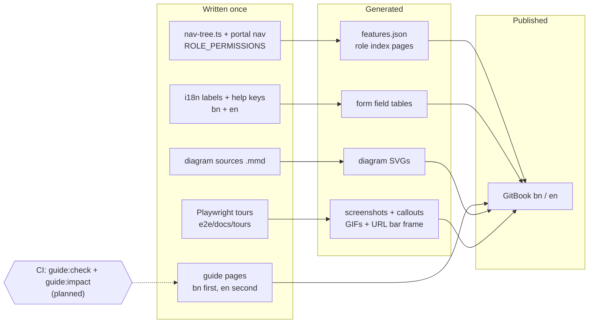
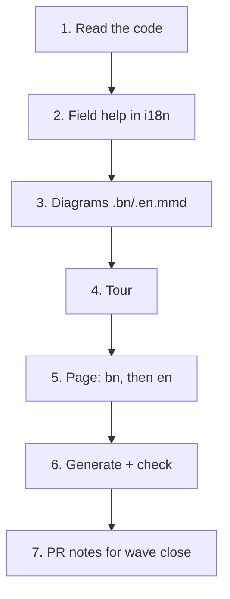
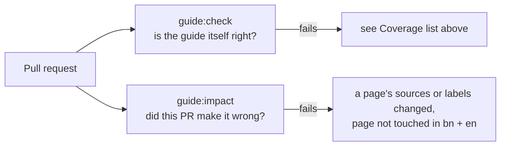
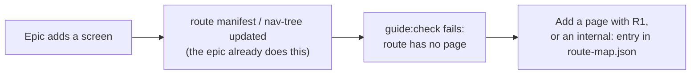
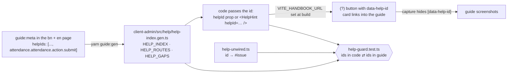

# User guide — the bilingual help site in `docs/user-guide/`

The guide is a GitBook site, built from Markdown in this repo, in Bangla and
English. Epic 42 (#860) builds it. This doc is for **developers and agents**: what
the pieces are, which files are generated, what CI checks, and how to add a page.
Writers also read [`docs/documentation/writing-guide.md`](../documentation/writing-guide.md).

**Status.** Wave 1 of Epic 42 is building the checks and generators. Anything marked
_(planned)_ below does not exist yet; each names the ticket that builds it. Do not
call a planned command in a script or CI step until its ticket has merged.



Narrated video, voice, the media bucket and YouTube are **not in this release**
(D48). They wait in the deferred Epic 85 (#2837).

## What the guide is

One canonical page per customer-facing screen, in two languages, written for
people who may never have used the app.

| Fact           | Value                                                                                           |
| -------------- | ----------------------------------------------------------------------------------------------- |
| Where          | `docs/user-guide/{bn,en}/`                                                                      |
| Published by   | GitBook Git Sync, configured in `gitbook-docs.yaml` (`bn` default space, `en` second)           |
| Languages      | Bangla first, English second (D17). Same file name and same ids in both                         |
| Roles covered  | every role with a sidebar. SUPER_ADMIN is out of the customer guide (D15)                       |
| Brand in prose | "SchoolManager" (see [`branding-compatibility.md`](../documentation/branding-compatibility.md)) |
| Page shape     | locked by [`page-template.md`](../documentation/page-template.md) (D44)                         |
| How to write   | [`writing-guide.md`](../documentation/writing-guide.md)                                         |
| How to draw    | [`diagram-style.md`](../documentation/diagram-style.md)                                         |
| Words          | glossary: [bn](../user-guide/bn/help/glossary.md), [en](../user-guide/en/help/glossary.md)      |

### Structure (same in `bn/` and `en/`)

| #   | Section                                                                              | Path                   |
| --- | ------------------------------------------------------------------------------------ | ---------------------- |
| 1   | Welcome: why SchoolManager, the dashboard story, "আপনি কে?" role cards               | `README.md`            |
| 2   | Getting started: sign in, phone and PWA install, language, account, Ctrl+K, sign out | `start/`               |
| 3   | For the admin: create your school, setup order, scenarios with Excel files           | `admin-setup/`         |
| 4   | Dashboard: every role's dashboard, each widget, thresholds, alerts and notifications | `dashboard/`           |
| 5   | Roles: one generated index per role                                                  | `roles/<role>.md`      |
| 6   | Features: one canonical page per sidebar or portal item                              | `<group>/<feature>.md` |
| 7   | Help: problems and fixes, "why can't I see this?", glossary                          | `help/`                |

## Contracts

These are the "pattern" every later epic reuses. All tickets follow them.

### Page metadata

Every page starts with a hidden HTML comment (invisible on GitHub and GitBook).
The full block is in [`page-template.md`](../documentation/page-template.md). Example:

```markdown
<!-- guide:meta
feature: attendance.attendance       # nav-tree id | portal.<seg> | start.<x> | admin.<x> | dashboard | dashboard.<x> | help.<x>
title: উপস্থিতি নেওয়া
summary: <= 160 characters; this is the HelpCard text (Epic 44)
roles: [TEACHER, ADMIN]
sources: [client-admin/src/routes/_staff/attendance/index.tsx]   # code this page documents
labels: [attendance:mark.*]                                       # i18n key globs (ns:keyGlob) the page quotes
helpIds: [attendance.attendance, attendance.attendance.action.submit]
devices: [desktop, phone]
entry: [sidebar, palette, dashboard:my-pending-sections]
keywords: [হাজিরা, attendance]
appVersion: 0.1.0 (7b776974b)
owner: tareq89
lastVerified: 2026-10-23
knownIssues:
  - { id: submit-stays-draft, checked: 2026-10-23, issue: null }
-->
```

The `bn` and `en` pages of one feature always have the same `feature`, `helpIds`
and `roles`.

### Ids and paths

- helpId grammar: `<feature>`, `<feature>.action.<name>`, `<feature>.field.<name>`, `<feature>.section.<name>`, `widget.<widgetKey>`; a `helpIds` entry may add `#<anchor>` (E20). Details: [In-app help](#in-app-help-epic-44).
- URL slugs are English kebab case in **both** languages (D27).
- The feature id maps to a path through `docs/user-guide/_generated/features.json` _(planned, 42.1.04)_.

### Page anchors

Headings carry explicit ASCII ids, because GitHub and GitBook slug Bangla
differently (D44). The fixed ids are `arrive`, `task-main`, `confirm`, `other`,
`trouble`, `roles`, `known-issues`, `more`. The section list and which are
required are in the [writing guide](../documentation/writing-guide.md#1-order-and-anchors).

### Generated files — never hand-edit

| File or block                                                                                                                                                                                                  | Made by                                           |
| -------------------------------------------------------------------------------------------------------------------------------------------------------------------------------------------------------------- | ------------------------------------------------- |
| `docs/user-guide/_generated/features.json`: `[{ id, kind: "nav"\|"portal"\|"start"\|"admin"\|"dashboard"\|"help", path, route, routes, roles }]`. `routes` lists every manifest route the page documents (D41) | `guide:gen` _(planned, 42.1.04)_                  |
| Marker blocks in a page: `<!-- guide:generated:<kind>:<id> -->` … `<!-- /guide:generated -->`, where kind is `fields`, `roles` or `widgets` (**`video` is not allowed**, D48)                                  | `guide:gen` _(planned)_                           |
| `docs/user-guide/roles/*`                                                                                                                                                                                      | `guide:gen` _(planned, 42.6.03)_                  |
| `docs/user-guide/<lang>/<section>/diagrams/*.svg`                                                                                                                                                              | `scripts/user-guide/render-diagrams.mjs` (exists) |

### Coverage

`docs/user-guide/coverage.json` holds `{ "<feature id>": "planned" | "done" }`.
`guide:check` hard-fails when:

- a `features.json` id is missing from `coverage.json`;
- a `done` id lacks a bn or an en page;
- a route in `e2e/route-manifest.json` maps to no feature and has no `internal:` entry in `docs/user-guide/route-map.json` (D41);
- a `done` page lacks a required anchor id, or lacks `#arrive` while `entry` has more than `sidebar`/`palette` (D44, D45);
- a page bolds another page's title without a link, or a **সম্পর্কিত পাতা** link has no link back (D46);
- a page has a `guide:generated:video` marker (D48);
- a link or a helpId points at a missing page;
- an image has no meaningful alt text (rule `(s)`);
- an id is still `planned` (rule `(t)`, strict coverage, D16). A new feature ships its page as `done`; it is not added as `planned`. There are no exceptions: every id has its page.

It warns when a `knownIssues` entry was `checked` more than 30 days ago, or has no issue number.

### Media files

| What           | Where                                                           | Limit                            |
| -------------- | --------------------------------------------------------------- | -------------------------------- |
| Screenshots    | `docs/user-guide/<lang>/<section>/img/<feature-kebab>-<nn>.png` | at most 300 KB, light mode (D31) |
| GIFs           | `…/img/<feature-kebab>-<workflow>.gif`                          | at most 2 MB, 20 s, 960 px wide  |
| Diagram source | `docs/user-guide/_diagrams/<name>.{bn,en}.mmd`                  | —                                |
| Diagram output | `docs/user-guide/<lang>/<section>/diagrams/<name>.svg`          | —                                |
| Tours          | `e2e/docs/tours/<feature-kebab>.tour.ts`                        | —                                |

No video file ever goes in git, and no video is made in this release (D48).

## Recipe R1 — one feature page

Every content ticket runs this per feature.

1. **Read the feature.** Its route files, the namespaces they load (`loadRouteNamespaces(…)`), its nav item and `ROLE_PERMISSIONS`. List every screen, workflow, form and role difference.
2. **Write field help.** Every form field gets `help.<field>` in its own namespace, in `ui/src/i18n/locales/bn/<ns>.json` first, then `en`. Mark the hard ones with a `<feature>.field.<name>` entry in `helpIds` (D18, D19).
3. **Write the diagrams** ([style](../documentation/diagram-style.md), D23). One overview diagram with who-sees-what; one per cross-feature flow. Each as `.bn.mmd` and `.en.mmd`.
4. **Write the tour** `e2e/docs/tours/<feature>.tour.ts` _(capture toolkit: planned, W1)_. Sign in as the demo-school login card for the role. It makes an overview shot, numbered callouts on every component, and one GIF per workflow. Desktop, plus phone for `devices: [phone]`.
5. **Write the page.** Copy [`page-template.md`](../documentation/page-template.md), write **bn first**, then en, following the [writing guide](../documentation/writing-guide.md). Verify every behaviour claim in code first.
6. **Generate and check.** `yarn guide:gen`, `yarn guide:shoot`, `yarn guide:diagrams` and `yarn guide:check`. The full routine is in the [update runbook](../documentation/update-runbook.md).
7. **Files you do not touch.** During Epic 42 the wave close edited `coverage.json` and `SUMMARY.md`. After the epic, the author of a new page edits both (`done`, and the page in `SUMMARY.md` for bn and en). Need a reciprocal link in a page another ticket of the same wave owns? List it in the PR notes. Demo data missing? Open a follow-up on Epic 58; never fake data in a tour.



## Generated files

Why they exist and what makes them stale:

| Generated               | Source of truth                           | Stale when…                                        |
| ----------------------- | ----------------------------------------- | -------------------------------------------------- |
| `features.json`         | `nav-tree.ts`, portal nav, route manifest | a route or nav item is added or renamed            |
| Field tables (`fields`) | i18n `help.*` keys                        | a help key changes                                 |
| Role indexes            | `ROLE_PERMISSIONS` + `features.json`      | a permission or page changes                       |
| Diagram SVGs            | `.mmd` files (stamped with a source hash) | the `.mmd` changed but the SVG was not re-rendered |

Never fix a generated file by hand. Fix its source and regenerate. CI checks
freshness _(planned, #2518)_.

## CI checks: guide:check and guide:impact

Both exist (`scripts/user-guide/check.mjs` and `impact.mjs`).



| Check          | Fails when                                                                                                                                              |
| -------------- | ------------------------------------------------------------------------------------------------------------------------------------------------------- |
| `guide:check`  | any item in the **Coverage** list above; a broken link or helpId; a generated block or `features.json` out of date; a key in `labels` missing from i18n |
| `guide:impact` | a PR changes a file named in a page's `sources`, or adds or renames i18n keys inside its `labels`, and does not touch that page in **both** bn and en   |

Media staleness (a screenshot older than its page) is a soft report, not a failure.

**The escape.** Put this line in the PR body when the change really does not
affect the guide, with a real reason:

```text
User guide: not affected — renamed an internal helper, no screen or text changed
```

The rule is also written into `CLAUDE.md` and the plan-epic and
implement-epic/issue skills (D16), so every change keeps the guide true.

## How a future epic adds a page



1. Add the screen as usual (route, nav item, i18n keys, `help.*` keys).
2. `guide:check` fails until the route maps to a page. Run **R1** above and write the bn page, then en.
3. Add the page's id to `coverage.json` as `done`, in the same PR as the page. A `planned` id fails `guide:check` (rule `(t)`, D16), so never add one.
4. If the route needs no customer page, add an `internal:` entry with a reason to `route-map.json` instead (for example `internal: redirect`).
5. In the PR body, either list the new pages or write `User guide: not affected — <reason>`.

## How to regenerate media

Screenshots, GIFs and diagrams only. There is no video and no narration (D48).

| What                 | Command                                                                                                   | Needs                                                                                                    |
| -------------------- | --------------------------------------------------------------------------------------------------------- | -------------------------------------------------------------------------------------------------------- |
| Diagrams             | `yarn guide:diagrams [name-prefix]`                                                                       | `mmdc` (`MMDC` env) or `npx -p @mermaid-js/mermaid-cli mmdc`; `PUPPETEER_CONFIG` for an installed Chrome |
| Screenshots and GIFs | `yarn guide:shoot <feature>`: runs `e2e/docs/tours/<feature>.tour.ts` through `playwright.docs.config.ts` | the demo school (Epic 58), Playwright                                                                    |

A tour never uses fake data. If the demo school lacks what a tour needs, open a
follow-up on Epic 58.

## In-app help (Epic 44)

The small round **(?)** sits next to a page title, a button, a field or a
section header. Hover, click, tap, Enter or Space opens a short card: the guide page's
summary (or the field's help text) and a link that opens **this guide** at the
right spot, in the user's language, in a new tab.

### How an id becomes a (?)



### helpId grammar and where the link lands

An id is the page's feature id plus an optional kind and name. Without a
suffix, the link goes to the default spot for its kind (E10):

| Shape                      | Example                                      | The card links to                                    |
| -------------------------- | -------------------------------------------- | ---------------------------------------------------- |
| `<feature>`                | `attendance.attendance`                      | the page top                                         |
| `<feature>.action.<name>`  | `attendance.attendance.action.submit`        | `#task-main`                                         |
| `<feature>.section.<name>` | `administration.settings.section.attendance` | `#task-main`                                         |
| `<feature>.field.<name>`   | `finance.feeStructures.field.amount`         | `#more`; the card text is the i18n key `help.<name>` |
| `widget.<key>`             | `widget.attendance-today`                    | `dashboard/widgets#widget.attendance-today`          |

**`#anchor` suffix (E20).** In `helpIds` an entry may name its own section.
No page uses a suffix yet; for example
`attendance.attendance.action.fix#task-fix`. The index keeps the id without
the suffix and stores `anchor: 'task-fix'`; code still writes
`helpId="attendance.attendance.action.fix"`. `guide:check` fails a suffix that
is not an `id="…"` on the page (bn and en share anchors, D44).

A page with `knownIssues` also gets a "Known issues →" link to `#known-issues`.

### One real example: `attendance.attendance.action.submit`

1. **Guide.** `docs/user-guide/bn/attendance/attendance.md` and the en page list
   it in `helpIds` (same list in both).
2. **`yarn guide:gen`** writes this entry into `help-index.gen.ts`:

   ```ts
   'attendance.attendance.action.submit': {
     title: { bn: 'উপস্থিতি নেওয়া', en: 'Taking attendance' },
     summary: { bn: '…', en: "Take your section's attendance, mark late arrivals and leave, and fix mistakes." },
     path: 'attendance/attendance',
     anchor: 'task-main',   // E10 default for .action.
     knownIssues: 3,
   },
   ```

3. **Code.** `client-admin/src/routes/_staff/attendance/$sectionId.tsx` puts it
   right after the Submit button, in the same row:

   ```tsx
   <Button type="submit">…</Button>
   <HelpHint helpId="attendance.attendance.action.submit" />
   ```

4. **Result.** With `VITE_HANDBOOK_URL=https://schoolmanagerp.gitbook.io/schoolmanagerp-docs`
   and the app in Bangla, the card links to
   `https://schoolmanagerp.gitbook.io/schoolmanagerp-docs/bn/attendance/attendance#task-main`,
   plus "Known issues →" to `…/attendance#known-issues`. In English the
   button's accessible name is "Help: Taking attendance".

### How a new page, button or field gets its (?)

1. **Declare** the id in `helpIds` of the page's `guide:meta`, bn and en.
   A field also needs `help.<name>` in bn and en of
   `ui/src/i18n/locales/<lang>/<ns>.json`, where `<ns>` is the page's
   `<!-- guide:generated:fields:<ns> -->` marker.
2. **Run `yarn guide:gen`** and commit `help-index.gen.ts`. Never edit it by hand.
3. **Wire the prop** where the guide says the element is (placement rules:
   [21-ui-patterns §10](21-ui-patterns.md#helphint-placement), D18):
   - page title: nothing to do. `PageHeader` finds the page id from the route
     (`HELP_ROUTES`, E15);
   - header action that `PageHeader` shows inline (primary, the first two
     secondaries, or a lone destructive): `helpId` on the `PageAction`;
   - a More-menu item or a table row action draws no (?) itself: put the id on
     the dialog it opens (`helpId` on `ConfirmDialog`, or `<HelpHint>` beside the
     `DialogTitle`). An action that opens no dialog stays in `help-unwired.ts`;
   - field: `helpId` on its `FormField`, or on its `FilterBar` descriptor;
   - `FullPageShell` footer button: `helpId` on `primary`; `EmptyState` button:
     `helpId` on `action`; `DataTable` expand toggle: `expandHelpId`;
   - any other button, or a section header: `<HelpHint helpId="…" />` right after it.
4. **Check:** `npx vitest run client-admin/src/help/` and `yarn guide:check`.

New code uses `HelpHint` and the generated index only (D36). No hand-written
links into the guide.

Two behaviours worth knowing:

- **Tab after a keyboard open.** Focus lands on the card's guide link. Tab past
  the last link (or Shift+Tab before the first) closes the card and Radix puts
  focus back on the (?), so the next Tab continues from there.
- **Two features claiming one route** (`HELP_ROUTES`) makes `yarn guide:gen`
  throw, even in non-strict mode. Routes come from code, not from guide data,
  so this is a code bug (D41), not a guide gap.

### The guard and `help-unwired.ts`

`client-admin/src/help/help-guard.test.ts` keeps code and guide in step, **both
ways** (E6, strict since 44.3.12):

| Check             | Fails when                                                                                                                                                                                                                                                                                                                                     |
| ----------------- | ---------------------------------------------------------------------------------------------------------------------------------------------------------------------------------------------------------------------------------------------------------------------------------------------------------------------------------------------- |
| code → guide      | a `helpId` literal in code is not in `HELP_INDEX`                                                                                                                                                                                                                                                                                              |
| guide → code      | a declared id (indexed, or skipped into `HELP_GAPS`) that is not a page id or `widget.*` is not used in code and not in `help-unwired.ts`. Blind spots: a `helpId` on a More-menu action counts as used, though no (?) renders (#3078); and the guard cannot tell which actions go to the More menu when that depends on `allowed` at run time |
| grammar           | an index id is not `<feature>`, `<feature>.action\|field\|section.<name>` or `widget.<key>` (no exceptions since #3148 renamed the 16 settings ids)                                                                                                                                                                                            |
| widgets           | the `widget.*` ids differ from the `dashboard/widgets/*/<key>.widget.tsx` files (WidgetSlot wires them through context, E23, so code has no literal)                                                                                                                                                                                           |
| `help-unwired.ts` | an id is used in code, is not in the guide, or its reason is not `#<issue>: …` (the E11 reason is allowed only on sign-in and create-school ids)                                                                                                                                                                                               |
| fields            | a `.field.` id has no non-blank `help.<name>` in bn and en                                                                                                                                                                                                                                                                                     |
| baselines         | `HELP_GAPS`, missing anchors or missing `known-issues` sections differ from their checked-in lists (shrink-only)                                                                                                                                                                                                                               |

The guard reads literals only: `helpId="x"`, `helpId={'x'}` and `helpId: 'x'`,
and the same forms of a prefixed slot prop such as `expandHelpId="x"`.
An id built from a variable is invisible to it, and a literal inside a comment
counts as used.

`client-admin/src/help/help-unwired.ts` is the only allowlist: id → reason.
A reason is either an **issue number** (`'#3078: header More-menu item has no (?) slot'`)
or `E11: public page, no shell` (sign-in, create-school: no (?) by design). The
guard checks the format only, not that the issue is still open. The issue that
wires an id deletes its line. Nothing ties a closed issue to its lines, so a PR
that says `Closes #3143` but wires only some of its ids still passes: the
reviewer checks that no line names the issue being closed.

### The gap rule (E19, #3017 = 44.4.00)

Two kinds of gap, both tracked under #3017 (one sub-issue each):

- **A spot needs a (?) but the guide has no id for it.** File
  `[44.4.nn] guide gap — <page>: <what>` (new page, or section of an existing
  page). Add no `helpId` yet.
- **The guide declares an id but the element has no slot** (no button, a menu
  item, a `ui/` component without `helpId`). File a page-fix issue and add the
  id to `help-unwired.ts` with that issue number.

Never add a `helpId` the guide does not declare, and never leave a gap in PR
notes. When the gap's page lands: write bn, then en, declare the id, run
`yarn guide:gen`, wire it, delete its `help-unwired.ts` line. #3017 closes when
`help-unwired.ts` holds only E11 lines.

### Video (E21, waits for Epic 85)

The index already has an optional `video` per language, read from
`docs/user-guide/media-manifest.json` when that file exists. Today it does not
(D48: no video in this release). When Epic 85 (#2837) adds the file, the card
shows "ভিডিও দেখুন · m:ss" as a YouTube link; no code change is needed. A story
and a test already cover that state.

### Learning

Each bullet: surprise, cost, fix, rule candidate.

- **2026-10-27 — the guide's real data did not match the ticket.** 54
  `.field.` ids have no `help.<key>` in the page's `fields:<ns>` namespace, and 9
  ids are declared on more than one page (all under
  `administration.printTemplates.*`, 14 extra declarations). Cost: a strict
  generator would have made `yarn guide:gen` unusable. Fix: the generator skips
  the offender, lists it in `HELP_GAPS` (68 messages), and a checked-in
  `KNOWN_GAPS` baseline of those whole messages fails on any new gap, fixed gap,
  or added or removed duplicate declaration. Rule
  candidate: check a new generator against the real tree before making it strict.
- **2026-10-27 — focus-open broke keyboard use.** Opening the card on focus
  meant Tab could never reach the card's links and Enter toggled the card shut.
  Fix: Enter, Space and click open it, and a keyboard open moves focus to the
  "গাইড দেখুন" link; hover keeps its 300 ms / 200 ms timers. This changes E1.
  Rule candidate: review a popover's keyboard path before wiring it to focus.
- **2026-10-27 — the capture hide lives in `capture.ts`.** The ticket named
  `overlays.ts`, but the style injected for every shot and GIF is in `prepare()`
  in `capture.ts`, next to the demo-ribbon rule. The `[data-help-id]` hide went
  there.
- **2026-10-27 — the generated index is not visible to `git status` until it is
  committed**, so "run `guide:gen` twice, no diff" must be checked through the
  golden test, not `git status`.
- **2026-10-27 — the Vite build, not the browser, needs the handbook URL.**
  `VITE_HANDBOOK_URL` is inlined at build time, so the e2e job sets it on the
  step that builds client-admin (`yarn e2e:serve:client`). A build without it
  hides every (?) and F1 on purpose (E4), so an e2e that finds no (?) usually
  means a missing build variable. The Dockerfile and deploy files carry no
  `VITE_*` build argument yet; #3045 wires one for production. For local dev the
  variable goes in `client-admin/.env` (copy `client-admin/.env.example`): Vite
  reads env files from `client-admin/`, not the repo root.
- **2026-10-27 — widget help is wired through context, not 39 widget files.**
  `WidgetSlot` sets a `widget.<key>` id and `WidgetCard` reads it, so the
  unused-id check in `help-guard.test.ts` cannot see those ids in code.
  44.3.12 exempts `widget.*` from that check and instead matches the `widget.*`
  ids one to one against the `*.widget.tsx` files.
- **2026-10-28 — a helpId on a More-menu action renders nothing.** `PageHeader`
  moves tertiary actions, secondaries after the second, and a destructive that
  is not alone into the "More" menu, and a menu item
  has no (?). The id is still a literal in code, so the guard counted it as
  wired while no user could see it. Cost: dead ids that looked done. Fix: such
  ids sit in `help-unwired.ts` under #3078 instead of in code. Rule candidate:
  give `helpId` only to an action `PageHeader` shows inline (primary, the first
  two secondaries, or a lone destructive).
- **2026-10-28 — every new (?) broke older e2e locators.** The (?) is a button
  named "Help: <page title>", so `getByRole('button', { name: /record payment/i })`
  or any substring name now matches two buttons and Playwright's strict mode
  fails. Each retrofit wave paid a CI round for it. Fix: `exact: true`, or add
  `.and(page.locator(':not([data-help-id])'))`; `tabUntilFocused` in
  `e2e/keyboard/keyboard-utils.ts` skips `[data-help-id]`. Rule candidate: a
  PR that adds a (?) greps `e2e/` for the neighbour's label first.
- **2026-10-28 — e2e passes trivially without the handbook URL.** With no
  `VITE_HANDBOOK_URL` at build time no (?) renders, so every spec that tabs
  past or clicks around a (?) passes without testing the new case. Fix: CI sets
  it on the build step, and `e2e/help.spec.ts` expects a visible (?), so it
  fails loudly when the variable is missing. Rule candidate: every local sweep
  of (?) behaviour includes `e2e/help.spec.ts`.
- **2026-10-28 — a "cancelled" e2e shard was not a test failure.** Shard 3/3
  spends about 10 minutes on the Playwright apt download and hits the 20-minute
  job timeout (#3085). Cost: reruns and time spent hunting a test that never
  failed. Fix: read the cancelled job's step times before reading test output;
  #3085 tracks caching the download. Rule candidate: a cancelled shard is an
  infra signal until the log says otherwise.
- **2026-10-28 — Radix put first focus on the (?).** A dialog's first field
  label carries a (?), and Radix focuses the first tabbable element on open, so
  focus landed on the (?) instead of the field. Fix: `DialogContent`
  (`ui/src/primitives/dialog.tsx`) sets `tabindex="-1"` on `[data-help-id]` for
  that one pick and removes it a microtask later. Cost for tests: right after
  open the (?) briefly has `tabindex="-1"`, so a test waits for the attribute to
  go before checking it. Rule candidate: a focus helper that is not a target
  must never be the first tabbable element of a dialog.
- **2026-10-28 — the guide → code check missed 16 ids.** It only looked at
  `.action.` / `.field.` / `.section.` ids, so the settings page's
  `administration.settings.logo` and 15 more (no kind in the id) were neither
  wired nor listed. Fix: the check now covers every id except page and
  `widget.*` ids, a grammar test pins the 16 to #3148, which renames or drops
  them. Rule candidate: a completeness check names what it skips, not what it
  checks, so an id of a new shape is checked by default.

- **2026-10-29 — a menu item or row action has no room for a (?), its dialog does.**
  #3078 asked for `helpId` on DataTable row actions; a (?) on every row would
  repeat one card down the whole table. Fix: the (?) sits beside the title of
  the confirm or form dialog the action opens (`ConfirmDialog.helpId`), the
  same place #3013 used for the results actions. The row and the More menu stay
  clean. Rule candidate: wire an action's (?) where the user decides, not where
  they click first.

## Related

- [`docs/documentation/writing-guide.md`](../documentation/writing-guide.md): how to write a page.
- [`docs/documentation/page-template.md`](../documentation/page-template.md): the locked shape.
- [`docs/documentation/diagram-style.md`](../documentation/diagram-style.md): diagram rules.
- [`22-demo-seed.md`](22-demo-seed.md): the demo school the tours read.
- [`21-ui-patterns.md`](21-ui-patterns.md): the UI the pages describe.
