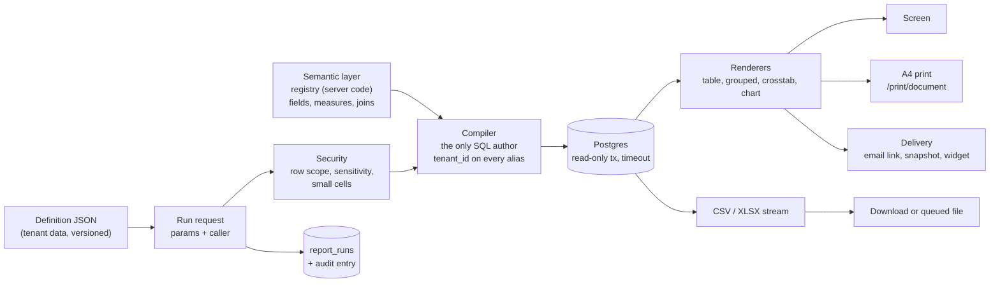
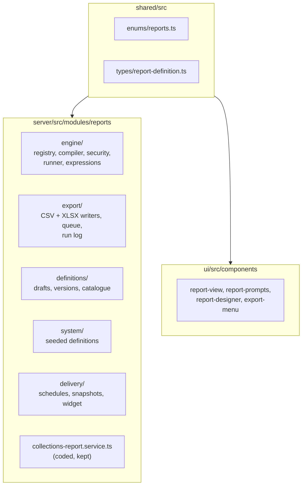

# 40 — Reporting engine: catalogue, definitions, runs and exports

> **Why 40?** The ticket ([8.15.7], #3088) said `32-reporting-engine.md`. `32-programs.md` already exists, and `33`–`39` are taken, so the next free number is 40.

Epic 8.15 (#378). An admin builds a report from business fields the developer made safe. No SQL. No new controller per report. This page is the living decision record: the decisions, the engine shape, the safety net.

## 1. What a user sees

Open **Reports**. A hub lists ready reports. Click one: it runs at once with its default prompts and shows the answer. Change a prompt in the one-line summary above it and press Enter to run again. One click downloads everything that matches (`Excel-এ নামান`). Print prints what is on screen.

Admins also get `Reports › New`: start from a ready report or a question, then a blank page last.

## 2. The big picture



Two tiers (D1). **Coded** reports (collections, student statement) stay as code because they are ledgers or documents. **Defined** reports are JSON slices over the registry. One catalogue lists both.

## 3. Decisions

| #   | Decision                                                                                                                                                                                                                                                                                                   |
| --- | ---------------------------------------------------------------------------------------------------------------------------------------------------------------------------------------------------------------------------------------------------------------------------------------------------------- |
| D1  | Two tiers: coded reports for ledgers/documents, defined reports for slicing; one catalogue lists both.                                                                                                                                                                                                     |
| D2  | The semantic layer is code, never tenant data (it holds SQL fragments). Refined by D19.                                                                                                                                                                                                                    |
| D3  | Definitions are tenant JSON with immutable published versions, like print templates.                                                                                                                                                                                                                       |
| D4  | The query spec is declarative; the compiler is the only SQL author; calculated fields use a whitelisted language.                                                                                                                                                                                          |
| D5  | Row scopes and field sensitivity apply with the **runner's** permissions, not the author's.                                                                                                                                                                                                                |
| D6  | The compiler injects `tenant_id` on every table alias; a CI property test fails any SQL that misses one. RLS on a reporting role is a later hardening.                                                                                                                                                     |
| D7  | No server PDF; print is the browser A4 document (Epic 32 D1/D2).                                                                                                                                                                                                                                           |
| D8  | CSV and XLSX streamed; sync ≤ 5,000 rows, queued above; every run and export audited.                                                                                                                                                                                                                      |
| D9  | `REPORTS_VIEW` runs, `REPORTS_EXPORT` exports, new `REPORTS_DESIGN` (ADMIN only) authors; teachers run only; keep `REPORT_COLLECTIONS_READ`; `DASHBOARD_ADMIN` → #169 or deleted.                                                                                                                          |
| D10 | Student statement (G5) is coded.                                                                                                                                                                                                                                                                           |
| D11 | Dataset vocabulary stays close to open semantic layers (measures, dimensions, filters); build in-house now.                                                                                                                                                                                                |
| D12 | System reports are seeded definitions selected by presets; tenants clone to customise.                                                                                                                                                                                                                     |
| D13 | Out of this epic: student category (waits for Epic 72.0, #2205), cross-branch counts, unmatched receipts (→ #291), defined reports in the portal (statement only).                                                                                                                                         |
| D14 | COMMITTEE row scope suppresses any count under 5 (cells, not totals).                                                                                                                                                                                                                                      |
| D15 | Scheduled reports are delivered as an email link only.                                                                                                                                                                                                                                                     |
| D16 | Redis down → queued export fails closed with a clear error; sync exports ≤ 5,000 rows keep working. No new boot check (Redis already required by existing queues).                                                                                                                                         |
| D17 | Result cache fails open: a cache error is logged and the report runs uncached.                                                                                                                                                                                                                             |
| D18 | Statement timeout fails closed: `REPORT_TOO_SLOW`, never partial rows.                                                                                                                                                                                                                                     |
| D19 | Registry lives in `server/src/modules/reports/engine/registry/`; `shared/` carries only enums and definition types; clients read fields from `GET /reports/meta`, which never contains SQL.                                                                                                                |
| D20 | Caps: preview 500 rows; run 10,000 rows paged 100; sync export 5,000; export 200,000; timeouts 15 s interactive, 120 s jobs.                                                                                                                                                                               |
| D21 | Plain Bangla-first wording everywhere a user looks. Never dimension, measure, crosstab, aggregate. Money: বিল / জমা / বাকি, never debit, credit, ledger. Delivery: 'নিয়মিত ইমেইলে পাঠান', 'আজকের কপি রেখে দিন'. One-click export: 'Excel-এ নামান'. Glossary: `docs/ux-research/8.15-reports-glossary.md`. |
| D22 | UX first: the easiest path is built first (open a ready report → it runs; keep a filtered list as a report; start from a template or a question); the blank-page designer is last. No report screen is built before its mockup passes the usability test (8.15.51).                                        |
| D23 | Early value: a small coded BANBEIS student count ships in Waves 2–3; Wave 5 turns its screen into a redirect to the system report and the epic close removes the coded endpoint.                                                                                                                           |
| D24 | Learn from use: each run can carry a one-tap 'was this useful?' and an optional comment on `report_runs`; a platform-only usage page shows aggregates only.                                                                                                                                                |

(D22 and D24 appear in epic order; D21's full word list is in the glossary.)

## 4. Where the code lives



## 5. Subject areas

| Area           | Root entity                  | Joins                                    | Owner ticket |
| -------------- | ---------------------------- | ---------------------------------------- | ------------ |
| `STUDENTS`     | `students`                   | enrolments, sections, classes, guardians | 8.15.20      |
| `STAFF`        | `staff_profiles`             | designations, users                      | 8.15.20      |
| `PUBLIC_EXAMS` | public exam results          | students, classes                        | 8.15.20      |
| `FEES`         | `student_fees`               | students, fee structures, invoices       | 8.15.21      |
| `PAYMENTS`     | `payments`                   | allocations, students, collectors        | 8.15.21      |
| `ATTENDANCE`   | attendance records (summary) | students, sections                       | 8.15.21      |

## 6. Field sensitivity

Every registry field carries one level. The runner hides a field the caller's role may not see, even if a definition lists it (D5).

| Level       | Example                            | Required permission                          |
| ----------- | ---------------------------------- | -------------------------------------------- |
| `PUBLIC`    | class name, section, gender        | `REPORTS_VIEW`                               |
| `PERSONAL`  | student name, date of birth, photo | `REPORTS_VIEW` + the area's read permission  |
| `CONTACT`   | phone, address, guardian contact   | the area's read permission + a contact grant |
| `FINANCIAL` | amount due, paid, discount         | `FEE_READ` / `PAYMENT_READ`                  |
| `SENSITIVE` | health note, religion              | ADMIN only                                   |

The exact permission per level is finalised in 8.15.19; this table is the contract that ticket implements.

## 7. Safety net

Every route this epic adds must show up in two snapshots, or CI fails:

- `server/src/__snapshots__/route-permissions.txt` — who may call it (`permission-matrix.e2e-spec.ts`).
- `server/src/route-status.snapshot.txt` — what the guards answer per role (`route-status-snapshot.e2e-spec.ts`).

```bash
yarn test-env run -- yarn workspace @biddaloy/server test:file src/permission-matrix.e2e-spec.ts
yarn test-env run -- yarn workspace @biddaloy/server test:file src/route-status-snapshot.e2e-spec.ts
```

A new `/reports/*` route with no snapshot line makes both fail in CI (`CI=1`). Update with `-u`, commit the diff, and explain each changed line in the PR (Security Rule 20).

## 8. Waves

| Wave | What lands                                                              |
| ---- | ----------------------------------------------------------------------- |
| 0    | This page                                                               |
| 1    | Shared enums/types, five tables, export pipeline, six export-all routes |
| 2    | Registry, compiler, queued export, Excel button, early BANBEIS (server) |
| 3    | Security, subject areas, runner, definitions, routes, BANBEIS screen    |
| 4    | Renderers, prompts, hub + runner, print, save a list as a report        |
| 5–6  | System reports, demo seed, statement API, calculated fields             |
| 7–8  | Statement screens, designer, formatting, drill-through                  |
| 9–10 | Schedules, snapshots, widget, delivery UI, performance, guide, close    |
