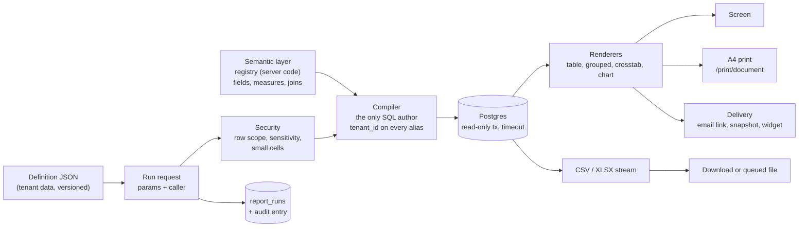
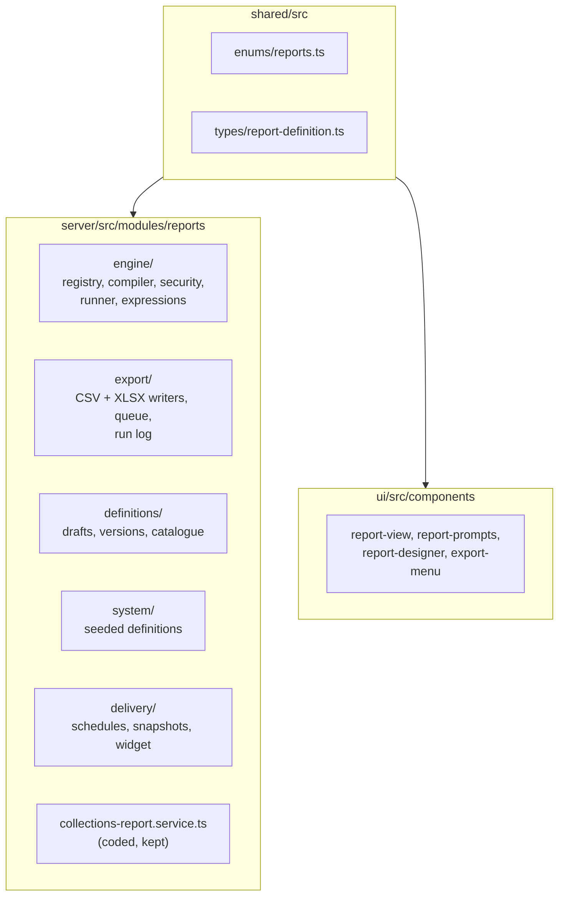

# 40 — Reporting engine: catalogue, definitions, runs and exports

> **Why 40?** The ticket ([8.15.7], #3088) said `32-reporting-engine.md`. `32-programs.md` already exists, and `33`–`39` are taken, so the next free number is 40.

Epic 8.15 (#378). An admin builds a report from business fields the developer made safe. No SQL. No new controller per report. This page is the living decision record: the decisions, the engine shape, the safety net.

## 1. What a user sees

Open **Reports**. A hub lists ready reports. Click one: it runs at once with its default prompts and shows the answer. Change a prompt in the one-line summary above it and press Enter to run again. One click downloads everything that matches (`Excel-এ নামান`). Print prints what is on screen.

Admins also get `Reports › New`: start from a ready report or a question, then a blank page last.

## 2. The big picture



Two tiers (D1). **Coded** reports (collections, student statement) stay as code because they are ledgers or documents. **Defined** reports are JSON slices over the registry. One catalogue lists both.

## 3. Decisions

| #   | Decision                                                                                                                                                                                                                                                                                                   |
| --- | ---------------------------------------------------------------------------------------------------------------------------------------------------------------------------------------------------------------------------------------------------------------------------------------------------------- |
| D1  | Two tiers: coded reports for ledgers/documents, defined reports for slicing; one catalogue lists both.                                                                                                                                                                                                     |
| D2  | The semantic layer is code, never tenant data (it holds SQL fragments). Refined by D19.                                                                                                                                                                                                                    |
| D3  | Definitions are tenant JSON with immutable published versions, like print templates.                                                                                                                                                                                                                       |
| D4  | The query spec is declarative; the compiler is the only SQL author; calculated fields use a whitelisted language.                                                                                                                                                                                          |
| D5  | Row scopes and field sensitivity apply with the **runner's** permissions, not the author's.                                                                                                                                                                                                                |
| D6  | The compiler injects `tenant_id` on every table alias; a CI property test fails any SQL that misses one. RLS on a reporting role is a later hardening.                                                                                                                                                     |
| D7  | No server PDF; print is the browser A4 document (Epic 32 D1/D2).                                                                                                                                                                                                                                           |
| D8  | CSV and XLSX streamed; sync ≤ 5,000 rows, queued above; every run and export audited.                                                                                                                                                                                                                      |
| D9  | `REPORTS_VIEW` runs, `REPORTS_EXPORT` exports, new `REPORTS_DESIGN` (ADMIN only) authors; teachers run only; keep `REPORT_COLLECTIONS_READ`; `DASHBOARD_ADMIN` → #169 or deleted.                                                                                                                          |
| D10 | Student statement (G5) is coded.                                                                                                                                                                                                                                                                           |
| D11 | Dataset vocabulary stays close to open semantic layers (measures, dimensions, filters); build in-house now.                                                                                                                                                                                                |
| D12 | System reports are seeded definitions selected by presets; tenants clone to customise.                                                                                                                                                                                                                     |
| D13 | Out of this epic: student category (waits for Epic 72.0, #2205), cross-branch counts, unmatched receipts (→ #291), defined reports in the portal (statement only).                                                                                                                                         |
| D14 | COMMITTEE row scope suppresses any count under 5 (cells, not totals).                                                                                                                                                                                                                                      |
| D15 | Scheduled reports are delivered as an email link only.                                                                                                                                                                                                                                                     |
| D16 | Redis down → queued export fails closed with a clear error; sync exports ≤ 5,000 rows keep working. No new boot check (Redis already required by existing queues).                                                                                                                                         |
| D17 | Result cache fails open: a cache error is logged and the report runs uncached.                                                                                                                                                                                                                             |
| D18 | Statement timeout fails closed: `REPORT_TOO_SLOW`, never partial rows.                                                                                                                                                                                                                                     |
| D19 | Registry lives in `server/src/modules/reports/engine/registry/`; `shared/` carries only enums and definition types; clients read fields from `GET /reports/meta`, which never contains SQL.                                                                                                                |
| D20 | Caps: preview 500 rows; run 10,000 rows paged 100; sync export 5,000; export 200,000; timeouts 15 s interactive, 120 s jobs.                                                                                                                                                                               |
| D21 | Plain Bangla-first wording everywhere a user looks. Never dimension, measure, crosstab, aggregate. Money: বিল / জমা / বাকি, never debit, credit, ledger. Delivery: 'নিয়মিত ইমেইলে পাঠান', 'আজকের কপি রেখে দিন'. One-click export: 'Excel-এ নামান'. Glossary: `docs/ux-research/8.15-reports-glossary.md`. |
| D22 | UX first: the easiest path is built first (open a ready report → it runs; keep a filtered list as a report; start from a template or a question); the blank-page designer is last. No report screen is built before its mockup passes the usability test (8.15.51).                                        |
| D23 | Early value: a small coded BANBEIS student count ships in Waves 2–3; Wave 5 turns its screen into a redirect to the system report and the epic close removes the coded endpoint.                                                                                                                           |
| D24 | Learn from use: each run can carry a one-tap 'was this useful?' and an optional comment on `report_runs`; a platform-only usage page shows aggregates only.                                                                                                                                                |

(D22 and D24 appear in epic order; D21's full word list is in the glossary.)

## 4. Where the code lives



## 5. Subject areas

| Area           | Root entity                  | Joins                                    | Owner ticket |
| -------------- | ---------------------------- | ---------------------------------------- | ------------ |
| `STUDENTS`     | `students`                   | enrolments, sections, classes, guardians | 8.15.20      |
| `STAFF`        | `staff_profiles`             | designations, users                      | 8.15.20      |
| `PUBLIC_EXAMS` | public exam results          | students, classes                        | 8.15.20      |
| `FEES`         | `student_fees`               | students, fee structures, invoices       | 8.15.21      |
| `PAYMENTS`     | `payments`                   | allocations, students, collectors        | 8.15.21      |
| `ATTENDANCE`   | attendance records (summary) | students, sections                       | 8.15.21      |

## 6. Field sensitivity

Every registry field carries one level. The runner hides a field the caller's role may not see, even if a definition lists it (D5).

| Level       | Example                            | Required permission                          |
| ----------- | ---------------------------------- | -------------------------------------------- |
| `PUBLIC`    | class name, section, gender        | `REPORTS_VIEW`                               |
| `PERSONAL`  | student name, date of birth, photo | `REPORTS_VIEW` + the area's read permission  |
| `CONTACT`   | phone, address, guardian contact   | the area's read permission + a contact grant |
| `FINANCIAL` | amount due, paid, discount         | `FEE_READ` / `PAYMENT_READ`                  |
| `SENSITIVE` | health note, religion              | ADMIN only                                   |

The exact permission per level is finalised in 8.15.19; this table is the contract that ticket implements.

## 7. Safety net

Every route this epic adds must show up in two snapshots, or CI fails:

- `server/src/__snapshots__/route-permissions.txt` — who may call it (`permission-matrix.e2e-spec.ts`).
- `server/src/route-status.snapshot.txt` — what the guards answer per role (`route-status-snapshot.e2e-spec.ts`).

```bash
yarn test-env run -- yarn workspace @biddaloy/server test:file src/permission-matrix.e2e-spec.ts
yarn test-env run -- yarn workspace @biddaloy/server test:file src/route-status-snapshot.e2e-spec.ts
```

A new `/reports/*` route with no snapshot line makes both fail in CI (`CI=1`). Update with `-u`, commit the diff, and explain each changed line in the PR (Security Rule 20).

## 8. Waves

| Wave | What lands                                                              | State                                       |
| ---- | ----------------------------------------------------------------------- | ------------------------------------------- |
| 0    | This page                                                               | Landed                                      |
| 1    | Shared enums/types, five tables, export pipeline, six export-all routes | Landed                                      |
| 2    | Registry, compiler, queued export, Excel button, early BANBEIS (server) | Landed                                      |
| 3    | Security, subject areas, runner, definitions, routes, BANBEIS screen    | Landed                                      |
| 4    | Renderers, prompts, hub + runner, print, save a list as a report        | Landed                                      |
| 5–6  | System reports, demo seed, statement API, calculated fields             | Landed                                      |
| 7–8  | Statement screens, designer, formatting, drill-through                  | Landed                                      |
| 9–10 | Schedules, snapshots, widget, delivery UI, performance, guide, close    | Landed, except the human gates listed below |

The human gates that are still open: the usability test (8.15.51), the full `ci:local` and e2e run on Node 24, filing the follow-ups (cross-branch counts, student category after Epic 72.0, RLS on a reporting role, more subject areas) and closing #378. The coded BANBEIS count is gone (D23): `/reports/student-count` only redirects to the ready report.

## 9. Learnings

Dated bullets: what surprised us, what it cost, the fix, and a rule worth keeping.

- **2026-10-31 — doc number.** The ticket said `32-reporting-engine.md`, but `32` was taken. Cost: a renamed file and a note. Fix: next free number (40). Rule candidate: tickets name a doc by topic, the author picks the number on the day.
- **2026-10-31 — decorators belong to the next class.** A helper class placed between `@ApiTags(...)` and a controller silently took the decorators, and the OpenAPI document lost its schemas. Cost: failed type generation. Fix: put new helper classes above the whole decorator block. Rule candidate: never insert code between a decorator and its class.
- **2026-10-31 — a `@Roles` copied from a list can contradict the new permission.** The students export copied the list's `@Roles`, but `REPORTS_EXPORT` is narrower, so `permission-matrix.e2e-spec.ts` ("never tightens") failed. Fix: no `@Roles` on the export; the permission alone narrows it.
- **2026-10-31 — new tables touch eight registries.** `app.module.ts`, `test/all-entities.ts`, `reset-order.ts`, `staging-scrub-columns.ts` plus `scrub.sql`, workbook coverage, demo-seed `EXEMPT`, and the audit action enum (own migration). Rule candidate: the migration ticket lists them all.
- **2026-10-31 — a draft cannot live in an immutable table.** The ticket put a report's draft in a version row with no `published_at`. A version is frozen by a trigger and `published_at` is required, so it could never be edited. Fix: `report_definitions.draft` (jsonb), like print templates. Rule candidate: before choosing where state lives, check which triggers and NOT NULLs guard that table.
- **2026-10-31 — "tenant_id on every alias" needs a lookup rule.** `student_fees` and `users` have no `tenant_id`. The registry now says how each is still school-scoped: `tenantVia` an always-joined inner table (`student_fees` → its student), or a lookup reached only from a scoped row (`users` ← the payment). The property test checks both. Rule candidate: list every table the first areas touch and its tenant column before writing the compiler.
- **2026-10-31 — what a row IS belongs in the area.** Collections counts a payment only if it succeeded or is one side of a reversal. Putting that in the report author's filters would make two reports disagree, so the area carries `baseWhere` and the reconciliation test compares with `CollectionsReportService`.
- **2026-10-31 — the ticket's "teacher cannot see guardian phone" is wrong.** A TEACHER holds `GUARDIAN_READ` for their sections, so by the invariant (a report never shows what the screen would hide) a section-scoped teacher report may show it. The test uses EXECUTIVE, who has no `GUARDIAN_READ`.
- **2026-10-31 — property tests earn their keep only if they can fail.** Removing the tenant predicate from the join builder made the property test fail in both fixture areas; it is then restored. Do this once for every new invariant test.
- **2026-10-31 — `pg-query-stream` is not installed.** A queued definition export reads through a SQL cursor (`DECLARE … CURSOR`, `FETCH 1000`) inside the read-only transaction: constant memory, one snapshot, no new dependency.
- **2026-10-31 — a schedule is one run per person, not one run for the group.** The download route only serves a run to the person who made it, so one shared run would give every recipient a 404. Worse, one file built with the creator's rights would hand an admin-only column to a narrower role. Fix: on each fire, every active person who holds a recipient role gets their own run, built with their own role, and the email carries a link only. Rule candidate: any "send to a group" feature builds the output once per reader.
- **2026-10-31 — a snapshot is an export.** A snapshot copies a file out of the system, so it needs `REPORTS_EXPORT`, not `REPORTS_VIEW`, and it is readable only by its maker or an admin, checked on every list and every download. Its storage key is its own, so the export clean-up job never touches it.
- **2026-10-31 — a timeout must leave a trace.** A screen run that hit the statement timeout wrote no run row, so the platform usage page could never count `REPORT_TOO_SLOW`. The runner now writes a failed row with that code.
- **2026-10-31 — a temporary endpoint needs a redirect, not a delete.** The coded BANBEIS count ([8.15.53], [8.15.54]) gave schools their head count in Waves 2–3, weeks before the engine, and D23 said it would go. At the close it went: the server module (controller, service, dto, module, two specs, its import in `app.module.ts`) and two lines in each route snapshot. The screen did not go. `/reports/student-count` is now a small route that reads `GET /reports/catalogue`, finds the entry whose `system_template_key` is `student-count-banbeis`, and replaces itself with `/reports/<id>`. A bookmark, the sidebar item, the palette action and the dashboard card keep working, and a role that is not a reader of the report sees "report not found for your role". Rule candidate: a retired screen keeps its address and forwards.
  ```mermaid
  flowchart LR
    B["bookmark, sidebar, palette"] --> R["/reports/student-count"]
    R -->|"catalogue has system_template_key<br/>student-count-banbeis"| X["/reports/&lt;id&gt; (replace)"]
    R -->|"not in this role's catalogue"| N["report not found for your role"]
  ```
- **2026-10-31 — compare before you delete; the replacement is narrower for non-admins.** The admin gets everything the coded screen had: the table with totals, the year question, links to the student list, the EIIN on the printed page, Excel, and the staff counts (as a second ready report, `staff-by-type-gender`). Other viewers get less: only a designer (ADMIN) can read a report's layout and questions, so they see a plain list for the current year, with no year choice and no links; print needs `DOCUMENT_PRINT`; religion is hidden from everyone but the admin; COMMITTEE cannot open the staff report. We retired anyway because every school has an admin who fills the BANBEIS form, and filed the rest as follow-ups: put `layout` and the questions in the run result so every viewer reads them, and decide who may see aggregated religion counts. Rule candidate: a retirement ticket lists who loses what.
- **2026-10-31 — the file cap shapes the close.** A close ticket touches a lot, and a cap of 30 files forced choices. Deleting a guide page would have touched every page that links to it (five role pages in each language, the students page, the hub, `SUMMARY.md`, `coverage.json`, `features.json` and the help index). So the page stays and is rewritten ("open it from All reports; the old address forwards"), and the hub drops its teacher note. In the same way, the old screen's test file became the redirect's test file instead of being deleted and a new one added. Rule candidate: rewrite in place is one file, delete plus add is two; merge small test files; fold a guide page into the hub page only when nothing else links to it.
- **2026-10-31 — dashboard cards live in the browser until there is a shared widget key.** The saved dashboard layout accepts only known widget keys from `shared/`, so a pinned report cannot be saved in it. "Show on my dashboard", "opened before" and "hide the useful-reports card" are kept in `localStorage` (`client-admin/src/dashboard/report-cards/report-prefs.ts`). Cost: they do not follow a person to another device. Fix: a shared widget key for "a report card" plus a server list of pins.
- **2026-10-31 — `guide:impact` reads the whole PR, so the sources must move with the code.** Deleting the server module named in the student-count page's `sources`, and editing `-coded-reports.ts` (a source of the hub page), made both pages "touched code". The fix was to repoint `sources` at the files that now own the behaviour and update both pages in bn and en. A PR that really changes no screen carries one line, `User guide: not affected — <reason>`, for the whole PR; here no such line is needed because the pages changed.
- **2026-10-31 — everyone who may run a report may read how it looks, and nothing more.** Only `REPORTS_DESIGN` could read `GET /reports/definitions/:id`, so an accountant, executive or committee member got a plain table with no questions, no table of counts, no colours, no links, and a plain A4 print. The fix is one route, `GET /reports/catalogue/:id/definition` (`REPORTS_VIEW`). It asks the catalogue (`ReportDefinitionsService.catalogue`) for the report, so it follows the same rules as a run: this school, published, and `visible_roles`; anything else is the one 404, never a 403. It answers from the published version, not the draft, and names the fields it returns one by one (`parameters`, `layout`, `page`, `format`, `drill`, `schema`, `subjectArea`, `version_id`). It leaves out `dataset` and `calculated`, so a viewer learns no more than the run result already shows. The runner and the print page read it when the viewer is not a designer, and fall back to the plain table only when it answers 404. Rule candidate: a screen that needs part of a definition gets its own route with an allow-list of fields, never a wider permission on the full definition. Follow-up: a designer still reads the draft for the runner's look, while a run uses the published version; the two can differ until the next publish.

  ```mermaid
  flowchart LR
    V["Accountant opens a report"] --> P["GET /reports/catalogue/:id/definition"]
    P -->|"in this role's catalogue"| L["questions, layout, colours, links<br/>(published version, no dataset)"]
    P -->|"hidden, draft, archived, other school"| N["404"]
    D["Admin (REPORTS_DESIGN)"] --> G["GET /reports/definitions/:id<br/>(draft, with dataset)"]
  ```
