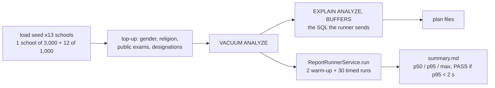
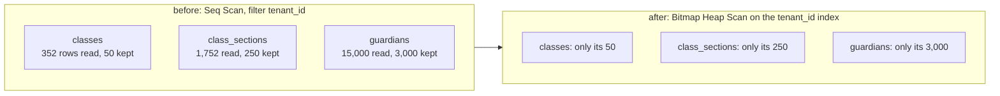

# Reporting load test (nightly)

Goal: every system report and every designer-shaped report answers in **under 2 s (p95)** on a
school of **3,000 students**, and no report scans a whole table for one school's rows (Epic 8.15,
ticket 8.15.48, decision D20). The method is the dashboard load test's
([37-dashboard-load-test.md](37-dashboard-load-test.md)): seed once, measure cold, record the plans.



## Result (2026-10-31): target met, every report far under 2 s

All 8 reports pass with a wide margin: the slowest p95 is 249 ms (the "still owed" report, 7,867 rows).
The three indexes below changed the plans, not the end-to-end time. Do not read the small p95 moves
between the two runs as a win or a loss: they are inside the run-to-run noise on this machine.

Machine: a cloud VM, 4 vCPU Intel Xeon 2.8 GHz, 16 GB RAM, PostgreSQL 16.15 with the default
`shared_buffers` (128 MB), Postgres and the test process on the same machine. **It is slower than
CI**, so CI numbers should be equal or better.

| Report                              | Rows | p95 before | p95 after | Plan time before / after |
| ----------------------------------- | ---: | ---------: | --------: | -----------------------: |
| student-list (ready)                | 3000 |     105 ms |     99 ms |            56 ms / 66 ms |
| student-count-banbeis (ready)       |   30 |      39 ms |     34 ms |            17 ms / 24 ms |
| staff-by-type-gender (ready)        |    2 |       8 ms |      6 ms |             0.7 / 1.1 ms |
| public-exam-results (ready)         |    2 |       5 ms |      5 ms |             0.8 / 1.2 ms |
| defaulters-guardian-contact (ready) | 7867 |     217 ms |    249 ms |          224 ms / 209 ms |
| designer: students by class, gender |   20 |      22 ms |     18 ms |                11 / 8 ms |
| designer: dues by class, section    |   50 |      77 ms |     70 ms |               51 / 45 ms |
| designer: payments by day, method   |  102 |      50 ms |     38 ms |               23 / 24 ms |

"p95" is the whole runner path (compile, query, shaping) over 30 runs. "Plan time" is the
`Execution Time` line of one `EXPLAIN (ANALYZE, BUFFERS)` of the same SQL. Row counts differ by a
few between runs because each run makes its own random-by-hash data.

## What the plans showed

Before the migration, three tenant-filtered reads were sequential scans of a whole table, other
schools' rows included. The school is 20% of the students table here, so each scan read 5x the rows
it kept.



| Scan (student-list) | Before            | After                     |
| ------------------- | ----------------- | ------------------------- |
| `classes`           | Seq Scan, 0.17 ms | Bitmap Heap Scan, 0.05 ms |
| `class_sections`    | Seq Scan, 0.56 ms | Bitmap Heap Scan, 0.12 ms |
| `guardians`         | Seq Scan, 4.06 ms | Bitmap Heap Scan, 1.72 ms |

A concrete example, the first lines of the student list's plan:

```text
before:  ->  Seq Scan on guardians g  (actual time=0.030..4.058 rows=3000)
               Filter: ((deleted_at IS NULL) AND (tenant_id = 'b5e35d8d-...'))
               Rows Removed by Filter: 12000
after:   ->  Bitmap Heap Scan on guardians g  (actual time=0.207..1.720 rows=3000)
               Recheck Cond: (tenant_id = 'b5e35d8d-...')
               ->  Bitmap Index Scan on "IDX_24430fa0e9c48d2ba41cf6312f"
```

The gain is per scan and small today. It is the **shape** that matters: a scan of the whole table grows
with every school on the platform, an index scan grows only with this school. With 13 schools the
scan is a few milliseconds. What it would cost on a table with hundreds of schools was not measured
(see follow-ups).

## The migration

`1791900001400-ReportingIndexes.ts` adds exactly three indexes, all `(tenant_id)`:

| Index                            | Table            | Removes                         |
| -------------------------------- | ---------------- | ------------------------------- |
| `IDX_80e98e9a9146352f155f0bd3ad` | `classes`        | Seq Scan in every class join    |
| `IDX_5d6fa6a7e8bca2439a922182f0` | `class_sections` | Seq Scan in every section join  |
| `IDX_24430fa0e9c48d2ba41cf6312f` | `guardians`      | Seq Scan for the guardian phone |

The entities already declared all three (`@Index(['tenant_id'])`); the database never got them.
They were listed in `server/test/schema-drift-baseline.ts` as known drift, so the same change deletes
those statements from the baseline. The migration uses plain `CREATE INDEX`, like every other index
migration in the repo (no `CONCURRENTLY`); it blocks writes to these three small tables while it builds.

Scans that were looked at and left alone: `academic_years` (1 row kept of a few dozen),
`designations` (2 rows) and `users` for staff (no `tenant_id` column; reached only from a school's staff
rows, 0.1 ms). An index there costs a write and saves nothing.

## What is still the slowest, and why an index is not the answer

"Still owed" (`defaulters-guardian-contact`, 210-250 ms) spends most of its time in the guardian
lookup: a correlated subquery that picks each student's primary guardian runs once per probe
(`loops=6000`, about 30,000 buffers). Every access in it is already an index scan. The fix is a query
change (join the guardians once, not once per row), not an index, so it is **not** part of this
ticket. See follow-ups.

## Run it

Nightly or by hand. The spec is skipped unless `REPORT_PERF=1`, because its file name matches
the unit and integration patterns. It uses the test database, which each vitest run drops and rebuilds, so
nothing is left behind and no throwaway database is needed.

```bash
cd server
REPORT_PERF=1 REPORT_PERF_OUT=/tmp/report-perf npx vitest run src/modules/reports/engine/runner/report-runner.perf.spec.ts
```

It takes about 3 minutes (almost all of it seeding). Needs the same env as any integration spec.

| Variable                    | Default | Meaning                                                      |
| --------------------------- | ------- | ------------------------------------------------------------ |
| `REPORT_PERF`               | unset   | Must be `1`, or the spec is skipped                          |
| `REPORT_PERF_OUT`           | unset   | Folder for `<report>.plan.txt` (SQL + plan) and `summary.md` |
| `REPORT_PERF_RUNS`          | `30`    | Timed runs per report                                        |
| `REPORT_PERF_NOISE_SCHOOLS` | `12`    | Other schools of 1,000 students next to the 3,000 one        |

The spec fails if any report's p95 is 2 s or more. The other schools matter: with one school in the
database every tenant index looks useless, because the school is the whole table.

To compare an index, run it before and after and diff the `*.plan.txt` files.

## Follow-ups

- Rewrite the primary-guardian lookup that the students and fees areas share (`PRIMARY_GUARDIAN_ON`) so it
  is joined once per report, not evaluated per row. Biggest remaining cost (a large share of the 220 ms).
- Re-run on a staging copy with the real number of schools, to turn the scale estimate above into a measurement.
- Money-tier note: no report SQL changed in this ticket, only indexes, so the reconciliation tests are unaffected.
