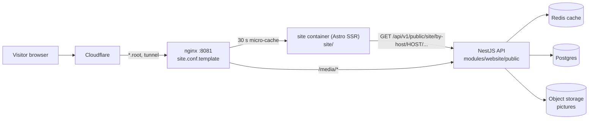
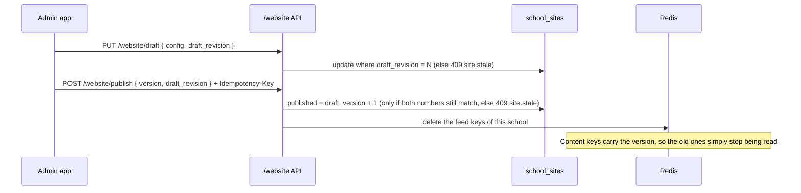

# School website (Epic 40)

Every school can have a public website at `<school>.<root domain>` (for example `bmsc-high.schoolmanagerp.com`),
or at its own domain. The school edits a **draft** in the admin app and **publishes** it. The public site shows only
the published copy.

Wave 1 (this page) covers the database, the by-host API, the `site/` container and the edge. The admin screens,
blog, enquiries, gallery and results come in later waves and add to this page.

## Request flow

The site container is anonymous: no cookie ever reaches it, and no tenant id is sent. The API reads the school from
the `Host` name only.

## Publish

Example body: `PUT /api/v1/website/draft` with `{"config": {...}, "draft_revision": 3}`. A save from a stale tab, or a
publish of a draft nobody on that screen has seen, answers 409 `site.stale`.

## Host to school

| Host the visitor typed                                       | Looked up in                                                              | Answer                                        |
| ------------------------------------------------------------ | ------------------------------------------------------------------------- | --------------------------------------------- |
| `bmsc-high.<root>`                                           | `school_sites.subdomain`                                                  | The site                                      |
| `old-name.<root>` (renamed < 30 days)                        | `school_sites.previous_subdomain` until `previous_until`                  | 301 to the new subdomain                      |
| `www.myschool.edu.bd`                                        | `school_sites.custom_domain`, only when `custom_domain_status = 'ACTIVE'` | The site                                      |
| anything else, off site, nothing published, suspended school | n/a                                                                       | One identical 404 (`site.not_found`, Rule 23) |

Subdomains are 3 to 30 characters (`SITE_SUBDOMAIN_RE`); `RESERVED_SUBDOMAINS` in `shared` lists the names no school
may take (`app`, `demo`, `site-test`, ...). On staging, `SITE_TEST_HOST` is an always-on custom domain for the demo
school.

## Cache

| What                         | Key                               | TTL   | Cleared by                                     |
| ---------------------------- | --------------------------------- | ----- | ---------------------------------------------- |
| Manifest and pages (Redis)   | `site:<tenant>:<version>:<kind>`  | 24 h  | A publish (new `version`, old keys never read) |
| Notice feed (Redis)          | `site:<tenant>:feed:notices`      | 60 s  | TTL, or publish / switch on-off                |
| Pages (nginx `site_cache`)   | `$host$request_uri`               | 30 s  | TTL; `?preview=` is never stored               |
| Pictures (nginx and browser) | `/media/<id>` (the id is the key) | 1 day | Nothing: a new picture gets a new id (D41)     |

## When something is down

| What is down          | What the visitor gets                                                                             | Why                     |
| --------------------- | ------------------------------------------------------------------------------------------------- | ----------------------- |
| Redis                 | The page, built from Postgres. One error log per minute.                                          | D32, D42: never a 500   |
| API or site container | nginx serves the last good page, even an expired one; if none is cached, `maintenance.html` (503) | `proxy_cache_use_stale` |
| Postgres              | Same as API down for uncached pages; cached pages still show                                      | D32                     |
| Object storage        | The page; the picture answers the one 404 and the site shows no picture                           | Rules 23, 24            |

## File map

| Path                                                   | What lives there                                                     |
| ------------------------------------------------------ | -------------------------------------------------------------------- |
| `server/src/modules/website/`                          | Entities, admin `/website` API, public by-host API, Redis cache      |
| `server/src/migrations/1791900003400-SchoolWebsite.ts` | The five tables; drops the unused `schools.domain`                   |
| `site-themes/`                                         | Theme manifests (palettes, fonts, sections) and `validateSiteConfig` |
| `site/`                                                | The Astro SSR site container, themes under `site/src/themes/`        |
| `nginx/templates/site.conf.template`                   | The `:8081` listener, micro-cache, `/media/` rule, maintenance page  |
| `server/src/modules/workbook/tabs/website/`            | Backup and restore tabs (four tables)                                |
| `server/src/scripts/demo-seed/slices/website.ts`       | The demo school's published site                                     |

## Backup and restore

`school_site`, `site_posts`, `site_enquiries` and `staff_web_profiles` are workbook tabs. Pictures (`site_media`) are
files in storage, not rows: a restored post or staff card loses its picture link, and a restored config that points at
a picture id keeps the id, which answers 404 until the school uploads it again. A restore never changes the school's
subdomain or custom domain, and only moves `version` / `draft_revision` forward.

## Learning

- **2026-11-07 (W1 close).** Surprise: the draft save and publish take `draft_revision`, not just `version`.
  Cost: tickets written against `{ config, version }` would have sent a body the API refuses. Fix: contract note
  posted on #3624. Rule candidate: a ticket that names an API body copies it from `schema.d.ts`, not from memory.
- **2026-11-07 (W1 close).** Surprise: Postgres `jsonb` stores keys in its own order. Cost: a restore preview showed
  `draft` as changed on an identical config. Fix: the `school_site` tab compares with sorted keys. Rule candidate: any
  tab that compares jsonb sorts keys first.
- **2026-11-07 (W1 close).** Surprise: `demo` and `site-test` are reserved subdomains, so the demo school cannot use
  its own short name. Cost: none, it uses `bmsc-high`. Rule candidate: seed code takes the subdomain from the school
  slug, never from the word "demo".
- **2026-11-07 (W2 close).** Surprise: the server lane (#3622) rejected the `logo` media slot while the wizard
  (#3625) uploaded to it. Cost: each lane's own tests were green; only regenerating `schema.d.ts` and running the
  typecheck exposed the mismatch. Fix: caught at W2 close. Rule candidate: regenerate `schema.d.ts` as soon as each
  server lane lands, so a client lane never builds on a stale contract.
- **2026-11-07 (W2 close).** Surprise: a client type was hand-typed (a `media.url` field) instead of taken from
  `schema.d.ts`; the admin media list has no picture URL. Cost: the wizard preview had to use the blob it just
  uploaded. Fix: preview from the uploaded blob. Rule candidate: client types for an API response come from the
  generated schema, never from memory of the ticket.
- **2026-11-07 (W2 close).** Surprise: a fresh worktree has no built `shared/dist` or `site-themes/dist`, and the
  symlinked main-checkout `node_modules/@biddaloy/*` points at main's stale packages. Cost: server build and
  migrations failed with missing exports until the packages were linked to the worktree and `yarn build:shared`
  and `yarn build:site-themes` ran. Rule candidate: an e2e run in a worktree links `@biddaloy/*` to its own
  packages and builds shared first.
