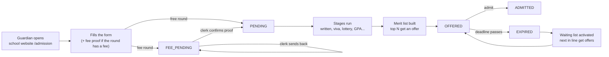
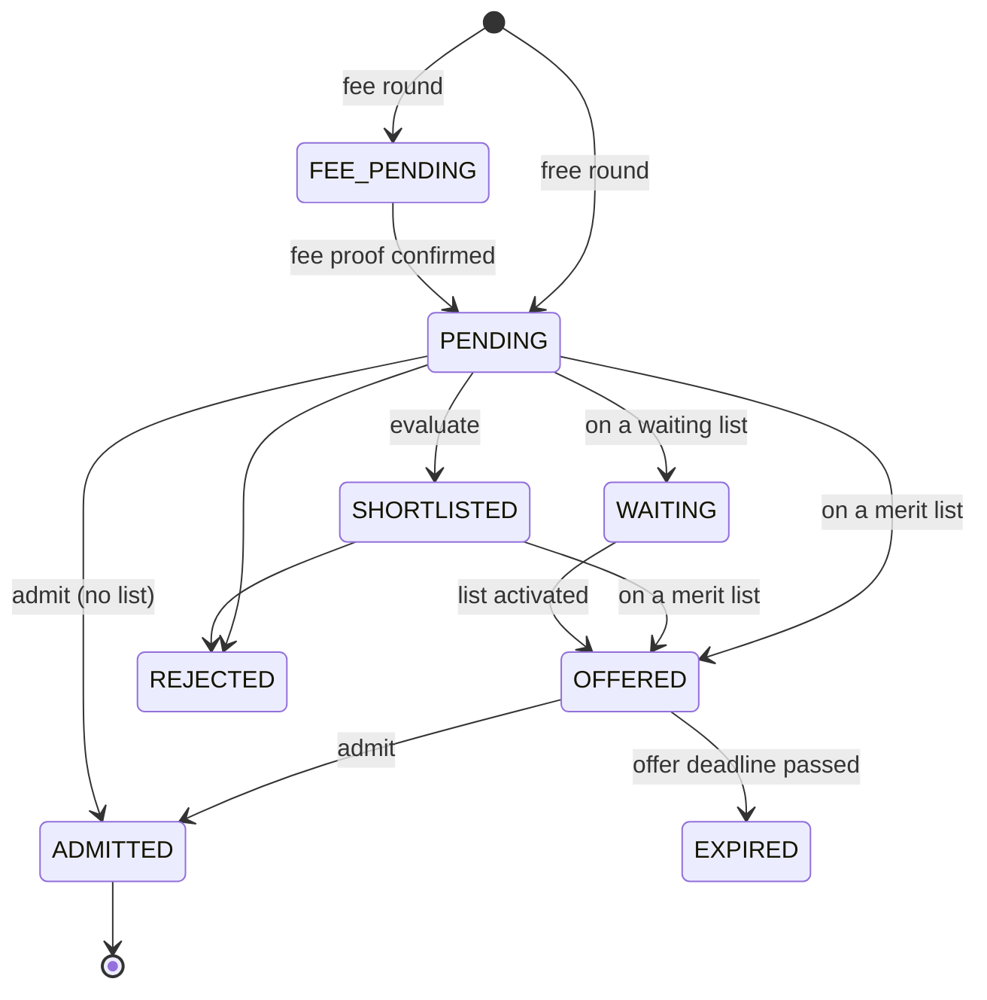
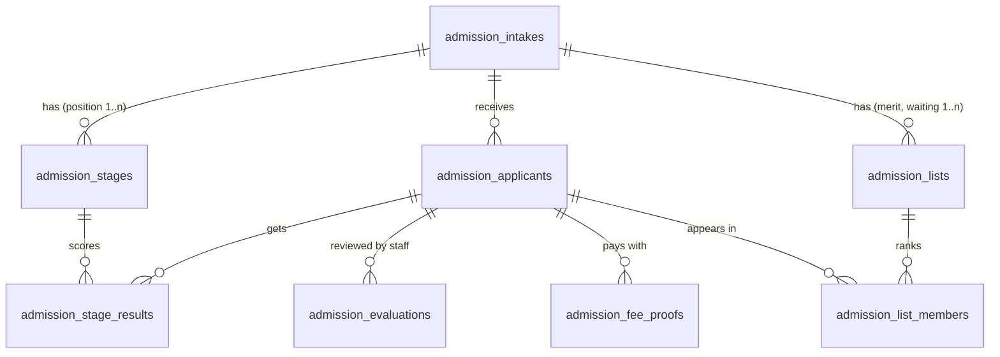
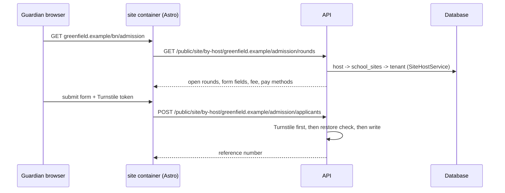

# Admission pipeline

How a child goes from "found the school website" to "student with a roll number".
Built by Epic 71. Code lives in `server/src/modules/admission/` (staff side),
`server/src/modules/website/public/public-admission-site.*` (public side) and
`site/src/islands/admission-*.ts` (the form on the school website).

## The applicant journey



A walk-in at the school desk skips the website: the clerk uses
`POST /admission/applicants` (no captcha, `source = CLERK`).

## Status machine

Status is the only state an applicant has. A list member has no state of its own.



Seat rule: `ADMITTED + OFFERED` never goes above the round's `seat_count`. Every
list write locks the round row first (`admission-list.service.ts`).

## Tables



| Table                     | One row is                                                                                            | Entity file                                 |
| ------------------------- | ----------------------------------------------------------------------------------------------------- | ------------------------------------------- |
| `admission_intakes`       | A round: dates, seats, template, fee, form fields, publish switches                                   | `entities/admission-intake.entity.ts`       |
| `admission_stages`        | One step of a round (`WRITTEN`, `VIVA`, `LOTTERY`, `FIRST_COME`, `GPA`, `NONE`)                       | `entities/admission-stage.entity.ts`        |
| `admission_applicants`    | A child's application: `status`, `source` (ONLINE or CLERK), `quota_tags`, `roll_number`, `fee_state` | `entities/admission-applicant.entity.ts`    |
| `admission_stage_results` | One applicant's score and pass/fail at one stage                                                      | `entities/admission-stage-result.entity.ts` |
| `admission_lists`         | A merit or waiting list (`sequence`, `capacity`, `act_by_date`, `active`, `published_at`)             | `entities/admission-list.entity.ts`         |
| `admission_list_members`  | An applicant's place (`position`) on a list                                                           | `entities/admission-list-member.entity.ts`  |
| `admission_fee_proofs`    | A guardian's payment proof: `AWAITING`, `CONFIRMED` or `SENT_BACK`                                    | `entities/admission-fee-proof.entity.ts`    |
| `admission_evaluations`   | A staff note and decision on an applicant                                                             | `entities/admission-evaluation.entity.ts`   |

Round templates (`ADMISSION_TEMPLATES` in `shared/src/admission/templates.ts`) pick the
stages and form fields: `APPLY_ONLY`, `WRITTEN`, `WRITTEN_VIVA`, `LOTTERY`, `FIRST_COME`, `GPA_MERIT`.

## Lists and deadlines

- **Merit list.** Built from applicants who are `PENDING` or `SHORTLISTED`, ordered by the
  last stage. It is created active: the first `capacity` people become `OFFERED`.
- **Waiting list 1, 2, ...** Built inactive; members are `WAITING`. `activate` turns
  `min(capacity, vacant seats)` of them into `OFFERED`. It answers 409 until the previous
  list's `act_by_date` has passed.
- **Deadline.** `act_by_date` is the last day to accept an offer. Staff run `expire-pending`,
  or the scheduled `admission-list-auto.job.ts` does it for rounds with
  `auto_activate_lists = true`: lapsed offers become `EXPIRED`, then the next list opens.

## Fee proof

Only rounds with a `fee_amount_paisa` ask for one. The guardian uploads an image and a
method (bKash, bank) with the form. The applicant starts `FEE_PENDING`.
`POST /admission/fee-proofs/:id/confirm` moves the applicant to `PENDING`;
`.../send-back` keeps `FEE_PENDING` and tells the guardian why. Roll numbers are only
given after confirmation.

## Lottery

A `LOTTERY` stage is filled once, by an in-app draw (`POST /admission/stages/:id/lottery/draw`)
or an uploaded rank list (`.../lottery/import/validate` then `/commit`). Both write
`score = N - rank + 1` (higher is better) with `passed = null`, so the merit order and the
cut-off treat it like any other score. A second draw is a 409.

## Roll numbers

`POST /admission/intakes/:id/rolls` numbers every fee-confirmed `PENDING` or `SHORTLISTED`
applicant that has no roll yet, in the chosen order, zero-padded to 4 digits. A repeat call
only numbers newcomers. The round row lock stops two calls sharing a number.

## The public API: by host, never by slug

The school website calls the API with its own host name. The host is the only signal of
which school it is; there is no JWT, no `X-Tenant-ID`, and no school slug in any admission route.
Old `/admission/<slug>` links on the app host now show a one-line "this link moved" page.



| Route (all under `/public/site/by-host/:host/admission`) | Does                                                          | Needs Redis        |
| -------------------------------------------------------- | ------------------------------------------------------------- | ------------------ |
| `GET rounds`                                             | Open rounds with form schema, fee, documents                  | no                 |
| `GET lists`                                              | Published lists: roll numbers, names only if the round allows | no                 |
| `POST applicants`                                        | Submit (multipart). Turnstile, then 409 while restoring       | yes (fails closed) |
| `POST status`                                            | Status by reference number + phone                            | no                 |
| `POST result`                                            | Published stage outcomes and list place, by roll + phone      | yes (fails closed) |
| `POST admit-card`                                        | Exam schedule, by roll + phone                                | yes (fails closed) |

Real example (status check):

```http
POST /api/v1/public/site/by-host/greenfield.example/admission/status
Content-Type: application/json

{ "reference_number": "ADM-2026-7K3Q9X", "guardian_phone": "01712345678" }
```

```json
{ "status": "OFFERED", "applicant_name": "Rahim Uddin", "intake_title": "ভর্তি ২০২৭: প্রথম শ্রেণি" }
```

A wrong reference, a wrong phone and another school's reference all give the same `404`.

## Staff routes

All need `ADMISSION_REVIEW` (the old lifecycle report needs `STUDENT_LIFECYCLE_MANAGE`).

| Area       | Routes                                                                                                                       | Service                                                         |
| ---------- | ---------------------------------------------------------------------------------------------------------------------------- | --------------------------------------------------------------- |
| Rounds     | `/admission-intakes` (CRUD, `:id/close`, `:id/stages`)                                                                       | `intake.service.ts`, `admission-stage.service.ts`               |
| Applicants | `/admission/applicants` (list, detail, create walk-in, `evaluate`, `admit`, `reject`, `expire`)                              | `applicant-review.service.ts`, `admission-applicant.service.ts` |
| Scores     | `PUT /admission/stages/:id/results`, `cutoff/preview`, `cutoff/commit`, `schedule`                                           | `admission-stage-result.service.ts`                             |
| Lottery    | `/admission/stages/:id/lottery/*`                                                                                            | `admission-lottery.service.ts`                                  |
| Lists      | `/admission/intakes/:id/lists`, `lists/merit`, `lists/waiting`, `/admission/lists/:id/activate`, `expire-pending`, `members` | `admission-list.service.ts`                                     |
| Fee proofs | `/admission/fee-proofs` (list, `attachment`, `confirm`, `send-back`)                                                         | `admission-fee.service.ts`                                      |
| Publishing | `/admission/intakes/:id/publish`, `publish/estimate`                                                                         | `admission-publication.service.ts`                              |
| Rolls      | `POST /admission/intakes/:id/rolls`                                                                                          | `admission-roll.service.ts`                                     |
| Reports    | `GET /admission/reports/funnel`, `export/:kind`, `lifecycle`                                                                 | `admission-reports.service.ts`                                  |

## Website widgets

Three site sections read the data above: `ADMISSIONS` (open rounds), `ADMISSION_RESULT`
(roll + phone lookup) and `ADMISSION_LISTS` (published lists). The last two are off by
default; the demo school turns all three on (`demo-seed/slices/website.ts`).

## What fails closed, and why

| Failure                                      | Answer                                                    | Why                                                  |
| -------------------------------------------- | --------------------------------------------------------- | ---------------------------------------------------- |
| Redis down on submit, result, admit card     | `503` with the site's own text, nothing written           | No rate limit means no safe answer (Rule 15)         |
| Turnstile missing or rejected                | `400`/`503`, nothing written                              | A public form is the cheapest abuse target (Rule 22) |
| School is being restored                     | `409`, nothing written                                    | A write would be lost in the restore                 |
| Admission module off, site off, unknown host | one identical `404`                                       | Never say which of the three it was (Rule 23)        |
| Wrong roll, wrong phone, other school        | one identical `404`                                       | A phone number is the key to a name                  |
| Academic year closed                         | `409 ACADEMIC_YEAR_CLOSED` on list, roll and stage writes | Rule 28                                              |
| Every response                               | `Cache-Control: no-store`                                 | Rule 14                                              |

## Where the demo data is

`server/src/scripts/demo-seed/slices/admission.ts`: one round per template, scored stages, a
merit list, waiting list 1 (active, with a deadline), waiting list 2 (pending), a drawn
lottery, a desk-entered applicant, and fee proofs in every state.
