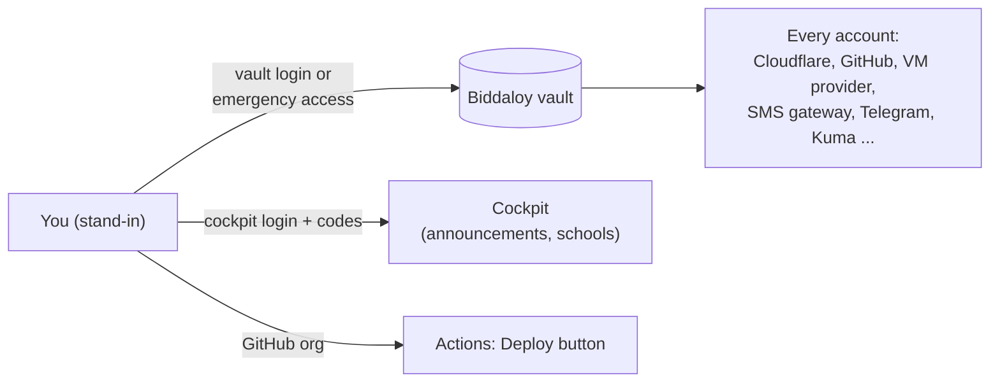
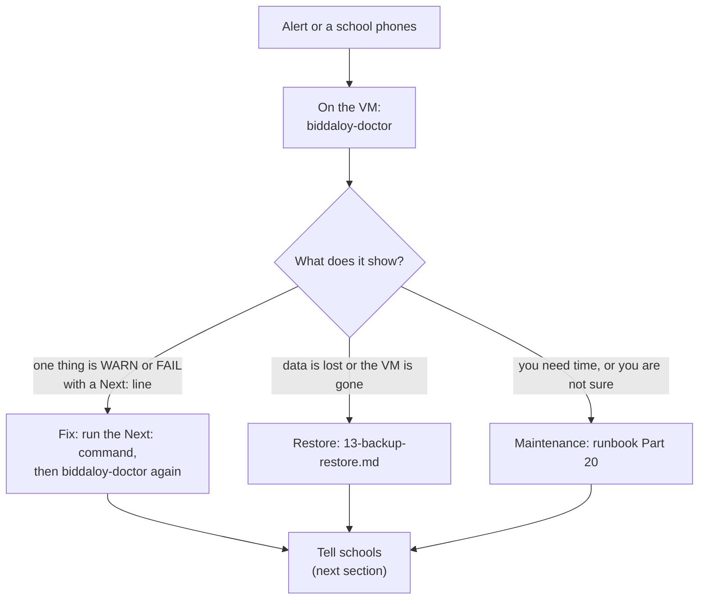

# 44. The first 24 hours without the founder

> Written for a stand-in who was handed this page at 2 a.m. and has never run Biddaloy.
> Short on purpose. Where a step needs detail it links to the page that has it.

**No contact, password, code, bill or legal note is written in this file.** The repo is public.
Those live in the **Biddaloy vault** (see [Where the contacts, bills and legal notes
are](#where-the-contacts-bills-and-legal-notes-are)). Only service names appear here.

Related pages: [12-operations.md](12-operations.md) (alerts and incident runbooks),
[13-backup-restore.md](13-backup-restore.md) (restore), the incident severity doc (pending,
#1760), and the [runbook](28-platform-runbook.md) (every command).

## Who can do what

The table of accounts, where each is kept and whether a second person can reach it is in
[Part 0 of the runbook](28-platform-runbook.md#accounts-you-will-have-at-the-end).

If you cannot get into the vault, stop and use the emergency access path described in the
vault note. Do not try to guess or reset other accounts.

## First hour

**Example.** Alert group says "app-public down". You `ssh deploy@<the VM>` and run
`biddaloy-doctor prod`. A row says `prod ready  FAIL` and gives a `Next:` line. You run that
line, read the logs it opens, and run `biddaloy-doctor prod` again until the row is OK.
Every runbook starts this way: [12-operations.md](12-operations.md).

| You decided              | Go to                                                                                    |
| ------------------------ | ---------------------------------------------------------------------------------------- |
| Fix                      | the `Next:` line, then [12-operations.md, section 3](12-operations.md#3-runbooks)        |
| Restore                  | [13-backup-restore.md, Restore runbook](13-backup-restore.md#restore-runbook)            |
| Maintenance              | [Part 20 of the runbook](28-platform-runbook.md#part-20-maintenance-and-telling-schools) |
| How bad is it (severity) | the incident response doc, pending (#1760)                                               |

## Telling schools

Do this **before** you stop anything: the cockpit that sends the message is served by the app.

1. **Announcement to all schools.** Cockpit, owner announcement (preview first). The second owner
   approves it ([12-operations.md 3.11](12-operations.md#311-a-queue-is-stuck-or-a-restore-lock-will-not-clear)).
2. **Telegram.** One message in the alert group: what, since when, next update time.
3. **Status page.** Pending (#1770). Until it exists, step 1 is the school notice.
4. **If the app is already down and the cockpit does not open.** Send the same words as an SMS
   from the SMS gateway's own panel (account in the vault) to the school admins' list kept in
   the vault note.

Fill `<time>` with a real time, the next update, never "soon". Copy one message exactly.

**English**

> Biddaloy is having a problem. Your data is safe. We will update you by `<time>`.

**বাংলা**

> Biddaloy-তে একটি সমস্যা হচ্ছে। আপনাদের তথ্য নিরাপদ আছে। আমরা `<time>`-এর মধ্যে আপনাদের জানাব।

When it is fixed, send a second message:

> **English:** Biddaloy is working again. Thank you for waiting.
>
> **বাংলা:** Biddaloy আবার চালু হয়েছে। অপেক্ষা করার জন্য ধন্যবাদ।

## Never do

- Never delete a server, a database or a backup. A wrong delete cannot be undone, and the backups
  are the only way back.
- Never paste a password, key or code in chat, an issue or a commit. Say "it is in the vault".
- Never stop `db`, `redis` or `seaweedfs` to "reset" things. Stop only `app` and `app2` (Part 20).
- Never deploy while the site is in maintenance: the deploy restarts the app on its own.

## Where the contacts, bills and legal notes are

In the **Biddaloy vault**, in one note. This page never lists them. The note holds who to call,
the bills that keep the servers and domain alive, and the legal and school-contract notes.
Open it first, read it second, and update it when anything changes.
