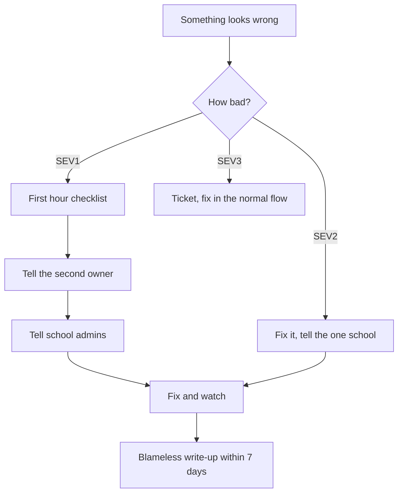
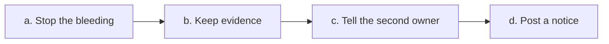

# Incident response: what to do on a bad day

This page is the plan for a bad day: a data leak, a hacked account, ransomware or a long outage.
Read it **before** you need it. Practise it once (see [Practice](#practice)).

> This repo is public. This page holds **no secrets, no phone numbers and no email addresses
> of people.** Contacts live in the owners' password manager (see [Contacts](#contacts)).

## The whole plan on one picture



## Severity

| Level    | Meaning                                                         | Example                                                           |
| -------- | --------------------------------------------------------------- | ----------------------------------------------------------------- |
| **SEV1** | A school's data is exposed or lost, **or** every school is down | A database dump is found on a public link. The prod VM is gone.   |
| **SEV2** | One school is down, **or** one feature is broken for everyone   | One school's site returns 500. Fee payments fail for all schools. |
| **SEV3** | Minor. Nobody is blocked                                        | A report page shows a wrong label.                                |

When unsure, pick the higher level. You can lower it later.

## First hour, SEV1

Do these in order. Step (a) comes first because it stops more damage.

**One exception: take the database dump (b.2) before any step that changes data**, such as
the `tokens_valid_after` bump in a.3. Suspending a school (a.1) changes
only that school's status row and rotating a key (a.2) changes none, so they can go first. If you must change data before the dump, write each change and
its time in the shared note (b.3), so the dump can be read against it.



**a. Stop the bleeding**

1. **Suspend the school** (if one school is affected): `PATCH /platform/schools/:id/status`
   with a reason, as a cockpit owner. Code: `server/src/modules/schools/platform-schools.controller.ts`.
   The change applies on the school's very next request.
2. **Rotate the leaked key or secret.** Follow
   [28-platform-runbook.md, Part 16 "Rotate a secret, lose a key"](28-platform-runbook.md#part-16-rotate-a-secret-lose-a-key).
3. **Sign people out.** This changes data, so take the dump ([b.2](#first-hour-sev1)) first.
   - One person: suspend or reset that user. Either sets `users.tokens_valid_after`, so their access tokens are refused on the next request ([08-security.md, Rule 8](08-security.md#rule-8-suspend-remove-or-reset-bumps-tokens_valid_after)). `POST /auth/logout-all` only signs out the caller, so do not use it here.
   - A whole school: bump `users.tokens_valid_after` for its users
     ([08-security.md, Rule 8](08-security.md#rule-8-suspend-remove-or-reset-bumps-tokens_valid_after)).

**b. Keep evidence**

1. **Do not delete logs.** Do not restart containers just to "clean up", unless step (a) needs it.
2. **Take a fresh database dump before you change data.** The hourly backup can be up to an hour old and would miss changes made during the intrusion, so take a new dump now, and keep the newest hourly one separately. The backup container writes an
   encrypted dump every hour. Copy the newest one and note its name. How backups work and how to
   open one: [13-backup-restore.md](13-backup-restore.md).
3. Write down the time you started, in a shared note. Add every action with its time.

**c. Tell the second owner.** Two people always know. Find them in [Contacts](#contacts).

**d. Post a notice.** Use the status page once it exists
(Epic 61 task 61.4, [#1770](https://github.com/tareq89/biddaloy/issues/1770)).
Until then: **SMS the school admins** with the template below.

## Telling schools

Who hears first: the **school's admins**. The school then tells guardians. We help them
with the words. We do not message guardians ourselves unless a school asks us to.

**Deadline: tell affected schools within 72 hours of finding out.**

> **OPEN QUESTION — the lawyer's answer in [#1781](https://github.com/tareq89/biddaloy/issues/1781) replaces this number.**
> 72 hours is a placeholder, not legal advice. Until the answer lands, treat it as the limit.

### Template A: data exposed

**English**

> Dear {school name} admin,
> On {date} we found that some of your school's data may have been seen by someone who should
> not have seen it. The data involved: {what data, for example "student names and phone numbers"}.
> We have {what we did, for example "stopped the access and changed all keys"}.
> What you need to do: {the action for this incident, for example "reset your password now", or "nothing right now"}. Please do not share your password with anyone.
> We will write again by {time} with more detail. Questions: {support channel}.

**বাংলা**

> প্রিয় {স্কুলের নাম} অ্যাডমিন,
> {তারিখ} তারিখে আমরা জানতে পেরেছি, আপনার স্কুলের কিছু তথ্য এমন কেউ দেখে ফেলতে পারেন, যাঁর দেখার কথা নয়।
> যে তথ্য জড়িত: {কোন তথ্য, যেমন "ছাত্রছাত্রীর নাম ও ফোন নম্বর"}।
> আমরা {কী করেছি, যেমন "প্রবেশ বন্ধ করেছি এবং সব চাবি বদলেছি"}।
> আপনার করণীয়: {এই ঘটনার জন্য করণীয়, যেমন "এখনই পাসওয়ার্ড বদলান", অথবা "এখন কিছু করতে হবে না"}। অনুগ্রহ করে আপনার পাসওয়ার্ড কাউকে দেবেন না।
> আমরা {সময়}-এর মধ্যে আবার বিস্তারিত জানাব। প্রশ্ন থাকলে: {সাপোর্ট মাধ্যম}।

### Template B: long outage

**English**

> Dear {school name} admin,
> Since {time} the system is not working for your school. We know about it and we are fixing it.
> Your data is safe. {Or: "We are checking this and will tell you."}
> Next update by {time}. Until then please use paper for attendance and fee receipts, and
> enter them later.

**বাংলা**

> প্রিয় {স্কুলের নাম} অ্যাডমিন,
> {সময়} থেকে আপনার স্কুলে সিস্টেম কাজ করছে না। আমরা বিষয়টি জানি এবং ঠিক করছি।
> আপনার তথ্য নিরাপদ আছে। {অথবা: "আমরা এটি যাচাই করছি, জানাব।"}
> পরের আপডেট {সময়}-এর মধ্যে। ততক্ষণ হাজিরা ও ফি-র রসিদ কাগজে রাখুন, পরে সিস্টেমে তুলবেন।

## After

Within **7 days**, write a **blameless** write-up. Blameless means we ask "what let this
happen?", never "who did it?". Copy this template into a new file or issue:

```text
## What happened
One short paragraph. Who was affected, how many schools.

## Timeline (all times Asia/Dhaka)
- 14:02  First sign: ...
- 14:10  Second owner told
- 14:40  Access stopped
- ...

## Why it happened
The real cause, and why nothing caught it earlier.

## What we changed
Fixes already done.

## What we will change
Fixes still to do. Each one is an issue with an owner.
```

## Contacts

Names, phone numbers and emails are **not** in this repo. They are kept in the owners'
password manager, in the incident-contacts note
(set up in Epic 65, [#1734](https://github.com/tareq89/biddaloy/issues/1734)).

## Security calendar

Chores that must repeat. If a row is missed, the next one is late.

| Every    | What                                                                      | Where it is described                                                                        |
| -------- | ------------------------------------------------------------------------- | -------------------------------------------------------------------------------------------- |
| Year     | Outside penetration test                                                  | [#1747](https://github.com/tareq89/biddaloy/issues/1747)                                     |
| Year     | Renew the `Expires` date in `security.txt`                                | [#1761](https://github.com/tareq89/biddaloy/issues/1761)                                     |
| Year     | Review who is platform owner, GitHub admin, and who has server SSH access | This page                                                                                    |
| Quarter  | Review the restore drill results                                          | [13-backup-restore.md](13-backup-restore.md), `.github/workflows/restore-drill.yml`          |
| Quarter  | Read the support access log                                               | Epic 99, [#3726](https://github.com/tareq89/biddaloy/issues/3726)                            |
| 6 months | Rotate S3, SMTP and SMS provider keys                                     | [28-platform-runbook.md, Part 16](28-platform-runbook.md#part-16-rotate-a-secret-lose-a-key) |
| Month    | Triage Dependabot PRs and the weekly image scan                           | [#1757](https://github.com/tareq89/biddaloy/issues/1757)                                     |

## Practice

The owners practise this plan once: a tabletop, where they talk through a made-up SEV1 with
this page open. The result is recorded in [#1765](https://github.com/tareq89/biddaloy/issues/1765),
not here.
