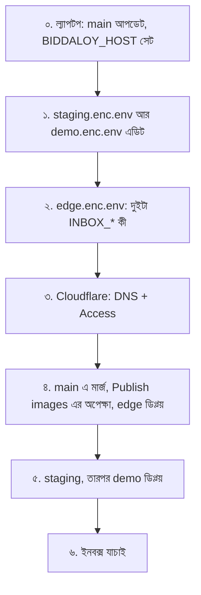
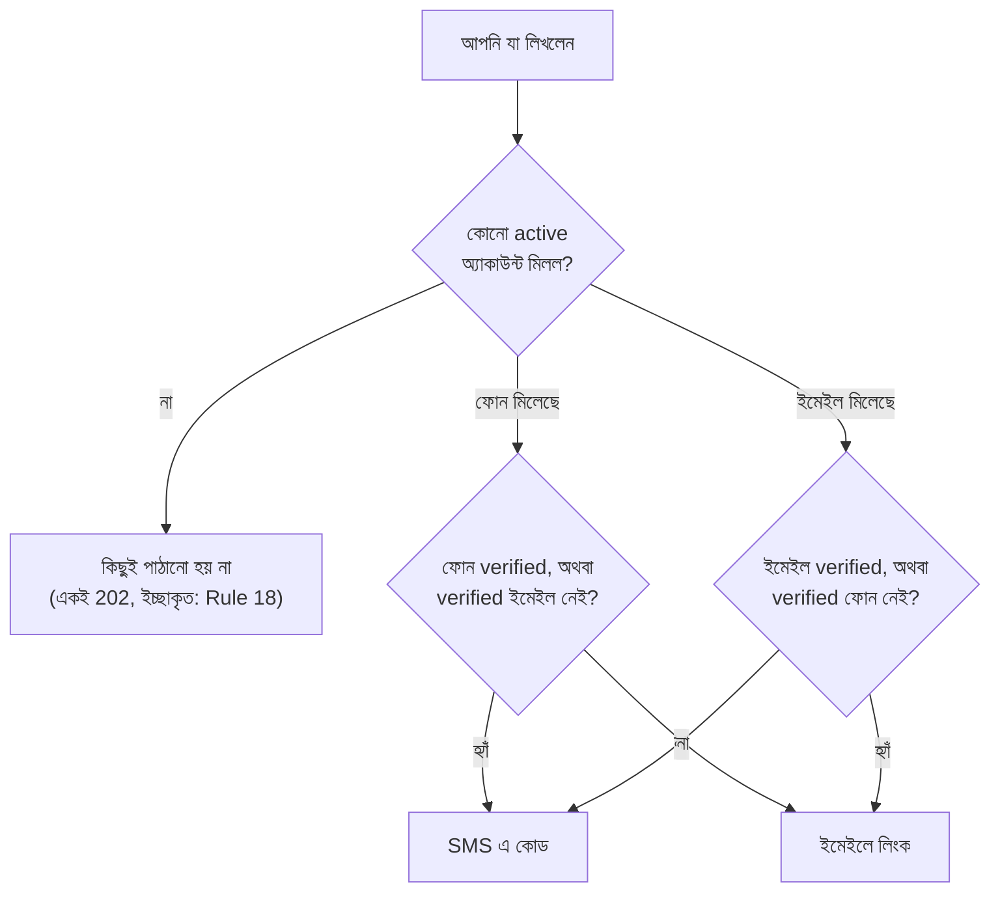

# টেস্ট ইনবক্স ডিপ্লয় (Epic 87): staging আর demo

এটা [28-platform-runbook.md, part 10b](../28-platform-runbook.md#10b-deploy-the-test-inbox-epic-87-staging-and-demo)
এর বাংলা সংস্করণ। দুইটার মধ্যে অমিল থাকলে ইংরেজিটাই ঠিক ধরবেন।

**এটা কী।** staging আর demo সার্ভার কোনো আসল মানুষকে মেসেজ পাঠায় না। ইমেইল, SMS,
WhatsApp, Messenger, সব মেসেজ একটা Mailpit ইনবক্সে জমা হয়। prod এ এটা কখনো চলে না।

**শব্দগুলোর মানে**

- **Mailpit:** একটা নকল ইনবক্স। মেসেজ ধরে রাখে, কাউকে পাঠায় না।
- **sops:** এনক্রিপ্ট করা সিক্রেট ফাইল (`*.enc.env`) খোলা আর এডিট করার টুল।
- **cloudflared:** VM থেকে Cloudflare পর্যন্ত টানেল চালায়। বাইরের সব ট্রাফিক এর ভেতর দিয়ে আসে।
- **sha:** একটা কমিটের ৪০ অক্ষরের পুরো আইডি।

একবারই করতে হবে, এই ক্রমে:



## ০. শুরুর আগে

main আপডেট করুন। VM এর ঠিকানা একবার একটা ভেরিয়েবলে রাখুন। নিচের সব কমান্ড এটা নিজেই
পড়ে, তাই ঠিকানা আর টাইপ করতে হবে না।

```bash
git checkout main && git pull --ff-only
export BIDDALOY_HOST=203.0.113.10   # আপনার VM এর public IP
```

> **কমান্ডে কখনো `<...>` লিখবেন না।** zsh এ `<` মানে "ফাইল থেকে পড়ো"। তাই
> `ssh deploy@<vm-ip>` পেস্ট করলে এই এরর আসে: `zsh: no such file or directory: vm-ip`।
> এই গাইডের সব কমান্ডে placeholder এর বদলে `$BIDDALOY_HOST` আর `$SHA` আছে।

## ১. staging আর demo এর env ফাইল

`sops infra/secrets/staging.enc.env` খুলুন, তারপর `demo.enc.env`। এর কোনোটা বাদ পড়লে
config-check ডিপ্লয় আটকে দেবে:

```text
MESSAGE_SINK=mailpit
COMPOSE_PROFILES=sink                     # mailpit কন্টেইনার চালু করে; আগের প্রোফাইল থাকলে রেখে দিন
MESSAGE_SINK_PUBLIC_URL=https://inbox-staging.schoolmanagerp.com   # demo তে: https://inbox-demo.schoolmanagerp.com
SMOKE_INBOX_API_URL=http://staging-mailpit:8025                    # শুধু staging; smoke এ `inbox` চেক যোগ করে
```

- `COMPOSE_PROFILES` এ আগে থেকে অন্য প্রোফাইল থাকলে কমা দিয়ে `sink` যোগ করুন।
- demo ফাইলে `SMOKE_INBOX_API_URL` লাইনটা দেবেন না।

কমিটের আগে চাইলে চেক করে নিন। এর জন্য `yarn install` লাগে। না করলেও চলবে, VM একই চেক চালায়।

```bash
sops -d infra/secrets/staging.enc.env | yarn config:check --env staging --file /dev/stdin
sops -d infra/secrets/demo.enc.env    | yarn config:check --env demo    --file /dev/stdin
```

## ২. edge এর env ফাইল

`sops infra/secrets/edge.enc.env` খুলে দুইটা কী সেট করুন। একটাও না থাকলে edge preflight ফেল করবে।

```text
INBOX_DEMO_DOMAIN=inbox-demo.schoolmanagerp.com
INBOX_STAGING_DOMAIN=inbox-staging.schoolmanagerp.com
```

## ৩. Cloudflare

ইংরেজি runbook এর part 4c আর 4d তে বিস্তারিত আছে।

- টানেলের দিকে দুইটা **Proxied** CNAME: `inbox-demo` আর `inbox-staging`।
- Zero Trust > Access > `Staging` অ্যাপের hostname লিস্টে `inbox-staging.schoolmanagerp.com` যোগ করুন।
- `inbox-demo` কোনো Access অ্যাপে দেবেন না। ওটা ইচ্ছা করেই পাবলিক।
- নাম এক লেভেলের হবে: `inbox-demo.`, কখনো `inbox.demo.` না। নাহলে TLS ফেল করে।

```bash
for h in inbox-demo.schoolmanagerp.com inbox-staging.schoolmanagerp.com; do
  cloudflared tunnel route dns biddaloy "$h"
done
```

## ৪. মার্জ, ইমেজের অপেক্ষা, edge ডিপ্লয়

তিনটা `.enc.env` ফাইল কমিট করে main এ মার্জ করুন। তারপর **Publish images** সবুজ হওয়া পর্যন্ত
অপেক্ষা করুন। VM যে sha ডিপ্লয় করে, সেই sha এর চেকআউট থেকেই সিক্রেট পড়ে। তাই আপনার এডিট
ওই sha তে থাকতে হবে।

```bash
gh run list -w publish-image.yml --limit 1   # অপেক্ষা করুন: completed success
git pull --ff-only && SHA=$(git rev-parse HEAD)
scripts/deploy.sh edge "$SHA"
```

- `scripts/deploy.sh` আগে দেখে নেয় sha টা GitHub এ আছে কিনা। তারপর VM এ `biddaloy-deploy` চালায়।
- টানেল কনফিগ বদলালে edge ডিপ্লয় এখন cloudflared নিজেই রিক্রিয়েট করে (PR #3242)। এতে নতুন
  দুইটা hostname nginx পর্যন্ত পৌঁছায়।
- রিক্রিয়েটের সময় prod সহ পুরো টানেল কয়েক সেকেন্ড বন্ধ থাকে।

> **#3242 (২০২৬-১০-২৯ এ মার্জ) এর আগে edge ডিপ্লয় করেছিলেন?** তাহলে VM এর কনফিগে inbox
> hostname আছে, কিন্তু cloudflared পুরোনো কনফিগ নিয়ে চলছে। দুইটা inbox host ই **খালি** `404`
> দেয়, আর পরের edge ডিপ্লয়ও কোনো পরিবর্তন দেখে না। আগে প্রমাণ নিন:
>
> ```bash
> ssh deploy@$BIDDALOY_HOST 'grep -n inbox /opt/biddaloy/edge/cloudflared/config.yml; stat -c %y /opt/biddaloy/edge/cloudflared/config.yml; docker inspect -f "{{.State.StartedAt}}" $(docker ps -qf name=cloudflared)'
> ```
>
> দুইটা `inbox` লাইন আছে, আর কন্টেইনার চালুর সময় ফাইলের সময়ের **আগে**? তাহলে cloudflared
> পুরোনো কনফিগে চলছে। একবার হাতে রিস্টার্ট করুন:
>
> ```bash
> ssh deploy@$BIDDALOY_HOST 'docker restart $(docker ps -qf name=cloudflared)'
> ```
>
> আসল উদাহরণ (২০২৬-১০-২৯): ফাইল বদলেছে `2026-10-29 11:12 +0600` এ, কন্টেইনার চালু হয়েছিল
> `2026-10-22T17:47Z` এ। রিস্টার্টের পরে `/readyz` থেকে `200` এসেছে। prod কয়েক সেকেন্ড বন্ধ থাকে।

## ৫. স্ট্যাক ডিপ্লয়

একই `$SHA`, আগে staging। ডিপ্লয় mailpit নিজেই চালু করে, হাতে `docker compose` লাগবে না।

```bash
scripts/deploy.sh staging "$SHA"
scripts/deploy.sh demo "$SHA"
```

## ৬. যাচাই

| চেক                                                                                     | আশা করা ফল                                      |
| --------------------------------------------------------------------------------------- | ----------------------------------------------- |
| `curl -s -o /dev/null -w '%{http_code}\n' https://inbox-demo.schoolmanagerp.com/readyz` | `200`                                           |
| `curl -sI https://inbox-staging.schoolmanagerp.com/`                                    | `302`, Location এ `<team>.cloudflareaccess.com` |
| ব্রাউজারে `https://inbox-staging.schoolmanagerp.com` খুলে লগইন                          | Mailpit ইনবক্স দেখা যাবে, `404` না              |
| staging ডিপ্লয়ের আউটপুট                                                                | `PASS ... inbox: ok`                            |
| staging এ "forgot password", একটা আসল active অ্যাকাউন্ট দিয়ে (নিচে দেখুন)              | সাইন-ইন নোটিশে ইনবক্সের লিংক, আর কোডটা ইনবক্সে  |

`302` টা আসে Cloudflare Access থেকে, টানেলে পৌঁছানোর আগেই। এটা প্রমাণ করে না যে টানেল ওই
host চেনে। তাই লগইন করে staging ইনবক্স একবার খুলে দেখবেন।

## ইনবক্সে কী আসে

প্রতিটা চ্যানেলের মেসেজ Mailpit এ ইমেইল হয়ে আসে, চ্যানেলের নামে ট্যাগসহ। Mailpit কোনো ট্যাগ
তখনই দেখায় যখন অন্তত একটা মেসেজে সেটা আছে। তাই শুধু SMS এসে থাকলে শুধু `SMS` ট্যাগ দেখবেন।

| চ্যানেল   | ট্যাগ       | Subject                                         | To                             |
| --------- | ----------- | ----------------------------------------------- | ------------------------------ |
| ইমেইল     | `EMAIL`     | আসল subject                                     | আসল ইমেইল ঠিকানা               |
| SMS       | `SMS`       | `[SMS]`                                         | `<phone>@sms.sink.invalid`     |
| WhatsApp  | `WHATSAPP`  | `[WHATSAPP]`, অথবা `[WhatsApp template <name>]` | `<phone>@sms.sink.invalid`     |
| Messenger | `MESSENGER` | `[MESSENGER]`                                   | `<recipient>@sms.sink.invalid` |

"Forgot password" কোন চ্যানেলে যাবে, তা ঠিক হয় আপনি কী লিখেছেন আর কোনটা verified তা দেখে
(`recovery.service.ts`):



- এলোমেলো বা অচেনা ইমেইল দিলে ইনবক্সে কিছুই আসে না। স্ক্রিনে তবু একই সফলতার মেসেজ দেখাবে,
  যাতে বাইরের কেউ বুঝতে না পারে কোন অ্যাকাউন্ট আছে।
- ইমেইল unverified কিন্তু ফোন verified হলে, ইমেইল লিখলেও SMS যাবে।
- `EMAIL` মেসেজ দেখতে চাইলে এমন active অ্যাকাউন্ট নিন যার ইমেইল verified, অথবা যার ফোন নেই।

## কিছু না চললে

| যা দেখছেন                                         | কারণ                                                  | সমাধান                                                                                                 |
| ------------------------------------------------- | ----------------------------------------------------- | ------------------------------------------------------------------------------------------------------ |
| `zsh: no such file or directory: vm-ip`           | `<placeholder>` হুবহু টাইপ করা হয়েছে                 | ধাপ ০ এর মতো `BIDDALOY_HOST` সেট করে কমান্ড যেমন আছে তেমন চালান                                        |
| `Unable to create '.git/index.lock': File exists` | কোনো git প্রসেস crash করে খালি lock ফাইল রেখে গেছে    | `pgrep -fl git` কিছু না দেখালে `rm -f .git/index.lock`                                                 |
| ডিপ্লয় `settings` বা config-check এ থামে         | ধাপ ১ বা ২ এর কোনো কী নেই                             | `Why:` লাইনে কী এর নাম থাকে; `sops` দিয়ে ঠিক করে push করে একই ডিপ্লয় আবার                            |
| inbox host থেকে **খালি** `404`                    | cloudflared পুরোনো টানেল কনফিগে চলছে                  | ধাপ ৪ এর চেক আর রিস্টার্ট                                                                              |
| inbox host থেকে `502`                             | nginx পর্যন্ত আসে, কিন্তু mailpit এ পৌঁছায় না        | `ssh deploy@$BIDDALOY_HOST 'docker ps --format "{{.Names}} {{.Status}}" \| grep -iE "mailpit\|nginx"'` |
| staging ইনবক্সে লগইন হয়, তারপর `404`             | খালি `404` এর মতোই                                    | ধাপ ৪ এর চেক আর রিস্টার্ট                                                                              |
| শুধু `SMS` ট্যাগ, কোনো ইমেইল নেই                  | ওই অ্যাকাউন্টের জন্য forgot-password SMS বেছে নিয়েছে | উপরের ছবি দেখুন; verified ইমেইলওয়ালা অ্যাকাউন্ট দিয়ে চেষ্টা করুন                                     |
| এলোমেলো ইমেইলে ইনবক্সে কিছু আসে না                | কোনো অ্যাকাউন্ট মেলেনি, তাই কিছুই পাঠানো হয়নি        | আসল active অ্যাকাউন্ট ব্যবহার করুন                                                                     |

রোলব্যাক হলেও mailpit চলতে থাকে, এটা ইচ্ছাকৃত।

## ঐচ্ছিক: staging থেকে আসল মেসেজ

শুধু staging ইনবক্স বাদ দিয়ে আসল মেসেজ পাঠাতে পারে। `staging.enc.env` এ
`ALLOW_REAL_PROVIDERS_ON_STAGING=true` আর `MESSAGE_SINK=real` দিন, প্রোভাইডারের কী গুলো ভরুন,
আর `COMPOSE_PROFILES` থেকে `sink` সরিয়ে দিন।

- তখন আসল মানুষের কাছে আসল মেসেজ যাবে।
- এটা চালু থাকা অবস্থায় prod এর ডাটা staging এ কপি করবেন না।
- demo আর prod এই ফ্ল্যাগ মানে না।
