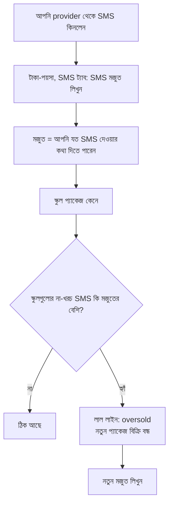

# টাকা-পয়সা: SMS মজুত, প্যাকেজ, কুপন, ফেরত (বাংলা)

এটা [28-platform-runbook.md](../28-platform-runbook.md) এর [Part 19](../28-platform-runbook.md#part-19-money-sms-stock-packages-coupons-refunds-owners) এর বাংলা সংস্করণ। দুইটার মধ্যে অমিল থাকলে ইংরেজিটাই ঠিক ধরবেন। রুট আর কমান্ডের নাম ইংরেজিতেই থাকল।

> একজন বাংলা পাঠক শব্দগুলো দেখে নিলে ভালো হয় (#3844 এর মতো পরীক্ষা বাকি আছে)।

**শব্দগুলোর মানে**

- **SMS মজুত:** আপনি SMS কোম্পানি (provider) থেকে যত SMS কিনেছেন।
- **SMS প্যাকেজ:** স্কুল যেটা কেনে: কয়টা SMS, কত টাকা, কত দিন চলবে।
- **মেয়াদ:** প্যাকেজের SMS যতদিন ব্যবহার করা যায়। তারপর বাকি SMS শেষ হয়ে যায়।
- **কুপন:** ছাড়ের কোড। শুধু সিট কেনার জন্য।
- **ফেরত:** আপনি সিস্টেমে লিখে রাখেন যে টাকা ফেরত হলো। আসল টাকা bKash প্যানেল থেকে আপনি নিজে ফেরত দেন।

## কখন কী করবেন

| অবস্থা | কী করবেন |
| --- | --- |
| **provider থেকে SMS কিনেছেন** | **টাকা-পয়সা, SMS, SMS মজুত লিখুন**। তারিখ, কয়টা SMS, খরচ (টাকায়) আর চাইলে একটা নোট দিন। ভুল লাইন মুছতে ৫ থেকে ৪৯০ অক্ষরের কারণ লিখুন (লাইনটা লুকানো থাকে, মুছে যায় না)। provider এর নিজের ব্যালেন্সও মাঝে মাঝে লিখে রাখুন। |
| **লাল লাইন পড়বেন** | **Stock low:** মজুত স্কুলের হাতের SMS এর কাছাকাছি। **Oversold:** স্কুলগুলোর না-খরচ SMS মজুতের চেয়ে বেশি। provider এর ব্যালেন্স অজানা থাকলে oversold ধরা হয় না। |
| **Oversold হলে** | নতুন প্যাকেজ কেনা আর পেমেন্ট `409 SMS_SALES_PAUSED` পায়। SMS পাঠানো কখনো বন্ধ হয় না, আর যে টাকা আগেই এসেছে তা ফেরানো হয় না। আরও SMS কিনুন, মজুত লিখুন, বিক্রি নিজেই চালু হবে। স্কুলের ব্যালেন্স হাতে বদলে "ঠিক" করবেন না। |
| **স্কুল টাকা ফেরত চায়** | **Subscriptions**, স্কুল, অর্ডার, **ফেরত**, ৫ থেকে ৩০০ অক্ষরের কারণ লিখুন, authenticator কোড দিন। এতে শুধু লেখা থাকে। **তারপর bKash merchant প্যানেলে গিয়ে নিজে টাকা ফেরত দিন।** |
| **কুপন বানাবেন** | **টাকা-পয়সা, কুপন, নতুন কুপন**। কোড, ১ থেকে ৯৯ শতাংশ (বা নির্দিষ্ট টাকা), শেষ তারিখ, সর্বোচ্চ কতবার, চাইলে স্কুলের তালিকা। বানানোর পর কোড, ধরন আর শতাংশ বদলায় না; বন্ধ করতে "active" সুইচ ব্যবহার করুন। |
| **১০০% কুপন বানাবেন** | একই ফর্মে শতাংশ ১০০ দিন। আপনার কোড **আর অন্য owner এর অনুমোদন** লাগে (পর্দায় "অন্য owner এর অপেক্ষা" দেখাবে), কারণ অর্ডার বিনামূল্যের হয় আর bKash ছাড়াই PAID হয়। প্ল্যাটফর্মে একজনই owner থাকলে বানানো যায় না। |

## ফেরতের নিয়ম

- শুধু `PAID` সিটের অর্ডার (বা `ACTIVE` প্যাকেজ অর্ডার) ফেরত হয়; অপেক্ষমাণ বা আগেই ফেরত হওয়া অর্ডারেও `409 ORDER_NOT_REFUNDABLE` আসে। সিটের অর্ডারে দেওয়া টাকা ০ এর বেশি হতে হবে। ১০০% কুপনে বিনামূল্যের অর্ডার ফেরত হয় না (`409 ORDER_NOT_REFUNDABLE`)। এটা owner এর সিদ্ধান্ত (#4126)।
- SMS প্যাকেজ ফেরত হয় যতক্ষণ তার একটাও SMS খরচ হয়নি। খরচ হলে `409 BUNDLE_ALREADY_USED`।
- ফেরত দিলেও কুপন ব্যবহারের গণনা থাকে।

## উদাহরণ

Greenview স্কুল ৩ মাসের সিটের জন্য ৩০০০ টাকা (৩০০০০০ পয়সা) দিয়েছিল, একই দিনে ছেড়ে দিতে চায়। আপনি ফেরত চাপেন, কারণ লেখেন "স্কুল বন্ধ, ফোনে জানিয়েছে", কোড দেন। অর্ডার `REFUNDED` হয়, সিট কমে যায়। এবার bKash প্যানেলে টাকা, তারিখ আর পাঠানো নম্বর দিয়ে পেমেন্টটা খুঁজে ৩০০০ টাকা ফেরত দিন। cockpit টাকা সরায় না, শুধু লিখে রাখে।

**Oversold এর উদাহরণ:** মজুত লেখা আছে ১০০০০ SMS। স্কুলগুলোর হাতে না-খরচ ১০৫০০। লাল "Oversold" লাইন দেখায়। আপনি আরও ৫০০০ SMS এর কেনা লিখলেন: মজুত ১৫০০০, কথা দেওয়া ১০৫০০, লাইন মিলিয়ে যায়।
