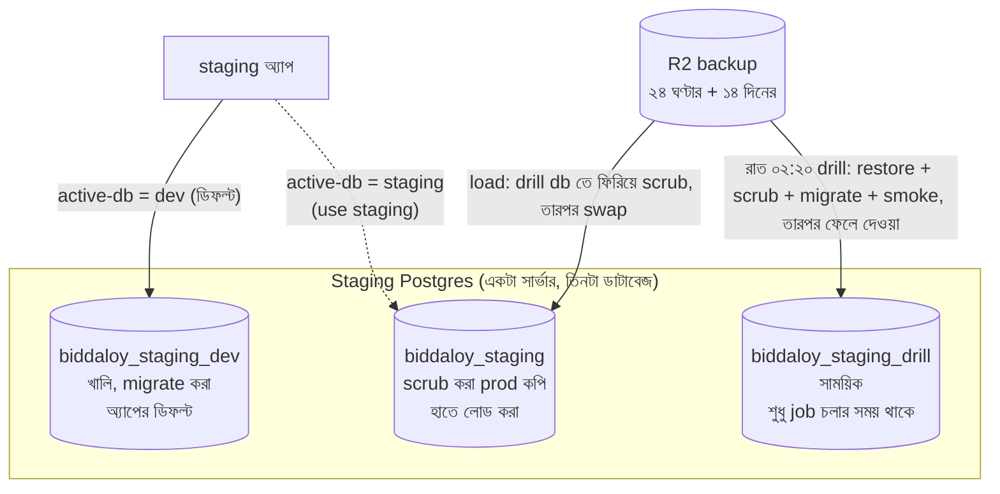
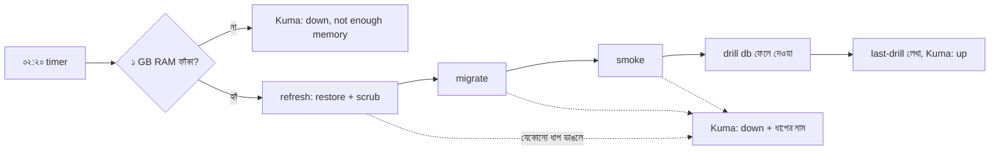
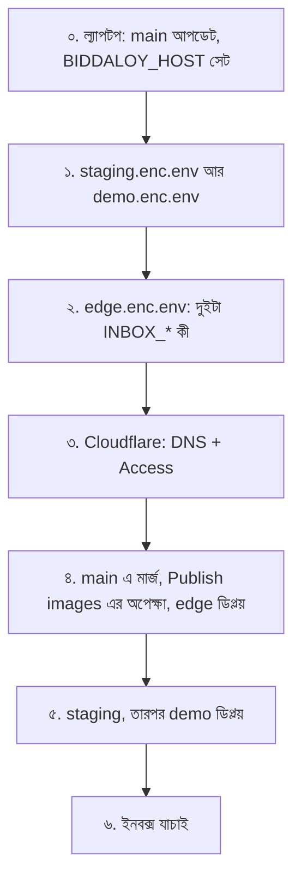
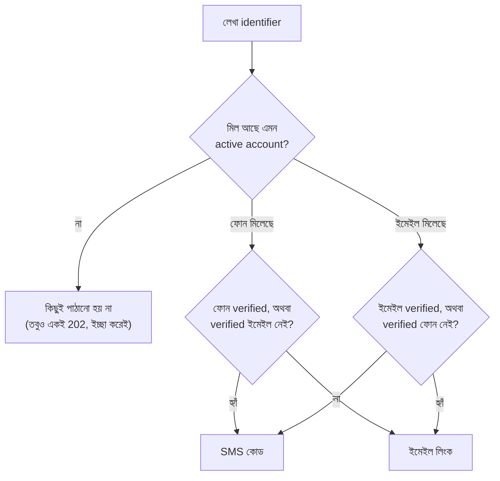

# Staging, রাতের drill আর টেস্ট ইনবক্স (বাংলা)

এটা [28-platform-runbook.md](../28-platform-runbook.md) এর দুইটা অংশের বাংলা সংস্করণ:

1. [Staging: dev, staging and the nightly drill](../28-platform-runbook.md#staging-dev-staging-and-the-nightly-drill)
2. [Part 10b, টেস্ট ইনবক্স ডিপ্লয়](../28-platform-runbook.md#10b-deploy-the-test-inbox-epic-87-staging-and-demo)

দুইটার মধ্যে অমিল থাকলে ইংরেজিটাই ঠিক ধরবেন। কমান্ড, ফাইলের নাম আর মান ইংরেজিতেই আছে,
হুবহু কপি করুন। টেস্ট ইনবক্সের পুরো বিস্তারিত ধাপ আছে
[test-inbox-deploy.md](../bn/test-inbox-deploy.md) এ।

**শব্দগুলোর মানে**

- **Backup:** R2 তে রাখা prod এর এনক্রিপ্ট করা কপি। প্রতি ঘণ্টার ২৪টা আর প্রতি দিনের ১৪টা দেখা যায়।
- **Scrub:** আসল নাম, ফোন, ইমেইল সরিয়ে নকল তথ্য বসানো। এতে staging থেকে কোনো আসল মানুষের কাছে মেসেজ যায় না।
- **Active db:** staging অ্যাপ এখন যে ডাটাবেজ ব্যবহার করছে।
- **Drill:** একটা backup সাময়িক ডাটাবেজে ফিরিয়ে দেখা যে ফেরানো কাজ করে, তারপর ডাটাবেজটা ফেলে দেওয়া।

---

## ক. Staging: dev, staging আর রাতের drill

আগে staging প্রতি রাতে prod এর নতুন কপি দিয়ে বদলে যেত। এখন আর যায় না (Epic 88)। এখন:

- staging এ **দুইটা ডাটাবেজ** আছে,
- prod এর কপি **আপনি যখন চান তখন** লোড করেন,
- আলাদা একটা **রাতের drill** প্রমাণ করে যে backup ফেরানো এখনো কাজ করে।



- **dev** (ডিফল্ট): খালি আর migrate করা। নতুন কোড আসল-ধাঁচের ডেটা ছাড়া চালিয়ে দেখতে। অ্যাপের হেডারে `DEV` ব্যাজ থাকে।
- **staging**: একটা prod backup এর scrub করা কপি। নতুন কোড আসল ধাঁচের ডেটায় কেমন চলে দেখতে। ব্যাজে `STAGING` আর backup এর তারিখ থাকে। **backup লোড না করা পর্যন্ত এটা খালি**, আর খালি থাকলে `use staging` চলে না।
- **drill** এই দুইটার কোনোটাকেই ছোঁয় না। এটা শুধু "ফেরানো কাজ করে" এর প্রমাণ।

### কমান্ডগুলো

সব কাজ একটা কমান্ডে: `biddaloy-staging <verb>`। এটা VM এ `deploy` ইউজার হিসেবে চলে। পৌঁছানোর তিনটা রাস্তা আছে, তিনটাতেই একই কোড চলে।

| রাস্তা       | কীভাবে                                                                                                                              | কখন ভালো                                        |
| ------------ | ----------------------------------------------------------------------------------------------------------------------------------- | ----------------------------------------------- |
| VM এ গিয়ে   | `ssh deploy@$BIDDALOY_HOST`, তারপর `biddaloy-staging status`                                                                        | সব কাজ, প্রশ্ন করে নিশ্চিত করে                  |
| ল্যাপটপ থেকে | `BIDDALOY_HOST=$BIDDALOY_HOST scripts/staging.sh status`                                                                            | সব কাজ, backup এর নম্বর-তালিকাও চলে             |
| GitHub থেকে  | **Actions > Staging > Run workflow**, একটা action বাছুন (আগে [part 5e](../28-platform-runbook.md#5e-staging-workflow-key) করতে হবে) | টার্মিনাল ছাড়া; নম্বর-তালিকা নেই, key দিতে হবে |

GitHub এর key শুধু এই কয়টা কাজ করতে পারে, আর কিছু না: `status`, `backups`,
`load <key> --yes [--use]`, `use dev|staging --yes`, `clean-dev --yes`। ব্রাউজার ট্যাব বন্ধ করলেও কাজ মাঝপথে থামে না।

নিচের উদাহরণের তারিখ, সাইজ আর sha বানানো। আউটপুটের ধাঁচ আসল।

**`status`**: শুধু দেখা। কোনটা active, কোন backup লোড করা, শেষ drill, শেষ ৫টা পরিবর্তন।

```bash
biddaloy-staging status
# active db:     dev (biddaloy_staging_dev)
# loaded backup: 2026-10-28
# staging sha:   3f9c2ab4e1d07a5b6c8f9e0d1a2b3c4d5e6f7a8b
# last drill:    2026-10-29T02:31:07+0600 duration=642s schools=12 users=1480 students=9120
# history (last 5):
#   2026-10-28T09:14:02Z deploy load db/daily/2026-10-28.dump.age ok
```

**`backups`**: শুধু দেখা। সবচেয়ে নতুন ২৪টা ঘণ্টার আর ১৪টা দিনের backup, নম্বর দেওয়া।

```bash
biddaloy-staging backups
#  No.  Backup (UTC date, size)
#    1  db/hourly/20261029T060011Z.dump.age   2026-10-29 06:00:41 41.3 MB
#    2  db/hourly/20261029T050010Z.dump.age   2026-10-29 05:00:39 41.2 MB
#   ...
#   25  db/daily/2026-10-29.dump.age          2026-10-29 02:00:52 41.0 MB
# Next: biddaloy-staging load <number>   (add --use to switch the app to it)
```

**`load`**: একটা backup এর scrub করা কপি `biddaloy_staging` এ বসায়। নম্বর, key, `latest-daily` বা `latest-hourly` দিয়ে বাছুন। কিছু না দিলে তালিকা দেখিয়ে জিজ্ঞেস করে। নম্বর দিলে সেটা শেষবার `backups` যে তালিকা দেখিয়েছিল (`staging/backups-list` এ রাখা) সেখান থেকে নেয়, নতুন করে তালিকা আনে না। তাই মাঝে নতুন dump এলেও `3` মানে একই backup থাকে। রাখা তালিকা না থাকলে নম্বর নেয় না।

```bash
biddaloy-staging load latest-daily --use
# Load db/daily/2026-10-29.dump.age (written 2026-10-29) into biddaloy_staging and switch the app to it. Type yes to go on: yes
# 2026-10-29T10:05:02+0600 biddaloy-staging: loading db/daily/2026-10-29.dump.age (written 2026-10-29)
# step: refresh (into the scratch database biddaloy_staging_drill, not biddaloy_staging)
# step: swap
# step: migrate biddaloy_staging
# step: flush-redis
# step: deploy staging 3f9c2ab4e1d07a5b6c8f9e0d1a2b3c4d5e6f7a8b
# 2026-10-29T10:12:44+0600 biddaloy-staging: done: the app now serves staging (biddaloy_staging). Next: biddaloy-staging status
```

`load` আগে সাময়িক ডাটাবেজে ফিরিয়ে **scrub করে**, তারপর `biddaloy_staging` নামে বদলে বসায়। পুরোনোটা `biddaloy_staging_prev` নামে থেকে যায়। swap এর আগে কিছু ভাঙলে কিছুই বদলায় না। অ্যাপ staging চালালে swap এর সময় একটু থামে। `--use` দিলে অ্যাপও নতুন কপিতে চলে যায়। `--yes` দিলে "yes" লিখতে হয় না (GitHub সবসময় এটা দেয়)।

**`use dev|staging`**: অ্যাপকে একটা ডাটাবেজে ঘুরিয়ে দেয়। ডাটাবেজ migrate করে, Redis খালি করে, `/opt/biddaloy/staging/active-db` লেখে, তারপর একই sha আবার ডিপ্লয় করে।

```bash
biddaloy-staging use dev
# Switch the staging app to dev (it restarts and Redis is flushed). Type yes to go on: yes
# step: migrate biddaloy_staging_dev
# step: flush-redis
# step: deploy staging 3f9c2ab4e1d07a5b6c8f9e0d1a2b3c4d5e6f7a8b
# 2026-10-29T10:20:03+0600 biddaloy-staging: done: the app now serves dev (biddaloy_staging_dev). Next: biddaloy-staging status

biddaloy-staging use staging       # biddaloy_staging খালি থাকলে:
# REFUSED: biddaloy_staging is empty (D18): load a backup first
# Next: biddaloy-staging load   (pick a backup; add --use to switch right after)
# Nothing was modified.
```

**`clean-dev`**: dev মুছে নতুন করে বানায়। `biddaloy_staging_dev` খালি করে নতুন বানায়, dev এর bucket খালি করে, migrate করে। `biddaloy_staging` ছুঁতে পারে না। dev active থাকলে অ্যাপ একটু থামে।

```bash
biddaloy-staging clean-dev --yes
# step: stop-app
# step: recreate-db
# step: empty-bucket
# step: migrate
# step: flush-redis
# 2026-10-29T10:31:10+0600 biddaloy-staging: done: biddaloy_staging_dev is empty and migrated. Next: biddaloy-staging status
```

Exit code: `0` ঠিক আছে, `1` কোনো ধাপ ভেঙেছে, `2` আটকে দিয়েছে (কিছু বদলায়নি)। আটকালে বা ভাঙলে চার লাইন আসে: `FAILED at:` বা `REFUSED:`, `Why:` (কেন), `State:` (এখন কী অবস্থা), `Next:` (কোন কমান্ড চালাবেন)। চলমান ডিপ্লয় বা রাতের job থাকলে এটা এক ঘণ্টা পর্যন্ত অপেক্ষা করে, তাই দুইটা কাজ একসাথে চলে না। প্রতিটা পরিবর্তনে `/opt/biddaloy/staging/history.log` এ এক লাইন যোগ হয়।

### রাতের drill

প্রতি রাত ০২:২০ এ (Asia/Dhaka) `biddaloy-nightly restore-drill` সবচেয়ে নতুন **daily** backup `biddaloy_staging_drill` এ ফেরায়, scrub করে, staging image দিয়ে migrate করে, একটা সাময়িক অ্যাপে smoke test চালায়, তারপর ডাটাবেজটা ফেলে দেয়। চালু staging অ্যাপ কখনো থামে না বা বদলায় না। ১ GB এর কম RAM ফাঁকা থাকলে নিজেই বাদ দেয় আর `down` জানায়। শেষে Kuma র `restore-drill` monitor এ ঠিক একটা push যায়।



ভালো রাতে `/opt/biddaloy/staging/last-drill` এ এক লাইন লেখা হয়, আর `status` ও `biddaloy-doctor staging` সেটা দেখায়। খারাপ রাতে আগের দিনের লাইনটাই থাকে।

**অ্যালার্ট দেখতে কেমন।** Telegram এ Kuma র `restore-drill` monitor থেকে বার্তা আসে: `restore-drill is DOWN`, সাথে `refresh`, `migrate`, `smoke`, `guard` বা `not enough memory`। ২৬ ঘণ্টা কোনো push না এলেও লাল হয় (timer চলেইনি)।

**drill ফেল করলে**

1. অ্যালার্টের ধাপের নাম দেখুন, তারপর VM এ log পড়ুন:

   ```bash
   journalctl -u biddaloy-nightly@restore-drill.service -n 200 --no-pager
   cat /opt/biddaloy/staging/last-drill        # আগের দিনের ভালো লাইন
   ```

2. `not enough memory`: কিছু বদলায়নি। `free -m` দেখুন, RAM খালি করুন, আবার চালান।
3. `refresh`: সাধারণত সেদিনের backup এখনো R2 তে আসেনি (job ০২:৫০ পর্যন্ত অপেক্ষা করে), অথবা কোনো নতুন column scrub হয়নি। আগে Kuma র `backup-hourly` দেখুন।
4. `migrate`: আজ রাতের prod ডেটা staging এর কোডে migrate হচ্ছে না। হালকাভাবে নেবেন না, prod এও একই migration ভাঙবে।
5. `smoke`: ডেটা ফিরেছে কিন্তু অ্যাপ সেটা চালাতে পারছে না।
6. হাতে আবার চালান:

   ```bash
   sudo systemctl start biddaloy-nightly@restore-drill.service
   ```

7. `ok, warning: drill db not dropped` বার্তা সবুজ কিন্তু হাতে কাজ আছে: পড়ে থাকা `biddaloy_staging_drill` মুছুন (ধাপ [12-operations.md, 3.10](../12-operations.md) এ)।

drill ফেল করলে staging ব্যবহারকারীরা আটকে যান না। শুধু সেই রাতের restore প্রমাণ থাকে না।

### যা এখনো আসল VM এ যাচাই হয়নি

Epic 88 এর কিছুই এখনো আসল VM এ চলেনি। কোড নকল (stand-in) দিয়ে পরীক্ষা করা
(`deploy/bin/test/biddaloy-staging.test.sh`: ১২২টা পরীক্ষা পাস)। go-live এর দিন আগে এগুলো দেখুন:

| আগে এটা দেখুন                          | কীভাবে                                                                                                        | কেন যাচাই হয়নি                                                            |
| -------------------------------------- | ------------------------------------------------------------------------------------------------------------- | -------------------------------------------------------------------------- |
| GitHub এর staging key (forced command) | **Actions > Staging** এ `status` চালান; `active db: ...` আর `exit status: 0` আসতে হবে                         | `authorized_keys` এর কমান্ড লাইন শুধু নকল দিয়ে পরীক্ষা হয়েছে             |
| `restore-drill` Kuma monitor           | Push monitor বানান (part 11c), `RESTORE_DRILL_PUSH_URL` দিন, drill একবার হাতে চালান, monitor সবুজ হতে হবে     | কখনো push না পাওয়া monitor আর কাজ করা monitor এক জিনিস না                 |
| পুরোনো systemd timer সরে গেছে          | `systemctl list-timers 'biddaloy-nightly@*'` এ `staging-refresh` থাকবে না; একবার `provision.yml` চালান        | `biddaloy-nightly@staging-refresh.timer` সরানোর ansible কাজ আসল VM এ চলেনি |
| আসল backup দিয়ে একটা `load`           | `biddaloy-staging backups`, তারপর `load latest-daily --use`, তারপর staging খুলে `STAGING` ব্যাজের তারিখ দেখুন | আসল read-only R2 token আর আসল prod dump লাগে                               |
| আসল VM এর সাইজে memory guard           | staging চালু রেখে drill চালান; memory শেষ হয় কিনা দেখুন                                                      | ১ GB ফাঁকা থাকার শর্তটা অনুমান                                             |

---

## খ. টেস্ট ইনবক্স ডিপ্লয় (Part 10b সংক্ষেপে)

staging আর demo কোনো আসল মানুষকে মেসেজ পাঠায় না। ইমেইল, SMS, WhatsApp, Messenger, সব এক Mailpit ইনবক্সে জমা হয়। prod এ এটা চলে না। একবারই করতে হবে। পুরো ধাপ: [test-inbox-deploy.md](../bn/test-inbox-deploy.md)।



**০. শুরুর আগে।** `<...>` কখনো কমান্ডে লিখবেন না (zsh এ `<` মানে ফাইল থেকে পড়া)। VM এর ঠিকানা একবার ভেরিয়েবলে রাখুন:

```bash
git checkout main && git pull --ff-only
export BIDDALOY_HOST=203.0.113.10   # আপনার VM এর public IP
```

**১. env ফাইল** (`sops infra/secrets/staging.enc.env`, তারপর `demo.enc.env`):

```text
MESSAGE_SINK=mailpit
COMPOSE_PROFILES=sink                     # mailpit কন্টেইনার চালু করে; আগের প্রোফাইল থাকলে রেখে দিন
MESSAGE_SINK_PUBLIC_URL=https://inbox-staging.schoolmanagerp.com   # demo তে: https://inbox-demo.schoolmanagerp.com
SMOKE_INBOX_API_URL=http://staging-mailpit:8025                    # শুধু staging; smoke এ `inbox` check যোগ করে
```

**২. Edge env** (`sops infra/secrets/edge.enc.env`): `INBOX_DEMO_DOMAIN=inbox-demo.schoolmanagerp.com` আর `INBOX_STAGING_DOMAIN=inbox-staging.schoolmanagerp.com`। দুইটাই না থাকলে edge preflight ফেল করে।

**৩. Cloudflare।** টানেলে দুইটা CNAME (`inbox-demo`, `inbox-staging`), আর `inbox-staging` কে `Staging` Access app এ যোগ। নাম এক স্তরের: `inbox-demo.`, কখনো `inbox.demo.` না।

```bash
for h in inbox-demo.schoolmanagerp.com inbox-staging.schoolmanagerp.com; do
  cloudflared tunnel route dns biddaloy "$h"
done
```

**৪. মার্জ, images এর অপেক্ষা, edge ডিপ্লয়।** তিনটা `.enc.env` কমিট করে `main` এ মার্জ করুন, **Publish images** সবুজ হওয়া পর্যন্ত অপেক্ষা করুন। VM যে sha ডিপ্লয় করে তার checkout থেকে secret পড়ে, তাই ওই sha তে আপনার পরিবর্তন থাকতে হবে।

```bash
gh run list -w publish-image.yml --limit 1   # অপেক্ষা: completed success
git pull --ff-only && SHA=$(git rev-parse HEAD)
scripts/deploy.sh edge "$SHA"
```

edge ডিপ্লয়ে tunnel config বদলালে cloudflared নতুন করে চালু হয় (PR #3242), তখন prod সহ টানেল কয়েক সেকেন্ড নেমে যায়। **#3242 এর আগে edge ডিপ্লয় করে থাকলে** দুইটা inbox হোস্টই **খালি** `404` দেয়। প্রমাণ দেখে একবার হাতে restart করুন:

```bash
ssh deploy@$BIDDALOY_HOST 'grep -n inbox /opt/biddaloy/edge/cloudflared/config.yml; stat -c %y /opt/biddaloy/edge/cloudflared/config.yml; docker inspect -f "{{.State.StartedAt}}" $(docker ps -qf name=cloudflared)'
# দুইটা `inbox` লাইন, আর কন্টেইনারের start সময় ফাইলের সময়ের চেয়ে পুরোনো হলে সমস্যা এটাই
ssh deploy@$BIDDALOY_HOST 'docker restart $(docker ps -qf name=cloudflared)'
```

**৫. stack ডিপ্লয়।** একই `$SHA`, আগে staging।

```bash
scripts/deploy.sh staging "$SHA"
scripts/deploy.sh demo "$SHA"
```

**৬. যাচাই।**

| যাচাই                                                                                   | যা আসার কথা                            |
| --------------------------------------------------------------------------------------- | -------------------------------------- |
| `curl -s -o /dev/null -w '%{http_code}\n' https://inbox-demo.schoolmanagerp.com/readyz` | `200`                                  |
| `curl -sI https://inbox-staging.schoolmanagerp.com/`                                    | `302`, `<team>.cloudflareaccess.com` এ |
| ব্রাউজারে `https://inbox-staging.schoolmanagerp.com` খুলে লগইন                          | Mailpit ইনবক্স, `404` না               |
| staging ডিপ্লয়ের আউটপুট                                                                | `PASS ... inbox: ok`                   |
| staging এ আসল active account দিয়ে "Forgot password"                                    | ইনবক্সে কোড বা লিংক আসে                |

`302` আসে Cloudflare Access থেকে, টানেলের আগেই। তাই এটা প্রমাণ করে না যে টানেল হোস্টটা চেনে। লগইন করে একবার ইনবক্স খুলে দেখুন।

**ইনবক্সে কী আসে।** প্রতিটা মাধ্যম Mailpit এ ইমেইল হয়ে আসে, মাধ্যম অনুযায়ী tag সহ: `EMAIL`, `SMS`, `WHATSAPP`, `MESSENGER`। Mailpit tag দেখায় শুধু যখন অন্তত একটা মেসেজে সেটা থাকে। তাই শুধু SMS এলে শুধু `SMS` tag দেখবেন।

"Forgot password" কোন মাধ্যমে যাবে তা ঠিক হয় আপনি কী লিখলেন আর কোনটা verified তা দেখে:



তাই অজানা বা বানানো ঠিকানায় ইনবক্সে কিছু আসে না (**unknown account sends nothing**)। ইমেইল unverified কিন্তু ফোন verified থাকলে ইমেইল লিখলেও SMS যায়। `EMAIL` মেসেজ দেখতে চাইলে verified ইমেইলওয়ালা active account নিন।

**কিছু ভাঙলে**

| যা দেখছেন                                         | কারণ                                                   | সমাধান                                                                    |
| ------------------------------------------------- | ------------------------------------------------------ | ------------------------------------------------------------------------- |
| `zsh: no such file or directory: vm-ip`           | `<placeholder>` হুবহু টাইপ হয়েছে                      | `BIDDALOY_HOST` সেট করুন (ধাপ ০), কমান্ড যেমন আছে তেমন চালান              |
| `Unable to create '.git/index.lock': File exists` | git ক্র্যাশ করে খালি lock ফেলে গেছে                    | `pgrep -fl git` কিছু না দেখালে `rm -f .git/index.lock`                    |
| ডিপ্লয় `settings` বা config-check এ থামে         | ধাপ ১ বা ২ এর কোনো key বাদ                             | `Why:` লাইনে নাম থাকে; `sops` দিয়ে ঠিক করে push, একই ডিপ্লয় আবার চালান  |
| ইনবক্স হোস্টে **খালি** `404`                      | cloudflared পুরোনো tunnel config চালাচ্ছে              | ধাপ ৪ এর যাচাই আর restart                                                 |
| ইনবক্স হোস্টে `502`                               | nginx হোস্ট পায় কিন্তু mailpit পায় না                | `ssh deploy@$BIDDALOY_HOST 'docker ps --format "{{.Names}} {{.Status}}"'` |
| শুধু `SMS` tag, ইমেইল নেই                         | ওই account এর জন্য forgot-password SMS বেছেছে          | উপরের flowchart দেখুন; verified ইমেইলওয়ালা account নিন                   |
| বানানো ইমেইলে ইনবক্সে কিছু নেই                    | কোনো account মেলেনি, তাই কিছু পাঠানো হয়নি (ইচ্ছা করে) | আসল active account ব্যবহার করুন                                           |
