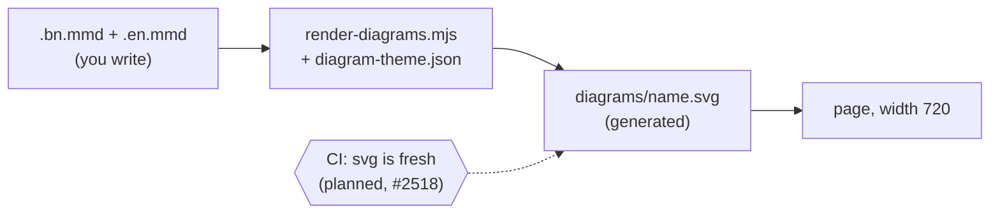
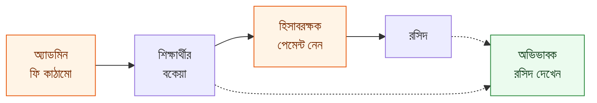

# Diagram style for user-guide pages

Every guide page opens its "learn more" with at least one high-level diagram,
and a flow that crosses features (structure, then dues, then payment, then
receipt) is drawn on **every** page it touches (Epic 42, D23). This file is the
rulebook. Page rules are in [`writing-guide.md`](writing-guide.md) and
[`page-template.md`](page-template.md); the system is in
[`../architecture/39-user-guide.md`](../architecture/39-user-guide.md).



## The rules (checklist)

- [ ] **Flat.** Plain boxes and arrows. No shadows, gradients or icons.
- [ ] **At most 3 colour families plus grey.** Colour has a meaning (see below), never decoration.
- [ ] **Labels of at most 3 words.** Put detail in the page text.
- [ ] **At most 4 boxes across and about 7 down.** It must be readable at 390 px wide.
- [ ] **Who sees what is shown with colour and a word.** The word is in the box ("শিক্ষক", "Teacher"), so colour is never the only signal.
- [ ] **`<title>` and `<desc>` on every diagram.** Write them as `%% title:` and `%% desc:` lines at the top of the `.mmd`. The renderer copies them into the SVG for screen readers.
- [ ] **bn and en labels.** Two files, same shape: `<name>.bn.mmd` and `<name>.en.mmd`.
- [ ] **Source is `.mmd`; the SVG is generated.** Never edit the SVG. CI checks that the SVG matches its source (planned, #2518).
- [ ] **Words are the UI's words.** A box named after a screen uses the sidebar name from i18n.

## Colour meaning

Use the same families on every page.

| Family                               | Use for                            | Fill / stroke / text              |
| ------------------------------------ | ---------------------------------- | --------------------------------- |
| Blue                                 | the main actor (usually teacher)   | `#e7f5ff` / `#1c7ed6` / `#0b3d66` |
| Orange                               | a second actor (admin, accountant) | `#fff4e6` / `#e8590c` / `#7a2e05` |
| Grey                                 | system output, alerts, neutral     | `#f1f3f5` / `#868e96` / `#343a40` |
| (third colour, only if needed) green | the guardian or student view       | `#ebfbee` / `#2b8a3e` / `#14411d` |

Unclassed boxes use the theme default
([`diagram-theme.json`](diagram-theme.json): light grey fill, grey border).
A dashed arrow means "sends a notice", a solid arrow means "feeds".

## Files and names

| What     | Where                                                                                                     |
| -------- | --------------------------------------------------------------------------------------------------------- |
| Source   | `docs/user-guide/_diagrams/<name>.bn.mmd`, `<name>.en.mmd`                                                |
| Output   | `docs/user-guide/<lang>/<section>/diagrams/<name>.svg`                                                    |
| Theme    | `docs/documentation/diagram-theme.json`                                                                   |
| Renderer | `scripts/user-guide/render-diagrams.mjs` (run it with `node`; the `yarn guide:diagrams` alias is planned) |

Name a diagram after the page it opens (`attendance-overview`) or the flow it
shows (`fee-flow`). Reference it in the page at `width="720"`:

```html
<figure>
  
</figure>
```

## Worked example: the fee flow

The flow is: **structure, then dues, then payment, then receipt**. Three
people look at it differently: the admin sets the structure, the accountant
records the payment, the guardian sees dues and the receipt. That is the
"who sees what".



Four boxes across, three colour families (orange, green, default grey), every
label at most 3 words, and each person's name is in their box.

`docs/user-guide/_diagrams/fee-flow.bn.mmd`:

```text
%% title: ফি কীভাবে কাজ করে
%% desc: অ্যাডমিন ফি কাঠামো বানান; তা থেকে প্রতিটি শিক্ষার্থীর বকেয়া হয়; হিসাবরক্ষক পেমেন্ট নেন এবং রসিদ তৈরি হয়; অভিভাবক বকেয়া ও রসিদ দেখেন।
flowchart LR
  A["অ্যাডমিন<br/>ফি কাঠামো"]:::admin --> D["শিক্ষার্থীর<br/>বকেয়া"]
  D --> P["হিসাবরক্ষক<br/>পেমেন্ট নেন"]:::admin
  P --> R["রসিদ"]
  R -.-> G["অভিভাবক<br/>রসিদ দেখেন"]:::guardian
  D -.-> G
  classDef admin fill:#fff4e6,stroke:#e8590c,color:#7a2e05
  classDef guardian fill:#ebfbee,stroke:#2b8a3e,color:#14411d
```

`docs/user-guide/_diagrams/fee-flow.en.mmd`:

```text
%% title: How fees work
%% desc: The admin builds a fee structure; each student's dues come from it; the accountant takes the payment and a receipt is made; the guardian sees the dues and the receipt.
flowchart LR
  A["Admin<br/>fee structure"]:::admin --> D["Student<br/>dues"]
  D --> P["Accountant<br/>takes payment"]:::admin
  P --> R["Receipt"]
  R -.-> G["Guardian<br/>sees receipt"]:::guardian
  D -.-> G
  classDef admin fill:#fff4e6,stroke:#e8590c,color:#7a2e05
  classDef guardian fill:#ebfbee,stroke:#2b8a3e,color:#14411d
```

(These two are an example for this file. They are not yet in `_diagrams/`; the
fee page's own ticket adds them and checks every label against i18n.)

The attendance pilot has a second, smaller reference:
[`attendance-overview.bn.mmd`](../user-guide/_diagrams/attendance-overview.bn.mmd)
and [`.en.mmd`](../user-guide/_diagrams/attendance-overview.en.mmd).

## Bad and good

| Bad                                                       | Good                                                 |
| --------------------------------------------------------- | ---------------------------------------------------- |
| Box label: "ফি কাঠামো তৈরি করার পর সিস্টেম বকেয়া বানায়" | Box label: "শিক্ষার্থীর বকেয়া"                      |
| Eight boxes in one row                                    | Two rows of four, or cut the diagram in two          |
| Teacher and admin both blue                               | Teacher blue, admin orange, and the word in each box |
| Only the SVG committed                                    | `.bn.mmd` and `.en.mmd` committed, SVG generated     |
| No `%% title` / `%% desc`                                 | Both lines at the top of each file                   |
