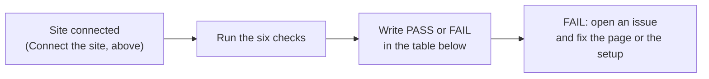

# GitBook starter setup

This repository now contains a small customer-handbook starter. It is ready
for manual connection to GitBook; this file is for the person configuring that
connection and is not customer content.

## What is mapped

`gitbook-docs.yaml` maps two GitBook spaces to separate directories:

| Space | Repository directory | Default |
| --- | --- | --- |
| বাংলা | `docs/user-guide/bn` | Yes |
| English | `docs/user-guide/en` | No |

Each directory owns its own `README.md`, `SUMMARY.md`, and pages. Keep assets
inside the directory that uses them. Do not map `docs/architecture` or
`docs/design` into the customer site.

## Connect the site

1. Create or open the SchoolManager site in GitBook.
2. From the site content, choose **Git Sync** and set up GitHub sync.
3. Select `tareq89/biddaloy` and the branch that contains the reviewed docs.
4. Set the Git Sync **Project directory** to the repository root (leave it
   empty in GitBook if that means the root).
5. Choose the site-wide/monorepo mapping option if GitBook offers it. Import
   from **GitHub to GitBook** first to initialize the spaces from the reviewed
   repository content. Git Sync is bidirectional: later edits made in GitBook
   can sync back to GitHub, and repository changes can sync into GitBook.
6. Use GitHub pull requests as the team's normal editing path. Keep GitBook
   editing for previews or deliberate small changes, and review any GitBook
   change that is synchronized back before it reaches the publication branch.
7. Review the generated `gitbook-docs.yaml` mapping. Keep the stable keys
   `docs-bn` and `docs-en`; changing a key makes GitBook treat the space as a
   new space.
8. Preview the site, confirm both variants and their pages, then publish only
   after checking the public content.

The repository configuration intentionally omits `content.language` for both
spaces. GitBook's current configuration schema does not include `bn` in its
language enum, while the two named spaces still provide the native variant
picker. The picker should show **বাংলা** and **English**. If GitBook's UI asks
for a language metadata value that cannot represent Bangla, leave that field
unset and keep the visible space title as **বাংলা**.

## Verify after connection

- The default site opens the Bangla welcome page.
- The variant picker switches between Bangla and English.
- Each variant shows its welcome page and sample page.
- No architecture, design, credentials, or internal authoring files are
  visible in the customer site.
- Relative links work in both variants on desktop and mobile.

GitBook's current docs describe `gitbook-docs.yaml` as the site mapping file,
`README.md` as the default first page, and `SUMMARY.md` as the navigation file.
Recheck GitBook's UI and schema when connecting because those are external
service behavior.

## Live checks

Epic 42 closes with six checks on the live GitBook site. **None of them has been run.** They need
the maintainer's GitBook account and the connected site, which the build agents do not have. Run
each one, then change its status here from `NOT RUN` to `PASS` or `FAIL` with the date and a note.

| #   | Check                                           | Status  |
| --- | ----------------------------------------------- | ------- |
| 1   | Bangla and English switch                       | NOT RUN |
| 2   | Bangla search finds বেতন, হাজিরা, রসিদ          | NOT RUN |
| 3   | Embeds play at 390 px                           | DROPPED |
| 4   | SVG diagrams are crisp in light and dark themes | NOT RUN |
| 5   | Page rating is on                               | NOT RUN |
| 6   | Role links open the right part of the page      | NOT RUN |

### 1. Bangla and English switch

1. Open the published site in a normal browser window.
2. The Bangla welcome page should open first (it is the default space).
3. Use the variant picker. It should offer **বাংলা** and **English**.
4. Pick English. The English welcome page opens. Open any page in each language, then press back.
5. **Pass** when both languages open, both show their own sidebar, and no page is blank.

### 2. Bangla search

1. In the Bangla site, use the search box and type `বেতন`. Then `হাজিরা`. Then `রসিদ`.
2. Each search should list a sensible guide page near the top (fees, attendance, and invoices or
   payments are the pages that should match).
3. Repeat in English with `fees`, `attendance`, `receipt`.
4. **Pass** when every word finds a sensible page. If a word finds nothing, add it to that page's
   `keywords` in the `guide:meta` comment and test again after the next sync.

### 3. Embeds at 390 px: dropped

This check was about embedded videos. There are no videos in this release (D48), so there is
nothing to embed. It comes back with Epic 85 (#2837). Instead, check that GIFs fit a phone: open a
page with a GIF in the browser's phone view at 390 px wide and confirm the picture is not cut off.

### 4. SVG diagrams in light and dark

1. Open a page with a diagram, for example the attendance page.
2. Zoom the browser to 200%. The lines and Bangla letters should stay sharp, not blurry.
3. Switch the GitBook theme to dark, then back to light. The diagram text and boxes must stay readable.
4. **Pass** when the diagram is sharp at 200% and readable in both themes.

### 5. Page rating

1. Open the site's settings in GitBook and find the page rating (feedback) option.
2. It should be switched on, so readers can mark a page helpful or not.
3. Open a page and confirm the rating control shows at the bottom.

### 6. Role links open the right part of the page

The `?` help button in the app opens the guide at the section for the user's active role (D20).

1. Open a role page, for example the Teacher page, and press each link in **At a glance**
   (`#first-day`, `#tasks`, `#features`, `#cannot`).
2. Each link should scroll to its own heading, in both languages.
3. Open the Teacher page with a section ending, for example `.../roles/teacher#tasks`, from a fresh tab.
   It should open at the list of five tasks.
4. **Pass** when every link lands on the right heading. If one does not, GitBook is slugging that
   Bangla heading differently from GitHub; the explicit `id` on the heading is what should win.
