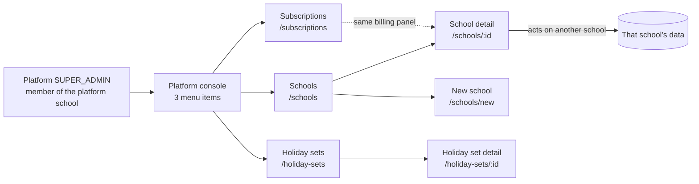
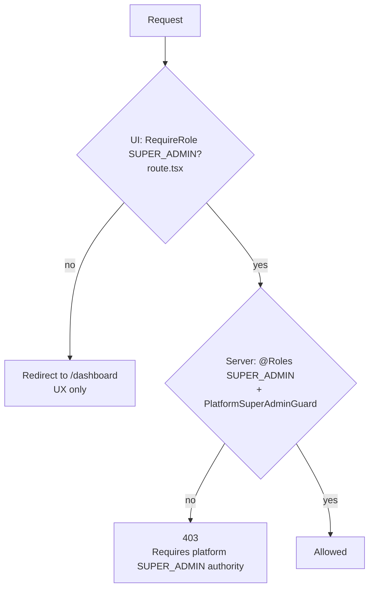
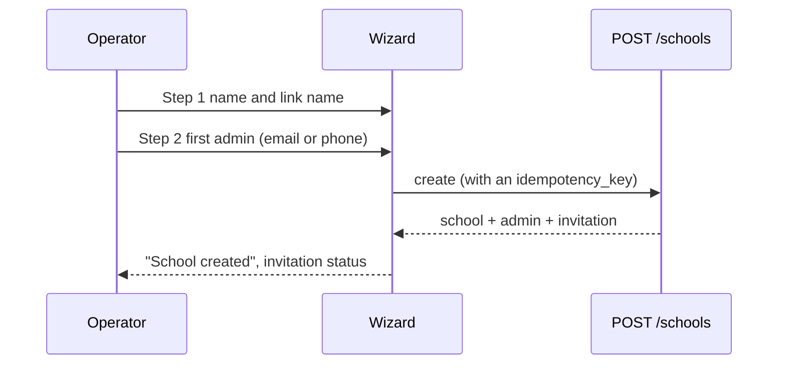
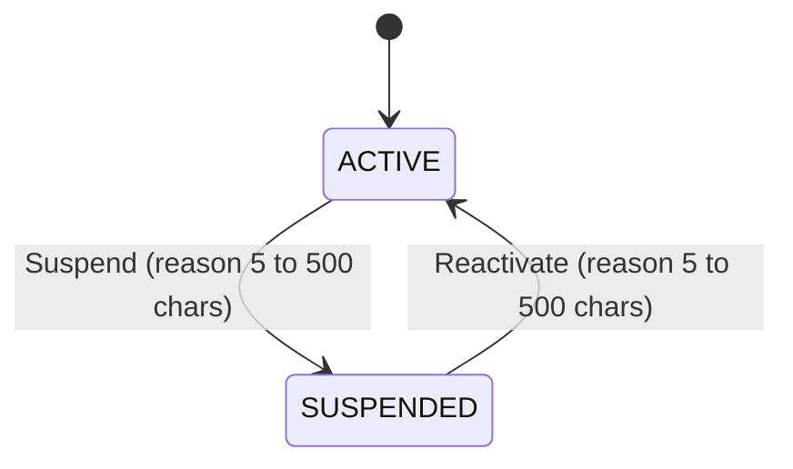
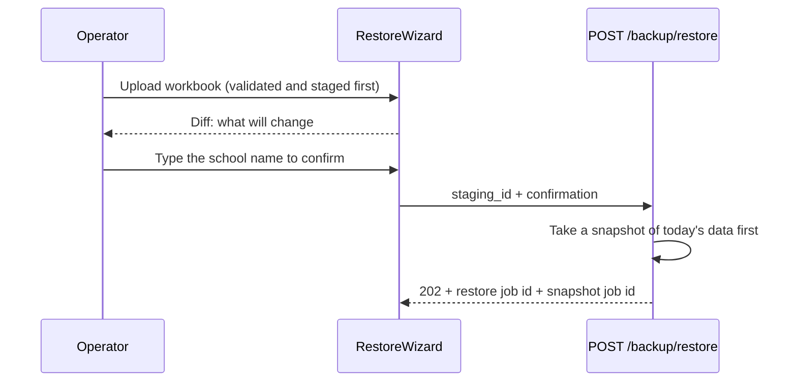

# Platform guide (internal)

> **Internal. Not part of the customer guide.** This page is for the people
> who run the platform (the platform operator). It lives in
> `docs/documentation/`, not in `docs/user-guide/`, and must never be linked
> from `docs/user-guide/`. School staff must not be sent here.
>
> Everything below was read from the code on branch
> `epic/42/w4-accumulate`. Where a claim is not backed by code that was read,
> it is marked **(unverified)**. File paths are given so you can re-check.

## Where this fits

Three menu items, six routes. The ticket said "5 pages"; the route manifest
(`e2e/route-manifest.json`) lists six `super_admin` routes, so all six are
covered here.

| Route | Page | Archetype |
| --- | --- | --- |
| `/schools` | Schools list | list |
| `/schools/new` | New school wizard | wizard |
| `/schools/$schoolId` | School detail | detail |
| `/holiday-sets` | Holiday sets list | list |
| `/holiday-sets/$setId` | Holiday set detail | detail |
| `/subscriptions` | Subscriptions list | list |

Files: `client-admin/src/routes/_platform/` (layout in `route.tsx`).

## Who can see it

Two checks, and only the second one is security.

- The UI gate redirects any other role to `/dashboard`
  (`_platform/route.tsx`). The file itself says it is UX only.
- The server gate is `@Roles(SUPER_ADMIN)` plus `PlatformSuperAdminGuard` on
  the routes below. The guard passes only when the user holds a SUPER_ADMIN
  membership **in the platform school** (`isPlatformSuperAdmin` in
  `server/src/modules/auth/guards/context.guard.ts`). A SUPER_ADMIN that only
  exists inside one ordinary school gets 403.
- Not every route carries the guard. `POST /schools` (create school),
  `GET/POST /schools/:id/sms-credits` and the admin-invitation routes under
  `schools/:id/admins` use `@Roles(SUPER_ADMIN)` only, without
  `PlatformSuperAdminGuard`
  (`provisioning.controller.ts`, `sms-credits.controller.ts`; for
  `school-admins.controller.ts` the guard list is jwt, context, roles, permissions, with no platform guard). In production, a SUPER_ADMIN is created
  deliberately, so this is a hardening question, not a day-to-day one. See
  "Gaps for a human" at the end.
- If the platform school id is not configured, no one passes the guard
  (fails closed). In production, set `PLATFORM_TENANT_ID` (comment in
  `context.guard.ts`).
- Every platform page also shows a **platform alert banner**
  (`PlatformAlertBanner`, fed by `GET /platform/alerts`, for example "Redis is
  down") and the usual attention bar and bell.

---

## 1. Schools list: `/schools`

**For:** see every school on the platform, and check platform health at a
glance.

**Example:** You get a call: "our school cannot log in". Open Schools, type
`green` in the search box, and look at the status badge. `Suspended` explains
it.

**Steps**
1. Open **Schools** in the menu.
2. Search by name or link name (a client-side filter over the full list;
   `index.tsx`).
3. Click a row to open its detail page, or **New school** to create one.
4. Scroll down for two health cards (read only):
   - **Alert engine**: is the attention-alert sweep running. The card treats a
     quick sweep older than 15 minutes as "late" (`-engine-health.tsx`,
     `STALE_MS`) and lists failing rules.
   - **Backup status**: per school, how often it is backed up, the last
     attempt, the last success and space used (`GET` backup health, platform
     SUPER_ADMIN only).

**Who can see it:** platform SUPER_ADMIN.

**Dangerous actions:** none on this page. It only reads.

---

## 2. New school wizard: `/schools/new`

**For:** create a school and its first admin in one go.

**Example:** A new school, "Green Valley School", wants to start. Create it
with link name `green-valley` and invite the headmaster by email.

**Steps**
1. **Step 1, School details:** name, and the link name (lowercase English
   letters, numbers and single hyphens). It auto-fills when the name is typed
   in English.
2. **Step 2, First admin:** name, and an email **or** a phone (at least one).
   The sign-in invitation goes there.
3. Click **Create school**. A taken link name shows "This link name is
   already taken" (409). An email or phone that already belongs to another
   user is also a 409 (`provisioning.controller.ts`).
4. On the success screen you can open the school or use the optional
   "Import data from a workbook" section.

**Idempotent:** the API creates the school, user and invitation atomically,
and replaying the same `idempotency_key` returns the first result (200)
instead of creating a second school.

**Who can see it:** platform SUPER_ADMIN (route gate in the UI; on the server
`@Roles(SUPER_ADMIN)`, see "Who can see it").

**Dangerous action: the optional workbook import.** The wizard says it itself:
"This replaces this school's data with the workbook's: the admin you just
invited stays, but everything else follows the file." On a brand-new school
there is little to lose. Never use it on a school that already has data.

---

## 3. School detail: `/schools/$schoolId`

**For:** operate one school: its admins, seats and billing, SMS credits, status
and recovery tools. This is where the platform operator **acts on another
school**. The school comes from the URL, not from your own login.

**Example:** "Green Valley" asks for 200 free seats for 6 months as a goodwill
gift. Open `/schools/<id>`, use **Grant seats**, enter 200, 6 and a reason of at
least 10 characters.

Cards on the page: Stats, Seats, Admins, SMS credits, Ready-made curriculum.
Actions: Add admin (the one filled button), Suspend or Reactivate, Restore
data from a backup file.

**Who can see it:** platform SUPER_ADMIN.

### 3.1 Stats (read only)
Active users, students, messages waiting to send, failed messages in the last
7 days, last activity (`GET /schools/:id/stats`).

### 3.2 Seats and billing (same panel as Subscriptions, section 6)
Seats bought, seats used, paid until, and the orders list.

- **Grant seats:** 1 to 100000 seats, 1 to 24 months, a reason of 10 to 500
  characters, plus an `idempotency_key` (8 to 100 characters; a replay changes nothing). It creates a PAID order with method `GRANT` and unit price 0, in
  one transaction, and writes an audit row (`schools/trial/trial.service.ts`,
  `grantSeats`). A school suspended for a billing reason is **reactivated by
  the grant** (same file).
- **Record payment** (only on a PENDING order): see section 6.
- **Revive school** (only when the school was paused for having no students):
  see section 6.

### 3.3 Admins
Lists the school's ADMIN members and invitation status.
- **Add admin:** name plus an email or phone. An existing user matched by
  email or phone is not duplicated (`school-admins.controller.ts`).
- **Send invitation again:** re-issues a pending invitation.
- **Cancel invitation:** the admin "will need a new one to sign in". This is
  the only way to take back a pending invitation from this page. It cannot be
  undone, but a new invitation can be sent.

### 3.4 SMS credits
Shows `Available` and `Held for sending`. If the school is not on platform SMS
credits it shows "This school isn't on platform SMS credits." and nothing can
be granted.

- **Add or remove credits:** a whole number other than zero (positive adds,
  for example `500`; negative removes, for example `-100`) and a reason of at
  least 5 characters. Audited as a School update. It is idempotent on its
  `idempotency_key`: a repeat does nothing and still answers 200 with the
  balance.
- A removal that would push `available` below 0 is rejected with a 400
  (`sms-credit.service.ts`, `adjust`).
- **Cannot be undone as a delete:** every change is a ledger row. To undo a
  grant you make an opposite adjustment. There is no "delete ledger row".

### 3.5 Ready-made curriculum, "Undo ready-made curriculum"
Undoes the preset applied to the school (`POST /platform/schools/:id/preset/reset`,
with `PlatformSuperAdminGuard`).

**Dangerous. It cannot be undone.** The dialog says: it permanently deletes
academic years, terms, classes, subjects, class-subjects, the grading scale,
exam templates and the preset's settings. It refuses (409
`PRESET_RESET_BLOCKED`) while the school has operational data such as
students, exams, fees or homework, and 409 `PRESET_NOT_APPLIED` if no preset
was applied. A reason is required and audited.

### 3.6 Suspend and Reactivate
`PATCH /schools/:id/status`, guarded by `PlatformSuperAdminGuard`.

- **Suspend:** "will lose access immediately". The tenant-status cache is
  invalidated, so the change applies on the school's very next request.
  The reason is audited (`SUSPEND` or `REACTIVATE`).
- **Reserved reasons:** you cannot type `TRIAL_EXPIRED`, `SEATS_EXPIRED` or
  `IDLE` as a reason (400 `RESERVED_STATUS_REASON`). Those codes belong to the
  billing jobs and one of their effects is to open the backup export
  (`schools.service.ts`, `updateStatus`). Write the reason in words.
- **Reversible:** yes, with Reactivate. But the school is locked out in the
  meantime, so confirm the school name first.
- Suspending an already-suspended school with a new reason replaces the
  stored reason (that is how a manual suspension takes over from an expired
  one).

### 3.7 Restore data from a backup file
Opens the same `RestoreWizard` used in school settings, but pointed at this
school through an `X-Tenant-ID` override (`restore-workbook-dialog.tsx`,
`restore-wizard.tsx`).

- **Another school's backup:** only a platform SUPER_ADMIN can restore a
  backup made from a different school (403
  `RESTORE_OTHER_SCHOOL_PLATFORM_ONLY`: "Only platform support can restore it
  here"). Template workbooks are exempt (`restore.service.ts`).
- **You must type the school's exact name** to confirm (400
  `CONFIRMATION_MISMATCH` otherwise). Check the name belongs to the school you
  intended.
- A workbook with validation errors cannot be restored (409
  `RESTORE_HAS_ERRORS`). Only one restore runs per school at a time (409
  `RESTORE_IN_PROGRESS`).

**Dangerous. Read this twice.** The dialog text says: restoring replaces all
the school's current data with the backup, **"This cannot be undone"**.
Students, guardians, classes, fees and payments are replaced; anything created
after the backup was made is lost; the school is temporarily unavailable
while it runs. User accounts and permissions are not affected.

The one safety net: a snapshot of the current data is taken **before** the
restore and linked when done. If a restore fails part-way, "Parts before
{tab} were applied", and you go back by restoring that snapshot. The restore
is therefore recoverable only through that snapshot, and a restore of the
snapshot is itself another full replace.

---

## 4. Holiday sets list: `/holiday-sets`

**For:** keep one public-holiday list per country and year, which schools can
import from.

**Example:** Before January, fetch `BD` / `2027` so Bangladeshi schools can
import the 2027 holidays.

**Steps**
1. Open **Holiday sets**. Columns: country, year, source, number of holidays,
   Published or Draft.
2. Click **Fetch a set**: two-letter country code (for example `BD`) and a year
   from 2000 to 2100.
3. The server fetches from an online source and creates or refreshes the set.
   The source shown is `Nager.Date`, `Google Calendar` or `Entered by hand`.
   If neither source answers: "Could not fetch this set from either source"
   (502 `PUBLIC_HOLIDAY_SOURCE_UNAVAILABLE`).
4. Click a row to edit it.

**Who can see it:** platform SUPER_ADMIN (`@Roles(SUPER_ADMIN)` on
`platform/holiday-sets*`, `public-holidays.controller.ts`; the
`PlatformSuperAdminGuard` is **not** on this controller, so any SUPER_ADMIN passes the server check).

**Dangerous: re-fetching overwrites.** Fetching a country and year that already
exist **deletes all its entries and inserts fresh ones** in one transaction,
including any entries you added or edited by hand and every Bangla name
(`name_bn` is reset to empty) (`public-holidays.service.ts`, `fetchIntoSet`).
The publish state is not changed: a published set stays published and is
live to schools the whole time. Fetch before you edit, never after.

---

## 5. Holiday set detail: `/holiday-sets/$setId`

**For:** correct a set by hand, then publish it.

**Example:** The online list misses a local closure on 2027-03-26. Add a row,
fill the date and the English and Bangla names, **Save**, then **Publish**.

**Steps**
1. Edit rows: start date, end date (the same date for a one-day holiday),
   English name, optional Bangla name (without it schools see the English
   name).
2. **Save.** Publish is disabled until you save ("Save your changes before
   publishing"). Leaving with unsaved changes asks you to confirm.
3. **Publish:** "Schools will be able to import these holidays once
   published." Only published sets are offered to schools; a school never sees
   a draft (`public-holidays.service.ts`).
4. **Unpublish:** "Schools will no longer be able to import from this set."

**Who can see it:** same as section 4.

**What cannot be undone**
- Publish and Unpublish are reversible, and audited.
- **Holidays a school has already imported stay in that school.** Unpublishing
  stops new imports only (the import creates calendar events in the school's
  own tenant; the service reads only published sets). Whether a later
  correction reaches schools that already imported **(unverified: no code
  was read for a sync back to imported events)**.
- Remove row plus Save permanently drops that entry from the set, and fetching
  again does not bring back hand edits (see section 4).

---

## 6. Subscriptions: `/subscriptions`

**For:** see every school's seats, orders and payments, and settle money.

**Example:** A school paid by bank slip `BS-20271`. Find the school, open its
row, find the PENDING order, click **Record payment**, choose Bank, enter
the slip number.

**Steps**
1. Open **Subscriptions**. Columns: school, status, seats used / bought,
   paid until, pending orders. Search by school name. The filter is saved in
   the URL (`?filter=expiring`): All schools, Expiring in 14 days, All seats
   used, Idle (no students).
2. Open a school's row. The dialog shows seats bought, seats used, paid until
   and the orders.
3. **Record payment** (on PENDING orders only): choose Cash or Bank, give a
   reference of 3 to 100 characters, then **Mark as paid**. The order amount is
   paid in full.
4. **Grant seats:** see section 3.2.
5. **Revive school:** see below.

**Who can see it:** platform SUPER_ADMIN (`PlatformBillingController`,
`@Roles(SUPER_ADMIN)` plus `PlatformSuperAdminGuard`).

**Seat orders, read from code**
- **Statuses:** Pending, Paid, Failed, Cancelled, Refunded. Only PENDING can be
  marked paid. FAILED, CANCELLED and REFUNDED can never be paid (409
  `ORDER_NOT_PENDING`).
- **Payment methods shown:** bKash, Bank, Cash, Grant. The UI only offers
  Cash and Bank for manual recording.
- **Idempotent:** marking an already-PAID order paid again changes nothing
  ("This order was already paid. Nothing changed."). Each slip number can
  be used for one order only (409 when reused).
- **bKash guard:** if the school started a bKash payment for that order in the
  last 24 hours, recording is refused (409 `BKASH_PAYMENT_LIVE`), to avoid
  charging twice. If Redis cannot be read, it also refuses (503).
- **Trial:** the trial is retired (Epic 49 D3, `schools/trial/trial.service.ts`). A new
  school has no trial end date. There is no trial control on these pages.

**Revive school** (`POST /schools/:id/revive`, `PlatformSuperAdminGuard`)
- Shown only when the school was paused for having no students (reason
  `IDLE`) or is soft-deleted.
- Needs a reason of 5 to 500 characters. Audited as `REACTIVATE`.
- Fails if the school is not idle (409 `NOT_IDLE`) or was deleted more than
  90 days ago (409 `REVIVE_WINDOW_PASSED`, `IDLE_REVIVE_WINDOW_DAYS = 90`).

**Dangerous actions in this page**

| Action | Can it be undone? |
| --- | --- |
| Mark as paid | **No undo control exists in the UI.** A PAID order gives the school its seats. Refunds exist as a status, and no refund action or route exists (REFUNDED is only a badge colour). Check the slip before you click. |
| Grant seats | **No undo control in the UI.** A grant only adds seats and cannot lower the limit (`schools/trial/trial.service.ts`). It also reactivates a school suspended for a billing reason. |
| Revive school | Reversible by suspending again, but after the 90 day window the school cannot be revived at all. |

---

## Gaps for a human

1. **Guard coverage.** `POST /schools`, the SMS credits routes, and (the
   `@Roles` line only was read) the school-admin routes are `@Roles(SUPER_ADMIN)`
   without `PlatformSuperAdminGuard`, while the status, revive, preset,
   billing and alert routes have it. The comment in `sms-credits.controller.ts`
   says this is the convention, but `context.guard.ts` explains a tenant-local
   SUPER_ADMIN is a real escalation risk. Confirm the difference is intended.
2. **Guard list (checked):** only `schools.controller.ts`, billing, presets, platform alerts and attention health carry `PlatformSuperAdminGuard`.
3. **Seed data and the guide:** this page is a developer doc only; there is
   no user-guide page and no coverage entry for the platform console by design
   (Epic 42, D15).
4. **Trial filter:** `GET /schools` still accepts a `trial` query
   (`SchoolsController.findAll`) although the trial is retired. Nothing in the
   platform UI sends it.
